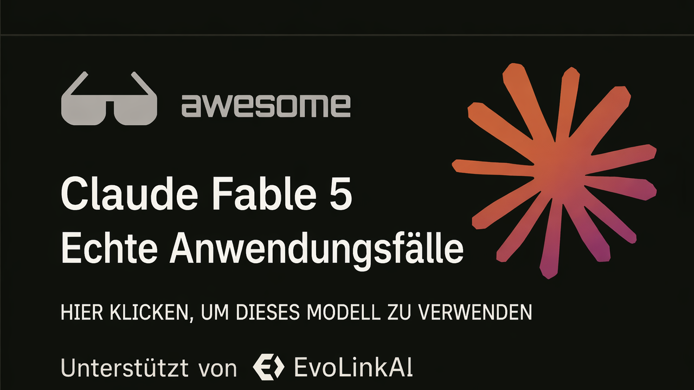

<div align="center">

<a href="https://evolink.ai/claude-fable-5?utm_source=github&utm_medium=readme&utm_campaign=awesome-claude-fable-5"></a>

[](LICENSE)
[](https://evolink.ai/claude-fable-5?utm_source=github&utm_medium=readme&utm_campaign=awesome-claude-fable-5)
[](https://evolink.ai/claude-fable-5?utm_source=github&utm_medium=readme&utm_campaign=awesome-claude-fable-5)
[](https://docs.evolink.ai)

[](README.md)
[](README_es.md)
[](README_pt.md)
[](README_ja.md)
[](README_ko.md)
[](README_de.md)
[](README_fr.md)
[](README_tr.md)
[](README_zh-TW.md)
[](README_zh-CN.md)
[](README_ru.md)

</div>

## 🍌 Einführung

Willkommen im High-Signal-Usecase-Repository zu Claude Fable 5.

**Wir sammeln reale Anwendungsfälle, Tutorials, Integrationen und Auswertungen zu Claude Fable 5, kuratiert aus öffentlichen Demos und Creator-Communities.**

Diese deutsche README konzentriert sich auf High-Signal-Fälle mit konkreten Workflows, Prompts, Demos, Integrationen, Benchmark-Belegen oder praktischen Grenzen.

Die meisten Fälle sind aus X/Twitter-Posts und öffentlichen Demos kuratiert. Jeder Falltitel verlinkt auf die Originalquelle, und jeder Autoren-Handle verlinkt auf das Profil des Creators.

Auf Evolink ausprobieren: [Claude Fable 5](https://evolink.ai/claude-fable-5?utm_source=github&utm_medium=readme&utm_campaign=awesome-claude-fable-5)

## 📊 Überblick

- **88 ursprüngliche Fable-5-Fälle plus 9 Fable-5.5-Community-Demos; insgesamt 97 Fälle.**
- Deckt Coding-Agents, lang laufende Automatisierung, Spiele, visuelles Design, 3D-Simulationen, Wissensarbeit, Tutorials, API-Integrationen, Benchmarks, Preise und Launch-Einschränkungen ab.
- Jeder Fall enthält die Originalquelle, Creator-Zuordnung, eine knappe Kernaussage, den Evidenztyp und das Veröffentlichungsdatum.
- Nutze dieses Repo, um praktische Workflows zu finden, Stärken und Grenzen zu vergleichen, reproduzierbare Prompts zu entdecken und Integrationsbeispiele nachzuvollziehen.

> [!NOTE]
> Die Sammlung bevorzugt konkrete Evidenz gegenüber Hype: reproduzierbare Prompts, veröffentlichte Demos, Benchmark-Methoden, Integrationsnotizen, Kostendaten und klar benannte Einschränkungen.

<a id="-quick-api-access"></a>
## ⚡ Schneller API-Zugriff

Nutze Claude Fable 5 über die Evolink-kompatible Messages API. Hole dir einen API-Token über [Evolink](https://evolink.ai/login?utm_source=github&utm_medium=readme&utm_campaign=awesome-claude-fable-5) und ersetze dann `<token>` durch deinen Token.

```bash
curl --request POST \
  --url https://direct.evolink.ai/v1/messages \
  --header 'Authorization: Bearer <token>' \
  --header 'Content-Type: application/json' \
  --data '
{
  "model": "claude-fable-5",
  "max_tokens": 1024,
  "messages": [
    {
      "role": "user",
      "content": "Hello, world"
    }
  ]
}
'
```

## 📑 Menü

| Bereich | Fälle |
|---|---|
| [💻 Coding und Codegenerierung](#coding-and-code-generation) | Case 1-6 |
| [🤖 Agents und lang laufende Automatisierung](#agents-and-long-running-automation) | Case 7-8 |
| [🎮 Spiele und interaktive Demos](#games-and-interactive-demos) | Case 9-12 |
| [🎨 Visuelles, Design, Video und 3D](#visual-design-video-and-3d) | Case 13-16 |
| [📚 Dokumente, Wissensarbeit und Forschung](#documents-knowledge-work-and-research) | Case 17-19 |
| [🧭 Tutorials, Kurse und Prompt-Ressourcen](#tutorials-courses-and-prompt-resources) | Case 20-28 |
| [🔌 Plattform, API und Tool-Integration](#platform-api-and-tool-integration) | Case 29-34 |
| [📏 Auswertungen, Vergleiche und Grenzen](#evaluations-comparisons-and-limits) | Case 35-88 |
| [🙏 Acknowledge](#acknowledge) | Credits und Korrekturhinweis |

### [💻 Coding und Codegenerierung](#coding-and-code-generation)

| Case | Was es zeigt | Typ |
|---|---|---|
| [Mehrstufiger Cursor-Workflow](#case-1) | Nutze Fable 5 als Plan-Review- und Kritikschritt innerhalb eines Multi-Model-Cursor-Workflows und gib Implementierung sowie Überarbeitung anschließend an günstigere oder spezialisierte Modelle zurück. | Auswertung |
| [GitHub aus einem Screenshot nachbauen](#case-2) | Füge einen Produktscreenshot in ein agentisches Coding-Tool ein und bitte Fable 5, die Oberfläche mit funktionierender Funktionalität nachzubauen. | Demo |
| [Schwarzes-Loch-Simulation mit einem Prompt](#case-3) | Gib Fable 5 einen detaillierten Creative-Coding-Prompt und bitte es, eine eigenständige Three.js-Physikvisualisierung zu erstellen. | Tutorial |
| [macOS-artiges Web-OS im One-Shot](#case-4) | Bitte Fable 5 um ein vollständiges Single-File-Web-OS und lass es UI-Shell, Apps, Interaktionen, Audio und eingebettetes Spielverhalten in einem Durchgang bauen. | Tutorial |
| [Spawn 5.0 mit 1.687 Prompts bauen](#case-5) | Nutze Fable 5 über viele Prompts hinweg als Engineering-Partner für lange Sitzungen, wobei sich die Rolle des Menschen von Architektur hin zur Beurteilung der Ausgabequalität verschiebt. | Tutorial |
| [Review einer großen Pull Request mit Findings](#case-6) | Richte Fable 5 auf eine große Pull Request und bitte es, Korrektheit, False Positives, echte Bugs und Polish-Probleme zu prüfen. | Demo |

### [🤖 Agents und lang laufende Automatisierung](#agents-and-long-running-automation)

| Case | Was es zeigt | Typ |
|---|---|---|
| [Review eines Long-Horizon-Relay-Workflows](#case-7) | Nutze Fable 5 für ambitionierte Langhorizont-Arbeit: Site-Rebuilds, programmatische Content-Pipelines, Voice-Matching, Security-Review und abschließende Qualitätschecks. | Auswertung |
| [Infrastrukturausfall diagnostizieren und Fix-PR öffnen](#case-8) | Gib Fable 5 Zugriff auf Infra-Hinweise wie Logs, Datenbankfehler und Image-Digests und bitte es dann, den Ausfall zu diagnostizieren und den Fix vorzubereiten. | Auswertung |

### [🎮 Spiele und interaktive Demos](#games-and-interactive-demos)

| Case | Was es zeigt | Typ |
|---|---|---|
| [Dino Runner mit Fingertracking](#case-9) | Bitte Fable 5, ein Browserspiel zu bauen, das Fingertracking als Eingabemechanik nutzt. | Demo |
| [Rennspiel-Build mit zwei Sätzen](#case-10) | Gib Fable 5 einen sehr kurzen Spielprompt und lass es Maps, Modi, Musik, UI und Game-Assets in einem Lauf generieren. | Tutorial |
| [Installierbares Terminal-Minecraft in Rust](#case-11) | Führe Fable 5 durch ein Terminal-Coding-Harness und bitte es, ein installierbares Rust-Terminalspiel zu bauen. | Demo |
| [Minecraft-Klon mit Zeit und Kosten](#case-12) | Nutze einen Prompt, um Fable 5 um einen spielbaren Minecraft-artigen Klon zu bitten, und bewerte anschließend Zeit, Kosten, Codeumfang und Feature-Abdeckung. | Tutorial |

### [🎨 Visuelles, Design, Video und 3D](#visual-design-video-and-3d)

| Case | Was es zeigt | Typ |
|---|---|---|
| [Vollständig reproduzierbarer Ecommerce-E-Mail-Prompt](#case-13) | Gib Fable 5 ein vollständiges Creative Briefing für ein Marken-E-Mail-Mockup, einschließlich exakter Abschnitte, Produktanforderungen, visueller Richtung und Einschränkungen. | Tutorial |
| [Schweizer-Ankeruhrmacher-Benchmark](#case-14) | Nutze Fable 5 für einen mechanischen Simulationsbenchmark und bitte es, physikalische Korrektheit zu implementieren, zu verifizieren und iterativ zu verbessern. | Auswertung |
| [Friends-Apartment-Szene in Three.js](#case-15) | Prompte Fable 5, einen Grundriss und eine Szenenreferenz in eine navigierbare Three.js-Umgebung zu verwandeln. | Auswertung |
| [Sonnensystem-Simulation mit Prompt und URL](#case-16) | Nutze Fable 5, um aus physikalischen Prinzipien eine Astronomiesimulation zu bauen, mit Iteration bis Simulation und öffentliche Ausgabe bereit sind. | Tutorial |

### [📚 Dokumente, Wissensarbeit und Forschung](#documents-knowledge-work-and-research)

| Case | Was es zeigt | Typ |
|---|---|---|
| [Evidenz zu Stripe und wissenschaftlichen Workflows](#case-17) | Nutze dies als Evidenz für Enterprise-Migrationen und wissenschaftliche Workflow-Claims, nicht als Copy-Paste-Prompt. | Auswertung |
| [Policy-Memo- und Änderungsnachverfolgungs-Workflows](#case-18) | Nutze Fable 5 für qualitative Langform-Dokumentarbeit: Änderungen nachverfolgen, Kommentare triagieren und transkriptgetriebene Edits. | Tutorial |
| [Deep-Research-Prompt und Ausgabe](#case-19) | Stelle Fable 5 eine forschungsartige Frage und bewerte, ob es eine strukturierte, historisch fundierte lange Antwort erzeugen kann. | Demo |

### [🧭 Tutorials, Kurse und Prompt-Ressourcen](#tutorials-courses-and-prompt-resources)

| Case | Was es zeigt | Typ |
|---|---|---|
| [Wie Fable 5 Claude Code-Workflows verändert](#case-20) | Nutze Fable 5, indem du Richtung, Kontext, Ziele und Verifikationskriterien setzt, statt jeden Schritt mikrozuverwalten. | Demo |
| [Review mit einer Milliarde Tokens und Routing-Strategie](#case-21) | Nutze Fable 5 für Frontier-Planung und Review und route anschließend volumenstarke Implementierung an günstigere Modelle. | Tutorial |
| [Defensiver Prompt zur Gerätehärtung](#case-22) | Führe einen defensiven Härtungsprompt Schritt für Schritt aus, bei dem Fable 5 Geräte inventarisiert, exakte Checks gibt und auf Verifikation wartet. | Tutorial |
| [Goal-Prompt für ein Full-Site-Design-Audit](#case-23) | Nutze `/goal`, damit Fable 5 eine Site bootet, Seiten screenshotet, UX auditiert, einen Bericht schreibt und sichere kleine Probleme fixt. | Tutorial |
| [Aufteilung eines Long-Form-Creative-Workflows](#case-24) | Nutze Fable 5, um stabile Formate und Beispiele zu entwerfen, und übergib diese Struktur dann an ein anderes Generierungssystem für domänenspezifische Ausgabe. | Tutorial |
| [Anfängerleitfaden zur Nutzung von Fable 5](#case-25) | Nutze Fable 5 mit zielorientierten Prompts, Verifikationsschleifen und Effort-Einstellungen statt mit kleinen Schritt-für-Schritt-Anweisungen. | Auswertung |
| [Copy-Paste-Prompt für Repository-Audits](#case-26) | Füge den Repository-Audit-Prompt in Fable 5 ein und bitte um dateigestützte Discovery, Findings, Strategie und einen Meilenstein-Taskplan. | Tutorial |
| [Nutzungsstrategie für begrenzte Zeitfenster](#case-27) | Verwende Fable 5-Nutzung für Audit, Architektur und Planung, solange das Zugriffsfenster günstig ist, und nutze anschließend günstigere Modelle für die Ausführung. | Tutorial |
| [Goals und Workflows in Claude Code nutzen](#case-28) | Nutze Fable 5 vor der Implementierung als Denkpartner und kombiniere anschließend `/goal` und Workflows, um den Plan auszuführen und zu verifizieren. | Tutorial |

### [🔌 Plattform, API und Tool-Integration](#platform-api-and-tool-integration)

| Case | Was es zeigt | Typ |
|---|---|---|
| [Hermes-Agent-Integrationssetup](#case-29) | Konfiguriere Hermes so, dass es `anthropic/claude-fable-5` für komplexe `/goal`-Runs und gecachte Long-Horizon-Aufgaben nutzt. | Tutorial |
| [Fähigkeiten, Preise und Abo-Notizen](#case-30) | Nutze diesen Fall, um zu verstehen, wann Fable 5 verfügbar ist, was es kostet und welche geschützten Domains auf ein anderes Modell zurückfallen können. | Tutorial |
| [Zusammenfassung zu Launch, Zugriff, Preisen und Sicherheit](#case-31) | Nutze diese Launch-Zusammenfassung, um Zugriffsweg, API-Modellnamen, Kontextfenster, Caching-Strategie und Abo-Timing zu wählen. | Tutorial |
| [Advisor-basierte Strategie zur Kostensenkung](#case-32) | Nutze Fable 5 als Advisor oder Reviewer in einem Workflow mit günstigerem Modell, wenn marginale Intelligenz die Kosten wert ist. | Integration |
| [Preise, Zugriff und Sicherheitsleitplanken](#case-33) | Nutze diesen Fall, um Fable 5-Zugriff, API-Preise und Safety-Fallback-Verhalten zu verstehen, bevor du Workloads planst. | Integration |
| [Swarms-Integration in einer Zeile](#case-34) | Setze den Swarms-Modellnamen auf `anthropic/claude-fable-5` und führe Fable 5 über das Swarms-Framework oder die API aus. | Integration |

### [📏 Auswertungen, Vergleiche und Grenzen](#evaluations-comparisons-and-limits)

| Case | Was es zeigt | Typ |
|---|---|---|
| [Kosten- und Qualitätsvergleich Fable 5 vs. GPT-5.5](#case-35) | Vergleiche Fable 5 und GPT-5.5 bei derselben Coding-Aufgabe, um Ausgabequalität, Laufzeit und Toolkosten zu beurteilen. | Auswertung |
| [Ergebnis des AA-Omniscience-Benchmarks](#case-36) | Nutze diesen Benchmark-Fall, um Fable 5 bei Wissensgenauigkeit und Halluzinationsverhalten zu bewerten. | Auswertung |
| [Ergebnis des Artificial Analysis Intelligence Index](#case-37) | Nutze diesen Fall, um Fable 5s allgemeines Intelligenzranking gegenüber anderen Frontier-Modellen zu benchmarken. | Auswertung |
| [GDPval-AA-Benchmark für agentische Wissensarbeit](#case-38) | Nutze diesen Fall, um Fable 5 bei agentischer realer Wissensarbeit zu evaluieren. | Auswertung |
| [Ersteindrücke nach einer Woche und Preislogik](#case-39) | Nutze diesen Ersteindrucksfall, um zu entscheiden, wo Fable 5 am stärksten ist, besonders bei Game Design und Systemplanung. | Integration |
| [Kosten- und Geschwindigkeitsvergleich](#case-40) | Nutze diesen Vergleich, um zu entscheiden, ob der Qualitätsgewinn höhere Kosten und langsamere Long-Horizon-Runs rechtfertigt. | Auswertung |
| [Hands-on-Notizen zu Claude Code](#case-41) | Nutze diesen Fall, um Fable 5 in Claude Code zu bewerten, einschließlich Tool Use, Persönlichkeit und verbleibender Ecken und Kanten. | Demo |
| [Ergebnis des Creative-Writing-Benchmarks](#case-42) | Nutze diesen Benchmark-Fall, um Fable 5s Qualität bei Kurzgeschichten und Refusal-Verhalten zu beurteilen. | Auswertung |
| [Launch-Zusammenfassung mit mehreren Benchmarks](#case-43) | Nutze diese Launch-Benchmark-Zusammenfassung, um die Headline-Scores zu verstehen, die für Coding-Agents und komplexe Aufgaben am relevantesten sind. | Auswertung |
| [Benchmark- und Preisvergleich mit GPT-5.5](#case-44) | Nutze diesen Vergleich, um Fable 5 gegenüber GPT-5.5 bei Preis und Benchmark-Kategorien zu bewerten. | Auswertung |
| [Feldnotizen mit praktischen Einschränkungen](#case-45) | Nutze diesen Feldbericht, um zu verstehen, wo sich Fable 5 bedeutend besser anfühlt und wo es noch praktische Grenzen hat. | Tutorial |
| [Vergleich von Physiksimulationen](#case-46) | Führe identische Physiksimulations-Prompts gegen Fable 5 und Opus 4.8 aus, um Ausgabequalität, Kosten und Geschwindigkeit zu vergleichen. | Demo |
| [Debugging-Erfahrung und Designurteil](#case-47) | Nutze Fable 5 zum Debugging, indem du es messen, loggen, verifizieren und patchen lässt, statt einfach zu raten. | Demo |
| [Mehrdimensionale Vor- und Nachteile](#case-48) | Nutze diesen Fall, um praktische Stärken und Schwächen zu verstehen, bevor du Fable 5 zum Daily Driver machst. | Demo |
| [Test zum Entwurf eines juristischen S-1](#case-49) | Nutze einen S-1-Drafting-Prompt als Fähigkeitstest für Legal Agents und vergleiche Struktur, Formatierung und Länge. | Tutorial |
| [Details zum Healthcare-Benchmark](#case-50) | Nutze diese Benchmark-Notiz, um Fable 5 bei Healthcare-bezogenen Aufgaben zu bewerten und fehlende harte medizinische Evals zu identifizieren. | Auswertung |
| [ParseBench-Auswertung zum Dokumentparsing](#case-51) | Nutze diesen Fall, um zu entscheiden, ob Fable 5 für Dokumentparsing gegenüber spezialisierten OCR-Systemen kosteneffektiv ist. | Auswertung |
| [Vergleich von SWE-Bench Pro und FrontierCode](#case-52) | Nutze diesen Benchmark-Fall, um Fable 5 für Migrationen, komplexe Implementierungen, autonome Sitzungen, Tests und visuelle Verifikation zu evaluieren. | Auswertung |
| [Qualitative Review langer Problemlösung](#case-53) | Nutze diese qualitative Review, um zu verstehen, warum Fable 5 für längere, schwierigere Aufgaben geeignet ist, aber weiterhin Produktionsreview braucht. | Auswertung |
| [ParseBench-Ergebnisse zu Treue und Formatierung](#case-54) | Nutze dieses ParseBench-Ergebnis, um Dokumenttreue und Formatierungsperformance zu beurteilen. | Auswertung |
| [Benchmarks, Preise, Zugriff und Schutzmaßnahmen](#case-55) | Nutze diesen Fall als breite Checkliste für Benchmarks, Preise, Zugriff, Schutzmaßnahmen und strategische Implikationen. | Auswertung |
| [Offizielle Liste der Benchmark-Scores](#case-56) | Nutze diese Benchmark-Liste, um Fable 5s offizielle Scores über Coding-, Computer-Use- und Security-Tasks hinweg zu verstehen. | Auswertung |
| [Methodik des APEX-SWE-Benchmarks](#case-57) | Nutze diesen Fall, um Fable 5 auf APEX-SWE zu bewerten, besonders Observability- und Integrationsarbeit. | Auswertung |
| [Ergebnis formaler Mathematik in ProofBench](#case-58) | Nutze diesen Fall, um Fable 5 bei formaler Mathematik gegenüber spezialisierten Theorem-Proving-Systemen zu evaluieren. | Tutorial |
| [Vorläufige Analyse von VirtueBench](#case-59) | Nutze diesen Fall, um Fable 5s Moral-Reasoning-Verhalten über Tugendkategorien hinweg zu untersuchen. | Auswertung |
| [Safety-Overfit-Test mit leeren API-Antworten](#case-60) | Nutze diesen Fall, um Launch-Time-Safety-Overfit-Risiko und Empty-Response-Verhalten in API-Tests zu verstehen. | Auswertung |
| [Fable-Prompts mit Überprüfung gestalten](#case-61) | Nutze diesen Leitfaden, um statt langer Prompt-Tricks Ziele, Kontext, Grenzen, Werkzeuge und Prüfschleifen vorzugeben. | Tutorial |
| [Istanbul-Plattformspiel aus einer Bildvorlage](#case-62) | Teste Fable 5 mit einem Sprite-Sheet als Vorlage und einer Anweisung zur Umsetzung als spielbares Plattformspiel. | Demo |
| [Ein 3D-Stadtdashboard für Geschäftsabläufe](#case-63) | Nutze Fable 5, um einen Geschäftsprozess als Konzept für ein lebendiges 3D-Stadtdashboard darzustellen. | Demo |
| [Ein Three.js-Lochspiel aus einem Prompt](#case-64) | Nutze Fable 5, um in einem Durchlauf einen 3D-Browserspiel-Prototyp in Three.js zu erstellen. | Demo |
| [DeepSWE-Ergebnisse im Vergleich](#case-65) | Vergleiche anhand dieses DeepSWE-Beitrags Fable 5 xHigh und GPT-5.5 xHigh bei Softwareentwicklungsaufgaben. | Auswertung |
| [Kosten einer Repository-Analyse vergleichen](#case-66) | Bewerte mit diesem Vergleich von Repository-Analysen Tokenpreise im Verhältnis zum menschlichen Nachbearbeitungsaufwand. | Auswertung |
| [Tokenverbrauch eines Super-Mario-Spiels](#case-67) | Nutze diesen Spielaufbau in einem Durchlauf, um Ausgabequalität und Tokenverbrauch von Fable 5 einzuschätzen. | Demo |
| [Claude Codes Einstellung zum Modellwechsel](#case-68) | Lerne die Claude-Code-Einstellung kennen, die bei einer markierten Fable-5-Nachricht das Modell wechselt. | Integration |
| [Einen Namma-Metro-Simulator entwickeln](#case-69) | Nutze diese Demo als kurzes Beispiel für die Entwicklung eines Nahverkehrssimulators mit Fable 5 per Vibe Coding. | Demo |
| [Dusk Drive aus einem einzigen Prompt](#case-70) | Bewerte mit diesem Fall, wie Fable 5 ein Low-Poly-Fahrspiel ohne menschliche Nachbearbeitung prototypisiert. | Demo |
| [APEX-Agents-Rangliste nach Pass@1](#case-71) | Vergleiche anhand dieses APEX-Agents-Ergebnisses Fable 5 Max bei mehrstufigen autonomen Aufgaben. | Auswertung |
| [Leitfaden zur Auswahl von Claude-Modellen](#case-72) | Reserviere Fable 5 mithilfe dieses Auswahlleitfadens für die anspruchsvollsten Aufgaben in Claude Code. | Tutorial |
| [HermesWorld mit einer autonomen Agentenschleife](#case-73) | Untersuche eine Fable-5-Schleife, die über Tage selbstständig entwickelt, testet, spielt und Smoke-Tests ausführt. | Integration |
| [Einen Beratungsbericht im McKinsey-Stil testen](#case-74) | Bewerte mit diesem Dokumenten-Prompt Berichtsstruktur, Diagramme, Erzählführung und Risikoanalyse. | Tutorial |
| [Sichtbare Schutzmechanismen einführen](#case-75) | Lerne anhand dieser offiziellen Mitteilung die sichtbaren Fable-5-Schutzmechanismen, API-Ablehnungsgründe und den Wechsel zu Opus kennen. | Integration |
| [Modellzuordnung in Claude Code korrigieren](#case-76) | Vermeide mit diesem Claude-Code-Änderungshinweis Probleme bei Fable-5-Modellnamen und der Kontextzuordnung. | Integration |
| [Drei Webanwendungen in Claude Code](#case-77) | Untersuche mit dieser Einsteigerdemo, wie Fable 5 in Claude Code mehrere Webanwendungen erzeugt. | Demo |
| [Rilable als quelloffenen App-Builder untersuchen](#case-78) | Untersuche anhand dieses quelloffenen App-Builders Fable 5 bei iOS- und Webanwendungen, Sandboxen und API-Tokenkosten. | Integration |
| [DeepSWE-Debüt im Coding-Agent-Index](#case-79) | Nutze den aktualisierten Artificial-Analysis-Index, um Claude Fable 5 bei schwierigeren agentischen Coding-Aufgaben zu vergleichen, die keine recycelten öffentlichen GitHub-Fixes verwenden. | Evaluation |
| [DataEmpire-Web-Analytics-Spiel](#case-80) | Verwandle rohe Site-Analytics in ein wiederholt spielbares Game, indem du Claude Fable 5 Besucher und Meilensteine auf Spieleinheiten abbilden lässt. | Integration |
| [FrontierSWE-20-Stunden-Tasksignal](#case-81) | Nutze FrontierSWE als Beleg dafür, dass Claude Fable 5 über sehr lange Engineering-Aufgaben hinweg produktiv bleiben kann und nicht nur in kurzen Bugfix-Schleifen. | Evaluation |
| [KernelBench-Hard-CUDA-Rekorde](#case-82) | Nutze Claude Fable 5 für fortgeschrittene CUDA-Kernel-Generierung, wenn du Low-Level-Optimierung brauchst und nicht nur Wrapper um bestehende Bibliotheken. | Evaluation |
| [Figma-Capture-Landingpage-Klon](#case-83) | Erfasse eine Live-Konkurrentenseite als Figma-Layer und lass Claude Code mit Claude Fable 5 Struktur, Copy und Brand-System neu aufbauen, statt aus Screenshots zu raten. | Integration |
| [GTA-2-Klon in zwei Stunden](#case-84) | Kombiniere Claude-Fable-5-Codegenerierung mit separatem Asset-Tooling, um schnell ein spielbares 3D-Spiel zu bauen, ohne den gesamten Stack von Hand zu coden. | Tutorial |
| [CloudWatch-Log-Triage-Agent](#case-85) | Lass einen von Claude Fable 5 angetriebenen Agenten sehr große Service-Log-Kontexte durcharbeiten, die Architektur ableiten und dann gezielt auf konkrete Fehler einzoomen. | Integration |
| [World-Cup-Predictor in Sandboxes](#case-86) | Stelle mehrere Frontier-Modelle hinter isolierte Sandboxes und lass sie Live-Nachrichten, Verletzungen und Gelbe-Karten-Kontext für eine öffentliche Prediction-App recherchieren. | Integration |
| [WolfBench-Refusal-Kostenfall](#case-87) | Behandle Refusal-Verhalten als echte Benchmark-Variable, wenn du lange autonome Runs auf Claude Fable 5 bepreist. | Evaluation |
| [API-Access-Cutoff-Tracker](#case-88) | Überwache die Verfügbarkeit per Skript, wenn dein Workflow von fortgesetztem Zugriff auf ein Frontier-Modell abhängt, das ohne große Vorwarnung rate-limitiert oder zurückgezogen werden kann. | Integration |


### [🆕 Fable 5.5: Community-Demos](#fable-5-5-community-demos)

| Fall | Was gezeigt wird | Typ |
|---|---|---|
| [Codegenerierte Fuchsanimation mit Ton](#case-89) | Lege mit einem Briefing für jede Einstellung eine eigenständige HTML-Animation samt Tongestaltung fest. | Demo |
| [Animation aus einem offenen Kreativbriefing](#case-90) | Vergleiche die Animation eines Coding-Modells nach einem offenen Briefing mit dem Ergebnis eines detaillierten Storyboards. | Demo |
| [Animierte Website für ein Bauunternehmen](#case-91) | Bewerte anhand eines Website-Briefings für ein Bauunternehmen die animierte 3D-Präsentation und den Seitenaufbau. | Demo |
| [Autopräsentation mit Three.js](#case-92) | Untersuche eine Autoszene als kompakten Test für 3D-Komposition, Materialien und Kamerapräsentation. | Demo |
| [Browserspiel-Demo im Minecraft-Stil](#case-93) | Ziehe bei der Bewertung eines erzeugten Browserspiels neben der Aufzeichnung auch den Spiellink des Erstellers heran. | Demo |
| [Radfahrender Pelikan als Three.js-Animation](#case-94) | Untersuche eine Fahrradszene auf abgestimmte Figurenbewegungen, Fahrradgeometrie und Umgebungsdetails. | Demo |
| [Pelikan-Fahrrad-SVG mit exaktem Prompt](#case-95) | Nutze den kurzen SVG-Prompt des Erstellers erneut, um Geometrie und Details bei identischer Eingabe zu vergleichen. | Demo |
| [Animationsbeispiel eines galoppierenden Zebras](#case-96) | Prüfe anhand eines Clips mit einem galoppierenden Tier die Konsistenz des Gangbilds und die Kontinuität der Bewegung. | Demo |
| [TradingView-Indikator mit manueller Orderausführung](#case-97) | Behalte die Orderausführung in menschlicher Hand, wenn du einen Indikator mit möglichen Einstiegen und Kommentaren bewertest. | Demo |

<a id="coding-and-code-generation"></a>
## 💻 Coding und Codegenerierung

<a id="case-1"></a>
### Case 1: [Mehrstufiger Cursor-Workflow](https://x.com/AlicanKiraz0/status/2064487347605918180) (von [@AlicanKiraz0](https://x.com/AlicanKiraz0))

**Nutze Fable 5 als Plan-Review- und Kritikschritt innerhalb eines Multi-Model-Cursor-Workflows und gib Implementierung sowie Überarbeitung anschließend an günstigere oder spezialisierte Modelle zurück.**

Wenn wir auf die abschließende Bewertung zwischen Fable 5 und GPT 5.5 schauen, ist der Abstand sehr klein. Meine bescheidene Nutzungsempfehlung lautet: Verwende auf IDE-Plattformen wie Cursor, die Hybridmodelle unterstützen, einen gestuften Workflow.

Phase 1: Für Code-Review und die erste Phase der Projektprüfung, während der Kontext aufgewärmt wird, nutze eines von GPT 5.5 High, Minimax M3, Kimi K2.6 oder Composer 2.5.

Phase 2: Für die Vorbereitung des Projektplans nutze GPT 5.5 Very High oder Opus 4.8.

Phase 3: Für die Analyse des Projektplans nutze Fable 5; lass es die fehlerhaften Teile des Plans identifizieren. Für Überarbeitungen nutze GPT 5.5 Very High.

Phase 4: Für die Umsetzung des Plans nutze Minimax M3, Deepseek v4 Max, Composer 2.5 oder Sonnet 4.6.

Phase 5: Für die abschließende Review und die Prüfung, ob die Implementierung dem Plan gefolgt ist, nutze GPT 5.5 High.

Type: Evaluation | Date: 2026-06-09

---

<a id="case-2"></a>
### Case 2: [GitHub aus einem Screenshot nachbauen](https://x.com/coldopn/status/2064435234465087638) (von [@coldopn](https://x.com/coldopn))

**Füge einen Produktscreenshot in ein agentisches Coding-Tool ein und bitte Fable 5, die Oberfläche mit funktionierender Funktionalität nachzubauen.**

🚨 Anthropic Fable 5 hat gerade GITHUB aus einem SCREENSHOT repliziert!!

Alles, was ich getan habe: Ich habe einen Screenshot der GitHub-UI in Kilo Code eingefügt und gesagt, es solle GitHub mit echter Funktionalität nachbauen.

Es codete 10 Minuten lang und verbrauchte $4.07.

Das Ergebnis war eine funktionale GitHub-Replik: https://t.co/bjMObvlsPX

Type: Demo | Date: 2026-06-09

---

<a id="case-3"></a>
### Case 3: [Schwarzes-Loch-Simulation mit einem Prompt](https://x.com/deveshcodes_/status/2064437742189379745) (von [@deveshcodes_](https://x.com/deveshcodes_))

**Gib Fable 5 einen detaillierten Creative-Coding-Prompt und bitte es, eine eigenständige Three.js-Physikvisualisierung zu erstellen.**

@claudeai hat mit Claude Fable 5 eine Echtzeit-Simulation von Schwarzes-Loch-Lensing in Three.js in einem Shot gebaut.

Sie enthielt Gravitationslinseneffekt, eine dopplerverstärkte Akkretionsscheibe, Photonensphäre, chromatische Aberration und ein prozedurales Sternenfeld.

Das Ergebnis: 60 fps, eine einzelne HTML-Datei, ein Prompt.

Die neue Baseline ist wild 🤯 https://t.co/E23I8bnPKb

Type: Tutorial | Date: 2026-06-09

---

<a id="case-4"></a>
### Case 4: [macOS-artiges Web-OS im One-Shot](https://x.com/intheworldofai/status/2064421915347812672) (von [@intheworldofai](https://x.com/intheworldofai))

**Bitte Fable 5 um ein vollständiges Single-File-Web-OS und lass es UI-Shell, Apps, Interaktionen, Audio und eingebettetes Spielverhalten in einem Durchgang bauen.**

🚨 Claude Fable 5 hat gerade in einem Shot ein vollständiges macOS-artiges Web-OS gebaut und ging weiter als die meisten Modelle.

Eine einzelne HTML-Datei, eingebettetes CSS + JS.

Aus einem Prompt baute es:

- macOS-Menüleiste + Dock
- Ziehbare und skalierbare App-Fenster
- Funktionalen Datei-Explorer
- Funktionierendes Terminal + Browser-Mockup
- SVG-Desktop-Icons + Benachrichtigungen
- Settings-App, Themes und Boot-Screen
- Voll funktionsfähigen Soundplayer mit echter Synthese und ohne externe Dateien
- Spielbaren Minecraft-Klon innerhalb des Desktops

Alles in einem Durchgang generiert, fast ohne Korrekturen.

Der funktionierende Soundplayer plus echter Minecraft-Klon ist etwas, das ich andere Modelle noch nicht habe schaffen sehen. Fable 5s Frontend/UI-Generierung wird absurd gut.

Type: Tutorial | Date: 2026-06-09

---

<a id="case-5"></a>
### Case 5: [Spawn 5.0 mit 1.687 Prompts bauen](https://x.com/jsnnsa/status/2064420561078693941) (von [@jsnnsa](https://x.com/jsnnsa))

**Nutze Fable 5 über viele Prompts hinweg als Engineering-Partner für lange Sitzungen, wobei sich die Rolle des Menschen von Architektur hin zur Beurteilung der Ausgabequalität verschiebt.**

claude fable 5 ist live.

spawn 5.0 wurde damit gebaut:

- 1.687 Prompts
- 102 Sitzungen
- Meine Aufgabe verlagerte sich von Architektur zu Geschmacksbeurteilung

Was wir gebaut haben, wofür jedes Einzelne mit einem ganzen Team auf Opus mindestens einen Monat gedauert hätte:

- Eine Physik-Engine von Grund auf, Mantle, die mit Rapier konkurriert und in einem Tag als Side-Thread testbar war
- Clustered-Froxel-Lighting: von 8 Lichtern zu über 1.000 vollständig dynamischen Lichtern
- Realtime diffuse GI auf WebGPU, auf deinem Handy
- Millionen-Partikel-GPU-VFX mit einer Shader-Architektur jenseits dessen, was Unreal und Unity ausliefern
- Netcode im MMO-Maßstab
- Eine native iOS-App im Alpha-Stadium

Alles zusammen dauerte etwa eine Woche. Alles läuft auf Mobile. Die Liste enthält nicht einmal die Hälfte dessen, was ausgeliefert wurde; der vollständige Changelog ist im Thread.

Der Teil, den Benchmarks nicht zeigen werden: Dieses Modell hat eine wunderbare Persönlichkeit. Es ist wirklich lustig. Ich habe mitten in der Physik-Neuschreibung mehrfach so sehr gelacht, dass ich geweint habe. Genialität und Charakter sind keine getrennten Features.

Type: Tutorial | Date: 2026-06-09

---

<a id="case-6"></a>
### Case 6: [Review einer großen Pull Request mit Findings](https://x.com/ryanrhughes/status/2064411147076534705) (von [@ryanrhughes](https://x.com/ryanrhughes))

**Richte Fable 5 auf eine große Pull Request und bitte es, Korrektheit, False Positives, echte Bugs und Polish-Probleme zu prüfen.**

Ich ließ Fable 5 eine einzelne PR reviewen (74 Dateien / +3.705 / -1.246), um zu sehen, wie es abschneidet. Es lief 34 Minuten, verbrauchte 42 % meiner 5-Stunden-Sitzung, erzeugte 16 „Korrektheits“-Findings und fand:

- 2 beängstigend klingende False Positives
- 3 echte Audit-Korrektheitsbugs
- ~5 legitime, aber kleine UX/Polish-Probleme
- eine Reihe von Cleanup-Meinungen

Das war zu gefährlich für einen Release?

Type: Demo | Date: 2026-06-09

---

<a id="agents-and-long-running-automation"></a>
## 🤖 Agents und lang laufende Automatisierung

<a id="case-7"></a>
### Case 7: [Review eines Long-Horizon-Relay-Workflows](https://x.com/JJEnglert/status/2064469635190170105) (von [@JJEnglert](https://x.com/JJEnglert))

**Nutze Fable 5 für ambitionierte Langhorizont-Arbeit: Site-Rebuilds, programmatische Content-Pipelines, Voice-Matching, Security-Review und abschließende Qualitätschecks.**

Die Kurzfassung meiner Claude Fable 5-Review: Ich habe eine Milliarde Tokens damit verbracht, Claude Fable 5 zu testen, und es fühlte sich an, als hätte man einen unfairen Vorteil.

Ich urteile nach dem Eye Test: Ich setze ein Modell in echte Arbeit und beobachte. Spart es mir Stunden oder kostet es sie mich? Fängt es auf, was ich übersehen habe? Fühlt es sich wie ein Partner an oder wie ein Tool, das ich babysitten muss?

Dies ist das erste Modell seit Langem, das in jeder relevanten Dimension bestanden hat, und zwar nicht nur knapp.

Bauen: Ich baute unsere Tenex-Site neu. Sie war sehr individuell und sehr schwer. GPT 5.5 und Claude 4.8 konnten sie allein nicht knacken. Selbst mit Figma-Dateien als Referenz kamen sie nur auf etwa 85-90 %.

Dann sah sich Fable 5 alles an, sagte, es könne es besser, ging direkt zur ursprünglichen Webflow-Quelle, lud jedes Asset herunter und baute nahezu die ganze Sache in einem Shot.

Dann ließ ich es über ein Wochenende eine zweite, völlig neue 80-Seiten-Site von Grund auf bauen. Das ist Arbeit, für die ich als Agentur $50k berechnet hätte.

Es verdrahtete außerdem eine vollständige programmatische Clip-Fabrik:

- HeyGen
- ElevenLabs
- Cloudflare
- Ein VPS

Die Pipeline findet Themen, schreibt Skripte, schneidet Video, fügt Musik hinzu und postet in Social. Sie lief lange Strecken eigenständig und baute sich sogar ein Webhook-System, um Renders zu überwachen.

Schreiben: Es replizierte unser Brand-Voice-Dokument fast identisch und hielt diese Stimme dann über 80 Seiten mit Features, Case Studies und Artikeln hinweg, ohne in flachen KI-Default abzudriften.

Security: Zwei Frontier-Modelle hatten in einem großen Repo gearbeitet und den Code abgenickt. Fable 5 fand beim ersten Durchlauf einen ernsten, gut versteckten Bug und patchte ihn sofort.

Der menschliche Moment: Ich stellte ihm eine Frage, während ich auf einen Cronjob wartete. Es antwortete und fügte dann von selbst hinzu, dass ich noch etwa 10 Minuten übrig hätte und es mich informieren würde, wenn es fertig sei. Ich hatte nie nach dem Timer gefragt.

Der ehrliche Haken: Du spürst den Zähler stärker als bei jedem anderen Modell. Anthropic nennt es absichtlich tokenintensiv. Also nutze es als Relay: mit Fable 5 denken, mit einem günstigeren Modell bauen, mit Fable 5 reviewen.

Das Urteil: Zugriff auf mehr Intelligenz als die Person neben dir ist der Vorteil. Fable 5 ist das erste Modell, das das real macht. Selbst zu vollen Frontier-Preisen war es profitabel.

Type: Evaluation | Date: 2026-06-09

---

<a id="case-8"></a>
### Case 8: [Infrastrukturausfall diagnostizieren und Fix-PR öffnen](https://x.com/ayushagarwal/status/2064422467557564862) (von [@ayushagarwal](https://x.com/ayushagarwal))

**Gib Fable 5 Zugriff auf Infra-Hinweise wie Logs, Datenbankfehler und Image-Digests und bitte es dann, den Ausfall zu diagnostizieren und den Fix vorzubereiten.**

claude fable 5 ist verdammt verdammt gut!!!!

Es hat gerade einen Ausfall diagnostiziert, den ich in einer selbst gehosteten Side-Infra nicht einmal richtig beschreiben konnte.

Es las Pod-Logs, fragte Cloud SQL-Error-Logs ab, verglich Image-Digests und fand heraus, dass Kubernetes ein 3 Monate altes gecachtes Image gegen eine neu migrierte Datenbank ausführte.

Dann öffnete es die Fix-PR.

Minuten, nicht Stunden. Keine Websuche. 🤯

Type: Evaluation | Date: 2026-06-09

---

<a id="games-and-interactive-demos"></a>
## 🎮 Spiele und interaktive Demos

<a id="case-9"></a>
### Case 9: [Dino Runner mit Fingertracking](https://x.com/ai_for_success/status/2064413182396108932) (von [@ai_for_success](https://x.com/ai_for_success))

**Bitte Fable 5, ein Browserspiel zu bauen, das Fingertracking als Eingabemechanik nutzt.**

Ich bat Fable 5, ein Dino-Runner-Spiel mit Fingertracking zu bauen.

Es baute das Finger-Runner-Spiel in etwa 11 bis 12 Minuten in einem Shot, verbrauchte rund 914K Tokens und implementierte alles in nur 629 Codezeilen.

https://t.co/AWt1lEIObq

Type: Demo | Date: 2026-06-09

---

<a id="case-10"></a>
### Case 10: [Rennspiel-Build mit zwei Sätzen](https://x.com/kieradev/status/2064482704763085202) (von [@kieradev](https://x.com/kieradev))

**Gib Fable 5 einen sehr kurzen Spielprompt und lass es Maps, Modi, Musik, UI und Game-Assets in einem Lauf generieren.**

Claude Fable 5, 40 % der Max-5x-Nutzung.

Vollständiges Spiel im Stil von Mario Kart 64 aus einem 2-Satz-Prompt.

Fable 5 erledigte die gesamte Dekoration, Charaktermodelle, 4 Maps, Musik, alle drei Spielmodi und die UI in einem einzigen Shot, in etwa 15 Minuten.

#fable #anthropic https://t.co/B7mTidE84U

Type: Tutorial | Date: 2026-06-09

---

<a id="case-11"></a>
### Case 11: [Installierbares Terminal-Minecraft in Rust](https://x.com/vikvang1/status/2064500731848319303) (von [@vikvang1](https://x.com/vikvang1))

**Führe Fable 5 durch ein Terminal-Coding-Harness und bitte es, ein installierbares Rust-Terminalspiel zu bauen.**

Ich ließ Claude Fable 5 mit Warps Harness eine Stunde lang arbeiten.

Es baute eine TUI-Version von Minecraft, die direkt in deinem Terminal rendert, vollständig in Rust gebaut.

Installationsbefehl: cargo install termcraft-3d

https://t.co/zs3y3t88oM

Type: Demo | Date: 2026-06-10

---

<a id="case-12"></a>
### Case 12: [Minecraft-Klon mit Zeit und Kosten](https://x.com/ydamitcodes/status/2064536076518363353) (von [@ydamitcodes](https://x.com/ydamitcodes))

**Nutze einen Prompt, um Fable 5 um einen spielbaren Minecraft-artigen Klon zu bitten, und bewerte anschließend Zeit, Kosten, Codeumfang und Feature-Abdeckung.**

@claudeai Fable 5 hat mir in 37 Minuten einen Minecraft-Klon gebaut.

Ein Prompt. ~3K Codezeilen. $12 API-Kosten.

Er enthielt Biome, Höhlen, Erze, Tag/Nacht, Mobs, alles.

Minecraft brauchte Notch 2 Jahre.

https://t.co/AmwdLwi75O

Type: Tutorial | Date: 2026-06-10

---

<a id="visual-design-video-and-3d"></a>
## 🎨 Visuelles, Design, Video und 3D

<a id="case-13"></a>
### Case 13: [Vollständig reproduzierbarer Ecommerce-E-Mail-Prompt](https://x.com/ecomchasedimond/status/2064454139225297091) (von [@ecomchasedimond](https://x.com/ecomchasedimond))

**Gib Fable 5 ein vollständiges Creative Briefing für ein Marken-E-Mail-Mockup, einschließlich exakter Abschnitte, Produktanforderungen, visueller Richtung und Einschränkungen.**

Claude Fable 5 hat dies mit einem einzigen Prompt und ohne Edits erstellt.

Hier ist der vollständige Prompt, den ich verwendet habe:

Erstelle ein vollständiges, hohes vertikales Ecommerce-E-Mail-Mockup für MVMT, eine moderne Uhren- und Accessoire-Marke für Millennials.

Entwirf eine hochrealistische Premium-DTC-E-Mail, die sleek, poliert, minimal, eher maskulin und editorial wirkt. Das finale Bild sollte wie ein echter, von einem Designer erstellter Ecommerce-E-Mail-Screenshot aussehen, nicht wie ein Poster, nicht wie eine Landingpage und nicht wie eine generische Vorlage.

Brand-Vibe: Modernes California-cool, jung, selbstbewusst, clean, aspirational, stylish und hochwertig. Das Design sollte luxusnah wirken, aber weiterhin zugänglich bleiben.

Zeige diese Produkte prominent:

- Mulholland
- Odyssey II Automatic
- Cali Diver
- Signature Watch Bands

Visueller Stil:

- cleanes Premium-Ecommerce-Design
- verfeinertes Editorial-Layout
- realistische Produktfotografie
- subtile Lifestyle-Bildsprache
- starke Hierarchie
- klare serifenlose Typografie
- großzügige Abstände
- subtile Schatten
- zurückhaltende moderne Farbpalette

Farbpalette: Schwarz, Weiß, Anthrazit, warmes Grau, Stein, sanftes Beige, gebürstete Metalltöne und subtile gedämpfte Akzente. Halte die Palette neutral und premium.

Wichtige kreative Richtung: Es sollte sich wie eine polierte E-Mail-Kampagne einer Uhrenmarke mit starkem Designgeschmack anfühlen. Priorisiere Realismus, Eleganz und Klarheit. Lass es wirken wie etwas, das MVMT tatsächlich versenden könnte.

Baue die E-Mail in dieser Reihenfolge:

1. Top-Promo-Bar: Eine dünne schwarze oder dunkel anthrazitfarbene Leiste über die gesamte Breite oben mit kleinem Text in Großbuchstaben: “FREE SHIPPING OVER $75 + EASY RETURNS”.

2. Header: Ein cleaner weißer Header mit MVMT-Wortmarke/Logo links und minimalen Navigationslinks rechts oder zentriert: WATCHES, SUNGLASSES, JEWELRY, NEW ARRIVALS.

3. Hero-Section: Eine Premium-Hero-Section mit starker visueller Balance.

Nutze eine fette Headline: “BUILT TO GET NOTICED”.

Füge kurze unterstützende Copy über moderne Zeitmesser und Accessoires hinzu, die entwickelt wurden, um Alltagsstil aufzuwerten.

Füge einen dunklen abgerundeten CTA-Button hinzu: “SHOP WATCHES”.

Hero-Bildmaterial sollte enthalten:

- ein dominantes Premium-Uhrenbild
- subtile Luxury-Lifestyle-Bildsprache
- ein stilvolles männliches Model oder eine fashion-forward maskuline Lifestyle-Szene
- moderne Beleuchtung und cleane Komposition

4. Featured-Collection-Section: Füge eine zentrierte Abschnittsheadline hinzu: “THREE WAYS TO WEAR MVMT”. Darunter zeige drei cleane Produktkarten oder Bildblöcke mit:

- Mulholland
- Odyssey II Automatic
- Cali Diver

Jeder Block sollte enthalten:

- Produktbild
- Produktname
- kurze ein- oder zweizeilige Beschreibung

Halte diesen Abschnitt symmetrisch, poliert und premium.

5. Accessory-Banner: Füge eine verfeinerte Split-Section mit dem Titel “FINISH THE LOOK” hinzu. Stelle Signature Watch Bands vor. Zeige Premium-Nahaufnahmen von Uhrenarmbändern oder austauschbaren Bändern. Füge kurze unterstützende Copy und einen dunklen CTA-Button hinzu: “SHOP ACCESSORIES”.

6. Editorial-Promo-Tiles: Füge zwei nebeneinanderliegende Promotion-Tiles mit bildgeführtem Design hinzu.

Headline von Tile eins: “FOR DAILY WEAR”.

Headline von Tile zwei: “FOR STATEMENT DAYS”.

Jedes Tile sollte kurze Copy und einen kleinen CTA haben: “SHOP NOW”.

Diese Tiles sollten sich wie Editorial-Brand-Momente anfühlen, nicht wie generische Sale-Boxen.

7. Shoppable Row: Füge einen Abschnitt mit dem Titel “IN ROTATION NOW” hinzu. Zeige eine cleane Produktreihe oder ein Grid mit 4 Items:

- Mulholland
- Odyssey II Automatic
- Cali Diver
- Signature Watch Bands

Jedes Item sollte enthalten:

- freigestelltes Produktbild
- Produktname
- kleiner “SHOP”-Link oder Button

8. Brand Signoff: Füge einen zentrierten Message-Block mit der Headline “DESIGNED TO MOVE WITH YOU” hinzu. Enthalten sein soll eine kurze Zeile über durchdacht gefertigte Uhren, Eyewear und Accessoires für das tägliche Leben.

9. Footer: Erstelle einen realistischen schwarzen oder anthrazitfarbenen Marken-Footer mit:

- MVMT-Logo
- Shop-Links
- Unternehmenslinks
- Support-Links
- Social Icons
- kleinem Rechts- und Versandtext

Typografie-Richtung: Nutze fette kondensierte oder moderne serifenlose Typografie für große Headlines und cleane serifenlose Body-Texte. Headlines sollten scharf, modern und fashion-forward wirken. Body Copy sollte realistisch und größtenteils lesbar aussehen.

Fotografie-Richtung: Nutze Premium-Produktfotografie mit realistischen Reflexionen, polierten Materialien, weichen Schatten und cleanen Oberflächen. Lifestyle-Fotografie sollte hochwertig, modern und modeorientiert wirken.

Kompositionsregeln:

- hohes vertikales E-Mail-Format
- klare Abschnittstrennung
- realistische E-Mail-Proportionen
- starke Hierarchie
- größtenteils lesbarer Text
- Premium-Abstände
- bewusste Ausrichtung
- ausgewogener Mix aus Produkt- und Lifestyle-Bildsprache

Vermeide:

- unordentlichen Collage-Stil
- verspielte Scrapbook-Ästhetik
- übermäßig farbiges Design
- billige Template-Vibes
- cartoonhafte Bildsprache
- überladene Layouts
- unecht wirkende UI-Elemente
- posterartige Komposition
- übermäßiges Promotions-Chaos

Output: Ein vollständiges, vertikal komponiertes, hochrealistisches Ecommerce-E-Mail-Design-Mockup für MVMT, das premium, clean, poliert, modern, editorial und präsentationsbereit wirkt.

Type: Tutorial | Date: 2026-06-09

---

<a id="case-14"></a>
### Case 14: [Schweizer-Ankeruhrmacher-Benchmark](https://x.com/quanghuynt14/status/2064509430650065278) (von [@quanghuynt14](https://x.com/quanghuynt14))

**Nutze Fable 5 für einen mechanischen Simulationsbenchmark und bitte es, physikalische Korrektheit zu implementieren, zu verifizieren und iterativ zu verbessern.**

Also gab ich Fable 5 den Uhrmacher-Benchmark: ein vollständiges Schweizer Ankerwerk in Three.js.

Echte Übersetzungsverhältnisse (18.000 bph), funktionierende Hemmung, atmende Spiralfeder, und die Zeiger zeigen die tatsächliche Uhrzeit.

Es verifizierte seine eigene Arbeit per Vision, in einer Schleife, bis es fertig war.

⌚ https://t.co/RSRfDoKxA4

Type: Evaluation | Date: 2026-06-10

---

<a id="case-15"></a>
### Case 15: [Friends-Apartment-Szene in Three.js](https://x.com/scottstts/status/2064464351906673029) (von [@scottstts](https://x.com/scottstts))

**Prompte Fable 5, einen Grundriss und eine Szenenreferenz in eine navigierbare Three.js-Umgebung zu verwandeln.**

Holy Crap!!!

Fable 5:

in @threejs, create a first person pov navigable 3d scene of the iconic Monica's apartment from tv show Friends correctly based on this floor plan, stay true to the original look and feel, use warm lighting

Das ist mit Abstand DAS BESTE, was ich bei diesem Test gesehen habe!

Diese einzelne HTML-Datei hat mich $12 gekostet, aber das Ergebnis ist beeindruckend!

Type: Evaluation | Date: 2026-06-09

---

<a id="case-16"></a>
### Case 16: [Sonnensystem-Simulation mit Prompt und URL](https://x.com/tetumemo/status/2064477582930989357) (von [@tetumemo](https://x.com/tetumemo))

**Nutze Fable 5, um aus physikalischen Prinzipien eine Astronomiesimulation zu bauen, mit Iteration bis Simulation und öffentliche Ausgabe bereit sind.**

Claude Fable 5 ist intensiv.

Weil es bei Physiksimulationen stark zu sein scheint, fragte ich es:

'Build a solar system simulation by deriving planetary orbital motion from the basic principles of physics and using that to predict solar eclipses.'

Nach ein paar Runden Hin und Her war es abgeschlossen.

Es macht unglaublich viel Spaß.

Der fertige Prompt und die öffentliche URL sind unten verlinkt.

Type: Tutorial | Date: 2026-06-09

---

<a id="documents-knowledge-work-and-research"></a>
## 📚 Dokumente, Wissensarbeit und Forschung

<a id="case-17"></a>
### Case 17: [Evidenz zu Stripe und wissenschaftlichen Workflows](https://x.com/AndrewCurran_/status/2064413892378546418) (von [@AndrewCurran_](https://x.com/AndrewCurran_))

**Nutze dies als Evidenz für Enterprise-Migrationen und wissenschaftliche Workflow-Claims, nicht als Copy-Paste-Prompt.**

Zitate aus der heutigen Veröffentlichung:

Mit Mythos 5 beschleunigten interne Experten für Proteindesign Teile des Wirkstoffdesignprozesses um etwa das Zehnfache.

In einem Beispiel erreichte oder übertraf Mythos 5 mit Proteindesign- und Bioinformatik-Tools, aber ohne menschliche Hilfe, qualifizierte menschliche Operatoren.

Es führte Aufgaben aus, die normalerweise von einem Wissenschaftler erledigt werden: Bindungsstellen auswählen, Proteindesign-Tools auswählen und ausführen sowie sich von Fehlern erholen.

Während früher Tests berichtete Stripe, dass Fable 5 Monate an Engineering auf Tage komprimierte. In einer Ruby-Codebase mit 50 Millionen Zeilen führte das Modell an einem Tag eine codebaseweite Migration durch, die ein ganzes Team sonst mehr als zwei Monate manuell gekostet hätte.

Mythos 5 erzeugte außerdem konsistent neue, überzeugende wissenschaftliche Hypothesen.

In verblindeten Head-to-Head-Vergleichen mit Modellen der Opus-Klasse bevorzugten Wissenschaftler in rund 80 % der Fälle Mythos' molekularbiologische Hypothesen und brachten mehrere davon in experimentelle Auswertung.

Eine Mythos-Hypothese, ein neuartiger Mechanismus für ein E. coli-Protein, wurde in einer Studie eines unabhängigen Labors gestützt.

Mythos 5 führte über mehr als eine Woche weitgehend autonom neue Genomikforschung durch.

Es stellte Single-Cell-Daten für Millionen von Zellen aus 138 Tierarten zusammen und entwarf sowie trainierte ein eigenes Machine-Learning-Modell, um Zellen zu identifizieren, die in entfernten Organismen dieselbe Rolle erfüllen.

Mit nur High-Level-menschlichem Input übertraf das trainierte Modell ein kürzlich in Science veröffentlichtes Modell, obwohl es 100-mal kleiner war.

Type: Evaluation | Date: 2026-06-09

---

<a id="case-18"></a>
### Case 18: [Policy-Memo- und Änderungsnachverfolgungs-Workflows](https://x.com/manaltdan/status/2064414129440608427) (von [@manaltdan](https://x.com/manaltdan))

**Nutze Fable 5 für qualitative Langform-Dokumentarbeit: Änderungen nachverfolgen, Kommentare triagieren und transkriptgetriebene Edits.**

Fable 5 ist das erste Modell, das ich für qualitative Arbeit über längere Dauer, etwa das Entwerfen von Policy-Analysen, konsistent hilfreich fand.

Zwischen seinen Fähigkeiten und Tools wie Wispr Flow beginne ich, mich dem Produktivitätsschub näher zu fühlen, von dem ich Coder schon lange reden höre.

Drei Use Cases fühlen sich deutlich besser an als zuvor:

- Claude ein langes Policy-Memo vollständig durchlesen lassen und Änderungen zurückgeben: Stil- und Flüssigkeitsedits, Kommentare zu wackeligen Claims und mögliche Quellen.
- In Projects eine große Menge Kommentare als Screenshot geben und Claude empfehlen lassen, ob und wie jeder einzelne adressiert werden sollte.
- Ein Meeting-Transkript zu einem Dokument in Claude einfügen und Claude dann die im Meeting und in Slack besprochenen Edits als nachverfolgte Änderungen eintragen lassen, mit zusätzlichem Kontext in Kommentaren.

Type: Tutorial | Date: 2026-06-09

---

<a id="case-19"></a>
### Case 19: [Deep-Research-Prompt und Ausgabe](https://x.com/naoyafujiwara/status/2064470780373811637) (von [@naoyafujiwara](https://x.com/naoyafujiwara))

**Stelle Fable 5 eine forschungsartige Frage und bewerte, ob es eine strukturierte, historisch fundierte lange Antwort erzeugen kann.**

Claude Fable 5 Max wurde heute Morgen verfügbar, also habe ich es ausprobiert. Darunter wirkt es sehr tief, während die Ausgabe an der Oberfläche hochpoliert ist.

Frage: Wenn Japans "verlorene 30 Jahre" exakt vor 30 Jahren von heute aus begannen, was genau war das, warum passierte es, und wie wird es die Welt ab diesem Jahr beeinflussen?

Antwort: Die verlorenen 30 Jahre nicht mit dem konventionellen Platzen der Blase 1991 beginnen zu lassen, sondern exakt vor 30 Jahren, 1996, führt zum Kern der Sache.

Statistisch begann Japan damals wirklich zu "verlieren":

- Die Bevölkerung im erwerbsfähigen Alter erreichte 1995 mit 87,16 Millionen ihren Höhepunkt.
- 1996 war das letzte Jahr, in dem die Geburten in der Größenordnung von 1,2 Millionen blieben.
- Löhne und nominales BIP erreichten 1997 ihren Höhepunkt.

Wenn das Platzen der Blase die Wunde war, dann war 1996 der Moment, in dem die Wunde zu eitern begann.

Ereignisse im Jahr 1996:

- Verabschiedung des Bailout-Gesetzes für Wohnungsbaukreditgesellschaften, das 685 Milliarden Yen an öffentlichen Geldern injizierte und zum Ursprung öffentlichen Misstrauens gegenüber Banken und Widerstands gegen Bailouts wurde.
- Die Entscheidung des Kabinetts Hashimoto, die Verbrauchsteuer auf 5 % zu erhöhen.
- Der finanzielle Big Bang wurde angekündigt, und fiskalische Konsolidierung wurde nationale Politik.

Im April 1997 erhöhten die Verbrauchsteuererhöhung, das Ende spezieller Steuererleichterungen und höhere Sozialversicherungsbelastungen zusammen die öffentliche Last um etwa 9 Billionen Yen. Dann traf im Sommer die asiatische Währungskrise.

Im November verursachte Sanyo Securities den ersten Nachkriegsdefault am Call-Markt und fror kurzfristige Finanzmärkte ein. Hokkaido Takushoku Bank und Yamaichi Securities brachen nacheinander zusammen.

Ab 1998 trat Japan in eine voll ausgeprägte Deflation und Kreditverknappung ein, und die Suizide stiegen auf über 30.000.

Das Ergebnis über die folgenden 30 Jahre:

- Das nominale BIP stagnierte ein Vierteljahrhundert lang bei rund 500 Billionen Yen.
- Japans Anteil am globalen BIP fiel von etwa 18 % auf unter 4 %.
- Durchschnittslöhne erreichten 1997 ihren Höhepunkt und fielen danach oder bewegten sich seitwärts.
- Nichtreguläre Beschäftigung stieg von rund 20 % auf fast 40 %.
- Geburten fielen von etwa 1,2 Millionen auf rund 690.000 im Jahr 2024.
- Leitzinsen blieben nahe null, nachdem sie 1995 unter 1 % gefallen waren.
- Ausstehende Staatsanleihen wuchsen von etwa 240 Billionen Yen auf über 1.100 Billionen Yen.
- Der Nikkei brauchte 34 Jahre, bis Februar 2024, um sein Hoch von 1989 wieder zu erreichen.

Mit anderen Worten: Die verlorenen Jahrzehnte waren nicht nur ein finanzieller Kater. Sie waren ein struktureller Wandel aus Demografie, Löhnen, Deflation, Schulden, politischen Entscheidungen und gesellschaftlichem Vertrauen.

Type: Demo | Date: 2026-06-09

---
<a id="tutorials-courses-and-prompt-resources"></a>
## 🧭 Tutorials, Kurse und Prompt-Ressourcen

<a id="case-20"></a>
### Case 20: [Wie Fable 5 Claude Code-Workflows verändert](https://x.com/AI_masaou/status/2064448218038223206) (von [@AI_masaou](https://x.com/AI_masaou))

**Nutze Fable 5, indem du Richtung, Kontext, Ziele und Verifikationskriterien setzt, statt jeden Schritt mikrozuverwalten.**

Interessant ist, was sich im Alltag des Claude Code-Teams nach Claude Fable 5 verändert hat.

Thariq aus dem Claude Code-Team sagt, Fable 5 habe deutlich verändert, wie Menschen innerhalb von Anthropic mit Claude arbeiten.

Früher mussten Menschen sorgfältig prüfen, ob Claude die Arbeit korrekt erledigte: Aufgaben zerlegen, Ausgaben reviewen und sicherstellen, dass es nicht mittendrin aufgehört hatte. Es war näher an Aufsicht.

Mit Fable 5 verschiebt sich die menschliche Rolle, weil es länger arbeiten, sich selbst testen und Code höherer Qualität erzeugen kann: weg vom Überwachen, ob es die Arbeit korrekt erledigt, hin zum Steuern, ob es die richtige Arbeit erledigt.

Anders gesagt: Zielsetzung und Kontextaufbau zählen mehr als Aufsicht.

Der veränderte Workflow hat drei Teile:

1. Nutze Claude als Denkpartner.

Beziehe Claude vor der Implementierung ein, kläre, was du bauen willst und was möglich ist, lass es Fragen zu einer kleinen Spezifikation stellen oder aus einer Idee mehrere Richtungen und HTML-Mocks erzeugen, damit Unklarheiten und Probleme vor dem Coding sichtbar werden.

2. Gib Kontext, nicht nur Einschränkungen.

Statt nur "halte es einfach" oder "nicht overbuilden" zu sagen, erkläre warum.

Zum Beispiel: "Dies ist ein experimentelles Feature, das in einem Monat entfernt werden könnte, also erstelle keine Struktur, die schwer wegzuwerfen ist."

Dadurch kann Claude bessere Urteile treffen.

3. Gib Ziele und Verifikationsmethoden. Fable 5 funktioniert gut mit Claude Codes `/goal` und Workflows. Gib ihm eine Spezifikation, setze die vollständige Implementierung als Ziel und lass Workflows jeden Schritt verifizieren und einen Bericht darüber vorbereiten, was implementiert wurde und was abwich.

Zum Schluss sagt Thariq, man solle versuchen, es ambitionierter einzusetzen. Fable 5 lohnt sich für Arbeit, die sich früher zu schwer für LLMs angefühlt hat, und sogar der Videoschnitt für das referenzierte Video wurde mit Fable erledigt.

Type: Demo | Date: 2026-06-09

---

<a id="case-21"></a>
### Case 21: [Review mit einer Milliarde Tokens und Routing-Strategie](https://x.com/JJEnglert/status/2064420538798260388) (von [@JJEnglert](https://x.com/JJEnglert))

**Nutze Fable 5 für Frontier-Planung und Review und route anschließend volumenstarke Implementierung an günstigere Modelle.**

Die Claude Fable 5-Review: Eine Milliarde Tokens, beurteilt von einem Nicht-Engineer.

Ich habe eine Milliarde Tokens damit verbracht, Claude Fable 5 an echten Projekten zu testen: UI und UX, Schreiben, Strategie, Security, Engineering und Wissensarbeit. Die Art von Arbeit, die ich tatsächlich shippen musste.

Es fühlte sich ehrlich an, als hätte ich einen unfairen Vorteil.

Zuerst die Perspektive: Ich bin kein Engineer. Die meisten Modellreviews kommen von Engineers, die Engineering-Benchmarks laufen lassen. Diese stammt von einem Nicht-Engineer, der Claude Fable 5 genutzt hat, um Arbeit zu erledigen, die früher ein Team von Engineers benötigt hätte.

Wenn du Wissensarbeit machst und wissen willst, ob dieses Modell deinen Tag verändert, ist diese Review für dich geschrieben.

Claude Fable 5 ist das erste Modell in Anthropics neuer Claude 5-Familie, eine neue Stufe oberhalb von Claude Opus und das fortschrittlichste allgemein verfügbare Claude-Modell. Ich hatte vor dem Launch Zugriff, also stammt alles hier aus echter Arbeit, nicht aus einer Demo.

Warum der Eye Test:

Die meisten Reviews ertränken dich in Benchmarks. Scores in Tests, die du nie ausführen wirst, sagen dir nicht, ob sich das Modell bezahlt macht.

Claude Fable 5 ist bei praktisch allem, worauf es getestet wurde, State of the Art, aber deshalb schreibe ich nicht. Qualitativ ist es ein Sprung, der den Major-Version-Bump verdient.

Ich bewerte anders: Ich setze ein Modell in echte Arbeit und beobachte, was passiert.

Fragen, die ich messe:

1. Fühlt es sich wie ein echter Schritt nach vorn an?
2. Kann es eine Idee zu einem funktionierenden, shippable Ergebnis bringen?
3. Kann es wie ein Mensch schreiben, und konkret wie ich?
4. Erkennt es harte, versteckte Probleme?
5. Antizipiert es, was ich brauche, bevor ich frage?

Big-Model-Gefühl:

Seit Opus 4.5 hatte ich das nicht mehr gespürt. Von der ersten ernsthaften Aufgabe an gab mir Claude Fable 5 dieses "Big Model"-Gefühl: Reasoning, Schreiben, Bauen, Security, alles durchgehend stark.

Das klarste Zeichen: Selbst wenn ich ihm solide Vorbereitungsmaterialien gab, blieb es nicht einfach darin. Es las die Dateien, las die tatsächliche Situation und fand einen besseren Weg außerhalb der Box, die ich gezeichnet hatte.

Bauen und Shippen:

Ich baute unsere Tenex-Site neu, um den Stack für Agents zu modernisieren. GPT 5.5 und Claude 4.8 kamen nicht nah genug heran. Selbst mit Figma-Dateien landeten sie bei etwa 85-90 %.

Dann sah Claude Fable 5 alle Dateien an, sagte, es könne es besser, ging direkt zur ursprünglichen Webflow-Quelle, lud jedes Asset herunter und baute die Experience Seite für Seite neu. Es brachte fast die gesamte Sache in einem Shot hin.

Dann baute ich eine zweite, völlig neue Site mit frischem Design: moderner Tech-Stack, Agent-Stack, Skills, SEO- und AEO-optimiert, 80 Seiten, bereit zum Shippen über ein Wochenende. Als Agenturinhaber hätte ich dafür $50k berechnet.

Ich ließ Fable außerdem eine vollständige programmatische Clip-Fabrik bauen.

Es verdrahtete HeyGen, HyperFrames, ElevenLabs, Cloudflare Workers und einen VPS.

Es findet Themen, schreibt Skripte, erstellt Thumbnails, schneidet Video, komponiert Musik, fügt Motion Graphics hinzu und postet in Social.

Schreiben und Stimme:

Ich hatte unsere Brand Voice mit GPT 5.5 und Claude 4.8 neu aufgebaut. Claude Fable 5 replizierte das Voice-Dokument fast identisch und hielt diese Stimme dann über 80 Seiten der neuen Site: Features, Case Studies, Blogartikel und Playbooks.

Es schrieb wie ein Mensch, nicht wie flacher KI-Default, und driftete nach ein paar Absätzen nicht ab.

Security:

Ich hatte ein großes Repo, in dem sowohl Claude 4.8 als auch GPT 5.5 gearbeitet hatten, ohne ein Risiko zu markieren. Claude Fable 5 fand beim ersten Durchlauf einen ernsten versteckten Bug und patchte ihn sofort.

Der menschliche Faktor:

Ich stellte ihm eine Frage, während ich auf einen Cronjob wartete. Es antwortete und fügte dann hinzu, dass ich noch etwa 10 Minuten auf dem Timer hätte und es mich informieren würde, wenn es fertig sei. Ich hatte nie nach dem Timer gefragt.

Kosten:

- Claude Fable 5-Workload-Kosten: $1,442
- Tokens: 1,04 Milliarden
- Gelieferte Arbeit: eine neue Website, Infrastruktur und ein funktionierendes Agent-Package
- Geschätzter Agenturwert: $30.000-$50.000

Das Ergebnis war die Tokenkosten wert, aber du spürst den Zähler stärker als bei jedem anderen Modell. Anthropic nennt Fable 5 absichtlich tokenintensiv.

Profi-Tipp #1: Lass es hybrid laufen.

Lass nicht alles auf Claude Fable 5 laufen. Nutze ein Relay:

1. Denke mit Claude Fable 5 für Planung, Strategie, Architektur und das Mapping des Ansatzes.
2. Baue mit 4.8, GPT-5.5 oder Sonnet 4.6 für Implementierung und repetitive Arbeit.
3. Reviewe mit Claude Fable 5, um zu finden, was günstigere Modelle übersehen.

Profi-Tipp #2: Passe die Effort-Einstellung an die Aufgabe an.

- High ist der Sweet Spot für die meiste Arbeit.
- Extra high ist für die härtesten, lang laufenden Aufgaben.
- Low oder medium ist für schnelle Hin-und-her-Sitzungen.

Profi-Tipp #3: Lass es dein eigenes Setup auditieren.

Richte Fable 5 auf deine Skills, CLAUDE.md-Dateien und Configs. Ein großer Teil dieses Scaffoldings wurde für schwächere Modelle geschrieben und kann ein klügeres Modell ausbremsen.

Das Urteil:

Claude Fable 5 ist das erste Modell seit einer Weile, das sich wirklich nach mehr Intelligenz als zuvor anfühlt.

Selbst zu Frontier-Preisen war der Workload profitabel.

Wenn du es dir leisten kannst, nutze es jetzt für die Arbeit, bei der ein echter Qualitätssprung das Ergebnis verändert.

Type: Tutorial | Date: 2026-06-09

---

<a id="case-22"></a>
### Case 22: [Defensiver Prompt zur Gerätehärtung](https://x.com/Truunik/status/2064399110384292077) (von [@Truunik](https://x.com/Truunik))

**Führe einen defensiven Härtungsprompt Schritt für Schritt aus, bei dem Fable 5 Geräte inventarisiert, exakte Checks gibt und auf Verifikation wartet.**

"Sicher für allgemeine Nutzung" hier ist ein Prompt zum Absichern deiner Geräte. Er funktioniert mit Opus 4.8 und Fable 5.

DEVICE HARDENING — Claude 5 Security Pass

Du agierst als defensiver Security-Assistent. Deine Aufgabe ist es, mich durch die Härtung ALL meiner Geräte zu führen und jeden Schritt zu verifizieren. Dies ist autorisierte Selbstschutz-Härtung von Geräten, die mir gehören.

STEP 0 — MODEL SELF-CHECK

Führe dies zuerst aus und setze ein Flag.

1. Nenne deine exakte Model-ID, etwa claude-opus-4-8, claude-fable-5 oder claude-mythos-5.

2. Entscheide: Gehört dieses Modell zur Claude 5-Familie, also Fable 5 oder Mythos 5?

- Wenn JA, setze RERUN_NOTICE = false.
- Wenn NEIN, etwa Opus 4.8 oder früher, setze RERUN_NOTICE = true.

Führe den vollständigen Härtungsdurchlauf normal fort. Stoppe NICHT und reduziere NICHT die Qualität. Du bist für diese defensive Aufgabe vollständig fähig.

3. Zeige das Flag nur im FINAL-Abschnitt.

STEP 1 — INVENTORY

Frage mich, welche Geräte in Scope sind:

- Laptops/Desktops und Betriebssysteme
- Phones/Tablets
- Router
- NAS/Home-Server
- Always-on-Konten wie Apple ID, Google, Microsoft, GitHub, Passwortmanager, E-Mail und Finanzkonten

Erstelle ein kurzes nummeriertes Inventar und bestätige es mit mir, bevor du fortfährst.

STEP 2 — HARDENING WALKTHROUGH

Gehe Kategorie für Kategorie durch. Für jedes Element:

- Sage, was zu tun ist.
- Gib den exakten Befehl oder Einstellungspfad für mein OS.
- Sage mir, wie ich verifiziere, dass es erledigt ist.
- Warte auf meine Bestätigung, bevor du weitermachst.

Führe niemals einen destruktiven Befehl ohne ausdrückliche Bestätigung aus. Bevorzuge Read-only-Checks und lass mich Änderungen anwenden.

Decke in dieser Reihenfolge ab:

1. OS- & Firmware-Updates: vollständig gepatchtes OS, automatische Updates aktiv, Firmware aktuell.
2. Festplattenverschlüsselung: FileVault, BitLocker oder LUKS aktiviert; Recovery Key offline gespeichert.
3. Konto-Auth: einzigartige starke Passwörter über einen Passwortmanager; phishing-resistente MFA für jedes kritische Konto; SMS-only-2FA entfernen, wo möglich; veraltete Sessions und App-Tokens prüfen und widerrufen.
4. Lokale Konten & Privilegien: getrenntes Admin- vs. Alltagskonto; kein Auto-Login; Bildschirmsperre mit kurzem Timeout; Firmware-/Login-Passwort.
5. Netzwerk: Firewall aktiv; Router-Admin-Passwort geändert; Firmware aktualisiert; WPA3; Remote Admin aus; UPnP geprüft; DNS-Härtung; Gastnetzwerk für IoT.
6. App- & Berechtigungs-Audit: Kamera-, Mikrofon-, Standort-, Bildschirmaufnahme- und Full-Disk-Access-Freigaben prüfen; ungenutzte Apps entfernen; Login Items und Background Agents prüfen.
7. Browser: aktualisieren; Extensions auditieren; unbekannte entfernen; HTTPS-only aktivieren; gespeicherte Passwort-Exposure prüfen; unbekannte Sync-Geräte prüfen.
8. Backups: verschlüsselt, automatisiert, 3-2-1-Regel, eine Kopie offline; verifizieren, dass ein Restore tatsächlich funktioniert.
9. Credential-Hygiene: nach Plaintext-Secrets in Dotfiles, Env-Dateien und Shell-History scannen; bestätigen, dass sensible Dateien gesperrt sind; alles Exponierte rotieren.
10. Mobile Geräte: OS aktuell; Biometrie + starker Passcode; Lockdown- oder Advanced-Protection-Modus, falls verfügbar; App-Berechtigungen durchgehen; Find My aktiviert.
11. Compromise-Check: nach unbekannten SSH-Keys, unerwarteten Admin-Usern, verdächtigen Launch Agents oder Cronjobs und nicht erkannten eingeloggten Sessions oder Geräten suchen.

STEP 3 — REPORT

Erzeuge eine Checkliste jedes Elements mit Markierung done, needs action oder skipped, plus die Top 3 noch offenen Aktionen mit höchstem Impact.

FINAL — RERUN NOTICE

Wenn RERUN_NOTICE == true, ende exakt mit:

NOTICE: This hardening pass ran on a pre-Claude 5 model (your model ID).

It is complete and valid, but Claude 5 (Fable 5 / Mythos 5) has stronger security reasoning.

Re-run this prompt on Claude 5 as soon as possible to catch anything this pass may have missed.

Wenn RERUN_NOTICE == false, ende mit:

Hardening pass completed on Claude 5. No re-run needed.

Type: Tutorial | Date: 2026-06-09

---

<a id="case-23"></a>
### Case 23: [Goal-Prompt für ein Full-Site-Design-Audit](https://x.com/Voxyz_ai/status/2064441201084825921) (von [@Voxyz_ai](https://x.com/Voxyz_ai))

**Nutze `/goal`, damit Fable 5 eine Site bootet, Seiten screenshotet, UX auditiert, einen Bericht schreibt und sichere kleine Probleme fixt.**

kurze Eindrücke nach ein paar Stunden mit fable 5:

→ es will große Aufgaben. Kleine Dinge fühlen sich darunter an; je komplexer der Job, desto härter legt es los

→ würde ultracode noch nicht einschalten, es startet sehr viele parallele Agents

→ es ist eher langsam. Selbst mit heruntergedrehtem Effort sitzt es noch eine Weile da und denkt.

Die Timeline ist voll mit Posts darüber, wie hart es Tokens verbrennt, also habe ich es auf meinem $200 Max-Plan getestet: Effort auf xhigh, ein Full-Site-Design-Audit-`/goal` laufen lassen, 30 Minuten, es nahm 2 % meines Wochenkontingents. Nicht so verrückt, wie ich erwartet hatte.

Der Prompt, den ich ausgeführt habe:

/goal boote die echte Site dieses Projekts, screenshote jede Seite, führe ein vollständiges Site-UI/UX-Audit durch und erstelle einen umsetzbaren Designbericht.

Auditiere wie ein Senior Design Lead am ersten Tag: Beurteile, ob ein normaler Nutzer das Produkt verstehen, ihm vertrauen und die Kernaktion abschließen kann, ohne Docs zu lesen, nicht ob die UI hübsch aussieht.

Akzeptanzkriterien:

- lokale Dev-Umgebung bootet und die echte Site öffnet sich
- wichtige Seiten mit eingebautem Browser-Debugging gescreenshottet
- deckt Hauptseiten, zentrale User Flows und mobiles Layout ab
- Dimensionen: erster Eindruck, Navigation, visuelle Hierarchie, Komponentenkonsistenz, Loading-/Empty-/Error-States, Trust Signals, Conversion Paths
- jedes Problem mit P0-P3 taggen, welche von understanding / trust / conversion es schädigt, und der konkrete Fix
- Bericht wird nach docs/design-audit/README.md geschrieben, Screenshots nach docs/design-audit/assets/
- sichere kleine Dinge wie Copy, Spacing, Button-Hierarchie sofort fixen. Große Änderungen sind nur Empfehlungen. Niemals payment / delete / publish actions anfassen
- endet mit den 5 Problemen, die Conversion am stärksten schaden, und 5 Quick Wins, die heute fixbar sind

Wenn fertig, speichere den ganzen Flow als wiederverwendbaren Skill: booten, screenshoten, auditieren, priorisieren, fixen. Nach jedem Release erneut ausführen.

Type: Tutorial | Date: 2026-06-09

---

<a id="case-24"></a>
### Case 24: [Aufteilung eines Long-Form-Creative-Workflows](https://x.com/aianimesyokunin/status/2064409545620017531) (von [@aianimesyokunin](https://x.com/aianimesyokunin))

**Nutze Fable 5, um stabile Formate und Beispiele zu entwerfen, und übergib diese Struktur dann an ein anderes Generierungssystem für domänenspezifische Ausgabe.**

Nachdem Claude von Opus zum neuen Modell Fable 5 gewechselt ist, wurde die Arbeitsteilung für Doujin-Produktion deutlich einfacher, deshalb teile ich den Workflow.

Meine Arbeitsteilung:

1. Claude übernimmt Design.
2. Grok übernimmt Ausdruck.
3. Die lokale Umgebung übernimmt Generierung.

In Claudes Designrolle definiert es detaillierte Muster:

- Prompt-Wortreihenfolge
- Kommaplatzierung
- Verhältnis von Tags zu natürlicher Sprache
- One-line-per-item-Formatierung
- feste Regeln für Negative und Auflösung

Es erzeugt außerdem viele Beispiele in diesem Format.

Der Grund, warum ich dafür Claude statt Grok nutze, ist, dass Claude beim Design klar stärker ist. Es ist besser, das klügere Modell die Struktur übernehmen zu lassen.

Der Kernpunkt ist, dass Grok keine Anweisungen erhält, sondern ein Format plus Beispielset. Grok imitiert die Beispiele und kann so auf die Ausdrucksseite wechseln, während das gleiche Format erhalten bleibt. Dieser Mechanismus verhindert, dass die Ausgabe driftet.

Noch ein Tipp: Sag Claude am Anfang, wohin die finale Arbeit gehen soll. Dann zieht es selbst die Grenze: "Bis hierhin kann ich; darüber hinaus nutze die andere Seite." Wenn das verborgen bleibt, kann das Gespräch abdriften.

Was änderte sich von Opus zu Fable?

Mit Opus verschlechterten sich beim Generieren vieler Beispiele Kommas und Formatierung in späteren Ausgaben allmählich, was zu Korrekturen wie "Ich habe dir doch gesagt, eine Zeile zu schreiben, oder?" führte oder einen neu geschriebenen Handoff-Chat erforderte.

Fable kann das Format über lange Läufe hinweg halten, sodass erstes und letztes Beispiel dieselbe Struktur haben. Weil das Lehrmaterial, das an Grok übergeben wird, stabiler ist, wird auch die Downstream-Ausgabe stabiler.

Baue das Format mit dem klügeren Modell und überlasse den Ausdruck dem Modell, das ihn produzieren kann.

Type: Tutorial | Date: 2026-06-09

---

<a id="case-25"></a>
### Case 25: [Anfängerleitfaden zur Nutzung von Fable 5](https://x.com/bielzinn/status/2064451064594608567) (von [@bielzinn](https://x.com/bielzinn))

**Nutze Fable 5 mit zielorientierten Prompts, Verifikationsschleifen und Effort-Einstellungen statt mit kleinen Schritt-für-Schritt-Anweisungen.**

Claude für Anfänger: Was du über Fable 5 wissen musst.

Anthropic hat kürzlich Claude Fable 5 gestartet, auch bekannt als Claude Mythos 5, und es lässt andere KI-Modelle in Benchmarks hinter sich.

Wenn du Entwickler, Content Creator oder Tech-Enthusiast bist, ist Folgendes am wichtigsten:

[1] Ändere deine Denkweise:

Mit Fable 5 musst du nicht mehr jedes kleine Detail des Codes im Auge behalten oder alles auf Fehler reviewen.

Das Modell ist klug genug, das zu übernehmen.

Deine Rolle ist jetzt, sicherzustellen, dass es in die richtige Richtung geht, mit stärkerem Fokus auf Strategie als auf technischer Ausführung.

[2] Nutze Schleifen und Ziele:

Fable 5s größter Differenzierungsfaktor ist Autonomie.

Statt Schritt-für-Schritt-Anweisungen zu geben, musst du ihm nur sagen, was das finale Ziel ist.

Es kann tagelang selbstständig arbeiten, bis es das von dir als Erfolg definierte Ergebnis erreicht, einschließlich des Baus ganzer Anwendungen.

[3] Behandle Claude wie einen Partner:

Anthropic empfiehlt, das Modell als echten "Thought Partner" zu nutzen.

Bevor du es arbeiten lässt, frage nach seiner Meinung: "Wie würdest du das machen?", "Was würdest du ändern?"

Extra-Tipp: Schalte den Advanced Plan Mode ein und bitte Claude, dich zu allem rund um das Projekt zu befragen, bevor es mit dem Coding beginnt.

[4] Ideale Terminal-Einstellungen: Wenn du Claude Code im Terminal nutzt, aktiviere den automatischen Modus. Es lohnt sich außerdem, das Effort-Level auf Effort High zu erhöhen, denn obwohl es mehr Tokens nutzt, denkt das Modell deutlich tiefer und das Ergebnis macht es wett.

Wichtiger Hinweis: Claude Fable 5 wird nur bis zum 22. Juni für Abonnenten verfügbar sein. Danach wird es nur über die API und zum doppelten Preis des Opus-Modells zugänglich sein.

Anders gesagt: Wir sehen möglicherweise das Ende der Ära günstiger Abos für Top-KI-Modelle. Wenn du bereits Abonnent bist, ist jetzt die Zeit, die Grenzen dessen zu testen, was du für unmöglich gehalten hast.

Type: Evaluation | Date: 2026-06-09

---

<a id="case-26"></a>
### Case 26: [Copy-Paste-Prompt für Repository-Audits](https://x.com/meta_alchemist/status/2064431279383433646) (von [@meta_alchemist](https://x.com/meta_alchemist))

**Füge den Repository-Audit-Prompt in Fable 5 ein und bitte um dateigestützte Discovery, Findings, Strategie und einen Meilenstein-Taskplan.**

Hast du Zugriff auf Claude Fable 5?

Das Erste, was du tun solltest, ist, deine Hauptprojekte damit upzugraden, damit es alles, woran du gearbeitet hast, drastisch verbessert.

Führe diesen Audit-&-Project-Improvement-Prompt für jedes Repo aus, das dir wichtig ist.

Einfach copy-pasten:

Repo Audit & Improvement Plan.

Prompt erstellt von Claude Fable 5.

Du bist ein world-class Principal-Level Software Engineer und technischer Auditor.

Deine Aufgabe ist es, dieses Repository tiefgehend zu analysieren, ein ehrliches Audit zu erstellen und einen priorisierten, umsetzbaren Verbesserungsplan zu liefern.

Arbeite in den vier Phasen unten, in Reihenfolge.

Springe nicht voraus.

Begründe jede Behauptung in tatsächlichen Dateien: Zitiere Dateipfade und Zeilennummern.

Wenn du etwas nicht verifizieren kannst, sage das ausdrücklich, statt zu raten.

Phase 1 / Discovery & Mapping (lesen, bevor du urteilst)

Erkunde das Repository systematisch, bevor du Meinungen bildest:

- Mape die Verzeichnisstruktur und identifiziere Projekttyp, Sprache(n), Frameworks und Runtime-Ziele.
- Identifiziere Entry Points, Kernmodule und den wichtigsten Daten-/Kontrollfluss durch das System.
- Lies Package-Manifest(e), Lockfiles, Build-Config, CI-Config, Environment-/Config-Dateien und alle Docs (README, CONTRIBUTING, ADRs).
- Bestimme, wofür das Projekt gedacht ist: Zweck, vorgesehene Nutzer und erkennbare Reife (Prototyp, internes Tool, Produktionsservice, Library).
- Notiere bereits genutzte Konventionen (Naming, Modulgrenzen, Error-Handling-Patterns, Teststil), damit Empfehlungen zur bestehenden Kultur passen, statt gegen sie zu arbeiten.

Output für diese Phase: eine knappe "Repo Map" mit Zweck, Stack, Architekturskizze, wichtigen Verzeichnissen mit Einzeilenbeschreibungen und allem, was dich überrascht hat.

Phase 2 / Audit (evidenzbasiert, nach Schweregrad bewertet)

Auditiere jede Dimension unten.

Für jedes Finding festhalten:

- was du gefunden hast
- wo (file:line)
- warum es wichtig ist (konkrete Konsequenz, kein vages Prinzip)
- Schweregrad: Critical / High / Medium / Low

Architecture & design:

- Modulgrenzen
- Kopplung/Kohäsion
- zirkuläre Abhängigkeiten
- leaky abstractions
- God Objects/Files
- Layering-Verletzungen
- Skalierbarkeits-Engpässe

Code quality:

- Duplikation
- Dead Code
- Komplexitäts-Hotspots (längste/am stärksten verzweigte Funktionen)
- inkonsistente Patterns
- Error-Handling-Lücken (verschluckte Exceptions, fehlende Edge Cases)
- Type-Safety-Löcher

Security:

- hardcodierte Secrets oder Credentials
- Injection-Risiken
- unsichere Deserialisierung
- fehlende Input-Validierung
- Auth/Authz-Schwächen
- veraltete Dependencies mit bekannten CVEs
- zu permissive Configs

Testing:

- Coverage-Lücken, besonders rund um zentrale Business Logic
- Testqualität: Prüfen Tests Verhalten oder nur Ausführung?
- fehlende Testtypen: unit, integration, e2e
- flaky Patterns
- nicht testbarer Code

Performance:

- N+1-Queries
- unnötige Allokationen oder Kopien
- blockierende Calls in async paths
- fehlendes Caching/Indexing
- unbegrenztes Wachstum: Memory, Dateien, Queues

Dependencies:

- veraltete, unmaintained, duplizierte oder unnötig schwere Packages
- Lizenzrisiken
- Lockfile-Hygiene

DevEx & operations:

- Build-/Setup-Reibung
- CI/CD-Lücken
- fehlende Linting-/Formatting-Erzwingung
- Logging-/Observability-Qualität
- Error Reporting
- Deployment Story

Documentation:

- README-Genauigkeit
- Onboarding-Pfad
- undokumentiertes kritisches Verhalten
- veraltete Docs, die Code widersprechen

Regeln für diese Phase:

- Bevorzuge 15 Findings mit hoher Sicherheit gegenüber 50 spekulativen.
- Unterscheide Fakten ("diese Funktion hat kein Error Handling: src/api/client.ts:142") von Urteilen ("die Verantwortlichkeiten dieses Moduls wirken unklar") und label, was was ist.
- Liste außerdem auf, was das Repo gut macht: Stärken sind wichtig, um zu entscheiden, was bewahrt werden sollte.

Output für diese Phase: ein "Audit Report": Findings nach Dimension gruppiert, nach Schweregrad sortiert, plus eine Strengths-Section. Vergiss nicht, alle hässlichen Teile zu erwähnen, die höchste Priorität brauchen.

Phase 3 / Improvement Strategy

Synthetisiere das Audit zu einer Strategie:

- Identifiziere die 3-5 Themen, die den Großteil der Findings erklären, zum Beispiel "keine erzwungenen Grenzen zwischen Layers" oder "Error Handling ist ad hoc".
- Schlage für jedes Thema einen Zielzustand und das Prinzip dahinter vor.
- Nenne explizite Trade-offs: was du NICHT zu fixen empfiehlst und warum (Aufwand vs. Nutzen, Risiko, Projektreife).
- Definiere, wie "done" aussieht: messbare Signale, zum Beispiel "CI scheitert bei Lint-Fehlern", "Core-Module-Testcoverage ≥ 80 %" oder "null Critical Findings".

Phase 4 / Detailed Task Plan

Wandle die Strategie in einen Ausführungsplan um.

Zerlege Arbeit in diskrete Tasks.

Jeder Task muss enthalten:

- Titel und Ein-Absatz-Beschreibung
- betroffene Dateien/Bereiche
- Akzeptanzkriterien: wie wir verifizieren, dass es erledigt ist
- Aufwandsschätzung: S = <2h, M = halber Tag, L = 1-2 Tage, XL = braucht Zerlegung
- Risiko der Änderung selbst: könnte sie Dinge brechen?
- Abhängigkeiten von anderen Tasks

Ordne Tasks in Meilensteine:

Milestone 0 Safety net: alles, was vor sicherem Refactoring nötig ist (Tests rund um kritische Pfade, CI-Gates, Backups).

Milestone 1 Critical fixes: Security- und Korrektheitsprobleme.

Milestone 2 High-leverage improvements: Änderungen, die alle künftige Arbeit erleichtern.

Milestone 3 Quality & polish: verbleibende Medium/Low-Items, die sich lohnen.

Markiere Quick Wins (hoher Impact, S-Aufwand) separat, damit sie sofort erledigt werden können.

Für die Top 3 Tasks füge eine kurze Implementierungsskizze hinzu (Ansatz, Schlüsselschritte, Gotchas).

Final Deliverable Format

Erzeuge ein einzelnes Dokument mit diesen Abschnitten:

- Executive Summary: ≤10 Sätze, Gesamtzustandsnote A-F mit Begründung, Top 3 Risiken, Top 3 Chancen
- Repo Map
- Audit Report
- Improvement Strategy
- Task Plan: Milestones + Task Table + Quick Wins
- Open Questions: alles, was du von einem Menschen brauchst, um zu entscheiden, etwa Produktabsicht, Deprecation-Kandidaten, Performance-Ziele

Constraints

Ändere während dieses Audits KEINEN Code.

Nur Analyse.

Polstere den Bericht nicht auf.

Wenn eine Dimension gesund ist, sage es in einem Satz und fahre fort.

Kalibriere auf die Reife des Projekts.

Empfiehl keine Enterprise-Grade-Infrastruktur für einen Wochenend-Prototyp, sofern die Ziele des Owners das nicht verlangen.

Analysiere die Bedürfnisse des Projekts und liefere Empfehlungen auf die effektivste Weise.

Wenn das Repo groß ist, priorisiere Tiefe in den zentralen 20 % des Codes, die 80 % der Arbeit erledigen, und notiere, welche Bereiche leichter geprüft wurden.

Type: Tutorial | Date: 2026-06-09

---

<a id="case-27"></a>
### Case 27: [Nutzungsstrategie für begrenzte Zeitfenster](https://x.com/meta_alchemist/status/2064423360428490911) (von [@meta_alchemist](https://x.com/meta_alchemist))

**Verwende Fable 5-Nutzung für Audit, Architektur und Planung, solange das Zugriffsfenster günstig ist, und nutze anschließend günstigere Modelle für die Ausführung.**

Ein Tipp für Claude-Nutzer, die sich auf Fable 5 freuen:

Claude Fable 5 ist durchgehend SOTA, mit großem Abstand, und ich liebe das.

ABER ab dem 23. wird es nur noch über Credits verfügbar sein, statt das Modell vollständig mit einem Plan nutzen zu können.

Nutze diese 14 Tage für deine besten Projekte.

Gib ihm hauptsächlich Audit- und architekturbezogene Arbeit, damit du großartige Dokumentation darüber hast, wie du alles verbessern kannst, was du gebaut hast.

Tu das, statt zu versuchen, es für Aufgaben einzusetzen, die deine Limits auffressen.

Solange Fable sich darauf konzentriert zu wissen, was verbessert werden muss, können andere Modelle dir helfen, den Rest zu erledigen.

Type: Tutorial | Date: 2026-06-09

---

<a id="case-28"></a>
### Case 28: [Goals und Workflows in Claude Code nutzen](https://x.com/oikon48/status/2064402696124453157) (von [@oikon48](https://x.com/oikon48))

**Nutze Fable 5 vor der Implementierung als Denkpartner und kombiniere anschließend `/goal` und Workflows, um den Plan auszuführen und zu verifizieren.**

Thariq aus dem Claude Code-Team erklärt, dass sich die Arbeitsweise nach dem Erscheinen von Claude Fable 5 grundlegend verändert hat.

Früher überprüften Menschen, ob Claude die Arbeit korrekt erledigte.

Heute überprüfen sie, ob Claude die richtige Arbeit erledigt.

Es gibt drei konkrete Veränderungen.

1. Behandle Claude als Denkpartner.

Konsultiere Claude früh, vor der Implementierung.

Lass es dich vor dem Coding interviewen.

Gib Hintergrund und Kontext statt nur Einschränkungen.

Sage zum Beispiel statt 'keep it simple' oder 'do not overbuild':

'This is an experimental feature and is likely to be removed in a month, so design it so it is easy to throw away later.'

2. Mache Ziele und Verifikationsmethoden explizit.

Nutze aktiv Claude Codes neue `/goal`- und Workflows-Features.

`/goal` sagt Claude, weiterzuarbeiten, bis die Spezifikation vollständig implementiert ist.

Workflows lassen Claude parallelisieren, die eigene Arbeit verifizieren und einen Bericht vorbereiten.

Beispielprompt:

'Set a goal to implement the spec fully, then use a workflow to verify each part of the plan, and prepare a report on what was implemented and if anything differed.'

3. Sei ambitionierter.

Probiere Aufgaben aus, die sich früher für LLMs unmöglich angefühlt haben, etwa Claude Fable 5 Videoschnitt erledigen zu lassen.

Type: Tutorial | Date: 2026-06-09

---

<a id="platform-api-and-tool-integration"></a>
## 🔌 Plattform, API und Tool-Integration

<a id="case-29"></a>
### Case 29: [Hermes-Agent-Integrationssetup](https://x.com/IBuzovskyi/status/2064427654942740608) (von [@IBuzovskyi](https://x.com/IBuzovskyi))

**Konfiguriere Hermes so, dass es `anthropic/claude-fable-5` für komplexe `/goal`-Runs und gecachte Long-Horizon-Aufgaben nutzt.**

HERMES AGENT LÄUFT JETZT AUF CLAUDE FABLE 5, Anthropics erstem öffentlichen Modell der Mythos-Klasse.

Veröffentlicht am 9. Juni. Gebaut für die Art von Arbeit, die Hermes am besten kann: autonome Langhorizont-Aufgaben.

Füge es über Nous Portal, OpenRouter oder die native Anthropic API jedem Profil hinzu:

hermes model

Provider auswählen, dann:

/model anthropic/claude-fable-5

Warum Fable 5 speziell zu Hermes passt:

→ Gebaut für tagelange Aufgaben. Je länger die Aufgabe, desto größer der Vorsprung. Hermes-`/goal`-Runs, die Stunden umfassen, profitieren am meisten.

→ Selbstkorrektur in einer Schleife. Anthropics eigene Empfehlung lautet: Entwirf ein Ziel oder eine Rubrik, lass es sich selbst korrigieren, tritt zurück. Genau so funktioniert Hermes `/goal`.

→ Stark beim Gedächtnis über Sitzungen hinweg. Auf Continual Learning Bench schloss es die ganze Schleife ab: fail → investigate → verify → distill → consult. Hermes' Memory-System speist das direkt.

→ 80,3 % auf SWE-Bench Pro. Bestes verfügbares Coding-Modell. Richte dein Code-Reviewer-Profil darauf aus.

Preise über die API:

- $10/Million Input
- $50/Million Output
- 90 % Rabatt mit Prompt-Caching. Hermes hängt automatisch 1-Stunden-Cache-Breakpoints an.

Ein Hinweis: Cybersecurity-, Biologie- und Chemie-Anfragen fallen auf Opus 4.8 zurück. Das passiert in unter 5 % der Sitzungen. Behalte es für security-fokussierte Profile im Kopf.

Bestes Setup: Fable 5 für komplexe `/goal`s, günstigere Modelle für Routine-Cronjobs.

Type: Tutorial | Date: 2026-06-09

---

<a id="case-30"></a>
### Case 30: [Fähigkeiten, Preise und Abo-Notizen](https://x.com/btibor91/status/2064441061079134598) (von [@btibor91](https://x.com/btibor91))

**Nutze diesen Fall, um zu verstehen, wann Fable 5 verfügbar ist, was es kostet und welche geschützten Domains auf ein anderes Modell zurückfallen können.**

Anthropic veröffentlichte Claude Fable 5 und Claude Mythos 5, zwei Versionen ihres bisher leistungsfähigsten Modells.

Fable 5 ist für allgemeine Nutzung.

Mythos 5 ist für eine kleine Gruppe vertrauenswürdiger Partner.

Der einzige echte Unterschied ist, welche Schutzmaßnahmen aktiv sind.

- Claude Fable 5s Fähigkeiten übertreffen die jedes Modells, das Anthropic je allgemein verfügbar gemacht hat.
- Es ist auf fast allen getesteten Benchmarks State of the Art.
- Je länger und komplexer die Aufgabe, desto größer sein Vorsprung.
- Bei Anfragen zu Cybersecurity, Biologie und Chemie oder Distillation wird Fable 5s Antwort stattdessen von Claude Opus 4.8 behandelt.
- Distillation bedeutet Versuche, Claudes Fähigkeiten zu extrahieren, um konkurrierende Modelle zu trainieren.
- Du wirst informiert, wenn das passiert, und im Durchschnitt wird es in weniger als 5 % der Sitzungen ausgelöst.
- Claude Mythos 5 ist dasselbe zugrunde liegende Modell wie Fable 5, wobei die Schutzmaßnahmen in einigen Bereichen aufgehoben sind.
- Mythos 5 wurde zuerst in Zusammenarbeit mit der US-Regierung für Project Glasswing-Cyberdefender bereitgestellt.
- Anthropic sagt, Mythos 5 habe die stärksten Cybersecurity-Fähigkeiten aller Modelle weltweit.
- Die System Card offenbart eine separate Schutzmaßnahme, die Claudes Effektivität bei Frontier-LLM-Development-Anfragen begrenzt.
- Diese Anfragen umfassen Pretraining-Pipelines, verteilte Trainingsinfrastruktur und ML-Accelerator-Design.
- Anders als die anderen Schutzmaßnahmen ist diese für dich nicht sichtbar und fällt nicht auf ein anderes Modell zurück.
- Sie funktioniert über Methoden wie Prompt-Modifikation, Steering Vectors oder parameter-effizientes Fine-Tuning.
- Beide Modelle werden für $10 pro Million Input-Tokens und $50 pro Million Output-Tokens angeboten.
- Das ist weniger als die Hälfte des Preises von Claude Mythos Preview.
- Fable 5 ist vom Launch bis zum 22. Juni ohne Zusatzkosten in Pro-, Max-, Team- und seat-basierten Enterprise-Plänen enthalten.
- Am 23. Juni wird es aus diesen Plänen entfernt, und seine Nutzung erfordert Usage Credits.
- Das enthaltene Fenster kann verlängert werden, wenn die Kapazität es erlaubt.
- Ziel ist, Fable 5 so schnell wie möglich wieder als Standardbestandteil von Aboplänen bereitzustellen.

Type: Tutorial | Date: 2026-06-09

---

<a id="case-31"></a>
### Case 31: [Zusammenfassung zu Launch, Zugriff, Preisen und Sicherheit](https://x.com/ctgptlb/status/2064410460963934479) (von [@ctgptlb](https://x.com/ctgptlb))

**Nutze diese Launch-Zusammenfassung, um Zugriffsweg, API-Modellnamen, Kontextfenster, Caching-Strategie und Abo-Timing zu wählen.**

Eine Zusammenfassung dessen, was du über Claude Fable 5 wissen solltest, das Mythos-Klasse-Modell, das endlich allgemein verfügbar ist.

Anthropic kündigte Claude Fable 5 an, das erste allgemein verfügbare Modell der Mythos-Klasse, positioniert oberhalb von Opus und das erste Mitglied der Claude 5-Familie.

Zugriff:

- API-Modellname: `claude-fable-5`
- Verfügbar über Claude API, AWS, Google Cloud und Microsoft Foundry
- Claude Code unterstützt ein 1M-Token-Kontextfenster auf Pro, Max, Team und Enterprise

Benchmark-Notizen:

- SWE-bench Pro: 80,3 %
- Opus 4.8: 69,2 %
- GPT-5.5: 58,6 %
- Gemini 3.1 Pro: 54,2 %

Je länger und komplexer die Aufgabe, desto größer wird die Lücke.

In Stripes Evaluation schloss es eine Migration über eine Ruby-Codebase mit 50 Millionen Zeilen an einem Tag ab, Arbeit, die zuvor ein Team mehr als zwei Monate gekostet hätte.

Es ist außerdem State of the Art bei visuellen Aufgaben und schaffte Pokemon FireRed nur mit Bildschirminformationen und minimalem Setup.

Safety Routing:

- Anfragen mit Cyber-, Bio-/Chem- oder Distillation-Bezug werden von einem Klassifikator erkannt.
- Diese Anfragen werden stattdessen von Opus 4.8 bearbeitet, mit Benachrichtigung.
- Dies wird in weniger als 5 % der Sitzungen ausgelöst.
- Mehr als 1.000 Stunden externes Bug-Bounty-Testing fanden keinen universellen Jailbreak.

Preise:

- $10 pro Million Input-Tokens
- $50 pro Million Output-Tokens
- 90 % Input-Rabatt für Prompt-Caching

Abo-Timing:

- Pro- und Max-Abos enthalten es bis zum 22. Juni ohne Zusatzkosten.
- Nach dem 23. Juni sind Usage Credits erforderlich.
- Anthropic sagt, es plane, es in Standardpläne zurückzubringen, wenn die Kapazität es erlaubt.

Felix Rieseberg, Anthropics Head of Desktop, sagt, Fable 5 beginne eine dritte Ära:

von Fragen, zu Aufgaben, zu Verantwortlichkeiten.

Er bittet Claude nicht mehr, Crashes einzeln zu untersuchen; er lässt es kontinuierlich alle Reports überwachen.

Die Arbeitseinheit verschiebt sich von "task" zu "responsibility."

Type: Tutorial | Date: 2026-06-09

---

<a id="case-32"></a>
### Case 32: [Advisor-basierte Strategie zur Kostensenkung](https://x.com/grapeot/status/2064460026996219992) (von [@grapeot](https://x.com/grapeot))

**Nutze Fable 5 als Advisor oder Reviewer in einem Workflow mit günstigerem Modell, wenn marginale Intelligenz die Kosten wert ist.**

Fable 5 ist teuer, aber Anthropic veröffentlichte die kostensparende Antwort vor zwei Monaten.

Heute veröffentlichte Anthropic Claude Fable 5, bepreist mit $50 pro Million Output-Tokens, mehr als dreimal Sonnet. Nach dem 22. Juni zahlen auch Abo-Nutzer nach Nutzung.

Zufällig veröffentlichte Anthropic am 9. April das Advisor-Tool:

- Lass Haiku oder Sonnet die Arbeit machen.
- Nutze Opus als Advisor.
- Abrechnung pro Call.
- Führe die Orchestrierung serverseitig innerhalb einer einzelnen Anfrage aus.

Am selben Tag schrieb ich über AgentOpt.

Dieses Paper kam zu dem Schluss, dass Opus in der Planner-Rolle unter 81 Modellkombinationen fast ganz unten rangierte.

Der Grund: Es respektiert Rollengrenzen nicht, und in 7 von 9 Experimenten übersprang es den Downstream-Solver und antwortete direkt.

Diese zwei Dinge sehen oberflächlich gegensätzlich aus, aber das Prinzip ist dasselbe:

Gib die Kontrolle dem Modell, das dem Protokoll folgt, und behandle Intelligenz als On-Demand-Ressource.

Offizielle Daten:

- Sonnet plus Opus Advisor verbesserte SWE-bench Multilingual um 2,7 Punkte und senkte gleichzeitig die Kosten pro Task um 11,9 %.
- Haiku plus Opus Advisor verbesserte BrowseComp von 19,7 % auf 41,2 % und war dabei 85 % günstiger als Sonnet allein.

Fable 5-Kompatibilität wurde am selben Tag aktualisiert, aber nur für Self-Pairing: Fable 5 Executor zu Fable 5 Advisor.

Ein günstigeres Modell plus Fable 5 als Advisor ist noch nicht offen, aber der Präzedenzfall deutet darauf hin, dass es bald kommen könnte. Vor dem 22. Juni können Claude Code-Abo-Nutzer Fable 5s Ceiling kostenlos spüren.

Der Artikel enthält API-Code-Snippets, Caveats und einen Cross-Company-Vergleich, der zeigt, dass nur Anthropic dies zu einem serverseitigen Primitive gemacht hat.

Type: Integration | Date: 2026-06-09

---

<a id="case-33"></a>
### Case 33: [Preise, Zugriff und Sicherheitsleitplanken](https://x.com/op7418/status/2064399444523782377) (von [@op7418](https://x.com/op7418))

**Nutze diesen Fall, um Fable 5-Zugriff, API-Preise und Safety-Fallback-Verhalten zu verstehen, bevor du Workloads planst.**

Ich hatte nicht erwartet, dass Anthropics Mythos-Modell heute tatsächlich startet.

Dieser Release ist eine Version von Mythos mit geringeren Berechtigungen, namens Fable 5. Seine Evaluationsbenchmarks sind erstaunlich, sogar höher als beim vorherigen Mythos Preview-Modell.

Für agentisches Coding liegen seine Hauptstärken in Coding, Agents und Tool Use, mit Benchmark-Scores weit über Opus 4.8.

Modellpositionierung und Zugriff:

- Mythos 5 und Fable 5 nutzen dasselbe zugrunde liegende Modell.
- Einschränkungen sind in spezifischen Domains für Mythos aufgehoben.
- Mythos ist weiterhin nur für vertrauenswürdige Partner verfügbar, mit Priorität für Cybersecurity- und Life-Science-Nutzer.
- Fable 5 ist jetzt für API-, Pro-, Max-, Team- und Enterprise-Nutzer verfügbar.

API-Preise:

- Input: $10 pro Million Tokens.
- Output: $50 pro Million Tokens.
- Das ist weniger als die Hälfte des Preises des früheren Mythos Preview.

Safety-Mechanismen:

- Fable hat stärkere Safety-Schutzmaßnahmen.
- Wenn das System feststellt, dass eine Anfrage Cyberangriffe, biochemische Angriffe oder großskalige Capability Distillation betreffen könnte, verweigert es oder routet weg von Fable.
- Wenn das passiert, fällt das System auf Version 4.8 zurück.
- Die offizielle Aussage ist, dass 95 % der Fälle keinen Fallback auslösen.

Abo-Notizen:

- Nach dem 23. Juni kann Fable auch für Abonnenten nutzungsbasiert bereitgestellt werden.
- Es ist möglicherweise nicht direkt im Basis-Abo-Paket enthalten.
- Wenn die Kapazität nach dem 23. ausreicht, wird das Unternehmen versuchen, es in Pro- und Max-Abos aufzunehmen.

Type: Integration | Date: 2026-06-09

---

<a id="case-34"></a>
### Case 34: [Swarms-Integration in einer Zeile](https://x.com/swarms_corp/status/2064420238553186343) (von [@swarms_corp](https://x.com/swarms_corp))

**Setze den Swarms-Modellnamen auf `anthropic/claude-fable-5` und führe Fable 5 über das Swarms-Framework oder die API aus.**

Fable 5 und Mythos sind jetzt live auf Swarms 👾🦀

Ab dem ersten Tag des Releases werden beide Modelle vollständig im Swarms Python Framework und in der Swarms API unterstützt. Entwickler können sofort mit dem Bauen beginnen, ohne Migrationen, zusätzliche Konfiguration oder Infrastrukturänderungen.

Highlights:

- Day-one-Support für Fable 5 und Mythos im Swarms Framework und in der API
- Fable 5 mit einer einzigen Codezeile aktivieren: model_name = "anthropic/claude-fable-5"
- Keine Migrationen, Compatibility Fixes oder Infrastrukturänderungen erforderlich
- Multi-Agent-Systeme mit den neuesten Anthropic-Modellen schon heute bauen, deployen und skalieren

Type: Integration | Date: 2026-06-09

---

<a id="evaluations-comparisons-and-limits"></a>
## 📏 Auswertungen, Vergleiche und Grenzen

<a id="case-35"></a>
### Case 35: [Kosten- und Qualitätsvergleich Fable 5 vs. GPT-5.5](https://x.com/AlicanKiraz0/status/2064424400494186867) (von [@AlicanKiraz0](https://x.com/AlicanKiraz0))

**Vergleiche Fable 5 und GPT-5.5 bei derselben Coding-Aufgabe, um Ausgabequalität, Laufzeit und Toolkosten zu beurteilen.**

Cursor Fable 5 Max vs Codex GPT 5.5 Very High.

Szenario: Physarum-Simulation mit Agents plus Pheromon-Trail-Map.

Timing:

- GPT 5.5 Very High: 17 Minuten
- Fable 5: mehr als 40 Minuten

Kosten:

- GPT 5.5 Very High: etwa $6 auf Codex
- Fable 5 Max: $360.55 auf Cursor

Ja, das ist kein Witz.

Champion bei Algorithmus und Code-Engineering: Fable 5.

Wenn dein Kriterium lautet: "Welches LLM kann Performance-Code von Grund auf schreiben, der die Hardware an ihre Grenzen bringt?", dann gewinnt klar das Modell, das den F5-Code geschrieben hat.

Es nutzte sin/cos-Lookup-Tabellen für Winkelberechnungen, packte Pixel beim Rendering mit einer Color-Lookup-Tabelle und verwendete Diffusionsfilterung.

Es war eine ernsthafte Engineering-Lösung.

Aber bei Zeit und Kosten war GPT 5.5 deutlich praktischer.

Die Kernaussage: Fable 5 kann fortgeschritteneren algorithmischen Code produzieren, aber Preis und Laufzeit müssen sorgfältig berücksichtigt werden.

Type: Evaluation | Date: 2026-06-09

---

<a id="case-36"></a>
### Case 36: [Ergebnis des AA-Omniscience-Benchmarks](https://x.com/ArtificialAnlys/status/2064500154959618084) (von [@ArtificialAnlys](https://x.com/ArtificialAnlys))

**Nutze diesen Benchmark-Fall, um Fable 5 bei Wissensgenauigkeit und Halluzinationsverhalten zu bewerten.**

Claude Fable 5 erzielt den bisher höchsten Score in unserem Knowledge- und Hallucination-Benchmark AA-Omniscience.

Dieser Score wird von führender Accuracy (Prozentsatz korrekt beantworteter Fragen) getrieben, nicht von niedrigen Halluzinationen.

Claude Fable 5 fällt bei 9 % der Fragen in AA-Omniscience auf Opus 4.8 zurück.

Type: Evaluation | Date: 2026-06-10

---

<a id="case-37"></a>
### Case 37: [Ergebnis des Artificial Analysis Intelligence Index](https://x.com/ArtificialAnlys/status/2064500150069030992) (von [@ArtificialAnlys](https://x.com/ArtificialAnlys))

**Nutze diesen Fall, um Fable 5s allgemeines Intelligenzranking gegenüber anderen Frontier-Modellen zu benchmarken.**

Claude Fable 5 startete auf Platz #1 im Artificial Analysis Intelligence Index und bringt Anthropic fast 5 Punkte vor das beste Modell jedes anderen Labs.

Wir unterstützten @AnthropicAI mit Pre-Release-Evaluation von Claude Fable 5.

Claude Fable 5 erzielt 64,9 im Artificial Analysis Intelligence Index und beansprucht insgesamt Rang #1.

Es liegt rund 5 Punkte vor dem nächsten Nicht-Anthropic-Modell, GPT-5.5.

Anthropic-Modelle belegen jetzt beide Top-2-Plätze.

Wichtigste Erkenntnisse zu Claude Fable 5, mit adaptive reasoning bei max effort und Opus 4.8 als Fallback-Modell:

Neue Safety Guardrails für Modelle der Mythos-Klasse:

- Claude Fable 5 nutzt für öffentliche Nutzung dasselbe zugrunde liegende Modell wie Claude Mythos 5.
- Es fügt Guardrails für potenziell schädliche Cybersecurity-, Biologie-, Chemie- und Distillation-bezogene Anfragen hinzu.
- Wir testeten Fable 5 mit Anthropics Fallback-Mechanismus, der safety-markierte Nachrichten zu Claude Opus 4.8 routen kann.
- Anthropic gibt an, dass Fallback im Durchschnitt in weniger als 5 % der Sitzungen auftritt.
- Wir registrierten Fallback-Routing bei rund 8 % der Tasks im Intelligence Index, meist bei wissenschaftlichen Fragen aus Evaluationen wie GPQA, AA-Omniscience und Humanity's Last Exam.

State-of-the-art-Intelligenz:

- Claude Fable 5 belegt Platz #1 im Artificial Analysis Intelligence Index.
- Score: 64,9.
- Höchster Score in 5 der 10 zugrunde liegenden Benchmarks.
- Auf AA-Omniscience erzielt Fable 5 40, +7 Punkte gegenüber dem früheren Spitzenreiter Gemini 3.1 Pro Preview.

Frontier-Agentic-Capability:

- Fable 5 liegt bei allen drei agentischen Evaluationen im Index an der Frontier.
- GDPval-AA: reale Arbeitstasks.
- Terminal-Bench Hard: agentisches Coding.
- Tau2-bench Telecom: Tool Use für Customer Service.
- GDPval-AA Elo: 1932, ein deutlicher Sprung gegenüber Claude Opus 4.8.

Humanity's Last Exam:

- Fable 5 erzielt 53 %.
- Es liegt mehr als 7 Punkte vor dem nächstbesten Modell, Claude Opus 4.8 max.
- Es triggert Safety Guardrails bei 9 % der HLE-Tasks und fällt auf Claude Opus 4.8 zurück.
- Einschließlich Fallback-Nutzung kostet ein HLE-Lauf mit Fable 5 rund $2.2k, der höchste Wert aller evaluierten Modelle.

Wichtige Modelldetails:

- Kontextfenster: 1M Tokens, wie Claude Opus 4.8.
- Preis: $10/$50 pro 1M Input-/Output-Tokens.
- Cache-write/read-Preis: $12.50/$1 pro Million Tokens.
- Verfügbarkeit: bis zum 22. Juni in Pro-, Max-, Team- und seat-basierten Enterprise-Plänen enthalten, verbraucht 2x Opus-Nutzung.
- Ab dem 23. Juni erfordert Nutzung Credits; Anthropic sagt, es plane, Abo-Zugriff wiederherzustellen, sobald Kapazität es erlaubt.

Type: Evaluation | Date: 2026-06-10

---

<a id="case-38"></a>
### Case 38: [GDPval-AA-Benchmark für agentische Wissensarbeit](https://x.com/ArtificialAnlys/status/2064414308289937869) (von [@ArtificialAnlys](https://x.com/ArtificialAnlys))

**Nutze diesen Fall, um Fable 5 bei agentischer realer Wissensarbeit zu evaluieren.**

Anthropic hat Claude Fable 5 veröffentlicht, das erste öffentlich verfügbare Modell der Mythos-Klasse, das in unserem Benchmark für agentische reale Wissensarbeit, GDPval-AA, Rang #1 belegt.

Claude Fable 5 teilt dasselbe zugrunde liegende Modell mit Claude Mythos 5, mit zusätzlichen Security Guardrails für potenziell schädliche Cybersecurity-, Biologie-, Chemie- und Distillation-bezogene Anfragen.

Der Release führt außerdem einen Fallback-Mechanismus ein, der Claude Fable 5 erlaubt, markierte Anfragen zu einem zweiten Modell wie Claude Opus 4.8 zu routen.

@AnthropicAI teilte uns vor der öffentlichen Veröffentlichung Zugriff, um dieses Modell zu benchmarken.

GDPval-AA-Ergebnis:

- Score: 1932
- Rang: #1
- Benchmark: agentische reale Arbeitstasks
- Anthropic-Modelle belegen jetzt 3 der Top-4-Plätze

Das Ergebnis wurde mit adaptive reasoning bei max effort gemessen, mit Claude Opus 4.8 als konfiguriertem Fallback-Modell.

Fable 5 fällt bei 2 % der GDPval-AA-Tasks auf Opus 4.8 zurück, wobei Anthropic angibt, dass Fallback im Durchschnitt in weniger als 5 % der Sitzungen auftritt.

Vollständige Benchmarks für Claude Fable 5 laufen noch. Wir teilen bald den vollständigen Intelligence Index und veröffentlichen Scores auf unserer Website.

Type: Evaluation | Date: 2026-06-09

---

<a id="case-39"></a>
### Case 39: [Ersteindrücke nach einer Woche und Preislogik](https://x.com/Conor_D_Dart/status/2064424882977243526) (von [@Conor_D_Dart](https://x.com/Conor_D_Dart))

**Nutze diesen Ersteindrucksfall, um zu entscheiden, wo Fable 5 am stärksten ist, besonders bei Game Design und Systemplanung.**

Meine ersten Eindrücke von Fable 5:

Ich habe die letzte Woche Fable 5 genutzt, meist im High Mode, und mein erster Eindruck ist, dass es wirklich beeindruckend ist.

Der größte Ausreißer ist Game Design.

Das ist ohne Weiteres das stärkste KI-Modell, das ich persönlich für das Design von Spielen, Systemen, Mechaniken und gesamter Projektstruktur genutzt habe.

Zum ersten Mal fühlt es sich wie ein Modell an, das realistisch helfen könnte, ein vollständiges Spiel von Anfang bis Ende zu bauen.

Der Trade-off ist Geschwindigkeit. Fable 5 braucht spürbar länger als die meisten Frontier-Modelle, aber die Qualität der Ausgabe macht das Warten oft lohnenswert.

Es war außerdem überraschend effektiv beim Beheben von Bugs. Mehrere Probleme, mit denen ich die ganze Woche kämpfte, wurden schnell gelöst, und insgesamt habe ich sehr starke Performance bei Development-Tasks gesehen.

Der größte Caveat sind die Kosten.

Fable 5 ist unglaublich teuer im Betrieb.

Wenn aktuelle Pläne unverändert bleiben, wird es ab dem 22. Juni 2026 nicht mehr über Claude Code verfügbar sein und nur noch API-only sein.

Da das API-Pricing Berichten zufolge etwa doppelt so hoch ist wie bei Opus, bekommen viele Menschen möglicherweise keine Chance, es ausgiebig zu nutzen.

Noch frühe Tage, aber bisher hat Fable 5 einen sehr starken ersten Eindruck hinterlassen.

Type: Integration | Date: 2026-06-09

---

<a id="case-40"></a>
### Case 40: [Kosten- und Geschwindigkeitsvergleich](https://x.com/HKrackDev/status/2064435392649306546) (von [@HKrackDev](https://x.com/HKrackDev))

**Nutze diesen Vergleich, um zu entscheiden, ob der Qualitätsgewinn höhere Kosten und langsamere Long-Horizon-Runs rechtfertigt.**

Ist @AnthropicAIs Fable 5 das Upgrade wirklich wert?

Wir haben das neue Mythos-Familienmodell gegen Claude Opus 4.8 gebencht, und die Daten erzählen eine überraschende Geschichte:

- Kostet 2x mehr als Claude Opus 4.8.
- Bis zu 3x langsamer bei Long-Horizon-Engineering-Tasks.
- 15-20 % mehr Kommentare, aber meist kleinere Nitpicks.

Fable 5 hat unglaubliche Intuition für kreative Aufgaben wie Game Design, aber für tägliche Development-Workflows hält Claude Opus 4.8 bei Qualität gegenüber Preis weiterhin die Krone.

Schau dir meine Diskussion mit @JuanPa aus unserem DevEx-Team bei @coderabbitai zum Modellrelease an.

Type: Evaluation | Date: 2026-06-09

---

<a id="case-41"></a>
### Case 41: [Hands-on-Notizen zu Claude Code](https://x.com/Hi_Noguchi/status/2064419241068319079) (von [@Hi_Noguchi](https://x.com/Hi_Noguchi))

**Nutze diesen Fall, um Fable 5 in Claude Code zu bewerten, einschließlich Tool Use, Persönlichkeit und verbleibender Ecken und Kanten.**

Ich habe Claude Fable 5 mit Claude Code 2.1.170 ausprobiert.

Insgesamt ist mein Eindruck positiv. Es fühlt sich wie eine legitime Weiterentwicklung von Opus 4.6 an.

Ich habe es nur etwas weniger als eine Stunde genutzt, daher können bei längerer Nutzung raue Kanten auftauchen, aber die guten Punkte sind:

- Es erzeugt nicht mehr die seltsame GPT-artige Formulierung, die man in Opus 4.7 oder 4.8 gesehen hat.
- Es hat nicht die sinnlose Long-Thinking-Gewohnheit, die 4.8 bei effort high hatte.
- Es hat dasselbe hohe EQ und angenehme Gefühl wie 4.6, ohne Humor oder Rücksicht zu verlieren.
- Es fühlt sich nicht opak oder vage beunruhigend an wie 4.7 oder 4.8.
- Tool Use ist gut, und es beeindruckt mich, indem es sich an Anweisungen erinnert, die ich nicht ausdrücklich wiederholt habe.

Auf der negativen Seite kann es selbst bei kleinen Anfragen noch zu viel denken, und einige Fehlurteile bleiben.

Die erste Erfahrung ist vielversprechend, aber es braucht längere Nutzung, um zu sehen, wo die rauen Kanten wirklich liegen.

Type: Demo | Date: 2026-06-09

---

<a id="case-42"></a>
### Case 42: [Ergebnis des Creative-Writing-Benchmarks](https://x.com/LechMazur/status/2064503575577821458) (von [@LechMazur](https://x.com/LechMazur))

**Nutze diesen Benchmark-Fall, um Fable 5s Qualität bei Kurzgeschichten und Refusal-Verhalten zu beurteilen.**

Claude Fable 5 (high) ist ein Schritt nach vorn beim Schreiben kurzer Fiktion.

Im Short-Story Creative Writing Benchmark schlägt es Claude Opus 4.8 (xhigh) und Claude Opus 4.7 (high) und belegt Platz zwei hinter GPT-5.5 (xhigh).

Caveat: Es verweigerte 5 der 400 Creative-Writing-Prompts.

https://t.co/76nCxwEybJ

Type: Evaluation | Date: 2026-06-10

---

<a id="case-43"></a>
### Case 43: [Launch-Zusammenfassung mit mehreren Benchmarks](https://x.com/MTSlive/status/2064430633800319436) (von [@MTSlive](https://x.com/MTSlive))

**Nutze diese Launch-Benchmark-Zusammenfassung, um die Headline-Scores zu verstehen, die für Coding-Agents und komplexe Aufgaben am relevantesten sind.**

SITUATION ERKLÄRT: Claude Fable 5 ist gerade erschienen.
• Anthropic hat Claude Fable 5 heute gestartet, "a Mythos class model made safe for general use"
• Frontier Code Diamond: GPT 5.5 bei 6 %, Opus 4.8 bei 13 %, Fable 5 bei 29-30 %
• Agentic coding: 88 %, Cybersecurity: 78 %

Anthropic: "The longer and more complex the task, the larger Fable 5's lead over our other models."

@theojaffee: "This Frontier Code Diamond benchmark was announced yesterday. Top model was Opus 4.8 at thirteen percent. GPT 5.5 at six percent. Fable 5 is at twenty-nine percent."

Type: Evaluation | Date: 2026-06-09

---

<a id="case-44"></a>
### Case 44: [Benchmark- und Preisvergleich mit GPT-5.5](https://x.com/VaibhavSisinty/status/2064459064810361271) (von [@VaibhavSisinty](https://x.com/VaibhavSisinty))

**Nutze diesen Vergleich, um Fable 5 gegenüber GPT-5.5 bei Preis und Benchmark-Kategorien zu bewerten.**

Anthropics neues Modell der Mythos-Klasse ist 3x günstiger als OpenAIs bestes Modell. Und es schlägt es in fast jedem Benchmark. 🤯

Preise:

- GPT-5.5 Pro: $30 input / $180 output
- Claude Fable 5: $10 input / $50 output

Die Benchmarks:

→ Agentic coding: 80,3 % vs 58,6 %
→ FrontierCode (Codequalität): 29,3 % vs 5,7 %
→ Cybersecurity: 78,0 % vs 34,0 %
→ Legal: 13,3 % vs 2,1 %
→ Reasoning: 59,0 % vs 41,4 %
→ Health: 66,0 % vs 51,8 %
→ Computer use: 85,0 % vs 78,7 %

Günstiger. Besser. Bei fast allem.

Kostenlos in Pro- und Max-Plänen bis zum 22. Juni. Es heißt Claude Fable 5.

Type: Evaluation | Date: 2026-06-09

---

<a id="case-45"></a>
### Case 45: [Feldnotizen mit praktischen Einschränkungen](https://x.com/alliekmiller/status/2064451731325415446) (von [@alliekmiller](https://x.com/alliekmiller))

**Nutze diesen Feldbericht, um zu verstehen, wo sich Fable 5 bedeutend besser anfühlt und wo es noch praktische Grenzen hat.**

🚨 Fable 5 ist etwas, auf das man achten sollte.

Dies ist ein weiterer "Ich hatte Early Access zum neuen Mythos-Klasse-Modell von Anthropic und möchte euch sagen, was ich davon hielt"-Post.

Ich weiß, ich weiß, es nervt.

Aber die Art, wie ich meine Wochenenden jetzt verbringe, hat sich wegen dieser neuen Modellklasse komplett verändert.

Und ich muss es mit euch allen teilen.
- Das ist ein echter Sprung. Der Sprung von irgendetwas "4.8" zu irgendetwas "5" klingt klein, aber der Funktionswandel, den ich gespürt habe, ist groß. Innerhalb meiner ersten paar Prompts dachte ich: "Oh, das ist es."
- Deine Arbeit ist nicht mehr 9-5. Keine Chance. Wir haben hochperformante Modelle, die 100+ Stunden laufen können. Wie gibst du diesen Systemen komplexe zielorientierte Prompts? Wie entscheidest du, was du anstößt? Wie richtest du deine Organisation auf diese Tasks aus?
- Reasoning auf einem anderen Level. Ich habe dieses Modell hart bearbeitet.
- Fable 5 ist das EINZIGE Modell, das ein kniffliges Wort-Matheproblem (MBA-Level) beantwortet hat, das ich auf allen früheren Modellen getestet habe.
- Es hat es nicht nur korrekt gelöst, sondern seine eigene Arbeit automatisch verifiziert UND erklärt, wo sich Annahmen ändern müssten.
- Wir werden sehen, wie KI erfindet. Ich kann mir einfach keine Welt vorstellen, in der sie es nicht tut.
- Es ist kein Copy-Paste-System.
- Ich würde außerdem argumentieren, dass menschliche Erfindung oft eine Rekombination bestehender Dinge sein kann (iPod), das Erkennen von Mustern und Best Practices über andere Räume hinweg und breites Experimentieren.
- Ich denke das schon eine Weile; dies war das erste Modell, das mir damit ins Gesicht schlug.
- Kein Babysitting nötig. Dies war das erste Anthropic-Modell, das ich gestartet habe, dann mit Freunden lange zum Lunch gegangen bin, mein Handy offen hielt und nichts tun musste, um es fern vom Computer zu steuern. Es hat einfach... funktioniert.
- Yap forever. Ich fand, es kam mit Kontextkompaktierung gut zurecht. Ich dachte kein einziges Mal über den Chat-Kontext nach, wie ich ihn verwalten soll und was zu tun ist, wenn wir 1M Tokens in der Konversation erreichen.
- In einigen Nischenbereichen wie komplexem 3D noch rau, wie alle Modelle.
- Wenn du nicht gerade geradlinige Dinge machst (3D-Würfel/Quadrate/Straßen), wird es out of the gate nicht alles zerstören.
- Freue mich darauf, es weiter zu nutzen und hart zu testen.
- Hinweis: Es gibt jetzt eine 30-Tage-Retention-Policy für ALLE Modelle der Mythos-Klasse für Workspaces mit Zero Data Retention (ZDR).
- Dies gilt in Claude Console, Claude Code mit ZDR in Claude Enterprise oder Zugriff über AWS Bedrock, Google Cloud Agent Platform oder Microsoft Foundry mit ZDR.

Type: Tutorial | Date: 2026-06-09

---

<a id="case-46"></a>
### Case 46: [Vergleich von Physiksimulationen](https://x.com/atomic_chat_hq/status/2064488894398161377) (von [@atomic_chat_hq](https://x.com/atomic_chat_hq))

**Führe identische Physiksimulations-Prompts gegen Fable 5 und Opus 4.8 aus, um Ausgabequalität, Kosten und Geschwindigkeit zu vergleichen.**

Das neue Fable 5 schlägt Opus 4.8 bei realen Physiksimulationen.

Wir gaben beiden Modellen dieselben drei Prompts und baten sie, eigenständige HTML5-Simulationen mit echter Physik und ohne Libraries zu bauen:

1. Chaotisches Doppelpendel
2. Galton-Brett
3. Wasser in einer rotierenden Trommel (WCSPH)

Generierungskosten:

- Fable 5: $3.35 bei 68,7k Tokens, 14m 47s
- Opus 4.8: $0.93 bei 38,9k Tokens, 8m 10s

Fable schnitt bei der Wassersimulation klar besser ab und erzeugte einen deutlich solideren und kontinuierlicheren Wasserkörper. Opus ließ größere Lücken nahe den Wänden, verstreute Partikel in der Szene und hatte Mühe, die Flüssigkeit stabil zu halten.

Type: Demo | Date: 2026-06-09

---

<a id="case-47"></a>
### Case 47: [Debugging-Erfahrung und Designurteil](https://x.com/bcherny/status/2064431111154053187) (von [@bcherny](https://x.com/bcherny))

**Nutze Fable 5 zum Debugging, indem du es messen, loggen, verifizieren und patchen lässt, statt einfach zu raten.**

Fable 5 ist der größte Schritt nach vorn, den ich in unseren Modellen seit Opus 4.5 im November gespürt habe.

Nachdem 4.5 erschienen war, deinstallierte ich meine IDE, als mir klar wurde, dass ich seit ein paar Wochen 100 % meines Codings in einem Terminal erledigte.

Mit Fable fühlt sich Claude an, als sei es vom Coding-Agent zu einem Denk- und Designpartner beim Bau des Produkts aufgestiegen.

Fable hat Urteil, Geschmack und Dimensionalität auf eine Weise, die frühere Modelle nicht hatten, wodurch ich ihm bei der komplexesten Arbeit mehr vertraue.

Das erste Mal hatte ich diese Erkenntnis, als ich Fable bat, etwas zu debuggen. Es ist das erste Modell, das ich genutzt habe, das so methodisch und präzise war: Messungen nehmen, Logs hinzufügen und verifizieren, dass es das Problem wirklich gelöst hatte, bevor es den Sieg erklärte.

Nichts in Claude Codes Prompting sagt dem Modell, das zu tun. Es ist einfach Teil seiner Persönlichkeit. Es hat wirklich diesen "big model smell", den ich zuvor nicht gespürt hatte.

Type: Demo | Date: 2026-06-09

---

<a id="case-48"></a>
### Case 48: [Mehrdimensionale Vor- und Nachteile](https://x.com/clairevo/status/2064416978685874333) (von [@clairevo](https://x.com/clairevo))

**Nutze diesen Fall, um praktische Stärken und Schwächen zu verstehen, bevor du Fable 5 zum Daily Driver machst.**

Fable 5 (aka baby Mythos) ist gerade erschienen. Ist es so beängstigend (oder beängstigend gut), wie behauptet? Meine Gedanken nach frühem Testen:
- smart smart smart (SWE bench zerschlagen)
- aber brauchst du immer Hyperintelligenz?
- bei One-Shot-Design auf eine Weise auf die Nase gefallen, die mich schockiert hat
- ich bin mir bei dynamischen Workflows + komplexen Subagents nicht sicher. sie funktionieren, aber zu welchem Preis?
- technische Arbeit definitiv gut erledigt
- ootb schlecht darin, technische Docs + Specs für Menschen zu machen. wahrscheinlich wirklich gute Docs für Agents. aber Prosa fast unmöglich zu parsen.
- A++ Vision und Dokumentformatierung. Das war mein Lieblingsteil.

Kein Daily Driver, und ich würde dieses Modell nicht in ein Meeting setzen, aber ich werde es definitiv hinten im Server Rack behalten, wo es Code produziert.

Vollständige Einschätzung auf YT: https://t.co/lvtwnPn6yR

Type: Demo | Date: 2026-06-09

---

<a id="case-49"></a>
### Case 49: [Test zum Entwurf eines juristischen S-1](https://x.com/gabepereyra/status/2064436570720284879) (von [@gabepereyra](https://x.com/gabepereyra))

**Nutze einen S-1-Drafting-Prompt als Fähigkeitstest für Legal Agents und vergleiche Struktur, Formatierung und Länge.**

Der erste Prompt, den ich bei einem neuen Modell immer ausführe, um juristische Fähigkeiten zu testen, lautet: “Draft an S-1”.

Er gibt sofort ein gutes Gefühl für die allgemeinen Fähigkeiten des Modells. An Länge des S-1, Formatierung, Struktur und Schreibweise lässt sich erkennen, wie groß der Sprung in allgemeiner und juristischer Performance beim neuen Modell voraussichtlich ist.

Wir haben festgestellt, dass Länge extrem gut damit korreliert, wie gut das Modell in unseren Legal Agents arbeiten wird.

Screenshots zeigen SpaceX-S-1-Entwürfe von Fable 5, Opus 4.8 und der tatsächlich eingereichten Version.

Es ist sehr klar, dass Fable 5 ein großer Schritt gegenüber Opus 4.8 ist, das bei dieser Aufgabe bereits deutlich stärker ist als die meisten anderen Modelle. Formatierung und Struktur sind erheblich besser und spiegeln sich auch in unserem LAB-Benchmark wider: 13 % vs. 10 %.

In frühen Tests dieses Modells super beeindruckt, sowohl im Benchmark als auch im Produkt.

Type: Tutorial | Date: 2026-06-09

---

<a id="case-50"></a>
### Case 50: [Details zum Healthcare-Benchmark](https://x.com/iScienceLuvr/status/2064411823445774554) (von [@iScienceLuvr](https://x.com/iScienceLuvr))

**Nutze diese Benchmark-Notiz, um Fable 5 bei Healthcare-bezogenen Aufgaben zu bewerten und fehlende harte medizinische Evals zu identifizieren.**

Ich schätze es, dass Anthropic Healthcare-bezogene Evals bereitstellt. Gehen wir sie kurz durch.

HealthBench:

- Benchmark von OpenAI mit 5k Multi-Turn-Konversationen mit Patienten und Rubrics zur Evaluation.
- Fable 5 erreicht 62,7 % vs. GPT-5.5s 56,5 %.
- Ich würde zusätzlich zum Aggregatscore auch HealthBench Hard-Scores begrüßen.

HealthBench Professional:

- Ein weiterer OpenAI-Benchmark mit Fokus auf Arztaufgaben.
- Fable 5 erreicht 66,0 % vs. 51,8 % für GPT 5.5.

HealthAdminBench:

- Ein Computer-Use-Benchmark von Stanford, der administrative Aufgaben wie Prior Authorization, Denials und Appeals evaluiert.
- Fable 5 erreicht 51,9 %; kein GPT-5.5-Score wird angegeben.

Insgesamt scheint dieses Modell bei Healthcare-Benchmarks recht gut abzuschneiden. Ich würde außerdem zusätzliche Benchmark-Scores wie MedCalc-Bench und MedXpertQA begrüßen, einen ungesättigten harten medizinischen MCQA-Benchmark.

Type: Evaluation | Date: 2026-06-09

---

<a id="case-51"></a>
### Case 51: [ParseBench-Auswertung zum Dokumentparsing](https://x.com/jerryjliu0/status/2064519456966205905) (von [@jerryjliu0](https://x.com/jerryjliu0))

**Nutze diesen Fall, um zu entscheiden, ob Fable 5 für Dokumentparsing gegenüber spezialisierten OCR-Systemen kosteneffektiv ist.**

Claude Fable 5 denkt, Dokumentparsing sei unter seiner Würde.

Es zerlegt reasoning-intensive und Long-Horizon-Benchmarks absolut: SWE-Bench Pro, FrontierCode, GDPval, RuneScape und mehr.

Aber bei Aufgaben zum Dokumentverständnis ist es in der Performance ungefähr gleichwertig mit Gemini 3 Flash, bei ungefähr 10-15x Tokenkosten.

Wir benchmarkten das Modell auf ParseBench und verglichen es mit allen anderen Frontier-Modellen. Es liegt im Vergleich zu anderen Frontier-Modellen definitiv weit oben, bleibt aber weit hinter spezialisierten OCR-Anbietern zurück.

Interessant fanden wir, dass Fable 5 sich dessen selbst bewusst ist. Wenn wir das Modell fragen, welche Aufgaben es am wenigsten mag, sagt es aktiv, es möge Aufgaben nicht, "where the request is fully specified and the answer is fully known."

Das impliziert, dass ein Teil der Schwäche möglicherweise mangelnde Bereitschaft ist, diese Art Aufgabe zu lösen.

Eine vollständige Ergebnisliste über Frontier-Modelle hinweg findest du bei ParseBench: https://t.co/PWczfhp0OX

Type: Evaluation | Date: 2026-06-10

---

<a id="case-52"></a>
### Case 52: [Vergleich von SWE-Bench Pro und FrontierCode](https://x.com/jumperz/status/2064402965461406044) (von [@jumperz](https://x.com/jumperz))

**Nutze diesen Benchmark-Fall, um Fable 5 für Migrationen, komplexe Implementierungen, autonome Sitzungen, Tests und visuelle Verifikation zu evaluieren.**

Fable 5 ist da und zerstört GPT 5.5 in SWE-Bench Pro, dem agentischen Coding-Benchmark, ehrlich gesagt:

- Fable 5: 80,3 %
- GPT 5.5: 58,6 %
- Lücke: 22 Punkte

Auf FrontierCode Diamond liegt es noch weiter vorn:

- Fable 5: 29,3 %
- GPT 5.5: 5,7 %

Das ist im Grunde Anthropics stärkstes Modell für große Migrationen, komplexe Implementierungen und mehrtägige autonome Sitzungen. Es schreibt seine eigenen Tests und nutzt Vision, um Outputs gegen das ursprüngliche Design zu prüfen.

Übrigens verbraucht es 2x so viel wie Opus, also sei vorsichtig damit. Wenn es so gut ist, könnten sie ein $500-Abo einführen, weil Nutzung leicht zerstört werden könnte.

Type: Evaluation | Date: 2026-06-09

---

<a id="case-53"></a>
### Case 53: [Qualitative Review langer Problemlösung](https://x.com/karpathy/status/2064409694761054332) (von [@karpathy](https://x.com/karpathy))

**Nutze diese qualitative Review, um zu verstehen, warum Fable 5 für längere, schwierigere Aufgaben geeignet ist, aber weiterhin Produktionsreview braucht.**

Das ist ein super spannender Release.

Claude Fable 5 ist dasselbe zugrunde liegende Modell wie Mythos, aber mit zusätzlichen Schutzmaßnahmen.

Die Benchmarks sind großartig, und es ist SOTA bei allem mit Abstand. Qualitativ fühlt es sich ebenfalls wie ein Major-Version-Bump-würdiger Sprung an, in derselben Größenordnung wie Claude 4.5 im November.

Es erreicht seinen Peak besonders bei langen Problemlösungssitzungen und sehr schwierigen Problemen. Du kannst ihm viel ambitioniertere Aufgaben geben, als du gewohnt bist; das Modell "gets it" und macht weiter.

Es hat sich nie verlockender angefühlt, ganz aufzuhören, auf den Code zu schauen, obwohl man das in Production nicht tun sollte.

Das Modell hat noch Eigenheiten, auf die Menschen stoßen werden, und die Schutzmaßnahmen sind beim Launch etwas zu triggerfreudig, was hoffentlich mit der Zeit abgestimmt wird.

Ich spüre, wie sich vieles verändert, wenn funktionierende Software zunehmend wie aus dem Wasserhahn kommt. Jevons Paradox setzt ein, und meine eigene Nachfrage nach Software wächst erheblich.

Du kannst fast alles verlangen:

- Explainer
- Visualizer
- Dashboards
- maßgeschneiderte Single-Use-Apps
- ein vollständiges wandb, das hyper-spezifisch nur für dein Projekt ist
- 10x deine Testsuite
- Code automatisch optimieren
- riesige Forschungsprojekte mit Custom HTML für die Ergebnisse

"Free your mind." Ich freue mich wirklich auf all die Dinge, die Menschen bauen.

Type: Evaluation | Date: 2026-06-09

---

<a id="case-54"></a>
### Case 54: [ParseBench-Ergebnisse zu Treue und Formatierung](https://x.com/llama_index/status/2064502330800615903) (von [@llama_index](https://x.com/llama_index))

**Nutze dieses ParseBench-Ergebnis, um Dokumenttreue und Formatierungsperformance zu beurteilen.**

Tag 0 Anthropic Fable 5 in ParseBench.

Wir testeten die Fortschritte des Modells im Dokumentverständnis.

Das Modell erreicht klar seinen Peak, wenn es um Treue zum Originaltext geht:

- Content faithfulness: 90,02 % vs 86,19 % für Gemini 3 Flash und 86,81 % für GPT-5.5.
- Semantic formatting: 72,62 % vs 58,35 % und 60,12 %, ein Vorsprung von 12+ Punkten.

Dies sind zwei der wichtigsten Metriken für SOTA-Dokumentverständnis:

- Bewahrt die Ausgabe, was das Dokument tatsächlich sagt?
- Bewahrt sie Formatierung, die Bedeutung trägt?

Aber es ist kein Sweep. Es gibt weiterhin viel Alpha darin, Dokumentverständnis für Frontier-Modelle zu erschließen.

Type: Evaluation | Date: 2026-06-10

---

<a id="case-55"></a>
### Case 55: [Benchmarks, Preise, Zugriff und Schutzmaßnahmen](https://x.com/lucas_flatwhite/status/2064483645184979183) (von [@lucas_flatwhite](https://x.com/lucas_flatwhite))

**Nutze diesen Fall als breite Checkliste für Benchmarks, Preise, Zugriff, Schutzmaßnahmen und strategische Implikationen.**

Claude Fable 5 und Mythos 5 sind gestartet. Sie sind die leistungsfähigsten Modelle, die Anthropic bisher gebaut hat.

Andrej Karpathy kommentierte, dass Fable 5s Stärken umso sichtbarer werden, je länger und komplexer die Aufgabe ist.

Wenn du ihm ambitionierte Arbeit gibst, versteht es und macht weiter.

Die Versuchung, ganz aufzuhören, auf den Code zu schauen, hat sich nie stärker angefühlt, obwohl man das in Production nicht tun sollte.

Der Kernpunkt: Dies ist eine Version des Mythos-Klasse-Modells, die öffentlich verfügbar gemacht werden kann. Fable 5 ist dasselbe zugrunde liegende Modell wie Mythos 5, mit zusätzlichen Schutzmaßnahmen.

Benchmarks:

- SOTA bei fast allem, besonders Software Engineering, Wissensarbeit, Vision und wissenschaftlicher Forschung.
- Stripe testete eine Migration einer Ruby-Codebase mit 50 Millionen Zeilen, die ein Team zwei Monate gekostet hätte; Fable 5 erledigte sie an einem Tag.
- Cognition FrontierCode zeigt den besten Score unter Frontier-Modellen, sogar bei medium effort.
- Hebbia Finance Benchmark zeigt Senior-Level-Reasoning bei dokumentbasierter Analyse.
- In Slay the Spire performt es mit file-based memory dreimal besser als Opus 4.8.
- Pokemon FireRed brauchte zuvor Helper Harnesses, aber Fable 5 schafft es nur mit Vision.

Mythos 5 ist noch stärker:

- Proteindesign-Experten beschleunigten Teile des Wirkstoffentwicklungsprozesses um etwa 10x.
- Unter 14 untersuchten Protein-Targets erzeugten neun valide Wirkstoffkandidaten.
- Das Modell führte den gesamten Workflow aus, den Wissenschaftler normalerweise erledigen: Auswahl von Bindungsstellen, Ausführen von Proteindesign-Tools und Erholung von Fehlern.
- In Molekularbiologie-Hypothesenexperimenten bevorzugten Wissenschaftler Mythos-Hypothesen in etwa 80 % der Fälle gegenüber Modellen der Opus-Klasse.
- Eine Hypothese wurde unabhängig von einem anderen Labor verifiziert.
- In Genomikforschung arbeitete Mythos mehr als eine Woche autonom.
- Es sammelte Single-Cell-Daten von Millionen Zellen über 138 Spezies hinweg.
- Es trainierte ein Modell, um Zellen zu identifizieren, die über entfernte Organismen hinweg dieselbe Rolle erfüllen.
- Es übertraf ein aktuelles Science-Modell, obwohl es 100x kleiner war.

Schutzmaßnahmen:

- Fable 5 enthält ein separates Klassifikator-KI-System.
- Wenn Cyber-, Bio-/Chem- oder Distillation-bezogene Anfragen erkannt werden, antwortet stattdessen Claude Opus 4.8 und der Nutzer wird informiert.
- Mehr als 95 % der Sitzungen fallen nicht zurück.
- Fallback ist keine Verweigerung; Opus 4.8 antwortet, was besser ist als einfaches Blockieren.
- Die Anfangseinstellungen sind konservativ, und harmlose Anfragen können erfasst werden; Anthropic sagt, False Positives sollten mit der Zeit abnehmen.

Zugriff:

- Mythos 5 ist derzeit nur für Project Glasswing-Partner verfügbar.
- Ein Trusted-Access-Programm für Biologieforscher kommt.
- Der Preis beträgt $10 pro Million Input-Tokens und $50 pro Million Output-Tokens.
- Abopläne enthalten Fable 5 bis zum 22. Juni.
- Ab dem 23. Juni wechselt es zu Usage Credits.
- Das API-Modell ist jetzt als `claude-fable-5` verfügbar.

Jevons Paradox gilt: Wenn Software beginnt, wie Wasser aus dem Hahn zu kommen, wächst die Nachfrage selbst. Dieses Modell könnte diese Verschiebung antreiben.

Type: Evaluation | Date: 2026-06-09

---

<a id="case-56"></a>
### Case 56: [Offizielle Liste der Benchmark-Scores](https://x.com/mark_k/status/2064401429234905279) (von [@mark_k](https://x.com/mark_k))

**Nutze diese Benchmark-Liste, um Fable 5s offizielle Scores über Coding-, Computer-Use- und Security-Tasks hinweg zu verstehen.**

Die offiziellen Claude Fable 5-Benchmarks sind ernsthaft beeindruckend.

Wichtige Scores:

- 80,3 % auf SWE-Bench Pro
- 29,3 % auf FrontierCode Diamond
- 88,0 % auf Terminal-Bench 2.1
- 85,0 % auf OSWorld-Verified
- 78,0 % auf ExploitBench

Das FrontierCode-Ergebnis ist das wilde:

- Fable 5: 29,3 %
- Claude Opus 4.8: 13,4 %
- GPT 5.5: 5,7 %

Claude Fable 5 sieht nach einem großen Sprung für Coding Agents, Computer Use und Cybersecurity aus.

Type: Evaluation | Date: 2026-06-09

---

<a id="case-57"></a>
### Case 57: [Methodik des APEX-SWE-Benchmarks](https://x.com/mercor_ai/status/2064399133075796446) (von [@mercor_ai](https://x.com/mercor_ai))

**Nutze diesen Fall, um Fable 5 auf APEX-SWE zu bewerten, besonders Observability- und Integrationsarbeit.**

Claude Fable 5 belegt #1 auf APEX-SWE: 65,5 % Pass@1 overall. Es erzielt ~18pp mehr als Opus 4.8. Wir testeten @claudeai Fable 5 auf APEX-SWE, das misst, ob KI-Modelle echte Software-Engineering-Arbeit erledigen können. Fable 5 führt unsere zwei APEX-SWE-Kategorien an:
- Integration: 61,3 %
- Observability: 69,7 %

Der Ausreißer ist Observability mit 69,7 %, 26pp vor Claude Opus 4.8.

Es ist das erste Modell, das in dieser Kategorie 50 % überschreitet, und das einzige, das bei Observability höher scored als bei Integration. Jedes andere Modell zeigt das Gegenteil.

Observability war der Engpass für jedes Modell, das wir gemessen haben. Fable 5 ist das erste, das ihn durchbricht.

Type: Evaluation | Date: 2026-06-09

---

<a id="case-58"></a>
### Case 58: [Ergebnis formaler Mathematik in ProofBench](https://x.com/nicbstme/status/2064443782255554960) (von [@nicbstme](https://x.com/nicbstme))

**Nutze diesen Fall, um Fable 5 bei formaler Mathematik gegenüber spezialisierten Theorem-Proving-Systemen zu evaluieren.**

Was ich an Claude Fable 5 faszinierend finde, ist, dass es erneut beweist, dass große generalistische Modelle vertikale Modelle übertreffen werden.

Auf ProofBench, einem Formal-Math-Benchmark auf Graduate-Level in Lean, bei dem ein Proof entweder kompiliert oder nicht, schlug Fable 5 Harmonics Aristotle:

- Fable 5: 77 %
- Aristotle: 71 %

Aristotle ist ein System, das speziell für formale Mathematik gebaut wurde und auf seinem eigenen internen Harness läuft, also schlug der Generalist den Spezialisten auf dessen Heimfeld.

Das ist Richard Suttons "Bitter Lesson": Über 70 Jahre Forschung zu maschineller Intelligenz hinweg gewinnen die allgemeinen Methoden, die mit Compute skalieren, nicht jene, in die wir menschliche Expertise von Hand encoden.

Unser eigenes Wissen ins System zu bauen fühlt sich gut an und hilft kurzfristigen Gewinnen, aber langfristig wird es vom größeren Modell überholt.

Du kannst auf Schach, Go, Sprache und Vision schauen: jedes Mal dieselbe Geschichte. Erst gewinnt das spezialisierte Modell, dann übernimmt das allgemeine.

Das ist die ganze Prämisse von AGI. Du baust nicht ein Modell für Mathematik, eins für Code und eins für Recht. Du baust ein einzelnes allgemeines Modell, das mit Compute skaliert und lernt, alles zu tun.

Type: Tutorial | Date: 2026-06-09

---

<a id="case-59"></a>
### Case 59: [Vorläufige Analyse von VirtueBench](https://x.com/timhwang/status/2064446028997423180) (von [@timhwang](https://x.com/timhwang))

**Nutze diesen Fall, um Fable 5s Moral-Reasoning-Verhalten über Tugendkategorien hinweg zu untersuchen.**

Faszinierende Ergebnisse werden in den kommenden Tagen von ICMI ausführlicher veröffentlicht, aber hier ist eine vorläufige Review, die Fable 5 gegen VirtueBench laufen lässt.

Ein paar Beobachtungen:

1. Fable setzt die Opus-Progression fort, indem es die Modellperformance bei Prudence und Justice voranbringt und sich bei moralischen Dilemmata, die auf die Ausübung dieser Tugenden fokussieren, fast vollständiger Sättigung nähert.

2. Courage bleibt der auffällige Schwachpunkt für Frontier-Modelle.

Fable scheint eine besorgniserregende Regression, die in der Opus-4.6-, 4.7- und 4.8-Progression beobachtet wurde, marginal zu korrigieren.

Diese Verwundbarkeit erscheint auch in der GPT-Serie: Modelle geben couragiertes Handeln leicht auf, wenn sie mit pragmatischen Rationales weggelockt werden.

3. Temperance stagniert.

Aquinas hielt fest, dass Temperance "takes the need of this life as the rule of the pleasures of which it makes use" — das Maß ist echtes Bedürfnis, nicht wahllose Zurückhaltung.

Unsere beste Vermutung ist, dass Tuning, das auf diesem Vektor weiter voranschiebt, riskiert, über das Mittel hinauszuschießen und das Modell übervorsichtig oder weniger hilfreich bei Forschung, Ressourcensammlung und ähnlichen Aufgaben zu machen.

Type: Evaluation | Date: 2026-06-09

---

<a id="case-60"></a>
### Case 60: [Safety-Overfit-Test mit leeren API-Antworten](https://x.com/xw33bttv/status/2064421048565789087) (von [@xw33bttv](https://x.com/xw33bttv))

**Nutze diesen Fall, um Launch-Time-Safety-Overfit-Risiko und Empty-Response-Verhalten in API-Tests zu verstehen.**

Claude Fable 5 ist stark zensiert.

Der Upstream-API-Endpoint killt Calls mit `empty_content`-Antworten, anscheinend klassifikatorbezogen auf Keywords, während er sie trotzdem berechnet.

Testergebnis:

- 73 Testfälle gaben keine Antwort.
- 65 davon liegen in Overfit, der Kategorie, die Safety Overfit testet, gewichtet mit 2x.
- Normalerweise gebe ich jedem Fail-NR, also Fail = No Response, 2-3 Regenerierungen, bevor ich es als absichtlichen Failure erkläre.

Claude Fable 5 könnte am Ende das am niedrigsten bewertete Anthropic-Modell auf SM Bench sein, sogar unter Haiku.

Type: Evaluation | Date: 2026-06-09

---

<a id="case-61"></a>
### Case 61: [Fable-Prompts mit Überprüfung gestalten](https://x.com/aashatwt/status/2064973740354818074) (by [@aashatwt](https://x.com/aashatwt))

**Nutze diesen Leitfaden, um statt langer Prompt-Tricks Ziele, Kontext, Grenzen, Werkzeuge und Prüfschleifen vorzugeben.**

Betrachte Prompts für Fable 5 als Gestaltung von Kontext und Arbeitsumgebung statt als lange Folge einzelner Anweisungen. Der Beitrag beschreibt ein praktisches Muster: klares Ziel, relevanter Kontext, Grenzen, Werkzeugzugriff und ein Verfahren zur Erfolgskontrolle. Überprüfung, Evaluation und Rückmeldungen seien wichtiger, als die Denkprozesse des Modells im Detail zu steuern.

Type: Tutorial | Date: 2026-06-11

---

<a id="case-62"></a>
### Case 62: [Istanbul-Plattformspiel aus einer Bildvorlage](https://x.com/ozansihay/status/2064973170780545535) (by [@ozansihay](https://x.com/ozansihay))

**Teste Fable 5 mit einem Sprite-Sheet als Vorlage und einer Anweisung zur Umsetzung als spielbares Plattformspiel.**

Der Ersteller erzeugte zunächst mit GPT Image 2 ein Sprite-Sheet für ein Retro-Plattformspiel in Istanbul. Anschließend gab er das Referenzbild an Claude Fable 5 High und bat darum, daraus ein Spiel zu machen. Nach seiner Darstellung entstand das Ergebnis in einem einzigen Durchlauf.

Type: Demo | Date: 2026-06-11

---

<a id="case-63"></a>
### Case 63: [Ein 3D-Stadtdashboard für Geschäftsabläufe](https://x.com/noisyb0y1/status/2064970594118967756) (by [@noisyb0y1](https://x.com/noisyb0y1))

**Nutze Fable 5, um einen Geschäftsprozess als Konzept für ein lebendiges 3D-Stadtdashboard darzustellen.**

Der Beitrag beschreibt eine mit einem Prompt erstellte Geschäftsvisualisierung, in der Lager, Verpackung, Drohnen, Bestellungen, Abteilungen, Kunden und KI-Assistenten zu einer lebendigen 3D-Stadt werden. Sie wird als kundenorientierte Alternative zu statischen Folien vorgestellt. Auf dem Bildschirm stehen Betriebskennzahlen wie 42 Lieferungen, eine durchschnittliche Dauer von 12 Minuten und $651 Umsatz.

Type: Demo | Date: 2026-06-11

---

<a id="case-64"></a>
### Case 64: [Ein Three.js-Lochspiel aus einem Prompt](https://x.com/thebuggeddev/status/2064968106104275008) (by [@thebuggeddev](https://x.com/thebuggeddev))

**Nutze Fable 5, um in einem Durchlauf einen 3D-Browserspiel-Prototyp in Three.js zu erstellen.**

Laut dem Ersteller baute Fable 5 in einem Durchlauf ein vollständiges 3D-Spiel im Stil von HOLE IT mit Three.js. Die kurze, konkrete Demo eignet sich dazu, zu prüfen, ob das Modell aus einer knappen Anfrage eine spielbare 3D-Interaktion erzeugen kann.

Type: Demo | Date: 2026-06-11

---

<a id="case-65"></a>
### Case 65: [DeepSWE-Ergebnisse im Vergleich](https://x.com/AiBattle_/status/2064964335957348462) (by [@AiBattle_](https://x.com/AiBattle_))

**Vergleiche anhand dieses DeepSWE-Beitrags Fable 5 xHigh und GPT-5.5 xHigh bei Softwareentwicklungsaufgaben.**

Der Beitrag berichtet, Claude Fable 5 xHigh habe bei DeepSWE 70% erreicht und damit mit GPT-5.5 xHigh gleichgezogen. Als Kontext verweist er auf ein aktuelles Video von Theo. Behandle dies als Hinweis auf ein Benchmark-Ergebnis und prüfe das zugrunde liegende Video, bevor du weitergehende Aussagen ableitest.

Type: Evaluation | Date: 2026-06-11

---

<a id="case-66"></a>
### Case 66: [Kosten einer Repository-Analyse vergleichen](https://x.com/Pilgrim6938/status/2064946766278210038) (by [@Pilgrim6938](https://x.com/Pilgrim6938))

**Bewerte mit diesem Vergleich von Repository-Analysen Tokenpreise im Verhältnis zum menschlichen Nachbearbeitungsaufwand.**

Der Beitrag vergleicht Claude Fable 5, Opus 4.8, GPT-5.5 und Gemini 3.1 Pro bei derselben Aufgabe: ein Repository mit ungefähr 90,000 Zeilen analysieren, einen Fehler bei der Cache-Invalidierung finden und einen vollständigen Behebungsplan vorschlagen. Der Autor argumentiert, dass Tokenpreise und tatsächliche Aufgabenkosten auseinanderfallen, sobald Korrekturzeit der Entwickler berücksichtigt wird. Er empfiehlt Fable 5 gezielt für komplexe Refactorings, modulübergreifende Migrationen und lange Agentenabläufe.

Type: Evaluation | Date: 2026-06-11

---

<a id="case-67"></a>
### Case 67: [Tokenverbrauch eines Super-Mario-Spiels](https://x.com/pankajkumar_dev/status/2064941888990593416) (by [@pankajkumar_dev](https://x.com/pankajkumar_dev))

**Nutze diesen Spielaufbau in einem Durchlauf, um Ausgabequalität und Tokenverbrauch von Fable 5 einzuschätzen.**

Der Ersteller bat Claude Fable 5 um ein Spiel im Stil von Nintendos Super Mario. Laut Beitrag verbrauchte die Aufgabe ungefähr 2 Millionen Token und lieferte in einem Durchlauf ein starkes Ergebnis. Der Fall bietet damit Anhaltspunkte für Spielqualität und Verbrauch.

Type: Demo | Date: 2026-06-11

---

<a id="case-68"></a>
### Case 68: [Claude Codes Einstellung zum Modellwechsel](https://x.com/oikon48/status/2064937790010503347) (by [@oikon48](https://x.com/oikon48))

**Lerne die Claude-Code-Einstellung kennen, die bei einer markierten Fable-5-Nachricht das Modell wechselt.**

Der Beitrag nennt die Claude-Code-Einstellung `/config` mit dem Namen "Switch models when a message is flagged." Er beschreibt einen möglichen Wechsel von Fable 5 zu einem Opus-Modell bei markierten Themen: offensive Cybersicherheitstechniken, experimentelle Methoden in Biologie und Lebenswissenschaften, molekulare Mechanismen oder Anfragen zur Offenlegung von Denkprozessen des Modells.

Type: Integration | Date: 2026-06-11

---

<a id="case-69"></a>
### Case 69: [Einen Namma-Metro-Simulator entwickeln](https://x.com/anilbpai/status/2064927784833790091) (by [@anilbpai](https://x.com/anilbpai))

**Nutze diese Demo als kurzes Beispiel für die Entwicklung eines Nahverkehrssimulators mit Fable 5 per Vibe Coding.**

Der Ersteller berichtet, während einer Fahrt mit der Metro in Bengaluru einen Namma-Metro-Simulator mit Claude Fable 5 als Programmierpartner gebaut zu haben. Der kurze Beitrag verlinkt eine visuelle Demo und zeigt die Anwendung auf eine ortsspezifische Simulationsidee.

Type: Demo | Date: 2026-06-11

---

<a id="case-70"></a>
### Case 70: [Dusk Drive aus einem einzigen Prompt](https://x.com/VincentLogic/status/2064921358359011684) (by [@VincentLogic](https://x.com/VincentLogic))

**Bewerte mit diesem Fall, wie Fable 5 ein Low-Poly-Fahrspiel ohne menschliche Nachbearbeitung prototypisiert.**

Der Beitrag beschreibt, wie Claude Fable 5 aus einem Prompt das vollständige Fahrspiel Dusk Drive erstellt habe. Der Ersteller hebt den Low-Poly-Stil, die Drift-Szene im Schnee unter Polarlichtern und die Behauptung hervor, zwischen Idee und spielbarer Version seien keinerlei menschliche Änderungen nötig gewesen.

Type: Demo | Date: 2026-06-11

---

<a id="case-71"></a>
### Case 71: [APEX-Agents-Rangliste nach Pass@1](https://x.com/GratomicAi/status/2064970797978911102) (by [@GratomicAi](https://x.com/GratomicAi))

**Vergleiche anhand dieses APEX-Agents-Ergebnisses Fable 5 Max bei mehrstufigen autonomen Aufgaben.**

Laut Beitrag belegt Fable 5 Max mit 45% Pass@1 den zweiten Platz der APEX-Agents-Rangliste, hinter Gemini 3.5 Flash und vor Opus. APEX-Agents wird als Benchmark dafür beschrieben, wie gut KI komplexe mehrstufige Aufgaben selbstständig ausführen kann.

Type: Evaluation | Date: 2026-06-11

---

<a id="case-72"></a>
### Case 72: [Leitfaden zur Auswahl von Claude-Modellen](https://x.com/charliejhills/status/2064957428211536212) (by [@charliejhills](https://x.com/charliejhills))

**Reserviere Fable 5 mithilfe dieses Auswahlleitfadens für die anspruchsvollsten Aufgaben in Claude Code.**

Der Beitrag vergleicht Haiku 4.5, Sonnet 4.6, Opus 4.8 und Fable 5 hinsichtlich Rechenaufwand und Kontingentverbrauch. Der praktische Rat: Sonnet für den Alltag, Opus für schwierigere Probleme und Fable 5 für die härtesten Claude-Code-Aufgaben, bei denen gründliche Planung, Umsetzung und Tests zählen.

Type: Tutorial | Date: 2026-06-11

---

<a id="case-73"></a>
### Case 73: [HermesWorld mit einer autonomen Agentenschleife](https://x.com/outsource_/status/2064954350187778366) (by [@outsource_](https://x.com/outsource_))

**Untersuche eine Fable-5-Schleife, die über Tage selbstständig entwickelt, testet, spielt und Smoke-Tests ausführt.**

Der Ersteller beschreibt, HermesWorld v2 mit Fable 5 in einer vollständig automatisierten Schleife zu bauen. Der Agent laufe nach seinen Angaben mehrere Tage, entwickle Funktionen, teste sie, spiele das Ergebnis durch und prüfe alles mit Smoke-Tests, während er weiter auf die Fertigstellung hinarbeite.

Type: Integration | Date: 2026-06-11

---

<a id="case-74"></a>
### Case 74: [Einen Beratungsbericht im McKinsey-Stil testen](https://x.com/smtgpt/status/2064953210335588758) (by [@smtgpt](https://x.com/smtgpt))

**Bewerte mit diesem Dokumenten-Prompt Berichtsstruktur, Diagramme, Erzählführung und Risikoanalyse.**

Der Ersteller bat Fable 5 um einen detaillierten Bericht im McKinsey-Stil zu Bitcoin als Anlageklasse und zur Blockchain-Technologie, bei Bedarf mit Diagrammen und Visualisierungen. Das berichtete Ergebnis war ein Dokument mit 19 Seiten, Daten, Diagrammen, einer Anlagethese und Risikoanalyse. Die Kritik lobt die Struktur, sieht aber Verbesserungsbedarf bei der visuellen Klarheit und der Präzision der Erklärungen.

Type: Tutorial | Date: 2026-06-11

---

<a id="case-75"></a>
### Case 75: [Sichtbare Schutzmechanismen einführen](https://x.com/ClaudeDevs/status/2064949876463645026) (by [@ClaudeDevs](https://x.com/ClaudeDevs))

**Lerne anhand dieser offiziellen Mitteilung die sichtbaren Fable-5-Schutzmechanismen, API-Ablehnungsgründe und den Wechsel zu Opus kennen.**

ClaudeDevs kündigte Änderungen an, die Fable-5-Schutzmechanismen für die Entwicklung von Frontier-LLMs sichtbar machen. Markierte Anfragen sollen sichtbar an Opus 4.8 übergeben werden; bei markierten API-Anfragen soll ein Ablehnungsgrund zurückgegeben werden. Der Beitrag erklärt außerdem, warum zunächst unsichtbare Schutzmechanismen ausgeliefert wurden und weshalb Anthropic diese Abwägung inzwischen für falsch hält.

Type: Integration | Date: 2026-06-11

---

<a id="case-76"></a>
### Case 76: [Modellzuordnung in Claude Code korrigieren](https://x.com/ClaudeCodeLog/status/2064948584907153576) (by [@ClaudeCodeLog](https://x.com/ClaudeCodeLog))

**Vermeide mit diesem Claude-Code-Änderungshinweis Probleme bei Fable-5-Modellnamen und der Kontextzuordnung.**

Claude Code 2.1.173 entfernt mit einer Korrektur das Suffix `[1m]` aus Fable-5-Modellnamen, damit das standardmäßige 1M-Kontextfenster die Modellzuordnung nicht stört. Dieselbe Version unterdrückt eine irrtümliche Warnung zu Windows-Sandbox-Abhängigkeiten und erläutert die Ausgabemodi in der grep-Hilfe deutlicher.

Type: Integration | Date: 2026-06-11

---

<a id="case-77"></a>
### Case 77: [Drei Webanwendungen in Claude Code](https://x.com/0x3b33/status/2064948399300825439) (by [@0x3b33](https://x.com/0x3b33))

**Untersuche mit dieser Einsteigerdemo, wie Fable 5 in Claude Code mehrere Webanwendungen erzeugt.**

Der Ersteller gibt an, ohne Programmierkenntnisse mit Claude Code und Fable 5 in 30 Minuten drei funktionierende Webanwendungen erstellt zu haben, die lokal über die Ports 3000, 3001 und 3002 erreichbar waren. Behandle dies als kurze Einsteigerdemo eines Arbeitsablaufs, nicht als Benchmark.

Type: Demo | Date: 2026-06-11

---

<a id="case-78"></a>
### Case 78: [Rilable als quelloffenen App-Builder untersuchen](https://x.com/rileybrown/status/2064931283403178354) (by [@rileybrown](https://x.com/rileybrown))

**Untersuche anhand dieses quelloffenen App-Builders Fable 5 bei iOS- und Webanwendungen, Sandboxen und API-Tokenkosten.**

Der Ersteller veröffentlichte Rilable als Open Source, eine iOS-App zum Erstellen von Web- und iOS-Anwendungen. Laut Beitrag wurde sie mit Fable 5 in 10 Prompts gebaut und kostete ungefähr $210 an API-Token. Sie nutzt Claude-Modelle für die App-Erzeugung, Daytona für Sandboxen, Convex als Datenbank, Vercel AI Gateway für KI-Funktionen und einen Chorus-Agent-iOS-Skill für iOS-Apps.

Type: Integration | Date: 2026-06-11

---

<a id="case-79"></a>
### Case 79: [DeepSWE-Debüt im Coding-Agent-Index](https://x.com/ArtificialAnlys/status/2065328920514515037) (von [@ArtificialAnlys](https://x.com/ArtificialAnlys))

**Nutze den aktualisierten Artificial-Analysis-Index, um Claude Fable 5 bei schwierigeren agentischen Coding-Aufgaben zu vergleichen, die keine recycelten öffentlichen GitHub-Fixes verwenden.**

Artificial Analysis ersetzte SWE-Bench Pro in seinem Coding Agent Index durch Datacurves DeepSWE. Laut dem Post schreibt DeepSWE Aufgaben von Grund auf neu, statt öffentliche GitHub-Issues oder Pull Requests anzupassen, was Benchmark-Kontamination reduziert. Im aktualisierten Ranking debütiert Claude Code mit Fable 5 Max bei 77, vor Codex mit GPT-5.5 xhigh bei 76 und Claude Code mit Opus 4.8 Max bei 73.

Type: Evaluation | Date: 2026-06-12

---

<a id="case-80"></a>
### Case 80: [DataEmpire-Web-Analytics-Spiel](https://x.com/marclou/status/2065029898243318093) (von [@marclou](https://x.com/marclou))

**Verwandle rohe Site-Analytics in ein wiederholt spielbares Game, indem du Claude Fable 5 Besucher und Meilensteine auf Spieleinheiten abbilden lässt.**

Marc Lou sagt, Claude Fable 5 habe DataEmpire auf seiner DataFast-Web-Analytics-API aufgebaut. Jeder Besucher wird zu einem Dorfbewohner, Traffic-Wachstum erweitert die Siedlung, und das Age of Legends wird bei 1 Million Besuchern freigeschaltet. Die öffentliche Demo lässt DataFast-Nutzer ihre eigene Site-Historie durch die Spielebene erneut durchspielen, was dies zu einem konkreten API-gestützten Produktisierungsbeispiel statt zu einem statischen Game-Clip macht.

Type: Integration | Date: 2026-06-11

---

<a id="case-81"></a>
### Case 81: [FrontierSWE-20-Stunden-Tasksignal](https://x.com/ProximalHQ/status/2065184730279223410) (von [@ProximalHQ](https://x.com/ProximalHQ))

**Nutze FrontierSWE als Beleg dafür, dass Claude Fable 5 über sehr lange Engineering-Aufgaben hinweg produktiv bleiben kann und nicht nur in kurzen Bugfix-Schleifen.**

ProximalHQ berichtet, dass Claude Fable 5 auf FrontierSWE Rang 1 belegt, und nennt es den größten Fähigkeitssprung seit Veröffentlichung des Benchmarks. Laut ihrer Notiz kann Fable 5 bei vielen Aufgaben fast 20 Stunden produktiv arbeiten und sättigt Aufgaben vollständig, die für frühere Modelle praktisch außer Reichweite lagen.

Type: Evaluation | Date: 2026-06-11

---

<a id="case-82"></a>
### Case 82: [KernelBench-Hard-CUDA-Rekorde](https://x.com/elliotarledge/status/2065109393142849932) (von [@elliotarledge](https://x.com/elliotarledge))

**Nutze Claude Fable 5 für fortgeschrittene CUDA-Kernel-Generierung, wenn du Low-Level-Optimierung brauchst und nicht nur Wrapper um bestehende Bibliotheken.**

Elliot Arledge ließ 13 Frontier-Coding-Agents jeweils 45 Minuten auf KernelBench-Hard laufen, roofline-bewertet auf einer RTX PRO 6000. Claude Fable 5 stellte Allzeitrekorde bei top-k, sonic-MoE und W4A16 int4 GEMM auf, gewann 5 von 6 Problemen, und der Autor veröffentlichte die Runs, das Leaderboard und den Code. Derselbe Thread vermerkt auch einen FP8-GEMM-Fehlschlag, bei dem Fable 5 einen echten Tensor-Core-Kernel versuchte, aber wegen eines Tail-Alignment-Randfalls null Punkte erhielt.

Type: Evaluation | Date: 2026-06-11

---

<a id="case-83"></a>
### Case 83: [Figma-Capture-Landingpage-Klon](https://x.com/mikefutia/status/2065537778516205856) (von [@mikefutia](https://x.com/mikefutia))

**Erfasse eine Live-Konkurrentenseite als Figma-Layer und lass Claude Code mit Claude Fable 5 Struktur, Copy und Brand-System neu aufbauen, statt aus Screenshots zu raten.**

Mike Futia beschreibt einen Workflow, bei dem Figmas Chrome-Erweiterung eine Website in editierbare Layer kopiert, Claude Code diese Layer über das Figma MCP liest, die Seite in der Brand Voice des Nutzers umschreibt und GPT Image 2 die markenkonforme Fotografie erzeugt. Das beanspruchte End-to-End-Ergebnis ist eine shippable Landingpage in etwa 15 Minuten mit rund $2 an Bildgenerierungs-API-Kosten für 16 Bilder.

Type: Integration | Date: 2026-06-12

---

<a id="case-84"></a>
### Case 84: [GTA-2-Klon in zwei Stunden](https://x.com/techhalla/status/2064682080445898957) (von [@techhalla](https://x.com/techhalla))

**Kombiniere Claude-Fable-5-Codegenerierung mit separatem Asset-Tooling, um schnell ein spielbares 3D-Spiel zu bauen, ohne den gesamten Stack von Hand zu coden.**

TechHalla sagt, Claude Fable 5 High habe in etwa zwei Stunden einen GTA-2-artigen Klon gebaut, während der Creator benutzerdefinierte 3D-Modelle in Tripo erzeugte. Der Post verweist auf einen Tutorial-Thread mit Prompts, was es eher zu einem kompakten Beispiel für Multi-Tool-Game-Produktion als zu einem reinen Benchmark-Teaser macht.

Type: Tutorial | Date: 2026-06-10

---

<a id="case-85"></a>
### Case 85: [CloudWatch-Log-Triage-Agent](https://x.com/diblacksmith/status/2066230084273344698) (von [@diblacksmith](https://x.com/diblacksmith))

**Lass einen von Claude Fable 5 angetriebenen Agenten sehr große Service-Log-Kontexte durcharbeiten, die Architektur ableiten und dann gezielt auf konkrete Fehler einzoomen.**

diblacksmith berichtet von einem RLM-Agenten, der in einem Run ungefähr 80.000 Zeilen CloudWatch-Logs verarbeitete, 53 Schritte erreichte und bisher nur etwa 32k aktive Tokens verbrauchte. Er sagt, der Agent habe die Systemarchitektur aus den Logs abgeleitet und Probleme markiert, die dem Team entgangen waren, darunter AgentCore-Throttles und Slack-Fehler `user_not_found`.

Type: Integration | Date: 2026-06-14

---

<a id="case-86"></a>
### Case 86: [World-Cup-Predictor in Sandboxes](https://x.com/upstash/status/2064702195333820846) (von [@upstash](https://x.com/upstash))

**Stelle mehrere Frontier-Modelle hinter isolierte Sandboxes und lass sie Live-Nachrichten, Verletzungen und Gelbe-Karten-Kontext für eine öffentliche Prediction-App recherchieren.**

Upstash sagt, es habe einen World-Cup-Predictor mit Claude Fable 5, GPT-5.5 und Gemini gebaut, die in isolierten Upstash-Sandboxes liefen. Die Demo und der Open-Source-Release positionieren Fable 5 als ein Modell innerhalb eines Multi-Model-Research- und Orchestrierungs-Stacks statt als eigenständige Chat-Demo.

Type: Integration | Date: 2026-06-10

---

<a id="case-87"></a>
### Case 87: [WolfBench-Refusal-Kostenfall](https://x.com/WolfBenchAI/status/2065582716054376921) (von [@WolfBenchAI](https://x.com/WolfBenchAI))

**Behandle Refusal-Verhalten als echte Benchmark-Variable, wenn du lange autonome Runs auf Claude Fable 5 bepreist.**

WolfBenchAI sagt, seine Claude-Fable-5-Evaluierung habe $11,081.12 gekostet, der bisher teuerste Benchmark-Run in dieser Suite, und trotzdem nicht die Spitze erreicht, weil wiederholte Refusals den nützlichen Task-Abschluss reduzierten. Dies ist ein konkreter Grenzfall für Teams, die Agenten-Evaluierungen oder andere High-Autonomy-Workloads budgetieren.

Type: Evaluation | Date: 2026-06-12

---

<a id="case-88"></a>
### Case 88: [API-Access-Cutoff-Tracker](https://x.com/simonw/status/2065618703480414666) (von [@simonw](https://x.com/simonw))

**Überwache die Verfügbarkeit per Skript, wenn dein Workflow von fortgesetztem Zugriff auf ein Frontier-Modell abhängt, das ohne große Vorwarnung rate-limitiert oder zurückgezogen werden kann.**

Simon Willison sagt, er habe die `claude-fable-5`-API jede Minute angepingt, um zu sehen, wie lange der Zugriff anhält, und den genauen Zeitpunkt gemeldet, an dem sie für ihn nicht mehr antwortete. Der Post ist dünn bei Anwendungsdetails, liefert aber konkrete Evidenz dafür, dass Zugangskontinuität selbst zu einer operativen Einschränkung wurde, die Nutzer messen statt voraussetzen mussten.

Type: Integration | Date: 2026-06-13

---


<a id="fable-5-5-community-demos"></a>
## 🆕 Fable 5.5: Community-Demos


<a id="case-89"></a>
### Case 89: [Codegenerierte Fuchsanimation mit Ton](https://x.com/chetaslua/status/2117224839010459987) (von [@chetaslua](https://x.com/chetaslua))

**Lege mit einem Briefing für jede Einstellung eine eigenständige HTML-Animation samt Tongestaltung fest.**

Der Ersteller berichtet von einem 66 Sekunden langen Kurzfilm mit einem Fuchs und Papiervögeln, dessen Einzelbilder und Ton mit Python erzeugt und nach ungefähr 2 Stunden 40 Minuten in einer HTML-Datei ausgeliefert wurden. Der zugehörige Prompt legt Einstellungen, originale Bilder, Ton und die Kontrolle einzelner Frames fest. Der Beitrag verbindet den Film mit einem detaillierten Kreativbriefing und Screenshots der Produktionsbesprechung.

[Vollständiger Prompt des Erstellers](https://x.com/chetaslua/status/2117224843661980093)

[](https://pub-62cf7640cd0f4066b60933bd2e9b85ef.r2.dev/github-repo-media/awesome-claude-fable-5/fable-5-5/2026-11-03/case-89-0-video-8e1ac3acc5e7cb57.mp4)


Type: Demo | Date: 2026-11-02

---

<a id="case-90"></a>
### Case 90: [Animation aus einem offenen Kreativbriefing](https://x.com/notjazii/status/2117221957104239010) (von [@notjazii](https://x.com/notjazii))

**Vergleiche die Animation eines Coding-Modells nach einem offenen Briefing mit dem Ergebnis eines detaillierten Storyboards.**

Der Autor teilt eine Animation und berichtet von ungefähr einer Stunde Arbeit auf Grundlage einer offenen kreativen Anfrage, mit Code und ohne externe Assets. Der Beitrag stellt das Ergebnis als offene Übung im kreativen Programmieren vor.

[](https://pub-62cf7640cd0f4066b60933bd2e9b85ef.r2.dev/github-repo-media/awesome-claude-fable-5/fable-5-5/2026-11-03/case-90-0-video-24243aa4947eafd2.mp4)

Type: Demo | Date: 2026-11-02

---

<a id="case-91"></a>
### Case 91: [Animierte Website für ein Bauunternehmen](https://x.com/exploraX_/status/2117176904306335864) (von [@exploraX_](https://x.com/exploraX_))

**Bewerte anhand eines Website-Briefings für ein Bauunternehmen die animierte 3D-Präsentation und den Seitenaufbau.**

Der Ersteller teilt eine animierte 3D-Website auf Grundlage eines Briefings für ein Bauunternehmen und fügt eine Aufzeichnung des Ergebnisses bei.

[](https://pub-62cf7640cd0f4066b60933bd2e9b85ef.r2.dev/github-repo-media/awesome-claude-fable-5/fable-5-5/2026-11-03/case-91-0-video-2b260d32fccecca6.mp4)

Type: Demo | Date: 2026-11-02

---

<a id="case-92"></a>
### Case 92: [Autopräsentation mit Three.js](https://x.com/chetaslua/status/2116975056014430419) (von [@chetaslua](https://x.com/chetaslua))

**Untersuche eine Autoszene als kompakten Test für 3D-Komposition, Materialien und Kamerapräsentation.**

Der Ersteller teilt eine Autopräsentation mit Three.js. Die Aufzeichnung bietet eine kompakte Referenz zur Beurteilung der Szene und ihrer visuellen Präsentation.

[](https://pub-62cf7640cd0f4066b60933bd2e9b85ef.r2.dev/github-repo-media/awesome-claude-fable-5/fable-5-5/2026-11-03/case-92-0-video-41812e3bdae683b0.mp4)

Type: Demo | Date: 2026-11-01

---

<a id="case-93"></a>
### Case 93: [Browserspiel-Demo im Minecraft-Stil](https://x.com/notjazii/status/2116919129974411584) (von [@notjazii](https://x.com/notjazii))

**Ziehe bei der Bewertung eines erzeugten Browserspiels neben der Aufzeichnung auch den Spiellink des Erstellers heran.**

Der Autor teilt eine Aufzeichnung eines Spiels im Minecraft-Stil samt Spiellink und beschreibt die Entwicklung als Aufgabe in einem Durchlauf von ungefähr ein bis zwei Stunden. Der Beitrag verbindet das aufgezeichnete Ergebnis mit einem Spiellink, über den Leser es erkunden können.

[](https://pub-62cf7640cd0f4066b60933bd2e9b85ef.r2.dev/github-repo-media/awesome-claude-fable-5/fable-5-5/2026-11-03/case-93-0-video-903a5b83acef99f5.mp4)

Type: Demo | Date: 2026-11-01

---

<a id="case-94"></a>
### Case 94: [Radfahrender Pelikan als Three.js-Animation](https://x.com/chetaslua/status/2116882694026269148) (von [@chetaslua](https://x.com/chetaslua))

**Untersuche eine Fahrradszene auf abgestimmte Figurenbewegungen, Fahrradgeometrie und Umgebungsdetails.**

Der Ersteller teilt eine realistische Three.js-Animation eines radfahrenden Pelikans und beschreibt sie als Ergebnis eines einzigen Durchlaufs. Der Clip bietet eine Referenz für Figurenbewegung, Fahrradstruktur und die umgebende Szene.

[](https://pub-62cf7640cd0f4066b60933bd2e9b85ef.r2.dev/github-repo-media/awesome-claude-fable-5/fable-5-5/2026-11-03/case-94-0-video-446b1cb698f14157.mp4)

Type: Demo | Date: 2026-11-01

---

<a id="case-95"></a>
### Case 95: [Pelikan-Fahrrad-SVG mit exaktem Prompt](https://x.com/marmaduke091/status/2116233349391962392) (von [@marmaduke091](https://x.com/marmaduke091))

**Nutze den kurzen SVG-Prompt des Erstellers erneut, um Geometrie und Details bei identischer Eingabe zu vergleichen.**

Der Autor verbindet ein gerendertes Bild eines Pelikans auf einem Fahrrad mit der kurzen SVG-Anfrage, die unten unverändert wiedergegeben wird.

```
Generate an SVG of a Pelican riding a bicycle as nicely done as you can
```


Type: Demo | Date: 2026-10-30

---

<a id="case-96"></a>
### Case 96: [Animationsbeispiel eines galoppierenden Zebras](https://x.com/AI_Screening/status/2115845754468356465) (von [@AI_Screening](https://x.com/AI_Screening))

**Prüfe anhand eines Clips mit einem galoppierenden Tier die Konsistenz des Gangbilds und die Kontinuität der Bewegung.**

Der Autor teilt sein ausgewähltes bestes Ergebnis für die Aufgabe eines galoppierenden Zebras. Der Clip gibt Lesern ein konkretes Bewegungsbeispiel zur Untersuchung.

[](https://pub-62cf7640cd0f4066b60933bd2e9b85ef.r2.dev/github-repo-media/awesome-claude-fable-5/fable-5-5/2026-11-03/case-96-0-video-506044b0159933fe.mp4)

Type: Demo | Date: 2026-10-29

---

<a id="case-97"></a>
### Case 97: [TradingView-Indikator mit manueller Orderausführung](https://x.com/waveking1314/status/2114572023204806669) (von [@waveking1314](https://x.com/waveking1314))

**Behalte die Orderausführung in menschlicher Hand, wenn du einen Indikator mit möglichen Einstiegen und Kommentaren bewertest.**

Der Ersteller berichtet, mit Claude Fable 5.5 einen TradingView-Indikator geschrieben zu haben, der mögliche Einstiegspunkte markiert und kurz kommentiert, während der Nutzer über eine Order entscheidet. Der Beitrag enthält eine Aufzeichnung und kündigt an, den Indikator später zu teilen.

[](https://pub-62cf7640cd0f4066b60933bd2e9b85ef.r2.dev/github-repo-media/awesome-claude-fable-5/fable-5-5/2026-11-03/case-97-0-video-e16da93b5ca229bd.mp4)

Type: Demo | Date: 2026-10-26

---

<a id="acknowledge"></a>
## 🙏 Danksagung

Dieses Repository wurde von den Creators, Entwicklern, Benchmark-Teams und Communities inspiriert, die reale Claude Fable 5-Anwendungsfälle öffentlich geteilt haben.

[@AlicanKiraz0](https://x.com/AlicanKiraz0), [@coldopn](https://x.com/coldopn), [@deveshcodes_](https://x.com/deveshcodes_), [@intheworldofai](https://x.com/intheworldofai), [@jsnnsa](https://x.com/jsnnsa), [@ryanrhughes](https://x.com/ryanrhughes), [@JJEnglert](https://x.com/JJEnglert), [@ayushagarwal](https://x.com/ayushagarwal), [@ai_for_success](https://x.com/ai_for_success), [@kieradev](https://x.com/kieradev), [@vikvang1](https://x.com/vikvang1), [@ydamitcodes](https://x.com/ydamitcodes), [@ecomchasedimond](https://x.com/ecomchasedimond), [@quanghuynt14](https://x.com/quanghuynt14), [@scottstts](https://x.com/scottstts), [@tetumemo](https://x.com/tetumemo), [@AndrewCurran_](https://x.com/AndrewCurran_), [@manaltdan](https://x.com/manaltdan), [@naoyafujiwara](https://x.com/naoyafujiwara), [@AI_masaou](https://x.com/AI_masaou), [@Truunik](https://x.com/Truunik), [@Voxyz_ai](https://x.com/Voxyz_ai), [@aianimesyokunin](https://x.com/aianimesyokunin), [@bielzinn](https://x.com/bielzinn), [@meta_alchemist](https://x.com/meta_alchemist), [@oikon48](https://x.com/oikon48), [@IBuzovskyi](https://x.com/IBuzovskyi), [@btibor91](https://x.com/btibor91), [@ctgptlb](https://x.com/ctgptlb), [@grapeot](https://x.com/grapeot), [@op7418](https://x.com/op7418), [@swarms_corp](https://x.com/swarms_corp), [@ArtificialAnlys](https://x.com/ArtificialAnlys), [@Conor_D_Dart](https://x.com/Conor_D_Dart), [@HKrackDev](https://x.com/HKrackDev), [@Hi_Noguchi](https://x.com/Hi_Noguchi), [@LechMazur](https://x.com/LechMazur), [@MTSlive](https://x.com/MTSlive), [@VaibhavSisinty](https://x.com/VaibhavSisinty), [@alliekmiller](https://x.com/alliekmiller), [@atomic_chat_hq](https://x.com/atomic_chat_hq), [@bcherny](https://x.com/bcherny), [@clairevo](https://x.com/clairevo), [@gabepereyra](https://x.com/gabepereyra), [@iScienceLuvr](https://x.com/iScienceLuvr), [@jerryjliu0](https://x.com/jerryjliu0), [@jumperz](https://x.com/jumperz), [@karpathy](https://x.com/karpathy), [@llama_index](https://x.com/llama_index), [@lucas_flatwhite](https://x.com/lucas_flatwhite), [@mark_k](https://x.com/mark_k), [@mercor_ai](https://x.com/mercor_ai), [@nicbstme](https://x.com/nicbstme), [@timhwang](https://x.com/timhwang), [@xw33bttv](https://x.com/xw33bttv), [@aashatwt](https://x.com/aashatwt), [@ozansihay](https://x.com/ozansihay), [@noisyb0y1](https://x.com/noisyb0y1), [@thebuggeddev](https://x.com/thebuggeddev), [@AiBattle_](https://x.com/AiBattle_), [@Pilgrim6938](https://x.com/Pilgrim6938), [@pankajkumar_dev](https://x.com/pankajkumar_dev), [@anilbpai](https://x.com/anilbpai), [@VincentLogic](https://x.com/VincentLogic), [@GratomicAi](https://x.com/GratomicAi), [@charliejhills](https://x.com/charliejhills), [@outsource_](https://x.com/outsource_), [@smtgpt](https://x.com/smtgpt), [@ClaudeDevs](https://x.com/ClaudeDevs), [@ClaudeCodeLog](https://x.com/ClaudeCodeLog), [@0x3b33](https://x.com/0x3b33), [@rileybrown](https://x.com/rileybrown), [@marclou](https://x.com/marclou), [@ProximalHQ](https://x.com/ProximalHQ), [@elliotarledge](https://x.com/elliotarledge), [@mikefutia](https://x.com/mikefutia), [@techhalla](https://x.com/techhalla), [@diblacksmith](https://x.com/diblacksmith), [@upstash](https://x.com/upstash), [@WolfBenchAI](https://x.com/WolfBenchAI), [@simonw](https://x.com/simonw), [@chetaslua](https://x.com/chetaslua), [@notjazii](https://x.com/notjazii), [@exploraX_](https://x.com/exploraX_), [@marmaduke091](https://x.com/marmaduke091), [@AI_Screening](https://x.com/AI_Screening), [@waveking1314](https://x.com/waveking1314)

*Wir können nicht garantieren, dass jeder Fall dem ursprünglichen Creator zugeschrieben ist. Wenn etwas korrigiert werden muss, kontaktiere uns bitte, und wir aktualisieren es.*

Wenn du weitere interessante Anwendungsfälle teilen möchtest, öffne gerne ein Issue oder eine Pull Request und hilf, die Evolink-Usecase-Bibliothek zu erweitern.


[](https://www.star-history.com/#EvoLinkAI/awesome-claude-fable-5&Date)
