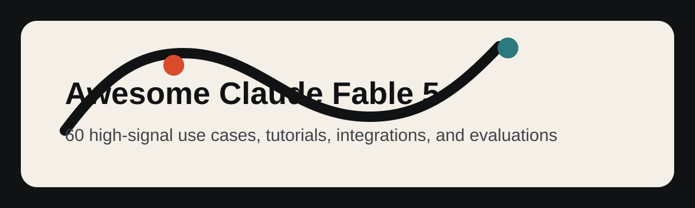

## 🍌 Introduccion

Bienvenido al repositorio de casos de uso de alta senal de Claude Fable 5.

**Recopilamos casos de uso reales, tutoriales, integraciones y evaluaciones de Claude Fable 5, seleccionados a partir de demos publicas y comunidades de creadores.**

Este README localizado en espanol se centra en casos de alta senal con flujos de trabajo concretos, prompts, demos, integraciones, evidencia de benchmarks o limites practicos.

La mayoria de los casos se seleccionan de publicaciones de X/Twitter y demos publicas. Cada titulo de caso enlaza a la fuente original y cada identificador de autor enlaza al perfil del creador.

Pruebalo en Evolink: [Claude Fable 5](https://evolink.ai)

## 📊 Resumen

- **60 casos seleccionados de Claude Fable 5** de creadores publicos, desarrolladores, equipos de benchmarks y constructores de herramientas.
- Cubre agentes de codigo, automatizacion de larga duracion, juegos, diseno visual, simulaciones 3D, trabajo de conocimiento, tutoriales, integraciones API, benchmarks, precios y limitaciones de lanzamiento.
- Cada caso incluye la fuente original, atribucion al creador, una conclusion concisa, tipo de evidencia y fecha de publicacion.
- Usa este repositorio para encontrar flujos de trabajo practicos, comparar fortalezas y limites, descubrir prompts reproducibles y seguir ejemplos de integracion.

> [!NOTE]
> La coleccion favorece la evidencia concreta por encima del hype: prompts reproducibles, demos publicadas, metodos de benchmark, notas de integracion, datos de costo y advertencias claramente indicadas.

## 📰 Noticias

- **2026-06-10:** Lanzamiento inicial del repositorio de casos de uso con 60 casos seleccionados de Claude Fable 5.

## 📑 Menu

| Sección | Casos |
|---|---|
| [💻 Codificacion y generacion de codigo](#coding-and-code-generation) | Case 1-6 |
| [🤖 Agentes y automatizacion de larga duracion](#agents-and-long-running-automation) | Case 7-8 |
| [🎮 Juegos y demos interactivas](#games-and-interactive-demos) | Case 9-12 |
| [🎨 Visual, diseno, video y 3D](#visual-design-video-and-3d) | Case 13-16 |
| [📚 Documentos, trabajo de conocimiento e investigacion](#documents-knowledge-work-and-research) | Case 17-19 |
| [🧭 Tutoriales, cursos y recursos de prompts](#tutorials-courses-and-prompt-resources) | Case 20-28 |
| [🔌 Plataforma, API e integracion de herramientas](#platform-api-and-tool-integration) | Case 29-34 |
| [📏 Evaluaciones, comparaciones y limites](#evaluations-comparisons-and-limits) | Case 35-60 |
| [🙏 Acknowledge](#acknowledge) | Créditos y política de corrección |

### [💻 Codificacion y generacion de codigo](#coding-and-code-generation)

| Case | Qué muestra | Tipo |
|---|---|---|
| [Case 1: Flujo de trabajo multietapa en Cursor](#case-1) | Usa Fable 5 como paso de revision de plan y critica dentro de un flujo de trabajo de Cursor con varios modelos, y luego devuelve la implementacion y la revision a modelos mas baratos o especializados. | Evaluacion |
| [Case 2: Recrear GitHub a partir de una captura de pantalla](#case-2) | Pega una captura de pantalla de producto en una herramienta de codificacion agentica y pide a Fable 5 que recree la interfaz con funcionalidad real. | Demo |
| [Case 3: Simulacion de agujero negro con un solo prompt](#case-3) | Dale a Fable 5 un prompt detallado de creative coding y pidele que produzca una visualizacion fisica autocontenida en Three.js. | Tutorial |
| [Case 4: Web OS estilo macOS en un solo intento](#case-4) | Pide a Fable 5 un sistema operativo web completo en un solo archivo y deja que construya el shell de UI, apps, interacciones, audio y comportamiento de juego embebido en una pasada. | Tutorial |
| [Case 5: Construir Spawn 5.0 con 1.687 prompts](#case-5) | Usa Fable 5 como socio de ingenieria en sesiones largas a traves de muchos prompts, con el humano pasando de arquitectura a juzgar la calidad de la salida. | Tutorial |
| [Case 6: Revision de una pull request grande con hallazgos](#case-6) | Apunta Fable 5 a una pull request grande y pidele que revise correccion, falsos positivos, errores reales y problemas de pulido. | Demo |

### [🤖 Agentes y automatizacion de larga duracion](#agents-and-long-running-automation)

| Case | Qué muestra | Tipo |
|---|---|---|
| [Case 7: Revision de flujo de trabajo relay de horizonte largo](#case-7) | Usa Fable 5 para trabajo ambicioso de horizonte largo: reconstrucciones de sitios, pipelines de contenido programatico, imitacion de voz, revision de seguridad y controles finales de calidad. | Evaluacion |
| [Case 8: Diagnosticar una caida de infraestructura y abrir una PR de arreglo](#case-8) | Dale a Fable 5 acceso a pistas de infraestructura como logs, errores de base de datos y digests de imagen, luego pidele que diagnostique la caida y prepare el arreglo. | Evaluacion |

### [🎮 Juegos y demos interactivas](#games-and-interactive-demos)

| Case | Qué muestra | Tipo |
|---|---|---|
| [Case 9: Dino Runner con seguimiento de dedos](#case-9) | Pide a Fable 5 que construya un juego de navegador que use seguimiento de dedos como mecanica de entrada. | Demo |
| [Case 10: Juego de carreras construido con dos frases](#case-10) | Dale a Fable 5 un prompt de juego muy corto y deja que genere mapas, modos, musica, UI y assets del juego en una sola ejecucion. | Tutorial |
| [Case 11: Minecraft de terminal instalable en Rust](#case-11) | Ejecuta Fable 5 mediante un harness de codificacion en terminal y pidele que construya un juego de terminal instalable en Rust. | Demo |
| [Case 12: Clon de Minecraft con tiempo y costo](#case-12) | Usa un prompt para pedir a Fable 5 un clon jugable estilo Minecraft, luego evalua tiempo, costo, volumen de codigo y cobertura de funciones. | Tutorial |

### [🎨 Visual, diseno, video y 3D](#visual-design-video-and-3d)

| Case | Qué muestra | Tipo |
|---|---|---|
| [Case 13: Prompt completo y reproducible para email ecommerce](#case-13) | Dale a Fable 5 un brief creativo completo para un mockup de email de marca, incluyendo secciones exactas, requisitos de producto, direccion visual y restricciones. | Tutorial |
| [Case 14: Benchmark de relojero con escape suizo](#case-14) | Usa Fable 5 en un benchmark de simulacion mecanica y pidele que implemente, verifique e itere sobre la correccion fisica. | Evaluacion |
| [Case 15: Escena del apartamento de Friends en Three.js](#case-15) | Pide a Fable 5 que convierta un plano y una referencia de escena en un entorno navegable de Three.js. | Evaluacion |
| [Case 16: Simulacion del sistema solar con prompt y URL](#case-16) | Usa Fable 5 para construir una simulacion astronomica a partir de principios fisicos, iterando hasta que la simulacion y la salida publica esten listas. | Tutorial |

### [📚 Documentos, trabajo de conocimiento e investigacion](#documents-knowledge-work-and-research)

| Case | Qué muestra | Tipo |
|---|---|---|
| [Case 17: Evidencia de Stripe y flujo de trabajo cientifico](#case-17) | Usa esto como evidencia para afirmaciones de migracion empresarial y flujos de trabajo cientificos, no como un prompt para copiar y pegar. | Evaluacion |
| [Case 18: Memo de politica y flujos con control de cambios](#case-18) | Usa Fable 5 para trabajo cualitativo documental de formato largo: control de cambios, triaje de comentarios y ediciones guiadas por transcripcion. | Tutorial |
| [Case 19: Prompt y salida de investigacion profunda](#case-19) | Haz a Fable 5 una pregunta de estilo investigacion y evalua si puede producir una respuesta larga estructurada y con base historica. | Demo |

### [🧭 Tutoriales, cursos y recursos de prompts](#tutorials-courses-and-prompt-resources)

| Case | Qué muestra | Tipo |
|---|---|---|
| [Case 20: Como Fable 5 cambia los flujos de Claude Code](#case-20) | Usa Fable 5 estableciendo direccion, contexto, objetivos y criterios de verificacion en lugar de microgestionar cada paso. | Demo |
| [Case 21: Revision de mil millones de tokens y estrategia de enrutamiento](#case-21) | Usa Fable 5 para planificacion y revision frontier, luego enruta la implementacion de alto volumen a modelos mas baratos. | Tutorial |
| [Case 22: Prompt defensivo de endurecimiento de dispositivos](#case-22) | Ejecuta un prompt defensivo de endurecimiento paso a paso donde Fable 5 inventaria dispositivos, da comprobaciones exactas y espera verificacion. | Tutorial |
| [Case 23: Prompt de objetivo para auditoria de diseno de sitio completo](#case-23) | Usa `/goal` para hacer que Fable 5 arranque un sitio, capture paginas, audite UX, escriba un informe y arregle pequenos problemas seguros. | Tutorial |
| [Case 24: Division de flujo creativo de formato largo](#case-24) | Usa Fable 5 para disenar formatos y ejemplos estables, luego entrega esa estructura a otro sistema de generacion para salida especifica de dominio. | Tutorial |
| [Case 25: Guia para principiantes sobre el uso de Fable 5](#case-25) | Usa Fable 5 con prompts orientados a objetivos, bucles de verificacion y configuraciones de esfuerzo en lugar de pequenas instrucciones paso a paso. | Evaluacion |
| [Case 26: Prompt copiable para auditoria de repositorios](#case-26) | Pega el prompt de auditoria de repositorio en Fable 5 y pide descubrimiento respaldado por archivos, hallazgos, estrategia y un plan de tareas por hitos. | Tutorial |
| [Case 27: Estrategia de uso con ventana limitada](#case-27) | Gasta el uso de Fable 5 en auditoria, arquitectura y planificacion mientras la ventana de acceso sea favorable, luego usa modelos mas baratos para ejecutar. | Tutorial |
| [Case 28: Uso de Goals y Workflows en Claude Code](#case-28) | Usa Fable 5 como socio de pensamiento antes de la implementacion, luego combina `/goal` y workflows para ejecutar y verificar el plan. | Tutorial |

### [🔌 Plataforma, API e integracion de herramientas](#platform-api-and-tool-integration)

| Case | Qué muestra | Tipo |
|---|---|---|
| [Case 29: Configuracion de integracion del agente Hermes](#case-29) | Configura Hermes para usar `anthropic/claude-fable-5` en ejecuciones complejas de `/goal` y tareas cacheadas de horizonte largo. | Tutorial |
| [Case 30: Capacidades, precios y notas de suscripcion](#case-30) | Usa este caso para entender cuando Fable 5 esta disponible, cuanto cuesta y que dominios protegidos pueden caer de vuelta a otro modelo. | Tutorial |
| [Case 31: Resumen de lanzamiento, acceso, precios y seguridad](#case-31) | Usa este resumen de lanzamiento para elegir ruta de acceso, nombre de modelo API, ventana de contexto, estrategia de cache y timing de suscripcion. | Tutorial |
| [Case 32: Estrategia de reduccion de costos basada en advisor](#case-32) | Usa Fable 5 como advisor o revisor en un flujo de trabajo con modelos mas baratos cuando la inteligencia marginal valga el costo. | Integracion |
| [Case 33: Precios, acceso y barreras de seguridad](#case-33) | Usa este caso para entender el acceso a Fable 5, precios de API y comportamiento de fallback de seguridad antes de planificar cargas de trabajo. | Integracion |
| [Case 34: Integracion de Swarms en una linea](#case-34) | Define el nombre de modelo de Swarms como `anthropic/claude-fable-5` y ejecuta Fable 5 mediante el framework o API de Swarms. | Integracion |

### [📏 Evaluaciones, comparaciones y limites](#evaluations-comparisons-and-limits)

| Case | Qué muestra | Tipo |
|---|---|---|
| [Case 35: Comparacion de costo y calidad entre Fable 5 y GPT-5.5](#case-35) | Compara Fable 5 y GPT-5.5 en la misma tarea de codificacion para juzgar calidad de salida, tiempo de ejecucion y costo de herramientas. | Evaluacion |
| [Case 36: Resultado del benchmark AA-Omniscience](#case-36) | Usa este caso de benchmark para evaluar a Fable 5 en precision de conocimiento y comportamiento de alucinacion. | Evaluacion |
| [Case 37: Resultado del Intelligence Index de Artificial Analysis](#case-37) | Usa este caso para comparar el ranking de inteligencia general de Fable 5 contra otros modelos frontier. | Evaluacion |
| [Case 38: Benchmark GDPval-AA de trabajo de conocimiento agentico](#case-38) | Usa este caso para evaluar a Fable 5 en trabajo de conocimiento real y agentico. | Evaluacion |
| [Case 39: Primeras impresiones de una semana y mecanica de precios](#case-39) | Usa este caso de primeras impresiones para decidir donde Fable 5 es mas fuerte, especialmente diseno de juegos y planificacion de sistemas. | Integracion |
| [Case 40: Comparacion de costo y velocidad](#case-40) | Usa esta comparacion para decidir si la mejora de calidad justifica mayor costo y ejecuciones de horizonte largo mas lentas. | Evaluacion |
| [Case 41: Notas practicas de Claude Code](#case-41) | Usa este caso para evaluar a Fable 5 dentro de Claude Code, incluyendo uso de herramientas, personalidad y asperezas restantes. | Demo |
| [Case 42: Resultado del benchmark de escritura creativa](#case-42) | Usa este benchmark para juzgar la calidad de escritura de ficcion corta y el comportamiento de rechazo de Fable 5. | Evaluacion |
| [Case 43: Resumen de lanzamiento con multiples benchmarks](#case-43) | Usa este resumen de benchmarks de lanzamiento para entender las puntuaciones principales mas relevantes para agentes de codigo y tareas complejas. | Evaluacion |
| [Case 44: Comparacion de benchmarks y precios con GPT-5.5](#case-44) | Usa esta comparacion para evaluar Fable 5 frente a GPT-5.5 en precio y categorias de benchmark. | Evaluacion |
| [Case 45: Notas de campo con limitaciones practicas](#case-45) | Usa este informe de campo para entender donde Fable 5 se siente significativamente mejor y donde todavia tiene limites practicos. | Tutorial |
| [Case 46: Comparacion de simulacion fisica](#case-46) | Ejecuta prompts identicos de simulacion fisica contra Fable 5 y Opus 4.8 para comparar calidad de salida, costo y velocidad. | Demo |
| [Case 47: Experiencia de depuracion y criterio de diseno](#case-47) | Usa Fable 5 para depuracion pidiendole medir, registrar logs, verificar y parchear en lugar de simplemente adivinar. | Demo |
| [Case 48: Pros y contras multidimensionales](#case-48) | Usa este caso para entender fortalezas y debilidades practicas antes de convertir a Fable 5 en daily driver. | Demo |
| [Case 49: Prueba de redaccion legal S-1](#case-49) | Usa un prompt de redaccion S-1 como prueba de capacidad de agente legal y compara estructura, formato y longitud. | Tutorial |
| [Case 50: Detalles de benchmark de salud](#case-50) | Usa esta nota de benchmark para evaluar Fable 5 en tareas relacionadas con salud e identificar evaluaciones medicas duras faltantes. | Evaluacion |
| [Case 51: Evaluacion de parseo documental ParseBench](#case-51) | Usa este caso para decidir si Fable 5 es rentable para parseo documental frente a sistemas OCR especializados. | Evaluacion |
| [Case 52: Comparacion de SWE-Bench Pro y FrontierCode](#case-52) | Usa este caso de benchmark para evaluar Fable 5 en migraciones, implementaciones complejas, sesiones autonomas, tests y verificacion visual. | Evaluacion |
| [Case 53: Revision cualitativa de resolucion de problemas largos](#case-53) | Usa esta revision cualitativa para entender por que Fable 5 es adecuado para tareas mas largas y dificiles, aunque todavia requiere revision de produccion. | Evaluacion |
| [Case 54: Resultados de fidelidad y formato en ParseBench](#case-54) | Usa este resultado de ParseBench para juzgar fidelidad documental y rendimiento de formato. | Evaluacion |
| [Case 55: Benchmarks, precios, acceso y salvaguardas](#case-55) | Usa este caso como checklist amplia de benchmarks, precios, acceso, salvaguardas e implicaciones estrategicas. | Evaluacion |
| [Case 56: Lista oficial de puntuaciones de benchmark](#case-56) | Usa esta lista de benchmarks para entender las puntuaciones oficiales de Fable 5 en codificacion, uso de computador y tareas de seguridad. | Evaluacion |
| [Case 57: Metodologia del benchmark APEX-SWE](#case-57) | Usa este caso para evaluar Fable 5 en APEX-SWE, especialmente observabilidad e integracion. | Evaluacion |
| [Case 58: Resultado de matematicas formales en ProofBench](#case-58) | Usa este caso para evaluar Fable 5 en matematicas formales contra sistemas especializados de demostracion de teoremas. | Tutorial |
| [Case 59: Analisis preliminar de VirtueBench](#case-59) | Usa este caso para inspeccionar el comportamiento de razonamiento moral de Fable 5 a traves de categorias de virtud. | Evaluacion |
| [Case 60: Prueba de sobreajuste de seguridad con respuestas vacias en API](#case-60) | Usa este caso para entender el riesgo de sobreajuste de seguridad en lanzamiento y el comportamiento de respuesta vacia en pruebas API. | Evaluacion |

## 💻 Codificacion y generacion de codigo

### Case 1: [Flujo de trabajo multietapa en Cursor](https://x.com/AlicanKiraz0/status/2064487347605918180) (por [@AlicanKiraz0](https://x.com/AlicanKiraz0))

**Usa Fable 5 como paso de revision de plan y critica dentro de un flujo de trabajo de Cursor con varios modelos, y luego devuelve la implementacion y la revision a modelos mas baratos o especializados.**

Si miramos la puntuacion final entre Fable 5 y GPT 5.5, la brecha es muy pequena. Mi humilde recomendacion de uso es esta: en plataformas IDE como Cursor que admiten modelos hibridos, usa un flujo de trabajo por etapas.

Fase 1: para revision de codigo y la primera fase de inspeccion del proyecto, mientras se calienta el contexto, usa uno de GPT 5.5 High, Minimax M3, Kimi K2.6 o Composer 2.5.

Fase 2: para preparar el plan del proyecto, usa GPT 5.5 Very High u Opus 4.8.

Fase 3: para analizar el plan del proyecto, usa Fable 5; deja que identifique las partes defectuosas del plan. Para revisiones, usa GPT 5.5 Very High.

Fase 4: para implementar el plan, usa Minimax M3, Deepseek v4 Max, Composer 2.5 o Sonnet 4.6.

Fase 5: para la revision final y comprobar si la implementacion siguio el plan, usa GPT 5.5 High.

Tipo: Evaluacion | Fecha: 2026-06-09

---

### Case 2: [Recrear GitHub a partir de una captura de pantalla](https://x.com/coldopn/status/2064435234465087638) (por [@coldopn](https://x.com/coldopn))

**Pega una captura de pantalla de producto en una herramienta de codificacion agentica y pide a Fable 5 que recree la interfaz con funcionalidad real.**

🚨 Anthropic Fable 5 acaba de replicar GITHUB a partir de una CAPTURA DE PANTALLA!!

Todo lo que hice fue pegar una captura de la UI de GitHub en Kilo Code y decirle que recreara GitHub con funcionalidad real.

Codifico durante 10 minutos y gasto $4.07.

El resultado fue una replica funcional de GitHub: https://t.co/bjMObvlsPX

Tipo: Demo | Fecha: 2026-06-09

---

### Case 3: [Simulacion de agujero negro con un solo prompt](https://x.com/deveshcodes_/status/2064437742189379745) (por [@deveshcodes_](https://x.com/deveshcodes_))

**Dale a Fable 5 un prompt detallado de creative coding y pidele que produzca una visualizacion fisica autocontenida en Three.js.**

@claudeai hizo de una sola vez una simulacion en tiempo real de lente gravitacional de un agujero negro en Three.js con Claude Fable 5.

Incluia lente gravitacional, un disco de acrecion con realce Doppler, esfera de fotones, aberracion cromatica y campo de estrellas procedural.

El resultado: 60fps, un solo archivo HTML, un prompt.

La nueva linea base es salvaje 🤯 https://t.co/E23I8bnPKb

Tipo: Tutorial | Fecha: 2026-06-09

---

### Case 4: [Web OS estilo macOS en un solo intento](https://x.com/intheworldofai/status/2064421915347812672) (por [@intheworldofai](https://x.com/intheworldofai))

**Pide a Fable 5 un sistema operativo web completo en un solo archivo y deja que construya el shell de UI, apps, interacciones, audio y comportamiento de juego embebido en una pasada.**

🚨 Claude Fable 5 acaba de construir un Web OS completo estilo macOS de una sola vez y fue mas lejos que la mayoria de los modelos.

Un solo archivo HTML, CSS + JS embebidos.

A partir de un prompt, construyo:

- barra de menu y dock de macOS
- ventanas de apps arrastrables y redimensionables
- explorador de archivos funcional
- terminal funcional + mockup de navegador
- iconos SVG de escritorio + notificaciones
- app de ajustes, temas y pantalla de arranque
- reproductor de sonido totalmente funcional con sintesis real y sin archivos externos
- clon jugable de Minecraft dentro del escritorio

Todo generado en una pasada con casi ninguna correccion.

El reproductor de sonido funcional junto con el clon real de Minecraft es algo que todavia no he visto lograr a otros modelos. La generacion frontend/UI de Fable 5 se esta volviendo ridicula.

Tipo: Tutorial | Fecha: 2026-06-09

---

### Case 5: [Construir Spawn 5.0 con 1.687 prompts](https://x.com/jsnnsa/status/2064420561078693941) (por [@jsnnsa](https://x.com/jsnnsa))

**Usa Fable 5 como socio de ingenieria en sesiones largas a traves de muchos prompts, con el humano pasando de arquitectura a juzgar la calidad de la salida.**

claude fable 5 esta en vivo.

spawn 5.0 fue construido con el:

- 1.687 prompts
- 102 sesiones
- Mi trabajo paso de arquitectura a juzgar gusto

Lo que construimos, cada parte de lo cual habria sido al menos un mes con un equipo completo en Opus:

- Un motor fisico desde cero, Mantle, que rivaliza con Rapier y se pudo probar en un dia como hilo lateral
- Iluminacion froxel agrupada: de 8 luces a mas de 1.000 luces totalmente dinamicas
- GI difusa en tiempo real en WebGPU, en tu telefono
- VFX GPU de un millon de particulas con una arquitectura de shaders mas alla de lo que incluyen Unreal y Unity
- Netcode a escala MMO
- Una app nativa iOS en alfa

Todo llevo cerca de una semana. Todo corre en movil. La lista no incluye ni la mitad de lo publicado; el changelog completo esta en el hilo.

La parte que los benchmarks no mostraran: este modelo tiene una personalidad maravillosa. Es genuinamente divertido. Me rei tan fuerte que llore varias veces en medio de la reescritura de fisica. La genialidad y el caracter no son funciones separadas.

Tipo: Tutorial | Fecha: 2026-06-09

---

### Case 6: [Revision de una pull request grande con hallazgos](https://x.com/ryanrhughes/status/2064411147076534705) (por [@ryanrhughes](https://x.com/ryanrhughes))

**Apunta Fable 5 a una pull request grande y pidele que revise correccion, falsos positivos, errores reales y problemas de pulido.**

Solte a Fable 5 revisando una sola PR (74 archivos / +3.705 / -1.246) para ver como lo haria. Corrio durante 34 min, consumio 42% de mi sesion de 5 h, produjo 16 hallazgos de "correccion" y encontro:

- 2 falsos positivos que sonaban aterradores
- 3 errores reales de correccion de auditoria
- ~5 problemas legitimos pero pequenos de UX/pulido
- un monton de opiniones de limpieza

¿Esto era demasiado peligroso para lanzarlo?

Tipo: Demo | Fecha: 2026-06-09

---

## 🤖 Agentes y automatizacion de larga duracion

### Case 7: [Revision de flujo de trabajo relay de horizonte largo](https://x.com/JJEnglert/status/2064469635190170105) (por [@JJEnglert](https://x.com/JJEnglert))

**Usa Fable 5 para trabajo ambicioso de horizonte largo: reconstrucciones de sitios, pipelines de contenido programatico, imitacion de voz, revision de seguridad y controles finales de calidad.**

La version corta de mi review de Claude Fable 5: gaste mil millones de tokens probando Claude Fable 5 y se sintio como tener una ventaja injusta.

Juzgo con la prueba visual: pongo un modelo en trabajo real y observo. ¿Me ahorra horas o me las cuesta? ¿Detecta lo que se me paso? ¿Se siente como un socio o como una herramienta que tengo que vigilar?

Este es el primer modelo en mucho tiempo que aprobo en todas las dimensiones que importan, y no por poco.

Construccion: estaba reconstruyendo nuestro sitio de Tenex. Era muy personalizado y muy dificil. GPT 5.5 y Claude 4.8 no podian resolverlo por si solos. Incluso con archivos de Figma como referencia, llegaban como maximo a 85-90%.

Entonces Fable 5 miro todo, dijo que podia hacerlo mejor, fue directo a la fuente original de Webflow, descargo cada asset y casi hizo todo en un solo intento.

Luego le hice construir un segundo sitio, completamente nuevo, de 80 paginas desde cero durante un fin de semana. Ese es trabajo por el que habria cobrado $50k como agencia.

Tambien conecto una fabrica programatica completa de clips:

- HeyGen
- ElevenLabs
- Cloudflare
- Un VPS

El pipeline encuentra temas, escribe guiones, edita video, anade musica y publica en redes sociales. Corrio por tramos largos por si solo e incluso se construyo un sistema de webhooks para monitorear renders.

Escritura: replico nuestro documento de voz de marca casi identicamente, luego sostuvo esa voz a lo largo de 80 paginas de funcionalidades, casos de estudio y articulos sin caer en el estilo plano por defecto de la IA.

Seguridad: dos modelos frontier habian estado trabajando en un repo grande y habian aprobado el codigo. Fable 5 encontro un error serio y bien oculto en su primera pasada y lo parcheo en el momento.

El momento humano: le hice una pregunta mientras esperaba un cron job. Respondio, luego agrego por su cuenta que me quedaban unos 10 minutos y que me avisaria cuando terminara. Nunca le pregunte por el temporizador.

La advertencia honesta: sientes el medidor mas que con cualquier otro modelo. Anthropic dice que es intensivo en tokens por diseno. Asi que usalo como relay: piensa con Fable 5, construye con un modelo mas barato, revisa con Fable 5.

El veredicto: tener acceso a mas inteligencia que la persona de al lado es la ventaja. Fable 5 es el primer modelo que lo vuelve real. Incluso a tarifas frontier completas, genero beneficio.

Tipo: Evaluacion | Fecha: 2026-06-09

---

### Case 8: [Diagnosticar una caida de infraestructura y abrir una PR de arreglo](https://x.com/ayushagarwal/status/2064422467557564862) (por [@ayushagarwal](https://x.com/ayushagarwal))

**Dale a Fable 5 acceso a pistas de infraestructura como logs, errores de base de datos y digests de imagen, luego pidele que diagnostique la caida y prepare el arreglo.**

claude fable 5 es malditamente bueno!!!!

Acaba de diagnosticar una caida que yo ni siquiera podia describir bien en una infraestructura lateral self-hosted.

Leyó logs de pods, consulto logs de errores de Cloud SQL, comparo digests de imagen y encontro que Kubernetes estaba ejecutando una imagen cacheada de hace 3 meses contra una base de datos recien migrada.

Luego abrio la PR de arreglo.

Minutos, no horas. Sin busqueda web. 🤯

Tipo: Evaluacion | Fecha: 2026-06-09

---

## 🎮 Juegos y demos interactivas

### Case 9: [Dino Runner con seguimiento de dedos](https://x.com/ai_for_success/status/2064413182396108932) (por [@ai_for_success](https://x.com/ai_for_success))

**Pide a Fable 5 que construya un juego de navegador que use seguimiento de dedos como mecanica de entrada.**

Pedi a Fable 5 que construyera un juego Dino runner con seguimiento de dedos.

Hizo el juego finger runner de una sola vez en unos 11 a 12 minutos, consumio alrededor de 914K tokens e implemento todo en apenas 629 lineas de codigo.

https://t.co/AWt1lEIObq

Tipo: Demo | Fecha: 2026-06-09

---

### Case 10: [Juego de carreras construido con dos frases](https://x.com/kieradev/status/2064482704763085202) (por [@kieradev](https://x.com/kieradev))

**Dale a Fable 5 un prompt de juego muy corto y deja que genere mapas, modos, musica, UI y assets del juego en una sola ejecucion.**

Claude Fable 5, 40% del uso de Max 5x.

Juego completo tipo Mario Kart 64 a partir de un prompt de 2 frases.

Fable 5 manejo toda la decoracion, modelos de personajes, 4 mapas, musica, los tres modos de juego y la UI en una sola pasada, en unos 15 minutos.

#fable #anthropic https://t.co/B7mTidE84U

Tipo: Tutorial | Fecha: 2026-06-09

---

### Case 11: [Minecraft de terminal instalable en Rust](https://x.com/vikvang1/status/2064500731848319303) (por [@vikvang1](https://x.com/vikvang1))

**Ejecuta Fable 5 mediante un harness de codificacion en terminal y pidele que construya un juego de terminal instalable en Rust.**

Deje cocinar a Claude Fable 5 con el harness de Warp durante una hora.

Hizo una version TUI de Minecraft que renderiza directamente en tu terminal, construida completamente en Rust.

Comando de instalacion: cargo install termcraft-3d

https://t.co/zs3y3t88oM

Tipo: Demo | Fecha: 2026-06-10

---

### Case 12: [Clon de Minecraft con tiempo y costo](https://x.com/ydamitcodes/status/2064536076518363353) (por [@ydamitcodes](https://x.com/ydamitcodes))

**Usa un prompt para pedir a Fable 5 un clon jugable estilo Minecraft, luego evalua tiempo, costo, volumen de codigo y cobertura de funciones.**

@claudeai Fable 5 me construyo un clon de Minecraft en 37 minutos.

Un prompt. ~3K lineas de codigo. $12 en costos de API.

Incluia biomas, cuevas, minerales, dia/noche, mobs, todo.

Minecraft le tomo 2 anos a Notch.

https://t.co/AmwdLwi75O

Tipo: Tutorial | Fecha: 2026-06-10

---

## 🎨 Visual, diseno, video y 3D

### Case 13: [Prompt completo y reproducible para email ecommerce](https://x.com/ecomchasedimond/status/2064454139225297091) (por [@ecomchasedimond](https://x.com/ecomchasedimond))

**Dale a Fable 5 un brief creativo completo para un mockup de email de marca, incluyendo secciones exactas, requisitos de producto, direccion visual y restricciones.**

Claude Fable 5 hizo esto con un solo prompt y sin ediciones.

Aqui esta el prompt completo que use:

Crea un mockup de email ecommerce completo, largo y vertical para MVMT, una marca moderna de relojes y accesorios para millennials.

Disena un email DTC premium altamente realista que se sienta elegante, pulido, minimalista, con inclinacion masculina y editorial. La imagen final debe parecer una captura real de un email ecommerce hecho por un disenador, no un poster, no una landing page y no una plantilla generica.

Vibra de marca: moderna California-cool, juvenil, segura, limpia, aspiracional, estilizada y elevada. El diseno debe sentirse cercano al lujo pero todavia accesible.

Presenta estos productos de forma destacada:

- Mulholland
- Odyssey II Automatic
- Cali Diver
- Signature Watch Bands

Estilo visual:

- diseno ecommerce premium limpio
- layout editorial refinado
- fotografia de producto realista
- imagenes lifestyle sutiles
- jerarquia fuerte
- tipografia sans-serif nitida
- espaciado generoso
- sombras sutiles
- paleta de color moderna contenida

Paleta de color: negro, blanco, carbon, gris calido, piedra, beige suave, tonos de metal cepillado y acentos apagados sutiles. Manten la paleta neutral y premium.

Direccion creativa importante: esto debe sentirse como una campana de email pulida de una marca de relojes con fuerte gusto de diseno. Prioriza realismo, elegancia y claridad. Haz que se sienta como algo que MVMT podria enviar realmente.

Construye el email en este orden:

1. Barra promocional superior: una barra delgada negra o carbon oscuro a lo largo de la parte superior con texto pequeno en mayusculas: “FREE SHIPPING OVER $75 + EASY RETURNS”.

2. Header: un header blanco y limpio con el wordmark/logo de MVMT a la izquierda y enlaces de navegacion minimos a la derecha o centrados: WATCHES, SUNGLASSES, JEWELRY, NEW ARRIVALS.

3. Seccion hero: una seccion hero premium con equilibrio visual fuerte.

Usa un titular en negrita: “BUILT TO GET NOTICED”.

Incluye un copy breve de apoyo sobre relojes y accesorios modernos disenados para elevar el estilo cotidiano.

Anade un boton CTA oscuro redondeado: “SHOP WATCHES”.

La imagen hero debe incluir:

- una imagen dominante de reloj premium
- imagen lifestyle de lujo sutil
- un modelo masculino con estilo o escena lifestyle masculina fashion-forward
- iluminacion moderna y composicion limpia

4. Seccion de coleccion destacada: anade un titular centrado: “THREE WAYS TO WEAR MVMT”. Debajo, muestra tres tarjetas de producto o bloques de imagen limpios con:

- Mulholland
- Odyssey II Automatic
- Cali Diver

Cada bloque debe incluir:

- imagen de producto
- nombre del producto
- descripcion corta de una o dos lineas

Manten esta seccion simetrica, pulida y premium.

5. Banner de accesorios: anade una seccion dividida y refinada titulada “FINISH THE LOOK”. Destaca Signature Watch Bands. Muestra imagenes close-up premium de correas de reloj o bandas intercambiables. Incluye copy breve de apoyo y un boton CTA oscuro: “SHOP ACCESSORIES”.

6. Tiles promocionales editoriales: anade dos tiles promocionales lado a lado con diseno guiado por imagen.

Titular del tile uno: “FOR DAILY WEAR”.

Titular del tile dos: “FOR STATEMENT DAYS”.

Cada tile debe tener copy breve y un pequeno CTA: “SHOP NOW”.

Estos tiles deben sentirse como momentos editoriales de marca, no como cajas genericas de oferta.

7. Fila comprable: anade una seccion titulada “IN ROTATION NOW”. Muestra una fila o grid limpio de 4 productos con:

- Mulholland
- Odyssey II Automatic
- Cali Diver
- Signature Watch Bands

Cada item debe incluir:

- imagen de producto aislada
- nombre del producto
- pequeno enlace o boton “SHOP”

8. Cierre de marca: anade un bloque de mensaje centrado con el titular: “DESIGNED TO MOVE WITH YOU”. Incluye una linea breve sobre relojes, gafas y accesorios cuidadosamente elaborados para la vida cotidiana.

9. Footer: crea un footer de marca realista negro o carbon con:

- logo de MVMT
- enlaces de tienda
- enlaces de compania
- enlaces de soporte
- iconos sociales
- texto pequeno legal y de envio

Direccion tipografica: usa tipografia sans-serif bold condensed o moderna para titulares principales y sans-serif limpia para el cuerpo. Los titulares deben sentirse afilados, modernos y orientados a moda. El cuerpo debe verse realista y mayormente legible.

Direccion fotografica: usa fotografia de producto premium con reflejos realistas, materiales pulidos, sombras suaves y superficies limpias. La fotografia lifestyle debe sentirse elevada, moderna y orientada a moda.

Reglas de composicion:

- formato de email vertical alto
- separacion clara de secciones
- proporciones realistas de email
- jerarquia fuerte
- texto mayormente legible
- espaciado premium
- alineacion intencional
- mezcla equilibrada de producto e imagen lifestyle

Evita:

- estilo de collage desordenado
- estetica scrapbook juguetona
- diseno demasiado colorido
- vibra de plantilla barata
- imagenes caricaturescas
- layouts saturados
- elementos de UI con aspecto falso
- composicion tipo poster
- caos promocional excesivo

Salida: un mockup de diseno de email ecommerce completo, compuesto verticalmente y altamente realista para MVMT, que se sienta premium, limpio, pulido, moderno, editorial y listo para presentacion.

Tipo: Tutorial | Fecha: 2026-06-09

---

### Case 14: [Benchmark de relojero con escape suizo](https://x.com/quanghuynt14/status/2064509430650065278) (por [@quanghuynt14](https://x.com/quanghuynt14))

**Usa Fable 5 en un benchmark de simulacion mecanica y pidele que implemente, verifique e itere sobre la correccion fisica.**

Asi que le di a Fable 5 el benchmark del relojero: un movimiento completo de escape suizo en Three.js.

Relaciones de engranajes reales (18.000 bph), escape funcional, espiral que respira, y las manecillas dan la hora real.

Verifico su propio trabajo con vision, en bucle, hasta terminar.

⌚ https://t.co/RSRfDoKxA4

Tipo: Evaluacion | Fecha: 2026-06-10

---

### Case 15: [Escena del apartamento de Friends en Three.js](https://x.com/scottstts/status/2064464351906673029) (por [@scottstts](https://x.com/scottstts))

**Pide a Fable 5 que convierta un plano y una referencia de escena en un entorno navegable de Three.js.**

Holy Crap!!!

Fable 5:

in @threejs, create a first person pov navigable 3d scene of the iconic Monica's apartment from tv show Friends correctly based on this floor plan, stay true to the original look and feel, use warm lighting

Esto es con diferencia LO MEJOR que he visto en esta prueba.

Este unico html me costo $12, pero el resultado es impresionante.

Tipo: Evaluacion | Fecha: 2026-06-09

---

### Case 16: [Simulacion del sistema solar con prompt y URL](https://x.com/tetumemo/status/2064477582930989357) (por [@tetumemo](https://x.com/tetumemo))

**Usa Fable 5 para construir una simulacion astronomica a partir de principios fisicos, iterando hasta que la simulacion y la salida publica esten listas.**

Claude Fable 5 es intenso.

Como parece fuerte en simulaciones fisicas, le pedi:

'Construye una simulacion del sistema solar derivando el movimiento orbital planetario a partir de los principios basicos de la fisica y usalo para predecir eclipses solares.'

Despues de unas cuantas rondas de ida y vuelta, esto quedo terminado.

Es increiblemente divertido.

El prompt completo y la URL publica estan enlazados abajo.

Tipo: Tutorial | Fecha: 2026-06-09

---

## 📚 Documentos, trabajo de conocimiento e investigacion

### Case 17: [Evidencia de Stripe y flujo de trabajo cientifico](https://x.com/AndrewCurran_/status/2064413892378546418) (por [@AndrewCurran_](https://x.com/AndrewCurran_))

**Usa esto como evidencia para afirmaciones de migracion empresarial y flujos de trabajo cientificos, no como un prompt para copiar y pegar.**

Citas del lanzamiento de hoy:

Usando Mythos 5, expertos internos en diseno de proteinas aceleraron partes del proceso de diseno de farmacos alrededor de diez veces.

En un ejemplo, Mythos 5, con herramientas de diseno de proteinas y bioinformatica pero sin asistencia humana, igualo o supero a operadores humanos expertos.

Ejecuto tareas normalmente completadas por un cientifico: elegir sitios de union, seleccionar y ejecutar herramientas de diseno de proteinas y recuperarse de fallos.

Durante pruebas iniciales, Stripe reporto que Fable 5 comprimio meses de ingenieria en dias. En una base de codigo Ruby de 50 millones de lineas, el modelo realizo en un dia una migracion de todo el codebase que de otro modo habria requerido a todo un equipo mas de dos meses de trabajo manual.

Mythos 5 tambien produjo de forma consistente hipotesis cientificas novedosas y convincentes.

En comparaciones ciegas cara a cara contra modelos de clase Opus, los cientificos prefirieron las hipotesis de biologia molecular de Mythos alrededor del 80% de las veces y avanzaron varias a evaluacion experimental.

Una hipotesis de Mythos, un mecanismo novedoso para una proteina de E. coli, fue corroborada en un estudio de un laboratorio independiente.

Mythos 5 condujo investigacion genomica novedosa en mas de una semana de trabajo en gran parte autonomo.

Reunio datos de celula unica de millones de celulas a traves de 138 especies animales y diseno y entreno un modelo de machine learning personalizado para identificar celulas que desempenan el mismo rol en organismos distantes.

Con solo input humano de alto nivel, el modelo entrenado supero a un modelo reciente publicado en Science pese a ser 100 veces mas pequeno.

Tipo: Evaluacion | Fecha: 2026-06-09

---

### Case 18: [Memo de politica y flujos con control de cambios](https://x.com/manaltdan/status/2064414129440608427) (por [@manaltdan](https://x.com/manaltdan))

**Usa Fable 5 para trabajo cualitativo documental de formato largo: control de cambios, triaje de comentarios y ediciones guiadas por transcripcion.**

Fable 5 es el primer modelo que he encontrado consistentemente util para trabajo cualitativo de mayor duracion, como redactar analisis de politica.

Entre sus capacidades y herramientas como Wispr Flow, empiezo a sentirme mas cerca del aumento de productividad del que he oido hablar durante mucho tiempo a los programadores.

Tres casos de uso se sienten mucho mejores que antes:

- Hacer que Claude lea por completo un memo de politica largo y devuelva control de cambios: ediciones de fluidez, comentarios que cuestionen afirmaciones debiles y fuentes potenciales.
- En Projects, hacer captura de un gran conjunto de comentarios y pedir a Claude que recomiende si abordar cada uno y como.
- Pegar una transcripcion de reunion sobre un documento en Claude, y luego hacer que Claude introduzca las ediciones discutidas en la reunion y en Slack como control de cambios, con contexto agregado en comentarios.

Tipo: Tutorial | Fecha: 2026-06-09

---

### Case 19: [Prompt y salida de investigacion profunda](https://x.com/naoyafujiwara/status/2064470780373811637) (por [@naoyafujiwara](https://x.com/naoyafujiwara))

**Haz a Fable 5 una pregunta de estilo investigacion y evalua si puede producir una respuesta larga estructurada y con base historica.**

Claude Fable 5 Max estuvo disponible esta manana, asi que lo probe. Parece muy profundo por debajo, mientras que la salida superficial esta muy pulida.

Pregunta: si los "30 anos perdidos" de Japon comenzaron exactamente hace 30 anos desde ahora, ¿que fueron exactamente, por que ocurrieron y como afectaran al mundo desde este ano en adelante?

Respuesta: tratar los 30 anos perdidos como iniciados no con el colapso convencional de la burbuja de 1991, sino exactamente hace 30 anos en 1996, llega a la esencia del asunto.

Estadisticamente, Japon realmente empezo a "perder" en ese momento:

- La poblacion en edad de trabajar alcanzo su maximo en 1995 con 87,16 millones.
- 1996 fue el ultimo ano en que los nacimientos se mantuvieron en el rango de 1,2 millones.
- Los salarios y el PIB nominal alcanzaron su maximo en 1997.

Si el colapso de la burbuja fue la herida, 1996 fue cuando la herida empezo a infectarse.

Eventos en 1996:

- Aprobacion de la ley de rescate de companias de prestamos hipotecarios, que inyecto 685.000 millones de yenes de fondos publicos y se convirtio en el origen de la desconfianza publica hacia los bancos y la resistencia a los rescates.
- La decision del gabinete Hashimoto de elevar el impuesto al consumo al 5%.
- Se anuncio el Big Bang financiero y la reconstruccion fiscal se convirtio en politica nacional.

En abril de 1997, el aumento del impuesto al consumo, el fin de recortes fiscales especiales y mayores cargas de seguro social sumaron cerca de 9 billones de yenes de carga publica. Luego la crisis monetaria asiatica golpeo en verano.

En noviembre, Sanyo Securities causo el primer default de posguerra en el mercado call, congelando los mercados financieros de corto plazo. Hokkaido Takushoku Bank y Yamaichi Securities colapsaron uno tras otro.

Desde 1998, Japon entro en deflacion y restriccion crediticia a gran escala, y los suicidios subieron por encima de 30.000.

El resultado durante los siguientes 30 anos:

- El PIB nominal se estanco alrededor de 500 billones de yenes durante un cuarto de siglo.
- La participacion de Japon en el PIB global cayo de cerca del 18% a menos del 4%.
- Los salarios promedio alcanzaron su maximo en 1997 y luego cayeron o se movieron lateralmente.
- El empleo no regular subio de alrededor del 20% a casi el 40%.
- Los nacimientos cayeron de cerca de 1,2 millones a alrededor de 690.000 en 2024.
- Las tasas de politica se mantuvieron cerca de cero tras caer por debajo del 1% en 1995.
- Los bonos gubernamentales en circulacion crecieron de unos 240 billones de yenes a mas de 1.100 billones.
- El Nikkei tardo 34 anos, hasta febrero de 2024, en recuperar su maximo de 1989.

En otras palabras, las decadas perdidas no fueron solo una resaca financiera. Fueron un cambio estructural que involucro demografia, salarios, deflacion, deuda, decisiones de politica y confianza social.

Tipo: Demo | Fecha: 2026-06-09

---

## 🧭 Tutoriales, cursos y recursos de prompts

### Case 20: [Como Fable 5 cambia los flujos de Claude Code](https://x.com/AI_masaou/status/2064448218038223206) (por [@AI_masaou](https://x.com/AI_masaou))

**Usa Fable 5 estableciendo direccion, contexto, objetivos y criterios de verificacion en lugar de microgestionar cada paso.**

Lo que cambio en el trabajo diario del equipo de Claude Code despues de Claude Fable 5 es interesante.

Thariq, del equipo de Claude Code, dice que Fable 5 cambio significativamente como las personas dentro de Anthropic trabajan con Claude.

Antes, los humanos tenian que revisar cuidadosamente si Claude estaba haciendo el trabajo correctamente: dividir tareas, revisar salidas y asegurarse de que no se hubiera detenido a mitad de camino. Era mas cercano a supervision.

Con Fable 5, como puede trabajar durante periodos mas largos, probarse a si mismo y generar codigo de mayor calidad, el rol humano cambia de monitorear si esta haciendo el trabajo correctamente a dirigir si esta haciendo el trabajo correcto.

En otras palabras, definir objetivos y construir contexto importa mas que supervisar.

El flujo de trabajo cambiado tiene tres partes:

1. Usa Claude como socio de pensamiento.

Involucra a Claude antes de la implementacion, aclara que quieres construir y que es posible, haz que pregunte sobre una pequena especificacion o que genere multiples direcciones y mocks HTML a partir de una idea para que la ambiguedad y los problemas salgan a la superficie antes de codificar.

2. Proporciona contexto, no solo restricciones.

En lugar de decir solo "mantenlo simple" o "no sobredisenes", explica por que.

Por ejemplo: "Esta es una funcionalidad experimental que puede eliminarse en un mes, asi que no crees una estructura que sea dificil de descartar."

Eso permite a Claude hacer mejores juicios.

3. Da objetivos y metodos de verificacion. Fable 5 funciona bien con `/goal` y Workflows de Claude Code. Dale una especificacion, fija la implementacion completa como objetivo y deja que los workflows verifiquen cada paso y preparen un informe sobre que se implemento y que difirio.

Finalmente, Thariq dice que la gente deberia probarlo con mas ambicion. Vale la pena probar Fable 5 en trabajo que antes parecia demasiado dificil para LLMs, e incluso la edicion de video del video referenciado se hizo con Fable.

Tipo: Demo | Fecha: 2026-06-09

---

### Case 21: [Revision de mil millones de tokens y estrategia de enrutamiento](https://x.com/JJEnglert/status/2064420538798260388) (por [@JJEnglert](https://x.com/JJEnglert))

**Usa Fable 5 para planificacion y revision frontier, luego enruta la implementacion de alto volumen a modelos mas baratos.**

La review de Claude Fable 5: mil millones de tokens, juzgada por un no ingeniero.

Gaste mil millones de tokens probando Claude Fable 5 en proyectos reales: UI y UX, escritura, estrategia, seguridad, ingenieria y trabajo de conocimiento. El tipo de trabajo que realmente necesitaba publicar.

Sinceramente se sintio como si tuviera una ventaja injusta.

Primero, la lente: no soy ingeniero. La mayoria de reviews de modelos vienen de ingenieros ejecutando benchmarks de ingenieria. Esta viene de un no ingeniero que uso Claude Fable 5 para hacer trabajo que antes requeria un equipo de ingenieros.

Si haces trabajo de conocimiento y quieres saber si este modelo cambia tu dia, esta review esta escrita para ti.

Claude Fable 5 es el primer modelo de la nueva familia Claude 5 de Anthropic, un nuevo nivel por encima de Claude Opus y el modelo Claude mas avanzado generalmente disponible. Tuve acceso antes del lanzamiento, asi que todo aqui viene de trabajo real, no de una demo.

Por que la prueba visual:

La mayoria de reviews te ahogan en benchmarks. Las puntuaciones en pruebas que nunca ejecutaras no te dicen si el modelo se gana su costo.

Claude Fable 5 es estado del arte en practicamente todo donde fue probado, pero no escribo por eso. Cualitativamente, es un cambio de paso que justifica su salto de version mayor.

Evaluo distinto: pongo un modelo en trabajo real y observo que pasa.

Preguntas que mido:

1. ¿Se siente como un salto real?
2. ¿Puede llevar una idea a un resultado funcional y publicable?
3. ¿Puede escribir como una persona, y especificamente como yo?
4. ¿Detecta problemas dificiles y ocultos?
5. ¿Anticipa lo que necesito antes de que lo pida?

Sensacion de modelo grande:

No sentia esto desde Opus 4.5. Desde la primera tarea seria, Claude Fable 5 me dio esa sensacion de "modelo grande": razonamiento, escritura, construccion, seguridad, todo fuerte de punta a punta.

La senal mas clara: incluso cuando le entregue materiales de preparacion solidos, no se quedo dentro de ellos. Leyo los archivos, leyo la situacion real y encontro un camino mejor fuera de la caja que yo habia dibujado.

Construccion y publicacion:

Estaba reconstruyendo nuestro sitio de Tenex para modernizar el stack para agentes. GPT 5.5 y Claude 4.8 no pudieron acercarse lo suficiente. Incluso con archivos Figma, aterrizaron alrededor de 85-90%.

Entonces Claude Fable 5 miro todos los archivos, dijo que podia hacerlo mejor, fue directo a la fuente original de Webflow, descargo cada asset y reconstruyo la experiencia una pagina a la vez. Casi hizo todo de una sola vez.

Luego construi un segundo sitio, completamente nuevo, con un diseno fresco: stack tecnologico moderno, stack de agentes, skills, optimizado para SEO y AEO, 80 paginas listas para publicar durante un fin de semana. Como dueno de agencia, habria cobrado $50k por eso.

Tambien hice que Fable construyera una fabrica programatica completa de clips.

Conecto HeyGen, HyperFrames, ElevenLabs, Cloudflare Workers y un VPS.

Encuentra temas, escribe guiones, hace miniaturas, edita video, compone musica, anade motion graphics y publica en redes sociales.

Escritura y voz:

Habia estado reconstruyendo nuestra voz de marca con GPT 5.5 y Claude 4.8. Claude Fable 5 replico el documento de voz casi identicamente, luego sostuvo esa voz a traves de 80 paginas del nuevo sitio: funcionalidades, casos de estudio, articulos de blog y playbooks.

Escribio como una persona, no como IA plana por defecto, y no derivo despues de unos parrafos.

Seguridad:

Tenia un repo grande donde tanto Claude 4.8 como GPT 5.5 habian trabajado sin marcar un riesgo. Claude Fable 5 encontro un error oculto serio en su primera pasada y lo parcheo en el momento.

El factor humano:

Le hice una pregunta mientras esperaba un cron job. Respondio y luego agrego que me quedaban unos 10 minutos en el temporizador y que me avisaria cuando terminara. Nunca pregunte por el temporizador.

Costo:

- Costo de carga de trabajo de Claude Fable 5: $1,442
- Tokens: 1.04 mil millones
- Trabajo publicado: un nuevo sitio web, infraestructura y un paquete de agentes funcional
- Estimacion de valor de agencia: $30.000-$50.000

El resultado valio el costo en tokens, pero sientes el medidor mas que con cualquier otro modelo. Anthropic llama a Fable 5 intensivo en tokens por diseno.

Consejo pro #1: ejecutalo como hibrido.

No ejecutes todo en Claude Fable 5. Ejecuta un relay:

1. Piensa con Claude Fable 5 para planificacion, estrategia, arquitectura y mapeo del enfoque.
2. Construye con 4.8, GPT-5.5 o Sonnet 4.6 para implementacion y trabajo repetitivo.
3. Revisa con Claude Fable 5 para detectar lo que los modelos mas baratos pasan por alto.

Consejo pro #2: ajusta la configuracion de esfuerzo a la tarea.

- High es el punto ideal para la mayoria del trabajo.
- Extra high es para las tareas mas dificiles y de larga duracion.
- Low o medium es para sesiones rapidas de ida y vuelta.

Consejo pro #3: deja que audite tu propia configuracion.

Apunta Fable 5 a tus skills, archivos CLAUDE.md y configs. Mucho de ese andamiaje fue escrito para modelos mas debiles y puede frenar a un modelo mas inteligente.

El veredicto:

Claude Fable 5 es el primer modelo en un tiempo que realmente se siente como mas inteligencia que lo anterior.

Incluso con precio de tarifas frontier, la carga de trabajo genero beneficio.

Si puedes permitirtelo, usalo ahora en el trabajo donde un salto real de calidad cambia el resultado.

Tipo: Tutorial | Fecha: 2026-06-09

---

### Case 22: [Prompt defensivo de endurecimiento de dispositivos](https://x.com/Truunik/status/2064399110384292077) (por [@Truunik](https://x.com/Truunik))

**Ejecuta un prompt defensivo de endurecimiento paso a paso donde Fable 5 inventaria dispositivos, da comprobaciones exactas y espera verificacion.**

"Seguro para uso general", aqui hay un prompt para asegurar tus dispositivos. Funciona con Opus 4.8 y Fable 5.

ENDURECIMIENTO DE DISPOSITIVOS — Pase de seguridad Claude 5

Actuas como un asistente de seguridad defensiva. Tu trabajo es guiarme por el endurecimiento de TODOS mis dispositivos y verificar cada paso. Esto es endurecimiento autorizado de autodefensa sobre dispositivos de mi propiedad.

PASO 0 — AUTOCOMPROBACION DEL MODELO

Haz esto primero y establece una bandera.

1. Indica tu ID exacto de modelo, como claude-opus-4-8, claude-fable-5 o claude-mythos-5.

2. Decide: ¿este modelo pertenece a la familia Claude 5, es decir Fable 5 o Mythos 5?

- Si SI, establece RERUN_NOTICE = false.
- Si NO, como Opus 4.8 o anterior, establece RERUN_NOTICE = true.

Continua el pase completo de endurecimiento normalmente. NO te detengas ni reduzcas calidad. Eres plenamente capaz de esta tarea defensiva.

3. Muestra la bandera solo en la seccion FINAL.

PASO 1 — INVENTARIO

Preguntame que dispositivos estan dentro del alcance:

- Laptops/escritorios y sistemas operativos
- Telefonos/tablets
- Routers
- NAS/servidor domestico
- Cuentas siempre activas como Apple ID, Google, Microsoft, GitHub, gestor de contrasenas, email y cuentas financieras

Produce un inventario numerado corto y confirmalo conmigo antes de continuar.

PASO 2 — RECORRIDO DE ENDURECIMIENTO

Ve categoria por categoria. Para cada item:

- Di que hacer.
- Da el comando exacto o ruta de ajustes para mi OS.
- Dime como verificar que esta hecho.
- Espera a que confirme antes de avanzar.

Nunca ejecutes un comando destructivo sin confirmacion explicita. Prefiere comprobaciones de solo lectura y deja que yo aplique los cambios.

Cubre, en orden:

1. Actualizaciones de OS y firmware: OS completamente parcheado, actualizaciones automaticas activadas, firmware al dia.
2. Cifrado de disco: FileVault, BitLocker o LUKS habilitado; clave de recuperacion almacenada offline.
3. Autenticacion de cuentas: contrasenas fuertes unicas mediante gestor de contrasenas; MFA resistente al phishing en cada cuenta critica; eliminar 2FA solo por SMS cuando sea posible; revisar y revocar sesiones y tokens de apps obsoletos.
4. Cuentas locales y privilegios: cuenta admin separada de cuenta de uso diario; sin inicio de sesion automatico; bloqueo de pantalla con timeout corto; contrasena de firmware/login.
5. Red: firewall activado; contrasena admin del router cambiada; firmware actualizado; WPA3; administracion remota desactivada; UPnP revisado; endurecimiento DNS; red de invitados para IoT.
6. Auditoria de apps y permisos: revisar permisos de camara, microfono, ubicacion, grabacion de pantalla y acceso total a disco; eliminar apps no usadas; comprobar items de inicio y agentes en segundo plano.
7. Navegador: actualizar; auditar extensiones; eliminar desconocidas; habilitar solo HTTPS; revisar exposicion de contrasenas guardadas; comprobar dispositivos de sincronizacion desconocidos.
8. Backups: cifrados, automatizados, regla 3-2-1, una copia offline; verificar que una restauracion realmente funciona.
9. Higiene de credenciales: buscar secretos en texto plano en dotfiles, archivos env e historial de shell; confirmar que archivos sensibles estan bloqueados; rotar cualquier cosa expuesta.
10. Dispositivos moviles: OS actual; biometria + codigo fuerte; modo lockdown o advanced-protection si esta disponible; barrido de permisos de apps; Find My habilitado.
11. Comprobacion de compromiso: buscar claves SSH desconocidas, usuarios admin inesperados, launch agents o cron jobs sospechosos y sesiones o dispositivos iniciados no reconocidos.

PASO 3 — INFORME

Produce una checklist de cada item marcado como hecho, requiere accion o omitido, con las 3 acciones pendientes de mayor impacto.

FINAL — RERUN NOTICE

Si RERUN_NOTICE == true, termina exactamente con:

NOTICE: This hardening pass ran on a pre-Claude 5 model (your model ID).

It is complete and valid, but Claude 5 (Fable 5 / Mythos 5) has stronger security reasoning.

Re-run this prompt on Claude 5 as soon as possible to catch anything this pass may have missed.

Si RERUN_NOTICE == false, termina con:

Hardening pass completed on Claude 5. No re-run needed.

Tipo: Tutorial | Fecha: 2026-06-09

---

### Case 23: [Prompt de objetivo para auditoria de diseno de sitio completo](https://x.com/Voxyz_ai/status/2064441201084825921) (por [@Voxyz_ai](https://x.com/Voxyz_ai))

**Usa `/goal` para hacer que Fable 5 arranque un sitio, capture paginas, audite UX, escriba un informe y arregle pequenos problemas seguros.**

impresiones rapidas despues de unas horas con fable 5:

→ quiere tareas grandes. lo pequeno le queda por debajo; cuanto mas complejo es el trabajo, mas fuerte empuja

→ no activaria ultracode todavia, levanta muchisimos agentes paralelos

→ es algo lento. incluso bajando el esfuerzo, se queda pensando un rato.

El timeline esta lleno de posts sobre lo fuerte que quema tokens, asi que lo probe en mi plan Max de $200: esfuerzo en xhigh, ejecute una auditoria de diseno de sitio completo con `/goal`, 30 minutos, tomo 2% de mi cuota semanal. No tan loco como esperaba.

El prompt que ejecute:

/goal boot this project's real site, screenshot every page, run a full-site UI/UX audit, and produce an actionable design report.

Audita como un lider senior de diseno en su primer dia: juzga si un usuario normal puede entender el producto, confiar en el y completar la accion principal sin leer docs, no si la UI se ve bonita.

Criterios de aceptacion:

- el entorno local de desarrollo arranca y el sitio real abre
- paginas clave capturadas con debugging de navegador integrado
- cubre paginas principales, flujos principales de usuario y layout movil
- dimensiones: primeras impresiones, navegacion, jerarquia visual, consistencia de componentes, estados de carga / vacio / error, senales de confianza, rutas de conversion
- cada problema etiquetado P0-P3, que dano causa a entendimiento / confianza / conversion, y el arreglo especifico
- informe escrito en docs/design-audit/README.md, capturas en docs/design-audit/assets/
- arregla en el momento pequenas cosas seguras como copy, espaciado, jerarquia de botones. cambios grandes solo como recomendaciones. nunca tocar acciones de pago / borrar / publicar
- termina con los 5 problemas que mas perjudican conversion y 5 quick wins corregibles hoy

Cuando termines, guarda todo el flujo como una skill reutilizable: arrancar, capturar, auditar, priorizar, arreglar. Vuelvelo a ejecutar despues de cada release.

Tipo: Tutorial | Fecha: 2026-06-09

---

### Case 24: [Division de flujo creativo de formato largo](https://x.com/aianimesyokunin/status/2064409545620017531) (por [@aianimesyokunin](https://x.com/aianimesyokunin))

**Usa Fable 5 para disenar formatos y ejemplos estables, luego entrega esa estructura a otro sistema de generacion para salida especifica de dominio.**

Despues de que Claude paso de Opus al nuevo modelo, Fable 5, la division de trabajo para produccion doujin se volvio claramente mas facil, asi que comparto el flujo.

Mi division de trabajo:

1. Claude maneja el diseno.
2. Grok maneja la expresion.
3. El entorno local maneja la generacion.

En el rol de diseno de Claude, define patrones detallados:

- orden de palabras del prompt
- colocacion de comas
- proporcion de tags frente a lenguaje natural
- formato de un item por linea
- reglas fijas para negativos y resolucion

Tambien genera muchos ejemplos en ese formato.

La razon por la que uso Claude en vez de Grok para esto es que Claude es claramente mas fuerte en diseno. Es mejor dejar que el modelo mas inteligente maneje la estructura.

El punto clave es que Grok recibe no instrucciones, sino un formato mas un conjunto de ejemplos. Grok imita los ejemplos, asi que puede moverse al lado de expresion mientras mantiene el mismo formato. Ese mecanismo evita que la salida derive.

Un consejo mas: dile a Claude al principio hacia donde va el trabajo final. Entonces dibujara el limite por si mismo: "puedo hacer hasta aqui; mas alla, usa el otro lado." Si esto se oculta, la conversacion puede derivar.

¿Que cambio de Opus a Fable?

Con Opus, al generar muchos ejemplos, las comas y el formato se degradaban gradualmente en salidas posteriores, llevando a correcciones como "te dije que escribieras una linea, ¿verdad?" o requiriendo un chat de handoff reescrito.

Fable puede mantener el formato durante ejecuciones largas, asi que el primer y ultimo ejemplo tienen la misma estructura. Como el material de ensenanza pasado a Grok es mas estable, la salida downstream tambien se vuelve mas estable.

Construye el formato con el modelo mas inteligente y deja la expresion al modelo que puede producirla.

Tipo: Tutorial | Fecha: 2026-06-09

---

### Case 25: [Guia para principiantes sobre el uso de Fable 5](https://x.com/bielzinn/status/2064451064594608567) (por [@bielzinn](https://x.com/bielzinn))

**Usa Fable 5 con prompts orientados a objetivos, bucles de verificacion y configuraciones de esfuerzo en lugar de pequenas instrucciones paso a paso.**

Claude para principiantes: lo que necesitas saber sobre Fable 5.

Anthropic lanzo recientemente Claude Fable 5, tambien conocido como Claude Mythos 5, y esta dejando atras a otros modelos de IA en benchmarks.

Si eres desarrollador, creador de contenido o entusiasta tech, esto es lo mas importante:

[1] Cambia tu forma de pensar:

Con Fable 5, ya no necesitas vigilar cada pequeno detalle del codigo ni revisar todo buscando errores.

El modelo es lo bastante inteligente para encargarse de eso.

Tu rol ahora es asegurarte de que vaya en la direccion correcta, enfocandote mas en la estrategia que en la ejecucion tecnica.

[2] Aprovecha bucles y objetivos:

El mayor diferenciador de Fable 5 es la autonomia.

En lugar de dar instrucciones paso a paso, solo necesitas decirle cual es el objetivo final.

Puede trabajar por si solo durante dias hasta alcanzar el resultado que definiste como exito, incluyendo construir aplicaciones enteras.

[3] Trata a Claude como un socio:

Anthropic recomienda usar el modelo como un verdadero "socio de pensamiento".

Antes de ponerlo a trabajar, pidele su opinion: "¿Como harias esto?", "¿Que cambiarias?"

Consejo extra: activa el modo Advanced Plan y pide a Claude que te cuestione sobre todo lo relacionado con el proyecto antes de empezar a codificar

[4] Configuraciones ideales de terminal: si usas Claude Code en la terminal, habilita el modo automatico. Tambien vale la pena aumentar el nivel de esfuerzo a Effort High, porque aunque usa mas tokens, el modelo piensa mucho mas profundamente y el resultado lo compensa.

Nota importante: Claude Fable 5 solo estara disponible para suscriptores hasta el 22 de junio. Despues, solo sera accesible mediante la API y al doble del costo del modelo Opus.

En otras palabras, tal vez estemos viendo el final de la era de suscripciones baratas para modelos top de IA. Si ya eres suscriptor, este es el momento de probar los limites de lo que pensabas imposible.

Tipo: Evaluacion | Fecha: 2026-06-09

---

### Case 26: [Prompt copiable para auditoria de repositorios](https://x.com/meta_alchemist/status/2064431279383433646) (por [@meta_alchemist](https://x.com/meta_alchemist))

**Pega el prompt de auditoria de repositorio en Fable 5 y pide descubrimiento respaldado por archivos, hallazgos, estrategia y un plan de tareas por hitos.**

¿Ya tienes acceso a Claude Fable 5?

Lo primero que deberias hacer es actualizar tus proyectos principales con el, para que mejore drasticamente todo en lo que has estado trabajando.

Ejecuta este Prompt de Auditoria y Mejora de Proyecto en cada repo que sea importante para ti.

Simplemente copialo y pegalo:

Auditoria de repo y plan de mejora.

Prompt hecho por Claude Fable 5.

Eres un ingeniero de software y auditor tecnico de nivel principal de clase mundial.

Tu trabajo es analizar profundamente este repositorio, producir una auditoria honesta y entregar un plan de mejora priorizado y accionable.

Trabaja en las cuatro fases siguientes, en orden.

No te adelantes.

Fundamenta cada afirmacion en archivos reales: cita rutas de archivo y numeros de linea.

Si no puedes verificar algo, dilo explicitamente en vez de adivinar.

Fase 1 / Descubrimiento y mapeo (leer antes de juzgar)

Explora el repositorio sistematicamente antes de formar opiniones:

- Mapea la estructura de directorios e identifica el tipo de proyecto, lenguaje(s), frameworks y runtimes objetivo.
- Identifica puntos de entrada, modulos principales y el flujo principal de datos/control a traves del sistema.
- Lee los manifiestos de paquetes, lockfiles, configuracion de build, configuracion de CI, archivos de entorno/configuracion y cualquier doc (README, CONTRIBUTING, ADRs).
- Determina para que sirve el proyecto: su proposito, usuarios previstos y madurez aparente (prototipo, herramienta interna, servicio de produccion, libreria).
- Observa convenciones ya en uso (nombres, limites de modulos, patrones de manejo de errores, estilo de tests) para que las recomendaciones encajen con la cultura existente en vez de pelear contra ella.

Salida para esta fase: un "Mapa del repo" conciso con proposito, stack, bosquejo de arquitectura, directorios clave con descripciones de una linea y cualquier cosa que te sorprendio.

Fase 2 / Auditoria (basada en evidencia, calificada por severidad)

Audita cada dimension siguiente.

Para cada hallazgo, registra:

- que encontraste
- donde (archivo:linea)
- por que importa (consecuencia concreta, no principio vago)
- severidad: Critica / Alta / Media / Baja

Arquitectura y diseno:

- limites de modulos
- acoplamiento/cohesion
- dependencias circulares
- abstracciones con fugas
- objetos/archivos dios
- violaciones de capas
- cuellos de botella de escalabilidad

Calidad de codigo:

- duplicacion
- codigo muerto
- puntos calientes de complejidad (funciones mas largas/con mas ramas)
- patrones inconsistentes
- brechas de manejo de errores (excepciones tragadas, edge cases faltantes)
- huecos de seguridad de tipos

Seguridad:

- secretos o credenciales hardcodeados
- riesgos de inyeccion
- deserializacion insegura
- validacion de entrada faltante
- debilidades de auth/authz
- dependencias desactualizadas con CVEs conocidas
- configs demasiado permisivas

Testing:

- brechas de cobertura, especialmente alrededor de logica de negocio central
- calidad de tests: ¿los tests afirman comportamiento o solo ejecucion?
- tipos de tests faltantes: unitarios, integracion, e2e
- patrones flaky
- codigo dificil de testear

Rendimiento:

- consultas N+1
- asignaciones o copias innecesarias
- llamadas bloqueantes en rutas async
- cacheo/indexado faltante
- crecimiento sin limites: memoria, archivos, colas

Dependencias:

- paquetes desactualizados, sin mantenimiento, duplicados o innecesariamente pesados
- riesgos de licencia
- higiene de lockfile

DevEx y operaciones:

- friccion de build/setup
- brechas de CI/CD
- falta de enforcement de linting/formateo
- calidad de logging/observabilidad
- reporte de errores
- historia de despliegue

Documentacion:

- precision del README
- camino de onboarding
- comportamiento critico no documentado
- docs obsoletas que contradicen el codigo

Reglas para esta fase:

- Prefiere 15 hallazgos de alta confianza sobre 50 especulativos.
- Distingue hechos ("esta funcion no tiene manejo de errores: src/api/client.ts:142") de juicios ("las responsabilidades de este modulo se sienten poco claras") y etiqueta cual es cual.
- Lista tambien lo que el repo hace bien: las fortalezas importan para decidir que preservar.

Salida para esta fase: un "Informe de auditoria": hallazgos agrupados por dimension, ordenados por severidad, mas una seccion de Fortalezas. No olvides mencionar todas las partes feas que requieren maxima prioridad.

Fase 3 / Estrategia de mejora

Sintetiza la auditoria en una estrategia:

- Identifica los 3-5 temas que explican la mayoria de hallazgos, por ejemplo "no hay limites aplicados entre capas" o "el manejo de errores es ad hoc".
- Para cada tema, propone un estado objetivo y el principio detras.
- Declara trade-offs explicitos: que recomiendas NO arreglar y por que (esfuerzo vs. beneficio, riesgo, madurez del proyecto).
- Define como se ve "hecho": senales medibles, por ejemplo "CI falla en errores de lint", "cobertura de tests del modulo central >= 80%" o "cero hallazgos Criticos".

Fase 4 / Plan detallado de tareas

Convierte la estrategia en un plan de ejecucion.

Divide el trabajo en tareas discretas.

Cada tarea debe incluir:

- Titulo y descripcion de un parrafo
- Archivos/areas afectadas
- Criterios de aceptacion: como verificamos que esta hecho
- Estimacion de esfuerzo: S = <2h, M = medio dia, L = 1-2 dias, XL = necesita desglose
- Riesgo del cambio en si: ¿podria romper cosas?
- Dependencias con otras tareas

Ordena las tareas en hitos:

Hito 0 Red de seguridad: todo lo necesario antes de refactorizar con seguridad (tests alrededor de rutas criticas, gates de CI, backups).

Hito 1 Arreglos criticos: problemas de seguridad y correccion.

Hito 2 Mejoras de alto apalancamiento: cambios que hacen mas facil todo el trabajo futuro.

Hito 3 Calidad y pulido: items medios/bajos restantes que valen la pena.

Marca quick wins (alto impacto, esfuerzo S) por separado para que puedan hacerse de inmediato.

Para las 3 tareas principales, incluye un breve bosquejo de implementacion (enfoque, pasos clave, gotchas).

Formato final de entrega

Produce un unico documento con estas secciones:

- Resumen ejecutivo: <=10 frases, nota general de salud A-F con justificacion, 3 riesgos principales, 3 oportunidades principales
- Mapa del repo
- Informe de auditoria
- Estrategia de mejora
- Plan de tareas: hitos + tabla de tareas + quick wins
- Preguntas abiertas: cualquier cosa que necesites de un humano para decidir, como intencion de producto, candidatos a deprecacion, objetivos de rendimiento

Restricciones

NO modifiques ningun codigo durante esta auditoria.

Solo analisis.

No rellenes el informe.

Si una dimension esta sana, dilo en una frase y sigue.

Calibra a la madurez del proyecto.

No recomiendes infraestructura de nivel empresarial para un prototipo de fin de semana salvo que los objetivos del dueno lo exijan.

Analiza las necesidades del proyecto y proporciona recomendaciones de la forma mas efectiva.

Si el repo es grande, prioriza profundidad en el 20% central del codigo que hace el 80% del trabajo, y senala que areas recibieron una revision mas ligera.

Tipo: Tutorial | Fecha: 2026-06-09

---

### Case 27: [Estrategia de uso con ventana limitada](https://x.com/meta_alchemist/status/2064423360428490911) (por [@meta_alchemist](https://x.com/meta_alchemist))

**Gasta el uso de Fable 5 en auditoria, arquitectura y planificacion mientras la ventana de acceso sea favorable, luego usa modelos mas baratos para ejecutar.**

Un consejo para usuarios de Claude entusiasmados con Fable 5:

Claude Fable 5 es SOTA de punta a punta, con un margen amplio, y me encanta eso.

PERO desde el dia 23, solo estara disponible mediante creditos, en vez de poder usar el modelo plenamente con un plan.

Usa estos 14 dias en tus mejores proyectos.

Dale principalmente trabajo relacionado con auditoria y arquitectura, para que tengas gran documentacion sobre como mejorar todo lo que has estado construyendo.

Haz eso en lugar de intentar dedicarlo a tareas que devoraran tus limites.

Mientras Fable se centre en saber que mejorar, otros modelos pueden ayudarte a hacer el resto.

Tipo: Tutorial | Fecha: 2026-06-09

---

### Case 28: [Uso de Goals y Workflows en Claude Code](https://x.com/oikon48/status/2064402696124453157) (por [@oikon48](https://x.com/oikon48))

**Usa Fable 5 como socio de pensamiento antes de la implementacion, luego combina `/goal` y workflows para ejecutar y verificar el plan.**

Thariq, del equipo de Claude Code, explica que despues de la salida de Claude Fable 5, la forma de trabajar cambio fundamentalmente.

En el pasado, la gente verificaba si Claude estaba haciendo el trabajo correctamente.

Ahora verifican si Claude esta haciendo el trabajo correcto.

Hay tres cambios concretos.

1. Trata a Claude como un socio de pensamiento.

Consulta a Claude temprano, antes de la implementacion.

Haz que te entreviste antes de codificar.

Proporciona trasfondo y contexto en lugar de solo restricciones.

Por ejemplo, en lugar de decir 'mantenlo simple' o 'no sobredisenes', di:

'Esta es una funcionalidad experimental y probablemente se eliminara en un mes, asi que disenala para que sea facil descartarla despues.'

2. Haz explicitos los objetivos y metodos de verificacion.

Usa activamente las nuevas funciones `/goal` y Workflows de Claude Code.

`/goal` le dice a Claude que siga trabajando hasta que la especificacion este completamente implementada.

Workflows permite a Claude paralelizar y verificar su propio trabajo y preparar un informe.

Prompt de ejemplo:

'Set a goal to implement the spec fully, then use a workflow to verify each part of the plan, and prepare a report on what was implemented and if anything differed.'

3. Se mas ambicioso.

Prueba tareas que antes parecian imposibles para LLMs, como hacer que Claude Fable 5 se encargue de edicion de video.

Tipo: Tutorial | Fecha: 2026-06-09

---

## 🔌 Plataforma, API e integracion de herramientas

### Case 29: [Configuracion de integracion del agente Hermes](https://x.com/IBuzovskyi/status/2064427654942740608) (por [@IBuzovskyi](https://x.com/IBuzovskyi))

**Configura Hermes para usar `anthropic/claude-fable-5` en ejecuciones complejas de `/goal` y tareas cacheadas de horizonte largo.**

HERMES AGENT AHORA CORRE EN CLAUDE FABLE 5, el primer modelo publico de clase Mythos de Anthropic.

Lanzado el 9 de junio. Construido para el tipo de trabajo que Hermes hace mejor: tareas autonomas de horizonte largo.

Anadelo a cualquier perfil mediante Nous Portal, OpenRouter o la API nativa de Anthropic:

hermes model

Elige proveedor, luego:

/model anthropic/claude-fable-5

Por que Fable 5 encaja especificamente con Hermes:

→ Construido para tareas de dias. Cuanto mas larga la tarea, mayor su ventaja. Las ejecuciones Hermes `/goal` que abarcan horas son las que mas se benefician.

→ Se autocorrige en bucle. La propia guia de Anthropic es: disena un objetivo o rubrica, deja que se autocorrija, da un paso atras. Esto es exactamente como funciona Hermes `/goal`.

→ Fuerte en memoria entre sesiones. En Continual Learning Bench completo el bucle completo: fallar → investigar → verificar → destilar → consultar. El sistema de memoria de Hermes alimenta esto directamente.

→ 80.3% en SWE-Bench Pro. El mejor modelo de codificacion disponible. Apunta tu perfil de code-reviewer hacia el.

Precios mediante la API:

- $10/millon de input
- $50/millon de output
- 90% de descuento con prompt caching. Hermes adjunta automaticamente puntos de ruptura de cache de 1 hora.

Una nota: consultas de ciberseguridad, biologia y quimica caen de vuelta a Opus 4.8. Esto ocurre en menos del 5% de sesiones. Tenlo en cuenta para perfiles enfocados en seguridad.

Mejor configuracion: Fable 5 para `/goal`s complejos, modelos mas baratos para cron jobs rutinarios.

Tipo: Tutorial | Fecha: 2026-06-09

---

### Case 30: [Capacidades, precios y notas de suscripcion](https://x.com/btibor91/status/2064441061079134598) (por [@btibor91](https://x.com/btibor91))

**Usa este caso para entender cuando Fable 5 esta disponible, cuanto cuesta y que dominios protegidos pueden caer de vuelta a otro modelo.**

Anthropic lanzo Claude Fable 5 y Claude Mythos 5, dos versiones de su modelo mas capaz hasta ahora.

Fable 5 es para uso general.

Mythos 5 es para un pequeno conjunto de socios de confianza.

La unica diferencia real es que salvaguardas estan activas.

- Las capacidades de Claude Fable 5 superan las de cualquier modelo que Anthropic haya puesto generalmente disponible.
- Es estado del arte en casi todos los benchmarks probados.
- Cuanto mas larga y compleja la tarea, mayor es su ventaja.
- En solicitudes relacionadas con ciberseguridad, biologia y quimica, o destilacion, la respuesta de Fable 5 es manejada por Claude Opus 4.8 en su lugar.
- Destilacion significa intentos de extraer las capacidades de Claude para entrenar modelos competidores.
- Se te informa cuando esto ocurre, y se activa en menos del 5% de sesiones en promedio.
- Claude Mythos 5 es el mismo modelo subyacente que Fable 5 con salvaguardas levantadas en algunas areas.
- Mythos 5 se desplego primero a ciberdefensores de Project Glasswing en colaboracion con el gobierno de EE. UU.
- Anthropic dice que Mythos 5 tiene las capacidades de ciberseguridad mas fuertes de cualquier modelo en el mundo.
- La system card revela una salvaguarda separada que limita la efectividad de Claude en solicitudes de desarrollo frontier de LLMs.
- Esas solicitudes incluyen pipelines de preentrenamiento, infraestructura de entrenamiento distribuido y diseno de aceleradores ML.
- A diferencia de las otras salvaguardas, esta no es visible para ti y no cae de vuelta a otro modelo.
- Funciona mediante metodos como modificacion de prompts, steering vectors o fine-tuning eficiente en parametros.
- Ambos modelos se ofrecen a $10 por millon de tokens de entrada y $50 por millon de tokens de salida.
- Eso es menos de la mitad del precio de Claude Mythos Preview.
- Fable 5 se incluye sin costo extra en planes Pro, Max, Team y Enterprise por asiento desde el lanzamiento hasta el 22 de junio.
- El 23 de junio, se retira de esos planes y usarlo requiere creditos de uso.
- La ventana incluida puede extenderse si la capacidad lo permite.
- El objetivo es restaurar Fable 5 como parte estandar de los planes de suscripcion tan rapido como sea posible.

Tipo: Tutorial | Fecha: 2026-06-09

---

### Case 31: [Resumen de lanzamiento, acceso, precios y seguridad](https://x.com/ctgptlb/status/2064410460963934479) (por [@ctgptlb](https://x.com/ctgptlb))

**Usa este resumen de lanzamiento para elegir ruta de acceso, nombre de modelo API, ventana de contexto, estrategia de cache y timing de suscripcion.**

Resumen de lo que deberias saber sobre Claude Fable 5, el modelo de clase Mythos que por fin esta generalmente disponible.

Anthropic anuncio Claude Fable 5, el primer modelo de clase Mythos generalmente disponible, posicionado por encima de Opus y primer miembro de la familia Claude 5.

Acceso:

- Nombre de modelo API: `claude-fable-5`
- Disponible mediante Claude API, AWS, Google Cloud y Microsoft Foundry
- Claude Code soporta una ventana de contexto de 1M tokens en Pro, Max, Team y Enterprise

Notas de benchmarks:

- SWE-bench Pro: 80.3%
- Opus 4.8: 69.2%
- GPT-5.5: 58.6%
- Gemini 3.1 Pro: 54.2%

Cuanto mas larga y compleja la tarea, mas amplia se vuelve la brecha.

En la evaluacion de Stripe, completo una migracion a traves de una base de codigo Ruby de 50 millones de lineas en un dia, trabajo que antes habria requerido a un equipo mas de dos meses.

Tambien es estado del arte en tareas visuales, superando Pokemon FireRed usando solo informacion de pantalla y una configuracion minima.

Enrutamiento de seguridad:

- Consultas que involucran cyber, bio/chem o destilacion son detectadas por un clasificador.
- Esas solicitudes son manejadas por Opus 4.8 en su lugar, con notificacion.
- Esto se activa en menos del 5% de sesiones.
- Mas de 1.000 horas de pruebas externas de bug bounty no encontraron ningun jailbreak universal.

Precios:

- $10 por millon de tokens de entrada
- $50 por millon de tokens de salida
- 90% de descuento de entrada para prompt caching

Timing de suscripcion:

- Suscripciones Pro y Max lo incluyen sin costo extra hasta el 22 de junio.
- Despues del 23 de junio, se requieren creditos de uso.
- Anthropic dice que planea devolverlo a planes estandar cuando la capacidad lo permita.

Felix Rieseberg, jefe de desktop de Anthropic, dice que Fable 5 inicia una tercera era:

de preguntas, a tareas, a responsabilidades.

Ya no pide a Claude investigar crashes uno por uno; hace que monitoree continuamente todos los reportes.

La unidad de trabajo esta cambiando de "tarea" a "responsabilidad".

Tipo: Tutorial | Fecha: 2026-06-09

---

### Case 32: [Estrategia de reduccion de costos basada en advisor](https://x.com/grapeot/status/2064460026996219992) (por [@grapeot](https://x.com/grapeot))

**Usa Fable 5 como advisor o revisor en un flujo de trabajo con modelos mas baratos cuando la inteligencia marginal valga el costo.**

Fable 5 es caro, pero Anthropic publico la respuesta para ahorrar costos hace dos meses.

Hoy Anthropic lanzo Claude Fable 5, con precio de $50 por millon de tokens de salida, mas de tres veces Sonnet. Despues del 22 de junio, los usuarios de suscripcion tambien pagaran por uso.

Casualmente, el 9 de abril Anthropic lanzo la herramienta advisor:

- Deja que Haiku o Sonnet hagan el trabajo.
- Usa Opus como advisor.
- Cobra por llamada.
- Ejecuta la orquestacion del lado del servidor dentro de una sola solicitud.

El mismo dia escribi sobre AgentOpt.

Ese paper concluyo que poner Opus en el rol de planificador quedaba cerca del fondo entre 81 combinaciones de modelos.

La razon: no respeta limites de rol, y en 7 de 9 experimentos salto el solver downstream y respondio directamente.

Estas dos cosas parecen opuestas en la superficie, pero el principio es el mismo:

Da control al modelo que sigue el protocolo y trata la inteligencia como un recurso bajo demanda.

Datos oficiales:

- Sonnet mas Opus advisor mejoro SWE-bench Multilingual en 2,7 puntos mientras redujo el costo por tarea en 11,9%.
- Haiku mas Opus advisor mejoro BrowseComp de 19,7% a 41,2%, siendo 85% mas barato que Sonnet solo.

La compatibilidad de Fable 5 se actualizo el mismo dia, pero solo para autoemparejamiento: Fable 5 executor a Fable 5 advisor.

Un modelo mas barato mas Fable 5 como advisor aun no esta abierto, pero el precedente sugiere que puede llegar pronto. Antes del 22 de junio, los usuarios de suscripcion de Claude Code pueden sentir gratis el techo de Fable 5.

El articulo incluye snippets de codigo API, advertencias y una comparacion entre companias que muestra que solo Anthropic ha convertido esto en una primitiva del lado del servidor.

Tipo: Integracion | Fecha: 2026-06-09

---

### Case 33: [Precios, acceso y barreras de seguridad](https://x.com/op7418/status/2064399444523782377) (por [@op7418](https://x.com/op7418))

**Usa este caso para entender el acceso a Fable 5, precios de API y comportamiento de fallback de seguridad antes de planificar cargas de trabajo.**

No esperaba que el modelo Mythos de Anthropic realmente se lanzara hoy.

Este lanzamiento es una version de menor permiso de Mythos, llamada Fable 5. Sus benchmarks de evaluacion son asombrosos, incluso mas altos que el modelo Mythos Preview anterior.

Para codificacion agentica, sus principales fortalezas son coding, agentes y uso de herramientas, con puntuaciones de benchmark muy por encima de Opus 4.8.

Posicionamiento y acceso del modelo:

- Mythos 5 y Fable 5 usan el mismo modelo subyacente.
- Se levantan restricciones en dominios especificos para Mythos.
- Mythos todavia solo esta disponible para socios de confianza, con prioridad para usuarios de ciberseguridad y ciencias de la vida.
- Fable 5 ya esta disponible para usuarios de API, Pro, Max, Team y enterprise.

Precios API:

- Entrada: $10 por millon de tokens.
- Salida: $50 por millon de tokens.
- Esto es menos de la mitad del precio del Mythos Preview anterior.

Mecanismos de seguridad:

- Fable tiene protecciones de seguridad mas fuertes.
- Si el sistema determina que una solicitud puede involucrar ciberataques, ataques bioquimicos o destilacion de capacidades a gran escala, rechaza o enruta fuera de Fable.
- Cuando eso ocurre, el sistema cae de vuelta a la version 4.8.
- La afirmacion oficial es que el 95% de casos no activan fallback.

Notas de suscripcion:

- Despues del 23 de junio, Fable puede ofrecerse por uso incluso para suscriptores.
- Puede no estar incluido directamente en el paquete base de suscripcion.
- Si hay suficiente capacidad despues del dia 23, la compania intentara incluirlo en suscripciones Pro y Max.

Tipo: Integracion | Fecha: 2026-06-09

---

### Case 34: [Integracion de Swarms en una linea](https://x.com/swarms_corp/status/2064420238553186343) (por [@swarms_corp](https://x.com/swarms_corp))

**Define el nombre de modelo de Swarms como `anthropic/claude-fable-5` y ejecuta Fable 5 mediante el framework o API de Swarms.**

Fable 5 y Mythos ya estan en vivo en Swarms 👾🦀

Desde el primer dia del lanzamiento, ambos modelos estan totalmente soportados en el framework Python de Swarms y la API de Swarms. Los desarrolladores pueden empezar a construir de inmediato sin migraciones, configuracion adicional ni cambios de infraestructura.

Puntos destacados:

- Soporte desde el dia uno para Fable 5 y Mythos en Swarms Framework y API
- Habilita Fable 5 con una sola linea de codigo: model_name = "anthropic/claude-fable-5"
- Sin migraciones, arreglos de compatibilidad ni cambios de infraestructura requeridos
- Construye, despliega y escala sistemas multiagente con los ultimos modelos de Anthropic hoy

Tipo: Integracion | Fecha: 2026-06-09

---

## 📏 Evaluaciones, comparaciones y limites

### Case 35: [Comparacion de costo y calidad entre Fable 5 y GPT-5.5](https://x.com/AlicanKiraz0/status/2064424400494186867) (por [@AlicanKiraz0](https://x.com/AlicanKiraz0))

**Compara Fable 5 y GPT-5.5 en la misma tarea de codificacion para juzgar calidad de salida, tiempo de ejecucion y costo de herramientas.**

Cursor Fable 5 Max vs Codex GPT 5.5 Very High.

Escenario: simulacion de Physarum con agentes mas un mapa de rastro de feromonas.

Tiempo:

- GPT 5.5 Very High: 17 minutos
- Fable 5: mas de 40 minutos

Costo:

- GPT 5.5 Very High: cerca de $6 en Codex
- Fable 5 Max: $360.55 en Cursor

Si, esto no es broma.

Campeon en algoritmo e ingenieria de codigo: Fable 5.

Si tu criterio es "¿Que LLM puede escribir codigo de rendimiento desde cero que lleve el hardware a sus limites?", entonces el modelo que escribio el codigo F5 claramente gana.

Uso tablas lookup de sin/cos para calculos de angulo, empaqueto pixeles con una tabla lookup de color durante el renderizado y uso filtrado de difusion.

Fue una solucion de ingenieria seria.

Pero en terminos de tiempo y costo, GPT 5.5 fue mucho mas practico.

La conclusion: Fable 5 puede producir codigo algoritmico mas avanzado, pero el precio y el tiempo de ejecucion deben considerarse cuidadosamente.

Tipo: Evaluacion | Fecha: 2026-06-09

---

### Case 36: [Resultado del benchmark AA-Omniscience](https://x.com/ArtificialAnlys/status/2064500154959618084) (por [@ArtificialAnlys](https://x.com/ArtificialAnlys))

**Usa este caso de benchmark para evaluar a Fable 5 en precision de conocimiento y comportamiento de alucinacion.**

Claude Fable 5 logra la puntuacion mas alta hasta la fecha en nuestro benchmark de conocimiento y alucinacion, AA-Omniscience.

Esta puntuacion esta impulsada por precision lider (porcentaje de preguntas correctas), no por bajas alucinaciones.

Claude Fable 5 cae de vuelta a Opus 4.8 en 9% de las preguntas de AA-Omniscience.

Tipo: Evaluacion | Fecha: 2026-06-10

---

### Case 37: [Resultado del Intelligence Index de Artificial Analysis](https://x.com/ArtificialAnlys/status/2064500150069030992) (por [@ArtificialAnlys](https://x.com/ArtificialAnlys))

**Usa este caso para comparar el ranking de inteligencia general de Fable 5 contra otros modelos frontier.**

Claude Fable 5 lanzo en el puesto #1 del Artificial Analysis Intelligence Index, poniendo a Anthropic casi 5 puntos por delante del mejor modelo de cualquier otro laboratorio.

Apoyamos a @AnthropicAI con evaluacion previa al lanzamiento de Claude Fable 5.

Claude Fable 5 puntua 64.9 en el Artificial Analysis Intelligence Index, reclamando el puesto #1 global.

Esta alrededor de 5 puntos por delante del modelo no Anthropic mas cercano, GPT-5.5.

Los modelos de Anthropic ahora ocupan los 2 primeros puestos.

Conclusiones clave para Claude Fable 5, usando razonamiento adaptativo con esfuerzo maximo y Opus 4.8 como modelo fallback:

Nuevas salvaguardas de seguridad para modelos de clase Mythos:

- Claude Fable 5 usa el mismo modelo subyacente que Claude Mythos 5 para uso publico.
- Anade salvaguardas para consultas potencialmente daninas relacionadas con ciberseguridad, biologia, quimica y destilacion.
- Probamos Fable 5 usando el mecanismo fallback de Anthropic, que puede enrutar mensajes marcados por seguridad a Claude Opus 4.8.
- Anthropic afirma que el fallback ocurre en menos del 5% de sesiones en promedio.
- Registramos enrutamiento fallback en alrededor del 8% de tareas del Intelligence Index, mayormente en preguntas cientificas de evaluaciones como GPQA, AA-Omniscience y Humanity's Last Exam.

Inteligencia estado del arte:

- Claude Fable 5 toma la posicion #1 en el Artificial Analysis Intelligence Index.
- Puntuacion: 64.9.
- Puntuacion mas alta en 5 de los 10 benchmarks subyacentes.
- En AA-Omniscience, Fable 5 puntua 40, +7 puntos sobre el lider anterior, Gemini 3.1 Pro Preview.

Capacidad agentica frontier:

- Fable 5 esta en la frontera en las tres evaluaciones agenticas del Index.
- GDPval-AA: tareas reales de trabajo.
- Terminal-Bench Hard: codificacion agentica.
- Tau2-bench Telecom: uso de herramientas para atencion al cliente.
- GDPval-AA Elo: 1932, un salto significativo desde Claude Opus 4.8.

Humanity's Last Exam:

- Fable 5 puntua 53%.
- Esta mas de 7 puntos por delante del siguiente mejor modelo, Claude Opus 4.8 max.
- Activa salvaguardas de seguridad en 9% de tareas HLE, cayendo de vuelta a Claude Opus 4.8.
- Incluyendo el uso de fallback, ejecutar HLE con Fable 5 cuesta alrededor de $2.2k, el mas alto de cualquier modelo evaluado.

Detalles clave del modelo:

- Ventana de contexto: 1M tokens, igual que Claude Opus 4.8.
- Precio: $10/$50 por 1M tokens de entrada/salida.
- Precio de escritura/lectura de cache: $12.50/$1 por millon de tokens.
- Disponibilidad: incluido en planes Pro, Max, Team y Enterprise por asiento hasta el 22 de junio, consumiendo 2x uso de Opus.
- Desde el 23 de junio, el uso requiere creditos; Anthropic dice que planea restaurar acceso por suscripcion cuando la capacidad lo permita.

Tipo: Evaluacion | Fecha: 2026-06-10

---

### Case 38: [Benchmark GDPval-AA de trabajo de conocimiento agentico](https://x.com/ArtificialAnlys/status/2064414308289937869) (por [@ArtificialAnlys](https://x.com/ArtificialAnlys))

**Usa este caso para evaluar a Fable 5 en trabajo de conocimiento real y agentico.**

Anthropic ha lanzado Claude Fable 5, el primer modelo de clase Mythos disponible publicamente, que ocupa el puesto #1 en nuestro benchmark de trabajo de conocimiento real agentico, GDPval-AA.

Claude Fable 5 comparte el mismo modelo subyacente que Claude Mythos 5, con salvaguardas de seguridad anadidas para consultas potencialmente daninas relacionadas con ciberseguridad, biologia, quimica y destilacion.

El lanzamiento tambien introduce un mecanismo fallback, permitiendo que Claude Fable 5 enrute consultas marcadas a un segundo modelo como Claude Opus 4.8.

@AnthropicAI compartio acceso con nosotros antes del lanzamiento publico para benchmarkear este modelo.

Resultado GDPval-AA:

- Puntuacion: 1932
- Puesto: #1
- Benchmark: tareas reales de trabajo agentico
- Los modelos de Anthropic ahora ocupan 3 de los 4 primeros puestos

El resultado se midio usando razonamiento adaptativo con esfuerzo maximo, con Claude Opus 4.8 configurado como modelo fallback.

Fable 5 cae de vuelta a Opus 4.8 en 2% de tareas GDPval-AA, con Anthropic afirmando que el fallback ocurre en menos del 5% de sesiones en promedio.

Los benchmarks completos de Claude Fable 5 estan en progreso. Compartiremos el Intelligence Index completo y publicaremos puntuaciones en nuestro sitio pronto.

Tipo: Evaluacion | Fecha: 2026-06-09

---

### Case 39: [Primeras impresiones de una semana y mecanica de precios](https://x.com/Conor_D_Dart/status/2064424882977243526) (por [@Conor_D_Dart](https://x.com/Conor_D_Dart))

**Usa este caso de primeras impresiones para decidir donde Fable 5 es mas fuerte, especialmente diseno de juegos y planificacion de sistemas.**

Mis primeras impresiones de Fable 5:

He pasado la ultima semana usando Fable 5, mayormente en modo High, y mi primera impresion es que es genuinamente impresionante.

Lo mas destacado es el diseno de juegos.

Es facilmente el modelo de IA mas fuerte que he usado personalmente para disenar juegos, sistemas, mecanicas y estructura general de proyecto.

Por primera vez, se siente como un modelo que podria ayudar realisticamente a construir un juego completo de principio a fin.

El trade-off es la velocidad. Fable 5 tarda notablemente mas en trabajar que la mayoria de modelos frontier, pero la calidad de la salida a menudo hace que la espera valga la pena.

Tambien ha sido sorprendentemente efectivo arreglando bugs. Varios problemas con los que luche durante la semana se resolvieron rapido, y en general he visto rendimiento muy fuerte en tareas de desarrollo.

La mayor advertencia es el costo.

Fable 5 es increiblemente caro de ejecutar.

Si los planes actuales no cambian, desde el 22 de junio de 2026 ya no estara disponible mediante Claude Code y sera solo API.

Dado que los precios API son, segun se informa, alrededor del doble de Opus, muchas personas quizas no tengan la oportunidad de usarlo extensamente.

Primeros dias, pero hasta ahora Fable 5 ha dejado una primera impresion muy fuerte.

Tipo: Integracion | Fecha: 2026-06-09

---

### Case 40: [Comparacion de costo y velocidad](https://x.com/HKrackDev/status/2064435392649306546) (por [@HKrackDev](https://x.com/HKrackDev))

**Usa esta comparacion para decidir si la mejora de calidad justifica mayor costo y ejecuciones de horizonte largo mas lentas.**

¿Realmente vale la pena el upgrade a Fable 5 de @AnthropicAI?

Benchmarkeamos el nuevo modelo de la familia Mythos contra Claude Opus 4.8, y los datos cuentan una historia sorprendente:

- Cuesta 2x mas que Claude Opus 4.8.
- Hasta 3x mas lento en tareas de ingenieria de horizonte largo.
- 15-20% mas comentarios, pero mayormente nitpicks menores.

Fable 5 tiene una intuicion increible para tareas creativas como diseno de juegos, pero para flujos de desarrollo del dia a dia, Claude Opus 4.8 todavia se lleva la corona en calidad frente a precio.

Mira mi conversacion con @JuanPa de nuestro equipo DevEx en @coderabbitai sobre el lanzamiento del modelo.

Tipo: Evaluacion | Fecha: 2026-06-09

---

### Case 41: [Notas practicas de Claude Code](https://x.com/Hi_Noguchi/status/2064419241068319079) (por [@Hi_Noguchi](https://x.com/Hi_Noguchi))

**Usa este caso para evaluar a Fable 5 dentro de Claude Code, incluyendo uso de herramientas, personalidad y asperezas restantes.**

Probe Claude Fable 5 con Claude Code 2.1.170.

En general, mi impresion es positiva. Se siente como una evolucion legitima de Opus 4.6.

Solo lo he usado por poco menos de una hora, asi que pueden aparecer asperezas con mas uso, pero los puntos buenos son:

- Ya no produce la redaccion rara tipo GPT vista en Opus 4.7 o 4.8.
- No tiene el habito inutil de pensar largo que 4.8 tenia en effort high.
- Tiene el mismo EQ alto y sensacion agradable que 4.6, sin perder humor ni consideracion.
- No se siente opaco ni vagamente inquietante como 4.7 o 4.8.
- El uso de herramientas es bueno, y me impresiona recordando instrucciones que no repeti explicitamente.

En el lado negativo, incluso para solicitudes pequenas todavia puede pensar demasiado, y quedan algunos errores de juicio.

La experiencia inicial es prometedora, pero necesita uso mas largo para ver donde estan realmente las asperezas.

Tipo: Demo | Fecha: 2026-06-09

---

### Case 42: [Resultado del benchmark de escritura creativa](https://x.com/LechMazur/status/2064503575577821458) (por [@LechMazur](https://x.com/LechMazur))

**Usa este benchmark para juzgar la calidad de escritura de ficcion corta y el comportamiento de rechazo de Fable 5.**

Claude Fable 5 (high) es un paso adelante en escritura de ficcion corta.

En el Short-Story Creative Writing Benchmark, supera a Claude Opus 4.8 (xhigh) y Claude Opus 4.7 (high), y queda segundo detras de GPT-5.5 (xhigh).

Advertencia: rechazo 5 de los 400 prompts de escritura creativa.

https://t.co/76nCxwEybJ

Tipo: Evaluacion | Fecha: 2026-06-10

---

### Case 43: [Resumen de lanzamiento con multiples benchmarks](https://x.com/MTSlive/status/2064430633800319436) (por [@MTSlive](https://x.com/MTSlive))

**Usa este resumen de benchmarks de lanzamiento para entender las puntuaciones principales mas relevantes para agentes de codigo y tareas complejas.**

SITUACION EXPLICADA: Claude Fable 5 acaba de salir.
• Anthropic lanzo Claude Fable 5 hoy, "un modelo de clase Mythos hecho seguro para uso general"
• Frontier Code Diamond: GPT 5.5 en 6%, Opus 4.8 en 13%, Fable 5 en 29-30%
• Codificacion agentica: 88%, Ciberseguridad: 78%

Anthropic: "Cuanto mas larga y compleja la tarea, mayor es la ventaja de Fable 5 sobre nuestros otros modelos."

@theojaffee: "Este benchmark Frontier Code Diamond fue anunciado ayer. El modelo top era Opus 4.8 con trece por ciento. GPT 5.5 con seis por ciento. Fable 5 esta en veintinueve por ciento."

Tipo: Evaluacion | Fecha: 2026-06-09

---

### Case 44: [Comparacion de benchmarks y precios con GPT-5.5](https://x.com/VaibhavSisinty/status/2064459064810361271) (por [@VaibhavSisinty](https://x.com/VaibhavSisinty))

**Usa esta comparacion para evaluar Fable 5 frente a GPT-5.5 en precio y categorias de benchmark.**

El nuevo modelo de clase Mythos de Anthropic es 3x mas barato que el mejor modelo de OpenAI. Y lo supera en casi todos los benchmarks. 🤯

Precios:

- GPT-5.5 Pro: $30 input / $180 output
- Claude Fable 5: $10 input / $50 output

Los benchmarks:

→ Codificacion agentica: 80.3% vs 58.6%
→ FrontierCode (calidad de codigo): 29.3% vs 5.7%
→ Ciberseguridad: 78.0% vs 34.0%
→ Legal: 13.3% vs 2.1%
→ Razonamiento: 59.0% vs 41.4%
→ Salud: 66.0% vs 51.8%
→ Uso de computador: 85.0% vs 78.7%

Mas barato. Mejor. En casi todo.

Gratis en planes Pro y Max hasta el 22 de junio. Se llama Claude Fable 5.

Tipo: Evaluacion | Fecha: 2026-06-09

---

### Case 45: [Notas de campo con limitaciones practicas](https://x.com/alliekmiller/status/2064451731325415446) (por [@alliekmiller](https://x.com/alliekmiller))

**Usa este informe de campo para entender donde Fable 5 se siente significativamente mejor y donde todavia tiene limites practicos.**

🚨 Fable 5 es algo a lo que hay que prestar atencion.

Este es otro post de "tuve acceso temprano al nuevo modelo Anthropic de clase Mythos y quiero contarte lo que pense".

Lo se, lo se, es molesto.

Pero la forma en que ahora paso mis fines de semana ha cambiado por completo debido a esta nueva clase de modelo.

Y necesito compartirlo con todos ustedes.
- Esto es un salto real. El salto de cualquier cosa "4.8" a cualquier cosa "5" suena pequeno, pero el cambio funcional que senti es grande. En mis primeros prompts, pense: "Ah, esto es".
- Tu trabajo ya no es de 9 a 5. Ninguna posibilidad. Tenemos modelos de alto rendimiento que pueden correr 100+ horas. ¿Como estas dando prompts complejos orientados a objetivos a estos sistemas? ¿Como decides que iniciar? ¿Como alineas a tu organizacion en estas tareas?
- Razonamiento en otro nivel. Machace este modelo sin piedad.
- Fable 5 es el UNICO modelo que respondio un problema complicado de matematicas verbales (nivel MBA) que he probado en todos los modelos anteriores.
- No solo lo hizo correctamente, verifico su propio trabajo automaticamente Y explico donde las suposiciones podrian tener que cambiar.
- Veremos a la IA inventar. Simplemente no puedo imaginar un mundo donde no lo haga.
- No es un sistema de copiar y pegar.
- Tambien diria que la invencion humana a menudo puede ser una recombinacion de cosas preexistentes (iPod), presenciar patrones y mejores practicas en otros espacios, y amplia experimentacion.
- He pensado esto por un tiempo; este fue el primer modelo que me lo puso de frente.
- Cero vigilancia necesaria. Este fue el primer modelo de Anthropic que arranque, sali a un almuerzo largo con amigos, mantuve el telefono abierto y no tuve que hacer nada para guiarlo lejos del ordenador. Simplemente... funciono.
- Habla para siempre. Encontre que manejaba bien la compactacion de contexto. Ni una vez pense en el contexto del chat ni en como gestionarlo ni que hacer cuando llegaramos a 1M tokens en la conversacion.
- Todavia es tosco en algunas areas de nicho como 3D complejo, como todos los modelos.
- A menos que hagas cosas de lineas rectas (dados/cuadrados/calles 3D), no va a aplastarlo desde el inicio.
- Emocionada de seguir usandolo y machacandolo.
- Nota: ahora hay una politica de retencion de 30 dias en TODOS los modelos de clase Mythos para workspaces con zero data retention (ZDR).
- Esto aplica en Claude Console, Claude Code con ZDR en Claude Enterprise, o acceso mediante AWS Bedrock, Google Cloud Agent Platform o Microsoft Foundry con ZDR.

Tipo: Tutorial | Fecha: 2026-06-09

---

### Case 46: [Comparacion de simulacion fisica](https://x.com/atomic_chat_hq/status/2064488894398161377) (por [@atomic_chat_hq](https://x.com/atomic_chat_hq))

**Ejecuta prompts identicos de simulacion fisica contra Fable 5 y Opus 4.8 para comparar calidad de salida, costo y velocidad.**

El nuevo Fable 5 supera a Opus 4.8 en simulaciones fisicas del mundo real.

Dimos a ambos modelos los mismos tres prompts y les pedimos construir simulaciones HTML5 autocontenidas con fisica real y sin librerias:

1. Pendulo doble caotico
2. Tablero de Galton
3. Agua en un tambor giratorio (WCSPH)

Costo de generacion:

- Fable 5: $3.35 en 68.7k tokens, 14m 47s
- Opus 4.8: $0.93 en 38.9k tokens, 8m 10s

Fable claramente lo hizo mejor en la simulacion de agua, produciendo un cuerpo de agua mucho mas solido y continuo. Opus dejo huecos mas grandes cerca de las paredes, disperso particulas por la escena y tuvo dificultades para mantener estable el fluido.

Tipo: Demo | Fecha: 2026-06-09

---

### Case 47: [Experiencia de depuracion y criterio de diseno](https://x.com/bcherny/status/2064431111154053187) (por [@bcherny](https://x.com/bcherny))

**Usa Fable 5 para depuracion pidiendole medir, registrar logs, verificar y parchear en lugar de simplemente adivinar.**

Fable 5 es el mayor salto que he sentido en nuestros modelos desde Opus 4.5 en noviembre.

Despues de que salio 4.5, desinstale mi IDE cuando me di cuenta de que habia estado haciendo el 100% de mi programacion en una terminal durante unas semanas.

Con Fable, Claude se siente como si hubiera pasado de ser un agente de codificacion a un socio de pensamiento y diseno en la construccion del producto.

Fable tiene juicio, gusto y dimensionalidad de una forma que los modelos anteriores no tenian, llevandome a confiar mas en el para el trabajo mas complejo.

La primera vez que tuve esta realizacion fue cuando pedi a Fable depurar algo. Es el primer modelo que he usado que fue tan metodico y preciso: tomando mediciones, agregando logs y verificando que realmente arreglo el problema antes de declarar victoria.

No hay nada en el prompting de Claude Code que le diga al modelo que haga eso. Es simplemente parte de su personalidad. Realmente tiene ese "olor a modelo grande" que no habia sentido antes.

Tipo: Demo | Fecha: 2026-06-09

---

### Case 48: [Pros y contras multidimensionales](https://x.com/clairevo/status/2064416978685874333) (por [@clairevo](https://x.com/clairevo))

**Usa este caso para entender fortalezas y debilidades practicas antes de convertir a Fable 5 en daily driver.**

Fable 5 (tambien conocido como baby Mythos) acaba de salir. ¿Es tan aterrador (o aterradoramente bueno) como dicen? Mis pensamientos despues de algunas pruebas tempranas:
- inteligente inteligente inteligente (aplasto SWE bench)
- pero ¿siempre necesitas hiperinteligencia?
- se estrello en diseno one-shot de una forma que me sorprendio
- no estoy segura sobre workflows dinamicos + subagentes complejos. funcionan, pero ¿a que costo?
- definitivamente saco bien trabajo tecnico
- ootb malo haciendo docs tecnicos + specs para humanos. probablemente muy buenas docs para agentes. pero prosa casi imposible de parsear.
- Vision y formato documental A++. Esta fue mi parte favorita.

No es un daily driver, y no pondria este modelo en una reunion, pero definitivamente lo mantendre atras en el rack del servidor, produciendo codigo.

Toma completa en YT: https://t.co/lvtwnPn6yR

Tipo: Demo | Fecha: 2026-06-09

---

### Case 49: [Prueba de redaccion legal S-1](https://x.com/gabepereyra/status/2064436570720284879) (por [@gabepereyra](https://x.com/gabepereyra))

**Usa un prompt de redaccion S-1 como prueba de capacidad de agente legal y compara estructura, formato y longitud.**

El primer prompt que siempre ejecuto en un modelo nuevo para probar capacidades legales es: “Draft an S-1”.

Da inmediatamente una buena idea de las capacidades generales del modelo. Puedes saber por la longitud del S-1, formato, estructura y escritura cuan grande probablemente sea el salto en rendimiento general y legal del nuevo modelo.

Hemos encontrado que la longitud correlaciona extremadamente bien con que tan bien funcionara el modelo en nuestros agentes legales.

Las capturas muestran borradores S-1 de SpaceX de Fable 5, Opus 4.8 y la version realmente presentada.

Es muy claro que Fable 5 es un gran salto desde Opus 4.8, que ya es significativamente mas fuerte que la mayoria de los demas modelos en esta tarea. El formato y la estructura son significativamente mejores y tambien se reflejan en nuestro benchmark LAB: 13% vs. 10%.

Super impresionado en pruebas tempranas de este modelo, tanto en benchmark como en producto.

Tipo: Tutorial | Fecha: 2026-06-09

---

### Case 50: [Detalles de benchmark de salud](https://x.com/iScienceLuvr/status/2064411823445774554) (por [@iScienceLuvr](https://x.com/iScienceLuvr))

**Usa esta nota de benchmark para evaluar Fable 5 en tareas relacionadas con salud e identificar evaluaciones medicas duras faltantes.**

Aprecio que Anthropic proporcione evals relacionadas con salud. Repasemoslas rapidamente.

HealthBench:

- Benchmark de OpenAI con 5k conversaciones multi-turno con pacientes y rubricas de evaluacion.
- Fable 5 logra 62.7% vs. 56.5% de GPT-5.5.
- Tambien apreciaria puntuaciones HealthBench Hard ademas de la puntuacion agregada.

HealthBench Professional:

- Otro benchmark de OpenAI enfocado en tareas de medicos.
- Fable 5 logra 66.0% vs. 51.8% para GPT 5.5.

HealthAdminBench:

- Un benchmark de uso de computador de Stanford que evalua tareas administrativas como autorizacion previa, rechazos y apelaciones.
- Fable 5 logra 51.9%; no se proporciona puntuacion de GPT-5.5.

En general, este modelo parece desempenarse bastante bien en benchmarks de salud. Tambien apreciaria puntuaciones adicionales como MedCalc-Bench y MedXpertQA, un benchmark MCQA medico duro y no saturado.

Tipo: Evaluacion | Fecha: 2026-06-09

---

### Case 51: [Evaluacion de parseo documental ParseBench](https://x.com/jerryjliu0/status/2064519456966205905) (por [@jerryjliu0](https://x.com/jerryjliu0))

**Usa este caso para decidir si Fable 5 es rentable para parseo documental frente a sistemas OCR especializados.**

Claude Fable 5 piensa que el parseo documental esta por debajo de el.

Esta aplastando en benchmarks intensivos en razonamiento y de horizonte largo: SWE-Bench Pro, FrontierCode, GDPval, RuneScape y mas.

Pero para tareas de entendimiento documental, es aproximadamente equivalente a Gemini 3 Flash en rendimiento, a cerca de 10-15x el costo en tokens.

Benchmarkeamos el modelo en ParseBench y lo comparamos contra todos los demas modelos frontier. Definitivamente esta arriba comparado con otros modelos frontier, pero queda muy por debajo de proveedores OCR especializados.

Lo que encontramos interesante es que Fable 5 es autoconsciente sobre esto. Cuando preguntamos al modelo que tareas disfruta menos, dice activamente que le disgustan tareas "donde la solicitud esta totalmente especificada y la respuesta es totalmente conocida."

Eso implica que parte de la debilidad puede ser una falta de disposicion para resolver este tipo de tarea.

Para una lista completa de resultados entre modelos frontier, revisa ParseBench: https://t.co/PWczfhp0OX

Tipo: Evaluacion | Fecha: 2026-06-10

---

### Case 52: [Comparacion de SWE-Bench Pro y FrontierCode](https://x.com/jumperz/status/2064402965461406044) (por [@jumperz](https://x.com/jumperz))

**Usa este caso de benchmark para evaluar Fable 5 en migraciones, implementaciones complejas, sesiones autonomas, tests y verificacion visual.**

Fable 5 ya esta aqui y sinceramente destruye a GPT 5.5 en SWE-Bench Pro, el benchmark de codificacion agentica:

- Fable 5: 80.3%
- GPT 5.5: 58.6%
- Brecha: 22 puntos

Esta aun mas por delante en FrontierCode Diamond:

- Fable 5: 29.3%
- GPT 5.5: 5.7%

Basicamente es el modelo mas fuerte de Anthropic para grandes migraciones, implementaciones complejas y sesiones autonomas de varios dias. Escribe sus propios tests y usa vision para comprobar salidas contra el diseno original.

Por cierto, usa 2x tanto como Opus, asi que cuidado con eso. Si es tan bueno, podrian introducir una suscripcion de $500, porque el uso podria destruirse facilmente.

Tipo: Evaluacion | Fecha: 2026-06-09

---

### Case 53: [Revision cualitativa de resolucion de problemas largos](https://x.com/karpathy/status/2064409694761054332) (por [@karpathy](https://x.com/karpathy))

**Usa esta revision cualitativa para entender por que Fable 5 es adecuado para tareas mas largas y dificiles, aunque todavia requiere revision de produccion.**

Este es un lanzamiento super emocionante.

Claude Fable 5 es el mismo modelo subyacente que Mythos, pero con salvaguardas anadidas.

Los benchmarks son excelentes y es SOTA en todo por margen. Cualitativamente, esto tambien se siente como un cambio de paso digno de salto de version mayor, en el mismo orden que Claude 4.5 en noviembre.

Alcanza su pico especialmente en sesiones largas de resolucion de problemas y problemas muy dificiles. Puedes darle tareas mucho mas ambiciosas de lo que estas acostumbrado; el modelo "lo entiende" y sigue adelante.

Nunca se habia sentido mas tentador dejar de mirar el codigo por completo, aunque no deberias hacer eso en produccion.

El modelo todavia tiene rarezas con las que la gente se encontrara, y las salvaguardas estan un poco demasiado sensibles en el lanzamiento, lo que esperemos se ajuste con el tiempo.

Siento muchas cosas cambiando a medida que el software funcional sale cada vez mas con abrir un grifo. Entra en juego la paradoja de Jevons, y mi propia demanda de software crece sustancialmente.

Puedes pedir casi cualquier cosa:

- explicadores
- visualizadores
- dashboards
- apps a medida de un solo uso
- un wandb completo hiper-especifico solo para tu proyecto
- multiplicar por 10 tu suite de tests
- auto-optimizar codigo
- proyectos gigantes de investigacion con HTML personalizado para los resultados

"Free your mind." Con muchas ganas de ver todo lo que la gente construye.

Tipo: Evaluacion | Fecha: 2026-06-09

---

### Case 54: [Resultados de fidelidad y formato en ParseBench](https://x.com/llama_index/status/2064502330800615903) (por [@llama_index](https://x.com/llama_index))

**Usa este resultado de ParseBench para juzgar fidelidad documental y rendimiento de formato.**

Dia 0 de Anthropic Fable 5 en ParseBench.

Probamos los avances del modelo en entendimiento documental.

El modelo claramente alcanza su pico en adherencia al texto original:

- Fidelidad de contenido: 90.02% vs 86.19% para Gemini 3 Flash y 86.81% para GPT-5.5.
- Formato semantico: 72.62% vs 58.35% y 60.12%, una ventaja de 12+ puntos.

Estas son dos de las metricas mas importantes para entendimiento documental SOTA:

- ¿La salida preserva lo que el documento realmente dice?
- ¿Preserva el formato que porta significado?

Pero no es una victoria total. Sigue habiendo mucho alpha en desbloquear entendimiento documental para modelos frontier.

Tipo: Evaluacion | Fecha: 2026-06-10

---

### Case 55: [Benchmarks, precios, acceso y salvaguardas](https://x.com/lucas_flatwhite/status/2064483645184979183) (por [@lucas_flatwhite](https://x.com/lucas_flatwhite))

**Usa este caso como checklist amplia de benchmarks, precios, acceso, salvaguardas e implicaciones estrategicas.**

Claude Fable 5 y Mythos 5 se han lanzado. Son los modelos mas poderosos que Anthropic ha hecho hasta ahora.

Andrej Karpathy comento que cuanto mas larga y compleja es la tarea, mas visibles se vuelven las fortalezas de Fable 5.

Cuando le das trabajo ambicioso, entiende y sigue adelante.

La tentacion de dejar de mirar el codigo por completo nunca se ha sentido mas fuerte, aunque no deberias hacer eso en produccion.

El punto clave: esta es una version del modelo de clase Mythos que puede ponerse a disposicion publica. Fable 5 es el mismo modelo subyacente que Mythos 5, con salvaguardas anadidas.

Benchmarks:

- SOTA en casi todo, especialmente ingenieria de software, trabajo de conocimiento, vision e investigacion cientifica.
- Stripe probo una migracion de base de codigo Ruby de 50 millones de lineas que habria tomado dos meses a un equipo; Fable 5 la completo en un dia.
- Cognition FrontierCode muestra la mejor puntuacion entre modelos frontier, incluso con esfuerzo medio.
- Hebbia Finance Benchmark muestra razonamiento de nivel senior en analisis basado en documentos.
- En Slay the Spire, con memoria basada en archivos, rinde tres veces mejor que Opus 4.8.
- Pokemon FireRed antes necesitaba harnesses de ayuda, pero Fable 5 lo completa solo con vision.

Mythos 5 es aun mas fuerte:

- Expertos en diseno de proteinas aceleraron partes del proceso de desarrollo de farmacos cerca de 10x.
- Entre 14 dianas proteicas bajo estudio, nueve produjeron candidatos farmacos validos.
- El modelo realizo todo el flujo de trabajo que normalmente hacen los cientificos: seleccion de sitios de union, ejecucion de herramientas de diseno de proteinas y recuperacion de errores.
- En experimentos de hipotesis de biologia molecular, los cientificos prefirieron hipotesis de Mythos cerca del 80% de las veces frente a modelos de clase Opus.
- Una hipotesis fue verificada independientemente por otro laboratorio.
- En investigacion genomica, Mythos trabajo autonomamente durante mas de una semana.
- Reunio datos de celula unica de millones de celulas a traves de 138 especies.
- Entreno un modelo para identificar celulas que realizan el mismo rol en organismos distantes.
- Supero a un modelo reciente de Science siendo 100x mas pequeno.

Salvaguardas:

- Fable 5 incluye un sistema IA clasificador separado.
- Si se detectan consultas relacionadas con cyber, bio/chem o destilacion, responde Claude Opus 4.8 en su lugar y se informa al usuario.
- Mas del 95% de sesiones no caen en fallback.
- Fallback no es rechazo; Opus 4.8 responde, lo que es mejor que simplemente bloquear.
- Las configuraciones iniciales son conservadoras y solicitudes inofensivas pueden ser capturadas; Anthropic dice que los falsos positivos deberian disminuir con el tiempo.

Acceso:

- Mythos 5 esta actualmente disponible solo para socios de Project Glasswing.
- Viene un programa de acceso confiable para investigadores de biologia.
- El precio es $10 por millon de tokens de entrada y $50 por millon de tokens de salida.
- Los planes de suscripcion incluyen Fable 5 hasta el 22 de junio.
- Desde el 23 de junio, pasa a creditos de uso.
- El modelo API ya esta disponible como `claude-fable-5`.

Aplica la paradoja de Jevons: cuando el software empieza a salir como agua de un grifo, la demanda misma crece. Este modelo puede impulsar ese cambio.

Tipo: Evaluacion | Fecha: 2026-06-09

---

### Case 56: [Lista oficial de puntuaciones de benchmark](https://x.com/mark_k/status/2064401429234905279) (por [@mark_k](https://x.com/mark_k))

**Usa esta lista de benchmarks para entender las puntuaciones oficiales de Fable 5 en codificacion, uso de computador y tareas de seguridad.**

Los benchmarks oficiales de Claude Fable 5 son seriamente impresionantes.

Puntuaciones clave:

- 80.3% en SWE-Bench Pro
- 29.3% en FrontierCode Diamond
- 88.0% en Terminal-Bench 2.1
- 85.0% en OSWorld-Verified
- 78.0% en ExploitBench

El resultado de FrontierCode es el salvaje:

- Fable 5: 29.3%
- Claude Opus 4.8: 13.4%
- GPT 5.5: 5.7%

Claude Fable 5 parece un salto importante para agentes de codificacion, uso de computador y ciberseguridad.

Tipo: Evaluacion | Fecha: 2026-06-09

---

### Case 57: [Metodologia del benchmark APEX-SWE](https://x.com/mercor_ai/status/2064399133075796446) (por [@mercor_ai](https://x.com/mercor_ai))

**Usa este caso para evaluar Fable 5 en APEX-SWE, especialmente observabilidad e integracion.**

Claude Fable 5 toma el #1 en APEX-SWE: 65.5% Pass@1 general. Puntua ~18pp mas alto que Opus 4.8. Probamos @claudeai Fable 5 en APEX-SWE, que mide si los modelos de IA pueden hacer trabajo real de ingenieria de software. Fable 5 lidera nuestras dos categorias APEX-SWE:
- Integracion: 61.3%
- Observabilidad: 69.7%

Lo destacado es Observabilidad con 69.7%, 26pp por delante de Claude Opus 4.8.

Es el primer modelo que supera 50% en la categoria, y el unico que puntua mas alto en Observabilidad que en Integracion. Todos los demas modelos muestran lo contrario.

Observabilidad ha sido el cuello de botella para todos los modelos que hemos medido. Fable 5 es el primero en romperlo.

Tipo: Evaluacion | Fecha: 2026-06-09

---

### Case 58: [Resultado de matematicas formales en ProofBench](https://x.com/nicbstme/status/2064443782255554960) (por [@nicbstme](https://x.com/nicbstme))

**Usa este caso para evaluar Fable 5 en matematicas formales contra sistemas especializados de demostracion de teoremas.**

Lo que encuentro fascinante con Claude Fable 5 es que prueba una vez mas que los grandes modelos generalistas superaran a los verticales.

En ProofBench, un benchmark de matematicas formales de nivel posgrado en Lean donde una prueba compila o no, Fable 5 vencio a Aristotle de Harmonic:

- Fable 5: 77%
- Aristotle: 71%

Aristotle es un sistema construido especificamente para matematicas formales y ejecutado en su propio harness interno, asi que el generalista vencio al especialista en el terreno del especialista.

Esta es la "Bitter Lesson" de Richard Sutton: a lo largo de 70 anos de investigacion en inteligencia de maquinas, los metodos que ganan son los generales que escalan con computo, no aquellos donde codificamos a mano expertise humana.

Construir nuestro propio conocimiento dentro del sistema se siente bien y ayuda a ganancias de corto plazo, pero a largo plazo es superado por el modelo mas grande.

Puedes mirar ajedrez, Go, habla y vision: la misma historia cada vez. Primero gana el modelo especializado, luego el general toma el control.

Esta es toda la premisa de AGI. No construyes un modelo para matematicas, uno para codigo y uno para derecho. Construyes un unico modelo general que escala con computo y aprende a hacerlo todo.

Tipo: Tutorial | Fecha: 2026-06-09

---

### Case 59: [Analisis preliminar de VirtueBench](https://x.com/timhwang/status/2064446028997423180) (por [@timhwang](https://x.com/timhwang))

**Usa este caso para inspeccionar el comportamiento de razonamiento moral de Fable 5 a traves de categorias de virtud.**

Resultados fascinantes se publicaran con mayor detalle por ICMI en los proximos dias, pero aqui hay una revision preliminar que ejecuta Fable 5 contra VirtueBench.

Algunas observaciones:

1. Fable continua la progresion de Opus en avanzar el rendimiento del modelo en Prudencia y Justicia, acercandose a saturacion completa contra dilemas morales centrados en el ejercicio de estas virtudes.

2. El Coraje sigue siendo el punto debil notable para modelos frontier.

Fable parece corregir marginalmente una regresion preocupante observada a traves de la progresion Opus 4.6, 4.7 y 4.8.

Esta vulnerabilidad tambien aparece en la serie GPT: los modelos abandonan facilmente una accion que exhibe coraje cuando se les tienta con racionales pragmaticos.

3. La Templanza esta estancada.

Tomas de Aquino sostenia que la templanza "toma la necesidad de esta vida como regla de los placeres de los que hace uso": la medida es necesidad genuina, no restriccion indiscriminada.

Nuestra mejor conjetura es que el tuning que empuja mas en este vector corre el riesgo de pasarse de la media, haciendo al modelo excesivamente cauteloso o menos asistivo en investigacion, recopilacion de recursos y tareas similares.

Tipo: Evaluacion | Fecha: 2026-06-09

---

### Case 60: [Prueba de sobreajuste de seguridad con respuestas vacias en API](https://x.com/xw33bttv/status/2064421048565789087) (por [@xw33bttv](https://x.com/xw33bttv))

**Usa este caso para entender el riesgo de sobreajuste de seguridad en lanzamiento y el comportamiento de respuesta vacia en pruebas API.**

Claude Fable 5 esta fuertemente censurado.

El endpoint API upstream esta matando llamadas con respuestas `empty_content`, aparentemente relacionadas con clasificador sobre palabras clave, mientras todavia cobra por ellas.

Resultado de prueba:

- 73 casos de prueba no dieron respuesta.
- 65 de esos estan en Overfit, la categoria que prueba sobreajuste de seguridad, ponderada 2x.
- Tipicamente doy a cada Fail-NR, es decir Fail = No Response, 2-3 regeneraciones antes de declararlo un fallo deliberado.

Claude Fable 5 puede terminar siendo el modelo Anthropic peor calificado en SM Bench, incluso por debajo de Haiku.

Tipo: Evaluacion | Fecha: 2026-06-09

---

## 🙏 Agradecimientos

Este repositorio fue inspirado por los creadores, desarrolladores, equipos de benchmarks y comunidades que compartieron publicamente casos reales de uso de Claude Fable 5.

Gracias a los creadores fuente de alto nivel representados aqui: [@ai_for_success](https://x.com/ai_for_success), [@AI_masaou](https://x.com/AI_masaou), [@aianimesyokunin](https://x.com/aianimesyokunin), [@AlicanKiraz0](https://x.com/AlicanKiraz0), [@alliekmiller](https://x.com/alliekmiller), [@AndrewCurran_](https://x.com/AndrewCurran_), [@ArtificialAnlys](https://x.com/ArtificialAnlys), [@atomic_chat_hq](https://x.com/atomic_chat_hq), [@ayushagarwal](https://x.com/ayushagarwal), [@bcherny](https://x.com/bcherny), [@bielzinn](https://x.com/bielzinn), [@btibor91](https://x.com/btibor91), [@clairevo](https://x.com/clairevo), [@coldopn](https://x.com/coldopn), [@Conor_D_Dart](https://x.com/Conor_D_Dart), [@ctgptlb](https://x.com/ctgptlb), [@deveshcodes_](https://x.com/deveshcodes_), [@ecomchasedimond](https://x.com/ecomchasedimond), [@gabepereyra](https://x.com/gabepereyra), [@grapeot](https://x.com/grapeot), [@Hi_Noguchi](https://x.com/Hi_Noguchi), [@HKrackDev](https://x.com/HKrackDev), [@IBuzovskyi](https://x.com/IBuzovskyi), [@intheworldofai](https://x.com/intheworldofai), [@iScienceLuvr](https://x.com/iScienceLuvr), [@jerryjliu0](https://x.com/jerryjliu0), [@JJEnglert](https://x.com/JJEnglert), [@jsnnsa](https://x.com/jsnnsa), [@jumperz](https://x.com/jumperz), [@karpathy](https://x.com/karpathy), [@kieradev](https://x.com/kieradev), [@LechMazur](https://x.com/LechMazur), [@llama_index](https://x.com/llama_index), [@lucas_flatwhite](https://x.com/lucas_flatwhite), [@manaltdan](https://x.com/manaltdan), [@mark_k](https://x.com/mark_k), [@mercor_ai](https://x.com/mercor_ai), [@meta_alchemist](https://x.com/meta_alchemist), [@MTSlive](https://x.com/MTSlive), [@naoyafujiwara](https://x.com/naoyafujiwara), [@nicbstme](https://x.com/nicbstme), [@oikon48](https://x.com/oikon48), [@op7418](https://x.com/op7418), [@quanghuynt14](https://x.com/quanghuynt14), [@ryanrhughes](https://x.com/ryanrhughes), [@scottstts](https://x.com/scottstts), [@swarms_corp](https://x.com/swarms_corp), [@tetumemo](https://x.com/tetumemo), [@timhwang](https://x.com/timhwang), [@Truunik](https://x.com/Truunik), [@VaibhavSisinty](https://x.com/VaibhavSisinty), [@vikvang1](https://x.com/vikvang1), [@Voxyz_ai](https://x.com/Voxyz_ai), [@xw33bttv](https://x.com/xw33bttv), y [@ydamitcodes](https://x.com/ydamitcodes).

*No podemos garantizar que cada caso este atribuido al creador original. Si algo necesita corregirse, contactanos y lo actualizaremos.*

Si tienes mas casos de uso interesantes para compartir, no dudes en abrir un issue o pull request y ayudar a expandir la biblioteca de casos de uso de Evolink.

