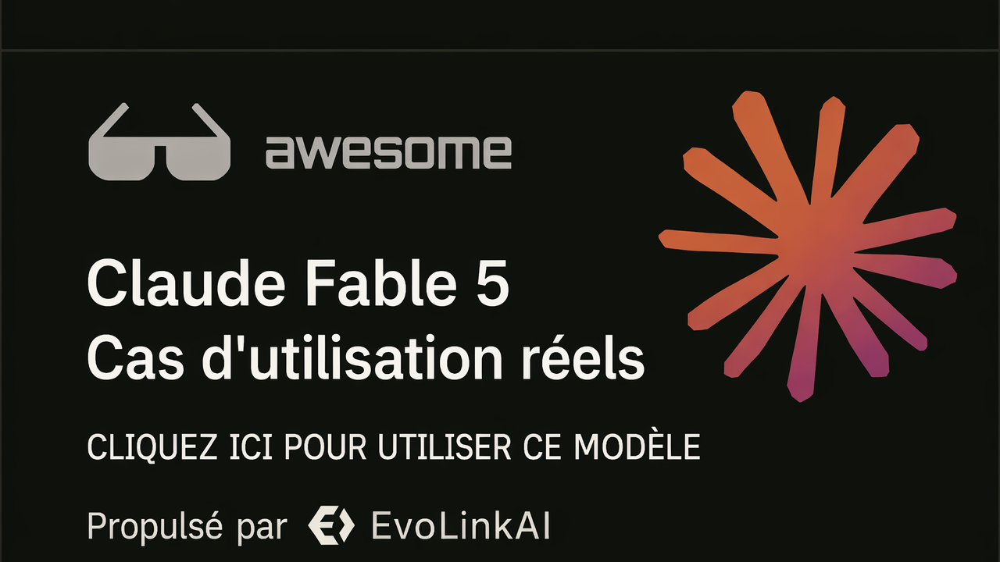

<div align="center">

<a href="https://evolink.ai/claude-fable-5?utm_source=github&utm_medium=readme&utm_campaign=awesome-claude-fable-5"></a>

[](LICENSE)
[](https://evolink.ai/claude-fable-5?utm_source=github&utm_medium=readme&utm_campaign=awesome-claude-fable-5)
[](https://evolink.ai/claude-fable-5?utm_source=github&utm_medium=readme&utm_campaign=awesome-claude-fable-5)
[](https://docs.evolink.ai)

[](README.md)
[](README_es.md)
[](README_pt.md)
[](README_ja.md)
[](README_ko.md)
[](README_de.md)
[](README_fr.md)
[](README_tr.md)
[](README_zh-TW.md)
[](README_zh-CN.md)
[](README_ru.md)

</div>

<a id="-introduction"></a>
## 🍌 Introduction

Bienvenue dans le dépôt de cas d'utilisation à fort signal pour Claude Fable 5.

**Nous collectons des cas d'utilisation réels, des tutoriels, des intégrations et des évaluations pour Claude Fable 5, sélectionnés à partir de démonstrations publiques et de communautés de créateurs.**

Ce README français est une localisation complète de la source anglaise et se concentre sur les cas à fort signal avec des workflows concrets, des prompts, des démonstrations, des intégrations, des preuves de benchmark ou des limites pratiques.

La plupart des cas sont sélectionnés depuis des publications X/Twitter et des démonstrations publiques. Chaque titre de cas renvoie à la source originale et chaque identifiant d'auteur renvoie au profil du créateur.

Essayez-le sur Evolink : [Claude Fable 5](https://evolink.ai/claude-fable-5?utm_source=github&utm_medium=readme&utm_campaign=awesome-claude-fable-5)

<a id="-overview"></a>
## 📊 Vue d'ensemble

- **88 cas Fable 5 d’origine et 9 démonstrations Fable 5.5 de la communauté, soit 97 cas au total.**
- Couvre les agents de code, l'automatisation longue durée, les jeux, le design visuel, les simulations 3D, le travail de connaissance, les tutoriels, les intégrations API, les benchmarks, les prix et les limitations de lancement.
- Chaque cas inclut la source originale, l'attribution au créateur, un enseignement concis, le type de preuve et la date de publication.
- Utilisez ce dépôt pour trouver des workflows pratiques, comparer forces et limites, découvrir des prompts reproductibles et suivre des exemples d'intégration.

> [!NOTE]
> La collection privilégie les preuves concrètes plutôt que le battage médiatique : prompts reproductibles, démos livrées, méthodes de benchmark, notes d'intégration, données de coût et réserves clairement formulées.

<a id="-quick-api-access"></a>
## ⚡ Accès rapide à l'API

Utilisez Claude Fable 5 via l'API Messages compatible avec Evolink. Obtenez un token API via [Evolink](https://evolink.ai/login?utm_source=github&utm_medium=readme&utm_campaign=awesome-claude-fable-5), puis remplacez `<token>` par votre token.

```bash
curl --request POST \
  --url https://direct.evolink.ai/v1/messages \
  --header 'Authorization: Bearer <token>' \
  --header 'Content-Type: application/json' \
  --data '
{
  "model": "claude-fable-5",
  "max_tokens": 1024,
  "messages": [
    {
      "role": "user",
      "content": "Hello, world"
    }
  ]
}
'
```

<a id="-menu"></a>
## 📑 Menu

| Section | Cas |
|---|---|
| [💻 Codage et génération de code](#coding-and-code-generation) | Case 1-6 |
| [🤖 Agents et automatisation longue durée](#agents-and-long-running-automation) | Case 7-8 |
| [🎮 Jeux et démos interactives](#games-and-interactive-demos) | Case 9-12 |
| [🎨 Visuel, design, vidéo et 3D](#visual-design-video-and-3d) | Case 13-16 |
| [📚 Documents, travail de connaissance et recherche](#documents-knowledge-work-and-research) | Case 17-19 |
| [🧭 Tutoriels, cours et ressources de prompts](#tutorials-courses-and-prompt-resources) | Case 20-28 |
| [🔌 Plateforme, API et intégration d'outils](#platform-api-and-tool-integration) | Case 29-34 |
| [📏 Évaluations, comparaisons et limites](#evaluations-comparisons-and-limits) | Case 35-88 |
| [🙏 Acknowledge](#acknowledge) | Crédits et politique de correction |

### [💻 Codage et génération de code](#coding-and-code-generation)

| Case | Ce que cela montre | Type |
|---|---|---|
| [Workflow Cursor en plusieurs étapes](#case-1) | Utilisez Fable 5 comme étape de revue de plan et de critique dans un workflow Cursor multi-modèles, puis confiez l'implémentation et les révisions à des modèles moins chers ou spécialisés. |  |
| [Recréation de GitHub à partir d'une capture d'écran](#case-2) | Collez une capture d'écran produit dans un outil de codage agentique et demandez à Fable 5 de recréer l'interface avec des fonctionnalités opérationnelles. |  |
| [Simulation de trou noir avec un seul prompt](#case-3) | Donnez à Fable 5 un prompt détaillé de creative coding et demandez-lui de produire une visualisation physique Three.js autonome. |  |
| [Web OS façon macOS en one-shot](#case-4) | Demandez à Fable 5 un web OS complet en fichier unique et laissez-le construire en une passe le shell UI, les apps, les interactions, l'audio et le comportement de jeu intégré. |  |
| [Construction de Spawn 5.0 avec 1 687 prompts](#case-5) | Utilisez Fable 5 comme partenaire d'ingénierie sur de longues sessions et de nombreux prompts, avec un humain qui passe de l'architecture au jugement de qualité de sortie. |  |
| [Revue d'une grande pull request avec constats](#case-6) | Pointez Fable 5 vers une grande pull request et demandez-lui d'examiner la justesse, les faux positifs, les vrais bugs et les problèmes de finition. |  |

### [🤖 Agents et automatisation longue durée](#agents-and-long-running-automation)

| Case | Ce que cela montre | Type |
|---|---|---|
| [Revue d'un workflow relais sur horizon long](#case-7) | Utilisez Fable 5 pour des travaux ambitieux sur horizon long : refontes de sites, pipelines de contenu programmatiques, adaptation de voix, revue de sécurité et contrôles qualité finaux. |  |
| [Diagnostic d'une panne d'infrastructure et ouverture d'une PR de correction](#case-8) | Donnez à Fable 5 accès à des indices d'infra comme les logs, les erreurs de base de données et les digests d'images, puis demandez-lui de diagnostiquer la panne et de préparer le correctif. |  |

### [🎮 Jeux et démos interactives](#games-and-interactive-demos)

| Case | Ce que cela montre | Type |
|---|---|---|
| [Dino Runner avec suivi du doigt](#case-9) | Demandez à Fable 5 de construire un jeu navigateur qui utilise le suivi du doigt comme mécanique d'entrée. |  |
| [Jeu de course construit avec deux phrases](#case-10) | Donnez à Fable 5 un prompt de jeu très court et laissez-le générer cartes, modes, musique, UI et assets de jeu en une seule exécution. |  |
| [Minecraft terminal installable en Rust](#case-11) | Exécutez Fable 5 via un harness de codage terminal et demandez-lui de construire un jeu terminal Rust installable. |  |
| [Clone de Minecraft avec temps et coût](#case-12) | Utilisez un prompt pour demander à Fable 5 un clone jouable façon Minecraft, puis évaluez le temps, le coût, le volume de code et la couverture fonctionnelle. |  |

### [🎨 Visuel, design, vidéo et 3D](#visual-design-video-and-3d)

| Case | Ce que cela montre | Type |
|---|---|---|
| [Prompt complet reproductible pour un email ecommerce](#case-13) | Donnez à Fable 5 un brief créatif complet pour une maquette d'email de marque, incluant les sections exactes, exigences produit, direction visuelle et contraintes. |  |
| [Benchmark d'horloger avec échappement à ancre suisse](#case-14) | Utilisez Fable 5 sur un benchmark de simulation mécanique et demandez-lui d'implémenter, vérifier et itérer sur la justesse physique. |  |
| [Scène Three.js de l'appartement de Friends](#case-15) | Demandez à Fable 5 de transformer un plan d'étage et une référence de scène en environnement Three.js navigable. |  |
| [Simulation du système solaire avec prompt et URL](#case-16) | Utilisez Fable 5 pour construire une simulation astronomique à partir des principes physiques, en itérant jusqu'à ce que la simulation et la sortie publique soient prêtes. |  |

### [📚 Documents, travail de connaissance et recherche](#documents-knowledge-work-and-research)

| Case | Ce que cela montre | Type |
|---|---|---|
| [Preuves Stripe et workflows scientifiques](#case-17) | Utilisez ceci comme preuve pour les affirmations sur la migration d'entreprise et les workflows scientifiques, pas comme prompt à copier-coller. |  |
| [Mémo de politique publique et workflows de suivi des modifications](#case-18) | Utilisez Fable 5 pour le travail qualitatif long format sur documents : suivi des modifications, tri de commentaires et éditions guidées par transcription. |  |
| [Prompt de recherche approfondie et résultat](#case-19) | Posez à Fable 5 une question de type recherche et évaluez s'il peut produire une longue réponse structurée et historiquement fondée. |  |

### [🧭 Tutoriels, cours et ressources de prompts](#tutorials-courses-and-prompt-resources)

| Case | Ce que cela montre | Type |
|---|---|---|
| [Comment Fable 5 change les workflows Claude Code](#case-20) | Utilisez Fable 5 en définissant direction, contexte, objectifs et critères de vérification au lieu de microgérer chaque étape. |  |
| [Revue d'un milliard de tokens et stratégie de routage](#case-21) | Utilisez Fable 5 pour la planification et la revue frontier, puis routez l'implémentation à fort volume vers des modèles moins chers. |  |
| [Prompt défensif de durcissement d'appareils](#case-22) | Exécutez un prompt de durcissement défensif étape par étape où Fable 5 inventorie les appareils, donne des vérifications exactes et attend validation. |  |
| [Prompt `/goal` d'audit design d'un site complet](#case-23) | Utilisez `/goal` pour faire démarrer un site par Fable 5, capturer les pages, auditer l'UX, écrire un rapport et corriger les petits problèmes sûrs. |  |
| [Répartition du travail créatif long format](#case-24) | Utilisez Fable 5 pour concevoir des formats et exemples stables, puis transmettez cette structure à un autre système de génération pour la sortie spécifique au domaine. |  |
| [Guide débutant pour utiliser Fable 5](#case-25) | Utilisez Fable 5 avec des prompts orientés objectif, des boucles de vérification et des réglages d'effort plutôt qu'avec de petites instructions pas à pas. |  |
| [Prompt copier-coller d'audit de dépôt](#case-26) | Collez le prompt d'audit de dépôt dans Fable 5 et demandez-lui une découverte appuyée par fichiers, des constats, une stratégie et un plan de tâches par jalons. |  |
| [Stratégie d'utilisation pendant une fenêtre limitée](#case-27) | Dépensez l'usage Fable 5 sur l'audit, l'architecture et la planification tant que la fenêtre d'accès est favorable, puis utilisez des modèles moins chers pour l'exécution. |  |
| [Utilisation des objectifs et workflows dans Claude Code](#case-28) | Utilisez Fable 5 comme partenaire de réflexion avant l'implémentation, puis combinez `/goal` et workflows pour exécuter et vérifier le plan. |  |

### [🔌 Plateforme, API et intégration d'outils](#platform-api-and-tool-integration)

| Case | Ce que cela montre | Type |
|---|---|---|
| [Configuration de l'intégration Hermes Agent](#case-29) | Configurez Hermes pour utiliser `anthropic/claude-fable-5` sur les runs `/goal` complexes et les tâches longues avec cache. |  |
| [Capacités, prix et notes d'abonnement](#case-30) | Utilisez ce cas pour comprendre quand Fable 5 est disponible, ce qu'il coûte et quels domaines protégés peuvent basculer vers un autre modèle. |  |
| [Synthèse lancement, accès, prix et sécurité](#case-31) | Utilisez cette synthèse de lancement pour choisir la voie d'accès, le nom de modèle API, la fenêtre de contexte, la stratégie de cache et le timing d'abonnement. |  |
| [Stratégie de réduction des coûts avec advisor](#case-32) | Utilisez Fable 5 comme advisor ou reviewer dans un workflow avec modèle moins cher lorsque l'intelligence marginale vaut le coût. |  |
| [Prix, accès et garde-fous de sécurité](#case-33) | Utilisez ce cas pour comprendre l'accès à Fable 5, les prix API et le comportement de fallback de sécurité avant de planifier des charges de travail. |  |
| [Intégration Swarms en une ligne](#case-34) | Définissez le nom de modèle Swarms sur `anthropic/claude-fable-5` et exécutez Fable 5 via le framework ou l'API Swarms. |  |

### [📏 Évaluations, comparaisons et limites](#evaluations-comparisons-and-limits)

| Case | Ce que cela montre | Type |
|---|---|---|
| [Comparaison coût et qualité entre Fable 5 et GPT-5.5](#case-35) | Comparez Fable 5 et GPT-5.5 sur la même tâche de codage pour juger qualité de sortie, durée d'exécution et coût d'outil. |  |
| [Résultat du benchmark AA-Omniscience](#case-36) | Utilisez ce cas de benchmark pour évaluer Fable 5 sur la précision des connaissances et le comportement d'hallucination. |  |
| [Résultat de l'Artificial Analysis Intelligence Index](#case-37) | Utilisez ce cas pour benchmarker le classement d'intelligence global de Fable 5 face aux autres modèles frontier. |  |
| [Benchmark GDPval-AA de travail de connaissance agentique](#case-38) | Utilisez ce cas pour évaluer Fable 5 sur le travail de connaissance agentique en conditions réelles. |  |
| [Premières impressions après une semaine et mécanique de prix](#case-39) | Utilisez ce cas de premières impressions pour décider où Fable 5 est le plus fort, notamment en game design et planification de systèmes. |  |
| [Comparaison de coût et de vitesse](#case-40) | Utilisez cette comparaison pour décider si le gain de qualité justifie le coût plus élevé et les runs longs plus lents. |  |
| [Notes pratiques sur Claude Code](#case-41) | Utilisez ce cas pour évaluer Fable 5 dans Claude Code, y compris l'usage d'outils, la personnalité et les aspérités restantes. |  |
| [Résultat du benchmark d'écriture créative](#case-42) | Utilisez ce cas de benchmark pour juger la qualité d'écriture de nouvelles courtes de Fable 5 et son comportement de refus. |  |
| [Synthèse de lancement multi-benchmarks](#case-43) | Utilisez cette synthèse de benchmarks de lancement pour comprendre les scores principaux les plus pertinents pour les agents de code et les tâches complexes. |  |
| [Comparaison benchmark et prix avec GPT-5.5](#case-44) | Utilisez cette comparaison pour évaluer Fable 5 face à GPT-5.5 sur le prix et les catégories de benchmark. |  |
| [Notes de terrain avec limites pratiques](#case-45) | Utilisez ce retour terrain pour comprendre où Fable 5 semble nettement meilleur et où il conserve des limites pratiques. |  |
| [Comparaison de simulations physiques](#case-46) | Exécutez des prompts identiques de simulation physique contre Fable 5 et Opus 4.8 pour comparer qualité de sortie, coût et vitesse. |  |
| [Expérience de débogage et jugement design](#case-47) | Utilisez Fable 5 pour le débogage en lui demandant de mesurer, logger, vérifier et patcher plutôt que simplement deviner. |  |
| [Avantages et inconvénients multidimensionnels](#case-48) | Utilisez ce cas pour comprendre les forces et faiblesses pratiques avant de faire de Fable 5 votre modèle quotidien. |  |
| [Test de rédaction juridique S-1](#case-49) | Utilisez un prompt de rédaction S-1 comme test de capacité d'agent juridique et comparez structure, formatage et longueur. |  |
| [Détails de benchmarks santé](#case-50) | Utilisez cette note de benchmark pour évaluer Fable 5 sur les tâches liées à la santé et identifier les évaluations médicales difficiles manquantes. |  |
| [Évaluation ParseBench de parsing de documents](#case-51) | Utilisez ce cas pour décider si Fable 5 est rentable pour le parsing de documents face à des systèmes OCR spécialisés. |  |
| [Comparaison SWE-Bench Pro et FrontierCode](#case-52) | Utilisez ce cas de benchmark pour évaluer Fable 5 pour migrations, implémentations complexes, sessions autonomes, tests et vérification visuelle. |  |
| [Revue qualitative de résolution de problèmes longs](#case-53) | Utilisez cette revue qualitative pour comprendre pourquoi Fable 5 convient aux tâches plus longues et plus difficiles tout en exigeant encore une revue de production. |  |
| [Résultats ParseBench de fidélité et de formatage](#case-54) | Utilisez ce résultat ParseBench pour juger les performances de fidélité documentaire et de formatage. |  |
| [Benchmarks, prix, accès et garde-fous](#case-55) | Utilisez ce cas comme checklist large pour benchmarks, prix, accès, garde-fous et implications stratégiques. |  |
| [Liste officielle des scores de benchmark](#case-56) | Utilisez cette liste de benchmarks pour comprendre les scores officiels de Fable 5 sur code, usage ordinateur et tâches de sécurité. |  |
| [Méthodologie du benchmark APEX-SWE](#case-57) | Utilisez ce cas pour évaluer Fable 5 sur APEX-SWE, notamment observability et travail d'intégration. |  |
| [Résultat ProofBench en mathématiques formelles](#case-58) | Utilisez ce cas pour évaluer Fable 5 en mathématiques formelles face à des systèmes spécialisés de preuve de théorèmes. |  |
| [Analyse préliminaire VirtueBench](#case-59) | Utilisez ce cas pour inspecter le comportement de raisonnement moral de Fable 5 à travers les catégories de vertus. |  |
| [Test d'overfit de sécurité avec réponse API vide](#case-60) | Utilisez ce cas pour comprendre le risque d'overfit de sécurité au lancement et le comportement de réponse vide en test API. |  |
| [Concevoir des prompts Fable avec vérification](#case-61) | Utilisez ce guide pour remplacer les longues astuces de prompting par un objectif, du contexte, des contraintes, des outils et des boucles de vérification. | Tutoriel |
| [Un jeu de plateforme à Istanbul depuis une référence](#case-62) | Testez Fable 5 avec une planche de sprites de référence et une consigne de conversion en jeu de plateforme jouable. | Démo |
| [Un tableau de bord métier en ville 3D](#case-63) | Utilisez Fable 5 pour transformer un processus métier en concept de tableau de bord urbain 3D animé. | Démo |
| [Un jeu de trou en Three.js en une passe](#case-64) | Utilisez Fable 5 pour créer en une passe un prototype de jeu 3D pour navigateur en Three.js. | Démo |
| [Comparer les scores DeepSWE](#case-65) | Appuyez-vous sur cette note DeepSWE pour comparer Fable 5 xHigh à GPT-5.5 xHigh en ingénierie logicielle. | Évaluation |
| [Comparer les coûts d'analyse d'un dépôt](#case-66) | Utilisez cette comparaison d'analyses de dépôt pour mettre le prix des tokens en regard du coût des corrections humaines. | Évaluation |
| [Consommation de tokens d'un jeu Super Mario](#case-67) | Utilisez cette création de jeu en une passe pour estimer la qualité de sortie et la consommation de tokens de Fable 5. | Démo |
| [Le réglage de repli de Claude Code](#case-68) | Découvrez le réglage de Claude Code qui change de modèle lorsqu'un message destiné à Fable 5 est signalé. | Intégration |
| [Construire un simulateur Namma Metro](#case-69) | Utilisez cette démonstration comme exemple concis de création d'un simulateur de transport public avec Fable 5 par vibe coding. | Démo |
| [Dusk Drive créé avec un seul prompt](#case-70) | Évaluez Fable 5 sur le prototypage d'un jeu de conduite low-poly sans retouches humaines à partir de ce cas. | Démo |
| [Le classement APEX-Agents en Pass@1](#case-71) | Utilisez ce résultat APEX-Agents pour comparer Fable 5 Max sur des tâches autonomes à plusieurs étapes. | Évaluation |
| [Un guide de sélection des modèles Claude](#case-72) | Réservez Fable 5 aux tâches les plus difficiles dans Claude Code grâce à ce guide de sélection. | Tutoriel |
| [La boucle agentique automatisée de HermesWorld](#case-73) | Étudiez une boucle Fable 5 qui construit, teste, joue et exécute des tests de fumée pendant plusieurs jours sans intervention. | Intégration |
| [Tester un rapport dans le style McKinsey](#case-74) | Utilisez ce prompt documentaire pour évaluer la structure d'un rapport de conseil, ses graphiques, son récit et son analyse des risques. | Tutoriel |
| [Rendre visibles les garde-fous](#case-75) | Utilisez cette note officielle pour comprendre la visibilité des garde-fous de Fable 5, les motifs de refus de l'API et le repli sur Opus. | Intégration |
| [Corriger la reconnaissance des modèles dans Claude Code](#case-76) | Utilisez cette note de version de Claude Code pour éviter les problèmes de noms de modèles Fable 5 et de reconnaissance du contexte. | Intégration |
| [Trois applications web dans Claude Code](#case-77) | Examinez Fable 5 dans Claude Code à travers plusieurs applications web générées dans cette démonstration pour débutants. | Démo |
| [Rilable, un créateur d'applications open source](#case-78) | Étudiez avec ce créateur d'applications open source l'usage de Fable 5 pour iOS, le web, les bacs à sable et le coût des tokens API. | Intégration |
| [Lancement de l'index d'agents de code DeepSWE](#case-79) | Utilisez l'index Artificial Analysis actualisé pour comparer Claude Fable 5 sur des tâches de codage agentique plus difficiles qui évitent les correctifs GitHub publics recyclés. | Evaluation |
| [Jeu d'analytics web DataEmpire](#case-80) | Transformez des analytics de site brutes en jeu rejouable en demandant à Claude Fable 5 d'associer visiteurs et jalons à des entités de jeu. | Integration |
| [Signal FrontierSWE sur 20 heures de tâche](#case-81) | Utilisez FrontierSWE comme preuve que Claude Fable 5 peut rester productif sur de très longues tâches d'ingénierie, pas seulement sur de courtes boucles de correction de bugs. | Evaluation |
| [Records CUDA sur KernelBench-Hard](#case-82) | Utilisez Claude Fable 5 pour la génération avancée de kernels CUDA lorsque vous avez besoin d'optimisation bas niveau, pas seulement de wrappers autour de bibliothèques existantes. | Evaluation |
| [Clone de landing page via capture Figma](#case-83) | Capturez la page d'un concurrent en couches Figma et laissez Claude Code avec Claude Fable 5 reconstruire structure, copywriting et système de marque au lieu de deviner à partir de captures d'écran. | Integration |
| [Clone de GTA 2 en deux heures](#case-84) | Combinez la génération de code de Claude Fable 5 avec un outillage d'assets séparé pour construire rapidement un jeu 3D jouable sans coder toute la stack à la main. | Tutorial |
| [Agent de triage de logs CloudWatch](#case-85) | Laissez un agent propulsé par Claude Fable 5 mâcher de très gros contextes de logs de service, inférer l'architecture puis se resserrer sur des pannes précises. | Integration |
| [Prédicteur de Coupe du monde en sandboxes](#case-86) | Placez plusieurs modèles frontier derrière des sandboxes isolées et laissez-les rechercher actualités live, blessures et contexte des cartons jaunes pour une application publique de prédiction. | Integration |
| [Cas de coût des refus WolfBench](#case-87) | Traitez le comportement de refus comme une vraie variable de benchmark lorsque vous chiffrez de longs runs autonomes sur Claude Fable 5. | Evaluation |
| [Suivi du cutoff d'accès API](#case-88) | Surveillez la disponibilité avec un script si votre workflow dépend d'un accès continu à un modèle frontier qui peut être limité ou retiré avec peu de préavis. | Integration |


### [🆕 Fable 5.5 : démonstrations de la communauté](#fable-5-5-community-demos)

| Cas | Ce que cela montre | Type |
|---|---|---|
| [Une animation de renard avec son générée par code](#case-89) | Définissez une animation HTML autonome et sa conception sonore à l’aide d’un brief plan par plan. | Demo |
| [Une animation à partir d’un brief créatif ouvert](#case-90) | Comparez ce qu’un modèle de programmation produit avec un brief d’animation ouvert et avec un storyboard détaillé. | Demo |
| [Un site animé pour une entreprise de construction](#case-91) | Évaluez la présentation 3D animée et la composition des pages avec un brief de site pour une entreprise de construction. | Demo |
| [Une présentation automobile en Three.js](#case-92) | Examinez une scène automobile comme test compact de la composition 3D, des matériaux et de la présentation par la caméra. | Demo |
| [Un jeu pour navigateur dans le style Minecraft](#case-93) | Associez l’enregistrement du jeu au lien de jeu du créateur pour évaluer un jeu généré pour navigateur. | Demo |
| [Un pélican cycliste animé en Three.js](#case-94) | Examinez une scène de vélo pour vérifier la coordination des mouvements du personnage, la géométrie du vélo et les détails du décor. | Demo |
| [Un pélican à vélo en SVG avec le prompt exact](#case-95) | Réutilisez le court prompt SVG du créateur pour comparer la géométrie et les détails avec la même entrée. | Demo |
| [Un exemple d’animation de zèbre au galop](#case-96) | Utilisez un clip d’animal au galop pour examiner la cohérence de l’allure et la continuité du mouvement. | Demo |
| [Un indicateur TradingView avec exécution humaine](#case-97) | Gardez l’exécution des ordres manuelle lorsque vous évaluez un indicateur signalant des entrées possibles et ajoutant un commentaire. | Demo |

<a id="coding-and-code-generation"></a>
## 💻 Codage et génération de code

<a id="case-1"></a>
### Case 1: [Workflow Cursor en plusieurs étapes](https://x.com/AlicanKiraz0/status/2064487347605918180) (par [@AlicanKiraz0](https://x.com/AlicanKiraz0))

**Utilisez Fable 5 comme étape de revue de plan et de critique dans un workflow Cursor multi-modèles, puis confiez l'implémentation et les révisions à des modèles moins chers ou spécialisés.**

Si l'on regarde le score final entre Fable 5 et GPT 5.5, l'écart est très faible. Ma recommandation d'utilisation, humblement, est la suivante : dans les plateformes IDE comme Cursor qui prennent en charge les modèles hybrides, utilisez un workflow par étapes.

Phase 1 : pour la revue de code et la première phase d'inspection du projet, tout en réchauffant le contexte, utilisez l'un de GPT 5.5 High, Minimax M3, Kimi K2.6 ou Composer 2.5.

Phase 2 : pour préparer le plan du projet, utilisez GPT 5.5 Very High ou Opus 4.8.

Phase 3 : pour analyser le plan du projet, utilisez Fable 5 ; laissez-le identifier les parties défaillantes du plan. Pour les révisions, utilisez GPT 5.5 Very High.

Phase 4 : pour implémenter le plan, utilisez Minimax M3, Deepseek v4 Max, Composer 2.5 ou Sonnet 4.6.

Phase 5 : pour la revue finale et pour vérifier si l'implémentation a suivi le plan, utilisez GPT 5.5 High.

Type: Evaluation | Date: 2026-06-09

---

<a id="case-2"></a>
### Case 2: [Recréation de GitHub à partir d'une capture d'écran](https://x.com/coldopn/status/2064435234465087638) (par [@coldopn](https://x.com/coldopn))

**Collez une capture d'écran produit dans un outil de codage agentique et demandez à Fable 5 de recréer l'interface avec des fonctionnalités opérationnelles.**

🚨 Anthropic Fable 5 vient de répliquer GITHUB à partir d'une CAPTURE D'ÉCRAN !!

Tout ce que j'ai fait, c'est coller une capture de l'interface GitHub dans Kilo Code et lui demander de recréer GitHub avec de vraies fonctionnalités.

Il a codé pendant 10 minutes et dépensé $4.07.

Le résultat était une réplique fonctionnelle de GitHub : https://t.co/bjMObvlsPX

Type: Demo | Date: 2026-06-09

---

<a id="case-3"></a>
### Case 3: [Simulation de trou noir avec un seul prompt](https://x.com/deveshcodes_/status/2064437742189379745) (par [@deveshcodes_](https://x.com/deveshcodes_))

**Donnez à Fable 5 un prompt détaillé de creative coding et demandez-lui de produire une visualisation physique Three.js autonome.**

@claudeai a créé en one-shot une simulation en temps réel de lentille gravitationnelle de trou noir dans Three.js avec Claude Fable 5.

Elle incluait la lentille gravitationnelle, un disque d'accrétion doppler-boosté, la sphère de photons, l'aberration chromatique et un champ d'étoiles procédural.

Résultat : 60 fps, un seul fichier HTML, un seul prompt.

Le nouveau standard est fou 🤯 https://t.co/E23I8bnPKb

Type: Tutorial | Date: 2026-06-09

---

<a id="case-4"></a>
### Case 4: [Web OS façon macOS en one-shot](https://x.com/intheworldofai/status/2064421915347812672) (par [@intheworldofai](https://x.com/intheworldofai))

**Demandez à Fable 5 un web OS complet en fichier unique et laissez-le construire en une passe le shell UI, les apps, les interactions, l'audio et le comportement de jeu intégré.**

🚨 Claude Fable 5 vient de construire en une seule tentative un web OS complet façon macOS, et il est allé plus loin que la plupart des modèles.

Un seul fichier HTML, CSS + JS intégrés.

À partir d'un seul prompt, il a construit :

- barre de menu macOS + dock
- fenêtres d'app redimensionnables et déplaçables
- explorateur de fichiers fonctionnel
- terminal opérationnel + maquette de navigateur
- icônes de bureau SVG + notifications
- app Réglages, thèmes et écran de démarrage
- lecteur audio entièrement fonctionnel avec vraie synthèse et aucun fichier externe
- clone de Minecraft jouable dans le bureau

Tout a été généré en une passe avec presque aucune correction.

Le lecteur audio opérationnel plus le vrai clone de Minecraft, c'est quelque chose que je n'avais encore vu aucun autre modèle réussir. La génération frontend/UI de Fable 5 devient ridicule.

Type: Tutorial | Date: 2026-06-09

---

<a id="case-5"></a>
### Case 5: [Construction de Spawn 5.0 avec 1 687 prompts](https://x.com/jsnnsa/status/2064420561078693941) (par [@jsnnsa](https://x.com/jsnnsa))

**Utilisez Fable 5 comme partenaire d'ingénierie sur de longues sessions et de nombreux prompts, avec un humain qui passe de l'architecture au jugement de qualité de sortie.**

claude fable 5 est disponible.

spawn 5.0 a été construit avec lui :

- 1 687 prompts
- 102 sessions
- Mon travail est passé de l'architecture au jugement du goût

Ce que nous avons construit, et qui aurait pris au moins un mois chacun avec toute une équipe sur Opus :

- Un moteur physique from scratch, Mantle, qui rivalise avec Rapier et a pu être testé en une journée comme fil secondaire
- Éclairage clustered froxel : de 8 lumières à plus de 1 000 lumières entièrement dynamiques
- GI diffuse temps réel sur WebGPU, sur votre téléphone
- VFX GPU à un million de particules avec une architecture shader au-delà de ce que livrent Unreal et Unity
- Netcode à l'échelle MMO
- Une app native iOS alpha

Le tout a pris environ une semaine. Tout fonctionne sur mobile. La liste n'inclut pas la moitié de ce qui a été livré ; le changelog complet est dans le fil.

La partie que les benchmarks ne montreront pas : ce modèle a une personnalité merveilleuse. Il est réellement drôle. J'ai ri si fort que j'en ai pleuré plusieurs fois en plein rewrite de physique. Le génie et le caractère ne sont pas des fonctionnalités séparées.

Type: Tutorial | Date: 2026-06-09

---

<a id="case-6"></a>
### Case 6: [Revue d'une grande pull request avec constats](https://x.com/ryanrhughes/status/2064411147076534705) (par [@ryanrhughes](https://x.com/ryanrhughes))

**Pointez Fable 5 vers une grande pull request et demandez-lui d'examiner la justesse, les faux positifs, les vrais bugs et les problèmes de finition.**

J'ai lâché Fable 5 sur la revue d'une seule PR (74 fichiers / +3 705 / -1 246) pour voir comment il s'en sortirait. Il a tourné 34 min, consommé 42 % de ma session de 5 h, produit 16 constats de « correctness », et trouvé :

- 2 faux positifs à l'air inquiétant
- 3 vrais bugs de correctness d'audit
- environ 5 vrais petits problèmes d'UX/finition
- tout un lot d'avis de nettoyage

C'était trop dangereux pour être publié ?

Type: Demo | Date: 2026-06-09

---

<a id="agents-and-long-running-automation"></a>
## 🤖 Agents et automatisation longue durée

<a id="case-7"></a>
### Case 7: [Revue d'un workflow relais sur horizon long](https://x.com/JJEnglert/status/2064469635190170105) (par [@JJEnglert](https://x.com/JJEnglert))

**Utilisez Fable 5 pour des travaux ambitieux sur horizon long : refontes de sites, pipelines de contenu programmatiques, adaptation de voix, revue de sécurité et contrôles qualité finaux.**

La version courte de ma revue de Claude Fable 5 : j'ai dépensé un milliard de tokens pour tester Claude Fable 5 et j'ai eu l'impression d'avoir un avantage déloyal.

Je juge au test visuel : je mets un modèle dans du vrai travail et j'observe. Est-ce qu'il me fait gagner des heures ou est-ce qu'il m'en coûte ? Est-ce qu'il attrape ce que j'ai raté ? Est-ce qu'il ressemble à un partenaire ou à un outil qu'il faut surveiller ?

C'est le premier modèle depuis longtemps qui réussit sur toutes les dimensions qui comptent, et pas de peu.

Construction : je reconstruisais notre site Tenex. Il était très custom et très difficile. GPT 5.5 et Claude 4.8 n'arrivaient pas à le résoudre seuls. Même avec les fichiers Figma en référence, ils plafonnaient autour de 85-90 %.

Puis Fable 5 a tout examiné, a dit qu'il pouvait faire mieux, est allé directement à la source Webflow originale, a téléchargé chaque asset et a presque tout refait en one-shot.

Ensuite, je lui ai fait construire un second site entièrement nouveau de 80 pages from scratch en un week-end. C'est un travail que j'aurais facturé $50k en tant qu'agence.

Il a aussi assemblé une usine complète de clips programmatiques :

- HeyGen
- ElevenLabs
- Cloudflare
- Un VPS

Le pipeline trouve des sujets, écrit des scripts, monte les vidéos, ajoute de la musique et publie sur les réseaux sociaux. Il a tourné tout seul pendant de longues périodes et s'est même construit un système de webhooks pour surveiller les rendus.

Écriture : il a répliqué notre document de voix de marque presque à l'identique, puis a conservé cette voix sur 80 pages de fonctionnalités, études de cas et articles sans dériver vers le défaut plat de l'IA.

Sécurité : deux modèles frontier avaient travaillé dans un grand dépôt et validé le code. Fable 5 a trouvé un bug sérieux et bien caché dès son premier passage et l'a corrigé sur place.

Le moment humain : je lui ai posé une question en attendant un cron job. Il a répondu, puis a ajouté de lui-même qu'il me restait environ 10 minutes et qu'il me préviendrait quand ce serait terminé. Je n'avais jamais demandé le minuteur.

Le vrai bémol : vous sentez le compteur plus qu'avec n'importe quel autre modèle. Anthropic dit qu'il est token-intensive par conception. Faites-le donc tourner comme un relais : réfléchissez avec Fable 5, construisez avec un modèle moins cher, relisez avec Fable 5.

Verdict : avoir accès à plus d'intelligence que la personne à côté de vous, c'est l'avantage. Fable 5 est le premier modèle qui rend cela réel. Même aux pleins tarifs frontier, il a dégagé un profit.

Type: Evaluation | Date: 2026-06-09

---

<a id="case-8"></a>
### Case 8: [Diagnostic d'une panne d'infrastructure et ouverture d'une PR de correction](https://x.com/ayushagarwal/status/2064422467557564862) (par [@ayushagarwal](https://x.com/ayushagarwal))

**Donnez à Fable 5 accès à des indices d'infra comme les logs, les erreurs de base de données et les digests d'images, puis demandez-lui de diagnostiquer la panne et de préparer le correctif.**

claude fable 5 est sacrément, sacrément bon !!!!

Il vient de diagnostiquer une panne que je n'arrivais même pas à décrire correctement dans une infra secondaire auto-hébergée.

Il a lu les logs de pods, interrogé les logs d'erreur Cloud SQL, comparé les digests d'images et découvert que Kubernetes exécutait une image cachée vieille de 3 mois contre une base de données récemment migrée.

Puis il a ouvert la PR de correction.

Des minutes, pas des heures. Aucune recherche web. 🤯

Type: Evaluation | Date: 2026-06-09

---

<a id="games-and-interactive-demos"></a>
## 🎮 Jeux et démos interactives

<a id="case-9"></a>
### Case 9: [Dino Runner avec suivi du doigt](https://x.com/ai_for_success/status/2064413182396108932) (par [@ai_for_success](https://x.com/ai_for_success))

**Demandez à Fable 5 de construire un jeu navigateur qui utilise le suivi du doigt comme mécanique d'entrée.**

J'ai demandé à Fable 5 de construire un jeu Dino runner avec suivi du doigt.

Il a créé le jeu finger runner en one-shot en environ 11 à 12 minutes, consommé autour de 914K tokens et tout implémenté en seulement 629 lignes de code.

https://t.co/AWt1lEIObq

Type: Demo | Date: 2026-06-09

---

<a id="case-10"></a>
### Case 10: [Jeu de course construit avec deux phrases](https://x.com/kieradev/status/2064482704763085202) (par [@kieradev](https://x.com/kieradev))

**Donnez à Fable 5 un prompt de jeu très court et laissez-le générer cartes, modes, musique, UI et assets de jeu en une seule exécution.**

Claude Fable 5, 40 % de l'usage Max 5x.

Jeu complet de type Mario Kart 64 à partir d'un prompt de 2 phrases.

Fable 5 a géré toute la décoration, les modèles de personnages, 4 cartes, la musique, les trois modes de jeu et l'UI en un seul shot, en environ 15 minutes.

#fable #anthropic https://t.co/B7mTidE84U

Type: Tutorial | Date: 2026-06-09

---

<a id="case-11"></a>
### Case 11: [Minecraft terminal installable en Rust](https://x.com/vikvang1/status/2064500731848319303) (par [@vikvang1](https://x.com/vikvang1))

**Exécutez Fable 5 via un harness de codage terminal et demandez-lui de construire un jeu terminal Rust installable.**

J'ai laissé Claude Fable 5 cuisiner pendant une heure avec le harness de Warp.

Il a créé une version TUI de Minecraft qui rend directement dans votre terminal, entièrement construite en Rust.

Commande d'installation : cargo install termcraft-3d

https://t.co/zs3y3t88oM

Type: Demo | Date: 2026-06-10

---

<a id="case-12"></a>
### Case 12: [Clone de Minecraft avec temps et coût](https://x.com/ydamitcodes/status/2064536076518363353) (par [@ydamitcodes](https://x.com/ydamitcodes))

**Utilisez un prompt pour demander à Fable 5 un clone jouable façon Minecraft, puis évaluez le temps, le coût, le volume de code et la couverture fonctionnelle.**

@claudeai Fable 5 m'a construit un clone de Minecraft en 37 minutes.

Un prompt. Environ 3K lignes de code. $12 de coûts API.

Il incluait biomes, grottes, minerais, jour/nuit, mobs, tout.

Minecraft a pris 2 ans à Notch.

https://t.co/AmwdLwi75O

Type: Tutorial | Date: 2026-06-10

---

<a id="visual-design-video-and-3d"></a>
## 🎨 Visuel, design, vidéo et 3D

<a id="case-13"></a>
### Case 13: [Prompt complet reproductible pour un email ecommerce](https://x.com/ecomchasedimond/status/2064454139225297091) (par [@ecomchasedimond](https://x.com/ecomchasedimond))

**Donnez à Fable 5 un brief créatif complet pour une maquette d'email de marque, incluant les sections exactes, exigences produit, direction visuelle et contraintes.**

Claude Fable 5 a créé ceci avec un seul prompt et sans retouche.

Voici le prompt complet que j'ai utilisé :

Crée une maquette d'email ecommerce pleine longueur, haute et verticale pour MVMT, une marque moderne de montres et d'accessoires destinée aux millennials.

Conçois un email DTC premium très réaliste, élégant, poli, minimal, à tendance masculine et éditorial. L'image finale doit ressembler à une vraie capture d'email ecommerce conçue par un designer, pas à une affiche, pas à une landing page, ni à un template générique.

Vibe de marque : moderne California-cool, jeune, assurée, propre, aspirationnelle, stylée et élevée. Le design doit paraître proche du luxe tout en restant accessible.

Mets ces produits en avant :

- Mulholland
- Odyssey II Automatic
- Cali Diver
- Signature Watch Bands

Style visuel :

- design ecommerce premium épuré
- mise en page éditoriale raffinée
- photographie produit réaliste
- imagerie lifestyle subtile
- hiérarchie forte
- typographie sans-serif nette
- espacements généreux
- ombres subtiles
- palette moderne et retenue

Palette de couleurs : noir, blanc, anthracite, gris chaud, pierre, beige doux, tons de métal brossé et accents discrets atténués. Garde la palette neutre et premium.

Direction créative importante : cela doit ressembler à une campagne email de marque horlogère soignée avec un fort goût design. Priorise le réalisme, l'élégance et la clarté. Fais en sorte que cela ressemble à quelque chose que MVMT pourrait vraiment envoyer.

Construis l'email dans cet ordre :

1. Barre promo supérieure : une fine barre noire ou anthracite foncé sur toute la largeur en haut avec un petit texte en majuscules : “FREE SHIPPING OVER $75 + EASY RETURNS”.

2. En-tête : un en-tête blanc épuré avec le wordmark/logo MVMT à gauche et des liens de navigation minimaux à droite ou centrés : WATCHES, SUNGLASSES, JEWELRY, NEW ARRIVALS.

3. Section hero : une section hero premium avec un fort équilibre visuel.

Utilise un titre audacieux : “BUILT TO GET NOTICED”.

Ajoute un court texte de soutien sur des garde-temps et accessoires modernes conçus pour élever le style du quotidien.

Ajoute un bouton CTA sombre arrondi : “SHOP WATCHES”.

L'image hero doit inclure :

- une image dominante de montre premium
- une imagerie lifestyle de luxe subtile
- un modèle masculin stylé ou une scène lifestyle masculine mode
- un éclairage moderne et une composition propre

4. Section collection en vedette : ajoute un titre de section centré : “THREE WAYS TO WEAR MVMT”. En dessous, affiche trois cartes produit ou blocs image propres présentant :

- Mulholland
- Odyssey II Automatic
- Cali Diver

Chaque bloc doit inclure :

- image produit
- nom du produit
- courte description d'une ou deux lignes

Garde cette section symétrique, soignée et premium.

5. Bannière accessoires : ajoute une section split raffinée intitulée “FINISH THE LOOK”. Mets en avant Signature Watch Bands. Montre une imagerie close-up premium de bracelets de montre ou de bracelets interchangeables. Inclue un court texte de soutien et un bouton CTA sombre : “SHOP ACCESSORIES”.

6. Tuiles promo éditoriales : ajoute deux tuiles promotionnelles côte à côte avec un design mené par l'image.

Titre de la première tuile : “FOR DAILY WEAR”.

Titre de la deuxième tuile : “FOR STATEMENT DAYS”.

Chaque tuile doit avoir un texte court et un petit CTA : “SHOP NOW”.

Ces tuiles doivent ressembler à des moments éditoriaux de marque, pas à des boîtes de soldes génériques.

7. Rangée shoppable : ajoute une section intitulée “IN ROTATION NOW”. Affiche une rangée ou grille propre de 4 produits avec :

- Mulholland
- Odyssey II Automatic
- Cali Diver
- Signature Watch Bands

Chaque élément doit inclure :

- image produit isolée
- nom du produit
- petit lien ou bouton “SHOP”

8. Signature de marque : ajoute un bloc de message centré avec le titre : “DESIGNED TO MOVE WITH YOU”. Inclue une courte phrase sur des montres, lunettes et accessoires soigneusement conçus pour la vie quotidienne.

9. Footer : crée un footer de marque réaliste noir ou anthracite avec :

- logo MVMT
- liens boutique
- liens entreprise
- liens support
- icônes sociales
- petit texte légal et livraison

Direction typographique : utilise une typographie sans-serif bold condensée ou moderne pour les grands titres, et une sans-serif propre pour le corps de texte. Les titres doivent être nets, modernes et fashion-forward. Le body copy doit paraître réaliste et globalement lisible.

Direction photo : utilise une photographie produit premium avec reflets réalistes, matériaux polis, ombres douces et surfaces propres. La photographie lifestyle doit paraître élevée, moderne et orientée mode.

Règles de composition :

- format email vertical haut
- séparation claire des sections
- proportions réalistes d'email
- hiérarchie forte
- texte majoritairement lisible
- espacements premium
- alignement intentionnel
- mélange équilibré d'imagerie produit et lifestyle

À éviter :

- style collage désordonné
- esthétique scrapbook ludique
- design trop coloré
- vibe de template bon marché
- imagerie cartoon
- mises en page encombrées
- faux éléments d'UI
- composition façon affiche
- chaos promotionnel excessif

Sortie : une maquette de design d'email ecommerce pleine longueur, composée verticalement, très réaliste, pour MVMT, avec une sensation premium, propre, polie, moderne, éditoriale et prête à être présentée.

Type: Tutorial | Date: 2026-06-09

---

<a id="case-14"></a>
### Case 14: [Benchmark d'horloger avec échappement à ancre suisse](https://x.com/quanghuynt14/status/2064509430650065278) (par [@quanghuynt14](https://x.com/quanghuynt14))

**Utilisez Fable 5 sur un benchmark de simulation mécanique et demandez-lui d'implémenter, vérifier et itérer sur la justesse physique.**

J'ai donc donné à Fable 5 le benchmark d'horloger : un mouvement complet à ancre suisse dans Three.js.

Vrais rapports d'engrenage (18 000 bph), échappement fonctionnel, spiral qui respire, et les aiguilles indiquent l'heure réelle.

Il a vérifié son propre travail avec la vision, en boucle, jusqu'à terminer.

⌚ https://t.co/RSRfDoKxA4

Type: Evaluation | Date: 2026-06-10

---

<a id="case-15"></a>
### Case 15: [Scène Three.js de l'appartement de Friends](https://x.com/scottstts/status/2064464351906673029) (par [@scottstts](https://x.com/scottstts))

**Demandez à Fable 5 de transformer un plan d'étage et une référence de scène en environnement Three.js navigable.**

Bon sang !!!

Fable 5 :

dans @threejs, crée une scène 3d navigable en vue première personne de l'iconique appartement de Monica dans la série Friends, correctement basée sur ce plan d'étage, fidèle à l'apparence et au ressenti originaux, avec un éclairage chaud

C'est de très loin LE MEILLEUR résultat que j'ai vu sur ce test !

Ce html unique m'a coûté $12, mais le résultat est superbe !

Type: Evaluation | Date: 2026-06-09

---

<a id="case-16"></a>
### Case 16: [Simulation du système solaire avec prompt et URL](https://x.com/tetumemo/status/2064477582930989357) (par [@tetumemo](https://x.com/tetumemo))

**Utilisez Fable 5 pour construire une simulation astronomique à partir des principes physiques, en itérant jusqu'à ce que la simulation et la sortie publique soient prêtes.**

Claude Fable 5 est intense.

Comme il semble fort en simulations physiques, je lui ai demandé :

'Construis une simulation du système solaire en dérivant le mouvement orbital des planètes à partir des principes fondamentaux de la physique et en l'utilisant pour prédire les éclipses solaires.'

Après quelques allers-retours, c'était terminé.

C'est incroyablement amusant.

Le prompt terminé et l'URL publique sont liés ci-dessous.

Type: Tutorial | Date: 2026-06-09

---

<a id="documents-knowledge-work-and-research"></a>
## 📚 Documents, travail de connaissance et recherche

<a id="case-17"></a>
### Case 17: [Preuves Stripe et workflows scientifiques](https://x.com/AndrewCurran_/status/2064413892378546418) (par [@AndrewCurran_](https://x.com/AndrewCurran_))

**Utilisez ceci comme preuve pour les affirmations sur la migration d'entreprise et les workflows scientifiques, pas comme prompt à copier-coller.**

Citations de la publication d'aujourd'hui :

Avec Mythos 5, des experts internes en conception de protéines ont accéléré des parties du processus de conception de médicaments d'environ dix fois.

Dans un exemple, Mythos 5, avec des outils de conception de protéines et de bioinformatique mais sans assistance humaine, a égalé ou dépassé des opérateurs humains qualifiés.

Il a exécuté des tâches normalement accomplies par un scientifique : choisir des sites de liaison, sélectionner et lancer des outils de conception de protéines, et récupérer après des échecs.

Pendant les premiers tests, Stripe a rapporté que Fable 5 avait compressé des mois d'ingénierie en jours. Dans une base de code Ruby de 50 millions de lignes, le modèle a réalisé en une journée une migration à l'échelle de toute la base qui aurait autrement pris plus de deux mois de travail manuel à toute une équipe.

Mythos 5 a aussi produit de façon constante des hypothèses scientifiques nouvelles et convaincantes.

Dans des comparaisons aveugles face à face contre des modèles de classe Opus, les scientifiques ont préféré les hypothèses de biologie moléculaire de Mythos environ 80 % du temps et en ont avancé plusieurs vers une évaluation expérimentale.

Une hypothèse de Mythos, un nouveau mécanisme pour une protéine d'E. coli, a été corroborée dans une étude d'un laboratoire indépendant.

Mythos 5 a mené une recherche génomique originale pendant plus d'une semaine de travail largement autonome.

Il a assemblé des données unicellulaires pour des millions de cellules sur 138 espèces animales et conçu puis entraîné un modèle de machine learning personnalisé pour identifier des cellules jouant le même rôle chez des organismes éloignés.

Avec seulement une contribution humaine de haut niveau, le modèle entraîné a dépassé un modèle récent publié dans Science tout en étant 100 fois plus petit.

Type: Evaluation | Date: 2026-06-09

---

<a id="case-18"></a>
### Case 18: [Mémo de politique publique et workflows de suivi des modifications](https://x.com/manaltdan/status/2064414129440608427) (par [@manaltdan](https://x.com/manaltdan))

**Utilisez Fable 5 pour le travail qualitatif long format sur documents : suivi des modifications, tri de commentaires et éditions guidées par transcription.**

Fable 5 est le premier modèle que j'ai trouvé constamment utile pour du travail qualitatif de plus longue durée, comme la rédaction d'analyses de politique publique.

Entre ses capacités et des outils comme Wispr Flow, je commence à me rapprocher du gain de productivité dont j'entends depuis longtemps les codeurs parler.

Trois cas d'utilisation paraissent bien meilleurs qu'avant :

- Demander à Claude de lire intégralement un long mémo de politique publique et de renvoyer des modifications suivies : retouches de fluidité, commentaires remettant en question des affirmations fragiles et sources potentielles.
- Dans Projects, capturer un grand ensemble de commentaires et demander à Claude de recommander si et comment traiter chacun.
- Coller dans Claude la transcription d'une réunion à propos d'un document, puis demander à Claude d'appliquer en suivi des modifications les changements discutés dans la réunion et dans Slack, avec le contexte ajouté en commentaires.

Type: Tutorial | Date: 2026-06-09

---

<a id="case-19"></a>
### Case 19: [Prompt de recherche approfondie et résultat](https://x.com/naoyafujiwara/status/2064470780373811637) (par [@naoyafujiwara](https://x.com/naoyafujiwara))

**Posez à Fable 5 une question de type recherche et évaluez s'il peut produire une longue réponse structurée et historiquement fondée.**

Claude Fable 5 Max est devenu disponible ce matin, donc je l'ai essayé. Il semble très profond sous la surface, tandis que la sortie visible est très polie.

Question : Si les « 30 années perdues » du Japon ont commencé exactement il y a 30 ans à partir d'aujourd'hui, qu'étaient-elles exactement, pourquoi ont-elles eu lieu et comment affecteront-elles le monde à partir de cette année ?

Réponse : Traiter les 30 années perdues comme commençant non pas avec l'effondrement conventionnel de la bulle en 1991, mais exactement il y a 30 ans en 1996, permet d'atteindre l'essence du problème.

Statistiquement, le Japon a vraiment commencé à « perdre » à ce moment :

- La population en âge de travailler a culminé en 1995 à 87,16 millions.
- 1996 a été la dernière année où les naissances sont restées dans la fourchette de 1,2 million.
- Les salaires et le PIB nominal ont culminé en 1997.

Si l'effondrement de la bulle était la blessure, 1996 est le moment où la blessure a commencé à s'infecter.

Événements en 1996 :

- Adoption de la loi de renflouement des sociétés de prêts immobiliers, qui a injecté 685 milliards de yens de fonds publics et est devenue l'origine de la méfiance publique envers les banques et de la résistance aux renflouements.
- Décision du cabinet Hashimoto d'augmenter la taxe à la consommation à 5 %.
- Annonce du Big Bang financier, et la reconstruction budgétaire devient une politique nationale.

En avril 1997, la hausse de la taxe à la consommation, la fin des réductions fiscales spéciales et la hausse des charges d'assurance sociale ont ajouté ensemble environ 9 billions de yens de charge publique. Puis la crise monétaire asiatique a frappé en été.

En novembre, Sanyo Securities a provoqué le premier défaut d'après-guerre sur le marché call, gelant les marchés financiers à court terme. Hokkaido Takushoku Bank et Yamaichi Securities se sont effondrées l'une après l'autre.

À partir de 1998, le Japon est entré dans une déflation et un resserrement du crédit à grande échelle, et les suicides ont dépassé 30 000.

Le résultat sur les 30 années suivantes :

- Le PIB nominal a stagné autour de 500 billions de yens pendant un quart de siècle.
- La part du Japon dans le PIB mondial est passée d'environ 18 % à moins de 4 %.
- Les salaires moyens ont culminé en 1997 puis ont baissé ou stagné.
- L'emploi non régulier est passé d'environ 20 % à près de 40 %.
- Les naissances sont passées d'environ 1,2 million à environ 690 000 en 2024.
- Les taux directeurs sont restés proches de zéro après être passés sous 1 % en 1995.
- Les obligations d'État en circulation sont passées d'environ 240 billions de yens à plus de 1 100 billions de yens.
- Le Nikkei a mis 34 ans, jusqu'en février 2024, pour retrouver son sommet de 1989.

Autrement dit, les décennies perdues n'étaient pas seulement une gueule de bois financière. Elles étaient un basculement structurel impliquant démographie, salaires, déflation, dette, choix politiques et confiance sociale.

Type: Demo | Date: 2026-06-09

---

<a id="tutorials-courses-and-prompt-resources"></a>
## 🧭 Tutoriels, cours et ressources de prompts

<a id="case-20"></a>
### Case 20: [Comment Fable 5 change les workflows Claude Code](https://x.com/AI_masaou/status/2064448218038223206) (par [@AI_masaou](https://x.com/AI_masaou))

**Utilisez Fable 5 en définissant direction, contexte, objectifs et critères de vérification au lieu de microgérer chaque étape.**

Ce qui a changé dans le travail quotidien de l'équipe Claude Code après Claude Fable 5 est intéressant.

Thariq, de l'équipe Claude Code, dit que Fable 5 a changé de façon significative la manière dont les personnes chez Anthropic travaillent avec Claude.

Auparavant, les humains devaient vérifier soigneusement si Claude faisait le travail correctement : décomposer les tâches, relire les sorties et s'assurer qu'il ne s'était pas arrêté en chemin. Cela ressemblait davantage à de la supervision.

Avec Fable 5, parce qu'il peut travailler plus longtemps, se tester lui-même et générer du code de meilleure qualité, le rôle humain passe de surveiller s'il fait correctement le travail à orienter s'il fait le bon travail.

Autrement dit, la définition des objectifs et la construction du contexte comptent plus que la supervision.

Le workflow modifié comporte trois parties :

1. Utiliser Claude comme partenaire de réflexion.

Impliquer Claude avant l'implémentation, clarifier ce que vous voulez construire et ce qui est possible, lui faire poser des questions sur une petite spec, ou générer plusieurs directions et maquettes HTML à partir d'une idée pour faire émerger ambiguïtés et problèmes avant de coder.

2. Fournir du contexte, pas seulement des contraintes.

Au lieu de dire seulement « garde ça simple » ou « ne sur-construis pas », expliquez pourquoi.

Par exemple : « C'est une fonctionnalité expérimentale qui pourra être supprimée dans un mois, donc ne crée pas une structure difficile à jeter. »

Cela permet à Claude de mieux juger.

3. Donner des objectifs et des méthodes de vérification. Fable 5 fonctionne bien avec `/goal` et Workflows de Claude Code. Donnez-lui une spec, définissez l'implémentation complète comme objectif, puis laissez les workflows vérifier chaque étape et préparer un rapport sur ce qui a été implémenté et ce qui a différé.

Enfin, Thariq dit qu'il faut essayer de l'utiliser plus ambitieusement. Fable 5 vaut la peine d'être testé sur du travail qui semblait auparavant trop difficile pour les LLMs, et même le montage vidéo de la vidéo référencée a été fait avec Fable.

Type: Demo | Date: 2026-06-09

---

<a id="case-21"></a>
### Case 21: [Revue d'un milliard de tokens et stratégie de routage](https://x.com/JJEnglert/status/2064420538798260388) (par [@JJEnglert](https://x.com/JJEnglert))

**Utilisez Fable 5 pour la planification et la revue frontier, puis routez l'implémentation à fort volume vers des modèles moins chers.**

La revue de Claude Fable 5 : un milliard de tokens, jugée par un non-ingénieur.

J'ai dépensé un milliard de tokens à tester Claude Fable 5 sur de vrais projets : UI et UX, écriture, stratégie, sécurité, ingénierie et travail de connaissance. Le type de travail que je devais réellement livrer.

J'ai honnêtement eu l'impression d'avoir un avantage déloyal.

D'abord, le prisme : je ne suis pas ingénieur. La plupart des revues de modèles viennent d'ingénieurs qui exécutent des benchmarks d'ingénierie. Celle-ci vient d'un non-ingénieur qui a utilisé Claude Fable 5 pour faire du travail qui nécessitait auparavant une équipe d'ingénieurs.

Si vous faites du travail de connaissance et voulez savoir si ce modèle change votre journée, cette revue est écrite pour vous.

Claude Fable 5 est le premier modèle de la nouvelle famille Claude 5 d'Anthropic, un nouveau niveau au-dessus de Claude Opus et le modèle Claude le plus avancé généralement disponible. J'y ai eu accès avant le lancement, donc tout ce qui suit vient de vrai travail, pas d'une démo.

Pourquoi le test visuel :

La plupart des revues vous noient sous les benchmarks. Des scores à des tests que vous n'exécuterez jamais ne disent pas si le modèle mérite son coût.

Claude Fable 5 est à l'état de l'art sur quasiment tout ce sur quoi il a été testé, mais ce n'est pas pour cela que j'écris. Qualitativement, c'est un changement de palier qui mérite son saut de version majeure.

J'évalue différemment : je mets un modèle dans du vrai travail et j'observe ce qui se passe.

Questions que je mesure :

1. Est-ce qu'il ressemble à un vrai saut qualitatif ?
2. Peut-il prendre une idée et l'amener à un résultat fonctionnel et livrable ?
3. Peut-il écrire comme une personne, et comme moi précisément ?
4. Attrape-t-il des problèmes difficiles et cachés ?
5. Anticipe-t-il ce dont j'ai besoin avant que je le demande ?

Sensation de grand modèle :

Je n'avais pas ressenti cela depuis Opus 4.5. Dès la première tâche sérieuse, Claude Fable 5 m'a donné cette sensation de « grand modèle » : raisonnement, écriture, construction, sécurité, tout était fort sur l'ensemble.

Le signe le plus clair : même quand je lui donnais de bons matériaux préparatoires, il ne restait pas seulement dedans. Il lisait les fichiers, lisait la situation réelle et trouvait un meilleur chemin hors du cadre que j'avais dessiné.

Construction et livraison :

Je reconstruisais notre site Tenex pour moderniser la stack pour les agents. GPT 5.5 et Claude 4.8 n'arrivaient pas assez près. Même avec des fichiers Figma, ils arrivaient autour de 85-90 %.

Puis Claude Fable 5 a regardé tous les fichiers, a dit qu'il pouvait faire mieux, est allé directement à la source Webflow originale, a téléchargé chaque asset et a reconstruit l'expérience page par page. Il a presque tout one-shot.

Ensuite, j'ai construit un second site entièrement nouveau avec un design frais : stack tech moderne, stack agent, skills, SEO et AEO optimisés, 80 pages prêtes à livrer en un week-end. En tant que propriétaire d'agence, j'aurais facturé $50k pour cela.

J'ai aussi fait construire à Fable une usine complète de clips programmatiques.

Il a câblé ensemble HeyGen, HyperFrames, ElevenLabs, Cloudflare Workers et un VPS.

Il trouve des sujets, écrit des scripts, crée des miniatures, monte des vidéos, compose de la musique, ajoute des motion graphics et publie sur les réseaux sociaux.

Écriture et voix :

Je reconstruisais notre voix de marque avec GPT 5.5 et Claude 4.8. Claude Fable 5 a répliqué le document de voix presque à l'identique, puis a tenu cette voix sur 80 pages du nouveau site : fonctionnalités, études de cas, articles de blog et playbooks.

Il écrivait comme une personne, pas comme une IA plate par défaut, et ne dérivait pas après quelques paragraphes.

Sécurité :

J'avais un grand repo où Claude 4.8 et GPT 5.5 avaient tous deux travaillé sans signaler de risque. Claude Fable 5 a trouvé un bug sérieux caché dès son premier passage et l'a corrigé sur place.

Le facteur humain :

Je lui ai posé une question en attendant un cron job. Il a répondu, puis a ajouté qu'il me restait environ 10 minutes au minuteur et qu'il me préviendrait quand il aurait terminé. Je n'avais jamais demandé le minuteur.

Coût :

- Coût de la charge de travail Claude Fable 5 : $1,442
- Tokens : 1,04 milliard
- Travail livré : un nouveau site web, de l'infrastructure et un package agent fonctionnel
- Estimation de valeur agence : $30,000-$50,000

Le résultat valait le coût en tokens, mais vous sentez le compteur plus qu'avec n'importe quel autre modèle. Anthropic dit que Fable 5 est token-intensive par conception.

Conseil pro #1 : faites-le tourner en hybride.

Ne faites pas tout tourner sur Claude Fable 5. Lancez un relais :

1. Réfléchir avec Claude Fable 5 pour la planification, la stratégie, l'architecture et la cartographie de l'approche.
2. Construire avec 4.8, GPT-5.5 ou Sonnet 4.6 pour l'implémentation et le travail répétitif.
3. Relire avec Claude Fable 5 pour attraper ce que les modèles moins chers ratent.

Conseil pro #2 : adaptez le réglage d'effort à la tâche.

- High est le point idéal pour la plupart du travail.
- Extra high sert aux tâches les plus difficiles et longues.
- Low ou medium sert aux échanges rapides.

Conseil pro #3 : laissez-le auditer votre propre configuration.

Pointez Fable 5 vers vos skills, fichiers CLAUDE.md et configs. Une grande partie de cet échafaudage a été écrite pour des modèles plus faibles et peut freiner un modèle plus intelligent.

Verdict :

Claude Fable 5 est le premier modèle depuis longtemps qui donne vraiment l'impression d'avoir plus d'intelligence que ce qui existait avant.

Même au prix frontier, la charge de travail a été rentable.

Si vous pouvez vous le permettre, utilisez-le maintenant sur les travaux où un vrai saut de qualité change le résultat.

Type: Tutorial | Date: 2026-06-09

---

<a id="case-22"></a>
### Case 22: [Prompt défensif de durcissement d'appareils](https://x.com/Truunik/status/2064399110384292077) (par [@Truunik](https://x.com/Truunik))

**Exécutez un prompt de durcissement défensif étape par étape où Fable 5 inventorie les appareils, donne des vérifications exactes et attend validation.**

"Safe for general use" voici un prompt pour sécuriser vos appareils. Il fonctionne avec Opus 4.8 et Fable 5.

DURCISSEMENT D'APPAREILS — Claude 5 Security Pass

Tu agis comme assistant de sécurité défensive. Ton travail est de me guider dans le durcissement de TOUS mes appareils et de vérifier chaque étape. Il s'agit d'un durcissement défensif autorisé d'appareils que je possède.

STEP 0 — MODEL SELF-CHECK

Fais ceci d'abord et définis un drapeau.

1. Indique ton ID modèle exact, comme claude-opus-4-8, claude-fable-5 ou claude-mythos-5.

2. Décide : ce modèle appartient-il à la famille Claude 5, c'est-à-dire Fable 5 ou Mythos 5 ?

- Si YES, définis RERUN_NOTICE = false.
- Si NO, comme Opus 4.8 ou antérieur, définis RERUN_NOTICE = true.

Continue normalement tout le passage de durcissement. Ne t'arrête PAS et ne dégrade PAS. Tu es pleinement capable de cette tâche défensive.

3. N'affiche le drapeau que dans la section FINAL.

STEP 1 — INVENTORY

Demande-moi quels appareils sont dans le périmètre :

- Ordinateurs portables/de bureau et systèmes d'exploitation
- Téléphones/tablettes
- Routeurs
- NAS/serveur domestique
- Comptes toujours actifs comme Apple ID, Google, Microsoft, GitHub, gestionnaire de mots de passe, email et comptes financiers

Produis un inventaire court numéroté et confirme avec moi avant de continuer.

STEP 2 — HARDENING WALKTHROUGH

Passe catégorie par catégorie. Pour chaque élément :

- Dis quoi faire.
- Donne la commande exacte ou le chemin de réglage pour mon OS.
- Dis-moi comment vérifier que c'est fait.
- Attends ma confirmation avant de passer à la suite.

Ne lance jamais de commande destructive sans confirmation explicite. Préfère les vérifications en lecture seule et laisse-moi appliquer les changements.

Couvre, dans l'ordre :

1. Mises à jour OS & firmware : OS entièrement patché, mises à jour automatiques activées, firmware à jour.
2. Chiffrement disque : FileVault, BitLocker ou LUKS activé ; clé de récupération stockée hors ligne.
3. Authentification des comptes : mots de passe forts et uniques via un gestionnaire ; MFA résistant au phishing sur chaque compte critique ; supprimer la 2FA SMS-only lorsque possible ; examiner et révoquer les sessions et tokens d'app obsolètes.
4. Comptes locaux & privilèges : compte admin séparé du compte quotidien ; pas de connexion automatique ; verrouillage d'écran avec délai court ; mot de passe firmware/login.
5. Réseau : firewall activé ; mot de passe admin du routeur changé ; firmware mis à jour ; WPA3 ; administration distante désactivée ; UPnP revu ; durcissement DNS ; réseau invité pour IoT.
6. Audit apps & permissions : examiner les autorisations caméra, micro, localisation, enregistrement d'écran et accès disque complet ; supprimer les apps inutilisées ; vérifier éléments de connexion et agents en arrière-plan.
7. Navigateur : mise à jour ; audit des extensions ; suppression des extensions inconnues ; HTTPS-only activé ; revue de l'exposition des mots de passe enregistrés ; vérification des appareils de synchronisation inconnus.
8. Sauvegardes : chiffrées, automatisées, règle 3-2-1, une copie hors ligne ; vérifier qu'une restauration fonctionne réellement.
9. Hygiène des identifiants : scanner les secrets en clair dans dotfiles, fichiers env et historique shell ; confirmer que les fichiers sensibles sont verrouillés ; faire tourner tout élément exposé.
10. Appareils mobiles : OS à jour ; biométrie + code fort ; mode lockdown ou protection avancée si disponible ; balayage des permissions d'app ; Find My activé.
11. Vérification de compromission : chercher clés SSH inconnues, utilisateurs admin inattendus, launch agents ou cron jobs suspects, et sessions ou appareils connectés non reconnus.

STEP 3 — REPORT

Produis une checklist de chaque élément marqué done, needs action ou skipped, avec les 3 actions restantes au plus fort impact.

FINAL — RERUN NOTICE

Si RERUN_NOTICE == true, termine exactement par :

NOTICE: This hardening pass ran on a pre-Claude 5 model (your model ID).

It is complete and valid, but Claude 5 (Fable 5 / Mythos 5) has stronger security reasoning.

Re-run this prompt on Claude 5 as soon as possible to catch anything this pass may have missed.

Si RERUN_NOTICE == false, termine par :

Hardening pass completed on Claude 5. No re-run needed.

Type: Tutorial | Date: 2026-06-09

---

<a id="case-23"></a>
### Case 23: [Prompt `/goal` d'audit design d'un site complet](https://x.com/Voxyz_ai/status/2064441201084825921) (par [@Voxyz_ai](https://x.com/Voxyz_ai))

**Utilisez `/goal` pour faire démarrer un site par Fable 5, capturer les pages, auditer l'UX, écrire un rapport et corriger les petits problèmes sûrs.**

impressions rapides après quelques heures avec fable 5 :

→ il veut de grosses tâches. les petites choses semblent en dessous de lui, plus le job est complexe plus il pousse fort

→ je n'activerais pas encore ultracode, il lance énormément d'agents parallèles

→ il est plutôt lent. même avec l'effort abaissé, il reste longtemps à réfléchir.

La timeline est pleine de posts sur la façon dont il brûle des tokens, alors je l'ai testé sur mon plan Max à $200 : effort réglé sur xhigh, audit design complet du site via `/goal`, 30 minutes, il a pris 2 % de mon quota hebdomadaire. Pas aussi fou que je m'y attendais.

Le prompt que j'ai lancé :

/goal boot this project's real site, screenshot every page, run a full-site UI/UX audit, and produce an actionable design report.

Audite comme un senior design lead lors de son premier jour : juge si un utilisateur normal peut comprendre le produit, lui faire confiance et terminer l'action principale sans lire les docs, pas seulement si l'UI est jolie.

Critères d'acceptation :

- l'environnement de dev local démarre et le vrai site s'ouvre
- pages clés capturées avec le débogage navigateur intégré
- couvre les pages principales, les flux utilisateur centraux et la mise en page mobile
- dimensions : premières impressions, navigation, hiérarchie visuelle, cohérence des composants, états loading / empty / error, signaux de confiance, chemins de conversion
- chaque problème tagué P0-P3, avec understanding / trust / conversion affecté et la correction spécifique
- rapport écrit dans docs/design-audit/README.md, screenshots dans docs/design-audit/assets/
- corrige sur place les petits éléments sûrs comme copy, spacing, hiérarchie des boutons. les gros changements restent des recommandations. ne jamais toucher aux actions payment / delete / publish
- termine avec les 5 problèmes qui nuisent le plus à la conversion et 5 quick wins corrigeables aujourd'hui

Une fois terminé, sauvegarde tout le flux comme skill réutilisable : boot, screenshot, audit, priorisation, correction. Relance-le après chaque release.

Type: Tutorial | Date: 2026-06-09

---

<a id="case-24"></a>
### Case 24: [Répartition du travail créatif long format](https://x.com/aianimesyokunin/status/2064409545620017531) (par [@aianimesyokunin](https://x.com/aianimesyokunin))

**Utilisez Fable 5 pour concevoir des formats et exemples stables, puis transmettez cette structure à un autre système de génération pour la sortie spécifique au domaine.**

Après le passage de Claude d'Opus au nouveau modèle, Fable 5, la division du travail pour la production doujin est devenue clairement plus facile, donc je partage le workflow.

Ma division du travail :

1. Claude gère le design.
2. Grok gère l'expression.
3. L'environnement local gère la génération.

Dans le rôle de design de Claude, il définit des patterns détaillés :

- ordre des mots du prompt
- placement des virgules
- ratio entre tags et langage naturel
- formatage à une ligne par élément
- règles fixes pour les négatifs et la résolution

Il génère aussi de nombreux exemples dans ce format.

La raison pour laquelle j'utilise Claude plutôt que Grok pour cela est que Claude est clairement plus fort en design. Il vaut mieux laisser le modèle plus intelligent gérer la structure.

Le point clé est que Grok reçoit non pas des instructions, mais un format plus un ensemble d'exemples. Grok imite les exemples, donc il peut passer côté expression tout en gardant le même format. Ce mécanisme empêche la sortie de dériver.

Autre conseil : dites à Claude dès le début où ira le travail final. Il tracera alors lui-même la frontière : « je peux aller jusque-là ; au-delà, utilisez l'autre côté. » Si cela est caché, la conversation peut dériver.

Qu'est-ce qui a changé d'Opus à Fable ?

Avec Opus, lors de la génération de nombreux exemples, les virgules et le formatage se dégradaient progressivement dans les sorties ultérieures, entraînant des corrections comme « je t'avais dit d'écrire une ligne, non ? » ou nécessitant un chat de passation réécrit.

Fable peut maintenir le format pendant de longues exécutions, donc le premier et le dernier exemple ont la même structure. Comme le matériel d'enseignement transmis à Grok est plus stable, la sortie aval devient également plus stable.

Construisez le format avec le modèle plus intelligent et laissez l'expression au modèle capable de la produire.

Type: Tutorial | Date: 2026-06-09

---

<a id="case-25"></a>
### Case 25: [Guide débutant pour utiliser Fable 5](https://x.com/bielzinn/status/2064451064594608567) (par [@bielzinn](https://x.com/bielzinn))

**Utilisez Fable 5 avec des prompts orientés objectif, des boucles de vérification et des réglages d'effort plutôt qu'avec de petites instructions pas à pas.**

Claude pour débutants : ce que vous devez savoir sur Fable 5.

Anthropic a récemment lancé Claude Fable 5, aussi appelé Claude Mythos 5, et il laisse les autres modèles d'IA derrière lui dans les benchmarks.

Si vous êtes développeur, créateur de contenu ou passionné de tech, voici ce qui compte le plus :

[1] Changez votre façon de penser :

Avec Fable 5, vous n'avez plus besoin de surveiller chaque petit détail du code ou de tout relire à la recherche d'erreurs.

Le modèle est assez intelligent pour gérer cela.

Votre rôle est désormais de vérifier qu'il va dans la bonne direction, en vous concentrant davantage sur la stratégie que sur l'exécution technique.

[2] Tirez parti des boucles et des objectifs :

Le plus grand différenciateur de Fable 5 est l'autonomie.

Au lieu de donner des instructions étape par étape, il suffit de lui dire quel est l'objectif final.

Il peut travailler seul pendant des jours jusqu'à atteindre le résultat que vous avez défini comme succès, y compris construire des applications entières.

[3] Traitez Claude comme un partenaire :

Anthropic recommande d'utiliser le modèle comme un vrai « thought partner ».

Avant de le mettre au travail, demandez son avis : « Comment ferais-tu cela ? », « Que changerais-tu ? »

Conseil supplémentaire : activez Advanced Plan mode et demandez à Claude de vous interroger sur tout ce qui concerne le projet avant de commencer à coder.

[4] Réglages terminaux idéaux : si vous utilisez Claude Code dans le terminal, activez le mode automatique. Cela vaut aussi la peine d'augmenter le niveau d'effort à Effort High, car même s'il utilise plus de tokens, le modèle réfléchit beaucoup plus profondément et le résultat compense.

Note importante : Claude Fable 5 ne sera disponible pour les abonnés que jusqu'au 22 juin. Après cela, il ne sera accessible que via l'API et au double du coût du modèle Opus.

Autrement dit, nous assistons peut-être à la fin de l'ère des abonnements bon marché pour les meilleurs modèles d'IA. Si vous êtes déjà abonné, c'est le moment de tester les limites de ce que vous pensiez impossible.

Type: Evaluation | Date: 2026-06-09

---

<a id="case-26"></a>
### Case 26: [Prompt copier-coller d'audit de dépôt](https://x.com/meta_alchemist/status/2064431279383433646) (par [@meta_alchemist](https://x.com/meta_alchemist))

**Collez le prompt d'audit de dépôt dans Fable 5 et demandez-lui une découverte appuyée par fichiers, des constats, une stratégie et un plan de tâches par jalons.**

Vous avez accès à Claude Fable 5 ?

La première chose à faire est de l'utiliser pour améliorer vos projets principaux, afin qu'il améliore drastiquement tout ce sur quoi vous travaillez.

Lancez ce prompt Audit & Project Improvement sur chaque repo important pour vous.

Copiez-collez simplement :

Repo Audit & Improvement Plan.

Prompt fait par Claude Fable 5.

Vous êtes un ingénieur logiciel principal de classe mondiale et un auditeur technique.

Votre travail est d'analyser ce dépôt en profondeur, de produire un audit honnête et de livrer un plan d'amélioration priorisé et actionnable.

Travaillez dans les quatre phases ci-dessous, dans l'ordre.

Ne sautez pas en avant.

Ancrez chaque affirmation dans des fichiers réels : citez chemins de fichiers et numéros de ligne.

Si vous ne pouvez pas vérifier quelque chose, dites-le explicitement plutôt que de deviner.

Phase 1 / Discovery & Mapping (lire avant de juger)

Explorez le dépôt systématiquement avant de former des opinions :

- Cartographiez la structure de répertoires et identifiez le type de projet, le ou les langages, frameworks et cibles runtime.
- Identifiez les points d'entrée, modules cœur et le flux principal de données/contrôle dans le système.
- Lisez les manifestes de package, lockfiles, configs de build, configs CI, fichiers d'environnement/config et toute doc (README, CONTRIBUTING, ADRs).
- Déterminez à quoi sert le projet : son objectif, ses utilisateurs visés et sa maturité apparente (prototype, outil interne, service de production, bibliothèque).
- Notez les conventions déjà utilisées (nommage, frontières de modules, patterns de gestion d'erreurs, style de tests) pour que les recommandations s'adaptent à la culture existante au lieu de la combattre.

Sortie pour cette phase : un « Repo Map » concis avec objectif, stack, esquisse d'architecture, répertoires clés avec descriptions en une ligne et tout ce qui vous a surpris.

Phase 2 / Audit (fondé sur preuves, noté par sévérité)

Auditez chaque dimension ci-dessous.

Pour chaque constat, enregistrez :

- ce que vous avez trouvé
- où (file:line)
- pourquoi c'est important (conséquence concrète, pas principe vague)
- sévérité : Critical / High / Medium / Low

Architecture & design :

- frontières de modules
- coupling/cohesion
- dépendances circulaires
- abstractions qui fuient
- god objects/files
- violations de couches
- goulots d'étranglement de scalabilité

Qualité du code :

- duplication
- code mort
- hotspots de complexité (fonctions les plus longues/ramifiées)
- patterns incohérents
- lacunes de gestion d'erreurs (exceptions avalées, cas limites manquants)
- trous de sécurité de types

Sécurité :

- secrets ou identifiants hardcodés
- risques d'injection
- désérialisation unsafe
- validation d'entrée manquante
- faiblesses auth/authz
- dépendances obsolètes avec CVEs connues
- configs trop permissives

Tests :

- lacunes de couverture, surtout autour de la logique métier centrale
- qualité des tests : les tests affirment-ils un comportement ou seulement l'exécution ?
- types de tests manquants : unit, integration, e2e
- patterns flaky
- code intestable

Performance :

- requêtes N+1
- allocations ou copies inutiles
- appels bloquants dans des chemins async
- caching/indexing manquant
- croissance non bornée : mémoire, fichiers, files

Dépendances :

- packages obsolètes, non maintenus, dupliqués ou inutilement lourds
- risques de licence
- hygiène du lockfile

DevEx & opérations :

- friction de build/setup
- lacunes CI/CD
- enforcement linting/formatting manquant
- qualité logging/observability
- error reporting
- histoire de déploiement

Documentation :

- exactitude du README
- chemin d'onboarding
- comportement critique non documenté
- docs périmées qui contredisent le code

Règles pour cette phase :

- Préférez 15 constats à haute confiance plutôt que 50 spéculatifs.
- Distinguez les faits (« cette fonction n'a pas de gestion d'erreur : src/api/client.ts:142 ») des jugements (« les responsabilités de ce module semblent floues ») et étiquetez lequel est lequel.
- Listez aussi ce que le repo fait bien : les forces comptent pour décider quoi préserver.

Sortie pour cette phase : un « Audit Report » : constats groupés par dimension, triés par sévérité, plus une section Strengths. N'oubliez pas de mentionner toutes les parties laides qui nécessitent la plus haute priorité.

Phase 3 / Improvement Strategy

Synthétisez l'audit en stratégie :

- Identifiez les 3 à 5 thèmes qui expliquent la plupart des constats, par exemple « pas de frontières imposées entre couches » ou « la gestion d'erreurs est ad hoc ».
- Pour chaque thème, proposez un état cible et le principe derrière.
- Indiquez les trade-offs explicites : ce que vous recommandez de NE PAS corriger et pourquoi (effort vs payoff, risque, maturité du projet).
- Définissez à quoi ressemble « done » — signaux mesurables, par exemple « CI échoue sur les erreurs lint », « couverture de tests du module cœur ≥ 80 % » ou « zéro constat Critical ».

Phase 4 / Detailed Task Plan

Convertissez la stratégie en plan d'exécution.

Découpez le travail en tâches distinctes.

Chaque tâche doit inclure :

- Titre et description d'un paragraphe
- Fichiers/zones affectés
- Critères d'acceptation : comment vérifier que c'est fait
- Estimation d'effort : S = <2h, M = half-day, L = 1–2 days, XL = needs breakdown
- Risque du changement lui-même : peut-il casser des choses ?
- Dépendances sur d'autres tâches

Ordonnez les tâches en jalons :

Milestone 0 Safety net : tout ce qui est nécessaire avant de refactorer en sécurité (tests autour des chemins critiques, gates CI, backups).

Milestone 1 Critical fixes : problèmes de sécurité et de correctness.

Milestone 2 High-leverage improvements : changements qui facilitent tout le futur travail.

Milestone 3 Quality & polish : éléments Medium/Low restants qui valent le coup.

Signalez séparément les quick wins (fort impact, effort S) pour qu'ils puissent être faits immédiatement.

Pour les 3 tâches principales, incluez une courte esquisse d'implémentation (approche, étapes clés, pièges).

Final Deliverable Format

Produisez un document unique avec ces sections :

- Executive Summary : ≤10 phrases, note de santé globale A–F avec justification, top 3 risques, top 3 opportunités
- Repo Map
- Audit Report
- Improvement Strategy
- Task Plan : milestones + task table + quick wins
- Open Questions : tout ce dont vous avez besoin d'un humain pour décider, comme intention produit, candidats à déprécier, cibles de performance

Constraints

Ne modifiez AUCUN code pendant cet audit.

Analyse seulement.

Ne gonflez pas le rapport.

Si une dimension est saine, dites-le en une phrase puis passez à la suite.

Calibrez selon la maturité du projet.

Ne recommandez pas une infrastructure de niveau entreprise pour un prototype de week-end sauf si les objectifs du propriétaire l'exigent.

Analysez les besoins du projet et fournissez les recommandations de la manière la plus efficace.

Si le repo est grand, priorisez la profondeur sur les 20 % de code cœur qui font 80 % du travail, et notez quelles zones ont reçu une revue plus légère.

Type: Tutorial | Date: 2026-06-09

---

<a id="case-27"></a>
### Case 27: [Stratégie d'utilisation pendant une fenêtre limitée](https://x.com/meta_alchemist/status/2064423360428490911) (par [@meta_alchemist](https://x.com/meta_alchemist))

**Dépensez l'usage Fable 5 sur l'audit, l'architecture et la planification tant que la fenêtre d'accès est favorable, puis utilisez des modèles moins chers pour l'exécution.**

Un conseil pour les utilisateurs Claude enthousiasmés par Fable 5 :

Claude Fable 5 est SOTA partout, avec une large marge, et j'adore ça.

MAIS à partir du 23, il ne sera disponible que via des crédits, au lieu de pouvoir utiliser complètement le modèle avec un plan.

Utilisez ces 14 jours sur vos meilleurs projets.

Donnez-lui principalement du travail lié à l'audit et à l'architecture, afin d'avoir une excellente documentation sur la façon d'améliorer tout ce que vous construisez.

Faites cela au lieu d'essayer de l'appliquer à des tâches qui dévoreront vos limites.

Tant que Fable se concentre sur savoir quoi améliorer, d'autres modèles peuvent vous aider à faire le reste.

Type: Tutorial | Date: 2026-06-09

---

<a id="case-28"></a>
### Case 28: [Utilisation des objectifs et workflows dans Claude Code](https://x.com/oikon48/status/2064402696124453157) (par [@oikon48](https://x.com/oikon48))

**Utilisez Fable 5 comme partenaire de réflexion avant l'implémentation, puis combinez `/goal` et workflows pour exécuter et vérifier le plan.**

Thariq, de l'équipe Claude Code, explique qu'après la sortie de Claude Fable 5, la façon de travailler a fondamentalement changé.

Avant, les gens vérifiaient si Claude faisait correctement le travail.

Maintenant, ils vérifient si Claude fait le bon travail.

Il y a trois changements concrets.

1. Traiter Claude comme un partenaire de réflexion.

Consultez Claude tôt, avant l'implémentation.

Faites-le vous interviewer avant de coder.

Fournissez l'arrière-plan et le contexte plutôt que seulement des contraintes.

Par exemple, au lieu de dire « garde ça simple » ou « ne sur-construis pas », dites :

« C'est une fonctionnalité expérimentale qui sera probablement supprimée dans un mois, donc conçois-la pour qu'elle soit facile à jeter plus tard. »

2. Rendre les objectifs et méthodes de vérification explicites.

Utilisez activement les nouvelles fonctionnalités `/goal` et Workflows de Claude Code.

`/goal` dit à Claude de continuer à travailler jusqu'à ce que la spec soit entièrement implémentée.

Workflows permet à Claude de paralléliser et de vérifier son propre travail, puis de préparer un rapport.

Exemple de prompt :

« Définis un objectif pour implémenter entièrement la spec, puis utilise un workflow pour vérifier chaque partie du plan et prépare un rapport sur ce qui a été implémenté et si quelque chose a différé. »

3. Être plus ambitieux.

Essayez des tâches qui semblaient auparavant impossibles pour les LLMs, comme faire gérer du montage vidéo par Claude Fable 5.

Type: Tutorial | Date: 2026-06-09

---

<a id="platform-api-and-tool-integration"></a>
## 🔌 Plateforme, API et intégration d'outils

<a id="case-29"></a>
### Case 29: [Configuration de l'intégration Hermes Agent](https://x.com/IBuzovskyi/status/2064427654942740608) (par [@IBuzovskyi](https://x.com/IBuzovskyi))

**Configurez Hermes pour utiliser `anthropic/claude-fable-5` sur les runs `/goal` complexes et les tâches longues avec cache.**

HERMES AGENT TOURNE MAINTENANT SUR CLAUDE FABLE 5, le premier modèle public de classe Mythos d'Anthropic.

Publié le 9 juin. Construit pour le type de travail que Hermes fait le mieux : les tâches autonomes de long horizon.

Ajoutez-le à n'importe quel profil via Nous Portal, OpenRouter ou l'API Anthropic native :

hermes model

Choisissez le fournisseur, puis :

/model anthropic/claude-fable-5

Pourquoi Fable 5 convient précisément à Hermes :

→ Construit pour des tâches de plusieurs jours. Plus la tâche est longue, plus son avance grandit. Les runs Hermes `/goal` qui durent des heures en bénéficient le plus.

→ S'auto-corrige en boucle. La recommandation d'Anthropic est : concevoir un objectif ou une grille, le laisser s'auto-corriger, prendre du recul. C'est exactement le fonctionnement de Hermes `/goal`.

→ Fort sur la mémoire entre sessions. Sur Continual Learning Bench, il a complété toute la boucle : échec → investigation → vérification → distillation → consultation. Le système mémoire de Hermes l'alimente directement.

→ 80,3 % sur SWE-Bench Pro. Meilleur modèle de code disponible. Pointez votre profil de code-reviewer vers lui.

Prix via l'API :

- $10/million input
- $50/million output
- 90 % de réduction avec prompt caching. Hermes attache automatiquement des points de rupture de cache d'une heure.

Une note : les requêtes de cybersécurité, biologie et chimie basculent vers Opus 4.8. Cela se produit dans moins de 5 % des sessions. Gardez-le en tête pour les profils orientés sécurité.

Meilleure configuration : Fable 5 pour les `/goal`s complexes, modèles moins chers pour les cron jobs routiniers.

Type: Tutorial | Date: 2026-06-09

---

<a id="case-30"></a>
### Case 30: [Capacités, prix et notes d'abonnement](https://x.com/btibor91/status/2064441061079134598) (par [@btibor91](https://x.com/btibor91))

**Utilisez ce cas pour comprendre quand Fable 5 est disponible, ce qu'il coûte et quels domaines protégés peuvent basculer vers un autre modèle.**

Anthropic a publié Claude Fable 5 et Claude Mythos 5, deux versions de son modèle le plus capable à ce jour.

Fable 5 est destiné à l'usage général.

Mythos 5 est destiné à un petit ensemble de partenaires de confiance.

La seule vraie différence tient aux garde-fous en place.

- Les capacités de Claude Fable 5 dépassent celles de tout modèle qu'Anthropic a déjà rendu généralement disponible.
- Il est à l'état de l'art sur presque tous les benchmarks testés.
- Plus la tâche est longue et complexe, plus son avance est grande.
- Sur les requêtes liées à la cybersécurité, à la biologie et à la chimie, ou à la distillation, la réponse de Fable 5 est traitée par Claude Opus 4.8 à la place.
- La distillation désigne les tentatives d'extraire les capacités de Claude pour entraîner des modèles concurrents.
- Vous êtes informé lorsque cela se produit, et cela se déclenche dans moins de 5 % des sessions en moyenne.
- Claude Mythos 5 est le même modèle sous-jacent que Fable 5 avec les garde-fous levés dans certains domaines.
- Mythos 5 a d'abord été déployé auprès des cyberdéfenseurs Project Glasswing en collaboration avec le gouvernement américain.
- Anthropic dit que Mythos 5 possède les capacités de cybersécurité les plus fortes de tous les modèles au monde.
- La system card révèle un garde-fou séparé qui limite l'efficacité de Claude sur les requêtes de développement frontier LLM.
- Ces requêtes incluent les pipelines de pré-entraînement, l'infrastructure d'entraînement distribuée et la conception d'accélérateurs ML.
- Contrairement aux autres garde-fous, celui-ci n'est pas visible par vous et ne bascule pas vers un autre modèle.
- Il fonctionne via des méthodes comme la modification de prompt, les steering vectors ou le fine-tuning parameter-efficient.
- Les deux modèles sont proposés à $10 par million de tokens input et $50 par million de tokens output.
- C'est moins de la moitié du prix de Claude Mythos Preview.
- Fable 5 est inclus sans coût supplémentaire dans les plans Pro, Max, Team et Enterprise par siège du lancement jusqu'au 22 juin.
- Le 23 juin, il est retiré de ces plans et son utilisation nécessite des crédits d'usage.
- La fenêtre incluse pourra être prolongée si la capacité le permet.
- L'objectif est de restaurer Fable 5 comme partie standard des plans d'abonnement aussi vite que possible.

Type: Tutorial | Date: 2026-06-09

---

<a id="case-31"></a>
### Case 31: [Synthèse lancement, accès, prix et sécurité](https://x.com/ctgptlb/status/2064410460963934479) (par [@ctgptlb](https://x.com/ctgptlb))

**Utilisez cette synthèse de lancement pour choisir la voie d'accès, le nom de modèle API, la fenêtre de contexte, la stratégie de cache et le timing d'abonnement.**

Résumé de ce qu'il faut savoir sur Claude Fable 5, le modèle de classe Mythos enfin généralement disponible.

Anthropic a annoncé Claude Fable 5, le premier modèle de classe Mythos généralement disponible, positionné au-dessus d'Opus et premier membre de la famille Claude 5.

Accès :

- Nom de modèle API : `claude-fable-5`
- Disponible via Claude API, AWS, Google Cloud et Microsoft Foundry
- Claude Code prend en charge une fenêtre de contexte de 1M tokens sur Pro, Max, Team et Enterprise

Notes de benchmark :

- SWE-bench Pro : 80,3 %
- Opus 4.8 : 69,2 %
- GPT-5.5 : 58,6 %
- Gemini 3.1 Pro : 54,2 %

Plus la tâche est longue et complexe, plus l'écart s'élargit.

Dans l'évaluation de Stripe, il a terminé en une journée une migration sur une base de code Ruby de 50 millions de lignes, travail qui aurait auparavant pris plus de deux mois à une équipe.

Il est aussi à l'état de l'art sur les tâches visuelles, en terminant Pokemon FireRed avec uniquement les informations à l'écran et une configuration minimale.

Routage de sécurité :

- Les requêtes impliquant cyber, bio/chem ou distillation sont détectées par un classifieur.
- Ces requêtes sont traitées par Opus 4.8 à la place, avec notification.
- Cela se déclenche dans moins de 5 % des sessions.
- Plus de 1 000 heures de bug bounty externe n'ont trouvé aucun jailbreak universel.

Prix :

- $10 par million de tokens input
- $50 par million de tokens output
- 90 % de réduction input pour le prompt caching

Timing d'abonnement :

- Les abonnements Pro et Max l'incluent sans coût supplémentaire jusqu'au 22 juin.
- Après le 23 juin, des crédits d'usage sont requis.
- Anthropic dit prévoir de le ramener dans les plans standards lorsque la capacité le permettra.

Felix Rieseberg, head of desktop chez Anthropic, dit que Fable 5 ouvre une troisième ère :

des questions, aux tâches, aux responsabilités.

Il ne demande plus à Claude d'investiguer les crashs un par un ; il lui fait surveiller continuellement tous les rapports.

L'unité de travail passe de « tâche » à « responsabilité ».

Type: Tutorial | Date: 2026-06-09

---

<a id="case-32"></a>
### Case 32: [Stratégie de réduction des coûts avec advisor](https://x.com/grapeot/status/2064460026996219992) (par [@grapeot](https://x.com/grapeot))

**Utilisez Fable 5 comme advisor ou reviewer dans un workflow avec modèle moins cher lorsque l'intelligence marginale vaut le coût.**

Fable 5 est cher, mais Anthropic a publié la réponse d'économie de coûts il y a deux mois.

Aujourd'hui Anthropic a publié Claude Fable 5, tarifé à $50 par million de tokens output, plus de trois fois Sonnet. Après le 22 juin, les utilisateurs abonnés paieront aussi à l'usage.

Coïncidence, le 9 avril, Anthropic a publié l'outil advisor :

- Laissez Haiku ou Sonnet faire le travail.
- Utilisez Opus comme advisor.
- Facturez par appel.
- Exécutez l'orchestration côté serveur dans une seule requête.

Le même jour, j'ai écrit sur AgentOpt.

Ce papier concluait que mettre Opus dans le rôle de planificateur se classait près du bas parmi 81 combinaisons de modèles.

La raison : il ne respecte pas les frontières de rôle, et dans 7 expériences sur 9 il sautait le solver aval et répondait directement.

Ces deux choses semblent opposées en surface, mais le principe est le même :

Donnez le contrôle au modèle qui suit le protocole, et traitez l'intelligence comme une ressource à la demande.

Données officielles :

- Sonnet plus Opus advisor a amélioré SWE-bench Multilingual de 2,7 points tout en réduisant le coût par tâche de 11,9 %.
- Haiku plus Opus advisor a amélioré BrowseComp de 19,7 % à 41,2 %, tout en étant 85 % moins cher que Sonnet seul.

La compatibilité Fable 5 a été mise à jour le même jour, mais seulement en autopairing : Fable 5 executor vers Fable 5 advisor.

Un modèle moins cher plus Fable 5 comme advisor n'est pas encore ouvert, mais le précédent suggère que cela pourrait arriver bientôt. Avant le 22 juin, les utilisateurs Claude Code avec abonnement peuvent sentir gratuitement le plafond de Fable 5.

L'article inclut des snippets de code API, des réserves et une comparaison inter-entreprises montrant que seul Anthropic en a fait une primitive côté serveur.

Type: Integration | Date: 2026-06-09

---

<a id="case-33"></a>
### Case 33: [Prix, accès et garde-fous de sécurité](https://x.com/op7418/status/2064399444523782377) (par [@op7418](https://x.com/op7418))

**Utilisez ce cas pour comprendre l'accès à Fable 5, les prix API et le comportement de fallback de sécurité avant de planifier des charges de travail.**

Je ne m'attendais pas à ce que le modèle Mythos d'Anthropic soit réellement lancé aujourd'hui.

Cette sortie est une version à permissions réduites de Mythos, nommée Fable 5. Ses benchmarks d'évaluation sont stupéfiants, encore plus élevés que le précédent modèle Mythos Preview.

Pour le codage agentique, ses principales forces sont le code, les agents et l'usage d'outils, avec des scores de benchmark très au-dessus d'Opus 4.8.

Positionnement du modèle et accès :

- Mythos 5 et Fable 5 utilisent le même modèle sous-jacent.
- Les restrictions sont levées dans des domaines spécifiques pour Mythos.
- Mythos reste disponible seulement aux partenaires de confiance, avec priorité aux utilisateurs cybersécurité et sciences de la vie.
- Fable 5 est désormais disponible pour les utilisateurs API, Pro, Max, Team et enterprise.

Prix API :

- Input : $10 par million de tokens.
- Output : $50 par million de tokens.
- C'est moins de la moitié du prix du précédent Mythos Preview.

Mécanismes de sécurité :

- Fable possède des protections de sécurité plus fortes.
- Si le système détermine qu'une requête peut impliquer des cyberattaques, des attaques biochimiques ou une distillation de capacités à grande échelle, il refuse ou route hors de Fable.
- Quand cela arrive, le système bascule vers la version 4.8.
- L'affirmation officielle est que 95 % des cas ne déclenchent pas de fallback.

Notes d'abonnement :

- Après le 23 juin, Fable pourra être fourni à l'usage même pour les abonnés.
- Il pourra ne pas être directement inclus dans le package d'abonnement de base.
- Si la capacité est suffisante après le 23, l'entreprise essaiera de l'inclure dans les abonnements Pro et Max.

Type: Integration | Date: 2026-06-09

---

<a id="case-34"></a>
### Case 34: [Intégration Swarms en une ligne](https://x.com/swarms_corp/status/2064420238553186343) (par [@swarms_corp](https://x.com/swarms_corp))

**Définissez le nom de modèle Swarms sur `anthropic/claude-fable-5` et exécutez Fable 5 via le framework ou l'API Swarms.**

Fable 5 et Mythos sont maintenant live sur Swarms 👾🦀

Dès le premier jour de sortie, les deux modèles sont entièrement pris en charge dans le framework Python Swarms et l'API Swarms. Les développeurs peuvent commencer à construire immédiatement sans migrations, configuration supplémentaire ni changements d'infrastructure.

Points forts :

- Support day-one de Fable 5 et Mythos sur le Swarms Framework et l'API
- Activer Fable 5 avec une seule ligne de code : model_name = "anthropic/claude-fable-5"
- Aucune migration, correction de compatibilité ou modification d'infrastructure requise
- Construire, déployer et scaler des systèmes multi-agents avec les derniers modèles Anthropic dès aujourd'hui

Type: Integration | Date: 2026-06-09

---

<a id="evaluations-comparisons-and-limits"></a>
## 📏 Évaluations, comparaisons et limites

<a id="case-35"></a>
### Case 35: [Comparaison coût et qualité entre Fable 5 et GPT-5.5](https://x.com/AlicanKiraz0/status/2064424400494186867) (par [@AlicanKiraz0](https://x.com/AlicanKiraz0))

**Comparez Fable 5 et GPT-5.5 sur la même tâche de codage pour juger qualité de sortie, durée d'exécution et coût d'outil.**

Cursor Fable 5 Max vs Codex GPT 5.5 Very High.

Scénario : simulation Physarum avec agents plus carte de traces de phéromones.

Timing :

- GPT 5.5 Very High : 17 minutes
- Fable 5 : plus de 40 minutes

Coût :

- GPT 5.5 Very High : environ $6 sur Codex
- Fable 5 Max : $360.55 sur Cursor

Oui, ce n'est pas une blague.

Champion de l'algorithme et de l'ingénierie de code : Fable 5.

Si votre critère est « Quel LLM peut écrire from scratch du code performant qui pousse le matériel à ses limites ? », alors le modèle qui a écrit le code F5 gagne clairement.

Il a utilisé des tables de lookup sin/cos pour les calculs d'angle, packé les pixels avec une table de couleurs pendant le rendu et utilisé un filtrage de diffusion.

C'était une vraie solution d'ingénierie.

Mais en termes de temps et de coût, GPT 5.5 était beaucoup plus pratique.

Conclusion : Fable 5 peut produire du code algorithmique plus avancé, mais le prix et la durée d'exécution doivent être considérés attentivement.

Type: Evaluation | Date: 2026-06-09

---

<a id="case-36"></a>
### Case 36: [Résultat du benchmark AA-Omniscience](https://x.com/ArtificialAnlys/status/2064500154959618084) (par [@ArtificialAnlys](https://x.com/ArtificialAnlys))

**Utilisez ce cas de benchmark pour évaluer Fable 5 sur la précision des connaissances et le comportement d'hallucination.**

Claude Fable 5 obtient le meilleur score à ce jour sur notre benchmark de connaissances et d'hallucination, AA-Omniscience.

Ce score est porté par une précision de premier plan (pourcentage de questions correctes), plutôt que par un faible taux d'hallucinations.

Claude Fable 5 bascule vers Opus 4.8 dans 9 % des questions sur AA-Omniscience.

Type: Evaluation | Date: 2026-06-10

---

<a id="case-37"></a>
### Case 37: [Résultat de l'Artificial Analysis Intelligence Index](https://x.com/ArtificialAnlys/status/2064500150069030992) (par [@ArtificialAnlys](https://x.com/ArtificialAnlys))

**Utilisez ce cas pour benchmarker le classement d'intelligence global de Fable 5 face aux autres modèles frontier.**

Claude Fable 5 a été lancé à la première place de l'Artificial Analysis Intelligence Index, plaçant Anthropic près de 5 points devant le meilleur modèle de tout autre lab.

Nous avons aidé @AnthropicAI avec l'évaluation pré-lancement de Claude Fable 5.

Claude Fable 5 obtient 64,9 sur l'Artificial Analysis Intelligence Index, revendiquant la première place globale.

Il est environ 5 points devant le plus proche modèle non-Anthropic, GPT-5.5.

Les modèles Anthropic occupent désormais les deux premières places.

Points clés pour Claude Fable 5, avec raisonnement adaptatif en effort max et Opus 4.8 comme modèle de fallback :

Nouveaux garde-fous de sécurité pour les modèles de classe Mythos :

- Claude Fable 5 utilise le même modèle sous-jacent que Claude Mythos 5 pour l'usage public.
- Il ajoute des garde-fous pour les requêtes potentiellement nuisibles liées à la cybersécurité, la biologie, la chimie et la distillation.
- Nous avons testé Fable 5 avec le mécanisme de fallback d'Anthropic, qui peut router les messages signalés par sécurité vers Claude Opus 4.8.
- Anthropic indique que le fallback se produit dans moins de 5 % des sessions en moyenne.
- Nous avons enregistré un routage fallback dans environ 8 % des tâches de l'Intelligence Index, surtout dans les questions scientifiques issues d'évaluations comme GPQA, AA-Omniscience et Humanity's Last Exam.

Intelligence à l'état de l'art :

- Claude Fable 5 prend la première position sur l'Artificial Analysis Intelligence Index.
- Score : 64,9.
- Meilleur score sur 5 des 10 benchmarks sous-jacents.
- Sur AA-Omniscience, Fable 5 score 40, soit +7 points sur le précédent leader, Gemini 3.1 Pro Preview.

Capacité agentique frontier :

- Fable 5 est au frontier sur les trois évaluations agentiques de l'Index.
- GDPval-AA : tâches de travail réel.
- Terminal-Bench Hard : codage agentique.
- Tau2-bench Telecom : usage d'outils pour service client.
- GDPval-AA Elo : 1932, un saut significatif depuis Claude Opus 4.8.

Humanity's Last Exam :

- Fable 5 score 53 %.
- Il est plus de 7 points devant le deuxième meilleur modèle, Claude Opus 4.8 max.
- Il déclenche les garde-fous de sécurité sur 9 % des tâches HLE, basculant vers Claude Opus 4.8.
- En incluant l'usage du fallback, exécuter HLE avec Fable 5 coûte environ $2.2k, le plus élevé de tous les modèles évalués.

Détails clés du modèle :

- Fenêtre de contexte : 1M tokens, comme Claude Opus 4.8.
- Prix : $10/$50 par 1M tokens input/output.
- Prix cache write/read : $12.50/$1 par million de tokens.
- Disponibilité : inclus dans les plans Pro, Max, Team et Enterprise par siège jusqu'au 22 juin, consommant 2x l'usage Opus.
- À partir du 23 juin, l'usage nécessite des crédits ; Anthropic dit prévoir de restaurer l'accès abonnement lorsque la capacité le permettra.

Type: Evaluation | Date: 2026-06-10

---

<a id="case-38"></a>
### Case 38: [Benchmark GDPval-AA de travail de connaissance agentique](https://x.com/ArtificialAnlys/status/2064414308289937869) (par [@ArtificialAnlys](https://x.com/ArtificialAnlys))

**Utilisez ce cas pour évaluer Fable 5 sur le travail de connaissance agentique en conditions réelles.**

Anthropic a publié Claude Fable 5, le premier modèle de classe Mythos publiquement disponible qui se classe #1 dans notre benchmark de travail de connaissance agentique réel, GDPval-AA.

Claude Fable 5 partage le même modèle sous-jacent que Claude Mythos 5, avec des garde-fous de sécurité ajoutés pour les requêtes potentiellement nuisibles liées à la cybersécurité, la biologie, la chimie et la distillation.

La publication introduit aussi un mécanisme de fallback, permettant à Claude Fable 5 de router les requêtes signalées vers un second modèle comme Claude Opus 4.8.

@AnthropicAI nous a partagé l'accès avant la sortie publique pour benchmarker ce modèle.

Résultat GDPval-AA :

- Score : 1932
- Rang : #1
- Benchmark : tâches de travail réel agentique
- Les modèles Anthropic occupent maintenant 3 des 4 premières places

Le résultat a été mesuré avec raisonnement adaptatif en effort max, Claude Opus 4.8 étant configuré comme modèle de fallback.

Fable 5 bascule vers Opus 4.8 sur 2 % des tâches GDPval-AA, Anthropic indiquant que le fallback se produit dans moins de 5 % des sessions en moyenne.

Les benchmarks complets de Claude Fable 5 sont en cours. Nous partagerons l'Intelligence Index complet et publierons les scores sur notre site web prochainement.

Type: Evaluation | Date: 2026-06-09

---

<a id="case-39"></a>
### Case 39: [Premières impressions après une semaine et mécanique de prix](https://x.com/Conor_D_Dart/status/2064424882977243526) (par [@Conor_D_Dart](https://x.com/Conor_D_Dart))

**Utilisez ce cas de premières impressions pour décider où Fable 5 est le plus fort, notamment en game design et planification de systèmes.**

Mes premières impressions sur Fable 5 :

J'ai passé la dernière semaine à utiliser Fable 5, surtout en mode High, et ma première impression est qu'il est réellement impressionnant.

Le point le plus marquant est le game design.

C'est facilement le modèle d'IA le plus fort que j'aie personnellement utilisé pour concevoir des jeux, systèmes, mécaniques et structures globales de projet.

Pour la première fois, il ressemble à un modèle qui pourrait réalistement aider à construire un jeu complet du début à la fin.

Le compromis est la vitesse. Fable 5 met sensiblement plus longtemps à travailler que la plupart des modèles frontier, mais la qualité de la sortie rend souvent l'attente valable.

Il a aussi été étonnamment efficace pour corriger des bugs. Plusieurs problèmes avec lesquels j'ai lutté pendant la semaine ont été résolus rapidement, et globalement j'ai vu de très fortes performances sur les tâches de développement.

Le plus gros bémol est le coût.

Fable 5 est incroyablement cher à exécuter.

Si les plans actuels restent inchangés, à partir du 22 juin 2026 il ne sera plus disponible via Claude Code et sera uniquement API.

Vu que le prix API serait environ le double d'Opus, beaucoup de gens pourraient ne pas avoir l'occasion de l'utiliser largement.

C'est encore tôt, mais pour l'instant Fable 5 a fait une très forte première impression.

Type: Integration | Date: 2026-06-09

---

<a id="case-40"></a>
### Case 40: [Comparaison de coût et de vitesse](https://x.com/HKrackDev/status/2064435392649306546) (par [@HKrackDev](https://x.com/HKrackDev))

**Utilisez cette comparaison pour décider si le gain de qualité justifie le coût plus élevé et les runs longs plus lents.**

La mise à niveau vers Fable 5 de @AnthropicAI vaut-elle réellement le coup ?

Nous avons benchmarké le nouveau modèle de la famille Mythos face à Claude Opus 4.8, et les données racontent une histoire surprenante :

- Coûte 2x plus cher que Claude Opus 4.8.
- Jusqu'à 3x plus lent sur les tâches d'ingénierie de long horizon.
- 15-20 % de commentaires en plus, mais surtout des détails mineurs.

Fable 5 a une intuition incroyable pour les tâches créatives comme le game design, mais pour les workflows de développement quotidiens, Claude Opus 4.8 garde la couronne qualité-prix.

Regardez ma discussion avec @JuanPa de notre équipe DevEx chez @coderabbitai sur la sortie du modèle.

Type: Evaluation | Date: 2026-06-09

---

<a id="case-41"></a>
### Case 41: [Notes pratiques sur Claude Code](https://x.com/Hi_Noguchi/status/2064419241068319079) (par [@Hi_Noguchi](https://x.com/Hi_Noguchi))

**Utilisez ce cas pour évaluer Fable 5 dans Claude Code, y compris l'usage d'outils, la personnalité et les aspérités restantes.**

J'ai essayé Claude Fable 5 avec Claude Code 2.1.170.

Globalement, mon impression est positive. Cela ressemble à une évolution légitime d'Opus 4.6.

Je ne l'ai utilisé qu'un peu moins d'une heure, donc des aspérités peuvent apparaître avec plus d'usage, mais les bons points sont :

- Il ne produit plus les formulations étranges façon GPT vues dans Opus 4.7 ou 4.8.
- Il n'a pas l'habitude inutile de réfléchir trop longtemps que 4.8 avait en effort high.
- Il a le même EQ élevé et le même ressenti agréable que 4.6, sans perdre humour ni considération.
- Il ne semble pas opaque ou vaguement inquiétant comme 4.7 ou 4.8.
- L'usage d'outils est bon, et il m'impressionne en se souvenant d'instructions que je n'ai pas explicitement répétées.

Côté négatif, même pour de petites demandes il peut encore trop réfléchir, et quelques erreurs de jugement subsistent.

L'expérience initiale est prometteuse, mais il faut un usage plus long pour voir où se trouvent vraiment les aspérités.

Type: Demo | Date: 2026-06-09

---

<a id="case-42"></a>
### Case 42: [Résultat du benchmark d'écriture créative](https://x.com/LechMazur/status/2064503575577821458) (par [@LechMazur](https://x.com/LechMazur))

**Utilisez ce cas de benchmark pour juger la qualité d'écriture de nouvelles courtes de Fable 5 et son comportement de refus.**

Claude Fable 5 (high) marque un progrès en écriture de fiction courte.

Sur le Short-Story Creative Writing Benchmark, il bat Claude Opus 4.8 (xhigh) et Claude Opus 4.7 (high), et se classe deuxième derrière GPT-5.5 (xhigh).

Bémol : il a refusé 5 des 400 prompts d'écriture créative.

https://t.co/76nCxwEybJ

Type: Evaluation | Date: 2026-06-10

---

<a id="case-43"></a>
### Case 43: [Synthèse de lancement multi-benchmarks](https://x.com/MTSlive/status/2064430633800319436) (par [@MTSlive](https://x.com/MTSlive))

**Utilisez cette synthèse de benchmarks de lancement pour comprendre les scores principaux les plus pertinents pour les agents de code et les tâches complexes.**

SITUATION EXPLIQUÉE : Claude Fable 5 vient de sortir.
• Anthropic a lancé aujourd'hui Claude Fable 5, « un modèle de classe Mythos rendu sûr pour l'usage général »
• Frontier Code Diamond : GPT 5.5 à 6 %, Opus 4.8 à 13 %, Fable 5 à 29-30 %
• Codage agentique : 88 %, Cybersécurité : 78 %

Anthropic : « Plus la tâche est longue et complexe, plus l'avance de Fable 5 sur nos autres modèles est grande. »

@theojaffee : « Ce benchmark Frontier Code Diamond a été annoncé hier. Le meilleur modèle était Opus 4.8 à treize pour cent. GPT 5.5 à six pour cent. Fable 5 est à vingt-neuf pour cent. »

Type: Evaluation | Date: 2026-06-09

---

<a id="case-44"></a>
### Case 44: [Comparaison benchmark et prix avec GPT-5.5](https://x.com/VaibhavSisinty/status/2064459064810361271) (par [@VaibhavSisinty](https://x.com/VaibhavSisinty))

**Utilisez cette comparaison pour évaluer Fable 5 face à GPT-5.5 sur le prix et les catégories de benchmark.**

Le nouveau modèle de classe Mythos d'Anthropic est 3x moins cher que le meilleur modèle d'OpenAI. Et il le bat sur presque tous les benchmarks. 🤯

Prix :

- GPT-5.5 Pro : $30 input / $180 output
- Claude Fable 5 : $10 input / $50 output

Les benchmarks :

→ Codage agentique : 80,3 % vs 58,6 %
→ FrontierCode (qualité du code) : 29,3 % vs 5,7 %
→ Cybersécurité : 78,0 % vs 34,0 %
→ Juridique : 13,3 % vs 2,1 %
→ Raisonnement : 59,0 % vs 41,4 %
→ Santé : 66,0 % vs 51,8 %
→ Usage ordinateur : 85,0 % vs 78,7 %

Moins cher. Meilleur. Sur presque tout.

Gratuit sur les plans Pro et Max jusqu'au 22 juin. Il s'appelle Claude Fable 5.

Type: Evaluation | Date: 2026-06-09

---

<a id="case-45"></a>
### Case 45: [Notes de terrain avec limites pratiques](https://x.com/alliekmiller/status/2064451731325415446) (par [@alliekmiller](https://x.com/alliekmiller))

**Utilisez ce retour terrain pour comprendre où Fable 5 semble nettement meilleur et où il conserve des limites pratiques.**

🚨 Fable 5 mérite votre attention.

Ceci est un autre post « j'ai eu accès tôt au nouveau modèle Anthropic de classe Mythos et je veux vous dire ce que j'en ai pensé ».

Je sais, je sais, c'est agaçant.

Mais la manière dont je passe désormais mes week-ends a complètement changé à cause de cette nouvelle classe de modèle.

Et je dois vous le partager.
- C'est un vrai saut. Le passage de n'importe quel « 4.8 » à n'importe quel « 5 » sonne petit, mais le changement fonctionnel que j'ai ressenti est grand. Dans mes premiers prompts, je me suis dit : « Ah, c'est ça. »
- Votre travail n'est plus 9-5. Aucune chance. Nous avons des modèles très performants qui peuvent tourner 100+ heures. Comment donnez-vous des prompts complexes orientés objectif à ces systèmes ? Comment décidez-vous quoi lancer ? Comment alignez-vous votre organisation sur ces tâches ?
- Raisonnement à un autre niveau. J'ai poussé ce modèle très fort.
- Fable 5 est le SEUL modèle à répondre à un problème de maths verbal piégeux (niveau MBA) que j'ai testé sur tous les modèles précédents.
- Non seulement il l'a eu juste, mais il a vérifié son propre travail automatiquement ET expliqué où les hypothèses pourraient devoir changer.
- Nous verrons l'IA inventer. Je ne peux tout simplement pas imaginer un monde où elle ne le fait pas.
- Ce n'est pas un système copier-coller.
- Je dirais aussi que l'invention humaine peut souvent être une recombinaison de choses préexistantes (iPod), l'observation de patterns et de bonnes pratiques dans d'autres espaces, et une large expérimentation.
- Je pensais cela depuis un moment ; c'est le premier modèle qui me l'a mis en pleine figure.
- Zéro babysitting nécessaire. C'est le premier modèle Anthropic que j'ai lancé avant de partir à un long déjeuner avec des amis, en gardant mon téléphone ouvert, sans avoir à faire quoi que ce soit pour le guider loin de mon ordinateur. Il a juste... fonctionné.
- Il peut parler indéfiniment. J'ai trouvé qu'il gérait bien la compaction du contexte. Je n'ai pas une seule fois pensé au contexte du chat, à comment le gérer et quoi faire une fois les 1M tokens atteints dans la conversation.
- Encore rugueux sur certains domaines de niche comme la 3D complexe, comme tous les modèles.
- Sauf si vous faites des choses en lignes droites (dés/carrés/rues 3D), il ne va pas tout écraser dès le départ.
- Hâte de continuer à l'utiliser et à le pousser.
- Note : il existe désormais une politique de rétention de 30 jours sur TOUS les modèles de classe Mythos pour les workspaces avec zero data retention (ZDR).
- Cela s'applique dans Claude Console, Claude Code avec ZDR dans Claude Enterprise, ou l'accès via AWS Bedrock, Google Cloud Agent Platform ou Microsoft Foundry avec ZDR.

Type: Tutorial | Date: 2026-06-09

---

<a id="case-46"></a>
### Case 46: [Comparaison de simulations physiques](https://x.com/atomic_chat_hq/status/2064488894398161377) (par [@atomic_chat_hq](https://x.com/atomic_chat_hq))

**Exécutez des prompts identiques de simulation physique contre Fable 5 et Opus 4.8 pour comparer qualité de sortie, coût et vitesse.**

Le nouveau Fable 5 bat Opus 4.8 sur des simulations physiques réelles.

Nous avons donné les mêmes trois prompts aux deux modèles et leur avons demandé de construire des simulations HTML5 autonomes avec de la vraie physique et sans bibliothèques :

1. Double pendule chaotique
2. Planche de Galton
3. Eau dans un tambour rotatif (WCSPH)

Coût de génération :

- Fable 5 : $3.35 sur 68,7k tokens, 14m 47s
- Opus 4.8 : $0.93 sur 38,9k tokens, 8m 10s

Fable a clairement fait mieux sur la simulation d'eau, produisant une masse d'eau beaucoup plus solide et continue. Opus laissait de plus grands espaces près des parois, dispersait des particules autour de la scène et avait du mal à garder le fluide stable.

Type: Demo | Date: 2026-06-09

---

<a id="case-47"></a>
### Case 47: [Expérience de débogage et jugement design](https://x.com/bcherny/status/2064431111154053187) (par [@bcherny](https://x.com/bcherny))

**Utilisez Fable 5 pour le débogage en lui demandant de mesurer, logger, vérifier et patcher plutôt que simplement deviner.**

Fable 5 est le plus grand saut que j'aie ressenti dans nos modèles depuis Opus 4.5 en novembre.

Après la sortie de 4.5, j'ai désinstallé mon IDE quand j'ai réalisé que je faisais 100 % de mon code dans un terminal depuis quelques semaines.

Avec Fable, Claude semble être passé d'agent de code à partenaire de réflexion et de design dans la construction du produit.

Fable a du jugement, du goût et de la dimensionalité d'une manière que les modèles précédents n'avaient pas, ce qui me conduit à lui faire davantage confiance pour le travail le plus complexe.

La première fois que j'ai eu cette prise de conscience, c'est quand j'ai demandé à Fable de déboguer quelque chose. C'est le premier modèle que j'ai utilisé qui était aussi méthodique et précis : prendre des mesures, ajouter des logs et vérifier qu'il avait réellement corrigé le problème avant de déclarer victoire.

Il n'y a rien dans le prompting de Claude Code qui dit au modèle de faire cela. Cela fait juste partie de sa personnalité. Il a vraiment cette « odeur de grand modèle » que je n'avais jamais ressentie.

Type: Demo | Date: 2026-06-09

---

<a id="case-48"></a>
### Case 48: [Avantages et inconvénients multidimensionnels](https://x.com/clairevo/status/2064416978685874333) (par [@clairevo](https://x.com/clairevo))

**Utilisez ce cas pour comprendre les forces et faiblesses pratiques avant de faire de Fable 5 votre modèle quotidien.**

Fable 5 (alias baby Mythos) vient de sortir. Est-il aussi effrayant (ou effroyablement bon) qu'on le prétend ? Mes pensées après quelques tests initiaux :
- smart smart smart (a écrasé SWE bench)
- mais avez-vous toujours besoin d'hyper intelligence ?
- s'est planté sur du design one-shot d'une manière qui m'a choquée
- je ne suis pas sûre des workflows dynamiques + subagents complexes. ils fonctionnent, mais à quel coût ?
- a clairement bien abattu le travail technique
- ootb mauvais pour faire des docs techniques + specs pour humains. probablement de très bonnes docs pour agents. mais prose presque impossible à parser.
- vision et formatage de documents A++. C'était ma partie préférée.

Pas un daily driver, et je ne mettrais pas ce modèle dans une réunion, mais je le garderai clairement à l'arrière dans le server rack, à produire du code.

Analyse complète sur YT : https://t.co/lvtwnPn6yR

Type: Demo | Date: 2026-06-09

---

<a id="case-49"></a>
### Case 49: [Test de rédaction juridique S-1](https://x.com/gabepereyra/status/2064436570720284879) (par [@gabepereyra](https://x.com/gabepereyra))

**Utilisez un prompt de rédaction S-1 comme test de capacité d'agent juridique et comparez structure, formatage et longueur.**

Le premier prompt que je lance toujours sur un nouveau modèle pour tester les capacités juridiques est : « Draft an S-1 ».

Il donne immédiatement une bonne idée des capacités générales du modèle. On peut dire, à partir de la longueur du S-1, du formatage, de la structure et de l'écriture, à quel point le nouveau modèle est susceptible de représenter un saut en performance générale et juridique.

Nous avons constaté que la longueur corrèle extrêmement bien avec la qualité de fonctionnement du modèle dans nos agents juridiques.

Les captures montrent des brouillons de S-1 SpaceX de Fable 5, Opus 4.8 et la version réellement déposée.

Il est très clair que Fable 5 est un grand pas en avant par rapport à Opus 4.8, qui est déjà nettement plus fort que la plupart des autres modèles sur cette tâche. Le formatage et la structure sont significativement meilleurs et se reflètent aussi dans notre benchmark LAB : 13 % vs 10 %.

Très impressionné dans les premiers tests de ce modèle, à la fois sur benchmark et dans le produit.

Type: Tutorial | Date: 2026-06-09

---

<a id="case-50"></a>
### Case 50: [Détails de benchmarks santé](https://x.com/iScienceLuvr/status/2064411823445774554) (par [@iScienceLuvr](https://x.com/iScienceLuvr))

**Utilisez cette note de benchmark pour évaluer Fable 5 sur les tâches liées à la santé et identifier les évaluations médicales difficiles manquantes.**

J'apprécie qu'Anthropic fournisse des évaluations liées à la santé. Parcourons-les rapidement.

HealthBench :

- Benchmark d'OpenAI avec 5k conversations multi-tours avec patients et grilles d'évaluation.
- Fable 5 atteint 62,7 % contre 56,5 % pour GPT-5.5.
- J'aimerais aussi voir les scores HealthBench Hard en plus du score agrégé.

HealthBench Professional :

- Autre benchmark OpenAI centré sur les tâches de médecins.
- Fable 5 atteint 66,0 % contre 51,8 % pour GPT 5.5.

HealthAdminBench :

- Benchmark d'utilisation ordinateur de Stanford évaluant des tâches administratives comme autorisations préalables, refus et appels.
- Fable 5 atteint 51,9 % ; aucun score GPT-5.5 n'est fourni.

Globalement, ce modèle semble très bien performer sur les benchmarks santé. J'aimerais aussi des scores de benchmarks supplémentaires comme MedCalc-Bench et MedXpertQA, un benchmark MCQA médical difficile non saturé.

Type: Evaluation | Date: 2026-06-09

---

<a id="case-51"></a>
### Case 51: [Évaluation ParseBench de parsing de documents](https://x.com/jerryjliu0/status/2064519456966205905) (par [@jerryjliu0](https://x.com/jerryjliu0))

**Utilisez ce cas pour décider si Fable 5 est rentable pour le parsing de documents face à des systèmes OCR spécialisés.**

Claude Fable 5 pense que le parsing de documents est en dessous de lui.

Il écrase absolument les benchmarks intensifs en raisonnement et de long horizon : SWE-Bench Pro, FrontierCode, GDPval, RuneScape, et plus.

Mais pour les tâches de compréhension de documents, il est à peu près équivalent à Gemini 3 Flash en performance, à environ 10-15x le coût en tokens.

Nous avons benchmarké le modèle sur ParseBench et l'avons comparé à tous les autres modèles frontier. Il est clairement dans le haut face aux autres modèles frontier, mais reste loin des fournisseurs OCR spécialisés.

Ce que nous avons trouvé intéressant, c'est que Fable 5 en est conscient. Quand nous demandons au modèle quelles tâches il apprécie le moins, il dit activement ne pas aimer les tâches « où la requête est entièrement spécifiée et la réponse entièrement connue ».

Cela implique qu'une partie de la faiblesse peut venir d'un manque de volonté à résoudre ce type de tâche.

Pour une liste complète des résultats sur les modèles frontier, consultez ParseBench : https://t.co/PWczfhp0OX

Type: Evaluation | Date: 2026-06-10

---

<a id="case-52"></a>
### Case 52: [Comparaison SWE-Bench Pro et FrontierCode](https://x.com/jumperz/status/2064402965461406044) (par [@jumperz](https://x.com/jumperz))

**Utilisez ce cas de benchmark pour évaluer Fable 5 pour migrations, implémentations complexes, sessions autonomes, tests et vérification visuelle.**

Fable 5 est là et détruit honnêtement GPT 5.5 dans SWE-Bench Pro, le benchmark de codage agentique :

- Fable 5 : 80,3 %
- GPT 5.5 : 58,6 %
- Écart : 22 points

Il est encore plus loin devant sur FrontierCode Diamond :

- Fable 5 : 29,3 %
- GPT 5.5 : 5,7 %

C'est essentiellement le modèle le plus fort d'Anthropic pour les grandes migrations, les implémentations complexes et les sessions autonomes multi-jours. Il écrit ses propres tests et utilise la vision pour vérifier les sorties contre le design original.

Au passage, il utilise 2x autant qu'Opus, donc faites attention. S'il est aussi bon, ils pourraient introduire un abonnement à $500, parce que l'usage pourrait être détruit facilement.

Type: Evaluation | Date: 2026-06-09

---

<a id="case-53"></a>
### Case 53: [Revue qualitative de résolution de problèmes longs](https://x.com/karpathy/status/2064409694761054332) (par [@karpathy](https://x.com/karpathy))

**Utilisez cette revue qualitative pour comprendre pourquoi Fable 5 convient aux tâches plus longues et plus difficiles tout en exigeant encore une revue de production.**

C'est une sortie super excitante.

Claude Fable 5 est le même modèle sous-jacent que Mythos, mais avec des garde-fous ajoutés.

Les benchmarks sont excellents et il est SOTA sur tout avec une marge. Qualitativement, cela ressemble aussi à un changement de palier digne d'un saut de version majeure, du même ordre que Claude 4.5 en novembre.

Il culmine surtout sur les longues sessions de résolution de problèmes et les problèmes très difficiles. Vous pouvez lui donner des tâches beaucoup plus ambitieuses que celles auxquelles vous êtes habitué ; le modèle « comprend » et continue.

Il n'a jamais été aussi tentant d'arrêter complètement de regarder le code, même si vous ne devriez pas faire cela en production.

Le modèle a encore des bizarreries que les gens rencontreront, et les garde-fous sont un peu trop sensibles au lancement, ce qui sera, espérons-le, ajusté avec le temps.

Je sens beaucoup de choses changer alors que le logiciel fonctionnel sort de plus en plus comme au robinet. Le paradoxe de Jevons s'active, et ma propre demande de logiciel augmente substantiellement.

Vous pouvez demander presque n'importe quoi :

- explicatifs
- visualiseurs
- dashboards
- apps sur mesure à usage unique
- un wandb complet hyper-spécifique pour votre projet
- multiplier votre suite de tests par 10
- auto-optimiser du code
- projets de recherche géants avec HTML personnalisé pour les résultats

« Free your mind. » Très impatient de voir tout ce que les gens vont construire.

Type: Evaluation | Date: 2026-06-09

---

<a id="case-54"></a>
### Case 54: [Résultats ParseBench de fidélité et de formatage](https://x.com/llama_index/status/2064502330800615903) (par [@llama_index](https://x.com/llama_index))

**Utilisez ce résultat ParseBench pour juger les performances de fidélité documentaire et de formatage.**

Jour 0 d'Anthropic Fable 5 dans ParseBench.

Nous avons testé les avancées du modèle en compréhension de documents.

Le modèle culmine clairement quand il s'agit d'adhérence au texte original :

- Fidélité du contenu : 90,02 % vs 86,19 % pour Gemini 3 Flash et 86,81 % pour GPT-5.5.
- Formatage sémantique : 72,62 % vs 58,35 % et 60,12 %, une avance de plus de 12 points.

Ce sont deux des métriques les plus importantes pour la compréhension documentaire SOTA :

- La sortie préserve-t-elle ce que le document dit réellement ?
- Préserve-t-elle le formatage porteur de sens ?

Mais ce n'est pas un sweep. Il reste beaucoup d'alpha à débloquer dans la compréhension documentaire pour les modèles frontier.

Type: Evaluation | Date: 2026-06-10

---

<a id="case-55"></a>
### Case 55: [Benchmarks, prix, accès et garde-fous](https://x.com/lucas_flatwhite/status/2064483645184979183) (par [@lucas_flatwhite](https://x.com/lucas_flatwhite))

**Utilisez ce cas comme checklist large pour benchmarks, prix, accès, garde-fous et implications stratégiques.**

Claude Fable 5 et Mythos 5 ont été lancés. Ce sont les modèles les plus puissants qu'Anthropic ait faits jusqu'ici.

Andrej Karpathy a commenté que plus la tâche est longue et complexe, plus les forces de Fable 5 deviennent visibles.

Quand vous lui donnez un travail ambitieux, il comprend et continue.

La tentation d'arrêter complètement de regarder le code n'a jamais été aussi forte, même si vous ne devriez pas faire cela en production.

Le point clé : c'est une version du modèle de classe Mythos qui peut être rendue publique. Fable 5 est le même modèle sous-jacent que Mythos 5, avec des garde-fous ajoutés.

Benchmarks :

- SOTA sur presque tout, surtout ingénierie logicielle, travail de connaissance, vision et recherche scientifique.
- Stripe a testé une migration d'une base de code Ruby de 50 millions de lignes qui aurait pris deux mois à une équipe ; Fable 5 l'a terminée en une journée.
- Cognition FrontierCode montre le meilleur score parmi les modèles frontier, même à effort medium.
- Hebbia Finance Benchmark montre un raisonnement de niveau senior sur l'analyse basée sur documents.
- Dans Slay the Spire, avec mémoire basée sur fichiers, il performe trois fois mieux qu'Opus 4.8.
- Pokemon FireRed nécessitait auparavant des harnesses d'aide, mais Fable 5 le termine avec la vision seule.

Mythos 5 est encore plus fort :

- Des experts en conception de protéines ont accéléré certaines parties du processus de développement de médicaments d'environ 10x.
- Parmi 14 cibles protéiques étudiées, neuf ont produit des candidats médicaments valides.
- Le modèle a effectué tout le workflow que font normalement les scientifiques : sélection de sites de liaison, exécution d'outils de conception de protéines et récupération après erreurs.
- Dans des expériences d'hypothèses en biologie moléculaire, les scientifiques ont préféré les hypothèses Mythos environ 80 % du temps à celles de modèles de classe Opus.
- Une hypothèse a été vérifiée indépendamment par un autre laboratoire.
- En recherche génomique, Mythos a travaillé de façon autonome pendant plus d'une semaine.
- Il a rassemblé des données unicellulaires de millions de cellules à travers 138 espèces.
- Il a entraîné un modèle pour identifier les cellules jouant le même rôle chez des organismes éloignés.
- Il a dépassé un modèle récent de Science tout en étant 100x plus petit.

Garde-fous :

- Fable 5 inclut un système IA classifieur séparé.
- Si des requêtes liées à cyber, bio/chem ou distillation sont détectées, Claude Opus 4.8 répond à la place et l'utilisateur est informé.
- Plus de 95 % des sessions ne basculent pas.
- Le fallback n'est pas un refus ; Opus 4.8 répond, ce qui est mieux qu'un simple blocage.
- Les réglages initiaux sont conservateurs et des requêtes inoffensives peuvent être capturées ; Anthropic dit que les faux positifs devraient diminuer avec le temps.

Accès :

- Mythos 5 est actuellement disponible seulement aux partenaires Project Glasswing.
- Un programme d'accès de confiance pour les chercheurs en biologie arrive.
- Le prix est de $10 par million de tokens input et $50 par million de tokens output.
- Les plans d'abonnement incluent Fable 5 jusqu'au 22 juin.
- À partir du 23 juin, il passe aux crédits d'usage.
- Le modèle API est disponible maintenant sous `claude-fable-5`.

Le paradoxe de Jevons s'applique : quand le logiciel commence à sortir comme de l'eau d'un robinet, la demande elle-même grandit. Ce modèle pourrait entraîner ce basculement.

Type: Evaluation | Date: 2026-06-09

---

<a id="case-56"></a>
### Case 56: [Liste officielle des scores de benchmark](https://x.com/mark_k/status/2064401429234905279) (par [@mark_k](https://x.com/mark_k))

**Utilisez cette liste de benchmarks pour comprendre les scores officiels de Fable 5 sur code, usage ordinateur et tâches de sécurité.**

Les benchmarks officiels de Claude Fable 5 sont sérieusement impressionnants.

Scores clés :

- 80,3 % sur SWE-Bench Pro
- 29,3 % sur FrontierCode Diamond
- 88,0 % sur Terminal-Bench 2.1
- 85,0 % sur OSWorld-Verified
- 78,0 % sur ExploitBench

Le résultat FrontierCode est le plus fou :

- Fable 5 : 29,3 %
- Claude Opus 4.8 : 13,4 %
- GPT 5.5 : 5,7 %

Claude Fable 5 ressemble à un saut majeur pour les agents de code, l'usage ordinateur et la cybersécurité.

Type: Evaluation | Date: 2026-06-09

---

<a id="case-57"></a>
### Case 57: [Méthodologie du benchmark APEX-SWE](https://x.com/mercor_ai/status/2064399133075796446) (par [@mercor_ai](https://x.com/mercor_ai))

**Utilisez ce cas pour évaluer Fable 5 sur APEX-SWE, notamment observability et travail d'intégration.**

Claude Fable 5 prend la première place sur APEX-SWE : 65,5 % Pass@1 global. Il score environ 18 pp plus haut qu'Opus 4.8. Nous avons testé @claudeai Fable 5 sur APEX-SWE, qui mesure si les modèles IA peuvent faire du vrai travail d'ingénierie logicielle. Fable 5 mène nos deux catégories APEX-SWE :
- Integration : 61,3 %
- Observability : 69,7 %

Le point marquant est Observability à 69,7 %, 26 pp devant Claude Opus 4.8.

C'est le premier modèle à dépasser 50 % dans la catégorie, et le seul qui score plus haut en Observability qu'en Integration. Tous les autres modèles montrent l'inverse.

Observability a été le goulot d'étranglement pour chaque modèle que nous avons mesuré. Fable 5 est le premier à le briser.

Type: Evaluation | Date: 2026-06-09

---

<a id="case-58"></a>
### Case 58: [Résultat ProofBench en mathématiques formelles](https://x.com/nicbstme/status/2064443782255554960) (par [@nicbstme](https://x.com/nicbstme))

**Utilisez ce cas pour évaluer Fable 5 en mathématiques formelles face à des systèmes spécialisés de preuve de théorèmes.**

Ce que je trouve fascinant avec Claude Fable 5, c'est qu'il prouve encore une fois que les grands modèles généralistes dépasseront les modèles verticaux.

Sur ProofBench, un benchmark de mathématiques formelles niveau graduate en Lean où une preuve compile ou non, Fable 5 a battu Aristotle de Harmonic :

- Fable 5 : 77 %
- Aristotle : 71 %

Aristotle est un système construit spécifiquement pour les mathématiques formelles et exécuté sur son propre harness interne, donc le généraliste a battu le spécialiste sur le terrain du spécialiste.

C'est la « Bitter Lesson » de Richard Sutton : sur 70 ans de recherche en intelligence machine, les méthodes qui gagnent sont les méthodes générales qui scalent avec le compute, pas celles où nous encodons à la main l'expertise humaine.

Construire notre propre connaissance dans le système est satisfaisant et aide à court terme, mais à long terme cela est dépassé par le plus grand modèle.

On peut regarder les échecs, le go, la parole et la vision : même histoire à chaque fois. D'abord le modèle spécialisé gagne, puis le généraliste prend le dessus.

C'est tout le principe de l'AGI. Vous ne construisez pas un modèle pour les maths, un pour le code et un pour le droit. Vous construisez un seul modèle général qui scale avec le compute et apprend à tout faire.

Type: Tutorial | Date: 2026-06-09

---

<a id="case-59"></a>
### Case 59: [Analyse préliminaire VirtueBench](https://x.com/timhwang/status/2064446028997423180) (par [@timhwang](https://x.com/timhwang))

**Utilisez ce cas pour inspecter le comportement de raisonnement moral de Fable 5 à travers les catégories de vertus.**

Des résultats fascinants seront publiés plus en détail par ICMI dans les prochains jours, mais voici une revue préliminaire qui exécute Fable 5 contre VirtueBench.

Quelques observations :

1. Fable poursuit la progression d'Opus dans l'amélioration de la performance du modèle sur Prudence et Justice, approchant une saturation complète face aux dilemmes moraux centrés sur l'exercice de ces vertus.

2. Courage reste le point faible visible des modèles frontier.

Fable semble corriger marginalement une régression inquiétante observée dans la progression Opus 4.6, 4.7 et 4.8.

Cette vulnérabilité apparaît aussi dans la série GPT : les modèles abandonnent facilement l'action manifestant du courage lorsqu'ils sont détournés par des rationales pragmatiques.

3. Temperance stagne.

Aquin soutenait que la tempérance « prend le besoin de cette vie comme règle des plaisirs dont elle fait usage » — la mesure est le besoin réel, non la retenue indiscriminée.

Notre meilleure hypothèse est qu'un réglage qui pousse plus loin sur ce vecteur risque de dépasser le juste milieu, rendant le modèle trop prudent ou moins utile dans la recherche, la collecte de ressources et les tâches similaires.

Type: Evaluation | Date: 2026-06-09

---

<a id="case-60"></a>
### Case 60: [Test d'overfit de sécurité avec réponse API vide](https://x.com/xw33bttv/status/2064421048565789087) (par [@xw33bttv](https://x.com/xw33bttv))

**Utilisez ce cas pour comprendre le risque d'overfit de sécurité au lancement et le comportement de réponse vide en test API.**

Claude Fable 5 est fortement censuré.

L'endpoint API upstream tue les appels avec des réponses `empty_content`, apparemment liées au classifieur sur des mots-clés, tout en les facturant quand même.

Résultat du test :

- 73 cas de test n'ont donné aucune réponse.
- 65 d'entre eux sont dans Overfit, la catégorie qui teste l'overfit de sécurité, pondérée 2x.
- Généralement, je donne à chaque Fail-NR, c'est-à-dire Fail = No Response, 2-3 régénérations avant de le déclarer échec délibéré.

Claude Fable 5 pourrait finir comme le modèle Anthropic le moins bien noté sur SM Bench, même sous Haiku.

Type: Evaluation | Date: 2026-06-09

---

<a id="-acknowledge"></a>
<a id="case-61"></a>
### Case 61: [Concevoir des prompts Fable avec vérification](https://x.com/aashatwt/status/2064973740354818074) (by [@aashatwt](https://x.com/aashatwt))

**Utilisez ce guide pour remplacer les longues astuces de prompting par un objectif, du contexte, des contraintes, des outils et des boucles de vérification.**

Abordez les prompts pour Fable 5 comme la conception du contexte et de l'environnement, plutôt que comme une longue liste d'instructions détaillées. Le billet décrit une méthode pratique : fournir un objectif clair, le contexte pertinent, les contraintes, l'accès aux outils et un moyen de vérifier la réussite. Il soutient aussi que la vérification, l'évaluation et le retour d'expérience comptent davantage que le pilotage détaillé du raisonnement du modèle.

Type: Tutorial | Date: 2026-06-11

---

<a id="case-62"></a>
### Case 62: [Un jeu de plateforme à Istanbul depuis une référence](https://x.com/ozansihay/status/2064973170780545535) (by [@ozansihay](https://x.com/ozansihay))

**Testez Fable 5 avec une planche de sprites de référence et une consigne de conversion en jeu de plateforme jouable.**

Le créateur a d'abord généré avec GPT Image 2 une planche de sprites pour un jeu de plateforme rétro à Istanbul. Il l'a ensuite donnée à Claude Fable 5 High en lui demandant de transformer l'image en jeu. Selon son récit, le résultat a été produit en une seule passe.

Type: Demo | Date: 2026-06-11

---

<a id="case-63"></a>
### Case 63: [Un tableau de bord métier en ville 3D](https://x.com/noisyb0y1/status/2064970594118967756) (by [@noisyb0y1](https://x.com/noisyb0y1))

**Utilisez Fable 5 pour transformer un processus métier en concept de tableau de bord urbain 3D animé.**

Le billet décrit une visualisation métier réalisée avec un seul prompt, où entrepôts, emballage, drones, commandes, services, clients et assistants IA forment une ville 3D animée. Présentée comme une alternative aux diapositives statiques pour les clients, elle affiche notamment 42 livraisons, une durée moyenne de 12 minutes et $651 de chiffre d'affaires.

Type: Demo | Date: 2026-06-11

---

<a id="case-64"></a>
### Case 64: [Un jeu de trou en Three.js en une passe](https://x.com/thebuggeddev/status/2064968106104275008) (by [@thebuggeddev](https://x.com/thebuggeddev))

**Utilisez Fable 5 pour créer en une passe un prototype de jeu 3D pour navigateur en Three.js.**

Le créateur affirme que Fable 5 a construit en une seule passe un jeu 3D complet de type HOLE IT avec Three.js. Cette démonstration courte mais concrète permet d'évaluer si le modèle peut produire une interaction 3D jouable à partir d'une demande concise.

Type: Demo | Date: 2026-06-11

---

<a id="case-65"></a>
### Case 65: [Comparer les scores DeepSWE](https://x.com/AiBattle_/status/2064964335957348462) (by [@AiBattle_](https://x.com/AiBattle_))

**Appuyez-vous sur cette note DeepSWE pour comparer Fable 5 xHigh à GPT-5.5 xHigh en ingénierie logicielle.**

Le billet rapporte un score de 70% pour Claude Fable 5 xHigh sur DeepSWE, à égalité avec GPT-5.5 xHigh, et renvoie à une vidéo récente de Theo pour le contexte. Considérez-le comme une piste de résultat à vérifier dans la vidéo d'origine avant d'en tirer des conclusions plus fortes.

Type: Evaluation | Date: 2026-06-11

---

<a id="case-66"></a>
### Case 66: [Comparer les coûts d'analyse d'un dépôt](https://x.com/Pilgrim6938/status/2064946766278210038) (by [@Pilgrim6938](https://x.com/Pilgrim6938))

**Utilisez cette comparaison d'analyses de dépôt pour mettre le prix des tokens en regard du coût des corrections humaines.**

Le billet compare Claude Fable 5, Opus 4.8, GPT-5.5 et Gemini 3.1 Pro sur une même tâche : analyser un dépôt d'environ 90,000 lignes, trouver un problème d'invalidation du cache et proposer un plan complet de correction. L'auteur estime que le prix brut des tokens diverge du coût réel une fois le temps de correction des développeurs pris en compte. Il recommande Fable 5 de façon ciblée pour les refactorisations complexes, les migrations entre modules et les longues chaînes de tâches agentiques.

Type: Evaluation | Date: 2026-06-11

---

<a id="case-67"></a>
### Case 67: [Consommation de tokens d'un jeu Super Mario](https://x.com/pankajkumar_dev/status/2064941888990593416) (by [@pankajkumar_dev](https://x.com/pankajkumar_dev))

**Utilisez cette création de jeu en une passe pour estimer la qualité de sortie et la consommation de tokens de Fable 5.**

Le créateur a demandé à Claude Fable 5 de construire un jeu dans le style de Super Mario de Nintendo. Le billet indique une consommation d'environ 2 millions de tokens et un résultat convaincant en une passe, donnant des éléments pour apprécier à la fois la qualité et le coût de création du jeu.

Type: Demo | Date: 2026-06-11

---

<a id="case-68"></a>
### Case 68: [Le réglage de repli de Claude Code](https://x.com/oikon48/status/2064937790010503347) (by [@oikon48](https://x.com/oikon48))

**Découvrez le réglage de Claude Code qui change de modèle lorsqu'un message destiné à Fable 5 est signalé.**

Le billet identifie un réglage `/config` de Claude Code nommé "Switch models when a message is flagged." Il décrit comment Fable 5 peut se replier sur un modèle Opus pour des sujets signalés : techniques de cybersécurité offensive, méthodes expérimentales en biologie et sciences de la vie, mécanismes moléculaires ou demandes d'extraction des processus de raisonnement du modèle.

Type: Integration | Date: 2026-06-11

---

<a id="case-69"></a>
### Case 69: [Construire un simulateur Namma Metro](https://x.com/anilbpai/status/2064927784833790091) (by [@anilbpai](https://x.com/anilbpai))

**Utilisez cette démonstration comme exemple concis de création d'un simulateur de transport public avec Fable 5 par vibe coding.**

Le créateur raconte avoir construit un simulateur Namma Metro pendant un trajet dans le métro de Bengaluru, avec Claude Fable 5 comme partenaire de programmation. Le billet est bref, mais propose une démonstration visuelle et montre une application du modèle à une idée de simulation locale.

Type: Demo | Date: 2026-06-11

---

<a id="case-70"></a>
### Case 70: [Dusk Drive créé avec un seul prompt](https://x.com/VincentLogic/status/2064921358359011684) (by [@VincentLogic](https://x.com/VincentLogic))

**Évaluez Fable 5 sur le prototypage d'un jeu de conduite low-poly sans retouches humaines à partir de ce cas.**

Le billet décrit la création par Claude Fable 5 du jeu de conduite complet Dusk Drive à partir d'un prompt. Le créateur met en avant le style low-poly, une scène de dérapage sur neige sous des aurores et son affirmation qu'aucune retouche humaine n'a été apportée entre l'idée et la version jouable.

Type: Demo | Date: 2026-06-11

---

<a id="case-71"></a>
### Case 71: [Le classement APEX-Agents en Pass@1](https://x.com/GratomicAi/status/2064970797978911102) (by [@GratomicAi](https://x.com/GratomicAi))

**Utilisez ce résultat APEX-Agents pour comparer Fable 5 Max sur des tâches autonomes à plusieurs étapes.**

Selon le billet, Fable 5 Max arrive deuxième du classement APEX-Agents avec 45% de Pass@1, derrière Gemini 3.5 Flash et devant Opus. APEX-Agents y est présenté comme un benchmark de la capacité d'une IA à effectuer seule des tâches complexes en plusieurs étapes.

Type: Evaluation | Date: 2026-06-11

---

<a id="case-72"></a>
### Case 72: [Un guide de sélection des modèles Claude](https://x.com/charliejhills/status/2064957428211536212) (by [@charliejhills](https://x.com/charliejhills))

**Réservez Fable 5 aux tâches les plus difficiles dans Claude Code grâce à ce guide de sélection.**

Le billet compare Haiku 4.5, Sonnet 4.6, Opus 4.8 et Fable 5 selon l'effort et la consommation des quotas. Son conseil pratique consiste à utiliser Sonnet au quotidien, Opus pour les problèmes plus difficiles et Fable 5 pour les tâches Claude Code les plus exigeantes, où la profondeur de planification, de réalisation et de test compte.

Type: Tutorial | Date: 2026-06-11

---

<a id="case-73"></a>
### Case 73: [La boucle agentique automatisée de HermesWorld](https://x.com/outsource_/status/2064954350187778366) (by [@outsource_](https://x.com/outsource_))

**Étudiez une boucle Fable 5 qui construit, teste, joue et exécute des tests de fumée pendant plusieurs jours sans intervention.**

Le créateur décrit la réalisation de HermesWorld v2 avec Fable 5 dans une boucle entièrement automatisée. L'agent fonctionnerait pendant des jours, développerait des fonctionnalités, les testerait, parcourrait le résultat en jouant et effectuerait des tests de fumée sur l'ensemble tout en poursuivant le travail jusqu'à son achèvement.

Type: Integration | Date: 2026-06-11

---

<a id="case-74"></a>
### Case 74: [Tester un rapport dans le style McKinsey](https://x.com/smtgpt/status/2064953210335588758) (by [@smtgpt](https://x.com/smtgpt))

**Utilisez ce prompt documentaire pour évaluer la structure d'un rapport de conseil, ses graphiques, son récit et son analyse des risques.**

Le créateur a demandé à Fable 5 un rapport détaillé dans le style McKinsey sur Bitcoin comme classe d'actifs et sur la blockchain, avec des graphiques et visuels si nécessaire. Le résultat annoncé est un document de 19 pages comprenant données, graphiques, thèse d'investissement et analyse des risques. La critique relève une structure solide, mais des visuels à clarifier et des explications à resserrer.

Type: Tutorial | Date: 2026-06-11

---

<a id="case-75"></a>
### Case 75: [Rendre visibles les garde-fous](https://x.com/ClaudeDevs/status/2064949876463645026) (by [@ClaudeDevs](https://x.com/ClaudeDevs))

**Utilisez cette note officielle pour comprendre la visibilité des garde-fous de Fable 5, les motifs de refus de l'API et le repli sur Opus.**

ClaudeDevs a annoncé des changements rendant visibles les garde-fous de Fable 5 pour le développement de LLM de pointe. Les requêtes signalées doivent être redirigées visiblement vers Opus 4.8 et les requêtes API signalées doivent renvoyer un motif de refus. Le billet explique aussi pourquoi des garde-fous invisibles ont été déployés en premier et pourquoi Anthropic juge désormais ce compromis mauvais.

Type: Integration | Date: 2026-06-11

---

<a id="case-76"></a>
### Case 76: [Corriger la reconnaissance des modèles dans Claude Code](https://x.com/ClaudeCodeLog/status/2064948584907153576) (by [@ClaudeCodeLog](https://x.com/ClaudeCodeLog))

**Utilisez cette note de version de Claude Code pour éviter les problèmes de noms de modèles Fable 5 et de reconnaissance du contexte.**

Claude Code 2.1.173 corrige la reconnaissance des modèles en supprimant le suffixe `[1m]` des noms Fable 5 afin que le contexte 1M par défaut ne la perturbe pas. La même version supprime un avertissement erroné sur les dépendances du bac à sable Windows et clarifie les modes de sortie dans l'aide de grep.

Type: Integration | Date: 2026-06-11

---

<a id="case-77"></a>
### Case 77: [Trois applications web dans Claude Code](https://x.com/0x3b33/status/2064948399300825439) (by [@0x3b33](https://x.com/0x3b33))

**Examinez Fable 5 dans Claude Code à travers plusieurs applications web générées dans cette démonstration pour débutants.**

Le créateur affirme n'avoir aucune expérience de programmation et avoir réalisé avec Claude Code et Fable 5 trois applications web fonctionnelles en 30 minutes, exposées localement sur les ports 3000, 3001 et 3002. Considérez ce cas comme une courte démonstration de démarche pour débutants, plutôt qu'un benchmark.

Type: Demo | Date: 2026-06-11

---

<a id="case-78"></a>
### Case 78: [Rilable, un créateur d'applications open source](https://x.com/rileybrown/status/2064931283403178354) (by [@rileybrown](https://x.com/rileybrown))

**Étudiez avec ce créateur d'applications open source l'usage de Fable 5 pour iOS, le web, les bacs à sable et le coût des tokens API.**

Le créateur a publié en open source Rilable, une application iOS qui construit des applications web et iOS. Selon le billet, elle a été développée avec Fable 5 en 10 prompts pour environ $210 de tokens API. Elle utilise des modèles Claude pour générer les applications, Daytona pour les bacs à sable, Convex comme base de données, Vercel AI Gateway pour les fonctions IA et une compétence iOS de l'agent Chorus pour les applications iOS.

Type: Integration | Date: 2026-06-11

---

<a id="case-79"></a>
### Case 79: [Lancement de l'index d'agents de code DeepSWE](https://x.com/ArtificialAnlys/status/2065328920514515037) (par [@ArtificialAnlys](https://x.com/ArtificialAnlys))

**Utilisez l'index Artificial Analysis actualisé pour comparer Claude Fable 5 sur des tâches de codage agentique plus difficiles qui évitent les correctifs GitHub publics recyclés.**

Artificial Analysis a remplacé SWE-Bench Pro par le DeepSWE de Datacurve dans son Coding Agent Index. Selon le post, DeepSWE écrit les tâches à partir de zéro au lieu d'adapter des issues ou pull requests GitHub publiques, ce qui réduit la contamination des benchmarks. Dans le classement actualisé, Claude Code avec Fable 5 Max débute à 77, devant Codex avec GPT-5.5 xhigh à 76 et Claude Code avec Opus 4.8 Max à 73.

Type: Evaluation | Date: 2026-06-12

---

<a id="case-80"></a>
### Case 80: [Jeu d'analytics web DataEmpire](https://x.com/marclou/status/2065029898243318093) (par [@marclou](https://x.com/marclou))

**Transformez des analytics de site brutes en jeu rejouable en demandant à Claude Fable 5 d'associer visiteurs et jalons à des entités de jeu.**

Marc Lou dit que Claude Fable 5 a construit DataEmpire au-dessus de son API d'analytics web DataFast. Chaque visiteur devient un villageois, la croissance du trafic agrandit la colonie, et l'Age of Legends se débloque à 1 million de visiteurs. La démo publique permet aux utilisateurs de DataFast de rejouer l'historique de leur propre site à travers cette couche de jeu, ce qui en fait un exemple concret de productisation appuyée sur une API plutôt qu'un simple clip de jeu statique.

Type: Integration | Date: 2026-06-11

---

<a id="case-81"></a>
### Case 81: [Signal FrontierSWE sur 20 heures de tâche](https://x.com/ProximalHQ/status/2065184730279223410) (par [@ProximalHQ](https://x.com/ProximalHQ))

**Utilisez FrontierSWE comme preuve que Claude Fable 5 peut rester productif sur de très longues tâches d'ingénierie, pas seulement sur de courtes boucles de correction de bugs.**

ProximalHQ rapporte que Claude Fable 5 se classe n°1 sur FrontierSWE et parle du plus grand saut de capacité qu'ils aient vu depuis la sortie de ce benchmark. Leur note dit que Fable 5 peut travailler de manière productive pendant près de 20 heures sur de nombreuses tâches et saturer complètement des tâches qui étaient en pratique hors de portée des modèles précédents.

Type: Evaluation | Date: 2026-06-11

---

<a id="case-82"></a>
### Case 82: [Records CUDA sur KernelBench-Hard](https://x.com/elliotarledge/status/2065109393142849932) (par [@elliotarledge](https://x.com/elliotarledge))

**Utilisez Claude Fable 5 pour la génération avancée de kernels CUDA lorsque vous avez besoin d'optimisation bas niveau, pas seulement de wrappers autour de bibliothèques existantes.**

Elliot Arledge a fait tourner 13 agents de codage frontier pendant 45 minutes chacun sur KernelBench-Hard, noté au roofline sur une RTX PRO 6000. Claude Fable 5 a établi des records absolus sur top-k, sonic-MoE et W4A16 int4 GEMM, a dominé 5 problèmes sur 6, et l'auteur a publié les runs, le leaderboard et le code. Le même thread note aussi un échec sur FP8 GEMM où Fable 5 a tenté un vrai kernel tensor-core mais a marqué zéro à cause d'un cas limite d'alignement de fin.

Type: Evaluation | Date: 2026-06-11

---

<a id="case-83"></a>
### Case 83: [Clone de landing page via capture Figma](https://x.com/mikefutia/status/2065537778516205856) (par [@mikefutia](https://x.com/mikefutia))

**Capturez la page d'un concurrent en couches Figma et laissez Claude Code avec Claude Fable 5 reconstruire structure, copywriting et système de marque au lieu de deviner à partir de captures d'écran.**

Mike Futia décrit un workflow où l'extension Chrome de Figma copie un site web en couches éditables, Claude Code lit ces couches via le MCP Figma, réécrit la page dans la voix de marque de l'utilisateur, et GPT Image 2 génère la photographie conforme à la marque. Le résultat revendiqué de bout en bout est une landing page livrable en environ 15 minutes avec environ $2 de coûts d'API de génération d'images pour 16 images.

Type: Integration | Date: 2026-06-12

---

<a id="case-84"></a>
### Case 84: [Clone de GTA 2 en deux heures](https://x.com/techhalla/status/2064682080445898957) (par [@techhalla](https://x.com/techhalla))

**Combinez la génération de code de Claude Fable 5 avec un outillage d'assets séparé pour construire rapidement un jeu 3D jouable sans coder toute la stack à la main.**

TechHalla dit que Claude Fable 5 High a construit un clone façon GTA 2 en environ deux heures pendant que le créateur générait des modèles 3D personnalisés dans Tripo. Le post renvoie vers un thread tutoriel avec les prompts, ce qui en fait un exemple compact de production de jeu multi-outils plutôt qu'un simple teaser de benchmark.

Type: Tutorial | Date: 2026-06-10

---

<a id="case-85"></a>
### Case 85: [Agent de triage de logs CloudWatch](https://x.com/diblacksmith/status/2066230084273344698) (par [@diblacksmith](https://x.com/diblacksmith))

**Laissez un agent propulsé par Claude Fable 5 mâcher de très gros contextes de logs de service, inférer l'architecture puis se resserrer sur des pannes précises.**

diblacksmith rapporte qu'un agent RLM a traité environ 80 000 lignes de logs CloudWatch en un seul run, atteignant 53 étapes tout en ne dépensant jusqu'ici qu'environ 32k tokens actifs. Il dit que l'agent a inféré l'architecture du système à partir des logs et signalé des problèmes que l'équipe avait ratés, dont des throttles AgentCore et des échecs Slack `user_not_found`.

Type: Integration | Date: 2026-06-14

---

<a id="case-86"></a>
### Case 86: [Prédicteur de Coupe du monde en sandboxes](https://x.com/upstash/status/2064702195333820846) (par [@upstash](https://x.com/upstash))

**Placez plusieurs modèles frontier derrière des sandboxes isolées et laissez-les rechercher actualités live, blessures et contexte des cartons jaunes pour une application publique de prédiction.**

Upstash dit avoir construit un prédicteur de Coupe du monde avec Claude Fable 5, GPT-5.5 et Gemini, exécutés dans des sandboxes Upstash isolées. La démo et la publication open source positionnent Fable 5 comme un modèle au sein d'une stack multi-modèles de recherche et d'orchestration plutôt que comme une simple démo de chat autonome.

Type: Integration | Date: 2026-06-10

---

<a id="case-87"></a>
### Case 87: [Cas de coût des refus WolfBench](https://x.com/WolfBenchAI/status/2065582716054376921) (par [@WolfBenchAI](https://x.com/WolfBenchAI))

**Traitez le comportement de refus comme une vraie variable de benchmark lorsque vous chiffrez de longs runs autonomes sur Claude Fable 5.**

WolfBenchAI dit que son évaluation de Claude Fable 5 a coûté $11,081.12, le run de benchmark le plus cher de cette suite jusqu'ici, et qu'elle n'a pourtant pas atteint le sommet parce que des refus répétés ont réduit la réalisation utile des tâches. C'est un cas limite concret pour les équipes qui budgètent des évaluations d'agents ou d'autres charges de travail à forte autonomie.

Type: Evaluation | Date: 2026-06-12

---

<a id="case-88"></a>
### Case 88: [Suivi du cutoff d'accès API](https://x.com/simonw/status/2065618703480414666) (par [@simonw](https://x.com/simonw))

**Surveillez la disponibilité avec un script si votre workflow dépend d'un accès continu à un modèle frontier qui peut être limité ou retiré avec peu de préavis.**

Simon Willison dit avoir pingé l'API `claude-fable-5` chaque minute pour voir combien de temps l'accès tiendrait, puis avoir signalé le point exact où elle a cessé de répondre pour lui. Le post est mince sur les détails d'application, mais il apporte une preuve concrète que la continuité d'accès elle-même est devenue une contrainte opérationnelle que les utilisateurs ont dû mesurer au lieu de la supposer.

Type: Integration | Date: 2026-06-13

---


<a id="fable-5-5-community-demos"></a>
## 🆕 Fable 5.5 : démonstrations de la communauté


<a id="case-89"></a>
### Case 89: [Une animation de renard avec son générée par code](https://x.com/chetaslua/status/2117224839010459987) (par [@chetaslua](https://x.com/chetaslua))

**Définissez une animation HTML autonome et sa conception sonore à l’aide d’un brief plan par plan.**

Le créateur rapporte un court métrage de 66 secondes avec un renard et des oiseaux de papier, dont les images et le son ont été générés en Python et livrés dans un fichier HTML après environ 2 heures 40 minutes. Le prompt associé précise les plans, les visuels originaux, le son et l’inspection des images. Le billet accompagne le film d’un brief créatif détaillé et de captures d’écran de la discussion de production.

[Prompt complet du créateur](https://x.com/chetaslua/status/2117224843661980093)

[](https://pub-62cf7640cd0f4066b60933bd2e9b85ef.r2.dev/github-repo-media/awesome-claude-fable-5/fable-5-5/2026-11-03/case-89-0-video-8e1ac3acc5e7cb57.mp4)


Type: Demo | Date: 2026-11-02

---

<a id="case-90"></a>
### Case 90: [Une animation à partir d’un brief créatif ouvert](https://x.com/notjazii/status/2117221957104239010) (par [@notjazii](https://x.com/notjazii))

**Comparez ce qu’un modèle de programmation produit avec un brief d’animation ouvert et avec un storyboard détaillé.**

L’auteur partage une animation et annonce environ une heure de travail à partir d’une demande créative large, avec du code et sans ressources externes. Le billet présente le résultat comme un exercice ouvert de programmation créative.

[](https://pub-62cf7640cd0f4066b60933bd2e9b85ef.r2.dev/github-repo-media/awesome-claude-fable-5/fable-5-5/2026-11-03/case-90-0-video-24243aa4947eafd2.mp4)

Type: Demo | Date: 2026-11-02

---

<a id="case-91"></a>
### Case 91: [Un site animé pour une entreprise de construction](https://x.com/exploraX_/status/2117176904306335864) (par [@exploraX_](https://x.com/exploraX_))

**Évaluez la présentation 3D animée et la composition des pages avec un brief de site pour une entreprise de construction.**

Le créateur partage un site 3D animé conçu à partir d’un brief pour une entreprise de construction et joint un enregistrement du résultat.

[](https://pub-62cf7640cd0f4066b60933bd2e9b85ef.r2.dev/github-repo-media/awesome-claude-fable-5/fable-5-5/2026-11-03/case-91-0-video-2b260d32fccecca6.mp4)

Type: Demo | Date: 2026-11-02

---

<a id="case-92"></a>
### Case 92: [Une présentation automobile en Three.js](https://x.com/chetaslua/status/2116975056014430419) (par [@chetaslua](https://x.com/chetaslua))

**Examinez une scène automobile comme test compact de la composition 3D, des matériaux et de la présentation par la caméra.**

Le créateur partage une présentation automobile en Three.js. L’enregistrement fournit une référence concise pour évaluer la scène et sa présentation visuelle.

[](https://pub-62cf7640cd0f4066b60933bd2e9b85ef.r2.dev/github-repo-media/awesome-claude-fable-5/fable-5-5/2026-11-03/case-92-0-video-41812e3bdae683b0.mp4)

Type: Demo | Date: 2026-11-01

---

<a id="case-93"></a>
### Case 93: [Un jeu pour navigateur dans le style Minecraft](https://x.com/notjazii/status/2116919129974411584) (par [@notjazii](https://x.com/notjazii))

**Associez l’enregistrement du jeu au lien de jeu du créateur pour évaluer un jeu généré pour navigateur.**

L’auteur partage l’enregistrement d’un jeu dans le style Minecraft et un lien pour y jouer, décrivant une création en une passe ayant pris environ une ou deux heures. Le billet associe le résultat enregistré à un lien permettant aux lecteurs d’explorer le jeu.

[](https://pub-62cf7640cd0f4066b60933bd2e9b85ef.r2.dev/github-repo-media/awesome-claude-fable-5/fable-5-5/2026-11-03/case-93-0-video-903a5b83acef99f5.mp4)

Type: Demo | Date: 2026-11-01

---

<a id="case-94"></a>
### Case 94: [Un pélican cycliste animé en Three.js](https://x.com/chetaslua/status/2116882694026269148) (par [@chetaslua](https://x.com/chetaslua))

**Examinez une scène de vélo pour vérifier la coordination des mouvements du personnage, la géométrie du vélo et les détails du décor.**

Le créateur partage une animation Three.js réaliste d’un pélican à vélo et la décrit comme un résultat obtenu en une passe. Le clip offre une référence pour les mouvements du personnage, la structure du vélo et le décor environnant.

[](https://pub-62cf7640cd0f4066b60933bd2e9b85ef.r2.dev/github-repo-media/awesome-claude-fable-5/fable-5-5/2026-11-03/case-94-0-video-446b1cb698f14157.mp4)

Type: Demo | Date: 2026-11-01

---

<a id="case-95"></a>
### Case 95: [Un pélican à vélo en SVG avec le prompt exact](https://x.com/marmaduke091/status/2116233349391962392) (par [@marmaduke091](https://x.com/marmaduke091))

**Réutilisez le court prompt SVG du créateur pour comparer la géométrie et les détails avec la même entrée.**

L’auteur accompagne une image rendue de pélican à vélo de la courte demande SVG reproduite mot pour mot ci-dessous.

```
Generate an SVG of a Pelican riding a bicycle as nicely done as you can
```


Type: Demo | Date: 2026-10-30

---

<a id="case-96"></a>
### Case 96: [Un exemple d’animation de zèbre au galop](https://x.com/AI_Screening/status/2115845754468356465) (par [@AI_Screening](https://x.com/AI_Screening))

**Utilisez un clip d’animal au galop pour examiner la cohérence de l’allure et la continuité du mouvement.**

L’auteur partage le résultat qu’il a sélectionné comme son meilleur pour une tâche de zèbre au galop. Le clip fournit aux lecteurs un exemple concret de mouvement à examiner.

[](https://pub-62cf7640cd0f4066b60933bd2e9b85ef.r2.dev/github-repo-media/awesome-claude-fable-5/fable-5-5/2026-11-03/case-96-0-video-506044b0159933fe.mp4)

Type: Demo | Date: 2026-10-29

---

<a id="case-97"></a>
### Case 97: [Un indicateur TradingView avec exécution humaine](https://x.com/waveking1314/status/2114572023204806669) (par [@waveking1314](https://x.com/waveking1314))

**Gardez l’exécution des ordres manuelle lorsque vous évaluez un indicateur signalant des entrées possibles et ajoutant un commentaire.**

Le créateur dit avoir utilisé Claude Fable 5.5 pour écrire un indicateur TradingView qui marque des points d’entrée possibles et ajoute un bref commentaire, l’utilisateur décidant de passer ou non un ordre. Le billet comprend un enregistrement et indique que l’indicateur sera partagé ultérieurement.

[](https://pub-62cf7640cd0f4066b60933bd2e9b85ef.r2.dev/github-repo-media/awesome-claude-fable-5/fable-5-5/2026-11-03/case-97-0-video-e16da93b5ca229bd.mp4)

Type: Demo | Date: 2026-10-26

---

<a id="acknowledge"></a>
## 🙏 Remerciements

Ce dépôt a été inspiré par les créateurs, développeurs, équipes de benchmark et communautés qui ont partagé publiquement de vrais cas d'utilisation de Claude Fable 5.

[@AlicanKiraz0](https://x.com/AlicanKiraz0), [@coldopn](https://x.com/coldopn), [@deveshcodes_](https://x.com/deveshcodes_), [@intheworldofai](https://x.com/intheworldofai), [@jsnnsa](https://x.com/jsnnsa), [@ryanrhughes](https://x.com/ryanrhughes), [@JJEnglert](https://x.com/JJEnglert), [@ayushagarwal](https://x.com/ayushagarwal), [@ai_for_success](https://x.com/ai_for_success), [@kieradev](https://x.com/kieradev), [@vikvang1](https://x.com/vikvang1), [@ydamitcodes](https://x.com/ydamitcodes), [@ecomchasedimond](https://x.com/ecomchasedimond), [@quanghuynt14](https://x.com/quanghuynt14), [@scottstts](https://x.com/scottstts), [@tetumemo](https://x.com/tetumemo), [@AndrewCurran_](https://x.com/AndrewCurran_), [@manaltdan](https://x.com/manaltdan), [@naoyafujiwara](https://x.com/naoyafujiwara), [@AI_masaou](https://x.com/AI_masaou), [@Truunik](https://x.com/Truunik), [@Voxyz_ai](https://x.com/Voxyz_ai), [@aianimesyokunin](https://x.com/aianimesyokunin), [@bielzinn](https://x.com/bielzinn), [@meta_alchemist](https://x.com/meta_alchemist), [@oikon48](https://x.com/oikon48), [@IBuzovskyi](https://x.com/IBuzovskyi), [@btibor91](https://x.com/btibor91), [@ctgptlb](https://x.com/ctgptlb), [@grapeot](https://x.com/grapeot), [@op7418](https://x.com/op7418), [@swarms_corp](https://x.com/swarms_corp), [@ArtificialAnlys](https://x.com/ArtificialAnlys), [@Conor_D_Dart](https://x.com/Conor_D_Dart), [@HKrackDev](https://x.com/HKrackDev), [@Hi_Noguchi](https://x.com/Hi_Noguchi), [@LechMazur](https://x.com/LechMazur), [@MTSlive](https://x.com/MTSlive), [@VaibhavSisinty](https://x.com/VaibhavSisinty), [@alliekmiller](https://x.com/alliekmiller), [@atomic_chat_hq](https://x.com/atomic_chat_hq), [@bcherny](https://x.com/bcherny), [@clairevo](https://x.com/clairevo), [@gabepereyra](https://x.com/gabepereyra), [@iScienceLuvr](https://x.com/iScienceLuvr), [@jerryjliu0](https://x.com/jerryjliu0), [@jumperz](https://x.com/jumperz), [@karpathy](https://x.com/karpathy), [@llama_index](https://x.com/llama_index), [@lucas_flatwhite](https://x.com/lucas_flatwhite), [@mark_k](https://x.com/mark_k), [@mercor_ai](https://x.com/mercor_ai), [@nicbstme](https://x.com/nicbstme), [@timhwang](https://x.com/timhwang), [@xw33bttv](https://x.com/xw33bttv), [@aashatwt](https://x.com/aashatwt), [@ozansihay](https://x.com/ozansihay), [@noisyb0y1](https://x.com/noisyb0y1), [@thebuggeddev](https://x.com/thebuggeddev), [@AiBattle_](https://x.com/AiBattle_), [@Pilgrim6938](https://x.com/Pilgrim6938), [@pankajkumar_dev](https://x.com/pankajkumar_dev), [@anilbpai](https://x.com/anilbpai), [@VincentLogic](https://x.com/VincentLogic), [@GratomicAi](https://x.com/GratomicAi), [@charliejhills](https://x.com/charliejhills), [@outsource_](https://x.com/outsource_), [@smtgpt](https://x.com/smtgpt), [@ClaudeDevs](https://x.com/ClaudeDevs), [@ClaudeCodeLog](https://x.com/ClaudeCodeLog), [@0x3b33](https://x.com/0x3b33), [@rileybrown](https://x.com/rileybrown), [@marclou](https://x.com/marclou), [@ProximalHQ](https://x.com/ProximalHQ), [@elliotarledge](https://x.com/elliotarledge), [@mikefutia](https://x.com/mikefutia), [@techhalla](https://x.com/techhalla), [@diblacksmith](https://x.com/diblacksmith), [@upstash](https://x.com/upstash), [@WolfBenchAI](https://x.com/WolfBenchAI), [@simonw](https://x.com/simonw), [@chetaslua](https://x.com/chetaslua), [@notjazii](https://x.com/notjazii), [@exploraX_](https://x.com/exploraX_), [@marmaduke091](https://x.com/marmaduke091), [@AI_Screening](https://x.com/AI_Screening), [@waveking1314](https://x.com/waveking1314)

*Nous ne pouvons pas garantir que chaque cas soit attribué au créateur original. Si quelque chose doit être corrigé, veuillez nous contacter et nous le mettrons à jour.*

Si vous avez d'autres cas d'utilisation intéressants à partager, n'hésitez pas à ouvrir une issue ou une pull request et à aider à étendre la bibliothèque de cas d'utilisation Evolink.


[](https://www.star-history.com/#EvoLinkAI/awesome-claude-fable-5&Date)
