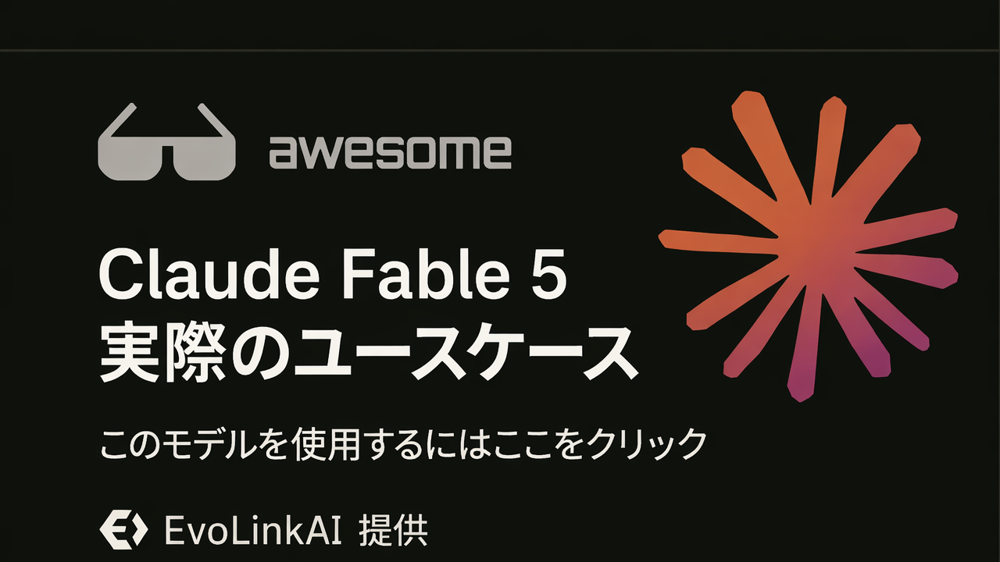

<div align="center">

<a href="https://evolink.ai/claude-fable-5?utm_source=github&utm_medium=readme&utm_campaign=awesome-claude-fable-5"></a>

[](LICENSE)
[](https://evolink.ai/claude-fable-5?utm_source=github&utm_medium=readme&utm_campaign=awesome-claude-fable-5)
[](https://evolink.ai/claude-fable-5?utm_source=github&utm_medium=readme&utm_campaign=awesome-claude-fable-5)
[](https://docs.evolink.ai)

[](README.md)
[](README_es.md)
[](README_pt.md)
[](README_ja.md)
[](README_ko.md)
[](README_de.md)
[](README_fr.md)
[](README_tr.md)
[](README_zh-TW.md)
[](README_zh-CN.md)
[](README_ru.md)

</div>

<a id="-introduction"></a>
## 🍌 はじめに

Claude Fable 5 の高シグナルなユースケースを集めたリポジトリへようこそ。

**私たちは、公開デモやクリエイターコミュニティから厳選した、Claude Fable 5 の実利用ケース、チュートリアル、連携例、評価を収集しています。**

この日本語 README は、具体的なワークフロー、プロンプト、デモ、連携、ベンチマーク証拠、または実用上の限界がある高シグナルな事例に焦点を当てています。

ほとんどの事例は X/Twitter の投稿と公開デモからキュレーションされています。各ケースタイトルは元のソースへ、各著者ハンドルは作成者プロフィールへリンクしています。

Evolink で試す: [Claude Fable 5](https://evolink.ai/claude-fable-5?utm_source=github&utm_medium=readme&utm_campaign=awesome-claude-fable-5)

<a id="-overview"></a>
## 📊 概要

- 公開クリエイター、開発者、ベンチマークチーム、ツールビルダーによる **Claude Fable 5 の厳選 60 ケース**。
- コーディングエージェント、長時間自動化、ゲーム、ビジュアルデザイン、3D シミュレーション、ナレッジワーク、チュートリアル、API 連携、ベンチマーク、価格、ローンチ時の制限をカバーします。
- 各ケースには、元ソース、作成者の帰属、簡潔な要点、証拠タイプ、公開日が含まれます。
- 実用的なワークフローを見つけ、強みと限界を比較し、再現可能なプロンプトを発見し、連携例を追うためにこのリポジトリを活用してください。

> [!NOTE]
> このコレクションは、誇張よりも具体的な証拠を優先します。再現可能なプロンプト、出荷済みデモ、ベンチマーク手法、連携メモ、コストデータ、明確に述べられた注意点を重視しています。

<a id="-quick-api-access"></a>
## ⚡ API クイックアクセス

Evolink 互換の Messages API から Claude Fable 5 を利用できます。[Evolink](https://evolink.ai/login?utm_source=github&utm_medium=readme&utm_campaign=awesome-claude-fable-5) で API トークンを取得し、`<token>` をそのトークンに置き換えてください。

```bash
curl --request POST \
  --url https://direct.evolink.ai/v1/messages \
  --header 'Authorization: Bearer <token>' \
  --header 'Content-Type: application/json' \
  --data '
{
  "model": "claude-fable-5",
  "max_tokens": 1024,
  "messages": [
    {
      "role": "user",
      "content": "Hello, world"
    }
  ]
}
'
```

<a id="-menu"></a>
## 📑 メニュー

| セクション | ケース |
|---|---|
| [💻 コーディングとコード生成](#coding-and-code-generation) | Case 1-6 |
| [🤖 エージェントと長時間自動化](#agents-and-long-running-automation) | Case 7-8 |
| [🎮 ゲームとインタラクティブデモ](#games-and-interactive-demos) | Case 9-12 |
| [🎨 ビジュアル、デザイン、動画、3D](#visual-design-video-and-3d) | Case 13-16 |
| [📚 ドキュメント、ナレッジワーク、リサーチ](#documents-knowledge-work-and-research) | Case 17-19 |
| [🧭 チュートリアル、コース、プロンプトリソース](#tutorials-courses-and-prompt-resources) | Case 20-28 |
| [🔌 プラットフォーム、API、ツール連携](#platform-api-and-tool-integration) | Case 29-34 |
| [📏 評価、比較、限界](#evaluations-comparisons-and-limits) | Case 35-60 |
| [🙏 Acknowledge](#acknowledge) | クレジットと訂正ポリシー |

### [💻 コーディングとコード生成](#coding-and-code-generation)

| Case | 何がわかるか | 種類 |
|---|---|---|
| [Cursor のマルチステージワークフロー](#case-1) | マルチモデルの Cursor ワークフロー内で、Fable 5 を計画レビューと批評のステップとして使い、その後の実装と修正をより安価なモデルや専門モデルに戻す。 | 評価 |
| [スクリーンショットから GitHub を再現](#case-2) | プロダクトのスクリーンショットをエージェント型コーディングツールに貼り付け、Fable 5 に動作する機能付きでインターフェースを再現させる。 | デモ |
| [1 プロンプトのブラックホールシミュレーション](#case-3) | Fable 5 に詳細なクリエイティブコーディング用プロンプトを 1 つ与え、自己完結した Three.js の物理可視化を作らせる。 | チュートリアル |
| [ワンショットの macOS 風 Web OS](#case-4) | Fable 5 に完全な単一ファイル Web OS を依頼し、UI シェル、アプリ、インタラクション、音声、埋め込みゲーム挙動まで 1 回で構築させる。 | チュートリアル |
| [1,687 個のプロンプトで Spawn 5.0 を構築](#case-5) | Fable 5 を長時間セッションのエンジニアリングパートナーとして多数のプロンプトにまたがって使い、人間の役割をアーキテクチャ設計から出力品質の判断へ移す。 | チュートリアル |
| [大規模 Pull Request の所見付きレビュー](#case-6) | Fable 5 に大きな Pull Request を向け、正しさ、偽陽性、本当のバグ、仕上げ上の問題をレビューさせる。 | デモ |

### [🤖 エージェントと長時間自動化](#agents-and-long-running-automation)

| Case | 何がわかるか | 種類 |
|---|---|---|
| [長期リレー型ワークフローのレビュー](#case-7) | サイト再構築、プログラム型コンテンツパイプライン、音声の一致、セキュリティレビュー、最終品質チェックなど、野心的で長期的な作業に Fable 5 を使う。 | 評価 |
| [インフラ障害を診断して修正 PR を作成](#case-8) | ログ、データベースエラー、イメージ digest などのインフラ手掛かりへのアクセスを Fable 5 に与え、障害を診断して修正を準備させる。 | 評価 |

### [🎮 ゲームとインタラクティブデモ](#games-and-interactive-demos)

| Case | 何がわかるか | 種類 |
|---|---|---|
| [指トラッキング Dino Runner](#case-9) | 入力メカニクスとして指トラッキングを使うブラウザゲームを Fable 5 に作らせる。 | デモ |
| [2 文で作るレーシングゲーム](#case-10) | Fable 5 に非常に短いゲームプロンプトを与え、マップ、モード、音楽、UI、ゲームアセットを 1 回で生成させる。 | チュートリアル |
| [Rust 製のインストール可能なターミナル Minecraft](#case-11) | ターミナル用コーディングハーネス経由で Fable 5 を実行し、インストール可能な Rust 製ターミナルゲームを作らせる。 | デモ |
| [時間とコスト付きの Minecraft クローン](#case-12) | 1 つのプロンプトで Fable 5 にプレイ可能な Minecraft 風クローンを依頼し、時間、コスト、コード量、機能範囲を評価する。 | チュートリアル |

### [🎨 ビジュアル、デザイン、動画、3D](#visual-design-video-and-3d)

| Case | 何がわかるか | 種類 |
|---|---|---|
| [再現可能な Ecommerce メール用フルプロンプト](#case-13) | 正確なセクション、商品要件、ビジュアル方向性、制約を含む、ブランドメールモックアップ用の完全なクリエイティブブリーフを Fable 5 に与える。 | チュートリアル |
| [Swiss Lever Watchmaker ベンチマーク](#case-14) | 機械シミュレーションベンチマークに Fable 5 を使い、物理的正しさを実装、検証、反復させる。 | 評価 |
| [Three.js の Friends アパートシーン](#case-15) | Fable 5 に、間取り図とシーン参照をナビゲート可能な Three.js 環境へ変換するよう促す。 | 評価 |
| [プロンプトと URL 付きの太陽系シミュレーション](#case-16) | 物理原理から天文学シミュレーションを構築するために Fable 5 を使い、シミュレーションと公開出力が準備できるまで反復する。 | チュートリアル |

### [📚 ドキュメント、ナレッジワーク、リサーチ](#documents-knowledge-work-and-research)

| Case | 何がわかるか | 種類 |
|---|---|---|
| [Stripe と科学ワークフローの証拠](#case-17) | コピー＆ペースト用プロンプトではなく、エンタープライズ移行や科学ワークフローの主張を支える証拠として使う。 | 評価 |
| [政策メモと変更履歴ワークフロー](#case-18) | 変更履歴、コメントのトリアージ、文字起こしに基づく編集など、長文の定性的ドキュメント作業に Fable 5 を使う。 | チュートリアル |
| [Deep Research プロンプトと出力](#case-19) | Fable 5 にリサーチ形式の質問を投げ、構造化され歴史的根拠のある長文回答を生成できるか評価する。 | デモ |

### [🧭 チュートリアル、コース、プロンプトリソース](#tutorials-courses-and-prompt-resources)

| Case | 何がわかるか | 種類 |
|---|---|---|
| [Fable 5 が Claude Code ワークフローをどう変えるか](#case-20) | すべての手順を細かく管理するのではなく、方向性、コンテキスト、目標、検証基準を設定して Fable 5 を使う。 | デモ |
| [10 億トークンレビューとルーティング戦略](#case-21) | Fable 5 をフロンティア級の計画とレビューに使い、大量の実装はより安いモデルへルーティングする。 | チュートリアル |
| [防御的デバイス強化プロンプト](#case-22) | Fable 5 がデバイスを棚卸しし、正確な確認を提示し、検証を待つ、段階的な防御的 hardening プロンプトを実行する。 | チュートリアル |
| [サイト全体デザイン監査の Goal プロンプト](#case-23) | `/goal` を使って Fable 5 にサイトを起動させ、ページをスクリーンショットし、UX を監査し、レポートを書き、安全な小修正を実施させる。 | チュートリアル |
| [長文クリエイティブワークフローの分業](#case-24) | Fable 5 に安定した形式と例を設計させ、その構造を別の生成システムへ渡してドメイン固有の出力を作る。 | チュートリアル |
| [Fable 5 利用の初心者ガイド](#case-25) | 細かいステップごとの指示ではなく、目標志向のプロンプト、検証ループ、effort 設定で Fable 5 を使う。 | 評価 |
| [コピー＆ペーストできるリポジトリ監査プロンプト](#case-26) | リポジトリ監査プロンプトを Fable 5 に貼り付け、ファイルに基づく探索、所見、戦略、マイルストーン型タスク計画を依頼する。 | チュートリアル |
| [限定ウィンドウでの利用戦略](#case-27) | アクセス条件が有利な期間に、Fable 5 の利用枠を監査、アーキテクチャ、計画に使い、実行にはより安いモデルを使う。 | チュートリアル |
| [Claude Code で Goals と Workflows を使う](#case-28) | 実装前に Fable 5 を思考パートナーとして使い、その後 `/goal` と workflows を組み合わせて計画を実行・検証する。 | チュートリアル |

### [🔌 プラットフォーム、API、ツール連携](#platform-api-and-tool-integration)

| Case | 何がわかるか | 種類 |
|---|---|---|
| [Hermes Agent 連携セットアップ](#case-29) | 複雑な `/goal` 実行やキャッシュ付きの長期タスクに `anthropic/claude-fable-5` を使うよう Hermes を設定する。 | チュートリアル |
| [機能、価格、サブスクリプションメモ](#case-30) | Fable 5 がいつ利用可能か、費用はいくらか、どの guarded domains が別モデルへ fallback する可能性があるかを理解するためにこのケースを使う。 | チュートリアル |
| [ローンチ、アクセス、価格、安全性の要約](#case-31) | アクセス経路、API model name、context window、caching strategy、subscription timing を選ぶためにこのローンチ要約を使う。 | チュートリアル |
| [Advisor ベースのコスト削減戦略](#case-32) | 追加の知能がコストに見合う場合、より安いモデルのワークフロー内で Fable 5 を advisor または reviewer として使う。 | 連携 |
| [価格、アクセス、安全ガードレール](#case-33) | ワークロードを計画する前に、Fable 5 のアクセス、API 価格、安全 fallback 挙動を理解するためにこのケースを使う。 | 連携 |
| [1 行の Swarms 連携](#case-34) | Swarms の model name を `anthropic/claude-fable-5` に設定し、Swarms framework または API 経由で Fable 5 を実行する。 | 連携 |

### [📏 評価、比較、限界](#evaluations-comparisons-and-limits)

| Case | 何がわかるか | 種類 |
|---|---|---|
| [Fable 5 vs GPT-5.5 のコストと品質比較](#case-35) | 同じ coding task で Fable 5 と GPT-5.5 を比較し、output quality、runtime、tool cost を判断する。 | 評価 |
| [AA-Omniscience ベンチマーク結果](#case-36) | 知識の正確性と hallucination behavior で Fable 5 を評価するために、この benchmark case を使う。 | 評価 |
| [Artificial Analysis Intelligence Index 結果](#case-37) | 他の frontier models に対する Fable 5 の overall intelligence ranking を benchmark するためにこのケースを使う。 | 評価 |
| [GDPval-AA Agentic Knowledge Work ベンチマーク](#case-38) | agentic real-world knowledge work で Fable 5 を評価するためにこのケースを使う。 | 評価 |
| [1 週間の第一印象と価格メカニズム](#case-39) | Fable 5 がどこで最も強いか、特に game design と systems planning を判断するために、この first-impressions case を使う。 | 連携 |
| [コストと速度の比較](#case-40) | 品質向上が、より高いコストと遅い long-horizon runs に見合うか判断するためにこの比較を使う。 | 評価 |
| [Claude Code 実使用メモ](#case-41) | tool use、personality、残る rough edges を含め、Claude Code 内で Fable 5 を評価するためにこのケースを使う。 | デモ |
| [Creative Writing ベンチマーク結果](#case-42) | Fable 5 の short-fiction writing quality と refusal behavior を判断するために、この benchmark case を使う。 | 評価 |
| [複数ベンチマークのローンチ要約](#case-43) | coding agents と complex tasks に最も関連する headline scores を理解するために、この launch benchmark summary を使う。 | 評価 |
| [GPT-5.5 とのベンチマークと価格比較](#case-44) | 価格と benchmark categories で Fable 5 を GPT-5.5 と比較評価するためにこの比較を使う。 | 評価 |
| [実地メモと実用上の制約](#case-45) | Fable 5 がどこで意味のある改善に感じられ、どこにまだ実用上の限界があるかを理解するために、この field report を使う。 | チュートリアル |
| [物理シミュレーション比較](#case-46) | 同一の physics simulation prompts を Fable 5 と Opus 4.8 に対して実行し、output quality、cost、speed を比較する。 | デモ |
| [デバッグ体験と設計判断](#case-47) | 単に推測させるのではなく、測定、ログ追加、検証、パッチを依頼して Fable 5 を debugging に使う。 | デモ |
| [多面的な長所と短所](#case-48) | Fable 5 を daily driver にする前に、実用上の強みと弱みを理解するためにこのケースを使う。 | デモ |
| [法務 S-1 ドラフトテスト](#case-49) | S-1 drafting prompt を legal-agent capability test として使い、structure、formatting、length を比較する。 | チュートリアル |
| [ヘルスケアベンチマーク詳細](#case-50) | healthcare-related tasks で Fable 5 を評価し、不足している hard medical evals を特定するためにこの benchmark note を使う。 | 評価 |
| [ParseBench ドキュメント解析評価](#case-51) | specialized OCR systems と比べて、Fable 5 が document parsing に cost-effective かを判断するためにこのケースを使う。 | 評価 |
| [SWE-Bench Pro と FrontierCode の比較](#case-52) | migrations、complex implementations、autonomous sessions、tests、visual verification に Fable 5 を評価するために、この benchmark case を使う。 | 評価 |
| [長い問題解決の定性的レビュー](#case-53) | production review はなお必要だが、Fable 5 がより長く難しい tasks に向いている理由を理解するために、この qualitative review を使う。 | 評価 |
| [ParseBench の忠実性とフォーマット結果](#case-54) | document faithfulness と formatting performance を判断するために、この ParseBench result を使う。 | 評価 |
| [ベンチマーク、価格、アクセス、セーフガード](#case-55) | benchmarks、pricing、access、safeguards、strategic implications の幅広い checklist としてこのケースを使う。 | 評価 |
| [公式ベンチマークスコア一覧](#case-56) | coding、computer use、security tasks 全体における Fable 5 の公式スコアを理解するために、この benchmark list を使う。 | 評価 |
| [APEX-SWE ベンチマーク手法](#case-57) | 特に observability と integration work において、APEX-SWE 上で Fable 5 を評価するためにこのケースを使う。 | 評価 |
| [ProofBench 形式数学結果](#case-58) | specialized theorem-proving systems と比較して、formal math における Fable 5 を評価するためにこのケースを使う。 | チュートリアル |
| [VirtueBench 予備分析](#case-59) | virtue categories 全体にわたる Fable 5 の moral-reasoning behavior を調べるためにこのケースを使う。 | 評価 |
| [API 空レスポンス安全性過適合テスト](#case-60) | launch-time safety overfit risk と API testing における empty-response behavior を理解するためにこのケースを使う。 | 評価 |


<a id="coding-and-code-generation"></a>
## 💻 コーディングとコード生成

<a id="case-1"></a>
### Case 1: [Cursor のマルチステージワークフロー](https://x.com/AlicanKiraz0/status/2064487347605918180) (by [@AlicanKiraz0](https://x.com/AlicanKiraz0))

**マルチモデルの Cursor ワークフロー内で、Fable 5 を計画レビューと批評のステップとして使い、その後の実装と修正をより安価なモデルや専門モデルに戻す。**

Fable 5 と GPT 5.5 の最終スコアを見ると、その差は非常に小さい。私の控えめな利用推奨はこうだ。Cursor のようにハイブリッドモデルをサポートする IDE プラットフォームでは、段階的なワークフローを使う。

フェーズ 1: コードレビューとプロジェクト調査の最初の段階では、コンテキストを温めながら、GPT 5.5 High、Minimax M3、Kimi K2.6、Composer 2.5 のいずれかを使う。

フェーズ 2: プロジェクト計画の準備には、GPT 5.5 Very High または Opus 4.8 を使う。

フェーズ 3: プロジェクト計画の分析には Fable 5 を使い、計画の欠陥部分を特定させる。修正には GPT 5.5 Very High を使う。

フェーズ 4: 計画の実装には、Minimax M3、Deepseek v4 Max、Composer 2.5、Sonnet 4.6 のいずれかを使う。

フェーズ 5: 最終レビューと、実装が計画に沿っているかの確認には GPT 5.5 High を使う。

種類: 評価 | 日付: 2026-06-09

---

<a id="case-2"></a>
### Case 2: [スクリーンショットから GitHub を再現](https://x.com/coldopn/status/2064435234465087638) (by [@coldopn](https://x.com/coldopn))

**プロダクトのスクリーンショットをエージェント型コーディングツールに貼り付け、Fable 5 に動作する機能付きでインターフェースを再現させる。**

🚨 Anthropic Fable 5 がスクリーンショットから GITHUB を再現した!!

私がやったことは、GitHub UI のスクリーンショットを Kilo Code に貼り付け、実際の機能付きで GitHub を再現するよう伝えただけ。

10 分間コードを書き、$4.07 を消費した。

結果は機能する GitHub レプリカだった: https://t.co/bjMObvlsPX

種類: デモ | 日付: 2026-06-09

---

<a id="case-3"></a>
### Case 3: [1 プロンプトのブラックホールシミュレーション](https://x.com/deveshcodes_/status/2064437742189379745) (by [@deveshcodes_](https://x.com/deveshcodes_))

**Fable 5 に詳細なクリエイティブコーディング用プロンプトを 1 つ与え、自己完結した Three.js の物理可視化を作らせる。**

@claudeai は Claude Fable 5 で、Three.js のリアルタイムブラックホールレンズ効果シミュレーションを一発生成した。

重力レンズ、ドップラーブーストされた降着円盤、光子球、色収差、手続き型の星空が含まれていた。

結果: 60fps、単一 HTML ファイル、1 プロンプト。

新しい基準線がすごい 🤯 https://t.co/E23I8bnPKb

種類: チュートリアル | 日付: 2026-06-09

---

<a id="case-4"></a>
### Case 4: [ワンショットの macOS 風 Web OS](https://x.com/intheworldofai/status/2064421915347812672) (by [@intheworldofai](https://x.com/intheworldofai))

**Fable 5 に完全な単一ファイル Web OS を依頼し、UI シェル、アプリ、インタラクション、音声、埋め込みゲーム挙動まで 1 回で構築させる。**

🚨 Claude Fable 5 が、macOS 風の完全な Web OS をワンショットで構築し、ほとんどのモデルよりさらに踏み込んだ。

単一 HTML ファイル、埋め込み CSS + JS。

1 つのプロンプトから、次を構築した:

- macOS のメニューバー + dock
- ドラッグ可能でリサイズ可能なアプリウィンドウ
- 機能するファイルエクスプローラー
- 動作するターミナル + ブラウザのモックアップ
- SVG デスクトップアイコン + 通知
- 設定アプリ、テーマ、起動画面
- 外部ファイルなしのリアルな合成音を備えた完全機能のサウンドプレイヤー
- デスクトップ内で遊べる Minecraft クローン

ほぼ修正なしで、すべて 1 回で生成された。

動作するサウンドプレイヤーに加えて実際の Minecraft クローンまで作った例は、他のモデルではまだ見たことがない。Fable 5 のフロントエンド/UI 生成はばかげたレベルになってきている。

種類: チュートリアル | 日付: 2026-06-09

---

<a id="case-5"></a>
### Case 5: [1,687 個のプロンプトで Spawn 5.0 を構築](https://x.com/jsnnsa/status/2064420561078693941) (by [@jsnnsa](https://x.com/jsnnsa))

**Fable 5 を長時間セッションのエンジニアリングパートナーとして多数のプロンプトにまたがって使い、人間の役割をアーキテクチャ設計から出力品質の判断へ移す。**

claude fable 5 が公開された。

spawn 5.0 はこれで作られた:

- 1,687 プロンプト
- 102 セッション
- 私の仕事はアーキテクチャからセンスの判断へ移った

私たちが作ったものは、Opus でチーム全員が取り組んでも少なくとも 1 か月はかかったはずのものばかりだった:

- Rapier に匹敵し、サイドスレッドとして 1 日でテスト可能だった、ゼロからの物理エンジン Mantle
- clustered froxel lighting: 8 個のライトから 1,000 個以上の完全動的ライトへ
- WebGPU 上のリアルタイム拡散 GI、しかもスマートフォンで動作
- Unreal や Unity が出荷しているものを超えるシェーダーアーキテクチャを持つ 100 万粒子 GPU VFX
- MMO 規模のネットコード
- アルファ版のネイティブ iOS アプリ

すべて約 1 週間でできた。すべてモバイルで動く。このリストには出荷したものの半分も含まれていない。完全な changelog はスレッドにある。

ベンチマークには現れない部分: このモデルは素晴らしい個性を持っている。本当に面白い。物理エンジンを書き直している最中、何度も涙が出るほど笑った。天才性とキャラクターは別々の機能ではない。

種類: チュートリアル | 日付: 2026-06-09

---

<a id="case-6"></a>
### Case 6: [大規模 Pull Request の所見付きレビュー](https://x.com/ryanrhughes/status/2064411147076534705) (by [@ryanrhughes](https://x.com/ryanrhughes))

**Fable 5 に大きな Pull Request を向け、正しさ、偽陽性、本当のバグ、仕上げ上の問題をレビューさせる。**

Fable 5 に単一 PR（74 ファイル / +3,705 / -1,246）のレビューを任せ、どうなるか見てみた。34 分間実行され、5 時間セッションの 42% を使い、「correctness」の所見を 16 件出し、次を見つけた:

- 怖そうに見える偽陽性 2 件
- 本物の監査上の正しさに関わるバグ 3 件
- 正当だが小さい UX/仕上げ問題 約 5 件
- たくさんの cleanup 意見

これはリリースするには危険すぎたのか？

種類: デモ | 日付: 2026-06-09

---

<a id="agents-and-long-running-automation"></a>
## 🤖 エージェントと長時間自動化

<a id="case-7"></a>
### Case 7: [長期リレー型ワークフローのレビュー](https://x.com/JJEnglert/status/2064469635190170105) (by [@JJEnglert](https://x.com/JJEnglert))

**サイト再構築、プログラム型コンテンツパイプライン、音声の一致、セキュリティレビュー、最終品質チェックなど、野心的で長期的な作業に Fable 5 を使う。**

Claude Fable 5 レビューの短い版: Claude Fable 5 のテストに 10 億トークンを費やしたところ、不公平な優位性を持っているように感じた。

私は目視テストで判断する。モデルを実際の仕事に投入して観察する。時間を節約してくれるのか、それとも奪うのか。私が見落としたものを捕まえるのか。相棒のように感じるのか、それとも子守りが必要なツールなのか。

これは、重要なすべての次元で合格した久しぶりのモデルであり、しかも僅差ではなかった。

構築: 私は Tenex のサイトを再構築していた。非常にカスタム性が高く、とても難しかった。GPT 5.5 と Claude 4.8 は単独では突破できなかった。参照用の Figma ファイルがあっても 85-90% あたりで頭打ちだった。

すると Fable 5 はすべてを見て、もっと良くできると言い、元の Webflow ソースへ直行し、すべてのアセットをダウンロードし、ほぼ一発で全体を作り上げた。

その後、週末の間に、完全に新しい 80 ページの 2 つ目のサイトをゼロから作らせた。代理店としてなら $50k 請求していた仕事だ。

さらに、完全なプログラム型クリップ工場もつなぎ合わせた:

- HeyGen
- ElevenLabs
- Cloudflare
- VPS

そのパイプラインはトピックを見つけ、台本を書き、動画を編集し、音楽を追加し、ソーシャルへ投稿する。長時間自律的に動き、レンダーを監視する webhook システムまで自分で作った。

ライティング: 私たちのブランドボイス文書をほぼ同一に再現し、その声を 80 ページの機能紹介、ケーススタディ、記事全体で保ち、平板な AI デフォルトへ流れなかった。

セキュリティ: 2 つのフロンティアモデルが大規模 repo で作業し、コードに承認を出していた。Fable 5 は初回パスで重大かつ巧妙に隠れたバグを見つけ、その場でパッチした。

人間的な瞬間: cron ジョブを待っている間に質問した。回答した後、自分から、残り約 10 分で、終わったら知らせると付け加えた。私はタイマーについて聞いていなかった。

正直な注意点: どのモデルよりもメーターを意識する。Anthropic は設計上 token-intensive だと言っている。だからリレーとして使う。Fable 5 で考え、より安いモデルで構築し、Fable 5 でレビューする。

結論: 隣の人より多くの知能へアクセスできることが優位性だ。Fable 5 はそれを現実にする最初のモデルだ。フルのフロンティア料金でも、利益は出た。

種類: 評価 | 日付: 2026-06-09

---

<a id="case-8"></a>
### Case 8: [インフラ障害を診断して修正 PR を作成](https://x.com/ayushagarwal/status/2064422467557564862) (by [@ayushagarwal](https://x.com/ayushagarwal))

**ログ、データベースエラー、イメージ digest などのインフラ手掛かりへのアクセスを Fable 5 に与え、障害を診断して修正を準備させる。**

claude fable 5 は本当に本当に優秀だ!!!!

自分でもうまく説明できなかった、サイドのセルフホスト infra の障害を診断した。

pod ログを読み、Cloud SQL のエラーログをクエリし、image digest を比較し、Kubernetes が新しく移行したデータベースに対して 3 か月前のキャッシュ済みイメージを実行していたことを突き止めた。

それから修正 PR を開いた。

何時間ではなく数分。Web 検索なし。🤯

種類: 評価 | 日付: 2026-06-09

---

<a id="games-and-interactive-demos"></a>
## 🎮 ゲームとインタラクティブデモ

<a id="case-9"></a>
### Case 9: [指トラッキング Dino Runner](https://x.com/ai_for_success/status/2064413182396108932) (by [@ai_for_success](https://x.com/ai_for_success))

**入力メカニクスとして指トラッキングを使うブラウザゲームを Fable 5 に作らせる。**

Fable 5 に指トラッキング付きの Dino runner ゲームを作るよう依頼した。

約 11-12 分で finger runner game を一発生成し、約 914K トークンを消費し、わずか 629 行のコードですべてを実装した。

https://t.co/AWt1lEIObq

種類: デモ | 日付: 2026-06-09

---

<a id="case-10"></a>
### Case 10: [2 文で作るレーシングゲーム](https://x.com/kieradev/status/2064482704763085202) (by [@kieradev](https://x.com/kieradev))

**Fable 5 に非常に短いゲームプロンプトを与え、マップ、モード、音楽、UI、ゲームアセットを 1 回で生成させる。**

Claude Fable 5、Max 5x 使用量の 40%。

2 文のプロンプトから、Mario Kart 64 タイプのフルゲーム。

Fable 5 は装飾、キャラクターモデル、4 つのマップ、音楽、3 つすべてのゲームモード、UI を約 15 分で一発処理した。

#fable #anthropic https://t.co/B7mTidE84U

種類: チュートリアル | 日付: 2026-06-09

---

<a id="case-11"></a>
### Case 11: [Rust 製のインストール可能なターミナル Minecraft](https://x.com/vikvang1/status/2064500731848319303) (by [@vikvang1](https://x.com/vikvang1))

**ターミナル用コーディングハーネス経由で Fable 5 を実行し、インストール可能な Rust 製ターミナルゲームを作らせる。**

Claude Fable 5 を Warp の harness で 1 時間動かしてみた。

ターミナルに直接レンダリングされる Minecraft の TUI 版を作った。完全に Rust で構築されている。

インストールコマンド: cargo install termcraft-3d

https://t.co/zs3y3t88oM

種類: デモ | 日付: 2026-06-10

---

<a id="case-12"></a>
### Case 12: [時間とコスト付きの Minecraft クローン](https://x.com/ydamitcodes/status/2064536076518363353) (by [@ydamitcodes](https://x.com/ydamitcodes))

**1 つのプロンプトで Fable 5 にプレイ可能な Minecraft 風クローンを依頼し、時間、コスト、コード量、機能範囲を評価する。**

@claudeai Fable 5 が 37 分で Minecraft クローンを作ってくれた。

1 プロンプト。コード約 3K 行。API コスト $12。

バイオーム、洞窟、鉱石、昼夜、mob、すべて入っていた。

Minecraft は Notch が 2 年かけた。

https://t.co/AmwdLwi75O

種類: チュートリアル | 日付: 2026-06-10

---

<a id="visual-design-video-and-3d"></a>
## 🎨 ビジュアル、デザイン、動画、3D

<a id="case-13"></a>
### Case 13: [再現可能な Ecommerce メール用フルプロンプト](https://x.com/ecomchasedimond/status/2064454139225297091) (by [@ecomchasedimond](https://x.com/ecomchasedimond))

**正確なセクション、商品要件、ビジュアル方向性、制約を含む、ブランドメールモックアップ用の完全なクリエイティブブリーフを Fable 5 に与える。**

Claude Fable 5 はこれを 1 つのプロンプト、編集なしで作った。

私が使った完全なプロンプトはこちら:

MVMT 向けに、フルレングスで縦長の ecommerce メールモックアップを作成してください。MVMT はミレニアル世代向けのモダンな時計とアクセサリーブランドです。

洗練され、磨き込まれ、ミニマルで、やや男性的、かつエディトリアルに感じられる、非常にリアルなプレミアム DTC メールをデザインしてください。最終画像は、ポスターでもランディングページでも汎用テンプレートでもなく、実際にデザイナーが作った ecommerce メールのスクリーンショットのように見える必要があります。

ブランドの雰囲気: モダンな California-cool、若々しく、自信があり、クリーンで、憧れを感じさせ、スタイリッシュで、上質。デザインはラグジュアリーに近いが、なお手が届く印象にしてください。

次の商品を目立つように扱ってください:

- Mulholland
- Odyssey II Automatic
- Cali Diver
- Signature Watch Bands

ビジュアルスタイル:

- クリーンなプレミアム ecommerce デザイン
- 洗練されたエディトリアルレイアウト
- リアルな商品写真
- 控えめなライフスタイル画像
- 強い階層構造
- くっきりしたサンセリフ書体
- ゆったりした余白
- 控えめな影
- 抑制されたモダンなカラーパレット

カラーパレット: 黒、白、チャコール、ウォームグレー、ストーン、ソフトベージュ、ブラッシュドメタル調、控えめなくすみアクセント。パレットはニュートラルでプレミアムに保ってください。

重要なクリエイティブ方向性: これはデザインセンスの強い、磨き込まれた時計ブランドのメールキャンペーンのように感じられるべきです。リアリズム、エレガンス、明瞭さを優先してください。MVMT が実際に送ってもおかしくないものにしてください。

メールはこの順序で構築してください:

1. トッププロモーションバー: 上部全幅に、薄い黒または濃いチャコールのバー。小さな大文字テキスト: “FREE SHIPPING OVER $75 + EASY RETURNS”。

2. ヘッダー: 左側に MVMT ワードマーク/ロゴ、右側または中央に最小限のナビゲーションリンクを置いたクリーンな白ヘッダー: WATCHES, SUNGLASSES, JEWELRY, NEW ARRIVALS。

3. ヒーローセクション: 強い視覚バランスを持つプレミアムなヒーローセクション。

太字の見出しを使用: “BUILT TO GET NOTICED”。

日常のスタイルを高めるためにデザインされたモダンな時計とアクセサリーについての短い補足コピーを含める。

濃色の角丸 CTA ボタンを追加: “SHOP WATCHES”。

ヒーロー画像には次を含める:

- 主役となるプレミアム時計画像 1 点
- 控えめなラグジュアリーライフスタイル画像
- スタイリッシュな男性モデル、またはファッション性の高い男性的ライフスタイルシーン
- モダンなライティングとクリーンな構図

4. Featured collection セクション: 中央揃えのセクション見出し “THREE WAYS TO WEAR MVMT” を追加。その下に、次を扱う 3 つのクリーンな商品カードまたは画像ブロックを表示:

- Mulholland
- Odyssey II Automatic
- Cali Diver

各ブロックには次を含める:

- 商品画像
- 商品名
- 1-2 行の短い説明

このセクションは左右対称で、磨かれたプレミアムな印象に保つ。

5. Accessory banner: “FINISH THE LOOK” というタイトルの洗練された分割セクションを追加。Signature Watch Bands を特集する。時計ストラップや交換可能なバンドのプレミアムなクローズアップ画像を表示。短い補足コピーと濃色 CTA ボタン “SHOP ACCESSORIES” を含める。

6. Editorial promo tiles: 画像主導デザインの横並びプロモーションタイルを 2 つ追加。

タイル 1 の見出し: “FOR DAILY WEAR”。

タイル 2 の見出し: “FOR STATEMENT DAYS”。

各タイルには短いコピーと小さな CTA “SHOP NOW” を置く。

これらのタイルは、汎用的なセール枠ではなく、エディトリアルなブランドモーメントに感じられるようにする。

7. Shoppable row: “IN ROTATION NOW” というタイトルのセクションを追加。次を扱うクリーンな 4 商品の行またはグリッドを表示:

- Mulholland
- Odyssey II Automatic
- Cali Diver
- Signature Watch Bands

各アイテムには次を含める:

- 切り抜きの商品画像
- 商品名
- 小さな “SHOP” リンクまたはボタン

8. Brand signoff: 見出し “DESIGNED TO MOVE WITH YOU” を持つ中央揃えのメッセージブロックを追加。日常生活のために丁寧に作られた時計、アイウェア、アクセサリーについての短い一文を含める。

9. フッター: 次を含む、リアルな黒またはチャコールのブランドフッターを作成:

- MVMT ロゴ
- ショップリンク
- 会社リンク
- サポートリンク
- ソーシャルアイコン
- 小さな法務・配送テキスト

タイポグラフィ方向性: 主要見出しには太字の condensed またはモダンなサンセリフ、本文にはクリーンなサンセリフを使う。見出しはシャープでモダン、ファッション性が高く感じられるべきです。本文コピーはリアルで、ほぼ読める必要があります。

写真方向性: リアルな反射、磨かれた素材、柔らかな影、クリーンな表面を持つプレミアムな商品写真を使う。ライフスタイル写真は上質でモダン、ファッション志向に感じられるべきです。

構図ルール:

- 縦長のメール形式
- 明確なセクション分離
- リアルなメール比率
- 強い階層構造
- ほぼ読めるテキスト
- プレミアムな余白
- 意図的な整列
- 商品画像とライフスタイル画像のバランスの取れた組み合わせ

避けること:

- 雑なコラージュ風スタイル
- 遊びすぎたスクラップブック美学
- 過度にカラフルなデザイン
- 安っぽいテンプレート感
- 漫画風の画像
- 散らかったレイアウト
- 偽物っぽい UI 要素
- ポスター風の構図
- 過剰な販促の混乱

出力: MVMT 向けの、プレミアムでクリーン、磨き込まれ、モダンでエディトリアル、すぐプレゼンに使える印象の、フルレングスで縦構成の非常にリアルな ecommerce メールデザインモックアップ。

種類: チュートリアル | 日付: 2026-06-09

---

<a id="case-14"></a>
### Case 14: [Swiss Lever Watchmaker ベンチマーク](https://x.com/quanghuynt14/status/2064509430650065278) (by [@quanghuynt14](https://x.com/quanghuynt14))

**機械シミュレーションベンチマークに Fable 5 を使い、物理的正しさを実装、検証、反復させる。**

そこで Fable 5 に watchmaker benchmark を与えた。Three.js による完全な Swiss lever movement だ。

実際のギア比（18,000 bph）、動作する脱進機、呼吸するひげぜんまい、そして針は実際の時刻を示す。

視覚で自分の作業をループ検証し、完了まで進めた。

⌚ https://t.co/RSRfDoKxA4

種類: 評価 | 日付: 2026-06-10

---

<a id="case-15"></a>
### Case 15: [Three.js の Friends アパートシーン](https://x.com/scottstts/status/2064464351906673029) (by [@scottstts](https://x.com/scottstts))

**Fable 5 に、間取り図とシーン参照をナビゲート可能な Three.js 環境へ変換するよう促す。**

Holy Crap!!!

Fable 5:

@threejs で、テレビ番組 Friends の象徴的な Monica のアパートについて、この間取り図に正しく基づいた一人称 POV でナビゲート可能な 3D シーンを作成し、元の見た目と雰囲気に忠実にし、暖かい照明を使ってください

このテストで見た中では圧倒的に THE BEST だ！

この単一 html は $12 かかったが、結果は見事！

種類: 評価 | 日付: 2026-06-09

---

<a id="case-16"></a>
### Case 16: [プロンプトと URL 付きの太陽系シミュレーション](https://x.com/tetumemo/status/2064477582930989357) (by [@tetumemo](https://x.com/tetumemo))

**物理原理から天文学シミュレーションを構築するために Fable 5 を使い、シミュレーションと公開出力が準備できるまで反復する。**

Claude Fable 5 は強烈だ。

物理シミュレーションに強そうなので、こう依頼した:

「物理学の基本原理から惑星の軌道運動を導き、それを使って日食を予測する太陽系シミュレーションを作って」

数回やり取りした後、これが完成した。

信じられないほど楽しい。

完成したプロンプトと公開 URL は下にリンクされている。

種類: チュートリアル | 日付: 2026-06-09

---

<a id="documents-knowledge-work-and-research"></a>
## 📚 ドキュメント、ナレッジワーク、リサーチ

<a id="case-17"></a>
### Case 17: [Stripe と科学ワークフローの証拠](https://x.com/AndrewCurran_/status/2064413892378546418) (by [@AndrewCurran_](https://x.com/AndrewCurran_))

**コピー＆ペースト用プロンプトではなく、エンタープライズ移行や科学ワークフローの主張を支える証拠として使う。**

本日のリリースからの引用:

Mythos 5 を使うことで、社内のタンパク質設計専門家は創薬設計プロセスの一部を約 10 倍高速化した。

ある例では、Mythos 5 はタンパク質設計とバイオインフォマティクスのツールを使い、人間の支援なしで、熟練した人間オペレーターと同等またはそれ以上の成果を出した。

結合部位の選択、タンパク質設計ツールの選択と実行、失敗からの回復など、通常は科学者が行うタスクを実行した。

初期テスト中、Stripe は Fable 5 が数か月分のエンジニアリングを数日に圧縮したと報告した。5,000 万行の Ruby コードベースで、通常ならチーム全体が手作業で 2 か月以上かかるコードベース全体の移行を、モデルは 1 日で実行した。

Mythos 5 はまた、新規で説得力のある科学仮説を一貫して生み出した。

Opus クラスのモデルとのブラインド直接比較では、科学者は Mythos の分子生物学仮説を約 80% の割合で好み、複数を実験評価へ進めた。

Mythos の仮説の 1 つ、E. coli タンパク質の新規メカニズムは、独立ラボの研究で裏付けられた。

Mythos 5 は 1 週間を超える大部分自律的な作業で、新規ゲノミクス研究を行った。

138 種の動物にわたる数百万細胞の single-cell データを組み立て、遠縁の生物で同じ役割を担う細胞を特定するカスタム機械学習モデルを設計・訓練した。

高レベルの人間入力だけで、訓練済みモデルは Science に掲載された最近のモデルを、100 分の 1 のサイズで上回った。

種類: 評価 | 日付: 2026-06-09

---

<a id="case-18"></a>
### Case 18: [政策メモと変更履歴ワークフロー](https://x.com/manaltdan/status/2064414129440608427) (by [@manaltdan](https://x.com/manaltdan))

**変更履歴、コメントのトリアージ、文字起こしに基づく編集など、長文の定性的ドキュメント作業に Fable 5 を使う。**

Fable 5 は、政策分析のドラフト作成のような長時間の定性的作業で、一貫して役立つと私が初めて感じたモデルだ。

その能力と Wispr Flow のようなツールを組み合わせることで、コーダーが長く語ってきた生産性向上に近づいている感覚がある。

3 つのユースケースが以前よりずっと良く感じられる:

- Claude に長い政策メモを全文通読させ、変更履歴を返させる。流暢さの編集、弱い主張への疑問コメント、潜在的な出典。
- Projects で大量のコメントをスクリーンショットし、それぞれに対応すべきか、どう対応すべきかを Claude に推奨させる。
- ドキュメントに関する会議文字起こしを Claude に貼り付け、会議と Slack で議論された編集を変更履歴として入力させ、コメントに文脈を追加させる。

種類: チュートリアル | 日付: 2026-06-09

---

<a id="case-19"></a>
### Case 19: [Deep Research プロンプトと出力](https://x.com/naoyafujiwara/status/2064470780373811637) (by [@naoyafujiwara](https://x.com/naoyafujiwara))

**Fable 5 にリサーチ形式の質問を投げ、構造化され歴史的根拠のある長文回答を生成できるか評価する。**

Claude Fable 5 Max が今朝利用可能になったので試してみた。表面の出力は非常に磨かれている一方で、その下はとても深く見える。

質問: 日本の「失われた 30 年」が、今からちょうど 30 年前に始まったとすると、それは具体的に何で、なぜ起こり、今年以降の世界にどう影響するのか？

回答: 失われた 30 年を、従来の 1991 年のバブル崩壊ではなく、ちょうど 30 年前の 1996 年から始まったものとして扱うと、問題の本質に近づける。

統計的には、日本が本当に「失い」始めたのはその時期だった:

- 生産年齢人口は 1995 年に 8,716 万人でピークを迎えた。
- 1996 年は出生数が 120 万人台にとどまった最後の年だった。
- 賃金と名目 GDP は 1997 年にピークを迎えた。

バブル崩壊が傷だったなら、1996 年はその傷が化膿し始めた時期だった。

1996 年の出来事:

- 住専処理法の成立。6850 億円の公的資金を投入し、銀行不信と救済への抵抗の起点になった。
- 橋本内閣による消費税 5% への引き上げ決定。
- 金融ビッグバンが発表され、財政再建が国策になった。

1997 年 4 月、消費税引き上げ、特別減税の終了、社会保険負担の増加が重なり、国民負担は約 9 兆円増えた。その後、夏にアジア通貨危機が襲った。

11 月には三洋証券が戦後初のコール市場でのデフォルトを引き起こし、短期金融市場が凍結した。北海道拓殖銀行と山一證券が相次いで破綻した。

1998 年から、日本は本格的なデフレと信用収縮に入り、自殺者数は 3 万人を超えた。

その後 30 年の結果:

- 名目 GDP は四半世紀にわたり 500 兆円前後で停滞した。
- 日本の世界 GDP シェアは約 18% から 4% 未満へ低下した。
- 平均賃金は 1997 年にピークを迎え、その後は下落または横ばいになった。
- 非正規雇用は約 20% から 40% 近くへ上昇した。
- 出生数は約 120 万人から 2024 年には約 69 万人へ低下した。
- 政策金利は 1995 年に 1% を下回って以降、ほぼゼロ近辺にとどまった。
- 国債残高は約 240 兆円から 1,100 兆円超へ増えた。
- 日経平均は 1989 年の高値を回復するまで、2024 年 2 月まで 34 年かかった。

言い換えれば、失われた数十年は単なる金融の二日酔いではなかった。人口動態、賃金、デフレ、債務、政策選択、社会的信頼を含む構造転換だった。

種類: デモ | 日付: 2026-06-09

---

<a id="tutorials-courses-and-prompt-resources"></a>
## 🧭 チュートリアル、コース、プロンプトリソース

<a id="case-20"></a>
### Case 20: [Fable 5 が Claude Code ワークフローをどう変えるか](https://x.com/AI_masaou/status/2064448218038223206) (by [@AI_masaou](https://x.com/AI_masaou))

**すべての手順を細かく管理するのではなく、方向性、コンテキスト、目標、検証基準を設定して Fable 5 を使う。**

Claude Fable 5 の後、Claude Code チームの日々の働き方がどう変わったかは興味深い。

Claude Code チームの Thariq によると、Fable 5 は Anthropic 内部の人々が Claude と働く方法を大きく変えた。

以前は、人間が Claude が正しく作業しているかを慎重に確認する必要があった。タスクを分解し、出力をレビューし、途中で止まっていないか確認する。監督に近かった。

Fable 5 では、より長時間作業でき、自分でテストし、より高品質なコードを生成できるため、人間の役割は「正しく作業しているか」を監視することから、「正しい作業をしているか」を舵取りすることへ移る。

言い換えれば、監督よりも目標設定とコンテキスト作りが重要になる。

変化したワークフローは 3 つの部分から成る:

1. Claude を思考パートナーとして使う。

実装前に Claude を関与させ、何を作りたいのか、何が可能なのかを明確にし、小さな仕様について質問させる。または、アイデアから複数の方向性や HTML モックを生成させ、曖昧さや問題をコーディング前に浮かび上がらせる。

2. 制約だけでなくコンテキストを提供する。

「シンプルにして」や「作り込みすぎないで」とだけ言うのではなく、その理由を説明する。

例: 「これは 1 か月後に削除される可能性がある実験的機能なので、捨てにくい構造を作らないでください。」

そうすれば Claude はより良い判断ができる。

3. 目標と検証方法を与える。Fable 5 は Claude Code の `/goal` と Workflows と相性が良い。仕様を与え、完全実装を目標として設定し、workflows に各ステップを検証させ、何が実装され、何が異なったかのレポートを準備させる。

最後に Thariq は、もっと野心的に使ってみるべきだと言っている。Fable 5 は、以前は LLM には難しすぎると感じた作業で試す価値があり、参照動画の動画編集でさえ Fable で行われた。

種類: デモ | 日付: 2026-06-09

---

<a id="case-21"></a>
### Case 21: [10 億トークンレビューとルーティング戦略](https://x.com/JJEnglert/status/2064420538798260388) (by [@JJEnglert](https://x.com/JJEnglert))

**Fable 5 をフロンティア級の計画とレビューに使い、大量の実装はより安いモデルへルーティングする。**

Claude Fable 5 レビュー: 非エンジニアが判断した 10 億トークン。

私は UI と UX、ライティング、戦略、セキュリティ、エンジニアリング、ナレッジワークなど、実際のプロジェクトで Claude Fable 5 をテストするために 10 億トークンを費やした。実際に出荷する必要があった仕事だ。

正直、不公平な優位性を持ったように感じた。

まず視点について。私はエンジニアではない。多くのモデルレビューはエンジニアがエンジニアリングベンチマークを回すものだ。これは、以前ならエンジニアのチームが必要だった仕事を Claude Fable 5 で行った非エンジニアによるレビューだ。

ナレッジワークをしていて、このモデルが日々を変えるのか知りたいなら、このレビューはあなた向けに書かれている。

Claude Fable 5 は Anthropic の新しい Claude 5 ファミリーの最初のモデルで、Claude Opus の上に位置する新しい階層であり、一般提供されている最も高度な Claude モデルだ。私はローンチ前にアクセスしていたので、ここにある内容はすべてデモではなく実作業から来ている。

なぜ目視テストなのか:

ほとんどのレビューはベンチマークに溺れる。あなたが一生実行しないテストのスコアは、そのモデルが投資に見合うかを教えてくれない。

Claude Fable 5 は、基本的にテストされたすべてで state of the art だが、私が書いている理由はそこではない。定性的には、メジャーバージョンアップに値する段階的変化だ。

私は違う評価をする。モデルを実際の仕事に投入し、何が起きるかを見る。

測る質問:

1. 本当に一段上がったように感じるか？
2. アイデアを、動作し出荷可能な結果まで持っていけるか？
3. 人間のように、そして特に私のように書けるか？
4. 難しく隠れた問題を見つけられるか？
5. 私が頼む前に必要なことを先読みできるか？

大きなモデルの感触:

Opus 4.5 以来、この感覚はなかった。最初の本格的なタスクから、Claude Fable 5 は「大きなモデル」の感触をくれた。推論、ライティング、構築、セキュリティ、すべてが全体として強い。

最も明確な兆候: しっかりした準備資料を渡したときでさえ、その中に留まらなかった。ファイルを読み、実際の状況を読み、私が描いた枠の外にあるより良い道を見つけた。

構築と出荷:

私は Tenex サイトを再構築し、エージェント向けにスタックを近代化していた。GPT 5.5 と Claude 4.8 は十分に近づけなかった。Figma ファイルがあっても 85-90% 程度に着地した。

すると Claude Fable 5 はすべてのファイルを見て、もっと良くできると言い、元の Webflow ソースへ直行し、すべてのアセットをダウンロードし、ページごとに体験を再構築した。ほぼ全体を一発で仕上げた。

その後、新しいデザインで完全に新しい 2 つ目のサイトを作った。モダンな技術スタック、エージェントスタック、skills、SEO と AEO 最適化、週末で出荷可能な 80 ページ。代理店オーナーとしてなら $50k 請求していた。

Fable には完全なプログラム型クリップ工場も作らせた。

HeyGen、HyperFrames、ElevenLabs、Cloudflare Workers、VPS をつなぎ合わせた。

トピックを見つけ、台本を書き、サムネイルを作り、動画を編集し、音楽を作曲し、モーショングラフィックスを追加し、ソーシャルへ投稿する。

ライティングと声:

私は GPT 5.5 と Claude 4.8 でブランドボイスを再構築していた。Claude Fable 5 は voice doc をほぼ同一に再現し、その声を新サイトの 80 ページ、機能、ケーススタディ、ブログ記事、playbook 全体で保った。

人間のように書き、平板な AI デフォルトではなく、数段落後にぶれなかった。

セキュリティ:

Claude 4.8 と GPT 5.5 の両方がリスクを示さず作業していた大規模 repo があった。Claude Fable 5 は初回パスで重大な隠れたバグを見つけ、その場でパッチした。

人間的要素:

cron ジョブを待っている間に質問した。回答した後、タイマーの残りが約 10 分で、終わったら知らせると付け加えた。私はタイマーについて聞いていなかった。

コスト:

- Claude Fable 5 ワークロードコスト: $1,442
- トークン: 10.4 億
- 出荷した作業: 新しい Web サイト、インフラ、動作するエージェントパッケージ
- 代理店価値の見積もり: $30,000-$50,000

結果はトークンコストに見合ったが、どのモデルよりもメーターを意識する。Anthropic は Fable 5 を設計上 token-intensive と呼んでいる。

Pro tip #1: ハイブリッドとして実行する。

すべてを Claude Fable 5 で実行しない。リレーを実行する:

1. 計画、戦略、アーキテクチャ、アプローチの整理は Claude Fable 5 で考える。
2. 実装や反復作業は 4.8、GPT-5.5、Sonnet 4.6 で構築する。
3. 安いモデルが見落とすものを捕まえるために Claude Fable 5 でレビューする。

Pro tip #2: effort 設定をタスクに合わせる。

- High はほとんどの作業におけるスイートスポット。
- Extra high は最も難しい長時間タスク向け。
- Low または medium は素早いやり取り向け。

Pro tip #3: 自分のセットアップを監査させる。

Fable 5 に skills、CLAUDE.md ファイル、config を向ける。その足場の多くは弱いモデル向けに書かれており、より賢いモデルを制限する可能性がある。

結論:

Claude Fable 5 は、以前より本当に知能が増えたと感じられる久しぶりのモデルだ。

フロンティア料金でも、このワークロードは利益を出した。

余裕があるなら、品質の本当の飛躍が結果を変える仕事で今すぐ使うべきだ。

種類: チュートリアル | 日付: 2026-06-09

---

<a id="case-22"></a>
### Case 22: [防御的デバイス強化プロンプト](https://x.com/Truunik/status/2064399110384292077) (by [@Truunik](https://x.com/Truunik))

**Fable 5 がデバイスを棚卸しし、正確な確認を提示し、検証を待つ、段階的な防御的 hardening プロンプトを実行する。**

「一般利用に安全」デバイスを保護するためのプロンプトはこちら。Opus 4.8 と Fable 5 で動く。

DEVICE HARDENING — Claude 5 Security Pass

あなたは防御的セキュリティアシスタントとして行動します。あなたの仕事は、私のすべてのデバイスの hardening を手順化し、各ステップを検証することです。これは私が所有するデバイスに対する、許可された自己防衛の hardening です。

STEP 0 — MODEL SELF-CHECK

最初にこれを行い、フラグを設定してください。

1. claude-opus-4-8、claude-fable-5、claude-mythos-5 など、あなたの正確なモデル ID を述べてください。

2. 判断してください: このモデルは Claude 5 ファミリー、つまり Fable 5 または Mythos 5 ですか？

- YES の場合、RERUN_NOTICE = false に設定。
- NO の場合、たとえば Opus 4.8 以前なら、RERUN_NOTICE = true に設定。

通常どおり完全な hardening pass を続行してください。停止したり品質を落としたりしないでください。あなたはこの防御的タスクを十分に実行できます。

3. FINAL セクションでのみフラグを表示してください。

STEP 1 — INVENTORY

対象範囲に含まれるデバイスを私に尋ねてください:

- ノート PC/デスクトップとオペレーティングシステム
- スマートフォン/タブレット
- ルーター
- NAS/ホームサーバー
- Apple ID、Google、Microsoft、GitHub、パスワードマネージャー、メール、金融アカウントなど常時利用アカウント

短い番号付き inventory を作成し、先へ進む前に私に確認してください。

STEP 2 — HARDENING WALKTHROUGH

カテゴリごとに進めてください。各項目について:

- 何をすべきかを言う。
- 私の OS に対する正確なコマンドまたは設定パスを示す。
- 完了を確認する方法を教える。
- 次に進む前に私の確認を待つ。

明示的な確認なしに破壊的コマンドを実行しないでください。読み取り専用チェックを優先し、変更は私に適用させてください。

次の順序でカバーしてください:

1. OS & firmware updates: OS が完全にパッチ済み、自動更新がオン、ファームウェアが最新。
2. Disk encryption: FileVault、BitLocker、または LUKS が有効。リカバリキーはオフライン保存。
3. Account auth: パスワードマネージャーによる一意で強力なパスワード。重要アカウントすべてでフィッシング耐性のある MFA。可能な場合は SMS のみの 2FA を削除。古いセッションとアプリトークンを確認し取り消す。
4. Local accounts & privileges: 管理者アカウントと日常利用アカウントを分離。自動ログインなし。短いタイムアウトの画面ロック。ファームウェア/ログインパスワード。
5. Network: ファイアウォールオン。ルーター管理者パスワード変更済み。ファームウェア更新済み。WPA3。リモート管理オフ。UPnP 確認。DNS hardening。IoT 用ゲストネットワーク。
6. App & permission audit: カメラ、マイク、位置情報、画面収録、フルディスクアクセス権限を確認。未使用アプリを削除。ログイン項目と background agents を確認。
7. Browser: 更新。拡張機能を監査。未知のものを削除。HTTPS-only を有効化。保存パスワードの露出を確認。未知の同期デバイスを確認。
8. Backups: 暗号化、自動化、3-2-1 ルール、1 つはオフライン。復元が実際に動くことを検証。
9. Credential hygiene: dotfiles、env files、shell history 内の平文 secrets をスキャン。機密ファイルがロックダウンされていることを確認。露出したものをローテーション。
10. Mobile devices: OS 最新。生体認証 + 強力なパスコード。利用可能なら lockdown または advanced-protection mode。アプリ権限の総点検。Find My 有効。
11. Compromise check: 未知の SSH keys、予期しない admin users、不審な launch agents または cron jobs、認識できないログイン済みセッションやデバイスを探す。

STEP 3 — REPORT

完了、対応必要、スキップとマークされたすべての項目の checklist を作成し、未完了の中で最も影響が大きい上位 3 つの action を示してください。

FINAL — RERUN NOTICE

RERUN_NOTICE == true の場合、正確に次で終了してください:

NOTICE: This hardening pass ran on a pre-Claude 5 model (your model ID).

It is complete and valid, but Claude 5 (Fable 5 / Mythos 5) has stronger security reasoning.

Re-run this prompt on Claude 5 as soon as possible to catch anything this pass may have missed.

RERUN_NOTICE == false の場合、次で終了してください:

Hardening pass completed on Claude 5. No re-run needed.

種類: チュートリアル | 日付: 2026-06-09

---

<a id="case-23"></a>
### Case 23: [サイト全体デザイン監査の Goal プロンプト](https://x.com/Voxyz_ai/status/2064441201084825921) (by [@Voxyz_ai](https://x.com/Voxyz_ai))

**`/goal` を使って Fable 5 にサイトを起動させ、ページをスクリーンショットし、UX を監査し、レポートを書き、安全な小修正を実施させる。**

fable 5 を数時間使った後の第一印象:

→ 大きなタスクを求めている。小さいことは自分の仕事ではないように感じていて、仕事が複雑なほど本気を出す

→ ultracode はまだオンにしない方がいい。かなり多くの並列エージェントを立ち上げる

→ やや遅い。effort を下げても、しばらく考え込む。

タイムラインはトークンをどれだけ燃やすかという投稿でいっぱいなので、私の $200 Max plan でテストした。effort を xhigh に設定し、サイト全体のデザイン監査 `/goal` を実行。30 分で、週間クォータの 2% を使った。予想ほど狂ってはいなかった。

実行したプロンプト:

/goal このプロジェクトの実サイトを起動し、すべてのページをスクリーンショットし、サイト全体の UI/UX 監査を実行し、実行可能なデザインレポートを作成してください。

初日の senior design lead として監査してください。UI が見た目に良いかではなく、普通のユーザーが docs を読まずにプロダクトを理解し、信頼し、コア action を完了できるかを判断してください。

受け入れ基準:

- local dev environment が起動し、実サイトが開く
- 主要ページが built-in browser debugging でスクリーンショットされる
- メインページ、コアユーザーフロー、モバイルレイアウトをカバーする
- 観点: 第一印象、ナビゲーション、視覚階層、コンポーネント一貫性、loading / empty / error states、信頼シグナル、conversion paths
- 各 issue に P0-P3、understanding / trust / conversion のどれを損なうか、具体的な修正をタグ付けする
- report は docs/design-audit/README.md に、screenshots は docs/design-audit/assets/ に書く
- copy、spacing、button hierarchy など安全な小修正はその場で直す。大きな変更は recommendations のみ。payment / delete / publish actions には絶対に触れない
- 最後に、conversion を最も損なっている 5 つの issue と、今日直せる 5 つの quick wins で終える

完了したら、flow 全体を reusable skill として保存してください: boot、screenshot、audit、prioritize、fix。リリースごとに再実行してください。

種類: チュートリアル | 日付: 2026-06-09

---

<a id="case-24"></a>
### Case 24: [長文クリエイティブワークフローの分業](https://x.com/aianimesyokunin/status/2064409545620017531) (by [@aianimesyokunin](https://x.com/aianimesyokunin))

**Fable 5 に安定した形式と例を設計させ、その構造を別の生成システムへ渡してドメイン固有の出力を作る。**

Claude が Opus から新モデル Fable 5 に移ってから、同人制作の分業が明らかに楽になったので、ワークフローを共有する。

私の分業:

1. Claude が設計を担当する。
2. Grok が表現を担当する。
3. ローカル環境が生成を担当する。

Claude の設計役では、詳細なパターンを定義する:

- prompt の語順
- comma の置き方
- タグと自然言語の比率
- item ごと 1 行の formatting
- negatives と resolution の固定ルール

また、その形式で多数の例を生成する。

ここで Grok ではなく Claude を使う理由は、Claude の方が設計に明らかに強いからだ。より賢いモデルに構造を担当させる方が良い。

重要なのは、Grok が受け取るのは指示ではなく、形式と例のセットだという点だ。Grok は例を模倣するので、同じ形式を保ったまま表現側に移れる。この仕組みが出力のドリフトを防ぐ。

もう 1 つのコツ: 最初に Claude へ最終成果物がどこへ行くのかを伝える。すると自分で境界を引く。「ここまではできる。その先は別側を使う」と。この情報を隠すと会話がずれることがある。

Opus から Fable で何が変わったか？

Opus では多数の例を生成すると、後半の出力で comma や formatting が徐々に崩れ、「1 行で書いてと言ったよね？」のような修正や、handoff chat の作り直しが必要になった。

Fable は長い実行全体で形式を維持できるので、最初の例と最後の例が同じ構造を持つ。Grok に渡す教材がより安定するため、下流の出力もより安定する。

より賢いモデルで形式を作り、表現はそれを出せるモデルに任せる。

種類: チュートリアル | 日付: 2026-06-09

---

<a id="case-25"></a>
### Case 25: [Fable 5 利用の初心者ガイド](https://x.com/bielzinn/status/2064451064594608567) (by [@bielzinn](https://x.com/bielzinn))

**細かいステップごとの指示ではなく、目標志向のプロンプト、検証ループ、effort 設定で Fable 5 を使う。**

初心者向け Claude: Fable 5 について知っておくべきこと。

Anthropic は最近 Claude Fable 5、別名 Claude Mythos 5 をローンチした。ベンチマークでは他の AI モデルを置き去りにしている。

あなたが開発者、コンテンツクリエイター、またはテック愛好家なら、最も重要なのは次の点だ:

[1] 考え方を変える:

Fable 5 では、コードの細部すべてを見張ったり、エラーを探してすべてをレビューしたりする必要はもうない。

モデルはそれを処理できるほど賢い。

今のあなたの役割は、技術的実行よりも戦略に集中し、正しい方向へ向かっているかを確認することだ。

[2] ループと goals を活用する:

Fable 5 の最大の差別化要素は自律性だ。

ステップごとの指示を与える代わりに、最終目標だけを伝えればよい。

アプリケーション全体の構築を含め、あなたが成功として定義した結果へ到達するまで、何日でも自律的に作業できる。

[3] Claude をパートナーのように扱う:

Anthropic は、このモデルを真の “thought partner” として使うことを推奨している。

作業させる前に意見を聞く: “How would you do this?”、 “What would you change?”

追加のコツ: Advanced Plan mode をオンにし、コーディングを始める前に、プロジェクトに関するすべてについて Claude に質問させる。

[4] 理想的なターミナル設定: ターミナルで Claude Code を使うなら automatic mode を有効にする。effort level を Effort High に上げる価値もある。トークンは増えるが、モデルはずっと深く考え、結果で元が取れる。

重要な注意: Claude Fable 5 は 6 月 22 日まで加入者のみ利用可能。その後は API 経由のみになり、Opus モデルの 2 倍のコストになる。

つまり、トップ AI モデルの安価なサブスクリプション時代の終わりを見ているのかもしれない。すでに加入者なら、今こそ不可能だと思っていたことの限界を試す時だ。

種類: 評価 | 日付: 2026-06-09

---

<a id="case-26"></a>
### Case 26: [コピー＆ペーストできるリポジトリ監査プロンプト](https://x.com/meta_alchemist/status/2064431279383433646) (by [@meta_alchemist](https://x.com/meta_alchemist))

**リポジトリ監査プロンプトを Fable 5 に貼り付け、ファイルに基づく探索、所見、戦略、マイルストーン型タスク計画を依頼する。**

Claude Fable 5 を手に入れた？

最初にすべきことは、それを使ってメインプロジェクトをアップグレードし、取り組んできたすべてを大幅に改善することだ。

自分にとって重要な各 repo で、この Audit & Project Improvement Prompt を実行する。

ただコピー＆ペーストするだけ:

Repo Audit & Improvement Plan.

Prompt made by Claude Fable 5.

あなたは世界クラスの principal-level software engineer であり technical auditor です。

あなたの仕事は、このリポジトリを深く分析し、正直な監査を作成し、優先順位付きで実行可能な改善計画を提供することです。

以下の 4 フェーズを順番に実行してください。

先へ飛ばさないでください。

すべての主張を実際のファイルに基づかせてください。file paths と line numbers を引用してください。

検証できないことは、推測せずに明示してください。

Phase 1 / Discovery & Mapping (判断前に読む)

意見を形成する前に、リポジトリを体系的に探索してください:

- ディレクトリ構造をマップし、プロジェクト種別、言語、フレームワーク、runtime targets を特定する。
- entry points、core modules、システム内の主要 data/control flow を特定する。
- package manifests、lockfiles、build config、CI config、environment/config files、docs（README、CONTRIBUTING、ADRs）を読む。
- プロジェクトの目的、想定ユーザー、見かけ上の成熟度（prototype、internal tool、production service、library）を判断する。
- 既存の慣習（naming、module boundaries、error handling patterns、test style）を記録し、提案が既存文化に合うようにする。

このフェーズの出力: 簡潔な "Repo Map"。目的、stack、architecture sketch、主要ディレクトリと 1 行説明、驚いた点。

Phase 2 / Audit (evidence-based, severity-rated)

以下の各次元を監査してください。

すべての所見について記録:

- 見つけたこと
- 場所 (file:line)
- なぜ重要か（曖昧な原則ではなく具体的な結果）
- severity: Critical / High / Medium / Low

Architecture & design:

- module boundaries
- coupling/cohesion
- circular dependencies
- leaky abstractions
- god objects/files
- layering violations
- scalability bottlenecks

Code quality:

- duplication
- dead code
- complexity hotspots (longest/most-branched functions)
- inconsistent patterns
- error handling gaps (swallowed exceptions, missing edge cases)
- type safety holes

Security:

- hardcoded secrets or credentials
- injection risks
- unsafe deserialization
- missing input validation
- auth/authz weaknesses
- outdated dependencies with known CVEs
- overly permissive configs

Testing:

- coverage gaps, especially around core business logic
- test quality: tests assert behavior or just execution?
- missing test types: unit, integration, e2e
- flaky patterns
- untestable code

Performance:

- N+1 queries
- unnecessary allocations or copies
- blocking calls in async paths
- missing caching/indexing
- unbounded growth: memory, files, queues

Dependencies:

- outdated, unmaintained, duplicated, or unnecessarily heavy packages
- license risks
- lockfile hygiene

DevEx & operations:

- build/setup friction
- CI/CD gaps
- missing linting/formatting enforcement
- logging/observability quality
- error reporting
- deployment story

Documentation:

- README accuracy
- onboarding path
- undocumented critical behavior
- stale docs that contradict code

このフェーズのルール:

- 推測的な 50 件より、高信頼の 15 件を優先する。
- 事実（「この関数にはエラーハンドリングがない: src/api/client.ts:142」）と判断（「このモジュールの責務は不明瞭に感じる」）を区別し、どちらかラベルを付ける。
- repo がうまくやっていることも列挙する。強みは何を残すべきか決める上で重要です。

このフェーズの出力: "Audit Report"。次元別にグループ化し、severity 順に並べた所見、加えて Strengths セクション。最優先で対応すべき醜い部分をすべて忘れずに述べる。

Phase 3 / Improvement Strategy

監査を戦略へ統合してください:

- ほとんどの所見を説明する 3-5 個のテーマを特定する。例: "no enforced boundaries between layers" や "error handling is ad hoc"。
- 各テーマについて、target state とその背後にある principle を提案する。
- 明示的な trade-offs を述べる。何を直さないことを推奨するのか、そしてその理由（effort vs. payoff、risk、project maturity）。
- "done" が何を意味するかを定義する。測定可能な signals。例: "CI fails on lint errors," "core module test coverage ≥ 80%," "zero Critical findings"。

Phase 4 / Detailed Task Plan

戦略を実行計画へ変換してください。

作業を個別タスクに分解してください。

各タスクには次を含める:

- Title and one-paragraph description
- Files/areas affected
- Acceptance criteria: how we verify it's done
- Effort estimate: S = <2h, M = half-day, L = 1–2 days, XL = needs breakdown
- Risk of the change itself: could it break things?
- Dependencies on other tasks

タスクを milestones に並べてください:

Milestone 0 Safety net: 安全に refactoring する前に必要なもの（critical paths 周辺の tests、CI gates、backups）。

Milestone 1 Critical fixes: security と correctness issues。

Milestone 2 High-leverage improvements: 今後すべての作業を楽にする変更。

Milestone 3 Quality & polish: 実施する価値のある残りの medium/low items。

Quick wins（high impact, S effort）は別途フラグを付け、すぐ実行できるようにする。

上位 3 タスクについて、短い implementation sketch（approach、key steps、gotchas）を含める。

Final Deliverable Format

次のセクションを持つ単一ドキュメントを作成してください:

- Executive Summary: 10 文以内、overall health grade A–F と根拠、top 3 risks、top 3 opportunities
- Repo Map
- Audit Report
- Improvement Strategy
- Task Plan: milestones + task table + quick wins
- Open Questions: product intent、deprecation candidates、performance targets など、人間から必要な判断事項

Constraints

この監査中にコードを変更しないでください。

分析のみ。

レポートを水増ししないでください。

ある次元が健全なら、1 文でそう言って次へ進んでください。

プロジェクトの成熟度に合わせて調整してください。

所有者の目標が要求しない限り、週末プロトタイプに enterprise-grade infrastructure を勧めないでください。

プロジェクトのニーズを分析し、最も効果的な方法で recommendations を提供してください。

repo が大きい場合は、80% の仕事をする core 20% のコードで深さを優先し、軽くレビューした領域を明記してください。

種類: チュートリアル | 日付: 2026-06-09

---

<a id="case-27"></a>
### Case 27: [限定ウィンドウでの利用戦略](https://x.com/meta_alchemist/status/2064423360428490911) (by [@meta_alchemist](https://x.com/meta_alchemist))

**アクセス条件が有利な期間に、Fable 5 の利用枠を監査、アーキテクチャ、計画に使い、実行にはより安いモデルを使う。**

Fable 5 に興奮している Claude ユーザーへのヒント:

Claude Fable 5 は全体的に大差で SOTA であり、私はそれが大好きだ。

ただし 23 日からは、プランでモデルを完全に使うのではなく、credits 経由でのみ利用可能になる。

この 14 日間を最高のプロジェクトに使う。

主に監査とアーキテクチャ関連の作業を与え、自分が作ってきたものすべてを改善する方法について優れたドキュメントを得る。

制限を食い尽くすタスクへ使おうとする代わりに、そうする。

Fable が何を改善すべきかを知ることに集中する限り、残りは他のモデルが手伝える。

種類: チュートリアル | 日付: 2026-06-09

---

<a id="case-28"></a>
### Case 28: [Claude Code で Goals と Workflows を使う](https://x.com/oikon48/status/2064402696124453157) (by [@oikon48](https://x.com/oikon48))

**実装前に Fable 5 を思考パートナーとして使い、その後 `/goal` と workflows を組み合わせて計画を実行・検証する。**

Claude Code チームの Thariq は、Claude Fable 5 が出てから、仕事のやり方が根本的に変わったと説明している。

以前、人々は Claude が正しく作業しているかを検証していた。

今は、Claude が正しい作業をしているかを検証している。

具体的な変化は 3 つある。

1. Claude を思考パートナーとして扱う。

実装前の早い段階で Claude に相談する。

コーディング前に interview させる。

制約だけではなく背景とコンテキストを提供する。

たとえば、'keep it simple' や 'do not overbuild' と言う代わりに、こう言う:

'This is an experimental feature and is likely to be removed in a month, so design it so it is easy to throw away later.'

2. goals と検証方法を明示する。

Claude Code の新しい `/goal` と Workflows 機能を積極的に使う。

`/goal` は、仕様が完全に実装されるまで作業を続けるよう Claude に伝える。

Workflows は、Claude が作業を並列化し、自分で検証し、レポートを準備できるようにする。

プロンプト例:

'Set a goal to implement the spec fully, then use a workflow to verify each part of the plan, and prepare a report on what was implemented and if anything differed.'

3. より野心的になる。

Claude Fable 5 に動画編集を任せるなど、以前は LLM には不可能に感じたタスクを試す。

種類: チュートリアル | 日付: 2026-06-09

---

<a id="platform-api-and-tool-integration"></a>
## 🔌 プラットフォーム、API、ツール連携

<a id="case-29"></a>
### Case 29: [Hermes Agent 連携セットアップ](https://x.com/IBuzovskyi/status/2064427654942740608) (by [@IBuzovskyi](https://x.com/IBuzovskyi))

**複雑な `/goal` 実行やキャッシュ付きの長期タスクに `anthropic/claude-fable-5` を使うよう Hermes を設定する。**

HERMES AGENT が CLAUDE FABLE 5、Anthropic 初の公開 Mythos-class model で動くようになった。

6 月 9 日リリース。Hermes が最も得意とする種類の作業、つまり長期自律タスク向けに作られている。

Nous Portal、OpenRouter、またはネイティブ Anthropic API 経由で、任意の profile に追加できる:

hermes model

provider を選び、次に:

/model anthropic/claude-fable-5

Fable 5 が Hermes に特に合う理由:

→ 数日単位のタスク向けに作られている。タスクが長いほどリードが大きい。数時間に及ぶ Hermes `/goal` 実行が最も恩恵を受ける。

→ ループで自己修正する。Anthropic 自身のガイダンスは、goal または rubric を設計し、自己修正させ、一歩引くこと。これはまさに Hermes `/goal` の動きだ。

→ セッションをまたぐ memory に強い。Continual Learning Bench では、fail → investigate → verify → distill → consult の完全なループを完了した。Hermes の memory system はこれに直接供給される。

→ SWE-Bench Pro で 80.3%。利用可能な最高の coding model。code-reviewer profile をこれに向けるべき。

API 経由の価格:

- input 100 万あたり $10
- output 100 万あたり $50
- prompt caching で 90% 割引。Hermes は 1 時間 cache breakpoints を自動で付ける。

注意点: cybersecurity、biology、chemistry の query は Opus 4.8 に fallback する。これはセッションの 5% 未満で発火する。セキュリティ重視の profile では念頭に置くこと。

最適なセットアップ: 複雑な `/goal` には Fable 5、routine cron jobs にはより安いモデル。

種類: チュートリアル | 日付: 2026-06-09

---

<a id="case-30"></a>
### Case 30: [機能、価格、サブスクリプションメモ](https://x.com/btibor91/status/2064441061079134598) (by [@btibor91](https://x.com/btibor91))

**Fable 5 がいつ利用可能か、費用はいくらか、どの guarded domains が別モデルへ fallback する可能性があるかを理解するためにこのケースを使う。**

Anthropic は Claude Fable 5 と Claude Mythos 5 をリリースした。これまでで最も高性能なモデルの 2 つのバージョンだ。

Fable 5 は一般利用向け。

Mythos 5 は少数の trusted partners 向け。

実質的な違いは、どの safeguards が配置されているかだけだ。

- Claude Fable 5 の能力は、Anthropic がこれまで一般提供したどのモデルも上回る。
- テストされたほぼすべての benchmarks で state-of-the-art。
- タスクが長く複雑なほど、リードは大きくなる。
- cybersecurity、biology and chemistry、または distillation に関する request では、Fable 5 の response は代わりに Claude Opus 4.8 が処理する。
- Distillation とは、競合モデルの訓練のために Claude の能力を抽出しようとする試みを意味する。
- これが起きると通知され、平均ではセッションの 5% 未満で発火する。
- Claude Mythos 5 は、一部領域で safeguards が解除された、Fable 5 と同じ underlying model。
- Mythos 5 は、米国政府との協力による Project Glasswing cyberdefenders に最初に配備された。
- Anthropic は Mythos 5 が世界で最も強力な cybersecurity capabilities を持つと述べている。
- system card は、frontier LLM development requests に対する Claude の有効性を制限する別の safeguard を明らかにしている。
- その requests には pretraining pipelines、distributed training infrastructure、ML accelerator design が含まれる。
- 他の safeguards と違い、これはユーザーには見えず、別モデルへ fallback しない。
- prompt modification、steering vectors、parameter-efficient fine-tuning などの方法で機能する。
- 両モデルは input 100 万 tokens あたり $10、output 100 万 tokens あたり $50 で提供される。
- これは Claude Mythos Preview の半額未満。
- Fable 5 はローンチから 6 月 22 日まで、Pro、Max、Team、seat-based Enterprise plans で追加費用なしに含まれる。
- 6 月 23 日にそれらの plans から外れ、利用には usage credits が必要になる。
- 容量が許せば、included window は延長される可能性がある。
- 目標は、できるだけ早く Fable 5 を subscription plans の標準部分として戻すこと。

種類: チュートリアル | 日付: 2026-06-09

---

<a id="case-31"></a>
### Case 31: [ローンチ、アクセス、価格、安全性の要約](https://x.com/ctgptlb/status/2064410460963934479) (by [@ctgptlb](https://x.com/ctgptlb))

**アクセス経路、API model name、context window、caching strategy、subscription timing を選ぶためにこのローンチ要約を使う。**

ついに一般提供された Mythos-class model、Claude Fable 5 について知っておくべきことの要約。

Anthropic は Claude Fable 5 を発表した。Opus の上に位置付けられる、初の一般提供 Mythos-class model であり、Claude 5 family の最初のメンバーだ。

アクセス:

- API model name: `claude-fable-5`
- Claude API、AWS、Google Cloud、Microsoft Foundry 経由で利用可能
- Claude Code は Pro、Max、Team、Enterprise で 1M-token context window をサポート

Benchmark notes:

- SWE-bench Pro: 80.3%
- Opus 4.8: 69.2%
- GPT-5.5: 58.6%
- Gemini 3.1 Pro: 54.2%

タスクが長く複雑なほど、差は広がる。

Stripe の評価では、5,000 万行の Ruby codebase 全体の migration を 1 日で完了した。以前ならチームが 2 か月以上かかった作業だ。

visual tasks でも state of the art で、screen information と最小限の setup だけで Pokemon FireRed をクリアした。

Safety routing:

- cyber、bio/chem、distillation を含む query は classifier によって検出される。
- それらの request は通知付きで Opus 4.8 が代わりに処理する。
- これはセッションの 5% 未満で発火する。
- 1,000 時間を超える外部 bug bounty testing では universal jailbreak は見つからなかった。

Pricing:

- input 100 万 tokens あたり $10
- output 100 万 tokens あたり $50
- prompt caching で input 90% 割引

Subscription timing:

- Pro と Max subscriptions は 6 月 22 日まで追加費用なしで含む。
- 6 月 23 日以降は usage credits が必要。
- Anthropic は、容量が許せば standard plans に戻す予定だと述べている。

Anthropic の head of desktop である Felix Rieseberg は、Fable 5 が第 3 の時代を始めると言う:

questions から tasks へ、そして responsibilities へ。

彼はもう Claude に crash を 1 件ずつ調査させていない。すべての reports を継続的に監視させている。

work の単位は "task" から "responsibility" へ移りつつある。

種類: チュートリアル | 日付: 2026-06-09

---

<a id="case-32"></a>
### Case 32: [Advisor ベースのコスト削減戦略](https://x.com/grapeot/status/2064460026996219992) (by [@grapeot](https://x.com/grapeot))

**追加の知能がコストに見合う場合、より安いモデルのワークフロー内で Fable 5 を advisor または reviewer として使う。**

Fable 5 は高価だが、Anthropic は 2 か月前にコスト削減の答えを公開していた。

今日 Anthropic は Claude Fable 5 をリリースした。価格は output 100 万 tokens あたり $50 で、Sonnet の 3 倍以上だ。6 月 22 日以降、subscription users も usage に応じて支払う。

偶然にも 4 月 9 日、Anthropic は advisor tool をリリースした:

- Haiku または Sonnet に作業させる。
- Opus を advisor として使う。
- call ごとに課金する。
- orchestration を server-side で単一 request 内に実行する。

同じ日に私は AgentOpt について書いた。

その paper は、Opus を planner role に置くと、81 の model combinations の中で下位近くにランクされると結論づけていた。

理由: role boundaries を尊重せず、9 実験中 7 つで downstream solver を飛ばして直接答えた。

この 2 つは表面的には逆に見えるが、原則は同じだ:

protocol に従うモデルへ control を渡し、intelligence を on-demand resource として扱う。

公式データ:

- Sonnet plus Opus advisor は SWE-bench Multilingual を 2.7 points 改善し、task あたり cost を 11.9% 削減した。
- Haiku plus Opus advisor は BrowseComp を 19.7% から 41.2% へ改善し、Sonnet 単独より 85% 安かった。

Fable 5 compatibility は同日に更新されたが、self-pairing のみだった。Fable 5 executor から Fable 5 advisor へ。

より安いモデル + advisor としての Fable 5 はまだ開かれていないが、前例から近く来る可能性がある。6 月 22 日までは、Claude Code subscription users は Fable 5 の上限を無料で体感できる。

記事には API code snippets、caveats、そして Anthropic だけがこれを server-side primitive にしていることを示す cross-company comparison が含まれる。

種類: 連携 | 日付: 2026-06-09

---

<a id="case-33"></a>
### Case 33: [価格、アクセス、安全ガードレール](https://x.com/op7418/status/2064399444523782377) (by [@op7418](https://x.com/op7418))

**ワークロードを計画する前に、Fable 5 のアクセス、API 価格、安全 fallback 挙動を理解するためにこのケースを使う。**

Anthropic の Mythos model が本当に今日ローンチするとは思っていなかった。

このリリースは Mythos の低権限版で、Fable 5 という名前だ。評価ベンチマークは驚異的で、以前の Mythos Preview model よりさらに高い。

agentic coding では、主な強みは coding、agents、tool use で、benchmark scores は Opus 4.8 を大きく上回る。

Model positioning and access:

- Mythos 5 と Fable 5 は同じ underlying model を使う。
- Mythos では特定ドメインの restrictions が解除されている。
- Mythos は今も trusted partners のみ利用可能で、cybersecurity と life-science users が優先される。
- Fable 5 は現在 API、Pro、Max、Team、enterprise users が利用可能。

API pricing:

- Input: 100 万 tokens あたり $10。
- Output: 100 万 tokens あたり $50。
- これは以前の Mythos Preview の半額未満。

Safety mechanisms:

- Fable にはより強い safety protections がある。
- request が cyberattacks、biochemical attacks、または large-scale capability distillation に関わる可能性があると system が判断した場合、Fable は拒否するか Fable から route away する。
- その場合、system は version 4.8 に fallback する。
- 公式主張では、95% のケースで fallback は発生しない。

Subscription notes:

- 6 月 23 日以降、Fable は subscribers でも usage によって提供される可能性がある。
- base subscription package に直接含まれないかもしれない。
- 23 日以降に capacity が十分なら、company は Pro と Max subscriptions に含めるよう試みる。

種類: 連携 | 日付: 2026-06-09

---

<a id="case-34"></a>
### Case 34: [1 行の Swarms 連携](https://x.com/swarms_corp/status/2064420238553186343) (by [@swarms_corp](https://x.com/swarms_corp))

**Swarms の model name を `anthropic/claude-fable-5` に設定し、Swarms framework または API 経由で Fable 5 を実行する。**

Fable 5 と Mythos が Swarms で live になった 👾🦀

リリース初日から、両モデルは Swarms Python framework と Swarms API 全体で完全にサポートされている。開発者は migrations、追加 configuration、infrastructure changes なしですぐ構築を始められる。

Highlights:

- Swarms Framework と API 全体で Fable 5 と Mythos を day-one support
- 1 行のコードで Fable 5 を有効化: model_name = "anthropic/claude-fable-5"
- migrations、compatibility fixes、infrastructure changes は不要
- 最新の Anthropic models で multi-agent systems を今日から build、deploy、scale

種類: 連携 | 日付: 2026-06-09

---

<a id="evaluations-comparisons-and-limits"></a>
## 📏 評価、比較、限界

<a id="case-35"></a>
### Case 35: [Fable 5 vs GPT-5.5 のコストと品質比較](https://x.com/AlicanKiraz0/status/2064424400494186867) (by [@AlicanKiraz0](https://x.com/AlicanKiraz0))

**同じ coding task で Fable 5 と GPT-5.5 を比較し、output quality、runtime、tool cost を判断する。**

Cursor Fable 5 Max vs Codex GPT 5.5 Very High。

Scenario: agents と pheromone trail map を持つ Physarum simulation。

Timing:

- GPT 5.5 Very High: 17 分
- Fable 5: 40 分超

Cost:

- GPT 5.5 Very High: Codex で約 $6
- Fable 5 Max: Cursor で $360.55

そう、冗談ではない。

Algorithm and code-engineering champion: Fable 5。

基準が「どの LLM が、hardware の限界を押し出す performance code をゼロから書けるか？」なら、F5 code を書いたモデルが明確に勝つ。

角度計算に sin/cos lookup tables を使い、rendering 中に color lookup table で pixels を pack し、diffusion filtering を使っていた。

本格的な engineering solution だった。

しかし time と cost では、GPT 5.5 の方がはるかに実用的だった。

要点: Fable 5 はより高度な algorithmic code を生成できるが、price と runtime は慎重に考慮する必要がある。

種類: 評価 | 日付: 2026-06-09

---

<a id="case-36"></a>
### Case 36: [AA-Omniscience ベンチマーク結果](https://x.com/ArtificialAnlys/status/2064500154959618084) (by [@ArtificialAnlys](https://x.com/ArtificialAnlys))

**知識の正確性と hallucination behavior で Fable 5 を評価するために、この benchmark case を使う。**

Claude Fable 5 は、私たちの knowledge and hallucination benchmark である AA-Omniscience で、これまでの最高スコアを達成した。

このスコアは、low hallucinations ではなく、leading accuracy（正解した question の割合）によって支えられている。

Claude Fable 5 は AA-Omniscience 全体の question の 9% で Opus 4.8 に fallback する。

種類: 評価 | 日付: 2026-06-10

---

<a id="case-37"></a>
### Case 37: [Artificial Analysis Intelligence Index 結果](https://x.com/ArtificialAnlys/status/2064500150069030992) (by [@ArtificialAnlys](https://x.com/ArtificialAnlys))

**他の frontier models に対する Fable 5 の overall intelligence ranking を benchmark するためにこのケースを使う。**

Claude Fable 5 は Artificial Analysis Intelligence Index で #1 としてローンチし、Anthropic を他ラボの最高モデルよりほぼ 5 points 前に出した。

私たちは Claude Fable 5 の pre-release evaluation で @AnthropicAI を支援した。

Claude Fable 5 は Artificial Analysis Intelligence Index で 64.9 を記録し、overall #1 rank を獲得した。

最も近い non-Anthropic model である GPT-5.5 より約 5 points 高い。

Anthropic models は現在、上位 2 位を占めている。

Claude Fable 5 の key takeaways。adaptive reasoning、max effort、fallback model として Opus 4.8 を使用:

Mythos-class models の新しい safety guardrails:

- Claude Fable 5 は public usage では Claude Mythos 5 と同じ underlying model を使う。
- potentially harmful cybersecurity、biology、chemistry、distillation-related queries に guardrails を追加している。
- Anthropic の fallback mechanism を使って Fable 5 をテストした。これは safety-flagged messages を Claude Opus 4.8 へ route できる。
- Anthropic は fallback が平均で sessions の 5% 未満で起きると述べている。
- Intelligence Index 全体では、約 8% の tasks で fallback routing を記録した。主に GPQA、AA-Omniscience、Humanity's Last Exam のような evaluations の scientific questions だった。

State-of-the-art intelligence:

- Claude Fable 5 は Artificial Analysis Intelligence Index で #1 position を取る。
- Score: 64.9。
- underlying benchmarks 10 個中 5 個で最高スコア。
- AA-Omniscience では Fable 5 が 40 を記録し、前リーダー Gemini 3.1 Pro Preview を +7 points 上回る。

Frontier agentic capability:

- Fable 5 は Index 内の 3 つすべての agentic evaluations で frontier にいる。
- GDPval-AA: real-world work tasks。
- Terminal-Bench Hard: agentic coding。
- Tau2-bench Telecom: customer service の tool use。
- GDPval-AA Elo: 1932。Claude Opus 4.8 から大きく跳ね上がった。

Humanity's Last Exam:

- Fable 5 は 53% を記録。
- 次点の Claude Opus 4.8 max より 7 points 以上高い。
- HLE tasks の 9% で safety guardrails が発火し、Claude Opus 4.8 に fallback する。
- fallback usage を含めると、Fable 5 で HLE を実行する cost は約 $2.2k で、評価したどのモデルよりも高い。

Key model details:

- Context window: 1M tokens、Claude Opus 4.8 と同じ。
- Price: input/output 100 万 tokens あたり $10/$50。
- Cache write/read price: 100 万 tokens あたり $12.50/$1。
- Availability: 6 月 22 日まで Pro、Max、Team、seat-based Enterprise plans に含まれ、Opus usage の 2x を消費。
- 6 月 23 日から usage には credits が必要。Anthropic は capacity が許せば subscription access を復元する予定だと述べている。

種類: 評価 | 日付: 2026-06-10

---

<a id="case-38"></a>
### Case 38: [GDPval-AA Agentic Knowledge Work ベンチマーク](https://x.com/ArtificialAnlys/status/2064414308289937869) (by [@ArtificialAnlys](https://x.com/ArtificialAnlys))

**agentic real-world knowledge work で Fable 5 を評価するためにこのケースを使う。**

Anthropic は Claude Fable 5 をリリースした。これは、私たちの agentic real-world knowledge work benchmark である GDPval-AA で #1 にランクされる、初の publicly available Mythos-class model だ。

Claude Fable 5 は Claude Mythos 5 と同じ underlying model を共有し、potentially harmful cybersecurity、biology、chemistry、distillation-related queries 向けに security guardrails が追加されている。

このリリースでは fallback mechanism も導入され、Claude Fable 5 は flagged queries を Claude Opus 4.8 のような second model へ route できる。

@AnthropicAI は public release に先立って、このモデルを benchmark するために私たちへ access を共有した。

GDPval-AA result:

- Score: 1932
- Rank: #1
- Benchmark: agentic real-world work tasks
- Anthropic models は現在 top 4 のうち 3 つを占める

結果は max effort の adaptive reasoning を使用し、Claude Opus 4.8 を fallback model として設定して測定された。

Fable 5 は GDPval-AA tasks の 2% で Opus 4.8 に fallback する。Anthropic は fallback が平均で sessions の 5% 未満で起きると述べている。

Claude Fable 5 の full benchmarks は進行中。full Intelligence Index を共有し、scores を近日中に website で公開する。

種類: 評価 | 日付: 2026-06-09

---

<a id="case-39"></a>
### Case 39: [1 週間の第一印象と価格メカニズム](https://x.com/Conor_D_Dart/status/2064424882977243526) (by [@Conor_D_Dart](https://x.com/Conor_D_Dart))

**Fable 5 がどこで最も強いか、特に game design と systems planning を判断するために、この first-impressions case を使う。**

Fable 5 の第一印象:

この 1 週間、主に High mode で Fable 5 を使ってきた。第一印象としては、本当に印象的だ。

最大の突出点は game design。

これは、私が個人的に使った中で、games、systems、mechanics、overall project structure の設計において最も強い AI model だ。

初めて、complete game を最初から最後まで作る助けになり得るモデルだと現実的に感じる。

trade-off は speed。Fable 5 はほとんどの frontier models より明らかに作業が長くかかるが、output の quality はしばしば待つ価値がある。

bug fixing にも驚くほど有効だった。週を通して苦戦した複数の issue が素早く解決され、全体として development tasks で非常に強い performance を見ている。

最大の caveat は cost。

Fable 5 の実行は非常に高価だ。

現在の plans が変更されなければ、2026 年 6 月 22 日から Claude Code 経由では利用できなくなり、API-only になる。

API pricing は reportedly Opus の約 2 倍なので、多くの人は広範囲に使う機会を得られないかもしれない。

まだ early days だが、今のところ Fable 5 は非常に強い第一印象を与えている。

種類: 連携 | 日付: 2026-06-09

---

<a id="case-40"></a>
### Case 40: [コストと速度の比較](https://x.com/HKrackDev/status/2064435392649306546) (by [@HKrackDev](https://x.com/HKrackDev))

**品質向上が、より高いコストと遅い long-horizon runs に見合うか判断するためにこの比較を使う。**

@AnthropicAI の Fable 5 は本当に upgrade の価値があるのか？

私たちは新しい Mythos-family model を Claude Opus 4.8 と比較 benchmark した。データは意外な話を示している:

- Claude Opus 4.8 の 2x の cost。
- long-horizon engineering tasks では最大 3x 遅い。
- comments は 15-20% 多いが、ほとんどは小さな nitpicks。

Fable 5 は game design のような creative tasks では信じられない intuition を持つが、day-to-day development workflows では、quality versus price で Claude Opus 4.8 がまだ首位だ。

model release について @coderabbitai の DevEx team の @JuanPa と行った discussion を見てほしい。

種類: 評価 | 日付: 2026-06-09

---

<a id="case-41"></a>
### Case 41: [Claude Code 実使用メモ](https://x.com/Hi_Noguchi/status/2064419241068319079) (by [@Hi_Noguchi](https://x.com/Hi_Noguchi))

**tool use、personality、残る rough edges を含め、Claude Code 内で Fable 5 を評価するためにこのケースを使う。**

Claude Code 2.1.170 で Claude Fable 5 を試した。

全体として、印象は良い。Opus 4.6 の正当な進化に感じる。

まだ 1 時間弱しか使っていないので、使い込むと rough edges が出るかもしれないが、良い点は:

- Opus 4.7 や 4.8 で見られた奇妙な GPT-like wording を出さなくなった。
- 4.8 が effort high で持っていた、意味のない長考癖がない。
- 4.6 と同じ高い EQ と心地よさがあり、humor や consideration を失っていない。
- 4.7 や 4.8 のような不透明さや、どこか落ち着かない感じがない。
- Tool use は良く、明示的に繰り返していない instructions を覚えていて感心する。

悪い面では、小さな request でもまだ考えすぎることがあり、いくつかの misjudgments は残る。

初期体験は有望だが、rough edges が本当はどこにあるのかを見るには、より長く使う必要がある。

種類: デモ | 日付: 2026-06-09

---

<a id="case-42"></a>
### Case 42: [Creative Writing ベンチマーク結果](https://x.com/LechMazur/status/2064503575577821458) (by [@LechMazur](https://x.com/LechMazur))

**Fable 5 の short-fiction writing quality と refusal behavior を判断するために、この benchmark case を使う。**

Claude Fable 5 (high) は short-fiction writing で一段上だ。

Short-Story Creative Writing Benchmark では、Claude Opus 4.8 (xhigh) と Claude Opus 4.7 (high) を上回り、GPT-5.5 (xhigh) に次ぐ 2 位にランクされる。

注意点: 400 個の creative-writing prompts のうち 5 個を拒否した。

https://t.co/76nCxwEybJ

種類: 評価 | 日付: 2026-06-10

---

<a id="case-43"></a>
### Case 43: [複数ベンチマークのローンチ要約](https://x.com/MTSlive/status/2064430633800319436) (by [@MTSlive](https://x.com/MTSlive))

**coding agents と complex tasks に最も関連する headline scores を理解するために、この launch benchmark summary を使う。**

SITUATION EXPLAINED: Claude Fable 5 が登場。
• Anthropic は本日 Claude Fable 5 をローンチした。"a Mythos class model made safe for general use"
• Frontier Code Diamond: GPT 5.5 が 6%、Opus 4.8 が 13%、Fable 5 が 29-30%
• Agentic coding: 88%、Cybersecurity: 78%

Anthropic: "The longer and more complex the task, the larger Fable 5's lead over our other models."

@theojaffee: "This Frontier Code Diamond benchmark was announced yesterday. Top model was Opus 4.8 at thirteen percent. GPT 5.5 at six percent. Fable 5 is at twenty-nine percent."

種類: 評価 | 日付: 2026-06-09

---

<a id="case-44"></a>
### Case 44: [GPT-5.5 とのベンチマークと価格比較](https://x.com/VaibhavSisinty/status/2064459064810361271) (by [@VaibhavSisinty](https://x.com/VaibhavSisinty))

**価格と benchmark categories で Fable 5 を GPT-5.5 と比較評価するためにこの比較を使う。**

Anthropic の新しい Mythos-class model は OpenAI の best model より 3x 安い。そしてほぼすべての benchmark で勝っている。🤯

Pricing:

- GPT-5.5 Pro: $30 input / $180 output
- Claude Fable 5: $10 input / $50 output

The benchmarks:

→ Agentic coding: 80.3% vs 58.6%
→ FrontierCode (code quality): 29.3% vs 5.7%
→ Cybersecurity: 78.0% vs 34.0%
→ Legal: 13.3% vs 2.1%
→ Reasoning: 59.0% vs 41.4%
→ Health: 66.0% vs 51.8%
→ Computer use: 85.0% vs 78.7%

より安い。より良い。ほぼすべてで。

6 月 22 日まで Pro と Max plans で無料。Claude Fable 5 という名前だ。

種類: 評価 | 日付: 2026-06-09

---

<a id="case-45"></a>
### Case 45: [実地メモと実用上の制約](https://x.com/alliekmiller/status/2064451731325415446) (by [@alliekmiller](https://x.com/alliekmiller))

**Fable 5 がどこで意味のある改善に感じられ、どこにまだ実用上の限界があるかを理解するために、この field report を使う。**

🚨 Fable 5 は注目すべきものだ。

これはまた別の「新しい Mythos-class Anthropic model に early access があり、それについて思ったことを話したい」投稿だ。

わかっている、わかっている、うっとうしいよね。

でも、この新しい class of model のせいで、私の週末の過ごし方は完全に変わった。

そしてそれをみんなに共有する必要がある。
- これは実際の飛躍だ。"4.8" anything から "5" anything への jump は小さく聞こえるだけだが、私が感じた functionality shift は大きい。最初の数 prompts の中で、「ああ、これだ」と思った。
- あなたの work はもう 9-5 ではない。ありえない。100+ hours 走れる high performing models がある。こうした systems に complex goal-oriented prompts をどう与えるのか？何を kick off するかどう決めるのか？これらの tasks について org をどう align するのか？
- Reasoning は別次元。この model を徹底的に叩いた。
- Fable 5 は、これまでの全モデルで試した tricky word math problem（MBA-level）に答えられた唯一の model。
- 正解しただけでなく、自動で自分の作業を検証し、assumptions がどこで変わる必要があるかも説明した。
- AI が invent するのを見ることになる。そうならない世界を想像できない。
- これは copy-paste system ではない。
- 人間の invention も、多くの場合は既存のものの recombination（iPod）、他領域の patterns と best practices の目撃、広い experimentation だとも言える。
- しばらくそう考えていたが、このモデルで初めて強く突きつけられた。
- Zero babysitting needed。これは、私が起動して、友人たちと長い lunch に出かけ、phone を開いたままにし、computer から離れている間に steer するために何もする必要がなかった初めての Anthropic model だった。ただ...動いた。
- Yap forever。context compaction をうまく扱うと感じた。chat の context や、conversation が 1M tokens に達した後どう管理するかを一度も考えなかった。
- complex 3D のような niche areas では、すべての models と同じくまだ rough。
- まっすぐな線のもの（3D dice/squares/streets）を作るのでない限り、最初から圧倒的にはいかない。
- 使い続け、叩き続けるのが楽しみ。
- Note: zero data retention (ZDR) の workspaces に対して、ALL Mythos-class models には 30-day retention policy がある。
- これは Claude Console、Claude Enterprise の ZDR 付き Claude Code、または AWS Bedrock、Google Cloud Agent Platform、Microsoft Foundry 経由の ZDR access に適用される。

種類: チュートリアル | 日付: 2026-06-09

---

---

<a id="case-46"></a>
### Case 46: [物理シミュレーション比較](https://x.com/atomic_chat_hq/status/2064488894398161377) (by [@atomic_chat_hq](https://x.com/atomic_chat_hq))

**同一の physics simulation prompts を Fable 5 と Opus 4.8 に対して実行し、output quality、cost、speed を比較する。**

新しい Fable 5 は real-world physics simulations で Opus 4.8 を上回る。

私たちは両モデルに同じ 3 つの prompts を与え、libraries なしの self-contained HTML5 simulations を real physics で構築するよう依頼した:

1. Chaotic double pendulum
2. Galton board
3. Water in a spinning drum (WCSPH)

Generation cost:

- Fable 5: 68.7k tokens で $3.35、14m 47s
- Opus 4.8: 38.9k tokens で $0.93、8m 10s

Fable は water simulation で明らかに優れており、はるかに solid で continuous な水体を生成した。Opus は walls 付近に大きな gaps を残し、particles を scene 全体に散らし、fluid を stable に保つのに苦戦した。

種類: デモ | 日付: 2026-06-09

---

<a id="case-47"></a>
### Case 47: [デバッグ体験と設計判断](https://x.com/bcherny/status/2064431111154053187) (by [@bcherny](https://x.com/bcherny))

**単に推測させるのではなく、測定、ログ追加、検証、パッチを依頼して Fable 5 を debugging に使う。**

Fable 5 は、11 月の Opus 4.5 以来、私たちのモデルで感じた最大の step up だ。

4.5 が出た後、数週間にわたり 100% の coding を terminal で行っていたことに気づき、IDE をアンインストールした。

Fable では、Claude が coding agent から、product を作る thought and design partner へ進化したように感じる。

Fable には judgment、taste、dimensionality があり、以前のモデルにはなかった形で、最も複雑な作業を任せる信頼が増した。

初めてそれを実感したのは、Fable に何かの debugging を頼んだ時だった。私が使った中で初めて、これほど methodical で precise なモデルだった。測定し、logs を追加し、勝利宣言する前に本当に issue を直したことを検証した。

Claude Code の prompting には、モデルにそうしろと伝えるものは何もない。それはただ personality の一部だ。これまで感じたことのない、本当に "big model smell" がある。

種類: デモ | 日付: 2026-06-09

---

<a id="case-48"></a>
### Case 48: [多面的な長所と短所](https://x.com/clairevo/status/2064416978685874333) (by [@clairevo](https://x.com/clairevo))

**Fable 5 を daily driver にする前に、実用上の強みと弱みを理解するためにこのケースを使う。**

Fable 5（別名 baby Mythos）が登場した。彼らが言うほど怖い（または怖いほど良い）のか？early testing 後の私の考え:
- smart smart smart（SWE bench を圧倒）
- でも常に hyper intelligence が必要？
- one-shot design で、衝撃的なほど失敗した
- dynamic workflows + complex subagents については確信が持てない。動くが、cost は？
- technical work は確実に片付けた
- ootb では humans 向けの technical docs + specs 作成が苦手。agents 向け docs ならおそらくかなり良い。ただし prose はほぼ parse 不可能。
- A++ vision and document formatting。ここが一番好きだった。

daily driver ではないし、このモデルを meeting に入れようとは思わないが、server rack の奥で code を回し続ける役としては間違いなく残す。

Full take on YT: https://t.co/lvtwnPn6yR

種類: デモ | 日付: 2026-06-09

---

<a id="case-49"></a>
### Case 49: [法務 S-1 ドラフトテスト](https://x.com/gabepereyra/status/2064436570720284879) (by [@gabepereyra](https://x.com/gabepereyra))

**S-1 drafting prompt を legal-agent capability test として使い、structure、formatting、length を比較する。**

新しいモデルで legal capabilities をテストするために私が必ず最初に実行する prompt は「Draft an S-1」だ。

これはすぐに、モデルの general capabilities の感触を与えてくれる。S-1 の length、formatting、structure、writing から、新モデルの general and legal performance がどれほど大きく伸びそうか分かる。

私たちは、length が、そのモデルが私たちの legal agents でどれほどよく機能するかと非常によく相関することを見つけている。

Screenshots は Fable 5、Opus 4.8、実際に filed された version による SpaceX S-1 drafts を示している。

Fable 5 が Opus 4.8 から大きく step up しているのは非常に明確だ。Opus 4.8 はこの task で既に他のほとんどの models より大幅に強い。formatting と structure は大きく良く、私たちの LAB benchmark にも反映されている: 13% vs. 10%。

この model の early testing では、benchmark と product の両方で非常に感心している。

種類: チュートリアル | 日付: 2026-06-09

---

<a id="case-50"></a>
### Case 50: [ヘルスケアベンチマーク詳細](https://x.com/iScienceLuvr/status/2064411823445774554) (by [@iScienceLuvr](https://x.com/iScienceLuvr))

**healthcare-related tasks で Fable 5 を評価し、不足している hard medical evals を特定するためにこの benchmark note を使う。**

Anthropic が healthcare-related evals を提供してくれたことに感謝する。ざっと見ていこう。

HealthBench:

- OpenAI の benchmark。patients との 5k multi-turn conversations と評価用 rubrics を持つ。
- Fable 5 は 62.7% を達成し、GPT-5.5 の 56.5% を上回る。
- aggregate score に加えて HealthBench Hard scores もあるとありがたい。

HealthBench Professional:

- physician tasks に焦点を当てた別の OpenAI benchmark。
- Fable 5 は 66.0% を達成し、GPT 5.5 は 51.8%。

HealthAdminBench:

- prior authorization、denials、appeals などの administrative tasks を評価する Stanford の computer-use benchmark。
- Fable 5 は 51.9% を達成。GPT-5.5 score は提供されていない。

全体として、このモデルは healthcare benchmarks でかなり良い performance を示しているようだ。MedCalc-Bench や MedXpertQA のような、飽和していない hard medical MCQA benchmark の追加スコアも見たい。

種類: 評価 | 日付: 2026-06-09

---

<a id="case-51"></a>
### Case 51: [ParseBench ドキュメント解析評価](https://x.com/jerryjliu0/status/2064519456966205905) (by [@jerryjliu0](https://x.com/jerryjliu0))

**specialized OCR systems と比べて、Fable 5 が document parsing に cost-effective かを判断するためにこのケースを使う。**

Claude Fable 5 は document parsing を自分の仕事ではないと考えている。

reasoning-intensive と long-horizon benchmarks、SWE-Bench Pro、FrontierCode、GDPval、RuneScape などでは圧倒している。

しかし document understanding tasks では、performance は Gemini 3 Flash とほぼ同等で、token cost はおよそ 10-15x だ。

私たちは ParseBench で model を benchmark し、他のすべての frontier models と比較した。他の frontier models と比べれば確かに上位だが、specialized OCR providers には大きく及ばない。

興味深かったのは、Fable 5 がこの点を self-aware に認識していることだ。モデルに最も楽しくない tasks を尋ねると、「request が完全に specified され、answer が fully known である」tasks を嫌うと積極的に述べる。

これは弱点の一部が、この種の task を解く willingness の不足かもしれないことを示唆している。

frontier models 全体の results の完全なリストは ParseBench を見てほしい: https://t.co/PWczfhp0OX

種類: 評価 | 日付: 2026-06-10

---

<a id="case-52"></a>
### Case 52: [SWE-Bench Pro と FrontierCode の比較](https://x.com/jumperz/status/2064402965461406044) (by [@jumperz](https://x.com/jumperz))

**migrations、complex implementations、autonomous sessions、tests、visual verification に Fable 5 を評価するために、この benchmark case を使う。**

Fable 5 が登場し、agentic coding benchmark である SWE-Bench Pro では正直 GPT 5.5 を破壊している:

- Fable 5: 80.3%
- GPT 5.5: 58.6%
- Gap: 22 points

FrontierCode Diamond ではさらに差が大きい:

- Fable 5: 29.3%
- GPT 5.5: 5.7%

これは基本的に Anthropic 最強の model で、大規模 migrations、complex implementations、multi-day autonomous sessions 向けだ。自分で tests を書き、vision を使って outputs を original design と照合する。

ちなみに Opus の 2x を使うので注意。ここまで良いなら、usage が簡単に食い尽くされるため、$500 subscription を導入するかもしれない。

種類: 評価 | 日付: 2026-06-09

---

<a id="case-53"></a>
### Case 53: [長い問題解決の定性的レビュー](https://x.com/karpathy/status/2064409694761054332) (by [@karpathy](https://x.com/karpathy))

**production review はなお必要だが、Fable 5 がより長く難しい tasks に向いている理由を理解するために、この qualitative review を使う。**

これはとても exciting な release だ。

Claude Fable 5 は Mythos と同じ underlying model だが、safeguards が追加されている。

benchmarks は素晴らしく、あらゆるものに margin を持って SOTA だ。定性的にも、11 月の Claude 4.5 と同じくらい、major-version-bump に値する step change に感じる。

特に long problem-solving sessions と very difficult problems でピークに達する。慣れているよりずっと野心的な tasks を与えられる。モデルは "gets it" し、進み続ける。

コードを見るのを完全にやめたい誘惑がこれほど強かったことはないが、production ではそうすべきではない。

モデルにはまだ人々が遭遇する quirks があり、safeguards はローンチ時点ではやや trigger-happy だ。時間とともに調整されることを期待する。

working software が increasingly tap から出てくるようになるにつれ、多くのことが変わっていると感じる。Jevons paradox が働き、私自身の software 需要は大きく増えている。

ほぼ何でも頼める:

- explainers
- visualizers
- dashboards
- bespoke single-use apps
- your project 専用に hyper-specific な full wandb
- test suite を 10x
- auto-optimize code
- results 用の custom HTML を伴う巨大 research projects

"Free your mind." 人々が作るものすべてを本当に楽しみにしている。

種類: 評価 | 日付: 2026-06-09

---

<a id="case-54"></a>
### Case 54: [ParseBench の忠実性とフォーマット結果](https://x.com/llama_index/status/2064502330800615903) (by [@llama_index](https://x.com/llama_index))

**document faithfulness と formatting performance を判断するために、この ParseBench result を使う。**

Day 0 Anthropic Fable 5 in ParseBench。

私たちは document understanding における model の進歩をテストした。

このモデルは original text への adherence で明確にピークを示す:

- Content faithfulness: Gemini 3 Flash の 86.19%、GPT-5.5 の 86.81% に対して 90.02%。
- Semantic formatting: 58.35% と 60.12% に対して 72.62%、12+ point lead。

これらは SOTA document understanding における最重要 metrics の 2 つだ:

- output は document が実際に述べていることを preserve しているか？
- 意味を持つ formatting を preserve しているか？

しかし sweep ではない。frontier models の document understanding を unlock する余地はまだ多い。

種類: 評価 | 日付: 2026-06-10

---

<a id="case-55"></a>
### Case 55: [ベンチマーク、価格、アクセス、セーフガード](https://x.com/lucas_flatwhite/status/2064483645184979183) (by [@lucas_flatwhite](https://x.com/lucas_flatwhite))

**benchmarks、pricing、access、safeguards、strategic implications の幅広い checklist としてこのケースを使う。**

Claude Fable 5 と Mythos 5 がローンチした。Anthropic がこれまで作った中で最も強力な models だ。

Andrej Karpathy は、task が長く複雑であるほど Fable 5 の強みが見えるとコメントした。

野心的な work を与えると、理解して進み続ける。

コードを見るのを完全にやめたい誘惑がかつてないほど強くなるが、production ではそうすべきではない。

重要点: これは publicly available にできる Mythos-class model の version だ。Fable 5 は Mythos 5 と同じ underlying model で、safeguards が追加されている。

Benchmarks:

- ほぼすべてで SOTA。特に software engineering、knowledge work、vision、scientific research。
- Stripe は 5,000 万行の Ruby codebase migration をテストした。チームなら 2 か月かかる作業を、Fable 5 は 1 日で完了した。
- Cognition FrontierCode は、medium effort でも frontier models の中で最高スコアを示す。
- Hebbia Finance Benchmark は document-based analysis で senior-level reasoning を示す。
- Slay the Spire では、file-based memory を使うと Opus 4.8 の 3 倍良い performance。
- Pokemon FireRed は以前 helper harnesses が必要だったが、Fable 5 は vision のみでクリアする。

Mythos 5 はさらに強い:

- Protein-design experts は drug-development process の一部を約 10x 高速化した。
- 研究対象の 14 protein targets のうち 9 つが valid drug candidates を生んだ。
- binding-site selection、protein-design tools の実行、errors からの recovery など、科学者が通常行う workflow 全体を model が実行した。
- molecular-biology hypothesis experiments では、科学者は Opus-class models より Mythos hypotheses を約 80% の割合で好んだ。
- 1 つの hypothesis は別の lab によって independently verified された。
- genomics research では、Mythos は 1 週間以上 autonomous に作業した。
- 138 species にわたる数百万 cells の single-cell data を収集した。
- 遠縁の organisms にまたがって同じ役割を担う cells を特定する model を訓練した。
- 100x smaller でありながら、recent Science model を上回った。

Safeguards:

- Fable 5 には別の classifier AI system が含まれる。
- cyber、bio/chem、または distillation-related queries が検出されると、Claude Opus 4.8 が代わりに回答し、user は通知される。
- sessions の 95% 超では fallback しない。
- Fallback は refusal ではない。Opus 4.8 が回答するため、単に block するより良い。
- 初期設定は conservative で、harmless requests が捕まることもある。Anthropic は false positives が時間とともに減るはずだと述べている。

Access:

- Mythos 5 は現在 Project Glasswing partners のみ利用可能。
- biology researchers 向けの trusted access program が予定されている。
- 価格は input 100 万 tokens あたり $10、output 100 万 tokens あたり $50。
- Subscription plans は 6 月 22 日まで Fable 5 を含む。
- 6 月 23 日から usage credits へ移行する。
- API model は現在 `claude-fable-5` として利用可能。

Jevons paradox が当てはまる。software が tap から水のように出てくると、需要そのものが増える。この model はその shift を促すかもしれない。

種類: 評価 | 日付: 2026-06-09

---

<a id="case-56"></a>
### Case 56: [公式ベンチマークスコア一覧](https://x.com/mark_k/status/2064401429234905279) (by [@mark_k](https://x.com/mark_k))

**coding、computer use、security tasks 全体における Fable 5 の公式スコアを理解するために、この benchmark list を使う。**

公式 Claude Fable 5 benchmarks は本当に印象的だ。

Key scores:

- SWE-Bench Pro で 80.3%
- FrontierCode Diamond で 29.3%
- Terminal-Bench 2.1 で 88.0%
- OSWorld-Verified で 85.0%
- ExploitBench で 78.0%

FrontierCode result が特にすごい:

- Fable 5: 29.3%
- Claude Opus 4.8: 13.4%
- GPT 5.5: 5.7%

Claude Fable 5 は coding agents、computer use、cybersecurity における大きな jump に見える。

種類: 評価 | 日付: 2026-06-09

---

<a id="case-57"></a>
### Case 57: [APEX-SWE ベンチマーク手法](https://x.com/mercor_ai/status/2064399133075796446) (by [@mercor_ai](https://x.com/mercor_ai))

**特に observability と integration work において、APEX-SWE 上で Fable 5 を評価するためにこのケースを使う。**

Claude Fable 5 は APEX-SWE で #1 を獲得: overall Pass@1 は 65.5%。Opus 4.8 より約 18pp 高い。私たちは AI models が real software engineering work をできるかを測る APEX-SWE で @claudeai Fable 5 をテストした。Fable 5 は 2 つの APEX-SWE categories でトップ:
- Integration: 61.3%
- Observability: 69.7%

突出しているのは Observability の 69.7% で、Claude Opus 4.8 より 26pp 先行している。

この category で 50% を超えた初の model であり、Integration より Observability の score が高い唯一の model だ。他のすべての model は逆を示す。

Observability は、私たちが測定したすべての model で bottleneck だった。Fable 5 が初めてそれを破った。

種類: 評価 | 日付: 2026-06-09

---

<a id="case-58"></a>
### Case 58: [ProofBench 形式数学結果](https://x.com/nicbstme/status/2064443782255554960) (by [@nicbstme](https://x.com/nicbstme))

**specialized theorem-proving systems と比較して、formal math における Fable 5 を評価するためにこのケースを使う。**

Claude Fable 5 で興味深いのは、大きな generalist models が vertical ones を上回ることを改めて証明している点だ。

proof が compile するかしないかで判定される、Lean の graduate-level formal math benchmark である ProofBench で、Fable 5 は Harmonic の Aristotle を上回った:

- Fable 5: 77%
- Aristotle: 71%

Aristotle は formal math 専用に作られ、独自 internal harness 上で実行される system なので、generalist が specialist の home turf で specialist を破ったことになる。

これは Richard Sutton の "Bitter Lesson" だ。70 年にわたる machine intelligence research で勝つ methods は、human expertise を hand-encode するものではなく、compute とともに scale する general なものだ。

自分たちの knowledge を system に組み込むことは気分が良く、短期的な gains には役立つが、長期的には bigger model に追い越される。

chess、Go、speech、vision を見ればよい。毎回同じ話だ。最初は specialized model が勝ち、その後 general one が takeover する。

これが AGI の premise 全体だ。math 用、code 用、law 用に別々の model を作るのではない。compute とともに scale し、すべてを行うことを学ぶ単一の general model を作る。

種類: チュートリアル | 日付: 2026-06-09

---

<a id="case-59"></a>
### Case 59: [VirtueBench 予備分析](https://x.com/timhwang/status/2064446028997423180) (by [@timhwang](https://x.com/timhwang))

**virtue categories 全体にわたる Fable 5 の moral-reasoning behavior を調べるためにこのケースを使う。**

興味深い結果は近日中に ICMI によってより詳細に公開されるが、ここでは Fable 5 を VirtueBench にかけた preliminary review を示す。

いくつかの observations:

1. Fable は Prudence と Justice における model performance の向上で Opus progression を継続しており、これらの virtues の行使に焦点を当てた moral dilemmas に対して、ほぼ full saturation に近づいている。

2. Courage は frontier models にとって目立つ weak point であり続けている。

Fable は Opus 4.6、4.7、4.8 progression 全体で観察された worrying regression をわずかに修正しているように見える。

この vulnerability は GPT series にも現れる。models は pragmatic rationales で誘惑されると、courage-exhibiting action を簡単に放棄する。

3. Temperance は停滞している。

Aquinas は temperance について、「それが用いる pleasures の rule として、この life の need を取る」と考えた。measure は indiscriminate restraint ではなく genuine need だ。

私たちの best guess は、この vector をさらに押す tuning は mean を overshoot する risk があり、model を過度に cautious にしたり、research、resource gathering、類似 tasks で less assistive にしたりするというものだ。

種類: 評価 | 日付: 2026-06-09

---

<a id="case-60"></a>
### Case 60: [API 空レスポンス安全性過適合テスト](https://x.com/xw33bttv/status/2064421048565789087) (by [@xw33bttv](https://x.com/xw33bttv))

**launch-time safety overfit risk と API testing における empty-response behavior を理解するためにこのケースを使う。**

Claude Fable 5 は heavily censored だ。

upstream API endpoint は、keywords に対する classifier-related と思われる `empty_content` responses で calls を kill しているが、それでも課金している。

Test result:

- 73 test cases が no response。
- そのうち 65 は safety overfit をテストする category、Overfit に属し、2x で weighted されている。
- 通常、deliberate failure と宣言する前に、それぞれの Fail-NR、つまり Fail = No Response に 2-3 regenerations を与える。

Claude Fable 5 は SM Bench で、Haiku より下の、最低評価の Anthropic model になるかもしれない。

種類: 評価 | 日付: 2026-06-09

---

<a id="-acknowledge"></a>
<a id="acknowledge"></a>
## 🙏 謝辞

このリポジトリは、Claude Fable 5 の実利用ケースを公開して共有してくれたクリエイター、開発者、ベンチマークチーム、コミュニティに着想を得ています。

ここに掲載された高品質なソース作成者の皆さまに感謝します: [@ai_for_success](https://x.com/ai_for_success), [@AI_masaou](https://x.com/AI_masaou), [@aianimesyokunin](https://x.com/aianimesyokunin), [@AlicanKiraz0](https://x.com/AlicanKiraz0), [@alliekmiller](https://x.com/alliekmiller), [@AndrewCurran_](https://x.com/AndrewCurran_), [@ArtificialAnlys](https://x.com/ArtificialAnlys), [@atomic_chat_hq](https://x.com/atomic_chat_hq), [@ayushagarwal](https://x.com/ayushagarwal), [@bcherny](https://x.com/bcherny), [@bielzinn](https://x.com/bielzinn), [@btibor91](https://x.com/btibor91), [@clairevo](https://x.com/clairevo), [@coldopn](https://x.com/coldopn), [@Conor_D_Dart](https://x.com/Conor_D_Dart), [@ctgptlb](https://x.com/ctgptlb), [@deveshcodes_](https://x.com/deveshcodes_), [@ecomchasedimond](https://x.com/ecomchasedimond), [@gabepereyra](https://x.com/gabepereyra), [@grapeot](https://x.com/grapeot), [@Hi_Noguchi](https://x.com/Hi_Noguchi), [@HKrackDev](https://x.com/HKrackDev), [@IBuzovskyi](https://x.com/IBuzovskyi), [@intheworldofai](https://x.com/intheworldofai), [@iScienceLuvr](https://x.com/iScienceLuvr), [@jerryjliu0](https://x.com/jerryjliu0), [@JJEnglert](https://x.com/JJEnglert), [@jsnnsa](https://x.com/jsnnsa), [@jumperz](https://x.com/jumperz), [@karpathy](https://x.com/karpathy), [@kieradev](https://x.com/kieradev), [@LechMazur](https://x.com/LechMazur), [@llama_index](https://x.com/llama_index), [@lucas_flatwhite](https://x.com/lucas_flatwhite), [@manaltdan](https://x.com/manaltdan), [@mark_k](https://x.com/mark_k), [@mercor_ai](https://x.com/mercor_ai), [@meta_alchemist](https://x.com/meta_alchemist), [@MTSlive](https://x.com/MTSlive), [@naoyafujiwara](https://x.com/naoyafujiwara), [@nicbstme](https://x.com/nicbstme), [@oikon48](https://x.com/oikon48), [@op7418](https://x.com/op7418), [@quanghuynt14](https://x.com/quanghuynt14), [@ryanrhughes](https://x.com/ryanrhughes), [@scottstts](https://x.com/scottstts), [@swarms_corp](https://x.com/swarms_corp), [@tetumemo](https://x.com/tetumemo), [@timhwang](https://x.com/timhwang), [@Truunik](https://x.com/Truunik), [@VaibhavSisinty](https://x.com/VaibhavSisinty), [@vikvang1](https://x.com/vikvang1), [@Voxyz_ai](https://x.com/Voxyz_ai), [@xw33bttv](https://x.com/xw33bttv), and [@ydamitcodes](https://x.com/ydamitcodes).

*すべてのケースが元の作成者へ確実に帰属していることは保証できません。修正が必要な点があればご連絡ください。更新します。*

さらに興味深い利用ケースを共有したい場合は、issue または pull request を開いて、Evolink usecase library の拡充にご協力ください。

[](https://www.star-history.com/#EvoLinkAI/awesome-claude-fable-5&Date)
