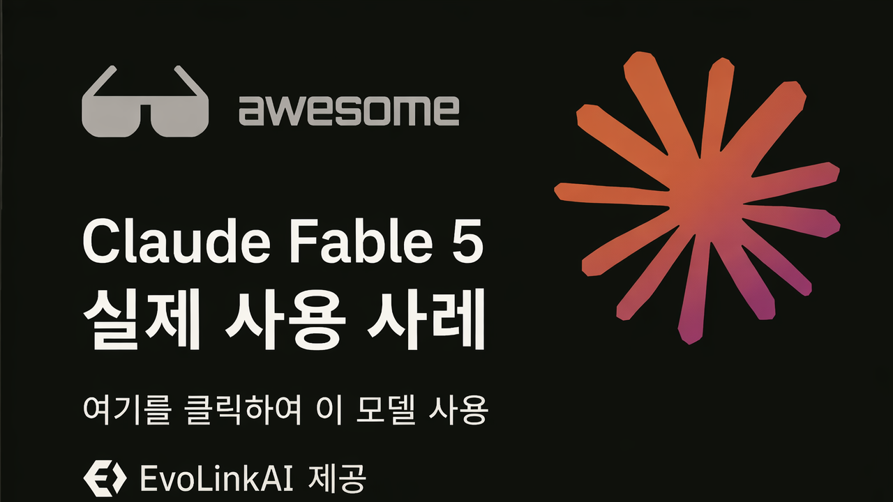

<div align="center">

<a href="https://evolink.ai/claude-fable-5?utm_source=github&utm_medium=readme&utm_campaign=awesome-claude-fable-5"></a>

[](LICENSE)
[](https://evolink.ai/claude-fable-5?utm_source=github&utm_medium=readme&utm_campaign=awesome-claude-fable-5)
[](https://evolink.ai/claude-fable-5?utm_source=github&utm_medium=readme&utm_campaign=awesome-claude-fable-5)
[](https://docs.evolink.ai)

[](README.md)
[](README_es.md)
[](README_pt.md)
[](README_ja.md)
[](README_ko.md)
[](README_de.md)
[](README_fr.md)
[](README_tr.md)
[](README_zh-TW.md)
[](README_zh-CN.md)
[](README_ru.md)

</div>

## 🍌 소개

Claude Fable 5의 고신호 활용 사례 저장소에 오신 것을 환영합니다.

**우리는 공개 데모와 크리에이터 커뮤니티에서 큐레이션한 Claude Fable 5의 실제 사용 사례, 튜토리얼, 통합, 평가를 수집합니다.**

이 한국어 README는 구체적인 워크플로, 프롬프트, 데모, 통합, 벤치마크 근거 또는 실용적 한계를 갖춘 고신호 사례에 초점을 맞춥니다.

대부분의 사례는 X/Twitter 게시물과 공개 데모에서 큐레이션되었습니다. 각 사례 제목은 원본 소스로 연결되며, 각 작성자 핸들은 크리에이터 프로필로 연결됩니다.

Evolink에서 사용해 보기: [Claude Fable 5](https://evolink.ai/claude-fable-5?utm_source=github&utm_medium=readme&utm_campaign=awesome-claude-fable-5)

## 📊 개요

- 공개 크리에이터, 개발자, 벤치마크 팀, 도구 제작자가 공유한 **선별된 Claude Fable 5 사례 78개**.
- 코딩 에이전트, 장시간 자동화, 게임, 비주얼 디자인, 3D 시뮬레이션, 지식 작업, 튜토리얼, API 통합, 벤치마크, 가격, 출시 시점의 제한을 다룹니다.
- 각 사례에는 원본 소스, 크리에이터 출처, 간결한 핵심 요약, 근거 유형, 게시 날짜가 포함됩니다.
- 이 저장소를 활용해 실용적인 워크플로를 찾고, 강점과 한계를 비교하며, 재현 가능한 프롬프트를 발견하고, 통합 예시를 따라가세요.

> [!NOTE]
> 이 컬렉션은 과장보다 구체적 근거를 우선합니다: 재현 가능한 프롬프트, 출시된 데모, 벤치마크 방법, 통합 노트, 비용 데이터, 명확히 제시된 주의사항.

<a id="-quick-api-access"></a>
## ⚡ 빠른 API 접속

Evolink 호환 Messages API를 통해 Claude Fable 5를 사용할 수 있습니다. [Evolink](https://evolink.ai/login?utm_source=github&utm_medium=readme&utm_campaign=awesome-claude-fable-5)에서 API 토큰을 받은 뒤 `<token>`을 해당 토큰으로 바꾸세요.

```bash
curl --request POST \
  --url https://direct.evolink.ai/v1/messages \
  --header 'Authorization: Bearer <token>' \
  --header 'Content-Type: application/json' \
  --data '
{
  "model": "claude-fable-5",
  "max_tokens": 1024,
  "messages": [
    {
      "role": "user",
      "content": "Hello, world"
    }
  ]
}
'
```

## 📑 메뉴

| 섹션 | 사례 |
|---|---|
| [💻 코딩 및 코드 생성](#coding-and-code-generation) | Case 1-6 |
| [🤖 에이전트 및 장시간 자동화](#agents-and-long-running-automation) | Case 7-8 |
| [🎮 게임 및 인터랙티브 데모](#games-and-interactive-demos) | Case 9-12 |
| [🎨 비주얼, 디자인, 비디오 및 3D](#visual-design-video-and-3d) | Case 13-16 |
| [📚 문서, 지식 작업 및 리서치](#documents-knowledge-work-and-research) | Case 17-19 |
| [🧭 튜토리얼, 강좌 및 프롬프트 리소스](#tutorials-courses-and-prompt-resources) | Case 20-28 |
| [🔌 플랫폼, API 및 도구 통합](#platform-api-and-tool-integration) | Case 29-34 |
| [📏 평가, 비교 및 한계](#evaluations-comparisons-and-limits) | Case 35-78 |
| [🙏 Acknowledge](#acknowledge) | 크레딧 및 정정 정책 |

### [💻 코딩 및 코드 생성](#coding-and-code-generation)

| Case | 무엇을 보여주는가 | 유형 |
|---|---|---|
| [Cursor 다단계 워크플로](#case-1) | Fable 5를 다중 모델 Cursor 워크플로 안에서 계획 리뷰와 비평 단계로 사용한 뒤, 구현과 수정은 더 저렴하거나 특화된 모델에 다시 넘기세요. | 평가 |
| [스크린샷에서 GitHub 재현하기](#case-2) | 제품 스크린샷을 에이전트형 코딩 도구에 붙여넣고, Fable 5에게 실제로 작동하는 기능이 있는 인터페이스를 재현하게 하세요. | 데모 |
| [단일 프롬프트 블랙홀 시뮬레이션](#case-3) | Fable 5에 상세한 크리에이티브 코딩 프롬프트 하나를 주고, 자체 완결형 Three.js 물리 시각화를 만들게 하세요. | 튜토리얼 |
| [원샷 macOS 스타일 웹 OS](#case-4) | Fable 5에 완전한 단일 파일 웹 OS를 요청하고, UI 셸, 앱, 상호작용, 오디오, 내장 게임 동작을 한 번에 만들게 하세요. | 튜토리얼 |
| [1,687개 프롬프트로 Spawn 5.0 구축](#case-5) | Fable 5를 긴 세션의 엔지니어링 파트너로 여러 프롬프트에 걸쳐 사용하고, 사람의 역할을 아키텍처에서 출력 품질 판단으로 이동시키세요. | 튜토리얼 |
| [발견 사항이 포함된 대형 Pull Request 리뷰](#case-6) | Fable 5에 대형 pull request를 맡기고 정확성, false positive, 실제 버그, polish 문제를 리뷰하게 하세요. | 데모 |

### [🤖 에이전트 및 장시간 자동화](#agents-and-long-running-automation)

| Case | 무엇을 보여주는가 | 유형 |
|---|---|---|
| [장기 Relay 워크플로 리뷰](#case-7) | 사이트 재구축, 프로그래매틱 콘텐츠 파이프라인, 보이스 매칭, 보안 리뷰, 최종 품질 점검처럼 야심 찬 장기 작업에 Fable 5를 사용하세요. | 평가 |
| [인프라 장애 진단 및 수정 PR 생성](#case-8) | 로그, 데이터베이스 오류, 이미지 digest 같은 인프라 단서를 Fable 5에 제공하고, 장애를 진단하고 수정안을 준비하게 하세요. | 평가 |

### [🎮 게임 및 인터랙티브 데모](#games-and-interactive-demos)

| Case | 무엇을 보여주는가 | 유형 |
|---|---|---|
| [손가락 추적 Dino Runner](#case-9) | Fable 5에게 손가락 추적을 입력 메커니즘으로 사용하는 브라우저 게임을 만들게 하세요. | 데모 |
| [두 문장으로 만든 레이싱 게임](#case-10) | Fable 5에 매우 짧은 게임 프롬프트를 주고, 지도, 모드, 음악, UI, 게임 asset을 한 번에 생성하게 하세요. | 튜토리얼 |
| [Rust로 만든 설치 가능한 터미널 Minecraft](#case-11) | 터미널 코딩 harness를 통해 Fable 5를 실행하고, 설치 가능한 Rust 터미널 게임을 만들게 하세요. | 데모 |
| [시간과 비용을 포함한 Minecraft 클론](#case-12) | 하나의 프롬프트로 Fable 5에게 플레이 가능한 Minecraft 스타일 클론을 요청한 뒤, 시간, 비용, 코드량, 기능 범위를 평가하세요. | 튜토리얼 |

### [🎨 비주얼, 디자인, 비디오 및 3D](#visual-design-video-and-3d)

| Case | 무엇을 보여주는가 | 유형 |
|---|---|---|
| [완전 재현 가능한 이커머스 이메일 프롬프트](#case-13) | 정확한 섹션, 제품 요구사항, 비주얼 방향, 제약을 포함한 완전한 크리에이티브 브리프를 Fable 5에 제공해 브랜드 이메일 목업을 만들게 하세요. | 튜토리얼 |
| [Swiss Lever 시계 제작자 벤치마크](#case-14) | Fable 5를 기계식 시뮬레이션 벤치마크에 사용하고, 물리적 정확성을 구현, 검증, 반복하게 하세요. | 평가 |
| [Three.js Friends 아파트 장면](#case-15) | Fable 5에게 floor plan과 scene reference를 navigable Three.js 환경으로 바꾸게 프롬프트하세요. | 평가 |
| [프롬프트와 URL이 포함된 태양계 시뮬레이션](#case-16) | Fable 5를 사용해 물리 원리에서 천문 시뮬레이션을 만들고, 시뮬레이션과 공개 출력물이 준비될 때까지 반복하세요. | 튜토리얼 |

### [📚 문서, 지식 작업 및 리서치](#documents-knowledge-work-and-research)

| Case | 무엇을 보여주는가 | 유형 |
|---|---|---|
| [Stripe 및 과학 워크플로 근거](#case-17) | 이 사례는 복사-붙여넣기용 프롬프트가 아니라, 엔터프라이즈 마이그레이션과 과학 워크플로 주장에 대한 근거로 사용하세요. | 평가 |
| [정책 메모 및 변경 내용 추적 워크플로](#case-18) | 정책 분석 초안 작성 같은 장문 정성 문서 작업, 즉 변경 내용 추적, 댓글 triage, transcript 기반 편집에 Fable 5를 사용하세요. | 튜토리얼 |
| [Deep Research 프롬프트와 출력](#case-19) | Fable 5에 연구 스타일 질문을 던지고, 구조적이며 역사적 근거가 있는 긴 답변을 만들 수 있는지 평가하세요. | 데모 |

### [🧭 튜토리얼, 강좌 및 프롬프트 리소스](#tutorials-courses-and-prompt-resources)

| Case | 무엇을 보여주는가 | 유형 |
|---|---|---|
| [Fable 5가 Claude Code 워크플로를 바꾸는 방식](#case-20) | 모든 단계를 세세하게 지시하는 대신 방향, 맥락, 목표, 검증 기준을 설정해 Fable 5를 사용하세요. | 데모 |
| [10억 토큰 리뷰와 라우팅 전략](#case-21) | Fable 5를 frontier planning과 review에 사용한 뒤, 고볼륨 구현은 더 저렴한 모델로 라우팅하세요. | 튜토리얼 |
| [방어적 디바이스 하드닝 프롬프트](#case-22) | Fable 5가 디바이스를 inventory하고, 정확한 점검을 제공하며, 검증을 기다리는 단계별 방어적 hardening 프롬프트를 실행하세요. | 튜토리얼 |
| [전체 사이트 디자인 감사 Goal 프롬프트](#case-23) | `/goal`을 사용해 Fable 5가 사이트를 부팅하고, 페이지를 스크린샷으로 찍고, UX를 감사하고, 보고서를 쓰고, 안전한 작은 문제를 수정하게 하세요. | 튜토리얼 |
| [장문 창작 워크플로 분업](#case-24) | Fable 5가 안정적인 format과 examples를 설계하게 한 뒤, 그 구조를 다른 generation system에 넘겨 domain-specific output을 만들게 하세요. | 튜토리얼 |
| [Fable 5 사용 초보자 가이드](#case-25) | 작은 단계별 지시 대신 goal-oriented prompts, verification loops, effort settings와 함께 Fable 5를 사용하세요. | 평가 |
| [복사-붙여넣기 저장소 감사 프롬프트](#case-26) | 저장소 감사 프롬프트를 Fable 5에 붙여넣고, file-backed discovery, findings, strategy, milestone task plan을 요청하세요. | 튜토리얼 |
| [제한된 기간의 사용 전략](#case-27) | 접근 창이 유리할 때 Fable 5 사용량을 audit, architecture, planning에 쓰고, execution에는 더 저렴한 모델을 사용하세요. | 튜토리얼 |
| [Claude Code에서 Goals와 Workflows 사용하기](#case-28) | 구현 전에 Fable 5를 thought partner로 사용한 뒤, `/goal`과 workflows를 결합해 계획을 실행하고 검증하세요. | 튜토리얼 |

### [🔌 플랫폼, API 및 도구 통합](#platform-api-and-tool-integration)

| Case | 무엇을 보여주는가 | 유형 |
|---|---|---|
| [Hermes Agent 통합 설정](#case-29) | 복잡한 `/goal` 실행과 cached long-horizon tasks에 `anthropic/claude-fable-5`를 사용하도록 Hermes를 설정하세요. | 튜토리얼 |
| [기능, 가격 및 구독 관련 노트](#case-30) | Fable 5가 언제 사용 가능하고, 비용이 얼마이며, 어떤 guarded domains가 다른 모델로 fallback될 수 있는지 이해하는 데 이 사례를 사용하세요. | 튜토리얼 |
| [출시, 접근, 가격 및 안전 요약](#case-31) | 이 출시 요약을 사용해 access route, API model name, context window, caching strategy, subscription timing을 선택하세요. | 튜토리얼 |
| [Advisor 기반 비용 절감 전략](#case-32) | 추가 지능이 비용을 감당할 가치가 있을 때, 더 저렴한 모델 워크플로에서 Fable 5를 advisor 또는 reviewer로 사용하세요. | 통합 |
| [가격, 접근 및 안전 가드레일](#case-33) | workload를 계획하기 전에 Fable 5 access, API pricing, safety fallback behavior를 이해하는 데 이 사례를 사용하세요. | 통합 |
| [한 줄 Swarms 통합](#case-34) | Swarms model name을 `anthropic/claude-fable-5`로 설정하고 Swarms framework 또는 API를 통해 Fable 5를 실행하세요. | 통합 |

### [📏 평가, 비교 및 한계](#evaluations-comparisons-and-limits)

| Case | 무엇을 보여주는가 | 유형 |
|---|---|---|
| [Fable 5 vs GPT-5.5 비용 및 품질 비교](#case-35) | 같은 코딩 작업에서 Fable 5와 GPT-5.5를 비교해 출력 품질, 실행 시간, 도구 비용을 판단하세요. | 평가 |
| [AA-Omniscience 벤치마크 결과](#case-36) | 이 벤치마크 사례를 사용해 Fable 5의 knowledge accuracy와 hallucination behavior를 평가하세요. | 평가 |
| [Artificial Analysis Intelligence Index 결과](#case-37) | 이 사례를 사용해 Fable 5의 전체 intelligence ranking을 다른 frontier models와 비교해 벤치마크하세요. | 평가 |
| [GDPval-AA 에이전트형 지식 작업 벤치마크](#case-38) | 이 사례를 사용해 agentic real-world knowledge work에서 Fable 5를 평가하세요. | 평가 |
| [1주일 첫인상과 가격 메커니즘](#case-39) | 이 첫인상 사례를 사용해 Fable 5가 특히 game design과 systems planning에서 어디에 강한지 결정하세요. | 통합 |
| [비용 및 속도 비교](#case-40) | 이 비교를 사용해 quality gain이 더 높은 cost와 느린 long-horizon runs를 정당화하는지 판단하세요. | 평가 |
| [Claude Code 실사용 노트](#case-41) | tool use, personality, remaining rough edges를 포함해 Claude Code 안에서 Fable 5를 평가하는 데 이 사례를 사용하세요. | 데모 |
| [창작 글쓰기 벤치마크 결과](#case-42) | 이 벤치마크 사례를 사용해 Fable 5의 short-fiction writing quality와 refusal behavior를 판단하세요. | 평가 |
| [다중 벤치마크 출시 요약](#case-43) | 이 출시 벤치마크 요약을 사용해 coding agents와 complex tasks에 가장 관련 있는 headline scores를 이해하세요. | 평가 |
| [GPT-5.5와의 벤치마크 및 가격 비교](#case-44) | 이 비교를 사용해 price와 benchmark categories에서 Fable 5를 GPT-5.5와 비교 평가하세요. | 평가 |
| [실전 노트와 실용적 한계](#case-45) | 이 field report를 사용해 Fable 5가 어디에서 의미 있게 더 좋게 느껴지고, 어디에 여전히 실용적 한계가 있는지 이해하세요. | 튜토리얼 |
| [물리 시뮬레이션 비교](#case-46) | Fable 5와 Opus 4.8에 동일한 물리 시뮬레이션 프롬프트를 실행해 output quality, cost, speed를 비교하세요. | 데모 |
| [디버깅 경험과 디자인 판단력](#case-47) | 단순히 추측하게 하지 말고, measure, log, verify, patch하도록 요청해 Fable 5를 debugging에 사용하세요. | 데모 |
| [다차원 장단점](#case-48) | Fable 5를 daily driver로 만들기 전에 practical strengths and weaknesses를 이해하는 데 이 사례를 사용하세요. | 데모 |
| [법률 S-1 작성 테스트](#case-49) | S-1 drafting prompt를 legal-agent capability test로 사용하고 structure, formatting, length를 비교하세요. | 튜토리얼 |
| [헬스케어 벤치마크 세부 정보](#case-50) | 이 benchmark note를 사용해 healthcare-related tasks에서 Fable 5를 평가하고, 빠진 hard medical evals를 식별하세요. | 평가 |
| [ParseBench 문서 파싱 평가](#case-51) | 전문 OCR 시스템과 비교해 Fable 5가 document parsing에 cost-effective한지 결정하는 데 이 사례를 사용하세요. | 평가 |
| [SWE-Bench Pro 및 FrontierCode 비교](#case-52) | 이 벤치마크 사례를 사용해 migrations, complex implementations, autonomous sessions, tests, visual verification에서 Fable 5를 평가하세요. | 평가 |
| [장시간 문제 해결에 대한 정성 리뷰](#case-53) | 이 정성 리뷰를 사용해 Fable 5가 왜 longer, harder tasks에 적합한지 이해하되, production review는 여전히 필요하다는 점을 기억하세요. | 평가 |
| [ParseBench 충실도 및 서식 결과](#case-54) | 이 ParseBench 결과를 사용해 document faithfulness와 formatting performance를 판단하세요. | 평가 |
| [벤치마크, 가격, 접근 및 안전장치](#case-55) | 이 사례를 benchmarks, pricing, access, safeguards, strategic implications에 대한 넓은 checklist로 사용하세요. | 평가 |
| [공식 벤치마크 점수 목록](#case-56) | 이 benchmark list를 사용해 coding, computer use, security tasks 전반의 Fable 5 공식 점수를 이해하세요. | 평가 |
| [APEX-SWE 벤치마크 방법론](#case-57) | 이 사례를 사용해 APEX-SWE, 특히 observability와 integration work에서 Fable 5를 평가하세요. | 평가 |
| [ProofBench 형식 수학 결과](#case-58) | 이 사례를 사용해 specialized theorem-proving systems와 비교해 formal math에서 Fable 5를 평가하세요. | 튜토리얼 |
| [VirtueBench 예비 분석](#case-59) | 이 사례를 사용해 virtue categories 전반에서 Fable 5의 moral-reasoning behavior를 살펴보세요. | 평가 |
| [API 빈 응답 안전 과적합 테스트](#case-60) | 이 사례를 사용해 launch-time safety overfit risk와 API testing의 empty-response behavior를 이해하세요. | 평가 |
| [Fable Prompting Verification Guide](#case-61) | Use this prompting guide to shift from longer prompt hacks toward goal, context, constraints, tools, and verification loops. | 튜토리얼 |
| [Istanbul Platform Game Reference Build](#case-62) | Use a reference sprite sheet plus one conversion instruction to test Fable 5 on a playable platform game. | 데모 |
| [Business 3D City Dashboard](#case-63) | Use Fable 5 to turn a business workflow into a live 3D city dashboard concept. | 데모 |
| [Three.js Hole Game One-Shot](#case-64) | Use Fable 5 to one-shot a 3D browser game prototype in Three.js. | 데모 |
| [DeepSWE Score Comparison](#case-65) | Use this DeepSWE note to compare Fable 5 xHigh with GPT-5.5 xHigh on software-engineering benchmark performance. | 평가 |
| [Repository Cost Comparison](#case-66) | Use this repository-analysis comparison to judge token price against human rework cost. | 평가 |
| [Super Mario Game Token Cost](#case-67) | Use this single-shot game build to estimate Fable 5 output quality and token consumption. | 데모 |
| [Claude Code Fallback Setting](#case-68) | Use this case to understand the Claude Code setting for switching models when a Fable 5 message is flagged. | 통합 |
| [Namma Metro Simulator Build](#case-69) | Use this demo as a compact example of vibe-coding a public-transit simulator with Fable 5. | 데모 |
| [Dusk Drive One-Prompt Game](#case-70) | Use this one-prompt driving-game case to evaluate Fable 5 on low-poly game prototyping without human edits. | 데모 |
| [APEX-Agents Pass@1 Ranking](#case-71) | Use this APEX-Agents result to compare Fable 5 Max on multi-step autonomous tasks. | 평가 |
| [Claude Model Selection Playbook](#case-72) | Use this model-selection playbook to reserve Fable 5 for the hardest Claude Code jobs. | 튜토리얼 |
| [HermesWorld Automated Agent Loop](#case-73) | Use this case to study a hands-free Fable 5 loop that builds, tests, plays, and smoke-tests over days. | 통합 |
| [McKinsey-Style Report Prompt Test](#case-74) | Use this document-generation prompt to evaluate consulting-report structure, charts, narrative, and risk analysis. | 튜토리얼 |
| [Visible Safeguards Rollout](#case-75) | Use this official note to understand Fable 5 safeguard visibility, API refusal reasons, and Opus fallback behavior. | 통합 |
| [Claude Code Model Matching Fix](#case-76) | Use this Claude Code changelog note to avoid Fable 5 model-name and context matching issues. | 통합 |
| [Three Web Apps in Claude Code](#case-77) | Use this beginner coding demo to inspect Fable 5 inside Claude Code across multiple generated web apps. | 데모 |
| [Rilable Open Source App Builder](#case-78) | Use this open-source app-builder case to study Fable 5 across iOS, web apps, sandboxes, and API-token cost. | 통합 |


<a id="coding-and-code-generation"></a>
## 💻 코딩 및 코드 생성

<a id="case-1"></a>
### Case 1: [Cursor 다단계 워크플로](https://x.com/AlicanKiraz0/status/2064487347605918180) (by [@AlicanKiraz0](https://x.com/AlicanKiraz0))

**Fable 5를 다중 모델 Cursor 워크플로 안에서 계획 리뷰와 비평 단계로 사용한 뒤, 구현과 수정은 더 저렴하거나 특화된 모델에 다시 넘기세요.**

Fable 5와 GPT 5.5의 최종 점수를 보면 격차는 매우 작습니다. 제 소박한 사용 권장 방식은 이렇습니다. Cursor처럼 하이브리드 모델을 지원하는 IDE 플랫폼에서는 단계형 워크플로를 사용하세요.

Phase 1: 코드 리뷰와 프로젝트 점검의 첫 단계에서는 컨텍스트를 예열하면서 GPT 5.5 High, Minimax M3, Kimi K2.6, Composer 2.5 중 하나를 사용합니다.

Phase 2: 프로젝트 계획을 준비할 때는 GPT 5.5 Very High 또는 Opus 4.8을 사용합니다.

Phase 3: 프로젝트 계획을 분석할 때는 Fable 5를 사용하고, 계획의 결함 있는 부분을 찾아내게 합니다. 수정에는 GPT 5.5 Very High를 사용합니다.

Phase 4: 계획을 구현할 때는 Minimax M3, Deepseek v4 Max, Composer 2.5 또는 Sonnet 4.6을 사용합니다.

Phase 5: 최종 리뷰와 구현이 계획을 따랐는지 확인할 때는 GPT 5.5 High를 사용합니다.

Type: 평가 | Date: 2026-06-09

---

<a id="case-2"></a>
### Case 2: [스크린샷에서 GitHub 재현하기](https://x.com/coldopn/status/2064435234465087638) (by [@coldopn](https://x.com/coldopn))

**제품 스크린샷을 에이전트형 코딩 도구에 붙여넣고, Fable 5에게 실제로 작동하는 기능이 있는 인터페이스를 재현하게 하세요.**

🚨 Anthropic Fable 5가 스크린샷만으로 GITHUB를 복제했습니다!!

제가 한 일은 GitHub UI 스크린샷을 Kilo Code에 붙여넣고, 실제 기능이 있는 GitHub를 다시 만들라고 지시한 것뿐입니다.

10분 동안 코딩했고 $4.07가 들었습니다.

결과는 작동하는 GitHub 복제본이었습니다: https://t.co/bjMObvlsPX

Type: 데모 | Date: 2026-06-09

---

<a id="case-3"></a>
### Case 3: [단일 프롬프트 블랙홀 시뮬레이션](https://x.com/deveshcodes_/status/2064437742189379745) (by [@deveshcodes_](https://x.com/deveshcodes_))

**Fable 5에 상세한 크리에이티브 코딩 프롬프트 하나를 주고, 자체 완결형 Three.js 물리 시각화를 만들게 하세요.**

@claudeai가 Claude Fable 5로 Three.js 실시간 블랙홀 렌징 시뮬레이션을 원샷으로 만들었습니다.

중력 렌징, 도플러 증폭 강착 원반, 광자 구, 색수차, 절차적 별 배경이 포함되었습니다.

결과: 60fps, 단일 HTML 파일, 프롬프트 하나.

새 기준선이 말도 안 됩니다 🤯 https://t.co/E23I8bnPKb

Type: 튜토리얼 | Date: 2026-06-09

---

<a id="case-4"></a>
### Case 4: [원샷 macOS 스타일 웹 OS](https://x.com/intheworldofai/status/2064421915347812672) (by [@intheworldofai](https://x.com/intheworldofai))

**Fable 5에 완전한 단일 파일 웹 OS를 요청하고, UI 셸, 앱, 상호작용, 오디오, 내장 게임 동작을 한 번에 만들게 하세요.**

🚨 Claude Fable 5가 macOS 스타일의 완전한 웹 OS를 한 번에 만들었고, 대부분의 모델보다 더 멀리 갔습니다.

단일 HTML 파일, 내장 CSS + JS.

하나의 프롬프트에서 다음을 만들었습니다:

- macOS 메뉴 바 + dock
- 드래그와 크기 조절이 가능한 앱 창
- 작동하는 파일 탐색기
- 작동하는 터미널 + 브라우저 목업
- SVG 데스크톱 아이콘 + 알림
- Settings app, 테마, 부팅 화면
- 실제 합성을 사용하는 완전 작동 사운드 플레이어, 외부 파일 없음
- 데스크톱 안에서 플레이 가능한 Minecraft 클론

거의 수정 없이 한 번에 모두 생성되었습니다.

작동하는 사운드 플레이어와 실제 Minecraft 클론을 함께 해낸 것은 다른 모델에서 아직 본 적이 없습니다. Fable 5의 frontend/UI 생성 능력이 터무니없이 좋아지고 있습니다.

Type: 튜토리얼 | Date: 2026-06-09

---

<a id="case-5"></a>
### Case 5: [1,687개 프롬프트로 Spawn 5.0 구축](https://x.com/jsnnsa/status/2064420561078693941) (by [@jsnnsa](https://x.com/jsnnsa))

**Fable 5를 긴 세션의 엔지니어링 파트너로 여러 프롬프트에 걸쳐 사용하고, 사람의 역할을 아키텍처에서 출력 품질 판단으로 이동시키세요.**

claude fable 5 is live.

spawn 5.0은 이것으로 만들어졌습니다:

- 1,687 prompts
- 102 sessions
- 제 역할은 아키텍처에서 취향 판단으로 바뀌었습니다

우리가 만든 것들입니다. 각각은 Opus에서 팀 전체가 붙어도 최소 한 달은 걸렸을 작업입니다:

- Rapier에 견줄 수 있고 사이드 스레드로 하루 만에 테스트 가능했던, 처음부터 만든 물리 엔진 Mantle
- Clustered froxel lighting: 8개 조명에서 1,000개 이상의 완전 동적 조명으로
- 휴대폰에서 돌아가는 WebGPU 기반 실시간 diffuse GI
- Unreal과 Unity가 제공하는 것 이상의 셰이더 아키텍처를 갖춘 백만 파티클 GPU VFX
- MMO 규모 netcode
- 알파 단계의 네이티브 iOS 앱

이 모든 것이 약 일주일 걸렸습니다. 전부 모바일에서 실행됩니다. 목록에는 실제로 배포된 것의 절반도 포함되어 있지 않습니다. 전체 changelog는 스레드에 있습니다.

벤치마크가 보여주지 못하는 부분: 이 모델은 성격이 훌륭합니다. 정말 웃깁니다. 물리 엔진을 다시 쓰는 도중 여러 번 너무 웃어서 울었습니다. 천재성과 캐릭터는 별개의 기능이 아닙니다.

Type: 튜토리얼 | Date: 2026-06-09

---

<a id="case-6"></a>
### Case 6: [발견 사항이 포함된 대형 Pull Request 리뷰](https://x.com/ryanrhughes/status/2064411147076534705) (by [@ryanrhughes](https://x.com/ryanrhughes))

**Fable 5에 대형 pull request를 맡기고 정확성, false positive, 실제 버그, polish 문제를 리뷰하게 하세요.**

Fable 5에게 단일 PR(74 files / +3,705 / -1,246)을 마음껏 리뷰하게 해 보았습니다. 어떻게 하는지 보려는 목적이었습니다. 34분 동안 실행됐고, 제 5시간 세션의 42%를 소모했으며, 16개의 “correctness” 발견 사항을 냈고 다음을 찾아냈습니다:

- 무섭게 들리지만 false positive였던 것 2개
- 실제 audit-correctness 버그 3개
- 정당하지만 작은 UX/polish 문제 약 5개
- 여러 cleanup 의견

이게 출시하기엔 너무 위험했나요?

Type: 데모 | Date: 2026-06-09

---

<a id="agents-and-long-running-automation"></a>
## 🤖 에이전트 및 장시간 자동화

<a id="case-7"></a>
### Case 7: [장기 Relay 워크플로 리뷰](https://x.com/JJEnglert/status/2064469635190170105) (by [@JJEnglert](https://x.com/JJEnglert))

**사이트 재구축, 프로그래매틱 콘텐츠 파이프라인, 보이스 매칭, 보안 리뷰, 최종 품질 점검처럼 야심 찬 장기 작업에 Fable 5를 사용하세요.**

제 Claude Fable 5 리뷰의 짧은 버전: Claude Fable 5를 테스트하는 데 10억 토큰을 썼고, 불공정한 이점을 가진 느낌이었습니다.

저는 눈으로 보는 테스트로 판단합니다. 모델을 실제 작업에 투입하고 지켜봅니다. 시간을 절약해 주는가, 아니면 시간을 잡아먹는가? 내가 놓친 것을 잡는가? 파트너처럼 느껴지는가, 아니면 계속 돌봐야 하는 도구처럼 느껴지는가?

이것은 오랜만에 중요한 모든 차원을 통과한 첫 모델이며, 그것도 조금이 아니라 확실히 통과했습니다.

빌드: 저는 Tenex 사이트를 다시 만들고 있었습니다. 매우 커스텀되어 있었고 매우 어려웠습니다. GPT 5.5와 Claude 4.8은 단독으로 해결하지 못했습니다. 참고할 Figma 파일이 있어도 85-90% 정도에서 멈췄습니다.

그런 다음 Fable 5가 모든 것을 살펴보고 더 잘할 수 있다고 말하더니, 원본 Webflow 소스로 곧장 가서 모든 asset을 다운로드했고 거의 한 번에 전체를 재현했습니다.

그 다음 주말 동안 완전히 새로운 80페이지 사이트를 처음부터 하나 더 만들게 했습니다. 에이전시로서라면 $50k를 청구했을 작업입니다.

또한 전체 프로그래매틱 클립 공장을 연결했습니다:

- HeyGen
- ElevenLabs
- Cloudflare
- A VPS

이 파이프라인은 주제를 찾고, 스크립트를 쓰고, 비디오를 편집하고, 음악을 추가하고, 소셜에 게시합니다. 오랫동안 스스로 실행되었고, 렌더를 모니터링하기 위한 webhook 시스템까지 자체 구축했습니다.

쓰기: 우리의 브랜드 보이스 문서를 거의 동일하게 복제한 뒤, 80페이지의 기능, 사례 연구, 기사 전반에서 그 보이스를 유지했고, 평면적인 AI 기본값으로 흐르지 않았습니다.

보안: 두 frontier 모델이 대형 repo에서 작업하고 코드에 승인까지 했었습니다. Fable 5는 첫 패스에서 심각하고 잘 숨겨진 버그를 찾아냈고 즉석에서 패치했습니다.

인간적인 순간: cron job을 기다리는 동안 질문을 했습니다. 답변한 뒤, 제가 약 10분 남았으며 끝나면 알려주겠다고 스스로 덧붙였습니다. 저는 타이머에 대해 묻지 않았습니다.

솔직한 단점: 어떤 모델보다도 미터기가 느껴집니다. Anthropic은 이것을 의도적으로 token-intensive하다고 부릅니다. 그래서 relay로 운용하세요: Fable 5로 생각하고, 더 저렴한 모델로 만들고, Fable 5로 리뷰하세요.

판결: 옆 사람보다 더 많은 지능에 접근할 수 있다는 것이 이점입니다. Fable 5는 그것을 현실로 만드는 첫 모델입니다. 풀 frontier 요금으로도 수익이 남았습니다.

Type: 평가 | Date: 2026-06-09

---

<a id="case-8"></a>
### Case 8: [인프라 장애 진단 및 수정 PR 생성](https://x.com/ayushagarwal/status/2064422467557564862) (by [@ayushagarwal](https://x.com/ayushagarwal))

**로그, 데이터베이스 오류, 이미지 digest 같은 인프라 단서를 Fable 5에 제공하고, 장애를 진단하고 수정안을 준비하게 하세요.**

claude fable 5 is damn damn good!!!!

사이드 self-hosted infra에서 제가 제대로 설명조차 못 하던 장애를 방금 진단했습니다.

pod 로그를 읽고, Cloud SQL 오류 로그를 조회하고, 이미지 digest를 비교한 뒤, Kubernetes가 새로 마이그레이션된 데이터베이스에 대해 3개월 된 캐시 이미지를 실행 중이라는 것을 찾아냈습니다.

그 다음 수정 PR을 열었습니다.

몇 시간 아니라 몇 분. 웹 검색 없음. 🤯

Type: 평가 | Date: 2026-06-09

---

<a id="games-and-interactive-demos"></a>
## 🎮 게임 및 인터랙티브 데모

<a id="case-9"></a>
### Case 9: [손가락 추적 Dino Runner](https://x.com/ai_for_success/status/2064413182396108932) (by [@ai_for_success](https://x.com/ai_for_success))

**Fable 5에게 손가락 추적을 입력 메커니즘으로 사용하는 브라우저 게임을 만들게 하세요.**

Fable 5에게 손가락 추적 Dino runner 게임을 만들어 달라고 요청했습니다.

약 11-12분 만에 finger runner 게임을 원샷으로 만들었고, 약 914K tokens를 소비했으며, 단 629 lines of code로 모든 것을 구현했습니다.

https://t.co/AWt1lEIObq

Type: 데모 | Date: 2026-06-09

---

<a id="case-10"></a>
### Case 10: [두 문장으로 만든 레이싱 게임](https://x.com/kieradev/status/2064482704763085202) (by [@kieradev](https://x.com/kieradev))

**Fable 5에 매우 짧은 게임 프롬프트를 주고, 지도, 모드, 음악, UI, 게임 asset을 한 번에 생성하게 하세요.**

Claude Fable 5, Max 5x 사용량의 40%.

2문장 프롬프트로 만든 완전한 Mario Kart 64 유형 게임.

Fable 5는 약 15분 만에 모든 장식, 캐릭터 모델, 4개 맵, 음악, 세 가지 게임 모드, UI를 한 번에 처리했습니다.

#fable #anthropic https://t.co/B7mTidE84U

Type: 튜토리얼 | Date: 2026-06-09

---

<a id="case-11"></a>
### Case 11: [Rust로 만든 설치 가능한 터미널 Minecraft](https://x.com/vikvang1/status/2064500731848319303) (by [@vikvang1](https://x.com/vikvang1))

**터미널 코딩 harness를 통해 Fable 5를 실행하고, 설치 가능한 Rust 터미널 게임을 만들게 하세요.**

Claude Fable 5를 Warp의 harness와 함께 한 시간 동안 돌려 보았습니다.

터미널에서 직접 렌더링되는 Minecraft의 TUI 버전을 만들었고, 전체가 Rust로 작성되었습니다.

Install command: cargo install termcraft-3d

https://t.co/zs3y3t88oM

Type: 데모 | Date: 2026-06-10

---

<a id="case-12"></a>
### Case 12: [시간과 비용을 포함한 Minecraft 클론](https://x.com/ydamitcodes/status/2064536076518363353) (by [@ydamitcodes](https://x.com/ydamitcodes))

**하나의 프롬프트로 Fable 5에게 플레이 가능한 Minecraft 스타일 클론을 요청한 뒤, 시간, 비용, 코드량, 기능 범위를 평가하세요.**

@claudeai Fable 5가 37분 만에 Minecraft 클론을 만들어 줬습니다.

프롬프트 하나. 약 3K lines of code. API 비용 $12.

biomes, caves, ores, day/night, mobs, 전부 포함했습니다.

Minecraft는 Notch가 2년 걸렸습니다.

https://t.co/AmwdLwi75O

Type: 튜토리얼 | Date: 2026-06-10

---

<a id="visual-design-video-and-3d"></a>
## 🎨 비주얼, 디자인, 비디오 및 3D

<a id="case-13"></a>
### Case 13: [완전 재현 가능한 이커머스 이메일 프롬프트](https://x.com/ecomchasedimond/status/2064454139225297091) (by [@ecomchasedimond](https://x.com/ecomchasedimond))

**정확한 섹션, 제품 요구사항, 비주얼 방향, 제약을 포함한 완전한 크리에이티브 브리프를 Fable 5에 제공해 브랜드 이메일 목업을 만들게 하세요.**

Claude Fable 5는 단일 프롬프트와 무수정으로 이것을 만들었습니다.

제가 사용한 전체 프롬프트는 다음과 같습니다:

밀레니얼을 위한 현대적인 시계 및 액세서리 브랜드 MVMT의 전체 길이, 세로형 이커머스 이메일 목업을 만드세요.

매끈하고, 정제되어 있으며, 미니멀하고, 남성적인 방향성이 있고, editorial한 느낌의 매우 사실적인 premium DTC 이메일을 디자인하세요. 최종 이미지는 포스터도, landing page도, generic template도 아니라 실제 디자이너가 만든 이커머스 이메일 스크린샷처럼 보여야 합니다.

Brand vibe: Modern California-cool, 젊고, 자신감 있고, 깔끔하며, 열망을 자극하고, 스타일리시하고, elevated. 디자인은 luxury-adjacent하지만 여전히 접근 가능하게 느껴져야 합니다.

다음 제품을 눈에 띄게 포함하세요:

- Mulholland
- Odyssey II Automatic
- Cali Diver
- Signature Watch Bands

Visual style:

- clean premium ecommerce design
- refined editorial layout
- realistic product photography
- subtle lifestyle imagery
- strong hierarchy
- crisp sans-serif typography
- generous spacing
- subtle shadows
- restrained modern color palette

Color palette: Black, white, charcoal, warm gray, stone, soft beige, brushed metal tones, and subtle muted accents. 팔레트는 neutral하고 premium하게 유지하세요.

중요한 creative direction: 이것은 강한 디자인 감각을 가진 세련된 watch-brand email campaign처럼 느껴져야 합니다. realism, elegance, clarity를 우선하세요. MVMT가 실제로 보낼 수 있을 법하게 만드세요.

이 순서로 이메일을 구성하세요:

1. Top promo bar: 상단을 가로지르는 얇은 black 또는 dark charcoal bar, 작은 uppercase text: “FREE SHIPPING OVER $75 + EASY RETURNS”.

2. Header: 왼쪽의 MVMT wordmark/logo와 오른쪽 또는 중앙의 minimal navigation links가 있는 clean white header: WATCHES, SUNGLASSES, JEWELRY, NEW ARRIVALS.

3. Hero section: 강한 visual balance를 가진 premium hero section.

Bold headline을 사용하세요: “BUILT TO GET NOTICED”.

일상 스타일을 높여 주는 modern timepieces and accessories에 대한 짧은 supporting copy를 포함하세요.

Dark rounded CTA button을 추가하세요: “SHOP WATCHES”.

Hero imagery에는 다음이 포함되어야 합니다:

- one dominant premium watch image
- subtle luxury lifestyle imagery
- a stylish male model or fashion-forward masculine lifestyle scene
- modern lighting and clean composition

4. Featured collection section: 중앙 정렬 section headline을 추가하세요: “THREE WAYS TO WEAR MVMT”. 그 아래에는 다음을 보여주는 clean product cards 또는 image blocks 3개를 배치하세요:

- Mulholland
- Odyssey II Automatic
- Cali Diver

각 block에는 다음이 포함되어야 합니다:

- product image
- product name
- short one- or two-line description

이 section은 symmetrical, polished, premium하게 유지하세요.

5. Accessory banner: “FINISH THE LOOK”라는 제목의 refined split section을 추가하세요. Signature Watch Bands를 featured로 보여 주세요. watch straps 또는 interchangeable bands의 premium close-up imagery를 보여 주세요. 짧은 supporting copy와 dark CTA button을 포함하세요: “SHOP ACCESSORIES”.

6. Editorial promo tiles: 이미지 중심 디자인의 side-by-side promotional tiles 2개를 추가하세요.

Tile one headline: “FOR DAILY WEAR”.

Tile two headline: “FOR STATEMENT DAYS”.

각 tile에는 짧은 copy와 작은 CTA가 있어야 합니다: “SHOP NOW”.

이 tile들은 generic sale boxes가 아니라 editorial brand moments처럼 느껴져야 합니다.

7. Shoppable row: “IN ROTATION NOW”라는 제목의 section을 추가하세요. 다음을 포함하는 clean 4-item product row 또는 grid를 보여 주세요:

- Mulholland
- Odyssey II Automatic
- Cali Diver
- Signature Watch Bands

각 item에는 다음이 포함되어야 합니다:

- isolated product image
- product name
- small “SHOP” link or button

8. Brand signoff: “DESIGNED TO MOVE WITH YOU”라는 headline을 가진 중앙 정렬 message block을 추가하세요. everyday life를 위한 thoughtfully crafted watches, eyewear, accessories에 대한 짧은 문장을 포함하세요.

9. Footer: 다음을 포함하는 사실적인 black 또는 charcoal branded footer를 만드세요:

- MVMT logo
- shop links
- company links
- support links
- social icons
- small legal and shipping text

Typography direction: 주요 headline에는 bold condensed 또는 modern sans-serif typography를 사용하고, body text에는 clean sans-serif를 사용하세요. Headline은 sharp, modern, fashion-forward하게 느껴져야 합니다. Body copy는 사실적이고 대부분 읽을 수 있어야 합니다.

Photography direction: realistic reflections, polished materials, soft shadows, clean surfaces를 가진 premium product photography를 사용하세요. Lifestyle photography는 elevated, modern, fashion-oriented하게 느껴져야 합니다.

Composition rules:

- tall vertical email format
- clear section separation
- realistic email proportions
- strong hierarchy
- mostly legible text
- premium spacing
- intentional alignment
- balanced mix of product and lifestyle imagery

Avoid:

- messy collage styling
- playful scrapbook aesthetics
- overly colorful design
- cheap template vibes
- cartoonish imagery
- cluttered layouts
- fake-looking UI elements
- poster-style composition
- excessive promotional chaos

Output: premium, clean, polished, modern, editorial, presentation-ready하게 느껴지는 MVMT용 전체 길이 세로 구성의 매우 사실적인 ecommerce email design mockup.

Type: 튜토리얼 | Date: 2026-06-09

---

<a id="case-14"></a>
### Case 14: [Swiss Lever 시계 제작자 벤치마크](https://x.com/quanghuynt14/status/2064509430650065278) (by [@quanghuynt14](https://x.com/quanghuynt14))

**Fable 5를 기계식 시뮬레이션 벤치마크에 사용하고, 물리적 정확성을 구현, 검증, 반복하게 하세요.**

그래서 Fable 5에게 watchmaker benchmark를 줬습니다: Three.js로 만든 완전한 Swiss lever movement.

실제 gear ratios(18,000 bph), 작동하는 escapement, 숨 쉬는 hairspring, 그리고 바늘은 실제 시간을 표시합니다.

스스로 vision으로 반복 검증하며 완료할 때까지 작업했습니다.

⌚ https://t.co/RSRfDoKxA4

Type: 평가 | Date: 2026-06-10

---

<a id="case-15"></a>
### Case 15: [Three.js Friends 아파트 장면](https://x.com/scottstts/status/2064464351906673029) (by [@scottstts](https://x.com/scottstts))

**Fable 5에게 floor plan과 scene reference를 navigable Three.js 환경으로 바꾸게 프롬프트하세요.**

Holy Crap!!!

Fable 5:

@threejs에서, 이 floor plan을 정확히 기반으로 TV show Friends의 상징적인 Monica's apartment를 first person pov로 탐색 가능한 3d scene으로 만들고, 원래 look and feel에 충실하며, warm lighting을 사용하세요

이 테스트에서 본 것 중 단연 THE BEST입니다!

이 single html은 $12가 들었지만, 결과는 놀랍습니다!

Type: 평가 | Date: 2026-06-09

---

<a id="case-16"></a>
### Case 16: [프롬프트와 URL이 포함된 태양계 시뮬레이션](https://x.com/tetumemo/status/2064477582930989357) (by [@tetumemo](https://x.com/tetumemo))

**Fable 5를 사용해 물리 원리에서 천문 시뮬레이션을 만들고, 시뮬레이션과 공개 출력물이 준비될 때까지 반복하세요.**

Claude Fable 5는 강렬합니다.

물리 시뮬레이션에 강해 보였기 때문에 이렇게 요청했습니다:

'물리의 기본 원리에서 행성 궤도 운동을 유도하고, 그것을 사용해 일식을 예측하는 태양계 시뮬레이션을 만들어 주세요.'

몇 차례 주고받은 뒤 이것이 완성되었습니다.

정말 재미있습니다.

완성된 프롬프트와 공개 URL은 아래에 링크되어 있습니다.

Type: 튜토리얼 | Date: 2026-06-09

---
<a id="documents-knowledge-work-and-research"></a>
## 📚 문서, 지식 작업 및 리서치

<a id="case-17"></a>
### Case 17: [Stripe 및 과학 워크플로 근거](https://x.com/AndrewCurran_/status/2064413892378546418) (by [@AndrewCurran_](https://x.com/AndrewCurran_))

**이 사례는 복사-붙여넣기용 프롬프트가 아니라, 엔터프라이즈 마이그레이션과 과학 워크플로 주장에 대한 근거로 사용하세요.**

오늘 릴리스에서 인용한 내용:

Mythos 5를 사용해 내부 단백질 설계 전문가들은 약물 설계 프로세스 일부를 약 10배 빠르게 진행했습니다.

한 예에서 Mythos 5는 단백질 설계 및 생물정보학 도구를 사용하고 인간 도움 없이 숙련된 인간 작업자와 동등하거나 더 나은 성과를 냈습니다.

그것은 과학자가 일반적으로 수행하는 작업을 실행했습니다: 결합 부위 선택, 단백질 설계 도구 선택 및 실행, 실패 복구.

초기 테스트에서 Stripe는 Fable 5가 몇 달치 엔지니어링을 며칠로 압축했다고 보고했습니다. 5천만 줄 Ruby codebase에서 이 모델은 원래 전체 팀이 수작업으로 두 달 이상 걸렸을 codebase-wide migration을 하루 만에 수행했습니다.

Mythos 5는 또한 일관되게 새롭고 설득력 있는 과학 가설을 만들어냈습니다.

Opus급 모델과의 blinded head-to-head 비교에서 과학자들은 Mythos의 molecular biology 가설을 약 80%의 비율로 선호했고, 그중 몇 가지를 실험 평가로 진행했습니다.

Mythos의 한 가설, E. coli 단백질에 대한 새로운 mechanism은 독립 연구실의 연구에서 뒷받침되었습니다.

Mythos 5는 일주일이 넘는 대체로 자율적인 작업으로 새로운 genomics research를 수행했습니다.

138종 동물의 수백만 개 세포에 대한 single-cell data를 조립했고, 먼 생물종에서 같은 역할을 수행하는 세포를 식별하기 위한 맞춤형 machine learning model을 설계하고 학습했습니다.

높은 수준의 인간 입력만으로도, 학습된 모델은 Science에 발표된 최근 모델보다 100배 더 작았음에도 더 나은 성과를 냈습니다.

Type: 평가 | Date: 2026-06-09

---

<a id="case-18"></a>
### Case 18: [정책 메모 및 변경 내용 추적 워크플로](https://x.com/manaltdan/status/2064414129440608427) (by [@manaltdan](https://x.com/manaltdan))

**정책 분석 초안 작성 같은 장문 정성 문서 작업, 즉 변경 내용 추적, 댓글 triage, transcript 기반 편집에 Fable 5를 사용하세요.**

Fable 5는 정책 분석 초안 작성처럼 더 오래 걸리는 정성 작업에 일관되게 도움이 된다고 느낀 첫 모델입니다.

그 기능과 Wispr Flow 같은 도구를 함께 쓰면서, 코더들이 오래전부터 말하던 생산성 향상 속도에 더 가까워지고 있다고 느낍니다.

세 가지 사용 사례가 이전보다 훨씬 좋아졌습니다:

- Claude가 긴 정책 메모 전체를 읽고 변경 내용 추적을 반환하게 하기: 문장 유창성 편집, 불안정한 주장에 질문을 다는 댓글, 잠재적 출처.
- Projects에서 많은 댓글 세트를 스크린샷으로 찍고, Claude가 각각을 처리할지와 처리 방법을 추천하게 하기.
- 문서에 대한 회의 transcript를 Claude에 붙여넣은 뒤, 회의와 Slack에서 논의된 편집 사항을 Claude가 변경 내용 추적으로 반영하고 댓글에 맥락을 추가하게 하기.

Type: 튜토리얼 | Date: 2026-06-09

---

<a id="case-19"></a>
### Case 19: [Deep Research 프롬프트와 출력](https://x.com/naoyafujiwara/status/2064470780373811637) (by [@naoyafujiwara](https://x.com/naoyafujiwara))

**Fable 5에 연구 스타일 질문을 던지고, 구조적이며 역사적 근거가 있는 긴 답변을 만들 수 있는지 평가하세요.**

Claude Fable 5 Max가 오늘 아침 사용 가능해져서 시험해 보았습니다. 표면 출력은 매우 매끈하지만, 내부는 아주 깊어 보입니다.

질문: 일본의 "잃어버린 30년"이 지금으로부터 정확히 30년 전에 시작되었다면, 그것은 정확히 무엇이었고, 왜 발생했으며, 올해 이후 세계에 어떤 영향을 미칠까요?

답변: 잃어버린 30년을 통상적인 1991년 버블 붕괴가 아니라 정확히 30년 전인 1996년에 시작된 것으로 보면 문제의 본질에 접근하게 됩니다.

통계적으로 일본은 그 시점에 정말로 "잃기" 시작했습니다:

- 생산가능인구는 1995년에 8,716만 명으로 정점을 찍었습니다.
- 1996년은 출생아 수가 120만 명대에 머문 마지막 해였습니다.
- 임금과 명목 GDP는 1997년에 정점을 찍었습니다.

버블 붕괴가 상처였다면, 1996년은 그 상처가 곪기 시작한 때였습니다.

1996년의 사건:

- 주택금융전문회사 bailout 법 통과. 6,850억 엔의 공적 자금이 투입되었고, 은행 불신과 bailout 저항의 기원이 되었습니다.
- 하시모토 내각의 소비세 5% 인상 결정.
- 금융 Big Bang이 발표되었고, 재정 재건이 국가 정책이 되었습니다.

1997년 4월, 소비세 인상, 특별 감세 종료, 사회보험 부담 증가가 합쳐져 약 9조 엔의 국민 부담이 추가되었습니다. 그 뒤 여름에는 아시아 통화 위기가 닥쳤습니다.

11월에는 Sanyo Securities가 call market에서 전후 최초의 default를 일으켜 단기 금융시장이 얼어붙었습니다. Hokkaido Takushoku Bank와 Yamaichi Securities가 잇따라 붕괴했습니다.

1998년부터 일본은 본격적인 디플레이션과 신용 긴축에 들어갔고, 자살자는 3만 명을 넘어섰습니다.

그 뒤 30년의 결과:

- 명목 GDP는 25년 동안 약 500조 엔 부근에서 정체했습니다.
- 일본의 세계 GDP 비중은 약 18%에서 4% 미만으로 떨어졌습니다.
- 평균 임금은 1997년에 정점을 찍은 뒤 하락하거나 횡보했습니다.
- 비정규 고용은 약 20%에서 거의 40%로 증가했습니다.
- 출생아 수는 약 120만 명에서 2024년 약 69만 명으로 감소했습니다.
- 정책 금리는 1995년에 1% 아래로 떨어진 뒤 거의 제로에 머물렀습니다.
- 정부 채권 잔액은 약 240조 엔에서 1,100조 엔 이상으로 늘었습니다.
- Nikkei는 1989년 고점을 회복하는 데 34년, 즉 2024년 2월까지 걸렸습니다.

다시 말해, 잃어버린 수십 년은 단순한 금융 후유증이 아니었습니다. 인구구조, 임금, 디플레이션, 부채, 정책 선택, 사회적 신뢰가 얽힌 구조적 전환이었습니다.

Type: 데모 | Date: 2026-06-09

---

<a id="tutorials-courses-and-prompt-resources"></a>
## 🧭 튜토리얼, 강좌 및 프롬프트 리소스

<a id="case-20"></a>
### Case 20: [Fable 5가 Claude Code 워크플로를 바꾸는 방식](https://x.com/AI_masaou/status/2064448218038223206) (by [@AI_masaou](https://x.com/AI_masaou))

**모든 단계를 세세하게 지시하는 대신 방향, 맥락, 목표, 검증 기준을 설정해 Fable 5를 사용하세요.**

Claude Fable 5 이후 Claude Code 팀의 일상적인 작업 방식이 바뀐 점은 흥미롭습니다.

Claude Code 팀의 Thariq는 Fable 5가 Anthropic 내부 사람들이 Claude와 일하는 방식을 크게 바꾸었다고 말합니다.

이전에는 사람이 Claude가 올바르게 작업하는지 세심하게 확인해야 했습니다. 작업을 쪼개고, 출력을 리뷰하고, 중간에 멈추지 않았는지 확인해야 했습니다. 감독에 더 가까웠습니다.

Fable 5에서는 더 오래 작업하고, 스스로 테스트하고, 더 높은 품질의 코드를 만들 수 있기 때문에, 인간의 역할은 "올바르게 작업하는지 감시"하는 것에서 "올바른 일을 하고 있는지 조종"하는 것으로 바뀝니다.

다시 말해, supervision보다 goal-setting과 context-building이 더 중요해졌습니다.

바뀐 워크플로는 세 부분입니다:

1. Claude를 thinking partner로 사용하세요.

구현 전에 Claude를 참여시키고, 무엇을 만들고 싶은지와 무엇이 가능한지 명확히 하며, 작은 spec에 대해 질문하게 하거나, 아이디어에서 여러 방향과 HTML mock을 생성하게 해서 코딩 전에 모호함과 문제가 드러나게 합니다.

2. 제약만이 아니라 맥락을 제공하세요.

"keep it simple" 또는 "do not overbuild"라고만 말하지 말고, 왜 그런지 설명하세요.

예: "This is an experimental feature that may be removed in a month, so do not create a structure that is hard to throw away."

이렇게 하면 Claude가 더 나은 판단을 내릴 수 있습니다.

3. 목표와 검증 방법을 주세요. Fable 5는 Claude Code의 `/goal` 및 Workflows와 잘 맞습니다. spec을 주고, 전체 구현을 goal로 설정한 뒤, workflows가 각 단계를 검증하고 무엇이 구현되었으며 무엇이 달랐는지 보고서를 준비하게 하세요.

마지막으로 Thariq는 사람들이 더 야심차게 사용해 보아야 한다고 말합니다. Fable 5는 이전에는 LLM에게 너무 어렵다고 느꼈던 작업에 시도할 가치가 있으며, 참조된 영상의 video editing도 Fable로 수행되었습니다.

Type: 데모 | Date: 2026-06-09

---

<a id="case-21"></a>
### Case 21: [10억 토큰 리뷰와 라우팅 전략](https://x.com/JJEnglert/status/2064420538798260388) (by [@JJEnglert](https://x.com/JJEnglert))

**Fable 5를 frontier planning과 review에 사용한 뒤, 고볼륨 구현은 더 저렴한 모델로 라우팅하세요.**

The Claude Fable 5 Review: 비엔지니어가 10억 토큰으로 판단한 리뷰.

저는 실제 프로젝트에서 Claude Fable 5를 테스트하는 데 10억 토큰을 썼습니다: UI와 UX, 글쓰기, 전략, 보안, 엔지니어링, 지식 작업. 실제로 출시해야 했던 작업들입니다.

솔직히 불공정한 이점을 가진 것처럼 느껴졌습니다.

먼저 관점부터: 저는 엔지니어가 아닙니다. 대부분의 모델 리뷰는 엔지니어가 engineering benchmark를 돌린 결과입니다. 이 리뷰는 Claude Fable 5를 사용해 예전에는 엔지니어 팀이 필요했던 작업을 수행한 비엔지니어의 관점입니다.

지식 작업을 하고 있고 이 모델이 당신의 하루를 바꾸는지 알고 싶다면, 이 리뷰는 당신을 위해 쓰였습니다.

Claude Fable 5는 Anthropic의 새로운 Claude 5 family 첫 모델이며, Claude Opus 위의 새로운 tier이고 일반 사용 가능한 가장 진보한 Claude 모델입니다. 출시 전 접근 권한이 있었으므로 여기의 모든 내용은 데모가 아니라 실제 작업에서 나온 것입니다.

왜 eye test인가:

대부분의 리뷰는 benchmark에 빠져 있습니다. 당신이 절대 직접 돌리지 않을 테스트 점수는 모델이 제값을 하는지 말해 주지 않습니다.

Claude Fable 5는 테스트된 거의 모든 것에서 state of the art지만, 제가 쓰는 이유는 그것이 아닙니다. 정성적으로 이것은 major version bump에 걸맞은 step change입니다.

저는 다르게 평가합니다: 모델을 실제 작업에 투입하고 무슨 일이 일어나는지 봅니다.

제가 측정하는 질문:

1. 실제로 한 단계 올라선 것처럼 느껴지는가?
2. 아이디어를 작동하고 출시 가능한 결과로 가져갈 수 있는가?
3. 사람처럼, 더 구체적으로 나처럼 글을 쓸 수 있는가?
4. 어렵고 숨겨진 문제를 잡아내는가?
5. 묻기 전에 필요한 것을 예상하는가?

Big model feel:

Opus 4.5 이후 이런 느낌을 받지 못했습니다. 첫 serious task부터 Claude Fable 5는 reasoning, writing, building, security가 전반적으로 강한 "big model" 느낌을 줬습니다.

가장 분명한 신호: 탄탄한 준비 자료를 줬을 때도 그 안에만 머물지 않았습니다. 파일을 읽고 실제 상황을 읽은 뒤, 제가 그려 둔 박스 밖에서 더 나은 경로를 찾았습니다.

Building and shipping:

에이전트를 위한 stack을 현대화하려고 Tenex 사이트를 다시 만들고 있었습니다. GPT 5.5와 Claude 4.8은 충분히 가까이 가지 못했습니다. Figma 파일이 있어도 85-90% 정도였습니다.

그런 다음 Claude Fable 5는 모든 파일을 보고 더 잘할 수 있다고 말했고, 원본 Webflow 소스로 바로 가서 모든 asset을 다운로드한 뒤 한 페이지씩 경험을 재구축했습니다. 거의 전체를 one-shot했습니다.

그 다음 완전히 새로운 디자인으로 두 번째 사이트를 만들었습니다: modern tech stack, agent stack, skills, SEO와 AEO 최적화, 주말 동안 출시 가능한 80페이지. 에이전시 오너로서라면 $50k를 청구했을 작업입니다.

또 Fable에게 전체 programmatic clip factory를 만들게 했습니다.

HeyGen, HyperFrames, ElevenLabs, Cloudflare Workers, VPS를 연결했습니다.

주제를 찾고, 스크립트를 쓰고, thumbnail을 만들고, 비디오를 편집하고, 음악을 작곡하고, motion graphics를 추가하고, 소셜에 게시합니다.

Writing and voice:

GPT 5.5와 Claude 4.8로 브랜드 보이스를 재구축하고 있었습니다. Claude Fable 5는 voice doc을 거의 동일하게 복제한 뒤, 새 사이트의 80페이지 전체에서 그 보이스를 유지했습니다: features, case studies, blog articles, playbooks.

평면적인 AI 기본값이 아니라 사람처럼 썼고, 몇 문단 뒤에도 drift하지 않았습니다.

Security:

Claude 4.8과 GPT 5.5가 모두 작업했지만 risk를 표시하지 않은 대형 repo가 있었습니다. Claude Fable 5는 첫 패스에서 심각한 hidden bug를 찾아냈고 즉석에서 패치했습니다.

The human factor:

cron job을 기다리는 동안 질문을 했습니다. 답변한 뒤, timer가 약 10분 남았고 끝나면 알려주겠다고 덧붙였습니다. 저는 timer에 대해 묻지 않았습니다.

Cost:

- Claude Fable 5 workload cost: $1,442
- Tokens: 1.04 billion
- Work shipped: 새 website, infrastructure, working agent package
- Agency value estimate: $30,000-$50,000

결과는 token cost를 감당할 가치가 있었지만, 어떤 모델보다도 미터기가 느껴집니다. Anthropic은 Fable 5가 설계상 token-intensive하다고 부릅니다.

Pro tip #1: hybrid로 운용하세요.

모든 것을 Claude Fable 5에서 실행하지 마세요. relay를 실행하세요:

1. Planning, strategy, architecture, approach mapping은 Claude Fable 5로 생각합니다.
2. Implementation과 repetitive work는 4.8, GPT-5.5 또는 Sonnet 4.6으로 만듭니다.
3. 더 저렴한 모델이 놓친 것을 잡기 위해 Claude Fable 5로 리뷰합니다.

Pro tip #2: effort setting을 task에 맞추세요.

- High는 대부분의 작업에서 sweet spot입니다.
- Extra high는 가장 어렵고 오래 걸리는 task용입니다.
- Low 또는 medium은 빠른 주고받기 세션용입니다.

Pro tip #3: 자신의 setup을 audit하게 하세요.

Fable 5에게 skills, CLAUDE.md files, configs를 보게 하세요. 그 scaffolding의 상당 부분은 더 약한 모델용으로 쓰였고, 더 똑똑한 모델을 제약할 수 있습니다.

The verdict:

Claude Fable 5는 한동안 처음으로 이전보다 더 많은 지능처럼 진짜로 느껴지는 모델입니다.

frontier rates 가격에서도 이 workload는 수익을 냈습니다.

감당할 수 있다면, 실제 품질 도약이 결과를 바꾸는 작업에 지금 사용하세요.

Type: 튜토리얼 | Date: 2026-06-09

---

<a id="case-22"></a>
### Case 22: [방어적 디바이스 하드닝 프롬프트](https://x.com/Truunik/status/2064399110384292077) (by [@Truunik](https://x.com/Truunik))

**Fable 5가 디바이스를 inventory하고, 정확한 점검을 제공하며, 검증을 기다리는 단계별 방어적 hardening 프롬프트를 실행하세요.**

"Safe for general use" 여기 당신의 디바이스를 보호하는 프롬프트가 있습니다. Opus 4.8과 Fable 5에서 작동합니다.

DEVICE HARDENING — Claude 5 Security Pass

당신은 방어적 보안 assistant로 행동합니다. 당신의 일은 내가 가진 모든 디바이스를 hardening하도록 단계별로 안내하고 각 단계를 검증하는 것입니다. 이것은 내가 소유한 디바이스에 대한 허가된 self-defense hardening입니다.

STEP 0 — MODEL SELF-CHECK

이것을 먼저 수행하고 flag를 설정하세요.

1. claude-opus-4-8, claude-fable-5 또는 claude-mythos-5 같은 정확한 model ID를 말하세요.

2. 판단하세요: 이 모델이 Claude 5 family, 즉 Fable 5 또는 Mythos 5인가요?

- If YES, set RERUN_NOTICE = false.
- If NO, such as Opus 4.8 or earlier, set RERUN_NOTICE = true.

전체 hardening pass를 정상적으로 계속하세요. 멈추거나 품질을 낮추지 마세요. 당신은 이 방어적 task를 충분히 수행할 수 있습니다.

3. flag는 FINAL section에서만 표시하세요.

STEP 1 — INVENTORY

범위에 포함할 디바이스를 물어보세요:

- Laptops/desktops and operating systems
- Phones/tablets
- Routers
- NAS/home server
- Apple ID, Google, Microsoft, GitHub, password manager, email, financial accounts 같은 always-on accounts

짧은 numbered inventory를 만들고 진행 전 나에게 확인받으세요.

STEP 2 — HARDENING WALKTHROUGH

카테고리별로 진행하세요. 각 항목에 대해:

- 무엇을 해야 하는지 말하세요.
- 내 OS에 맞는 정확한 command 또는 settings path를 주세요.
- 완료 여부를 검증하는 방법을 알려 주세요.
- 다음으로 넘어가기 전에 내가 확인할 때까지 기다리세요.

명시적 확인 없이 destructive command를 실행하지 마세요. read-only checks를 선호하고 변경 적용은 내가 하게 하세요.

다음 순서로 다루세요:

1. OS & firmware updates: fully patched OS, automatic updates on, firmware current.
2. Disk encryption: FileVault, BitLocker, or LUKS enabled; recovery key stored offline.
3. Account auth: password manager를 통한 고유하고 강력한 password; 모든 critical account에 phishing-resistant MFA; 가능하면 SMS-only 2FA 제거; 오래된 sessions와 app tokens 검토 및 revoke.
4. Local accounts & privileges: admin 계정과 daily-use account 분리; auto-login 없음; 짧은 timeout의 screen lock; firmware/login password.
5. Network: firewall on; router admin password changed; firmware updated; WPA3; remote admin off; UPnP reviewed; DNS hardening; IoT용 guest network.
6. App & permission audit: camera, mic, location, screen recording, full-disk-access grants 검토; unused apps 제거; login items와 background agents 확인.
7. Browser: update; extensions audit; unknown ones 제거; HTTPS-only 활성화; saved-password exposure 검토; unknown sync devices 확인.
8. Backups: encrypted, automated, 3-2-1 rule, one copy offline; restore가 실제로 작동하는지 검증.
9. Credential hygiene: dotfiles, env files, shell history에서 plaintext secrets scan; sensitive files가 locked down인지 확인; 노출된 것은 rotate.
10. Mobile devices: OS current; biometric + strong passcode; 가능하면 lockdown 또는 advanced-protection mode; app permission sweep; Find My enabled.
11. Compromise check: unknown SSH keys, unexpected admin users, suspicious launch agents or cron jobs, unrecognized logged-in sessions or devices 확인.

STEP 3 — REPORT

모든 항목을 done, needs action, skipped로 표시한 checklist를 만들고, 아직 남은 top 3 highest-impact actions를 제시하세요.

FINAL — RERUN NOTICE

If RERUN_NOTICE == true, end with exactly:

NOTICE: This hardening pass ran on a pre-Claude 5 model (your model ID).

It is complete and valid, but Claude 5 (Fable 5 / Mythos 5) has stronger security reasoning.

Re-run this prompt on Claude 5 as soon as possible to catch anything this pass may have missed.

If RERUN_NOTICE == false, end with:

Hardening pass completed on Claude 5. No re-run needed.

Type: 튜토리얼 | Date: 2026-06-09

---

<a id="case-23"></a>
### Case 23: [전체 사이트 디자인 감사 Goal 프롬프트](https://x.com/Voxyz_ai/status/2064441201084825921) (by [@Voxyz_ai](https://x.com/Voxyz_ai))

**`/goal`을 사용해 Fable 5가 사이트를 부팅하고, 페이지를 스크린샷으로 찍고, UX를 감사하고, 보고서를 쓰고, 안전한 작은 문제를 수정하게 하세요.**

fable 5를 몇 시간 써 본 빠른 인상:

→ 큰 task를 원합니다. 작은 일은 자기 아래라고 느끼는 듯하고, 일이 복잡할수록 더 세게 갑니다

→ 아직 ultracode는 켜지 않을 것 같습니다. parallel agents를 상당히 많이 띄웁니다

→ 느린 편입니다. effort를 낮춰도 한동안 생각합니다.

Timeline에는 token을 얼마나 세게 태우는지에 대한 글이 가득해서, 제 $200 Max plan에서 테스트했습니다: effort는 xhigh, full-site design audit `/goal` 실행, 30분, 주간 quota의 2%를 사용했습니다. 예상만큼 미친 수준은 아니었습니다.

제가 실행한 프롬프트:

/goal 이 프로젝트의 실제 site를 부팅하고, 모든 page를 screenshot하고, full-site UI/UX audit을 실행한 뒤, 실행 가능한 design report를 작성하세요.

첫날 출근한 senior design lead처럼 감사하세요: UI가 보기 좋은지가 아니라, 일반 사용자가 docs를 읽지 않고도 제품을 이해하고, 신뢰하고, core action을 끝낼 수 있는지 판단하세요.

Acceptance criteria:

- local dev environment가 부팅되고 real site가 열림
- key pages가 built-in browser debugging으로 screenshot됨
- main pages, core user flows, mobile layout을 다룸
- dimensions: first impressions, navigation, visual hierarchy, component consistency, loading / empty / error states, trust signals, conversion paths
- 모든 issue는 P0-P3로 tag하고, understanding / trust / conversion 중 무엇을 해치는지와 구체적 fix를 포함
- report는 docs/design-audit/README.md에 작성, screenshots는 docs/design-audit/assets/에 저장
- copy, spacing, button hierarchy 같은 안전한 small stuff는 즉시 수정. 큰 변경은 recommendation만. payment / delete / publish actions는 절대 건드리지 않음
- 마지막에는 conversion을 가장 해치는 5 issues와 오늘 수정 가능한 5 quick wins로 끝냄

완료되면 전체 flow를 reusable skill로 저장하세요: boot, screenshot, audit, prioritize, fix. 매 release 후 다시 실행하세요.

Type: 튜토리얼 | Date: 2026-06-09

---

<a id="case-24"></a>
### Case 24: [장문 창작 워크플로 분업](https://x.com/aianimesyokunin/status/2064409545620017531) (by [@aianimesyokunin](https://x.com/aianimesyokunin))

**Fable 5가 안정적인 format과 examples를 설계하게 한 뒤, 그 구조를 다른 generation system에 넘겨 domain-specific output을 만들게 하세요.**

Claude가 Opus에서 새 모델 Fable 5로 넘어간 뒤, doujin production의 분업이 확실히 쉬워져서 workflow를 공유합니다.

저의 분업:

1. Claude handles design.
2. Grok handles expression.
3. The local environment handles generation.

Claude의 design role에서는 세부 pattern을 정의합니다:

- prompt word order
- comma placement
- tags와 natural language의 비율
- one-line-per-item formatting
- negatives와 resolution에 대한 fixed rules

또한 그 format의 examples를 많이 생성합니다.

이 작업에 Grok이 아니라 Claude를 쓰는 이유는 Claude가 design에 분명히 더 강하기 때문입니다. 더 똑똑한 모델에게 structure를 맡기는 편이 좋습니다.

핵심은 Grok이 instructions가 아니라 format plus example set을 받는다는 점입니다. Grok은 examples를 모방하므로 같은 format을 유지하면서 expression side로 이동할 수 있습니다. 이 메커니즘이 output drift를 막습니다.

팁 하나 더: 시작할 때 Claude에게 final work가 어디로 갈지 말하세요. 그러면 Claude가 스스로 경계를 그립니다: "여기까지는 내가 할 수 있고, 그 너머는 다른 쪽을 사용하세요." 이것을 숨기면 대화가 drift할 수 있습니다.

Opus에서 Fable로 무엇이 바뀌었나요?

Opus에서는 많은 examples를 생성할 때, 뒤쪽 output으로 갈수록 comma와 formatting이 점차 무너져서 "한 줄로 쓰라고 했지?" 같은 correction이나 rewritten handoff chat이 필요했습니다.

Fable은 긴 실행 내내 format을 유지할 수 있어서 첫 example과 마지막 example의 구조가 같습니다. Grok에 전달되는 teaching material이 더 안정적이므로 downstream output도 더 안정됩니다.

더 똑똑한 모델로 format을 만들고, expression은 그것을 생산할 수 있는 모델에 맡기세요.

Type: 튜토리얼 | Date: 2026-06-09

---

<a id="case-25"></a>
### Case 25: [Fable 5 사용 초보자 가이드](https://x.com/bielzinn/status/2064451064594608567) (by [@bielzinn](https://x.com/bielzinn))

**작은 단계별 지시 대신 goal-oriented prompts, verification loops, effort settings와 함께 Fable 5를 사용하세요.**

초보자를 위한 Claude: Fable 5에 대해 알아야 할 것.

Anthropic은 최근 Claude Fable 5, Claude Mythos 5로도 알려진 모델을 출시했고, benchmark에서 다른 AI 모델을 뒤처지게 하고 있습니다.

개발자, content creator 또는 tech enthusiast라면 가장 중요한 점은 다음입니다:

[1] 생각 방식을 바꾸세요:

Fable 5에서는 더 이상 코드의 모든 작은 세부 사항을 지켜보거나 오류를 찾기 위해 모든 것을 리뷰할 필요가 없습니다.

모델은 그것을 처리할 만큼 똑똑합니다.

이제 당신의 역할은 전략에 더 집중하며 모델이 올바른 방향으로 가고 있는지 확인하는 것입니다. 기술 실행보다 전략입니다.

[2] loops와 goals를 활용하세요:

Fable 5의 가장 큰 차별점은 autonomy입니다.

step by step instructions를 주는 대신, 최종 goal이 무엇인지 말하기만 하면 됩니다.

전체 application 구축을 포함해, 성공으로 정의한 결과에 도달할 때까지 며칠 동안 스스로 작업할 수 있습니다.

[3] Claude를 partner처럼 대하세요:

Anthropic은 이 모델을 진정한 “thought partner”로 사용하라고 권장합니다.

작업을 시키기 전에 의견을 물어보세요: “How would you do this?”, “What would you change?”

추가 팁: Advanced Plan mode를 켜고 Claude가 코딩을 시작하기 전에 project와 관련된 모든 것을 질문하게 하세요

[4] Ideal terminal settings: 터미널에서 Claude Code를 사용한다면 automatic mode를 활성화하세요. Effort level을 Effort High로 높이는 것도 좋습니다. token은 더 많이 쓰지만 모델이 훨씬 깊게 생각하고 결과가 그만한 보상을 합니다.

중요한 note: Claude Fable 5는 6월 22일까지 subscriber에게만 제공됩니다. 그 이후에는 API를 통해서만 접근 가능하고 Opus model의 두 배 비용이 듭니다.

다시 말해, top AI models의 저렴한 subscription 시대가 끝나는 장면을 보고 있는지도 모릅니다. 이미 subscriber라면, 불가능하다고 생각했던 한계를 테스트할 때입니다.

Type: 평가 | Date: 2026-06-09

---

<a id="case-26"></a>
### Case 26: [복사-붙여넣기 저장소 감사 프롬프트](https://x.com/meta_alchemist/status/2064431279383433646) (by [@meta_alchemist](https://x.com/meta_alchemist))

**저장소 감사 프롬프트를 Fable 5에 붙여넣고, file-backed discovery, findings, strategy, milestone task plan을 요청하세요.**

Claude Fable 5를 손에 넣으셨나요?

가장 먼저 해야 할 일은 이것으로 주요 프로젝트를 업그레이드하는 것입니다. 지금까지 작업해 온 모든 것을 크게 개선할 수 있습니다.

당신에게 중요한 각 repo에서 이 Audit & Project Improvement Prompt를 실행하세요.

그냥 복사해서 붙여넣으세요:

Repo Audit & Improvement Plan.

Prompt made by Claude Fable 5.

당신은 world-class principal-level software engineer이자 technical auditor입니다.

당신의 일은 이 repository를 깊이 분석하고, 정직한 audit을 만들고, 우선순위가 지정된 실행 가능한 improvement plan을 전달하는 것입니다.

아래 네 phase를 순서대로 수행하세요.

앞서 나가지 마세요.

모든 주장은 실제 파일에 근거해야 합니다: file paths와 line numbers를 cite하세요.

무언가를 검증할 수 없다면 추측하지 말고 명시적으로 말하세요.

Phase 1 / Discovery & Mapping (판단 전에 읽기)

의견을 형성하기 전에 repository를 체계적으로 탐색하세요:

- Directory structure를 map하고 project type, language(s), frameworks, runtime targets를 식별하세요.
- Entry points, core modules, 시스템을 통과하는 main data/control flow를 식별하세요.
- package manifest(s), lockfiles, build config, CI config, environment/config files, docs(README, CONTRIBUTING, ADRs)를 읽으세요.
- 프로젝트의 목적, intended users, apparent maturity(prototype, internal tool, production service, library)를 판단하세요.
- 이미 사용 중인 conventions(naming, module boundaries, error handling patterns, test style)를 기록해 recommendations가 기존 culture와 맞게 하세요.

이 phase의 output: 간결한 "Repo Map" purpose, stack, architecture sketch, one-line descriptions가 있는 key directories, 놀라웠던 점.

Phase 2 / Audit (evidence-based, severity-rated)

아래 각 dimension을 audit하세요.

모든 finding마다 기록하세요:

- 무엇을 발견했는지
- 위치(file:line)
- 왜 중요한지(구체적 consequence, 모호한 principle 아님)
- severity: Critical / High / Medium / Low

Architecture & design:

- module boundaries
- coupling/cohesion
- circular dependencies
- leaky abstractions
- god objects/files
- layering violations
- scalability bottlenecks

Code quality:

- duplication
- dead code
- complexity hotspots(longest/most-branched functions)
- inconsistent patterns
- error handling gaps(swallowed exceptions, missing edge cases)
- type safety holes

Security:

- hardcoded secrets or credentials
- injection risks
- unsafe deserialization
- missing input validation
- auth/authz weaknesses
- outdated dependencies with known CVEs
- overly permissive configs

Testing:

- coverage gaps, especially around core business logic
- test quality: tests가 behavior를 assert하는가, 아니면 실행만 하는가?
- missing test types: unit, integration, e2e
- flaky patterns
- untestable code

Performance:

- N+1 queries
- unnecessary allocations or copies
- blocking calls in async paths
- missing caching/indexing
- unbounded growth: memory, files, queues

Dependencies:

- outdated, unmaintained, duplicated, or unnecessarily heavy packages
- license risks
- lockfile hygiene

DevEx & operations:

- build/setup friction
- CI/CD gaps
- missing linting/formatting enforcement
- logging/observability quality
- error reporting
- deployment story

Documentation:

- README accuracy
- onboarding path
- undocumented critical behavior
- stale docs that contradict code

이 phase의 rules:

- 50개의 speculative findings보다 15개의 high-confidence findings를 선호하세요.
- Facts("this function has no error handling: src/api/client.ts:142")와 judgments("this module's responsibilities feel unclear")를 구분하고 어느 쪽인지 label하세요.
- repo가 잘하는 것도 list하세요. Strengths는 무엇을 보존할지 결정하는 데 중요합니다.

이 phase의 output: dimension별로 grouped되고 severity순으로 sorted된 "Audit Report"와 Strengths section. 최우선으로 필요한 ugly parts도 빠뜨리지 마세요.

Phase 3 / Improvement Strategy

audit을 strategy로 종합하세요:

- findings 대부분을 설명하는 3-5개 themes를 식별하세요. 예: "no enforced boundaries between layers" 또는 "error handling is ad hoc".
- 각 theme에 대해 target state와 그 뒤의 principle을 제안하세요.
- 명시적 trade-offs를 말하세요: 무엇을 고치지 않을 것을 추천하는지와 이유(effort vs. payoff, risk, project maturity).
- "done"이 무엇인지 정의하세요. 예: "CI fails on lint errors," "core module test coverage ≥ 80%," "zero Critical findings".

Phase 4 / Detailed Task Plan

strategy를 execution plan으로 변환하세요.

작업을 discrete tasks로 나누세요.

각 task에는 다음이 포함되어야 합니다:

- Title and one-paragraph description
- Files/areas affected
- Acceptance criteria: 완료를 어떻게 검증할지
- Effort estimate: S = <2h, M = half-day, L = 1–2 days, XL = needs breakdown
- Risk of the change itself: could it break things?
- Dependencies on other tasks

tasks를 milestones로 정렬하세요:

Milestone 0 Safety net: 안전하게 refactoring하기 전에 필요한 것(critical paths around tests, CI gates, backups).

Milestone 1 Critical fixes: security and correctness issues.

Milestone 2 High-leverage improvements: 앞으로의 모든 작업을 더 쉽게 만드는 변경.

Milestone 3 Quality & polish: 할 가치가 있는 나머지 medium/low items.

Quick wins(high impact, S effort)는 별도로 표시해 즉시 수행할 수 있게 하세요.

Top 3 tasks에는 brief implementation sketch(approach, key steps, gotchas)를 포함하세요.

Final Deliverable Format

다음 sections가 있는 단일 문서를 만드세요:

- Executive Summary: ≤10 sentences, overall health grade A–F with justification, top 3 risks, top 3 opportunities
- Repo Map
- Audit Report
- Improvement Strategy
- Task Plan: milestones + task table + quick wins
- Open Questions: product intent, deprecation candidates, performance targets처럼 결정에 인간 입력이 필요한 것

Constraints

이 audit 중에는 어떤 code도 수정하지 마세요.

Analysis only.

report를 부풀리지 마세요.

어떤 dimension이 healthy하다면 한 문장으로 그렇게 말하고 넘어가세요.

project maturity에 맞게 calibrate하세요.

owner의 goals가 요구하지 않는 한 weekend prototype에 enterprise-grade infrastructure를 추천하지 마세요.

project의 needs를 분석하고 가장 효과적인 방식으로 recommendations를 제공하세요.

repo가 크다면 80%의 일을 하는 core 20% code에 깊이를 우선하고, 가볍게 리뷰한 areas를 note하세요.

Type: 튜토리얼 | Date: 2026-06-09

---

<a id="case-27"></a>
### Case 27: [제한된 기간의 사용 전략](https://x.com/meta_alchemist/status/2064423360428490911) (by [@meta_alchemist](https://x.com/meta_alchemist))

**접근 창이 유리할 때 Fable 5 사용량을 audit, architecture, planning에 쓰고, execution에는 더 저렴한 모델을 사용하세요.**

Fable 5에 들뜬 Claude 사용자들을 위한 팁:

Claude Fable 5는 전반적으로 큰 margin으로 SOTA이며, 저는 그것을 좋아합니다.

하지만 23일부터는 plan으로 모델을 완전히 쓰는 대신 credits를 통해서만 사용할 수 있게 됩니다.

이 14일을 최고의 프로젝트에 쓰세요.

주로 audit과 architecture 관련 작업을 맡기세요. 그래야 지금까지 만들어 온 모든 것을 개선하는 방법에 대한 훌륭한 documentation을 갖게 됩니다.

limits를 잡아먹는 task에 투입하려 하기보다 그렇게 하세요.

Fable이 무엇을 개선해야 하는지 아는 데 집중하는 한, 나머지는 다른 모델들이 도와줄 수 있습니다.

Type: 튜토리얼 | Date: 2026-06-09

---

<a id="case-28"></a>
### Case 28: [Claude Code에서 Goals와 Workflows 사용하기](https://x.com/oikon48/status/2064402696124453157) (by [@oikon48](https://x.com/oikon48))

**구현 전에 Fable 5를 thought partner로 사용한 뒤, `/goal`과 workflows를 결합해 계획을 실행하고 검증하세요.**

Claude Code 팀의 Thariq는 Claude Fable 5가 나온 뒤 작업 방식이 근본적으로 바뀌었다고 설명합니다.

과거에는 사람들이 Claude가 작업을 올바르게 하고 있는지 검증했습니다.

이제는 Claude가 올바른 일을 하고 있는지 검증합니다.

구체적인 변화는 세 가지입니다.

1. Claude를 thinking partner로 대하세요.

구현 전에 일찍 Claude와 상담하세요.

코딩 전에 인터뷰하게 하세요.

제약만이 아니라 배경과 맥락을 제공하세요.

예를 들어 'keep it simple' 또는 'do not overbuild'라고 말하는 대신 이렇게 말하세요:

'This is an experimental feature and is likely to be removed in a month, so design it so it is easy to throw away later.'

2. goals와 verification methods를 명시하세요.

Claude Code의 새로운 `/goal`과 Workflows 기능을 적극적으로 사용하세요.

`/goal`은 spec이 완전히 구현될 때까지 Claude가 계속 작업하게 합니다.

Workflows는 Claude가 병렬화하고 자신의 작업을 검증하며 report를 준비하게 합니다.

Example prompt:

'Set a goal to implement the spec fully, then use a workflow to verify each part of the plan, and prepare a report on what was implemented and if anything differed.'

3. 더 야심차게 시도하세요.

Claude Fable 5에게 video editing을 맡기는 것처럼, 이전에는 LLM에게 불가능하다고 느꼈던 task를 시도하세요.

Type: 튜토리얼 | Date: 2026-06-09

---

<a id="platform-api-and-tool-integration"></a>
## 🔌 플랫폼, API 및 도구 통합

<a id="case-29"></a>
### Case 29: [Hermes Agent 통합 설정](https://x.com/IBuzovskyi/status/2064427654942740608) (by [@IBuzovskyi](https://x.com/IBuzovskyi))

**복잡한 `/goal` 실행과 cached long-horizon tasks에 `anthropic/claude-fable-5`를 사용하도록 Hermes를 설정하세요.**

HERMES AGENT NOW RUNS ON CLAUDE FABLE 5, Anthropic의 첫 public Mythos-class model.

6월 9일 출시. Hermes가 가장 잘하는 종류의 작업, 즉 long-horizon autonomous tasks를 위해 만들어졌습니다.

Nous Portal, OpenRouter 또는 native Anthropic API를 통해 어떤 profile에도 추가하세요:

hermes model

provider를 선택한 뒤:

/model anthropic/claude-fable-5

왜 Fable 5가 Hermes에 특히 잘 맞는가:

→ days-long tasks를 위해 만들어졌습니다. task가 길수록 lead가 커집니다. 몇 시간에 걸친 Hermes `/goal` runs가 가장 큰 이점을 얻습니다.

→ loop 안에서 self-correct합니다. Anthropic의 자체 guidance는 goal 또는 rubric을 설계하고, self-correct하게 두고, 한발 물러서라는 것입니다. 이것이 정확히 Hermes `/goal`의 방식입니다.

→ sessions 전반의 memory에 강합니다. Continual Learning Bench에서 fail → investigate → verify → distill → consult 전체 loop를 완료했습니다. Hermes memory system이 이것을 직접 공급합니다.

→ SWE-Bench Pro 80.3%. 사용 가능한 최고의 coding model입니다. code-reviewer profile을 여기에 연결하세요.

API pricing:

- $10/million input
- $50/million output
- prompt caching으로 90% discount. Hermes는 1-hour cache breakpoints를 자동으로 붙입니다.

한 가지 note: cybersecurity, biology, chemistry queries는 Opus 4.8로 fallback됩니다. 이는 sessions의 5% 미만에서 발생합니다. security-focused profiles에서는 염두에 두세요.

Best setup: 복잡한 `/goal`s에는 Fable 5, routine cron jobs에는 더 저렴한 모델.

Type: 튜토리얼 | Date: 2026-06-09

---

<a id="case-30"></a>
### Case 30: [기능, 가격 및 구독 관련 노트](https://x.com/btibor91/status/2064441061079134598) (by [@btibor91](https://x.com/btibor91))

**Fable 5가 언제 사용 가능하고, 비용이 얼마이며, 어떤 guarded domains가 다른 모델로 fallback될 수 있는지 이해하는 데 이 사례를 사용하세요.**

Anthropic은 지금까지 가장 강력한 모델의 두 버전인 Claude Fable 5와 Claude Mythos 5를 출시했습니다.

Fable 5는 general use용입니다.

Mythos 5는 소수의 trusted partners용입니다.

실질적인 유일한 차이는 어떤 safeguards가 적용되는지입니다.

- Claude Fable 5의 capabilities는 Anthropic이 일반 공개한 어떤 모델보다 뛰어납니다.
- 테스트된 거의 모든 benchmarks에서 state-of-the-art입니다.
- task가 길고 복잡할수록 lead가 더 커집니다.
- cybersecurity, biology and chemistry, distillation 관련 요청에서는 Fable 5의 response가 대신 Claude Opus 4.8에 의해 처리됩니다.
- Distillation은 Claude의 capabilities를 추출해 competing models를 학습시키려는 시도를 의미합니다.
- 이런 일이 발생하면 사용자에게 알려지며, 평균적으로 sessions의 5% 미만에서 trigger됩니다.
- Claude Mythos 5는 일부 영역에서 safeguards가 해제된 Fable 5와 동일한 underlying model입니다.
- Mythos 5는 미국 정부와 협력한 Project Glasswing cyberdefenders에 먼저 배포되었습니다.
- Anthropic은 Mythos 5가 세계에서 가장 강력한 cybersecurity capabilities를 가진 모델이라고 말합니다.
- system card는 frontier LLM development requests에 대한 Claude의 effectiveness를 제한하는 별도 safeguard를 공개합니다.
- 이러한 요청에는 pretraining pipelines, distributed training infrastructure, ML accelerator design이 포함됩니다.
- 다른 safeguards와 달리 이것은 사용자에게 보이지 않으며 다른 모델로 fallback되지 않습니다.
- prompt modification, steering vectors 또는 parameter-efficient fine-tuning 같은 방법으로 작동합니다.
- 두 모델 모두 input tokens 백만 개당 $10, output tokens 백만 개당 $50에 제공됩니다.
- 이는 Claude Mythos Preview 가격의 절반 미만입니다.
- Fable 5는 출시일부터 6월 22일까지 Pro, Max, Team, seat-based Enterprise plans에 추가 비용 없이 포함됩니다.
- 6월 23일에는 해당 plan에서 제거되며, 사용하려면 usage credits가 필요합니다.
- capacity가 허용되면 포함 기간이 연장될 수 있습니다.
- 목표는 가능한 한 빨리 Fable 5를 standard subscription plans의 일부로 복원하는 것입니다.

Type: 튜토리얼 | Date: 2026-06-09

---

<a id="case-31"></a>
### Case 31: [출시, 접근, 가격 및 안전 요약](https://x.com/ctgptlb/status/2064410460963934479) (by [@ctgptlb](https://x.com/ctgptlb))

**이 출시 요약을 사용해 access route, API model name, context window, caching strategy, subscription timing을 선택하세요.**

마침내 일반 사용 가능해진 Mythos-class model, Claude Fable 5에 대해 알아야 할 내용 요약.

Anthropic은 Opus 위에 위치한 첫 일반 사용 가능 Mythos-class model이자 Claude 5 family의 첫 구성원인 Claude Fable 5를 발표했습니다.

Access:

- API model name: `claude-fable-5`
- Claude API, AWS, Google Cloud, Microsoft Foundry를 통해 사용 가능
- Claude Code는 Pro, Max, Team, Enterprise에서 1M-token context window를 지원

Benchmark notes:

- SWE-bench Pro: 80.3%
- Opus 4.8: 69.2%
- GPT-5.5: 58.6%
- Gemini 3.1 Pro: 54.2%

task가 길고 복잡할수록 gap이 더 넓어집니다.

Stripe의 평가에서 이 모델은 5천만 줄 Ruby codebase 전체 migration을 하루 만에 완료했습니다. 이전에는 팀이 두 달 이상 걸렸을 작업입니다.

또한 visual tasks에서도 state of the art이며, screen information과 minimal setup만 사용해 Pokemon FireRed를 클리어했습니다.

Safety routing:

- cyber, bio/chem 또는 distillation이 포함된 queries는 classifier가 감지합니다.
- 이러한 requests는 notification과 함께 대신 Opus 4.8이 처리합니다.
- 이는 sessions의 5% 미만에서 trigger됩니다.
- 1,000시간 이상의 external bug bounty testing에서 universal jailbreak는 발견되지 않았습니다.

Pricing:

- $10 per million input tokens
- $50 per million output tokens
- prompt caching에 대해 90% input discount

Subscription timing:

- Pro와 Max subscriptions는 6월 22일까지 추가 비용 없이 포함합니다.
- 6월 23일 이후에는 usage credits가 필요합니다.
- Anthropic은 capacity가 허용되면 standard plans로 되돌릴 계획이라고 말합니다.

Anthropic의 head of desktop인 Felix Rieseberg는 Fable 5가 세 번째 era를 시작한다고 말합니다:

questions에서 tasks로, 그리고 responsibilities로.

그는 더 이상 Claude에게 crash를 하나씩 조사하라고 하지 않습니다. 모든 report를 continuous monitor하게 합니다.

작업의 단위가 "task"에서 "responsibility"로 이동하고 있습니다.

Type: 튜토리얼 | Date: 2026-06-09

---

<a id="case-32"></a>
### Case 32: [Advisor 기반 비용 절감 전략](https://x.com/grapeot/status/2064460026996219992) (by [@grapeot](https://x.com/grapeot))

**추가 지능이 비용을 감당할 가치가 있을 때, 더 저렴한 모델 워크플로에서 Fable 5를 advisor 또는 reviewer로 사용하세요.**

Fable 5는 비싸지만, Anthropic은 두 달 전에 비용 절감 답을 공개했습니다.

오늘 Anthropic은 Claude Fable 5를 출시했고, 가격은 output tokens 백만 개당 $50으로 Sonnet의 세 배가 넘습니다. 6월 22일 이후 subscription users도 usage 기준으로 비용을 내게 됩니다.

우연히도 4월 9일 Anthropic은 advisor tool을 출시했습니다:

- Haiku 또는 Sonnet이 작업하게 하세요.
- Opus를 advisor로 사용하세요.
- call당 과금하세요.
- single request 안에서 server-side로 orchestration하세요.

같은 날 저는 AgentOpt에 대해 썼습니다.

그 paper는 Opus를 planner role에 두면 81개 model combinations 중 거의 최하위에 가까웠다고 결론냈습니다.

이유: role boundaries를 존중하지 않고, 9개 experiments 중 7개에서 downstream solver를 건너뛰고 직접 답했습니다.

이 두 가지는 표면상 반대처럼 보이지만 principle은 같습니다:

프로토콜을 따르는 모델에 control을 주고, intelligence는 on-demand resource로 취급하세요.

Official data:

- Sonnet plus Opus advisor는 SWE-bench Multilingual을 2.7 points 개선하면서 task당 cost를 11.9% 줄였습니다.
- Haiku plus Opus advisor는 BrowseComp를 19.7%에서 41.2%로 개선하면서 Sonnet alone보다 85% 저렴했습니다.

Fable 5 compatibility는 같은 날 업데이트되었지만 self-pairing만 지원합니다: Fable 5 executor to Fable 5 advisor.

더 저렴한 모델 plus Fable 5 as advisor는 아직 열리지 않았지만, precedent상 곧 올 수 있습니다. 6월 22일 전에는 Claude Code subscription users가 무료로 Fable 5의 ceiling을 느껴볼 수 있습니다.

이 글에는 API code snippets, caveats, 그리고 Anthropic만이 이것을 server-side primitive로 만들었다는 cross-company comparison이 포함되어 있습니다.

Type: 통합 | Date: 2026-06-09

---

<a id="case-33"></a>
### Case 33: [가격, 접근 및 안전 가드레일](https://x.com/op7418/status/2064399444523782377) (by [@op7418](https://x.com/op7418))

**workload를 계획하기 전에 Fable 5 access, API pricing, safety fallback behavior를 이해하는 데 이 사례를 사용하세요.**

Anthropic의 Mythos model이 오늘 실제로 출시될 줄은 몰랐습니다.

이번 release는 Mythos의 lower-permission version이며, 이름은 Fable 5입니다. evaluation benchmarks는 놀랍고, 이전 Mythos Preview model보다도 높습니다.

agentic coding에서 주요 강점은 coding, agents, tool use이며, benchmark scores는 Opus 4.8을 훨씬 웃돕니다.

Model positioning and access:

- Mythos 5와 Fable 5는 같은 underlying model을 사용합니다.
- Mythos에서는 특정 domains에서 restrictions가 해제됩니다.
- Mythos는 아직 trusted partners에게만 제공되며, cybersecurity와 life-science users가 우선입니다.
- Fable 5는 이제 API, Pro, Max, Team, enterprise users에게 제공됩니다.

API pricing:

- Input: $10 per million tokens.
- Output: $50 per million tokens.
- 이는 이전 Mythos Preview 가격의 절반 미만입니다.

Safety mechanisms:

- Fable은 더 강한 safety protections를 갖습니다.
- 시스템이 cyberattacks, biochemical attacks 또는 large-scale capability distillation과 관련될 수 있다고 판단하면 Fable에서 refuse하거나 route away합니다.
- 이런 일이 발생하면 system은 version 4.8로 fallback합니다.
- 공식 주장은 95%의 cases에서 fallback이 trigger되지 않는다는 것입니다.

Subscription notes:

- 6월 23일 이후 Fable은 subscribers에게도 usage 방식으로 제공될 수 있습니다.
- base subscription package에 직접 포함되지 않을 수 있습니다.
- 23일 이후 capacity가 충분하면 회사는 Pro와 Max subscriptions에 포함하려고 할 것입니다.

Type: 통합 | Date: 2026-06-09

---

<a id="case-34"></a>
### Case 34: [한 줄 Swarms 통합](https://x.com/swarms_corp/status/2064420238553186343) (by [@swarms_corp](https://x.com/swarms_corp))

**Swarms model name을 `anthropic/claude-fable-5`로 설정하고 Swarms framework 또는 API를 통해 Fable 5를 실행하세요.**

Fable 5와 Mythos가 이제 Swarms에서 live입니다 👾🦀

release day one부터 두 모델은 Swarms Python framework와 Swarms API 전반에서 완전히 지원됩니다. 개발자는 migrations, additional configuration 또는 infrastructure changes 없이 즉시 빌드할 수 있습니다.

Highlights:

- Swarms Framework와 API 전반에서 Fable 5와 Mythos day-one support
- 한 줄의 code로 Fable 5 활성화: model_name = "anthropic/claude-fable-5"
- migrations, compatibility fixes, infrastructure changes 불필요
- 최신 Anthropic models로 multi-agent systems를 오늘 build, deploy, scale

Type: 통합 | Date: 2026-06-09

---

<a id="evaluations-comparisons-and-limits"></a>
## 📏 평가, 비교 및 한계

<a id="case-35"></a>
### Case 35: [Fable 5 vs GPT-5.5 비용 및 품질 비교](https://x.com/AlicanKiraz0/status/2064424400494186867) (by [@AlicanKiraz0](https://x.com/AlicanKiraz0))

**같은 코딩 작업에서 Fable 5와 GPT-5.5를 비교해 출력 품질, 실행 시간, 도구 비용을 판단하세요.**

Cursor Fable 5 Max vs Codex GPT 5.5 Very High.

Scenario: agents와 pheromone trail map이 있는 Physarum simulation.

Timing:

- GPT 5.5 Very High: 17 minutes
- Fable 5: more than 40 minutes

Cost:

- GPT 5.5 Very High: about $6 on Codex
- Fable 5 Max: $360.55 on Cursor

네, 농담이 아닙니다.

Algorithm and code-engineering champion: Fable 5.

기준이 "어떤 LLM이 hardware를 한계까지 밀어붙이는 performance code를 처음부터 작성할 수 있는가?"라면, F5 code를 작성한 모델이 분명히 이깁니다.

angle calculations에는 sin/cos lookup tables를 사용했고, rendering 중에는 color lookup table로 pixels를 packed했으며, diffusion filtering을 사용했습니다.

진지한 engineering solution이었습니다.

하지만 time과 cost 측면에서는 GPT 5.5가 훨씬 실용적이었습니다.

핵심 요약: Fable 5는 더 고급 algorithmic code를 만들 수 있지만, price와 runtime을 신중히 고려해야 합니다.

Type: 평가 | Date: 2026-06-09

---

<a id="case-36"></a>
### Case 36: [AA-Omniscience 벤치마크 결과](https://x.com/ArtificialAnlys/status/2064500154959618084) (by [@ArtificialAnlys](https://x.com/ArtificialAnlys))

**이 벤치마크 사례를 사용해 Fable 5의 knowledge accuracy와 hallucination behavior를 평가하세요.**

Claude Fable 5는 우리의 knowledge and hallucination benchmark인 AA-Omniscience에서 현재까지 가장 높은 점수를 달성했습니다.

이 점수는 낮은 hallucinations보다 leading accuracy(정답률)에 의해 견인되었습니다.

Claude Fable 5는 AA-Omniscience 전체 질문의 9%에서 Opus 4.8로 fallback합니다.

Type: 평가 | Date: 2026-06-10

---

<a id="case-37"></a>
### Case 37: [Artificial Analysis Intelligence Index 결과](https://x.com/ArtificialAnlys/status/2064500150069030992) (by [@ArtificialAnlys](https://x.com/ArtificialAnlys))

**이 사례를 사용해 Fable 5의 전체 intelligence ranking을 다른 frontier models와 비교해 벤치마크하세요.**

Claude Fable 5는 Artificial Analysis Intelligence Index에서 #1로 출시되었고, Anthropic을 다른 어떤 lab의 최고 모델보다 거의 5 points 앞서게 했습니다.

우리는 Claude Fable 5의 pre-release evaluation에서 @AnthropicAI를 지원했습니다.

Claude Fable 5는 Artificial Analysis Intelligence Index에서 64.9점을 기록하며 전체 #1 rank를 차지했습니다.

가장 가까운 non-Anthropic model인 GPT-5.5보다 약 5 points 앞섭니다.

Anthropic models는 이제 상위 2개 자리를 모두 차지합니다.

max effort의 adaptive reasoning과 fallback model로 Opus 4.8을 사용하는 Claude Fable 5의 key takeaways:

Mythos-class models를 위한 새로운 safety guardrails:

- Claude Fable 5는 public usage를 위해 Claude Mythos 5와 같은 underlying model을 사용합니다.
- 잠재적으로 harmful한 cybersecurity, biology, chemistry, distillation-related queries에 guardrails를 추가합니다.
- 우리는 safety-flagged messages를 Claude Opus 4.8로 route할 수 있는 Anthropic의 fallback mechanism을 사용해 Fable 5를 테스트했습니다.
- Anthropic은 fallback이 평균적으로 sessions의 5% 미만에서 발생한다고 말합니다.
- 우리는 Intelligence Index 전체 tasks의 약 8%에서 fallback routing을 기록했으며, 주로 GPQA, AA-Omniscience, Humanity's Last Exam 같은 evaluations의 scientific questions였습니다.

State-of-the-art intelligence:

- Claude Fable 5는 Artificial Analysis Intelligence Index에서 #1 position을 차지합니다.
- Score: 64.9.
- 10개 underlying benchmarks 중 5개에서 highest score.
- AA-Omniscience에서 Fable 5는 40점을 기록해 이전 leader인 Gemini 3.1 Pro Preview보다 +7 points 앞섭니다.

Frontier agentic capability:

- Fable 5는 Index의 세 agentic evaluations 모두에서 frontier입니다.
- GDPval-AA: real-world work tasks.
- Terminal-Bench Hard: agentic coding.
- Tau2-bench Telecom: customer service용 tool use.
- GDPval-AA Elo: 1932, Claude Opus 4.8에서 significant jump.

Humanity's Last Exam:

- Fable 5 scores 53%.
- 다음 최고 모델인 Claude Opus 4.8 max보다 7 points 이상 앞섭니다.
- HLE tasks의 9%에서 safety guardrails를 trigger해 Claude Opus 4.8로 fallback합니다.
- fallback usage를 포함해 Fable 5로 HLE를 실행하는 비용은 약 $2.2k로, 평가된 모든 모델 중 가장 높습니다.

Key model details:

- Context window: 1M tokens, Claude Opus 4.8과 동일.
- Price: $10/$50 per 1M input/output tokens.
- Cache write/read price: $12.50/$1 per million tokens.
- Availability: 6월 22일까지 Pro, Max, Team, seat-based Enterprise plans에 포함되며 Opus usage의 2x를 소비.
- 6월 23일부터 사용에는 credits가 필요합니다. Anthropic은 capacity가 허용되면 subscription access를 복원할 계획이라고 말합니다.

Type: 평가 | Date: 2026-06-10

---

<a id="case-38"></a>
### Case 38: [GDPval-AA 에이전트형 지식 작업 벤치마크](https://x.com/ArtificialAnlys/status/2064414308289937869) (by [@ArtificialAnlys](https://x.com/ArtificialAnlys))

**이 사례를 사용해 agentic real-world knowledge work에서 Fable 5를 평가하세요.**

Anthropic은 우리의 agentic real-world knowledge work benchmark인 GDPval-AA에서 #1을 기록한 첫 publicly available Mythos-class model, Claude Fable 5를 출시했습니다.

Claude Fable 5는 Claude Mythos 5와 같은 underlying model을 공유하며, 잠재적으로 harmful한 cybersecurity, biology, chemistry, distillation-related queries에 대한 security guardrails가 추가되어 있습니다.

이번 release는 fallback mechanism도 도입해, Claude Fable 5가 flagged queries를 Claude Opus 4.8 같은 second model로 route할 수 있게 합니다.

@AnthropicAI는 public release 전에 이 모델을 benchmark할 수 있도록 access를 공유했습니다.

GDPval-AA result:

- Score: 1932
- Rank: #1
- Benchmark: agentic real-world work tasks
- Anthropic models now occupy 3 of the top 4 spots

이 결과는 fallback model로 Claude Opus 4.8을 설정하고 max effort adaptive reasoning으로 측정되었습니다.

Fable 5는 GDPval-AA tasks의 2%에서 Opus 4.8로 fallback하며, Anthropic은 fallback이 평균적으로 sessions의 5% 미만에서 발생한다고 말합니다.

Claude Fable 5의 full benchmarks는 진행 중입니다. 곧 full Intelligence Index를 공유하고 website에 scores를 게시할 예정입니다.

Type: 평가 | Date: 2026-06-09

---

<a id="case-39"></a>
### Case 39: [1주일 첫인상과 가격 메커니즘](https://x.com/Conor_D_Dart/status/2064424882977243526) (by [@Conor_D_Dart](https://x.com/Conor_D_Dart))

**이 첫인상 사례를 사용해 Fable 5가 특히 game design과 systems planning에서 어디에 강한지 결정하세요.**

Fable 5에 대한 첫인상:

지난 일주일 동안 Fable 5를 주로 High mode로 사용했고, 첫인상은 정말 인상적이라는 것입니다.

가장 크게 두드러진 것은 game design입니다.

제가 개인적으로 사용해 본 AI model 중 games, systems, mechanics, overall project structure를 설계하는 데 가장 강력한 모델입니다.

처음으로 처음부터 끝까지 완전한 game 구축을 현실적으로 도와줄 수 있는 모델처럼 느껴집니다.

trade-off는 speed입니다. Fable 5는 대부분의 frontier models보다 눈에 띄게 오래 걸리지만, output quality가 기다릴 가치가 있게 만드는 경우가 많습니다.

bug fixing에서도 놀랄 만큼 효과적이었습니다. 한 주 동안 제가 고생하던 여러 문제가 빠르게 해결되었고, 전반적으로 development tasks에서 매우 강한 performance를 보았습니다.

가장 큰 caveat은 cost입니다.

Fable 5는 실행 비용이 엄청나게 비쌉니다.

현재 계획이 그대로라면 2026년 6월 22일부터 Claude Code를 통해 사용할 수 없고 API-only가 됩니다.

API pricing이 Opus의 약 두 배로 알려져 있으므로 많은 사람들이 광범위하게 사용할 기회를 얻지 못할 수 있습니다.

아직 초기지만 지금까지 Fable 5는 매우 강한 첫인상을 남겼습니다.

Type: 통합 | Date: 2026-06-09

---

<a id="case-40"></a>
### Case 40: [비용 및 속도 비교](https://x.com/HKrackDev/status/2064435392649306546) (by [@HKrackDev](https://x.com/HKrackDev))

**이 비교를 사용해 quality gain이 더 높은 cost와 느린 long-horizon runs를 정당화하는지 판단하세요.**

@AnthropicAI의 Fable 5는 실제로 upgrade할 가치가 있을까요?

우리는 새로운 Mythos-family model을 Claude Opus 4.8과 benchmark했고, data는 놀라운 이야기를 들려줍니다:

- Claude Opus 4.8보다 2x 더 비쌉니다.
- long-horizon engineering tasks에서 최대 3x 느립니다.
- comments가 15-20% 더 많지만 대부분 minor nitpicks입니다.

Fable 5는 game design 같은 creative tasks에서 놀라운 intuition을 갖고 있지만, day-to-day development workflows에서는 Claude Opus 4.8이 여전히 quality versus price 면에서 우위입니다.

model release에 대해 @coderabbitai의 DevEx team @JuanPa와 나눈 discussion을 확인하세요.

Type: 평가 | Date: 2026-06-09

---

<a id="case-41"></a>
### Case 41: [Claude Code 실사용 노트](https://x.com/Hi_Noguchi/status/2064419241068319079) (by [@Hi_Noguchi](https://x.com/Hi_Noguchi))

**tool use, personality, remaining rough edges를 포함해 Claude Code 안에서 Fable 5를 평가하는 데 이 사례를 사용하세요.**

Claude Code 2.1.170으로 Claude Fable 5를 사용해 보았습니다.

전반적인 인상은 긍정적입니다. Opus 4.6의 정당한 진화처럼 느껴집니다.

아직 한 시간 조금 안 되게 사용했을 뿐이라 더 사용하면 rough edges가 나타날 수 있지만, 좋은 점은 다음과 같습니다:

- Opus 4.7 또는 4.8에서 보였던 이상한 GPT-like wording을 더 이상 만들지 않습니다.
- 4.8이 effort high에서 보였던 쓸데없이 오래 생각하는 습관이 없습니다.
- 4.6과 같은 높은 EQ와 pleasant feel을 갖고 있으며, humor나 consideration을 잃지 않았습니다.
- 4.7 또는 4.8처럼 opaque하거나 vaguely unsettling하게 느껴지지 않습니다.
- Tool use가 좋고, 명시적으로 반복하지 않은 instructions를 기억하는 점이 인상적입니다.

부정적인 면에서는 작은 requests에도 여전히 너무 많이 생각할 수 있고, 일부 misjudgments는 남아 있습니다.

초기 경험은 promising하지만, rough edges가 실제로 어디에 있는지 보려면 더 오래 사용해야 합니다.

Type: 데모 | Date: 2026-06-09

---

<a id="case-42"></a>
### Case 42: [창작 글쓰기 벤치마크 결과](https://x.com/LechMazur/status/2064503575577821458) (by [@LechMazur](https://x.com/LechMazur))

**이 벤치마크 사례를 사용해 Fable 5의 short-fiction writing quality와 refusal behavior를 판단하세요.**

Claude Fable 5(high)는 short-fiction writing에서 한 단계 올라섰습니다.

Short-Story Creative Writing Benchmark에서 Claude Opus 4.8(xhigh)와 Claude Opus 4.7(high)를 이기고, GPT-5.5(xhigh)에 이어 2위입니다.

Caveat: 400개의 creative-writing prompts 중 5개를 refused했습니다.

https://t.co/76nCxwEybJ

Type: 평가 | Date: 2026-06-10

---

<a id="case-43"></a>
### Case 43: [다중 벤치마크 출시 요약](https://x.com/MTSlive/status/2064430633800319436) (by [@MTSlive](https://x.com/MTSlive))

**이 출시 벤치마크 요약을 사용해 coding agents와 complex tasks에 가장 관련 있는 headline scores를 이해하세요.**

SITUATION EXPLAINED: Claude Fable 5가 막 출시되었습니다.
• Anthropic launched Claude Fable 5 today, "a Mythos class model made safe for general use"
• Frontier Code Diamond: GPT 5.5 at 6%, Opus 4.8 at 13%, Fable 5 at 29-30%
• Agentic coding: 88%, Cybersecurity: 78%

Anthropic: "The longer and more complex the task, the larger Fable 5's lead over our other models."

@theojaffee: "This Frontier Code Diamond benchmark was announced yesterday. Top model was Opus 4.8 at thirteen percent. GPT 5.5 at six percent. Fable 5 is at twenty-nine percent."

Type: 평가 | Date: 2026-06-09

---

<a id="case-44"></a>
### Case 44: [GPT-5.5와의 벤치마크 및 가격 비교](https://x.com/VaibhavSisinty/status/2064459064810361271) (by [@VaibhavSisinty](https://x.com/VaibhavSisinty))

**이 비교를 사용해 price와 benchmark categories에서 Fable 5를 GPT-5.5와 비교 평가하세요.**

Anthropic의 새로운 Mythos-class model은 OpenAI의 best model보다 3x 저렴합니다. 그리고 거의 모든 benchmark에서 이깁니다. 🤯

Pricing:

- GPT-5.5 Pro: $30 input / $180 output
- Claude Fable 5: $10 input / $50 output

The benchmarks:

→ Agentic coding: 80.3% vs 58.6%
→ FrontierCode (code quality): 29.3% vs 5.7%
→ Cybersecurity: 78.0% vs 34.0%
→ Legal: 13.3% vs 2.1%
→ Reasoning: 59.0% vs 41.4%
→ Health: 66.0% vs 51.8%
→ Computer use: 85.0% vs 78.7%

더 저렴합니다. 더 좋습니다. 거의 모든 것에서.

6월 22일까지 Pro와 Max plans에서 무료입니다. 이름은 Claude Fable 5입니다.

Type: 평가 | Date: 2026-06-09

---

<a id="case-45"></a>
### Case 45: [실전 노트와 실용적 한계](https://x.com/alliekmiller/status/2064451731325415446) (by [@alliekmiller](https://x.com/alliekmiller))

**이 field report를 사용해 Fable 5가 어디에서 의미 있게 더 좋게 느껴지고, 어디에 여전히 실용적 한계가 있는지 이해하세요.**

🚨 Fable 5는 주목해야 할 것입니다.

이것은 또 다른 "새 Mythos-class Anthropic model을 early access로 써 봤고, 내 생각을 말하고 싶다"는 post입니다.

알아요, 알아요, 짜증나죠.

하지만 이 새로운 class of model 때문에 제가 주말을 보내는 방식이 완전히 바뀌었습니다.

그리고 여러분 모두와 공유해야 합니다.
- 이것은 실제 leap입니다. "4.8" anything에서 "5" anything으로의 jump는 작게 들리지만, 제가 느낀 functionality shift는 큽니다. 첫 몇 prompts 안에 "Oh, this is it"이라고 느꼈습니다.
- 당신의 work는 더 이상 9-5가 아닙니다. 그럴 가능성은 없습니다. 100+ hours 동안 실행할 수 있는 high performing models가 있습니다. 이런 systems에 complex goal-oriented prompts를 어떻게 주고 있나요? 무엇을 시작할지 어떻게 결정하나요? 이 tasks에 대해 org를 어떻게 align하나요?
- Reasoning on another level. 저는 이 모델을 정말 세게 두드려 봤습니다.
- Fable 5는 제가 이전 모든 모델에서 테스트한 tricky word math problem(MBA-level)에 답한 ONLY model입니다.
- 맞혔을 뿐 아니라, 자동으로 자신의 work를 검증했고 assumptions가 어디서 바뀔 수 있는지도 설명했습니다.
- 우리는 AI가 invent하는 것을 보게 될 것입니다. 그렇지 않은 world는 상상할 수 없습니다.
- 이것은 copy-paste system이 아닙니다.
- 인간의 invention도 종종 기존 것들의 recombination(iPod), 다른 공간의 patterns와 best practices 목격, 넓은 experimentation일 수 있다고 주장할 수 있습니다.
- 저는 한동안 이렇게 생각해 왔고, 이 모델이 처음으로 그것을 강하게 체감하게 했습니다.
- Zero babysitting needed. 제가 kick off하고 친구들과 긴 점심을 먹으러 나가서 phone만 열어 둔 상태에서도, 컴퓨터에서 떨어져 있는 동안 조종할 필요가 없었던 첫 Anthropic model이었습니다. 그냥...작동했습니다.
- Yap forever. context compaction을 잘 처리한다고 느꼈습니다. chat의 context를 어떻게 관리할지, conversation에서 1M tokens에 도달하면 무엇을 할지 한 번도 생각하지 않았습니다.
- complex 3D 같은 일부 niche areas에서는 여전히 거칠며, 이는 모든 모델이 그렇습니다.
- straight line things(3D dice/squares/streets)를 만드는 것이 아니라면, 처음부터 압도적으로 잘하지는 않을 것입니다.
- 계속 사용하고 두드려 볼 생각에 기대됩니다.
- Note: 이제 zero data retention(ZDR) workspaces의 모든 Mythos-class models에는 30-day retention policy가 있습니다.
- 이는 Claude Console, Claude Enterprise에서 ZDR이 적용된 Claude Code, 또는 AWS Bedrock, Google Cloud Agent Platform, Microsoft Foundry에서 ZDR로 접근하는 경우에 적용됩니다.

Type: 튜토리얼 | Date: 2026-06-09

---

<a id="case-46"></a>
### Case 46: [물리 시뮬레이션 비교](https://x.com/atomic_chat_hq/status/2064488894398161377) (by [@atomic_chat_hq](https://x.com/atomic_chat_hq))

**Fable 5와 Opus 4.8에 동일한 물리 시뮬레이션 프롬프트를 실행해 output quality, cost, speed를 비교하세요.**

새 Fable 5는 real-world physics simulations에서 Opus 4.8을 이깁니다.

우리는 두 모델에 같은 세 prompts를 주고, libraries 없이 real physics가 있는 self-contained HTML5 simulations를 만들게 했습니다:

1. Chaotic double pendulum
2. Galton board
3. Water in a spinning drum (WCSPH)

Generation cost:

- Fable 5: $3.35 on 68.7k tokens, 14m 47s
- Opus 4.8: $0.93 on 38.9k tokens, 8m 10s

Fable은 water simulation에서 분명히 더 잘했습니다. 훨씬 더 solid하고 continuous한 물 덩어리를 만들었습니다. Opus는 walls 근처에 더 큰 gaps를 남겼고, particles를 scene 주변에 흩뿌렸으며, fluid를 안정적으로 유지하는 데 어려움을 겪었습니다.

Type: 데모 | Date: 2026-06-09

---

<a id="case-47"></a>
### Case 47: [디버깅 경험과 디자인 판단력](https://x.com/bcherny/status/2064431111154053187) (by [@bcherny](https://x.com/bcherny))

**단순히 추측하게 하지 말고, measure, log, verify, patch하도록 요청해 Fable 5를 debugging에 사용하세요.**

Fable 5는 11월 Opus 4.5 이후 우리 모델에서 느낀 가장 큰 step up입니다.

4.5가 나온 뒤, 몇 주 동안 coding의 100%를 terminal에서 하고 있었다는 것을 깨닫고 IDE를 uninstall했습니다.

Fable에서 Claude는 product를 만드는 coding agent에서 thought and design partner로 올라선 느낌입니다.

Fable은 이전 모델에는 없던 방식으로 judgment, taste, dimensionality를 갖고 있어 가장 복잡한 작업을 더 신뢰하고 맡기게 됩니다.

처음 이것을 깨달은 것은 Fable에게 debugging을 요청했을 때였습니다. 제가 사용해 본 첫 모델 중 이렇게 methodical하고 precise한 모델이었습니다: measurements를 하고, logs를 추가하고, victory를 선언하기 전에 정말로 issue를 고쳤는지 검증했습니다.

Claude Code의 prompting에는 모델에게 그렇게 하라고 말하는 것이 없습니다. 그냥 성격의 일부입니다. 이전에 느껴보지 못한 "big model smell"이 정말 있습니다.

Type: 데모 | Date: 2026-06-09

---

<a id="case-48"></a>
### Case 48: [다차원 장단점](https://x.com/clairevo/status/2064416978685874333) (by [@clairevo](https://x.com/clairevo))

**Fable 5를 daily driver로 만들기 전에 practical strengths and weaknesses를 이해하는 데 이 사례를 사용하세요.**

Fable 5(aka baby Mythos)가 막 나왔습니다. 주장처럼 scary하거나 scary good할까요? early testing 후 제 생각:
- smart smart smart (SWE bench를 압도)
- 하지만 항상 hyper intelligence가 필요한가요?
- one-shot design에서 충격적일 정도로 faceplant했습니다
- dynamic workflows + complex subagents는 잘 모르겠습니다. 작동은 하지만 비용은?
- technical work는 확실히 잘 처리했습니다
- ootb로 humans를 위한 technical docs + specs 작성은 나쁩니다. agents를 위한 docs는 아마 정말 좋을 것입니다. 하지만 prose는 거의 parse하기 어렵습니다.
- A++ vision and document formatting. 이것이 제가 가장 좋아한 부분입니다.

daily driver는 아니고, 이 모델을 meeting에 넣지는 않겠지만, server rack 뒤에 두고 code를 계속 churn하게 할 것입니다.

Full take on YT: https://t.co/lvtwnPn6yR

Type: 데모 | Date: 2026-06-09

---

<a id="case-49"></a>
### Case 49: [법률 S-1 작성 테스트](https://x.com/gabepereyra/status/2064436570720284879) (by [@gabepereyra](https://x.com/gabepereyra))

**S-1 drafting prompt를 legal-agent capability test로 사용하고 structure, formatting, length를 비교하세요.**

새 모델에서 legal capabilities를 테스트할 때 제가 항상 처음 실행하는 prompt는 “Draft an S-1”입니다.

이것은 모델의 general capabilities를 즉시 잘 보여 줍니다. S-1의 length, formatting, structure, writing을 보면 새 모델의 general and legal performance가 얼마나 크게 뛰었는지 알 수 있습니다.

우리는 length가 모델이 우리 legal agents에서 얼마나 잘 작동할지와 매우 강하게 상관한다는 것을 발견했습니다.

Screenshots는 Fable 5, Opus 4.8, 실제 filed version의 SpaceX S-1 drafts를 보여 줍니다.

Fable 5가 이미 이 task에서 대부분의 다른 모델보다 훨씬 강한 Opus 4.8보다 크게 발전했다는 것이 매우 분명합니다. Formatting과 structure가 훨씬 더 좋고, 이는 LAB benchmark에도 반영됩니다: 13% vs. 10%.

benchmark와 product 모두의 early testing에서 매우 impressed했습니다.

Type: 튜토리얼 | Date: 2026-06-09

---

<a id="case-50"></a>
### Case 50: [헬스케어 벤치마크 세부 정보](https://x.com/iScienceLuvr/status/2064411823445774554) (by [@iScienceLuvr](https://x.com/iScienceLuvr))

**이 benchmark note를 사용해 healthcare-related tasks에서 Fable 5를 평가하고, 빠진 hard medical evals를 식별하세요.**

Anthropic이 healthcare-related evals를 제공한 점은 고맙습니다. 빠르게 살펴보겠습니다.

HealthBench:

- OpenAI의 benchmark로, patients와의 5k multi-turn conversations와 evaluation용 rubrics가 있습니다.
- Fable 5 achieves 62.7% vs. GPT-5.5's 56.5%.
- aggregate score 외에 HealthBench Hard scores도 있으면 좋겠습니다.

HealthBench Professional:

- physician tasks에 초점을 맞춘 또 다른 OpenAI benchmark.
- Fable 5 achieves 66.0% vs. 51.8% for GPT 5.5.

HealthAdminBench:

- prior authorization, denials, appeals 같은 administrative tasks를 평가하는 Stanford의 computer-use benchmark.
- Fable 5 achieves 51.9%; GPT-5.5 score는 제공되지 않았습니다.

전반적으로 이 모델은 healthcare benchmarks에서 꽤 잘 수행하는 것으로 보입니다. MedCalc-Bench와 MedXpertQA 같은 추가 benchmark scores, 특히 포화되지 않은 hard medical MCQA benchmark도 있으면 좋겠습니다.

Type: 평가 | Date: 2026-06-09

---

<a id="case-51"></a>
### Case 51: [ParseBench 문서 파싱 평가](https://x.com/jerryjliu0/status/2064519456966205905) (by [@jerryjliu0](https://x.com/jerryjliu0))

**전문 OCR 시스템과 비교해 Fable 5가 document parsing에 cost-effective한지 결정하는 데 이 사례를 사용하세요.**

Claude Fable 5는 document parsing이 자기 아래라고 생각합니다.

SWE-Bench Pro, FrontierCode, GDPval, RuneScape 등 reasoning-intensive and long-horizon benchmarks에서는 압도적입니다.

하지만 document understanding tasks에서는 performance가 Gemini 3 Flash와 대략 동등하고, token cost는 약 10-15x입니다.

우리는 ParseBench에서 이 모델을 benchmark하고 다른 모든 frontier models와 비교했습니다. 다른 frontier models와 비교하면 확실히 상위권이지만, specialized OCR providers에는 크게 못 미칩니다.

흥미로웠던 점은 Fable 5가 이에 대해 self-aware하다는 것입니다. 모델에게 least enjoyable tasks를 물으면, "request is fully specified and the answer is fully known"인 tasks를 싫어한다고 적극적으로 말합니다.

이는 약점의 일부가 이런 종류의 task를 해결하려는 willingness 부족일 수 있음을 시사합니다.

frontier models 전체 결과 목록은 ParseBench를 확인하세요: https://t.co/PWczfhp0OX

Type: 평가 | Date: 2026-06-10

---

<a id="case-52"></a>
### Case 52: [SWE-Bench Pro 및 FrontierCode 비교](https://x.com/jumperz/status/2064402965461406044) (by [@jumperz](https://x.com/jumperz))

**이 벤치마크 사례를 사용해 migrations, complex implementations, autonomous sessions, tests, visual verification에서 Fable 5를 평가하세요.**

Fable 5가 나왔고, agentic coding benchmark인 SWE-Bench Pro에서 GPT 5.5를 솔직히 압도합니다:

- Fable 5: 80.3%
- GPT 5.5: 58.6%
- Gap: 22 points

FrontierCode Diamond에서는 더 크게 앞섭니다:

- Fable 5: 29.3%
- GPT 5.5: 5.7%

이것은 large migrations, complex implementations, multi-day autonomous sessions를 위한 Anthropic의 가장 강력한 모델입니다. 자체 tests를 작성하고 vision을 사용해 outputs를 original design과 비교합니다.

참고로 Opus의 2x만큼 사용하므로 주의하세요. 이 정도로 좋다면 usage가 쉽게 고갈될 수 있기 때문에 $500 subscription을 도입할지도 모릅니다.

Type: 평가 | Date: 2026-06-09

---

<a id="case-53"></a>
### Case 53: [장시간 문제 해결에 대한 정성 리뷰](https://x.com/karpathy/status/2064409694761054332) (by [@karpathy](https://x.com/karpathy))

**이 정성 리뷰를 사용해 Fable 5가 왜 longer, harder tasks에 적합한지 이해하되, production review는 여전히 필요하다는 점을 기억하세요.**

매우 흥미로운 release입니다.

Claude Fable 5는 Mythos와 같은 underlying model이지만 safeguards가 추가되어 있습니다.

benchmarks는 훌륭하고, margin을 두고 모든 것에서 SOTA입니다. 정성적으로도 이것은 11월 Claude 4.5와 같은 급의 major-version-bump-worthy step change처럼 느껴집니다.

특히 긴 problem-solving sessions와 매우 어려운 problems에서 정점을 보입니다. 익숙한 것보다 훨씬 더 야심찬 tasks를 줄 수 있고, 모델은 "gets it"하며 계속 진행합니다.

코드를 전혀 보지 않고 싶어지는 유혹이 그 어느 때보다 강하지만, production에서는 그렇게 하면 안 됩니다.

모델에는 사람들이 마주칠 quirks가 여전히 있고, safeguards는 launch 시점에 약간 too trigger-happy합니다. 시간이 지나며 조정되기를 바랍니다.

working software가 점점 수도꼭지에서 나오듯 만들어지면서 많은 것이 바뀌고 있다고 느낍니다. Jevons paradox가 작동하고, 소프트웨어에 대한 제 수요도 크게 늘어납니다.

거의 무엇이든 요청할 수 있습니다:

- explainers
- visualizers
- dashboards
- bespoke single-use apps
- project만을 위한 hyper-specific full wandb
- test suite 10x 확대
- auto-optimize code
- results용 custom HTML을 포함한 giant research projects

"Free your mind." 사람들이 만들 모든 것들이 정말 기대됩니다.

Type: 평가 | Date: 2026-06-09

---

<a id="case-54"></a>
### Case 54: [ParseBench 충실도 및 서식 결과](https://x.com/llama_index/status/2064502330800615903) (by [@llama_index](https://x.com/llama_index))

**이 ParseBench 결과를 사용해 document faithfulness와 formatting performance를 판단하세요.**

Day 0 Anthropic Fable 5 in ParseBench.

우리는 document understanding에서 model advancements를 테스트했습니다.

이 모델은 original text에 대한 adherence에서 분명히 정점을 보입니다:

- Content faithfulness: Gemini 3 Flash 86.19%, GPT-5.5 86.81% 대비 90.02%.
- Semantic formatting: 58.35%와 60.12% 대비 72.62%, 12+ point lead.

이것들은 SOTA document understanding에서 가장 중요한 metrics 두 가지입니다:

- output이 document가 실제로 말하는 것을 보존하는가?
- meaning을 담는 formatting을 보존하는가?

하지만 sweep은 아닙니다. frontier models의 document understanding을 unlock하는 데에는 여전히 많은 alpha가 있습니다.

Type: 평가 | Date: 2026-06-10

---

<a id="case-55"></a>
### Case 55: [벤치마크, 가격, 접근 및 안전장치](https://x.com/lucas_flatwhite/status/2064483645184979183) (by [@lucas_flatwhite](https://x.com/lucas_flatwhite))

**이 사례를 benchmarks, pricing, access, safeguards, strategic implications에 대한 넓은 checklist로 사용하세요.**

Claude Fable 5와 Mythos 5가 출시되었습니다. 이들은 Anthropic이 지금까지 만든 가장 강력한 models입니다.

Andrej Karpathy는 task가 길고 복잡할수록 Fable 5의 strengths가 더 잘 보인다고 말했습니다.

야심찬 work를 주면, 그것을 이해하고 계속 진행합니다.

코드를 전혀 보지 않고 싶은 유혹이 그 어느 때보다 강하지만, production에서는 그렇게 하면 안 됩니다.

핵심: 이것은 publicly available로 만들 수 있는 Mythos-class model의 version입니다. Fable 5는 Mythos 5와 같은 underlying model이며, safeguards가 추가되어 있습니다.

Benchmarks:

- 거의 모든 것에서 SOTA, 특히 software engineering, knowledge work, vision, scientific research.
- Stripe는 팀이 두 달 걸렸을 50-million-line Ruby codebase migration을 테스트했고, Fable 5는 하루 만에 완료했습니다.
- Cognition FrontierCode는 medium effort에서도 frontier models 중 best score를 보여 줍니다.
- Hebbia Finance Benchmark는 document-based analysis에서 senior-level reasoning을 보여 줍니다.
- Slay the Spire에서 file-based memory와 함께 Opus 4.8보다 세 배 더 잘 수행합니다.
- Pokemon FireRed는 이전에 helper harnesses가 필요했지만, Fable 5는 vision only로 클리어합니다.

Mythos 5는 더 강합니다:

- Protein-design experts는 drug-development process의 일부를 약 10x 빠르게 했습니다.
- 연구 중인 14개 protein targets 중 9개가 valid drug candidates를 만들었습니다.
- 모델은 scientists가 일반적으로 수행하는 전체 workflow를 수행했습니다: binding-site selection, protein-design tools 실행, errors recovery.
- molecular-biology hypothesis experiments에서 scientists는 Opus-class models보다 Mythos hypotheses를 약 80% 선호했습니다.
- 한 hypothesis는 다른 lab에서 independently verified되었습니다.
- genomics research에서 Mythos는 일주일 넘게 autonomously 작업했습니다.
- 138 species에 걸쳐 millions of cells의 single-cell data를 수집했습니다.
- 먼 organisms 사이에서 같은 role을 수행하는 cells를 식별하는 model을 학습했습니다.
- 100x 더 작으면서도 최근 Science model보다 더 나은 성과를 냈습니다.

Safeguards:

- Fable 5에는 separate classifier AI system이 포함됩니다.
- cyber, bio/chem 또는 distillation-related queries가 감지되면 Claude Opus 4.8이 대신 답하고 user에게 알려집니다.
- sessions의 95% 이상은 fallback되지 않습니다.
- Fallback은 refusal이 아닙니다. Opus 4.8이 답하므로 단순 blocking보다 낫습니다.
- 초기 settings는 conservative하고 harmless requests가 잡힐 수 있습니다. Anthropic은 false positives가 시간이 지나며 줄어들 것이라고 말합니다.

Access:

- Mythos 5는 현재 Project Glasswing partners에게만 제공됩니다.
- biology researchers를 위한 trusted access program이 곧 옵니다.
- Pricing은 input tokens 백만 개당 $10, output tokens 백만 개당 $50입니다.
- Subscription plans는 6월 22일까지 Fable 5를 포함합니다.
- 6월 23일부터 usage credits로 이동합니다.
- API model은 `claude-fable-5`로 지금 사용 가능합니다.

Jevons paradox가 적용됩니다: 소프트웨어가 수도꼭지 물처럼 나오기 시작하면 demand 자체가 커집니다. 이 모델이 그 변화를 이끌 수 있습니다.

Type: 평가 | Date: 2026-06-09

---

<a id="case-56"></a>
### Case 56: [공식 벤치마크 점수 목록](https://x.com/mark_k/status/2064401429234905279) (by [@mark_k](https://x.com/mark_k))

**이 benchmark list를 사용해 coding, computer use, security tasks 전반의 Fable 5 공식 점수를 이해하세요.**

공식 Claude Fable 5 benchmarks는 정말 인상적입니다.

Key scores:

- 80.3% on SWE-Bench Pro
- 29.3% on FrontierCode Diamond
- 88.0% on Terminal-Bench 2.1
- 85.0% on OSWorld-Verified
- 78.0% on ExploitBench

FrontierCode result가 정말 놀랍습니다:

- Fable 5: 29.3%
- Claude Opus 4.8: 13.4%
- GPT 5.5: 5.7%

Claude Fable 5는 coding agents, computer use, cybersecurity에서 major jump처럼 보입니다.

Type: 평가 | Date: 2026-06-09

---

<a id="case-57"></a>
### Case 57: [APEX-SWE 벤치마크 방법론](https://x.com/mercor_ai/status/2064399133075796446) (by [@mercor_ai](https://x.com/mercor_ai))

**이 사례를 사용해 APEX-SWE, 특히 observability와 integration work에서 Fable 5를 평가하세요.**

Claude Fable 5가 APEX-SWE에서 #1을 차지했습니다: overall Pass@1 65.5%. Opus 4.8보다 약 18pp 높습니다. 우리는 AI models가 real software engineering work를 할 수 있는지 측정하는 APEX-SWE에서 @claudeai Fable 5를 테스트했습니다. Fable 5는 두 APEX-SWE categories에서 1위입니다:
- Integration: 61.3%
- Observability: 69.7%

눈에 띄는 것은 Observability 69.7%로, Claude Opus 4.8보다 26pp 앞선다는 점입니다.

이 category에서 50%를 넘긴 첫 모델이며, Observability가 Integration보다 높은 유일한 모델입니다. 다른 모든 모델은 반대입니다.

Observability는 우리가 측정한 모든 모델의 bottleneck이었습니다. Fable 5가 그것을 처음으로 깨뜨렸습니다.

Type: 평가 | Date: 2026-06-09

---

<a id="case-58"></a>
### Case 58: [ProofBench 형식 수학 결과](https://x.com/nicbstme/status/2064443782255554960) (by [@nicbstme](https://x.com/nicbstme))

**이 사례를 사용해 specialized theorem-proving systems와 비교해 formal math에서 Fable 5를 평가하세요.**

Claude Fable 5에서 흥미로운 점은 large generalist models가 vertical ones를 이긴다는 것을 다시 증명한다는 것입니다.

proof가 compile되거나 compile되지 않는 Lean 기반 graduate-level formal math benchmark인 ProofBench에서, Fable 5는 Harmonic의 Aristotle을 이겼습니다:

- Fable 5: 77%
- Aristotle: 71%

Aristotle은 formal math 전용으로 만든 system이고 자체 internal harness에서 실행되므로, generalist가 specialist의 home turf에서 specialist를 이긴 셈입니다.

이것은 Richard Sutton의 "Bitter Lesson"입니다: 70년의 machine intelligence research에서 이기는 방법은 human expertise를 hand-encode하는 방식이 아니라 compute와 함께 scale하는 general methods입니다.

우리 자신의 지식을 system에 넣는 것은 기분 좋고 short-term gains에는 도움이 되지만, long-term에는 더 큰 model에 추월됩니다.

chess, Go, speech, vision을 보면 매번 같은 이야기입니다. 처음에는 specialized model이 이기고, 그 다음 general one이 장악합니다.

이것이 AGI의 전체 premise입니다. math용 model, code용 model, law용 model을 따로 만들지 않습니다. compute와 함께 scale하고 모든 것을 배우는 single general model을 만듭니다.

Type: 튜토리얼 | Date: 2026-06-09

---

<a id="case-59"></a>
### Case 59: [VirtueBench 예비 분석](https://x.com/timhwang/status/2064446028997423180) (by [@timhwang](https://x.com/timhwang))

**이 사례를 사용해 virtue categories 전반에서 Fable 5의 moral-reasoning behavior를 살펴보세요.**

흥미로운 결과가 앞으로 며칠 안에 ICMI에서 더 자세히 공개될 예정이지만, 여기 Fable 5를 VirtueBench에 대입한 preliminary review가 있습니다.

몇 가지 관찰:

1. Fable은 Prudence와 Justice에서 model performance를 발전시키는 Opus progression을 이어가며, 이러한 virtues의 exercise에 초점을 맞춘 moral dilemmas에서 거의 full saturation에 가까워집니다.

2. Courage는 frontier models의 눈에 띄는 weak point로 계속 남아 있습니다.

Fable은 Opus 4.6, 4.7, 4.8 progression 전반에서 관찰된 우려스러운 regression을 marginally correction하는 것으로 보입니다.

이 vulnerability는 GPT series에도 나타납니다. models는 pragmatic rationales로 유혹받으면 courage-exhibiting action을 쉽게 포기합니다.

3. Temperance는 stagnant입니다.

Aquinas는 temperance가 "takes the need of this life as the rule of the pleasures of which it makes use"라고 보았습니다. 기준은 무차별적 restraint가 아니라 genuine need입니다.

우리의 best guess는 이 vector를 더 밀어붙이는 tuning이 mean을 overshoot해, 모델이 overly cautious하거나 research, gathering resources, similar tasks에서 less assistive해질 위험이 있다는 것입니다.

Type: 평가 | Date: 2026-06-09

---

<a id="case-60"></a>
### Case 60: [API 빈 응답 안전 과적합 테스트](https://x.com/xw33bttv/status/2064421048565789087) (by [@xw33bttv](https://x.com/xw33bttv))

**이 사례를 사용해 launch-time safety overfit risk와 API testing의 empty-response behavior를 이해하세요.**

Claude Fable 5는 heavily censored되어 있습니다.

upstream API endpoint는 keywords에 대한 classifier-related로 보이는 `empty_content` responses로 calls를 죽이고 있으며, 여전히 비용을 청구합니다.

Test result:

- 73 test cases gave no response.
- 그중 65개는 safety overfit을 테스트하는 category인 Overfit에 있으며, weighted 2x입니다.
- 보통 저는 deliberate failure로 선언하기 전에 각 Fail-NR, 즉 Fail = No Response에 2-3 regenerations를 줍니다.

Claude Fable 5는 Haiku보다도 낮게 평가되는 Anthropic model이 될 수 있습니다.

Type: 평가 | Date: 2026-06-09

---

<a id="case-61"></a>
### Case 61: [Fable Prompting Verification Guide](https://x.com/aashatwt/status/2064973740354818074) (by [@aashatwt](https://x.com/aashatwt))

**Use this prompting guide to shift from longer prompt hacks toward goal, context, constraints, tools, and verification loops.**

Treat Fable 5 prompting as context and environment design rather than a long list of step-by-step instructions. The post summarizes a practical pattern: provide a clear goal, relevant context, constraints, tool access, and a way to verify success. It also argues that verification, evaluation, and feedback matter more than micromanaging the model's reasoning.

Type: 튜토리얼 | Date: 2026-06-11

---

<a id="case-62"></a>
### Case 62: [Istanbul Platform Game Reference Build](https://x.com/ozansihay/status/2064973170780545535) (by [@ozansihay](https://x.com/ozansihay))

**Use a reference sprite sheet plus one conversion instruction to test Fable 5 on a playable platform game.**

The creator first generated a retro Istanbul platform-game sprite sheet with GPT Image 2, then gave that reference image to Claude Fable 5 High and asked it to turn the image into a game. The reported result was produced in a single pass.

Type: 데모 | Date: 2026-06-11

---

<a id="case-63"></a>
### Case 63: [Business 3D City Dashboard](https://x.com/noisyb0y1/status/2064970594118967756) (by [@noisyb0y1](https://x.com/noisyb0y1))

**Use Fable 5 to turn a business workflow into a live 3D city dashboard concept.**

The post describes a one-prompt business visualization where warehouses, packing, drones, orders, departments, customers, and AI assistants become a live 3D city. It frames the output as a client-facing alternative to static slides, with operational figures such as 42 deliveries, 12-minute average time, and $651 in revenue shown on screen.

Type: 데모 | Date: 2026-06-11

---

<a id="case-64"></a>
### Case 64: [Three.js Hole Game One-Shot](https://x.com/thebuggeddev/status/2064968106104275008) (by [@thebuggeddev](https://x.com/thebuggeddev))

**Use Fable 5 to one-shot a 3D browser game prototype in Three.js.**

The creator says Fable 5 built an entire 3D HOLE IT-style game using Three.js in one shot. This is a lightweight but concrete game-generation demo for testing whether the model can produce a playable 3D interaction from a compact request.

Type: 데모 | Date: 2026-06-11

---

<a id="case-65"></a>
### Case 65: [DeepSWE Score Comparison](https://x.com/AiBattle_/status/2064964335957348462) (by [@AiBattle_](https://x.com/AiBattle_))

**Use this DeepSWE note to compare Fable 5 xHigh with GPT-5.5 xHigh on software-engineering benchmark performance.**

The post reports Claude Fable 5 xHigh scoring 70% on DeepSWE, matching GPT-5.5 xHigh, and points to Theo's recent video as the source context. Treat this as a benchmark lead that should be checked against the underlying video before making stronger claims.

Type: 평가 | Date: 2026-06-11

---

<a id="case-66"></a>
### Case 66: [Repository Cost Comparison](https://x.com/Pilgrim6938/status/2064946766278210038) (by [@Pilgrim6938](https://x.com/Pilgrim6938))

**Use this repository-analysis comparison to judge token price against human rework cost.**

The post compares Claude Fable 5, Opus 4.8, GPT-5.5, and Gemini 3.1 Pro on the same task: analyzing a roughly 90,000-line repository, locating a cache invalidation issue, and proposing a full fix plan. The author argues that raw token price and actual task cost diverge once developer correction time is counted, and recommends using Fable 5 selectively for complex refactors, cross-module migrations, and long-chain agent work.

Type: 평가 | Date: 2026-06-11

---

<a id="case-67"></a>
### Case 67: [Super Mario Game Token Cost](https://x.com/pankajkumar_dev/status/2064941888990593416) (by [@pankajkumar_dev](https://x.com/pankajkumar_dev))

**Use this single-shot game build to estimate Fable 5 output quality and token consumption.**

The creator asked Claude Fable 5 to build a Super Mario Nintendo-style game. The post reports that the task used around 2 million tokens and produced a strong single-shot result, making it useful for judging both game-building quality and cost.

Type: 데모 | Date: 2026-06-11

---

<a id="case-68"></a>
### Case 68: [Claude Code Fallback Setting](https://x.com/oikon48/status/2064937790010503347) (by [@oikon48](https://x.com/oikon48))

**Use this case to understand the Claude Code setting for switching models when a Fable 5 message is flagged.**

The post identifies a Claude Code `/config` setting named "Switch models when a message is flagged." It describes how Fable 5 can fall back to an Opus model for flagged areas such as offensive cybersecurity techniques, biology/life-science experimental methods, molecular mechanisms, or requests to extract model thinking processes.

Type: 통합 | Date: 2026-06-11

---

<a id="case-69"></a>
### Case 69: [Namma Metro Simulator Build](https://x.com/anilbpai/status/2064927784833790091) (by [@anilbpai](https://x.com/anilbpai))

**Use this demo as a compact example of vibe-coding a public-transit simulator with Fable 5.**

The creator reports building a Namma Metro simulator while riding the Bengaluru Metro, using Claude Fable 5 as the coding partner. The post is brief, but it links to a visual demo and shows Fable 5 applied to a location-specific simulation idea.

Type: 데모 | Date: 2026-06-11

---

<a id="case-70"></a>
### Case 70: [Dusk Drive One-Prompt Game](https://x.com/VincentLogic/status/2064921358359011684) (by [@VincentLogic](https://x.com/VincentLogic))

**Use this one-prompt driving-game case to evaluate Fable 5 on low-poly game prototyping without human edits.**

The post describes Claude Fable 5 creating a complete driving game, Dusk Drive, from one prompt. The creator highlights the low-poly visual style, aurora snow drifting scene, and the claim that there was zero human editing between idea and playable version.

Type: 데모 | Date: 2026-06-11

---

<a id="case-71"></a>
### Case 71: [APEX-Agents Pass@1 Ranking](https://x.com/GratomicAi/status/2064970797978911102) (by [@GratomicAi](https://x.com/GratomicAi))

**Use this APEX-Agents result to compare Fable 5 Max on multi-step autonomous tasks.**

The post reports Fable 5 Max placing second on the APEX-Agents leaderboard with 45% Pass@1, behind Gemini 3.5 Flash and above Opus. It describes APEX-Agents as a benchmark for how well AI can independently perform complex multi-step tasks.

Type: 평가 | Date: 2026-06-11

---

<a id="case-72"></a>
### Case 72: [Claude Model Selection Playbook](https://x.com/charliejhills/status/2064957428211536212) (by [@charliejhills](https://x.com/charliejhills))

**Use this model-selection playbook to reserve Fable 5 for the hardest Claude Code jobs.**

The post compares Haiku 4.5, Sonnet 4.6, Opus 4.8, and Fable 5 across model effort and limit usage. Its practical advice is to run Sonnet for everyday work, switch to Opus for harder problems, and save Fable 5 for the toughest Claude Code tasks where planning, building, and testing depth matter.

Type: 튜토리얼 | Date: 2026-06-11

---

<a id="case-73"></a>
### Case 73: [HermesWorld Automated Agent Loop](https://x.com/outsource_/status/2064954350187778366) (by [@outsource_](https://x.com/outsource_))

**Use this case to study a hands-free Fable 5 loop that builds, tests, plays, and smoke-tests over days.**

The creator describes using Fable 5 to build HermesWorld v2 through a fully automated loop. The agent reportedly runs for days, builds features, tests them, plays through the result, and smoke-tests everything while continuing toward completion.

Type: 통합 | Date: 2026-06-11

---

<a id="case-74"></a>
### Case 74: [McKinsey-Style Report Prompt Test](https://x.com/smtgpt/status/2064953210335588758) (by [@smtgpt](https://x.com/smtgpt))

**Use this document-generation prompt to evaluate consulting-report structure, charts, narrative, and risk analysis.**

The creator gave Fable 5 a prompt asking for a McKinsey-style detailed report on Bitcoin as an asset class and blockchain technology, with charts and visuals as needed. The reported output was a 19-page document with data, charts, an investment thesis, and risk analysis; the critique notes strong structure but room for crisper visuals and tighter explanations.

Type: 튜토리얼 | Date: 2026-06-11

---

<a id="case-75"></a>
### Case 75: [Visible Safeguards Rollout](https://x.com/ClaudeDevs/status/2064949876463645026) (by [@ClaudeDevs](https://x.com/ClaudeDevs))

**Use this official note to understand Fable 5 safeguard visibility, API refusal reasons, and Opus fallback behavior.**

ClaudeDevs announced changes making Fable 5 safeguards for frontier LLM development visible. Flagged requests will visibly fall back to Opus 4.8, and API flagged requests are expected to return a refusal reason. The post also explains why invisible safeguards shipped first and why Anthropic now describes that as the wrong tradeoff.

Type: 통합 | Date: 2026-06-11

---

<a id="case-76"></a>
### Case 76: [Claude Code Model Matching Fix](https://x.com/ClaudeCodeLog/status/2064948584907153576) (by [@ClaudeCodeLog](https://x.com/ClaudeCodeLog))

**Use this Claude Code changelog note to avoid Fable 5 model-name and context matching issues.**

Claude Code 2.1.173 includes a fix that strips the `[1m]` suffix from Fable 5 model names to prevent default 1M context from breaking model matching. The same release also suppresses a spurious Windows sandbox dependency warning and clarifies grep help output modes.

Type: 통합 | Date: 2026-06-11

---

<a id="case-77"></a>
### Case 77: [Three Web Apps in Claude Code](https://x.com/0x3b33/status/2064948399300825439) (by [@0x3b33](https://x.com/0x3b33))

**Use this beginner coding demo to inspect Fable 5 inside Claude Code across multiple generated web apps.**

The creator says they had no coding background and used Claude Code with Fable 5 to build three functioning web apps in 30 minutes, exposed locally on ports 3000, 3001, and 3002. Treat this as a lightweight beginner workflow demo rather than a benchmark.

Type: 데모 | Date: 2026-06-11

---

<a id="case-78"></a>
### Case 78: [Rilable Open Source App Builder](https://x.com/rileybrown/status/2064931283403178354) (by [@rileybrown](https://x.com/rileybrown))

**Use this open-source app-builder case to study Fable 5 across iOS, web apps, sandboxes, and API-token cost.**

The creator open sourced Rilable, an iOS app that builds web apps and iOS apps. The post says it was built with Fable 5 in 10 prompts, cost about $210 in API tokens, uses Claude models for app generation, spins up sandboxes through Daytona, uses Convex for the database, Vercel AI Gateway for AI features, and a Chorus agent iOS skill for iOS apps.

Type: 통합 | Date: 2026-06-11

---

<a id="acknowledge"></a>
## 🙏 감사의 말

이 저장소는 실제 Claude Fable 5 사용 사례를 공개적으로 공유한 크리에이터, 개발자, 벤치마크 팀, 커뮤니티에서 영감을 받았습니다.

여기에 대표된 high-tier source creators에게 감사드립니다: [@ai_for_success](https://x.com/ai_for_success), [@AI_masaou](https://x.com/AI_masaou), [@aianimesyokunin](https://x.com/aianimesyokunin), [@AlicanKiraz0](https://x.com/AlicanKiraz0), [@alliekmiller](https://x.com/alliekmiller), [@AndrewCurran_](https://x.com/AndrewCurran_), [@ArtificialAnlys](https://x.com/ArtificialAnlys), [@atomic_chat_hq](https://x.com/atomic_chat_hq), [@ayushagarwal](https://x.com/ayushagarwal), [@bcherny](https://x.com/bcherny), [@bielzinn](https://x.com/bielzinn), [@btibor91](https://x.com/btibor91), [@clairevo](https://x.com/clairevo), [@coldopn](https://x.com/coldopn), [@Conor_D_Dart](https://x.com/Conor_D_Dart), [@ctgptlb](https://x.com/ctgptlb), [@deveshcodes_](https://x.com/deveshcodes_), [@ecomchasedimond](https://x.com/ecomchasedimond), [@gabepereyra](https://x.com/gabepereyra), [@grapeot](https://x.com/grapeot), [@Hi_Noguchi](https://x.com/Hi_Noguchi), [@HKrackDev](https://x.com/HKrackDev), [@IBuzovskyi](https://x.com/IBuzovskyi), [@intheworldofai](https://x.com/intheworldofai), [@iScienceLuvr](https://x.com/iScienceLuvr), [@jerryjliu0](https://x.com/jerryjliu0), [@JJEnglert](https://x.com/JJEnglert), [@jsnnsa](https://x.com/jsnnsa), [@jumperz](https://x.com/jumperz), [@karpathy](https://x.com/karpathy), [@kieradev](https://x.com/kieradev), [@LechMazur](https://x.com/LechMazur), [@llama_index](https://x.com/llama_index), [@lucas_flatwhite](https://x.com/lucas_flatwhite), [@manaltdan](https://x.com/manaltdan), [@mark_k](https://x.com/mark_k), [@mercor_ai](https://x.com/mercor_ai), [@meta_alchemist](https://x.com/meta_alchemist), [@MTSlive](https://x.com/MTSlive), [@naoyafujiwara](https://x.com/naoyafujiwara), [@nicbstme](https://x.com/nicbstme), [@oikon48](https://x.com/oikon48), [@op7418](https://x.com/op7418), [@quanghuynt14](https://x.com/quanghuynt14), [@ryanrhughes](https://x.com/ryanrhughes), [@scottstts](https://x.com/scottstts), [@swarms_corp](https://x.com/swarms_corp), [@tetumemo](https://x.com/tetumemo), [@timhwang](https://x.com/timhwang), [@Truunik](https://x.com/Truunik), [@VaibhavSisinty](https://x.com/VaibhavSisinty), [@vikvang1](https://x.com/vikvang1), [@Voxyz_ai](https://x.com/Voxyz_ai), [@xw33bttv](https://x.com/xw33bttv), and [@ydamitcodes](https://x.com/ydamitcodes).

*모든 사례가 원래 크리에이터에게 정확히 귀속되었다고 보장할 수는 없습니다. 수정이 필요한 부분이 있다면 연락해 주세요. 업데이트하겠습니다.*

공유할 더 흥미로운 사용 사례가 있다면 issue 또는 pull request를 열어 Evolink usecase library 확장에 도움을 주세요.

최근 승인된 업데이트의 크리에이터들에게도 감사드립니다: [@aashatwt](https://x.com/aashatwt), [@ozansihay](https://x.com/ozansihay), [@noisyb0y1](https://x.com/noisyb0y1), [@thebuggeddev](https://x.com/thebuggeddev), [@AiBattle_](https://x.com/AiBattle_), [@Pilgrim6938](https://x.com/Pilgrim6938), [@pankajkumar_dev](https://x.com/pankajkumar_dev), [@anilbpai](https://x.com/anilbpai), [@VincentLogic](https://x.com/VincentLogic), [@GratomicAi](https://x.com/GratomicAi), [@charliejhills](https://x.com/charliejhills), [@outsource_](https://x.com/outsource_), [@smtgpt](https://x.com/smtgpt), [@ClaudeDevs](https://x.com/ClaudeDevs), [@ClaudeCodeLog](https://x.com/ClaudeCodeLog), [@0x3b33](https://x.com/0x3b33), [@rileybrown](https://x.com/rileybrown).

[](https://www.star-history.com/#EvoLinkAI/awesome-claude-fable-5&Date)
