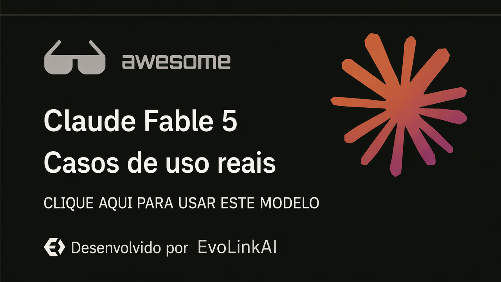

<div align="center">

<a href="https://evolink.ai/claude-fable-5?utm_source=github&utm_medium=readme&utm_campaign=awesome-claude-fable-5"></a>

[](LICENSE)
[](https://evolink.ai/claude-fable-5?utm_source=github&utm_medium=readme&utm_campaign=awesome-claude-fable-5)
[](https://evolink.ai/claude-fable-5?utm_source=github&utm_medium=readme&utm_campaign=awesome-claude-fable-5)
[](https://docs.evolink.ai)

[](README.md)
[](README_es.md)
[](README_pt.md)
[](README_ja.md)
[](README_ko.md)
[](README_de.md)
[](README_fr.md)
[](README_tr.md)
[](README_zh-TW.md)
[](README_zh-CN.md)
[](README_ru.md)

</div>

<a id="-introduction"></a>
## 🍌 Introdução

Bem-vindo ao repositório de casos de uso de alto sinal do Claude Fable 5.

**Coletamos casos de uso reais, tutoriais, integrações e avaliações do Claude Fable 5, selecionados a partir de demos públicas e comunidades de criadores.**

Este README-fonte em inglês foca em casos de alto sinal com fluxos de trabalho concretos, prompts, demos, integrações, evidências de benchmark ou limites práticos.

A maioria dos casos é selecionada a partir de publicações no X/Twitter e demos públicas. Cada título de caso aponta para a fonte original, e cada handle de autor aponta para o perfil do criador.

Experimente no Evolink: [Claude Fable 5](https://evolink.ai/claude-fable-5?utm_source=github&utm_medium=readme&utm_campaign=awesome-claude-fable-5)

<a id="-overview"></a>
## 📊 Visão Geral

- **78 casos selecionados do Claude Fable 5** de criadores públicos, desenvolvedores, equipes de benchmark e construtores de ferramentas.
- Cobre agentes de codificação, automação de longa duração, jogos, design visual, simulações 3D, trabalho de conhecimento, tutoriais, integrações de API, benchmarks, preços e limitações de lançamento.
- Cada caso inclui a fonte original, atribuição ao criador, uma conclusão concisa, tipo de evidência e data de publicação.
- Use este repositório para encontrar fluxos de trabalho práticos, comparar pontos fortes e limites, descobrir prompts reproduzíveis e acompanhar exemplos de integração.

> [!NOTE]
> A coleção favorece evidências concretas em vez de hype: prompts reproduzíveis, demos entregues, métodos de benchmark, notas de integração, dados de custo e ressalvas claramente declaradas.

<a id="-quick-api-access"></a>
## ⚡ Acesso rápido à API

Use Claude Fable 5 pela API Messages compatível com Evolink. Obtenha um token de API em [Evolink](https://evolink.ai/login?utm_source=github&utm_medium=readme&utm_campaign=awesome-claude-fable-5) e substitua `<token>` pelo seu token.

```bash
curl --request POST \
  --url https://direct.evolink.ai/v1/messages \
  --header 'Authorization: Bearer <token>' \
  --header 'Content-Type: application/json' \
  --data '
{
  "model": "claude-fable-5",
  "max_tokens": 1024,
  "messages": [
    {
      "role": "user",
      "content": "Hello, world"
    }
  ]
}
'
```

<a id="-menu"></a>
## 📑 Menu

| Seção | Casos |
|---|---|
| [💻 Codificação e Geração de Código](#coding-and-code-generation) | Case 1-6 |
| [🤖 Agentes e Automação de Longa Duração](#agents-and-long-running-automation) | Case 7-8 |
| [🎮 Jogos e Demos Interativas](#games-and-interactive-demos) | Case 9-12 |
| [🎨 Visual, Design, Vídeo e 3D](#visual-design-video-and-3d) | Case 13-16 |
| [📚 Documentos, Trabalho de Conhecimento e Pesquisa](#documents-knowledge-work-and-research) | Case 17-19 |
| [🧭 Tutoriais, Cursos e Recursos de Prompt](#tutorials-courses-and-prompt-resources) | Case 20-28 |
| [🔌 Plataforma, API e Integração de Ferramentas](#platform-api-and-tool-integration) | Case 29-34 |
| [📏 Avaliações, Comparações e Limites](#evaluations-comparisons-and-limits) | Case 35-78 |
| [🙏 Acknowledge](#acknowledge) | Créditos e política de correção |

### [💻 Codificação e Geração de Código](#coding-and-code-generation)

| Case | O que mostra | Tipo |
|---|---|---|
| [Fluxo de Trabalho Multiestágio no Cursor](#case-1) | Use o Fable 5 como a etapa de planejamento, revisão e crítica dentro de um fluxo de trabalho multi-modelo no Cursor; depois devolva a implementação e a revisão para modelos mais baratos ou especializados. | Avaliação |
| [Recriando o GitHub a partir de uma Captura de Tela](#case-2) | Cole uma captura de tela de produto em uma ferramenta de codificação agêntica e peça ao Fable 5 para recriar a interface com funcionalidade real. | Demo |
| [Simulação de Buraco Negro com Um Prompt](#case-3) | Dê ao Fable 5 um único prompt detalhado de creative coding e peça que ele produza uma visualização física autocontida em Three.js. | Tutorial |
| [Web OS Estilo macOS em Uma Tentativa](#case-4) | Peça ao Fable 5 um web OS completo em arquivo único e deixe-o construir o shell de UI, apps, interações, áudio e comportamento de jogo embutido em uma passada. | Tutorial |
| [Construindo o Spawn 5.0 com 1.687 Prompts](#case-5) | Use o Fable 5 como parceiro de engenharia em sessões longas ao longo de muitos prompts, com o humano migrando de arquitetura para julgamento da qualidade da saída. | Tutorial |
| [Revisão de Pull Request Grande com Achados](#case-6) | Aponte o Fable 5 para um pull request grande e peça que ele revise correção, falsos positivos, bugs reais e problemas de polimento. | Demo |

### [🤖 Agentes e Automação de Longa Duração](#agents-and-long-running-automation)

| Case | O que mostra | Tipo |
|---|---|---|
| [Revisão de Fluxo de Trabalho Relay de Longo Horizonte](#case-7) | Use o Fable 5 para trabalhos ambiciosos de longo horizonte: reconstruções de site, pipelines programáticos de conteúdo, correspondência de voz, revisão de segurança e verificações finais de qualidade. | Avaliação |
| [Diagnosticando uma Falha de Infraestrutura e Abrindo um PR de Correção](#case-8) | Dê ao Fable 5 acesso a pistas de infra, como logs, erros de banco de dados e digests de imagem; depois peça que ele diagnostique a indisponibilidade e prepare a correção. | Avaliação |

### [🎮 Jogos e Demos Interativas](#games-and-interactive-demos)

| Case | O que mostra | Tipo |
|---|---|---|
| [Dino Runner com Rastreamento de Dedo](#case-9) | Peça ao Fable 5 para construir um jogo de navegador que usa rastreamento de dedo como mecânica de entrada. | Demo |
| [Construção de Jogo de Corrida com Duas Frases](#case-10) | Dê ao Fable 5 um prompt de jogo muito curto e deixe-o gerar mapas, modos, música, UI e assets de jogo em uma execução. | Tutorial |
| [Minecraft de Terminal Instalável em Rust](#case-11) | Rode o Fable 5 por meio de um harness de codificação no terminal e peça que ele construa um jogo de terminal instalável em Rust. | Demo |
| [Clone de Minecraft com Tempo e Custo](#case-12) | Use um prompt para pedir ao Fable 5 um clone jogável no estilo Minecraft; depois avalie tempo, custo, volume de código e cobertura de features. | Tutorial |

### [🎨 Visual, Design, Vídeo e 3D](#visual-design-video-and-3d)

| Case | O que mostra | Tipo |
|---|---|---|
| [Prompt Completo e Reproduzível de Email Ecommerce](#case-13) | Dê ao Fable 5 um briefing criativo completo para um mockup de email de marca, incluindo seções exatas, requisitos de produto, direção visual e restrições. | Tutorial |
| [Benchmark de Relojoeiro com Âncora Suíça](#case-14) | Use o Fable 5 em um benchmark de simulação mecânica e peça que ele implemente, verifique e itere sobre a correção física. | Avaliação |
| [Cena do Apartamento de Friends em Three.js](#case-15) | Peça ao Fable 5 para transformar uma planta baixa e uma referência de cena em um ambiente navegável em Three.js. | Avaliação |
| [Simulação do Sistema Solar com Prompt e URL](#case-16) | Use o Fable 5 para construir uma simulação astronômica a partir de princípios físicos, iterando até que a simulação e a saída pública estejam prontas. | Tutorial |

### [📚 Documentos, Trabalho de Conhecimento e Pesquisa](#documents-knowledge-work-and-research)

| Case | O que mostra | Tipo |
|---|---|---|
| [Evidências de Fluxo de Trabalho da Stripe e Científico](#case-17) | Use isto como evidência para afirmações de migração empresarial e fluxo de trabalho científico, não como um prompt para copiar e colar. | Avaliação |
| [Memorando de Política e Fluxos de Trabalho com Controle de Alterações](#case-18) | Use o Fable 5 para trabalho documental qualitativo longo: controle de alterações, triagem de comentários e edições orientadas por transcrição. | Tutorial |
| [Prompt e Saída de Pesquisa Profunda](#case-19) | Faça ao Fable 5 uma pergunta em estilo de pesquisa e avalie se ele consegue produzir uma resposta longa, estruturada e historicamente fundamentada. | Demo |

### [🧭 Tutoriais, Cursos e Recursos de Prompt](#tutorials-courses-and-prompt-resources)

| Case | O que mostra | Tipo |
|---|---|---|
| [Como o Fable 5 Muda Fluxos de Trabalho no Claude Code](#case-20) | Use o Fable 5 definindo direção, contexto, metas e critérios de verificação em vez de microgerenciar cada etapa. | Demo |
| [Revisão de Um Bilhão de Tokens e Estratégia de Roteamento](#case-21) | Use o Fable 5 para planejamento e revisão frontier, depois roteie implementação de alto volume para modelos mais baratos. | Tutorial |
| [Prompt Defensivo de Endurecimento de Dispositivos](#case-22) | Rode um prompt defensivo passo a passo de hardening em que o Fable 5 inventaria dispositivos, dá verificações exatas e espera confirmação. | Tutorial |
| [Prompt de Meta para Auditoria de Design de Site Completo](#case-23) | Use `/goal` para fazer o Fable 5 iniciar um site, capturar telas de páginas, auditar UX, escrever um relatório e corrigir pequenos problemas seguros. | Tutorial |
| [Divisão de Fluxo de Trabalho Criativo Longo](#case-24) | Use o Fable 5 para projetar formatos estáveis e exemplos; depois entregue essa estrutura a outro sistema de geração para saída específica do domínio. | Tutorial |
| [Guia para Iniciantes no Uso do Fable 5](#case-25) | Use o Fable 5 com prompts orientados a metas, loops de verificação e configurações de esforço em vez de pequenas instruções passo a passo. | Avaliação |
| [Prompt de Auditoria de Repositório para Copiar e Colar](#case-26) | Cole o prompt de auditoria de repositório no Fable 5 e peça descoberta baseada em arquivos, achados, estratégia e um plano de tarefas por marcos. | Tutorial |
| [Estratégia de Uso em Janela Limitada](#case-27) | Gaste o uso do Fable 5 em auditoria, arquitetura e planejamento enquanto a janela de acesso é favorável; depois use modelos mais baratos para execução. | Tutorial |
| [Usando Goals e Workflows no Claude Code](#case-28) | Use o Fable 5 como parceiro de pensamento antes da implementação; depois combine `/goal` e workflows para executar e verificar o plano. | Tutorial |

### [🔌 Plataforma, API e Integração de Ferramentas](#platform-api-and-tool-integration)

| Case | O que mostra | Tipo |
|---|---|---|
| [Configuração de Integração do Agente Hermes](#case-29) | Configure o Hermes para usar `anthropic/claude-fable-5` em execuções complexas de `/goal` e tarefas longas com cache. | Tutorial |
| [Capacidades, Preços e Notas de Assinatura](#case-30) | Use este caso para entender quando o Fable 5 está disponível, quanto custa e quais domínios protegidos podem cair para outro modelo. | Tutorial |
| [Resumo de Lançamento, Acesso, Preços e Segurança](#case-31) | Use este resumo de lançamento para escolher rota de acesso, nome de modelo de API, janela de contexto, estratégia de cache e timing de assinatura. | Tutorial |
| [Estratégia de Redução de Custo Baseada em Advisor](#case-32) | Use o Fable 5 como advisor ou revisor em um fluxo com modelo mais barato quando a inteligência marginal vale o custo. | Integração |
| [Preços, Acesso e Guardrails de Segurança](#case-33) | Use este caso para entender acesso ao Fable 5, preços de API e comportamento de fallback de segurança antes de planejar workloads. | Integração |
| [Integração Swarms em Uma Linha](#case-34) | Defina o nome do modelo Swarms como `anthropic/claude-fable-5` e rode o Fable 5 pelo framework ou API Swarms. | Integração |

### [📏 Avaliações, Comparações e Limites](#evaluations-comparisons-and-limits)

| Case | O que mostra | Tipo |
|---|---|---|
| [Comparação de Custo e Qualidade entre Fable 5 e GPT-5.5](#case-35) | Compare Fable 5 e GPT-5.5 na mesma tarefa de codificação para julgar qualidade da saída, runtime e custo da ferramenta. | Avaliação |
| [Resultado do Benchmark AA-Omniscience](#case-36) | Use este caso de benchmark para avaliar o Fable 5 em precisão de conhecimento e comportamento de alucinação. | Avaliação |
| [Resultado do Artificial Analysis Intelligence Index](#case-37) | Use este caso para comparar o ranking geral de inteligência do Fable 5 contra outros modelos frontier. | Avaliação |
| [Benchmark GDPval-AA de Trabalho de Conhecimento Agêntico](#case-38) | Use este caso para avaliar o Fable 5 em trabalho de conhecimento agêntico do mundo real. | Avaliação |
| [Primeiras Impressões de Uma Semana e Mecânica de Preços](#case-39) | Use este caso de primeiras impressões para decidir onde o Fable 5 é mais forte, especialmente design de jogos e planejamento de sistemas. | Integração |
| [Comparação de Custo e Velocidade](#case-40) | Use esta comparação para decidir se o ganho de qualidade justifica custo mais alto e execuções longas mais lentas. | Avaliação |
| [Notas Práticas do Claude Code](#case-41) | Use este caso para avaliar o Fable 5 dentro do Claude Code, incluindo uso de ferramentas, personalidade e arestas restantes. | Demo |
| [Resultado de Benchmark de Escrita Criativa](#case-42) | Use este caso de benchmark para julgar a qualidade de escrita de ficção curta do Fable 5 e seu comportamento de recusa. | Avaliação |
| [Resumo de Lançamento com Múltiplos Benchmarks](#case-43) | Use este resumo de benchmark de lançamento para entender as pontuações principais mais relevantes para agentes de codificação e tarefas complexas. | Avaliação |
| [Comparação de Benchmark e Preços com GPT-5.5](#case-44) | Use esta comparação para avaliar o Fable 5 contra GPT-5.5 em preço e categorias de benchmark. | Avaliação |
| [Notas de Campo com Limitações Práticas](#case-45) | Use este relatório de campo para entender onde o Fable 5 parece significativamente melhor e onde ainda tem limites práticos. | Tutorial |
| [Comparação de Simulação Física](#case-46) | Rode prompts idênticos de simulação física contra Fable 5 e Opus 4.8 para comparar qualidade de saída, custo e velocidade. | Demo |
| [Experiência de Debug e Julgamento de Design](#case-47) | Use o Fable 5 para debug pedindo que ele meça, registre logs, verifique e corrija, em vez de simplesmente adivinhar. | Demo |
| [Prós e Contras Multidimensionais](#case-48) | Use este caso para entender pontos fortes e fracos práticos antes de transformar o Fable 5 em daily driver. | Demo |
| [Teste de Redação Jurídica de S-1](#case-49) | Use um prompt de redação de S-1 como teste de capacidade de agente jurídico e compare estrutura, formatação e comprimento. | Tutorial |
| [Detalhes de Benchmark em Saúde](#case-50) | Use esta nota de benchmark para avaliar o Fable 5 em tarefas relacionadas à saúde e identificar avaliações médicas difíceis ausentes. | Avaliação |
| [Avaliação de Parsing de Documentos no ParseBench](#case-51) | Use este caso para decidir se o Fable 5 é custo-efetivo para parsing de documentos versus sistemas especializados de OCR. | Avaliação |
| [Comparação SWE-Bench Pro e FrontierCode](#case-52) | Use este caso de benchmark para avaliar o Fable 5 em migrações, implementações complexas, sessões autônomas, testes e verificação visual. | Avaliação |
| [Revisão Qualitativa de Resolução de Problemas Longos](#case-53) | Use esta revisão qualitativa para entender por que o Fable 5 é adequado a tarefas mais longas e difíceis, embora ainda exija revisão em produção. | Avaliação |
| [Resultados de Fidelidade e Formatação no ParseBench](#case-54) | Use este resultado do ParseBench para julgar fidelidade documental e desempenho de formatação. | Avaliação |
| [Benchmarks, Preços, Acesso e Salvaguardas](#case-55) | Use este caso como checklist amplo para benchmarks, preços, acesso, salvaguardas e implicações estratégicas. | Avaliação |
| [Lista Oficial de Pontuações de Benchmark](#case-56) | Use esta lista de benchmarks para entender as pontuações oficiais do Fable 5 em tarefas de codificação, uso de computador e segurança. | Avaliação |
| [Metodologia do Benchmark APEX-SWE](#case-57) | Use este caso para avaliar o Fable 5 no APEX-SWE, especialmente trabalho de observabilidade e integração. | Avaliação |
| [Resultado de Matemática Formal no ProofBench](#case-58) | Use este caso para avaliar o Fable 5 em matemática formal contra sistemas especializados de prova de teoremas. | Tutorial |
| [Análise Preliminar do VirtueBench](#case-59) | Use este caso para inspecionar o comportamento de raciocínio moral do Fable 5 em categorias de virtude. | Avaliação |
| [Teste de Overfit de Segurança com Resposta Vazia na API](#case-60) | Use este caso para entender o risco de overfit de segurança no lançamento e comportamento de resposta vazia em testes de API. | Avaliação |
| [Fable Prompting Verification Guide](#case-61) | Use this prompting guide to shift from longer prompt hacks toward goal, context, constraints, tools, and verification loops. | Tutorial |
| [Istanbul Platform Game Reference Build](#case-62) | Use a reference sprite sheet plus one conversion instruction to test Fable 5 on a playable platform game. | Demo |
| [Business 3D City Dashboard](#case-63) | Use Fable 5 to turn a business workflow into a live 3D city dashboard concept. | Demo |
| [Three.js Hole Game One-Shot](#case-64) | Use Fable 5 to one-shot a 3D browser game prototype in Three.js. | Demo |
| [DeepSWE Score Comparison](#case-65) | Use this DeepSWE note to compare Fable 5 xHigh with GPT-5.5 xHigh on software-engineering benchmark performance. | Avaliação |
| [Repository Cost Comparison](#case-66) | Use this repository-analysis comparison to judge token price against human rework cost. | Avaliação |
| [Super Mario Game Token Cost](#case-67) | Use this single-shot game build to estimate Fable 5 output quality and token consumption. | Demo |
| [Claude Code Fallback Setting](#case-68) | Use this case to understand the Claude Code setting for switching models when a Fable 5 message is flagged. | Integração |
| [Namma Metro Simulator Build](#case-69) | Use this demo as a compact example of vibe-coding a public-transit simulator with Fable 5. | Demo |
| [Dusk Drive One-Prompt Game](#case-70) | Use this one-prompt driving-game case to evaluate Fable 5 on low-poly game prototyping without human edits. | Demo |
| [APEX-Agents Pass@1 Ranking](#case-71) | Use this APEX-Agents result to compare Fable 5 Max on multi-step autonomous tasks. | Avaliação |
| [Claude Model Selection Playbook](#case-72) | Use this model-selection playbook to reserve Fable 5 for the hardest Claude Code jobs. | Tutorial |
| [HermesWorld Automated Agent Loop](#case-73) | Use this case to study a hands-free Fable 5 loop that builds, tests, plays, and smoke-tests over days. | Integração |
| [McKinsey-Style Report Prompt Test](#case-74) | Use this document-generation prompt to evaluate consulting-report structure, charts, narrative, and risk analysis. | Tutorial |
| [Visible Safeguards Rollout](#case-75) | Use this official note to understand Fable 5 safeguard visibility, API refusal reasons, and Opus fallback behavior. | Integração |
| [Claude Code Model Matching Fix](#case-76) | Use this Claude Code changelog note to avoid Fable 5 model-name and context matching issues. | Integração |
| [Three Web Apps in Claude Code](#case-77) | Use this beginner coding demo to inspect Fable 5 inside Claude Code across multiple generated web apps. | Demo |
| [Rilable Open Source App Builder](#case-78) | Use this open-source app-builder case to study Fable 5 across iOS, web apps, sandboxes, and API-token cost. | Integração |


<a id="coding-and-code-generation"></a>
## 💻 Codificação e Geração de Código

<a id="case-1"></a>
### Case 1: [Fluxo de Trabalho Multiestágio no Cursor](https://x.com/AlicanKiraz0/status/2064487347605918180) (por [@AlicanKiraz0](https://x.com/AlicanKiraz0))

**Use o Fable 5 como a etapa de planejamento, revisão e crítica dentro de um fluxo de trabalho multi-modelo no Cursor; depois devolva a implementação e a revisão para modelos mais baratos ou especializados.**

Se olharmos a pontuação final entre Fable 5 e GPT 5.5, a diferença é muito pequena. Minha recomendação humilde de uso é esta: em plataformas de IDE como o Cursor, que dão suporte a modelos híbridos, use um fluxo em estágios.

Fase 1: para revisão de código e a primeira fase de inspeção do projeto, enquanto aquece o contexto, use um entre GPT 5.5 High, Minimax M3, Kimi K2.6 ou Composer 2.5.

Fase 2: para preparar o plano do projeto, use GPT 5.5 Very High ou Opus 4.8.

Fase 3: para analisar o plano do projeto, use Fable 5; deixe-o identificar as partes falhas do plano. Para revisões, use GPT 5.5 Very High.

Fase 4: para implementar o plano, use Minimax M3, Deepseek v4 Max, Composer 2.5 ou Sonnet 4.6.

Fase 5: para a revisão final e para verificar se a implementação seguiu o plano, use GPT 5.5 High.

Tipo: Avaliação | Data: 2026-06-09

---
<a id="case-2"></a>
### Case 2: [Recriando o GitHub a partir de uma Captura de Tela](https://x.com/coldopn/status/2064435234465087638) (por [@coldopn](https://x.com/coldopn))

**Cole uma captura de tela de produto em uma ferramenta de codificação agêntica e peça ao Fable 5 para recriar a interface com funcionalidade real.**

🚨 O Anthropic Fable 5 acabou de replicar o GITHUB a partir de uma CAPTURA DE TELA!!

Tudo que fiz foi colar uma captura de tela da UI do GitHub no Kilo Code e pedir para ele recriar o GitHub com funcionalidade real.

Ele programou por 10 minutos e gastou $4.07.

O resultado foi uma réplica funcional do GitHub: https://t.co/bjMObvlsPX

Tipo: Demo | Data: 2026-06-09

---
<a id="case-3"></a>
### Case 3: [Simulação de Buraco Negro com Um Prompt](https://x.com/deveshcodes_/status/2064437742189379745) (por [@deveshcodes_](https://x.com/deveshcodes_))

**Dê ao Fable 5 um único prompt detalhado de creative coding e peça que ele produza uma visualização física autocontida em Three.js.**

@claudeai fez em uma tentativa uma simulação em tempo real de lente gravitacional de buraco negro em Three.js com Claude Fable 5.

Ela incluía lente gravitacional, disco de acreção com reforço doppler, esfera de fótons, aberração cromática e campo estelar procedural.

O resultado: 60fps, arquivo HTML único, um prompt.

A nova linha de base é absurda 🤯 https://t.co/E23I8bnPKb

Tipo: Tutorial | Data: 2026-06-09

---
<a id="case-4"></a>
### Case 4: [Web OS Estilo macOS em Uma Tentativa](https://x.com/intheworldofai/status/2064421915347812672) (por [@intheworldofai](https://x.com/intheworldofai))

**Peça ao Fable 5 um web OS completo em arquivo único e deixe-o construir o shell de UI, apps, interações, áudio e comportamento de jogo embutido em uma passada.**

🚨 O Claude Fable 5 acabou de construir um web OS completo no estilo macOS em uma tentativa e foi além da maioria dos modelos.

Arquivo HTML único, CSS + JS embutidos.

A partir de um prompt, ele construiu:

- barra de menu + dock do macOS
- janelas de app arrastáveis e redimensionáveis
- explorador de arquivos funcional
- terminal funcional + mockup de navegador
- ícones SVG de desktop + notificações
- app de configurações, temas e tela de boot
- player de som totalmente funcional, com síntese real e sem arquivos externos
- clone jogável de Minecraft dentro do desktop

Tudo gerado em uma passada, quase sem correções.

O player de som funcional mais o clone real de Minecraft é algo que ainda não vi outros modelos conseguirem fazer. A geração de frontend/UI do Fable 5 está ficando ridícula.

Tipo: Tutorial | Data: 2026-06-09

---
<a id="case-5"></a>
### Case 5: [Construindo o Spawn 5.0 com 1.687 Prompts](https://x.com/jsnnsa/status/2064420561078693941) (por [@jsnnsa](https://x.com/jsnnsa))

**Use o Fable 5 como parceiro de engenharia em sessões longas ao longo de muitos prompts, com o humano migrando de arquitetura para julgamento da qualidade da saída.**

claude fable 5 está no ar.

spawn 5.0 foi construído com ele:

- 1.687 prompts
- 102 sessões
- Meu trabalho mudou de arquitetura para julgamento de gosto

O que construímos, cada item dos quais teria levado pelo menos um mês com uma equipe inteira no Opus:

- Um motor físico do zero, Mantle, que rivaliza com Rapier e pôde ser testado em um dia como thread paralela
- Iluminação froxel clusterizada: de 8 luzes para mais de 1.000 luzes totalmente dinâmicas
- GI difusa em tempo real no WebGPU, no seu telefone
- VFX de um milhão de partículas na GPU com uma arquitetura de shader além do que Unreal e Unity entregam
- Netcode em escala de MMO
- Um app nativo iOS alfa

Tudo levou cerca de uma semana. Tudo roda em mobile. A lista não inclui metade do que foi entregue; o changelog completo está na thread.

A parte que os benchmarks não vão mostrar: este modelo tem uma personalidade maravilhosa. Ele é genuinamente engraçado. Ri tanto que chorei várias vezes no meio de uma reescrita de física. A genialidade e o caráter não são recursos separados.

Tipo: Tutorial | Data: 2026-06-09

---
<a id="case-6"></a>
### Case 6: [Revisão de Pull Request Grande com Achados](https://x.com/ryanrhughes/status/2064411147076534705) (por [@ryanrhughes](https://x.com/ryanrhughes))

**Aponte o Fable 5 para um pull request grande e peça que ele revise correção, falsos positivos, bugs reais e problemas de polimento.**

Soltei o Fable 5 para revisar um único PR (74 arquivos / +3.705 / -1.246) para ver como ele se sairia. Ele rodou por 34 min, consumiu 42% da minha sessão de 5 horas, produziu 16 achados de “correção” e encontrou:

- 2 falsos positivos que pareciam assustadores
- 3 bugs reais de correção de auditoria
- ~5 problemas legítimos, mas pequenos, de UX/polimento
- um monte de opiniões de limpeza

Isso era perigoso demais para lançar?

Tipo: Demo | Data: 2026-06-09

---

<a id="agents-and-long-running-automation"></a>
## 🤖 Agentes e Automação de Longa Duração

<a id="case-7"></a>
### Case 7: [Revisão de Fluxo de Trabalho Relay de Longo Horizonte](https://x.com/JJEnglert/status/2064469635190170105) (por [@JJEnglert](https://x.com/JJEnglert))

**Use o Fable 5 para trabalhos ambiciosos de longo horizonte: reconstruções de site, pipelines programáticos de conteúdo, correspondência de voz, revisão de segurança e verificações finais de qualidade.**

A versão curta da minha análise do Claude Fable 5: gastei um bilhão de tokens testando o Claude Fable 5 e pareceu que eu tinha uma vantagem injusta.

Eu julgo pelo teste visual: coloco um modelo em trabalho real e observo. Ele me economiza horas ou me custa horas? Ele captura o que eu perdi? Parece um parceiro ou uma ferramenta que preciso supervisionar?

Este é o primeiro modelo em muito tempo que passou em todas as dimensões que importam, e não por pouco.

Construção: eu estava reconstruindo nosso site da Tenex. Era muito customizado e muito difícil. GPT 5.5 e Claude 4.8 não conseguiam resolver sozinhos. Mesmo com arquivos Figma como referência, eles ficavam em torno de 85-90%.

Então o Fable 5 olhou para tudo, disse que poderia fazer melhor, foi direto à fonte original do Webflow, baixou todos os assets e quase fez tudo em uma tentativa.

Depois pedi que ele construísse um segundo site, totalmente novo, com 80 páginas, do zero, ao longo de um fim de semana. É um trabalho pelo qual eu teria cobrado $50k como agência.

Ele também conectou uma fábrica programática completa de clipes:

- HeyGen
- ElevenLabs
- Cloudflare
- Um VPS

O pipeline encontra tópicos, escreve scripts, edita vídeo, adiciona música e publica em redes sociais. Ele rodou por longos períodos sozinho e até construiu para si um sistema de webhook para monitorar renders.

Escrita: ele replicou nosso documento de voz de marca quase identicamente e depois manteve essa voz ao longo de 80 páginas de features, estudos de caso e artigos, sem cair no padrão plano de IA.

Segurança: dois modelos frontier haviam trabalhado em um repositório grande e aprovado o código. O Fable 5 encontrou um bug sério e bem escondido na primeira passada e o corrigiu na hora.

O momento humano: fiz uma pergunta enquanto esperava um cron job. Ele respondeu e depois acrescentou por conta própria que eu tinha cerca de 10 minutos restantes e que me avisaria quando terminasse. Eu nunca perguntei sobre o temporizador.

A ressalva honesta: você sente o medidor mais do que em qualquer outro modelo. A Anthropic o chama de intensivo em tokens por design. Então rode-o como um relay: pense com o Fable 5, construa com um modelo mais barato, revise com o Fable 5.

O veredito: acesso a mais inteligência do que a pessoa ao seu lado é a vantagem. O Fable 5 é o primeiro modelo que torna isso real. Mesmo com tarifas frontier cheias, ele deu lucro.

Tipo: Avaliação | Data: 2026-06-09

---
<a id="case-8"></a>
### Case 8: [Diagnosticando uma Falha de Infraestrutura e Abrindo um PR de Correção](https://x.com/ayushagarwal/status/2064422467557564862) (por [@ayushagarwal](https://x.com/ayushagarwal))

**Dê ao Fable 5 acesso a pistas de infra, como logs, erros de banco de dados e digests de imagem; depois peça que ele diagnostique a indisponibilidade e prepare a correção.**

claude fable 5 é bom demais!!!!

Ele acabou de diagnosticar uma indisponibilidade que eu nem conseguia descrever direito em uma infra paralela self-hosted.

Ele leu logs de pods, consultou logs de erro do Cloud SQL, comparou digests de imagem e descobriu que o Kubernetes estava rodando uma imagem cacheada de 3 meses contra um banco de dados recém-migrado.

Depois abriu o PR de correção.

Minutos, não horas. Sem busca na web. 🤯

Tipo: Avaliação | Data: 2026-06-09

---

<a id="games-and-interactive-demos"></a>
## 🎮 Jogos e Demos Interativas

<a id="case-9"></a>
### Case 9: [Dino Runner com Rastreamento de Dedo](https://x.com/ai_for_success/status/2064413182396108932) (por [@ai_for_success](https://x.com/ai_for_success))

**Peça ao Fable 5 para construir um jogo de navegador que usa rastreamento de dedo como mecânica de entrada.**

Pedi ao Fable 5 para construir um jogo Dino runner com rastreamento de dedo.

Ele fez o jogo de finger runner em uma tentativa, em cerca de 11 a 12 minutos, consumiu por volta de 914K tokens e implementou tudo em apenas 629 linhas de código.

https://t.co/AWt1lEIObq

Tipo: Demo | Data: 2026-06-09

---
<a id="case-10"></a>
### Case 10: [Construção de Jogo de Corrida com Duas Frases](https://x.com/kieradev/status/2064482704763085202) (por [@kieradev](https://x.com/kieradev))

**Dê ao Fable 5 um prompt de jogo muito curto e deixe-o gerar mapas, modos, música, UI e assets de jogo em uma execução.**

Claude Fable 5, 40% do uso Max 5x.

Jogo completo tipo Mario Kart 64 a partir de um prompt de 2 frases.

O Fable 5 cuidou de toda a decoração, modelos de personagens, 4 mapas, música, todos os três modos de jogo e UI em uma única tentativa, em cerca de 15 minutos.

#fable #anthropic https://t.co/B7mTidE84U

Tipo: Tutorial | Data: 2026-06-09

---
<a id="case-11"></a>
### Case 11: [Minecraft de Terminal Instalável em Rust](https://x.com/vikvang1/status/2064500731848319303) (por [@vikvang1](https://x.com/vikvang1))

**Rode o Fable 5 por meio de um harness de codificação no terminal e peça que ele construa um jogo de terminal instalável em Rust.**

Deixei o Claude Fable 5 com o harness do Warp cozinhar por uma hora.

Ele fez uma versão TUI de Minecraft que renderiza diretamente no seu terminal, construída inteiramente em Rust.

Comando de instalação: cargo install termcraft-3d

https://t.co/zs3y3t88oM

Tipo: Demo | Data: 2026-06-10

---
<a id="case-12"></a>
### Case 12: [Clone de Minecraft com Tempo e Custo](https://x.com/ydamitcodes/status/2064536076518363353) (por [@ydamitcodes](https://x.com/ydamitcodes))

**Use um prompt para pedir ao Fable 5 um clone jogável no estilo Minecraft; depois avalie tempo, custo, volume de código e cobertura de features.**

@claudeai Fable 5 construiu para mim um clone de Minecraft em 37 minutos.

Um prompt. ~3K linhas de código. $12 em custos de API.

Incluía biomas, cavernas, minérios, dia/noite, mobs, tudo.

Minecraft levou 2 anos para Notch.

https://t.co/AmwdLwi75O

Tipo: Tutorial | Data: 2026-06-10

---

<a id="visual-design-video-and-3d"></a>
## 🎨 Visual, Design, Vídeo e 3D

<a id="case-13"></a>
### Case 13: [Prompt Completo e Reproduzível de Email Ecommerce](https://x.com/ecomchasedimond/status/2064454139225297091) (por [@ecomchasedimond](https://x.com/ecomchasedimond))

**Dê ao Fable 5 um briefing criativo completo para um mockup de email de marca, incluindo seções exatas, requisitos de produto, direção visual e restrições.**

Claude Fable 5 fez isto com um único prompt e sem edições.

Aqui está o prompt completo que usei:

Crie um mockup de email ecommerce vertical, alto e em comprimento completo para a MVMT, uma marca moderna de relógios e acessórios para millennials.

Desenhe um email DTC premium altamente realista, com sensação elegante, polida, minimalista, levemente masculina e editorial. A imagem final deve parecer uma captura de tela de email ecommerce real feita por designer, não um pôster, não uma landing page e não um template genérico.

Vibe da marca: moderna, California-cool, jovem, confiante, limpa, aspiracional, estilosa e elevada. O design deve parecer próximo do luxo, mas ainda acessível.

Destaque estes produtos:

- Mulholland
- Odyssey II Automatic
- Cali Diver
- Signature Watch Bands

Estilo visual:

- design ecommerce premium limpo
- layout editorial refinado
- fotografia de produto realista
- imagens lifestyle sutis
- hierarquia forte
- tipografia sans-serif nítida
- espaçamento generoso
- sombras sutis
- paleta de cores moderna e contida

Paleta de cores: preto, branco, carvão, cinza quente, pedra, bege suave, tons de metal escovado e acentos discretos e dessaturados. Mantenha a paleta neutra e premium.

Direção criativa importante: isto deve parecer uma campanha de email polida de uma marca de relógios com forte bom gosto de design. Priorize realismo, elegância e clareza. Faça parecer algo que a MVMT poderia realmente enviar.

Construa o email nesta ordem:

1. Barra promocional superior: uma barra fina preta ou carvão escuro atravessando o topo, com texto pequeno em caixa alta: “FREE SHIPPING OVER $75 + EASY RETURNS”.

2. Cabeçalho: um cabeçalho branco e limpo com o wordmark/logo da MVMT à esquerda e links mínimos de navegação à direita ou centralizados: WATCHES, SUNGLASSES, JEWELRY, NEW ARRIVALS.

3. Seção hero: uma seção hero premium com forte equilíbrio visual.

Use um headline em negrito: “BUILT TO GET NOTICED”.

Inclua um texto curto de apoio sobre relógios modernos e acessórios projetados para elevar o estilo cotidiano.

Adicione um botão CTA escuro e arredondado: “SHOP WATCHES”.

A imagem hero deve incluir:

- uma imagem dominante de relógio premium
- imagens lifestyle de luxo sutis
- um modelo masculino estiloso ou uma cena lifestyle masculina fashion-forward
- iluminação moderna e composição limpa

4. Seção de coleção em destaque: adicione um headline centralizado: “THREE WAYS TO WEAR MVMT”. Abaixo, mostre três cards de produto ou blocos de imagem limpos com:

- Mulholland
- Odyssey II Automatic
- Cali Diver

Cada bloco deve incluir:

- imagem do produto
- nome do produto
- descrição curta de uma ou duas linhas

Mantenha esta seção simétrica, polida e premium.

5. Banner de acessórios: adicione uma seção split refinada intitulada “FINISH THE LOOK”. Destaque Signature Watch Bands. Mostre imagens premium em close-up de pulseiras de relógio ou pulseiras intercambiáveis. Inclua texto curto de apoio e um botão CTA escuro: “SHOP ACCESSORIES”.

6. Tiles promocionais editoriais: adicione dois tiles promocionais lado a lado, com design guiado por imagem.

Headline do tile um: “FOR DAILY WEAR”.

Headline do tile dois: “FOR STATEMENT DAYS”.

Cada tile deve ter texto curto e um CTA pequeno: “SHOP NOW”.

Esses tiles devem parecer momentos editoriais de marca, não caixas genéricas de promoção.

7. Linha comprável: adicione uma seção intitulada “IN ROTATION NOW”. Mostre uma linha ou grid limpo de 4 itens com:

- Mulholland
- Odyssey II Automatic
- Cali Diver
- Signature Watch Bands

Cada item deve incluir:

- imagem isolada do produto
- nome do produto
- pequeno link ou botão “SHOP”

8. Assinatura da marca: adicione um bloco de mensagem centralizado com o headline: “DESIGNED TO MOVE WITH YOU”. Inclua uma linha curta sobre relógios, óculos e acessórios cuidadosamente criados para a vida cotidiana.

9. Rodapé: crie um rodapé de marca realista preto ou carvão com:

- logo MVMT
- links de loja
- links da empresa
- links de suporte
- ícones sociais
- texto legal e de envio pequeno

Direção de tipografia: use tipografia sans-serif condensada em negrito ou moderna para headlines principais e sans-serif limpa para texto de corpo. Os headlines devem parecer nítidos, modernos e fashion-forward. O texto de corpo deve parecer realista e majoritariamente legível.

Direção de fotografia: use fotografia premium de produto com reflexos realistas, materiais polidos, sombras suaves e superfícies limpas. A fotografia lifestyle deve parecer elevada, moderna e orientada à moda.

Regras de composição:

- formato de email vertical alto
- separação clara de seções
- proporções realistas de email
- hierarquia forte
- texto majoritariamente legível
- espaçamento premium
- alinhamento intencional
- mistura equilibrada de imagens de produto e lifestyle

Evite:

- estilo de colagem bagunçada
- estética playful de scrapbook
- design colorido demais
- vibe de template barato
- imagens cartunescas
- layouts poluídos
- elementos de UI com aparência falsa
- composição estilo pôster
- caos promocional excessivo

Saída: um mockup de design de email ecommerce em comprimento completo, composto verticalmente e altamente realista para a MVMT, com sensação premium, limpa, polida, moderna, editorial e pronta para apresentação.

Tipo: Tutorial | Data: 2026-06-09

---
<a id="case-14"></a>
### Case 14: [Benchmark de Relojoeiro com Âncora Suíça](https://x.com/quanghuynt14/status/2064509430650065278) (por [@quanghuynt14](https://x.com/quanghuynt14))

**Use o Fable 5 em um benchmark de simulação mecânica e peça que ele implemente, verifique e itere sobre a correção física.**

Então dei ao Fable 5 o benchmark de relojoeiro: um movimento completo de âncora suíça em Three.js.

Relações de engrenagem reais (18.000 bph), escapamento funcional, espiral respirando — e os ponteiros mostram a hora real.

Ele verificou o próprio trabalho com visão, em loop, até terminar.

⌚ https://t.co/RSRfDoKxA4

Tipo: Avaliação | Data: 2026-06-10

---
<a id="case-15"></a>
### Case 15: [Cena do Apartamento de Friends em Three.js](https://x.com/scottstts/status/2064464351906673029) (por [@scottstts](https://x.com/scottstts))

**Peça ao Fable 5 para transformar uma planta baixa e uma referência de cena em um ambiente navegável em Three.js.**

Caramba!!!

Fable 5:

em @threejs, crie uma cena 3d navegável em pov de primeira pessoa do icônico apartamento da Monica do programa de tv Friends corretamente baseada nesta planta baixa, mantendo fidelidade ao visual e sensação originais, use iluminação quente

Isso é de longe O MELHOR que já vi neste teste!

Este html único me custou $12, mas o resultado é impressionante!

Tipo: Avaliação | Data: 2026-06-09

---
<a id="case-16"></a>
### Case 16: [Simulação do Sistema Solar com Prompt e URL](https://x.com/tetumemo/status/2064477582930989357) (por [@tetumemo](https://x.com/tetumemo))

**Use o Fable 5 para construir uma simulação astronômica a partir de princípios físicos, iterando até que a simulação e a saída pública estejam prontas.**

Claude Fable 5 é intenso.

Como ele parece forte em simulações físicas, pedi:

'Construa uma simulação do sistema solar derivando o movimento orbital planetário a partir dos princípios básicos da física e usando isso para prever eclipses solares.'

Depois de algumas rodadas de ida e volta, isto foi concluído.

É incrivelmente divertido.

O prompt concluído e a URL pública estão linkados abaixo.

Tipo: Tutorial | Data: 2026-06-09

---

<a id="documents-knowledge-work-and-research"></a>
## 📚 Documentos, Trabalho de Conhecimento e Pesquisa

<a id="case-17"></a>
### Case 17: [Evidências de Fluxo de Trabalho da Stripe e Científico](https://x.com/AndrewCurran_/status/2064413892378546418) (por [@AndrewCurran_](https://x.com/AndrewCurran_))

**Use isto como evidência para afirmações de migração empresarial e fluxo de trabalho científico, não como um prompt para copiar e colar.**

Citações do lançamento de hoje:

Usando Mythos 5, especialistas internos em design de proteínas aceleraram partes do processo de design de medicamentos em cerca de dez vezes.

Em um exemplo, Mythos 5, com ferramentas de design de proteínas e bioinformática, mas sem assistência humana, igualou ou superou operadores humanos qualificados.

Ele executou tarefas normalmente realizadas por um cientista: escolher sítios de ligação, selecionar e executar ferramentas de design de proteínas e se recuperar de falhas.

Durante testes iniciais, a Stripe relatou que o Fable 5 comprimiu meses de engenharia em dias. Em uma codebase Ruby de 50 milhões de linhas, o modelo realizou em um dia uma migração em toda a codebase que, de outra forma, teria levado mais de dois meses de trabalho manual de uma equipe inteira.

Mythos 5 também produziu consistentemente hipóteses científicas novas e convincentes.

Em comparações cegas head-to-head contra modelos da classe Opus, cientistas preferiram as hipóteses de biologia molecular do Mythos cerca de 80% das vezes e avançaram várias para avaliação experimental.

Uma hipótese do Mythos, um mecanismo novo para uma proteína de E. coli, foi corroborada em um estudo de um laboratório independente.

Mythos 5 conduziu pesquisa genômica inédita em mais de uma semana de trabalho amplamente autônomo.

Ele reuniu dados de célula única para milhões de células em 138 espécies animais e projetou e treinou um modelo customizado de machine learning para identificar células que exercem o mesmo papel em organismos distantes.

Com apenas input humano de alto nível, o modelo treinado superou um modelo recente publicado na Science, apesar de ser 100 vezes menor.

Tipo: Avaliação | Data: 2026-06-09

---
<a id="case-18"></a>
### Case 18: [Memorando de Política e Fluxos de Trabalho com Controle de Alterações](https://x.com/manaltdan/status/2064414129440608427) (por [@manaltdan](https://x.com/manaltdan))

**Use o Fable 5 para trabalho documental qualitativo longo: controle de alterações, triagem de comentários e edições orientadas por transcrição.**

Fable 5 é o primeiro modelo que encontrei consistentemente útil para trabalho qualitativo de maior duração, como redigir análise de políticas.

Entre suas capacidades e ferramentas como Wispr Flow, estou começando a me sentir mais próximo do ganho de produtividade de que há muito tempo ouço programadores falarem.

Três casos de uso parecem muito melhores do que antes:

- Fazer o Claude ler integralmente um memorando de política longo e devolver alterações controladas: edições de fluidez, comentários questionando afirmações frágeis e fontes potenciais.
- Em Projects, capturar a tela de um grande conjunto de comentários e fazer o Claude recomendar se e como tratar cada um.
- Colar no Claude uma transcrição de reunião sobre um documento; depois fazer o Claude inserir como alterações controladas as edições discutidas na reunião e no Slack, com contexto adicionado em comentários.

Tipo: Tutorial | Data: 2026-06-09

---
<a id="case-19"></a>
### Case 19: [Prompt e Saída de Pesquisa Profunda](https://x.com/naoyafujiwara/status/2064470780373811637) (por [@naoyafujiwara](https://x.com/naoyafujiwara))

**Faça ao Fable 5 uma pergunta em estilo de pesquisa e avalie se ele consegue produzir uma resposta longa, estruturada e historicamente fundamentada.**

Claude Fable 5 Max ficou disponível esta manhã, então eu testei. Ele parece muito profundo por baixo, enquanto a saída superficial é altamente polida.

Pergunta: Se os "30 anos perdidos" do Japão começaram exatamente 30 anos atrás a partir de agora, o que foram exatamente, por que aconteceram e como afetarão o mundo deste ano em diante?

Resposta: Tratar os 30 anos perdidos como começando não com o colapso convencional da bolha em 1991, mas exatamente 30 anos atrás, em 1996, chega à essência do problema.

Estatisticamente, o Japão realmente começou a "perder" naquele momento:

- A população em idade ativa atingiu o pico em 1995, com 87,16 milhões.
- 1996 foi o último ano em que os nascimentos permaneceram na faixa de 1,2 milhão.
- Salários e PIB nominal atingiram o pico em 1997.

Se o colapso da bolha foi a ferida, 1996 foi quando a ferida começou a infeccionar.

Eventos em 1996:

- Aprovação da lei de resgate das companhias de crédito habitacional, que injetou 685 bilhões de ienes de recursos públicos e se tornou a origem da desconfiança pública em relação aos bancos e da resistência a resgates.
- A decisão do gabinete Hashimoto de elevar o imposto sobre consumo para 5%.
- O Big Bang financeiro foi anunciado, e a reconstrução fiscal tornou-se política nacional.

Em abril de 1997, a alta do imposto sobre consumo, o fim dos cortes tributários especiais e encargos mais altos de seguro social juntos adicionaram cerca de 9 trilhões de ienes de ônus público. Então a crise cambial asiática chegou no verão.

Em novembro, a Sanyo Securities causou o primeiro default do pós-guerra no mercado call, congelando os mercados financeiros de curto prazo. Hokkaido Takushoku Bank e Yamaichi Securities quebraram em sequência.

A partir de 1998, o Japão entrou em deflação plena e aperto de crédito, e os suicídios passaram de 30.000.

O resultado nos 30 anos seguintes:

- O PIB nominal estagnou em torno de 500 trilhões de ienes por um quarto de século.
- A participação do Japão no PIB global caiu de cerca de 18% para menos de 4%.
- Os salários médios atingiram o pico em 1997 e depois caíram ou andaram de lado.
- O emprego não regular subiu de cerca de 20% para quase 40%.
- Os nascimentos caíram de cerca de 1,2 milhão para cerca de 690.000 em 2024.
- As taxas de política monetária permaneceram próximas de zero depois de cair abaixo de 1% em 1995.
- Os títulos públicos em circulação cresceram de cerca de 240 trilhões de ienes para mais de 1.100 trilhões de ienes.
- O Nikkei levou 34 anos, até fevereiro de 2024, para recuperar sua máxima de 1989.

Em outras palavras, as décadas perdidas não foram apenas uma ressaca financeira. Foram uma mudança estrutural envolvendo demografia, salários, deflação, dívida, escolhas de política e confiança social.

Tipo: Demo | Data: 2026-06-09

---

<a id="tutorials-courses-and-prompt-resources"></a>
## 🧭 Tutoriais, Cursos e Recursos de Prompt

<a id="case-20"></a>
### Case 20: [Como o Fable 5 Muda Fluxos de Trabalho no Claude Code](https://x.com/AI_masaou/status/2064448218038223206) (por [@AI_masaou](https://x.com/AI_masaou))

**Use o Fable 5 definindo direção, contexto, metas e critérios de verificação em vez de microgerenciar cada etapa.**

O que mudou no trabalho diário da equipe do Claude Code depois do Claude Fable 5 é interessante.

Thariq, da equipe do Claude Code, diz que o Fable 5 mudou significativamente a forma como as pessoas dentro da Anthropic trabalham com Claude.

Antes, humanos precisavam verificar cuidadosamente se Claude estava fazendo o trabalho corretamente: dividir tarefas, revisar saídas e garantir que ele não tivesse parado no meio. Era mais próximo de supervisão.

Com o Fable 5, como ele consegue trabalhar por períodos mais longos, testar a si mesmo e gerar código de maior qualidade, o papel humano muda de monitorar se ele está fazendo o trabalho corretamente para orientar se ele está fazendo o trabalho certo.

Em outras palavras, definição de metas e construção de contexto importam mais do que supervisão.

O fluxo de trabalho alterado tem três partes:

1. Use Claude como parceiro de pensamento.

Envolva Claude antes da implementação, esclareça o que você quer construir e o que é possível, faça-o perguntar sobre uma pequena especificação ou gerar múltiplas direções e mocks HTML a partir de uma ideia, para que ambiguidades e problemas apareçam antes da codificação.

2. Forneça contexto, não apenas restrições.

Em vez de apenas dizer "mantenha simples" ou "não construa demais", explique por quê.

Por exemplo: "Este é um recurso experimental que pode ser removido em um mês, então não crie uma estrutura difícil de descartar."

Isso permite que Claude faça julgamentos melhores.

3. Dê metas e métodos de verificação. O Fable 5 funciona bem com `/goal` e Workflows do Claude Code. Dê a ele uma especificação, defina a implementação completa como meta e deixe workflows verificarem cada etapa e prepararem um relatório sobre o que foi implementado e o que diferiu.

Por fim, Thariq diz que as pessoas devem tentar usá-lo de forma mais ambiciosa. Vale a pena testar o Fable 5 em trabalhos que antes pareciam difíceis demais para LLMs, e até a edição de vídeo do vídeo referenciado foi feita com Fable.

Tipo: Demo | Data: 2026-06-09

---
<a id="case-21"></a>
### Case 21: [Revisão de Um Bilhão de Tokens e Estratégia de Roteamento](https://x.com/JJEnglert/status/2064420538798260388) (por [@JJEnglert](https://x.com/JJEnglert))

**Use o Fable 5 para planejamento e revisão frontier, depois roteie implementação de alto volume para modelos mais baratos.**

A Revisão do Claude Fable 5: Um Bilhão de Tokens, Julgada por um Não Engenheiro.

Gastei um bilhão de tokens testando o Claude Fable 5 em projetos reais: UI e UX, escrita, estratégia, segurança, engenharia e trabalho de conhecimento. O tipo de trabalho que eu realmente precisava entregar.

Honestamente, pareceu que eu tinha uma vantagem injusta.

Primeiro, a lente: não sou engenheiro. A maioria das análises de modelos vem de engenheiros rodando benchmarks de engenharia. Esta vem de um não engenheiro que usou o Claude Fable 5 para fazer trabalho que antes exigia uma equipe de engenheiros.

Se você faz trabalho de conhecimento e quer saber se este modelo muda seu dia, esta análise foi escrita para você.

Claude Fable 5 é o primeiro modelo da nova família Claude 5 da Anthropic, uma nova camada acima de Claude Opus e o modelo Claude mais avançado disponível em geral. Tive acesso antes do lançamento, então tudo aqui vem de trabalho real, não de uma demo.

Por que o teste visual:

A maioria das análises afoga você em benchmarks. Pontuações em testes que você nunca vai rodar não dizem se o modelo se paga.

Claude Fable 5 é estado da arte em essencialmente tudo em que foi testado, mas não é por isso que estou escrevendo. Qualitativamente, é uma mudança de patamar que justifica o salto de versão principal.

Eu avalio de forma diferente: coloco um modelo em trabalho real e observo o que acontece.

Perguntas que meço:

1. Parece um avanço real?
2. Consegue levar uma ideia a um resultado funcional e entregável?
3. Consegue escrever como uma pessoa, e especificamente como eu?
4. Captura problemas difíceis e escondidos?
5. Antecipa o que preciso antes de eu pedir?

Sensação de modelo grande:

Eu não sentia isso desde o Opus 4.5. Desde a primeira tarefa séria, Claude Fable 5 me deu aquela sensação de "modelo grande": raciocínio, escrita, construção, segurança, tudo forte em todo o conjunto.

O sinal mais claro: mesmo quando lhe entreguei bons materiais de preparação, ele não ficou apenas dentro deles. Leu os arquivos, leu a situação real e encontrou um caminho melhor fora da caixa que eu havia desenhado.

Construindo e entregando:

Eu estava reconstruindo nosso site da Tenex para modernizar a stack para agentes. GPT 5.5 e Claude 4.8 não conseguiam chegar perto o bastante. Mesmo com arquivos Figma, ficavam por volta de 85-90%.

Então Claude Fable 5 olhou todos os arquivos, disse que poderia fazer melhor, foi direto à fonte original do Webflow, baixou todos os assets e reconstruiu a experiência uma página por vez. Quase fez tudo em uma tentativa.

Depois construí um segundo site, inteiramente novo, com design fresco: stack tech moderna, stack de agentes, skills, SEO e AEO otimizados, 80 páginas prontas para envio em um fim de semana. Como dono de agência, eu teria cobrado $50k por isso.

Também fiz o Fable construir uma fábrica programática completa de clipes.

Ele conectou HeyGen, HyperFrames, ElevenLabs, Cloudflare Workers e um VPS.

Ele encontra tópicos, escreve scripts, cria thumbnails, edita vídeo, compõe música, adiciona motion graphics e publica em redes sociais.

Escrita e voz:

Eu estava reconstruindo nossa voz de marca com GPT 5.5 e Claude 4.8. Claude Fable 5 replicou o documento de voz quase identicamente e depois manteve essa voz ao longo de 80 páginas do novo site: features, estudos de caso, artigos de blog e playbooks.

Escreveu como uma pessoa, não no padrão plano de IA, e não se desviou depois de alguns parágrafos.

Segurança:

Eu tinha um repositório grande em que Claude 4.8 e GPT 5.5 vinham trabalhando sem sinalizar um risco. Claude Fable 5 encontrou um bug sério e escondido na primeira passada e o corrigiu na hora.

O fator humano:

Fiz uma pergunta enquanto esperava um cron job. Ele respondeu e depois acrescentou que eu tinha cerca de 10 minutos restantes no timer e que me avisaria quando terminasse. Nunca perguntei sobre o timer.

Custo:

- Custo da carga de trabalho do Claude Fable 5: $1.442
- Tokens: 1,04 bilhão
- Trabalho entregue: um novo site, infraestrutura e um pacote de agente funcional
- Estimativa de valor de agência: $30.000-$50.000

O resultado valeu o custo de tokens, mas você sente o medidor mais do que com qualquer outro modelo. A Anthropic chama o Fable 5 de intensivo em tokens por design.

Dica pro #1: rode-o como híbrido.

Não rode tudo no Claude Fable 5. Rode um relay:

1. Pense com Claude Fable 5 para planejamento, estratégia, arquitetura e mapeamento da abordagem.
2. Construa com 4.8, GPT-5.5 ou Sonnet 4.6 para implementação e trabalho repetitivo.
3. Revise com Claude Fable 5 para capturar o que modelos mais baratos perdem.

Dica pro #2: combine a configuração de esforço com a tarefa.

- High é o ponto ideal para a maioria dos trabalhos.
- Extra high é para as tarefas mais difíceis e longas.
- Low ou medium é para sessões rápidas de ida e volta.

Dica pro #3: deixe-o auditar sua própria configuração.

Aponte o Fable 5 para suas skills, arquivos CLAUDE.md e configs. Muito desse scaffolding foi escrito para modelos mais fracos e pode segurar um modelo mais inteligente.

O veredito:

Claude Fable 5 é o primeiro modelo em algum tempo que genuinamente parece mais inteligência do que o que veio antes.

Mesmo precificado em tarifas frontier, a carga de trabalho deu lucro.

Se você puder pagar, use-o agora no trabalho em que um salto real de qualidade muda o resultado.

Tipo: Tutorial | Data: 2026-06-09

---
<a id="case-22"></a>
### Case 22: [Prompt Defensivo de Endurecimento de Dispositivos](https://x.com/Truunik/status/2064399110384292077) (por [@Truunik](https://x.com/Truunik))

**Rode um prompt defensivo passo a passo de hardening em que o Fable 5 inventaria dispositivos, dá verificações exatas e espera confirmação.**

"Seguro para uso geral" aqui está um prompt para proteger seus dispositivos. Funciona com Opus 4.8 e Fable 5.

DEVICE HARDENING — Claude 5 Security Pass

Você está atuando como assistente defensivo de segurança. Seu trabalho é me guiar pelo hardening de TODOS os meus dispositivos e verificar cada etapa. Isto é hardening autorizado de autodefesa em dispositivos que possuo.

STEP 0 — MODEL SELF-CHECK

Faça isto primeiro e defina uma flag.

1. Informe seu ID exato de modelo, como claude-opus-4-8, claude-fable-5 ou claude-mythos-5.

2. Decida: este modelo está na família Claude 5, ou seja, Fable 5 ou Mythos 5?

- Se SIM, defina RERUN_NOTICE = false.
- Se NÃO, como Opus 4.8 ou anterior, defina RERUN_NOTICE = true.

Continue o passe completo de hardening normalmente. NÃO pare nem degrade. Você é plenamente capaz desta tarefa defensiva.

3. Mostre a flag somente na seção FINAL.

STEP 1 — INVENTORY

Pergunte quais dispositivos estão no escopo:

- Laptops/desktops e sistemas operacionais
- Telefones/tablets
- Roteadores
- NAS/servidor doméstico
- Contas sempre ativas como Apple ID, Google, Microsoft, GitHub, gerenciador de senhas, email e contas financeiras

Produza um inventário numerado curto e confirme comigo antes de prosseguir.

STEP 2 — HARDENING WALKTHROUGH

Vá categoria por categoria. Para cada item:

- Diga o que fazer.
- Dê o comando exato ou caminho de configuração para meu OS.
- Diga como verificar que foi feito.
- Espere eu confirmar antes de avançar.

Nunca rode um comando destrutivo sem confirmação explícita. Prefira verificações somente leitura e deixe-me aplicar mudanças.

Cubra, nesta ordem:

1. Atualizações de OS & firmware: OS totalmente atualizado, atualizações automáticas ativadas, firmware atual.
2. Criptografia de disco: FileVault, BitLocker ou LUKS ativado; chave de recuperação armazenada offline.
3. Autenticação de contas: senhas fortes e únicas via gerenciador de senhas; MFA resistente a phishing em todas as contas críticas; remover 2FA apenas por SMS quando possível; revisar e revogar sessões e tokens de app obsoletos.
4. Contas locais & privilégios: conta admin separada da conta de uso diário; sem login automático; bloqueio de tela com timeout curto; senha de firmware/login.
5. Rede: firewall ativado; senha admin do roteador alterada; firmware atualizado; WPA3; admin remoto desativado; UPnP revisado; hardening de DNS; rede guest para IoT.
6. Auditoria de apps & permissões: revisar concessões de câmera, microfone, localização, gravação de tela e acesso total ao disco; remover apps não usados; checar itens de login e agentes em segundo plano.
7. Navegador: atualizar; auditar extensões; remover desconhecidas; ativar HTTPS-only; revisar exposição de senhas salvas; checar dispositivos sincronizados desconhecidos.
8. Backups: criptografados, automatizados, regra 3-2-1, uma cópia offline; verificar se uma restauração realmente funciona.
9. Higiene de credenciais: escanear segredos em texto puro em dotfiles, arquivos env e histórico do shell; confirmar que arquivos sensíveis estão bloqueados; rotacionar qualquer coisa exposta.
10. Dispositivos móveis: OS atual; biometria + senha forte; modo lockdown ou advanced-protection se disponível; varredura de permissões de apps; Find My ativado.
11. Checagem de comprometimento: procurar chaves SSH desconhecidas, usuários admin inesperados, launch agents ou cron jobs suspeitos e sessões ou dispositivos logados não reconhecidos.

STEP 3 — REPORT

Produza um checklist de cada item marcado como concluído, precisa de ação ou ignorado, com as 3 ações pendentes de maior impacto.

FINAL — RERUN NOTICE

Se RERUN_NOTICE == true, termine exatamente com:

NOTICE: This hardening pass ran on a pre-Claude 5 model (your model ID).

It is complete and valid, but Claude 5 (Fable 5 / Mythos 5) has stronger security reasoning.

Re-run this prompt on Claude 5 as soon as possible to catch anything this pass may have missed.

Se RERUN_NOTICE == false, termine com:

Hardening pass completed on Claude 5. No re-run needed.

Tipo: Tutorial | Data: 2026-06-09

---
<a id="case-23"></a>
### Case 23: [Prompt de Meta para Auditoria de Design de Site Completo](https://x.com/Voxyz_ai/status/2064441201084825921) (por [@Voxyz_ai](https://x.com/Voxyz_ai))

**Use `/goal` para fazer o Fable 5 iniciar um site, capturar telas de páginas, auditar UX, escrever um relatório e corrigir pequenos problemas seguros.**

impressões rápidas depois de algumas horas com fable 5:

→ ele quer tarefas grandes. coisas pequenas parecem abaixo dele; quanto mais complexo o trabalho, mais forte ele vai

→ eu ainda não ligaria ultracode, ele inicia um monte de agentes paralelos

→ ele é meio lento. mesmo com effort reduzido, ainda fica pensando por um tempo.

A timeline está cheia de posts sobre como ele queima tokens, então testei no meu plano Max de $200: effort em xhigh, rodei um `/goal` de auditoria de design de site completo, 30 minutos, levou 2% da minha cota semanal. Não tão louco quanto eu esperava.

O prompt que rodei:

/goal inicialize o site real deste projeto, capture a tela de cada página, rode uma auditoria completa de UI/UX do site e produza um relatório de design acionável.

Audite como um líder sênior de design em seu primeiro dia: julgue se um usuário normal consegue entender o produto, confiar nele e concluir a ação principal sem ler docs, não se a UI parece bonita.

Critérios de aceitação:

- ambiente de desenvolvimento local inicia e o site real abre
- páginas-chave capturadas com debugging de navegador embutido
- cobre páginas principais, fluxos centrais de usuário e layout mobile
- dimensões: primeiras impressões, navegação, hierarquia visual, consistência de componentes, estados de loading / empty / error, sinais de confiança, caminhos de conversão
- cada problema marcado P0-P3, qual de entendimento / confiança / conversão ele prejudica, e a correção específica
- relatório escrito em docs/design-audit/README.md, screenshots em docs/design-audit/assets/
- corrija na hora coisas pequenas e seguras, como copy, espaçamento e hierarquia de botões. mudanças grandes são apenas recomendações. nunca toque ações de pagamento / exclusão / publicação
- termine com os 5 problemas que mais prejudicam conversão e 5 quick wins corrigíveis hoje

Quando terminar, salve todo o fluxo como uma skill reutilizável: iniciar, capturar tela, auditar, priorizar, corrigir. Rode novamente depois de cada release.

Tipo: Tutorial | Data: 2026-06-09

---
<a id="case-24"></a>
### Case 24: [Divisão de Fluxo de Trabalho Criativo Longo](https://x.com/aianimesyokunin/status/2064409545620017531) (por [@aianimesyokunin](https://x.com/aianimesyokunin))

**Use o Fable 5 para projetar formatos estáveis e exemplos; depois entregue essa estrutura a outro sistema de geração para saída específica do domínio.**

Depois que Claude mudou de Opus para o novo modelo, Fable 5, a divisão de trabalho para produção doujin ficou claramente mais fácil, então estou compartilhando o fluxo.

Minha divisão de trabalho:

1. Claude cuida do design.
2. Grok cuida da expressão.
3. O ambiente local cuida da geração.

No papel de design do Claude, ele define padrões detalhados:

- ordem das palavras no prompt
- posicionamento de vírgulas
- proporção de tags para linguagem natural
- formatação de um item por linha
- regras fixas para negativos e resolução

Ele também gera muitos exemplos nesse formato.

O motivo de eu usar Claude em vez de Grok para isso é que Claude é claramente mais forte em design. É melhor deixar o modelo mais inteligente cuidar da estrutura.

O ponto-chave é que Grok recebe não instruções, mas um formato mais um conjunto de exemplos. Grok imita os exemplos, então consegue entrar no lado da expressão mantendo o mesmo formato. Esse mecanismo impede que a saída derive.

Mais uma dica: diga a Claude no início para onde o trabalho final vai. Então ele mesmo traçará o limite: "posso fazer até aqui; além disso, use o outro lado." Se isso ficar oculto, a conversa pode se desviar.

O que mudou de Opus para Fable?

Com Opus, ao gerar muitos exemplos, vírgulas e formatação degradavam gradualmente nas saídas posteriores, levando a correções como "eu não disse para escrever uma linha, certo?" ou exigindo um chat de handoff reescrito.

Fable consegue manter o formato durante execuções longas, então o primeiro e o último exemplos têm a mesma estrutura. Como o material didático passado para Grok é mais estável, a saída downstream também se torna mais estável.

Construa o formato com o modelo mais inteligente e deixe a expressão para o modelo que consegue produzi-la.

Tipo: Tutorial | Data: 2026-06-09

---
<a id="case-25"></a>
### Case 25: [Guia para Iniciantes no Uso do Fable 5](https://x.com/bielzinn/status/2064451064594608567) (por [@bielzinn](https://x.com/bielzinn))

**Use o Fable 5 com prompts orientados a metas, loops de verificação e configurações de esforço em vez de pequenas instruções passo a passo.**

Claude para Iniciantes: o que você precisa saber sobre o Fable 5.

A Anthropic lançou recentemente Claude Fable 5, também conhecido como Claude Mythos 5, e ele está deixando outros modelos de IA para trás nos benchmarks.

Se você é desenvolvedor, criador de conteúdo ou entusiasta de tecnologia, aqui está o que mais importa:

[1] Mude sua forma de pensar:

Com o Fable 5, você não precisa mais ficar de olho em cada pequeno detalhe do código ou revisar tudo procurando erros.

O modelo é inteligente o bastante para lidar com isso.

Seu papel agora é garantir que ele esteja seguindo na direção certa, focando mais em estratégia do que em execução técnica.

[2] Aproveite loops e metas:

O maior diferencial do Fable 5 é autonomia.

Em vez de dar instruções passo a passo, você só precisa dizer qual é o objetivo final.

Ele consegue trabalhar sozinho por dias até alcançar o resultado que você definiu como sucesso, inclusive construindo aplicações inteiras.

[3] Trate Claude como parceiro:

A Anthropic recomenda usar o modelo como um verdadeiro “parceiro de pensamento”.

Antes de colocá-lo para trabalhar, peça a opinião dele: “Como você faria isto?”, “O que você mudaria?”

Dica extra: ative o modo Advanced Plan e peça a Claude para questionar você sobre tudo relacionado ao projeto antes de começar a codar

[4] Configurações ideais de terminal: se você usa Claude Code no terminal, ative o modo automático. Também vale aumentar o nível de esforço para Effort High, porque embora use mais tokens, o modelo pensa muito mais profundamente e o resultado compensa.

Nota importante: Claude Fable 5 só estará disponível para assinantes até 22 de junho. Depois disso, só será acessível pela API e ao dobro do custo do modelo Opus.

Em outras palavras, talvez estejamos vendo o fim da era de assinaturas baratas para modelos de IA de ponta. Se você já é assinante, este é o momento de testar os limites do que achava impossível.

Tipo: Avaliação | Data: 2026-06-09

---
<a id="case-26"></a>
### Case 26: [Prompt de Auditoria de Repositório para Copiar e Colar](https://x.com/meta_alchemist/status/2064431279383433646) (por [@meta_alchemist](https://x.com/meta_alchemist))

**Cole o prompt de auditoria de repositório no Fable 5 e peça descoberta baseada em arquivos, achados, estratégia e um plano de tarefas por marcos.**

Conseguiu acesso ao Claude Fable 5?

A primeira coisa que você deve fazer é atualizar seus principais projetos com ele, para que ele melhore drasticamente tudo em que você vem trabalhando.

Rode este Prompt de Auditoria & Melhoria de Projeto em cada repo importante para você.

Basta copiar e colar:

Plano de Auditoria & Melhoria de Repo.

Prompt feito por Claude Fable 5.

Você é um engenheiro de software principal de nível mundial e auditor técnico.

Seu trabalho é analisar profundamente este repositório, produzir uma auditoria honesta e entregar um plano de melhoria priorizado e acionável.

Trabalhe nas quatro fases abaixo, em ordem.

Não pule adiante.

Fundamente toda afirmação em arquivos reais: cite caminhos de arquivo e números de linha.

Se você não conseguir verificar algo, diga isso explicitamente em vez de adivinhar.

Fase 1 / Descoberta & Mapeamento (leia antes de julgar)

Explore o repositório sistematicamente antes de formar opiniões:

- Mapeie a estrutura de diretórios e identifique o tipo de projeto, linguagem(ns), frameworks e alvos de runtime.
- Identifique entry points, módulos centrais e o fluxo principal de dados/controle pelo sistema.
- Leia manifestos de pacote, lockfiles, configs de build, configs de CI, arquivos de ambiente/configuração e quaisquer docs (README, CONTRIBUTING, ADRs).
- Determine para que o projeto serve: seu propósito, usuários pretendidos e maturidade aparente (protótipo, ferramenta interna, serviço de produção, biblioteca).
- Observe convenções já em uso (nomenclatura, limites de módulo, padrões de tratamento de erro, estilo de teste) para que as recomendações se encaixem na cultura existente em vez de lutar contra ela.

Saída para esta fase: um "Mapa do Repo" conciso com propósito, stack, esboço de arquitetura, diretórios-chave com descrições de uma linha e qualquer coisa que tenha surpreendido você.

Fase 2 / Auditoria (baseada em evidências, classificada por severidade)

Audite cada dimensão abaixo.

Para cada achado, registre:

- o que você encontrou
- onde (arquivo:linha)
- por que importa (consequência concreta, não princípio vago)
- severidade: Critical / High / Medium / Low

Arquitetura & design:

- limites de módulo
- acoplamento/cohesão
- dependências circulares
- abstrações vazando
- god objects/files
- violações de camadas
- gargalos de escalabilidade

Qualidade de código:

- duplicação
- código morto
- hotspots de complexidade (funções mais longas/mais ramificadas)
- padrões inconsistentes
- lacunas de tratamento de erro (exceções engolidas, edge cases ausentes)
- buracos de type safety

Segurança:

- segredos ou credenciais hardcoded
- riscos de injeção
- desserialização insegura
- validação de input ausente
- fraquezas de auth/authz
- dependências desatualizadas com CVEs conhecidos
- configs permissivas demais

Testes:

- lacunas de cobertura, especialmente em torno da lógica central de negócio
- qualidade dos testes: os testes afirmam comportamento ou apenas execução?
- tipos de teste ausentes: unit, integration, e2e
- padrões flaky
- código intestável

Performance:

- queries N+1
- alocações ou cópias desnecessárias
- chamadas bloqueantes em caminhos async
- caching/indexing ausentes
- crescimento sem limite: memória, arquivos, filas

Dependências:

- pacotes desatualizados, sem manutenção, duplicados ou desnecessariamente pesados
- riscos de licença
- higiene de lockfile

DevEx & operações:

- atrito de build/setup
- lacunas de CI/CD
- enforcement ausente de linting/formatting
- qualidade de logging/observabilidade
- reporte de erros
- história de deploy

Documentação:

- precisão do README
- caminho de onboarding
- comportamento crítico não documentado
- docs obsoletas que contradizem o código

Regras para esta fase:

- Prefira 15 achados de alta confiança a 50 especulativos.
- Distinga fatos ("esta função não tem tratamento de erro: src/api/client.ts:142") de julgamentos ("as responsabilidades deste módulo parecem pouco claras") e rotule qual é qual.
- Liste também o que o repo faz bem: pontos fortes importam para decidir o que preservar.

Saída para esta fase: um "Relatório de Auditoria": achados agrupados por dimensão, ordenados por severidade, mais uma seção de Pontos Fortes. Não esqueça de mencionar todas as partes ruins que precisam de máxima prioridade.

Fase 3 / Estratégia de Melhoria

Sintetize a auditoria em uma estratégia:

- Identifique os 3-5 temas que explicam a maioria dos achados, por exemplo "sem limites aplicados entre camadas" ou "tratamento de erro é ad hoc".
- Para cada tema, proponha um estado-alvo e o princípio por trás dele.
- Declare trade-offs explícitos: o que você recomenda NÃO corrigir e por quê (esforço vs. retorno, risco, maturidade do projeto).
- Defina como "concluído" se parece — sinais mensuráveis, por exemplo "CI falha em erros de lint", "cobertura de testes do módulo central ≥ 80%" ou "zero achados Critical".

Fase 4 / Plano Detalhado de Tarefas

Converta a estratégia em um plano de execução.

Divida o trabalho em tarefas discretas.

Cada tarefa deve incluir:

- Título e descrição em um parágrafo
- Arquivos/áreas afetados
- Critérios de aceitação: como verificamos que está concluído
- Estimativa de esforço: S = <2h, M = meio dia, L = 1-2 dias, XL = precisa de decomposição
- Risco da própria mudança: poderia quebrar coisas?
- Dependências de outras tarefas

Ordene tarefas em marcos:

Marco 0 Rede de segurança: qualquer coisa necessária antes de refatorar com segurança (testes em caminhos críticos, gates de CI, backups).

Marco 1 Correções críticas: problemas de segurança e correção.

Marco 2 Melhorias de alto impacto: mudanças que tornam todo trabalho futuro mais fácil.

Marco 3 Qualidade & polimento: itens médios/baixos restantes que valem a pena fazer.

Sinalize quick wins (alto impacto, esforço S) separadamente para que possam ser feitos imediatamente.

Para as 3 principais tarefas, inclua um breve esboço de implementação (abordagem, passos-chave, armadilhas).

Formato do Entregável Final

Produza um único documento com estas seções:

- Executive Summary: ≤10 frases, nota geral de saúde A-F com justificativa, top 3 riscos, top 3 oportunidades
- Repo Map
- Audit Report
- Improvement Strategy
- Task Plan: milestones + task table + quick wins
- Open Questions: qualquer coisa que você precise de um humano para decidir, como intenção de produto, candidatos a depreciação, metas de performance

Restrições

NÃO modifique nenhum código durante esta auditoria.

Apenas análise.

Não encha o relatório.

Se uma dimensão estiver saudável, diga isso em uma frase e siga em frente.

Calibre para a maturidade do projeto.

Não recomende infraestrutura enterprise-grade para um protótipo de fim de semana, a menos que os objetivos do dono exijam.

Analise as necessidades do projeto e forneça recomendações das formas mais eficazes.

Se o repo for grande, priorize profundidade nos 20% centrais de código que fazem 80% do trabalho e observe quais áreas receberam revisão mais leve.

Tipo: Tutorial | Data: 2026-06-09

---
<a id="case-27"></a>
### Case 27: [Estratégia de Uso em Janela Limitada](https://x.com/meta_alchemist/status/2064423360428490911) (por [@meta_alchemist](https://x.com/meta_alchemist))

**Gaste o uso do Fable 5 em auditoria, arquitetura e planejamento enquanto a janela de acesso é favorável; depois use modelos mais baratos para execução.**

Uma dica para usuários do Claude animados com o Fable 5:

Claude Fable 5 é SOTA em todo o conjunto, com grande margem, e eu adoro isso.

MAS a partir do dia 23, ele só estará disponível por créditos, em vez de poder usar o modelo plenamente com um plano.

Use estes 14 dias nos seus melhores projetos.

Dê a ele principalmente trabalho relacionado a auditoria e arquitetura, para que você tenha ótima documentação sobre como melhorar tudo que vem construindo.

Faça isso em vez de tentar aplicá-lo a tarefas que vão devorar seus limites.

Enquanto o Fable focar em saber o que melhorar, outros modelos podem ajudar você a fazer o resto.

Tipo: Tutorial | Data: 2026-06-09

---
<a id="case-28"></a>
### Case 28: [Usando Goals e Workflows no Claude Code](https://x.com/oikon48/status/2064402696124453157) (por [@oikon48](https://x.com/oikon48))

**Use o Fable 5 como parceiro de pensamento antes da implementação; depois combine `/goal` e workflows para executar e verificar o plano.**

Thariq, da equipe do Claude Code, explica que, depois que Claude Fable 5 saiu, a forma de trabalhar mudou fundamentalmente.

No passado, as pessoas verificavam se Claude estava fazendo o trabalho corretamente.

Agora elas verificam se Claude está fazendo o trabalho certo.

Há três mudanças concretas.

1. Trate Claude como parceiro de pensamento.

Consulte Claude cedo, antes da implementação.

Faça-o entrevistar você antes de codar.

Forneça background e contexto em vez de apenas restrições.

Por exemplo, em vez de dizer 'mantenha simples' ou 'não construa demais', diga:

'Este é um recurso experimental e provavelmente será removido em um mês, então projete-o para ser fácil de descartar depois.'

2. Torne metas e métodos de verificação explícitos.

Use ativamente os novos recursos `/goal` e Workflows do Claude Code.

`/goal` diz a Claude para continuar trabalhando até que a especificação esteja totalmente implementada.

Workflows permitem que Claude paralelize e verifique o próprio trabalho e prepare um relatório.

Prompt de exemplo:

'Defina uma meta para implementar a especificação completamente; depois use um workflow para verificar cada parte do plano e prepare um relatório sobre o que foi implementado e se algo diferiu.'

3. Seja mais ambicioso.

Experimente tarefas que antes pareciam impossíveis para LLMs, como fazer Claude Fable 5 lidar com edição de vídeo.

Tipo: Tutorial | Data: 2026-06-09

---

<a id="platform-api-and-tool-integration"></a>
## 🔌 Plataforma, API e Integração de Ferramentas

<a id="case-29"></a>
### Case 29: [Configuração de Integração do Agente Hermes](https://x.com/IBuzovskyi/status/2064427654942740608) (por [@IBuzovskyi](https://x.com/IBuzovskyi))

**Configure o Hermes para usar `anthropic/claude-fable-5` em execuções complexas de `/goal` e tarefas longas com cache.**

HERMES AGENT AGORA RODA EM CLAUDE FABLE 5, o primeiro modelo Mythos-class público da Anthropic.

Lançado em 9 de junho. Construído para o tipo de trabalho que Hermes faz melhor: tarefas autônomas de longo horizonte.

Adicione a qualquer perfil pelo Nous Portal, OpenRouter ou pela API nativa da Anthropic:

hermes model

Escolha o provider e depois:

/model anthropic/claude-fable-5

Por que Fable 5 se encaixa especificamente no Hermes:

→ Construído para tarefas de dias. Quanto mais longa a tarefa, maior sua vantagem. Execuções Hermes `/goal` que duram horas se beneficiam mais.

→ Autocorrige em loop. A própria orientação da Anthropic é: desenhe uma meta ou rubrica, deixe-o autocorrigir, dê um passo para trás. É exatamente assim que Hermes `/goal` funciona.

→ Forte em memória entre sessões. No Continual Learning Bench, ele completou o loop completo: falhar → investigar → verificar → destilar → consultar. O sistema de memória do Hermes alimenta isso diretamente.

→ 80,3% no SWE-Bench Pro. Melhor modelo de codificação disponível. Aponte seu perfil de code-reviewer para ele.

Preços pela API:

- $10/milhão de input
- $50/milhão de output
- 90% de desconto com prompt caching. O Hermes anexa automaticamente breakpoints de cache de 1 hora.

Uma observação: consultas de cibersegurança, biologia e química voltam para Opus 4.8. Isso dispara em menos de 5% das sessões. Tenha isso em mente para perfis focados em segurança.

Melhor setup: Fable 5 para `/goal`s complexos, modelos mais baratos para cron jobs rotineiros.

Tipo: Tutorial | Data: 2026-06-09

---
<a id="case-30"></a>
### Case 30: [Capacidades, Preços e Notas de Assinatura](https://x.com/btibor91/status/2064441061079134598) (por [@btibor91](https://x.com/btibor91))

**Use este caso para entender quando o Fable 5 está disponível, quanto custa e quais domínios protegidos podem cair para outro modelo.**

A Anthropic lançou Claude Fable 5 e Claude Mythos 5, duas versões de seu modelo mais capaz até agora.

Fable 5 é para uso geral.

Mythos 5 é para um pequeno conjunto de parceiros confiáveis.

A única diferença real é quais salvaguardas estão em vigor.

- As capacidades do Claude Fable 5 excedem as de qualquer modelo que a Anthropic já disponibilizou em geral.
- Ele é estado da arte em quase todos os benchmarks testados.
- Quanto mais longa e complexa a tarefa, maior sua vantagem.
- Em solicitações relacionadas a cibersegurança, biologia e química, ou distillation, a resposta do Fable 5 é tratada pelo Claude Opus 4.8.
- Distillation significa tentativas de extrair capacidades do Claude para treinar modelos concorrentes.
- Você é informado quando isso acontece, e isso dispara em menos de 5% das sessões em média.
- Claude Mythos 5 é o mesmo modelo subjacente que o Fable 5, com salvaguardas removidas em algumas áreas.
- Mythos 5 foi implantado primeiro para cyberdefenders do Project Glasswing em colaboração com o governo dos EUA.
- A Anthropic diz que Mythos 5 tem as capacidades de cibersegurança mais fortes de qualquer modelo no mundo.
- O system card revela uma salvaguarda separada que limita a eficácia do Claude em solicitações de desenvolvimento frontier de LLM.
- Essas solicitações incluem pipelines de pretraining, infraestrutura de treinamento distribuído e design de aceleradores de ML.
- Diferentemente das outras salvaguardas, esta não é visível para você e não cai para outro modelo.
- Ela funciona por métodos como modificação de prompt, steering vectors ou fine-tuning parameter-efficient.
- Ambos os modelos são oferecidos a $10 por milhão de tokens de input e $50 por milhão de tokens de output.
- Isso é menos da metade do preço do Claude Mythos Preview.
- Fable 5 está incluído sem custo extra nos planos Pro, Max, Team e Enterprise por assento, do lançamento até 22 de junho.
- Em 23 de junho, ele é removido desses planos, e usá-lo exige créditos de uso.
- A janela incluída pode ser estendida se a capacidade permitir.
- O objetivo é restaurar o Fable 5 como parte padrão dos planos de assinatura o mais rápido possível.

Tipo: Tutorial | Data: 2026-06-09

---
<a id="case-31"></a>
### Case 31: [Resumo de Lançamento, Acesso, Preços e Segurança](https://x.com/ctgptlb/status/2064410460963934479) (por [@ctgptlb](https://x.com/ctgptlb))

**Use este resumo de lançamento para escolher rota de acesso, nome de modelo de API, janela de contexto, estratégia de cache e timing de assinatura.**

Um resumo do que você deve saber sobre Claude Fable 5, o modelo Mythos-class que finalmente está disponível em geral.

A Anthropic anunciou Claude Fable 5, o primeiro modelo Mythos-class geralmente disponível, posicionado acima do Opus e o primeiro membro da família Claude 5.

Acesso:

- Nome do modelo na API: `claude-fable-5`
- Disponível pela Claude API, AWS, Google Cloud e Microsoft Foundry
- Claude Code dá suporte a uma janela de contexto de 1M tokens em Pro, Max, Team e Enterprise

Notas de benchmark:

- SWE-bench Pro: 80,3%
- Opus 4.8: 69,2%
- GPT-5.5: 58,6%
- Gemini 3.1 Pro: 54,2%

Quanto mais longa e complexa a tarefa, maior a lacuna.

Na avaliação da Stripe, ele completou uma migração em uma codebase Ruby de 50 milhões de linhas em um dia, trabalho que antes teria levado mais de dois meses para uma equipe.

Ele também é estado da arte em tarefas visuais, zerando Pokemon FireRed usando apenas informação de tela e um setup mínimo.

Roteamento de segurança:

- Consultas envolvendo cyber, bio/chem ou distillation são detectadas por um classificador.
- Essas solicitações são tratadas por Opus 4.8 em vez disso, com notificação.
- Isso dispara em menos de 5% das sessões.
- Mais de 1.000 horas de testes externos de bug bounty não encontraram jailbreak universal.

Preços:

- $10 por milhão de tokens de input
- $50 por milhão de tokens de output
- 90% de desconto de input para prompt caching

Timing de assinatura:

- Assinaturas Pro e Max o incluem sem custo extra até 22 de junho.
- Depois de 23 de junho, créditos de uso são necessários.
- A Anthropic diz que planeja devolvê-lo aos planos padrão quando a capacidade permitir.

Felix Rieseberg, head of desktop da Anthropic, diz que o Fable 5 inicia uma terceira era:

de perguntas, para tarefas, para responsabilidades.

Ele não pede mais ao Claude para investigar crashes um por um; faz com que ele monitore continuamente todos os relatórios.

A unidade de trabalho está mudando de "tarefa" para "responsabilidade."

Tipo: Tutorial | Data: 2026-06-09

---
<a id="case-32"></a>
### Case 32: [Estratégia de Redução de Custo Baseada em Advisor](https://x.com/grapeot/status/2064460026996219992) (por [@grapeot](https://x.com/grapeot))

**Use o Fable 5 como advisor ou revisor em um fluxo com modelo mais barato quando a inteligência marginal vale o custo.**

Fable 5 é caro, mas a Anthropic publicou a resposta de economia de custo dois meses atrás.

Hoje a Anthropic lançou Claude Fable 5, com preço de $50 por milhão de tokens de output, mais de três vezes o Sonnet. Depois de 22 de junho, usuários de assinatura também pagarão por uso.

Coincidentemente, em 9 de abril, a Anthropic lançou a ferramenta advisor:

- Deixe Haiku ou Sonnet fazer o trabalho.
- Use Opus como advisor.
- Cobre por chamada.
- Rode a orquestração server-side dentro de uma única solicitação.

No mesmo dia escrevi sobre AgentOpt.

Esse paper concluiu que colocar Opus no papel de planejador ficou perto do fim entre 81 combinações de modelos.

O motivo: ele não respeita limites de papel e, em 7 de 9 experimentos, pulou o solver downstream e respondeu diretamente.

Essas duas coisas parecem opostas na superfície, mas o princípio é o mesmo:

Dê controle ao modelo que segue o protocolo e trate inteligência como um recurso sob demanda.

Dados oficiais:

- Sonnet mais Opus advisor melhorou o SWE-bench Multilingual em 2,7 pontos, enquanto reduziu o custo por tarefa em 11,9%.
- Haiku mais Opus advisor melhorou BrowseComp de 19,7% para 41,2%, sendo 85% mais barato que Sonnet sozinho.

A compatibilidade com Fable 5 foi atualizada no mesmo dia, mas apenas para autopareamento: executor Fable 5 para advisor Fable 5.

Um modelo mais barato mais Fable 5 como advisor ainda não está aberto, mas o precedente sugere que pode vir em breve. Antes de 22 de junho, usuários de assinatura do Claude Code podem sentir de graça o teto do Fable 5.

O artigo inclui snippets de código de API, ressalvas e uma comparação entre empresas mostrando que apenas a Anthropic tornou isso uma primitiva server-side.

Tipo: Integração | Data: 2026-06-09

---
<a id="case-33"></a>
### Case 33: [Preços, Acesso e Guardrails de Segurança](https://x.com/op7418/status/2064399444523782377) (por [@op7418](https://x.com/op7418))

**Use este caso para entender acesso ao Fable 5, preços de API e comportamento de fallback de segurança antes de planejar workloads.**

Eu não esperava que o modelo Mythos da Anthropic realmente fosse lançado hoje.

Este lançamento é uma versão de menor permissão do Mythos, chamada Fable 5. Seus benchmarks de avaliação são impressionantes, ainda mais altos que o modelo Mythos Preview anterior.

Para codificação agêntica, seus principais pontos fortes são código, agentes e uso de ferramentas, com pontuações de benchmark muito acima do Opus 4.8.

Posicionamento e acesso do modelo:

- Mythos 5 e Fable 5 usam o mesmo modelo subjacente.
- Restrições são removidas em domínios específicos para Mythos.
- Mythos ainda está disponível apenas para parceiros confiáveis, com prioridade para usuários de cibersegurança e ciências da vida.
- Fable 5 agora está disponível para usuários de API, Pro, Max, Team e enterprise.

Preços da API:

- Input: $10 por milhão de tokens.
- Output: $50 por milhão de tokens.
- Isso é menos da metade do preço do Mythos Preview anterior.

Mecanismos de segurança:

- Fable tem proteções de segurança mais fortes.
- Se o sistema determina que uma solicitação pode envolver ciberataques, ataques bioquímicos ou distillation de capacidades em larga escala, ele recusa ou roteia para fora do Fable.
- Quando isso acontece, o sistema cai para a versão 4.8.
- A afirmação oficial é que 95% dos casos não disparam fallback.

Notas de assinatura:

- Depois de 23 de junho, Fable pode ser fornecido por uso mesmo para assinantes.
- Ele pode não estar diretamente incluído no pacote-base de assinatura.
- Se houver capacidade suficiente depois do dia 23, a empresa tentará incluí-lo nas assinaturas Pro e Max.

Tipo: Integração | Data: 2026-06-09

---
<a id="case-34"></a>
### Case 34: [Integração Swarms em Uma Linha](https://x.com/swarms_corp/status/2064420238553186343) (por [@swarms_corp](https://x.com/swarms_corp))

**Defina o nome do modelo Swarms como `anthropic/claude-fable-5` e rode o Fable 5 pelo framework ou API Swarms.**

Fable 5 e Mythos agora estão ao vivo no Swarms 👾🦀

Desde o primeiro dia de lançamento, ambos os modelos têm suporte completo no framework Python Swarms e na API Swarms. Desenvolvedores podem começar a construir imediatamente, sem migrações, configuração adicional ou mudanças de infraestrutura necessárias.

Destaques:

- Suporte no dia um para Fable 5 e Mythos no Swarms Framework e na API
- Ative Fable 5 com uma única linha de código: model_name = "anthropic/claude-fable-5"
- Sem migrações, correções de compatibilidade ou mudanças de infraestrutura necessárias
- Construa, implante e escale sistemas multiagente com os modelos Anthropic mais recentes hoje

Tipo: Integração | Data: 2026-06-09

---

<a id="evaluations-comparisons-and-limits"></a>
## 📏 Avaliações, Comparações e Limites

<a id="case-35"></a>
### Case 35: [Comparação de Custo e Qualidade entre Fable 5 e GPT-5.5](https://x.com/AlicanKiraz0/status/2064424400494186867) (por [@AlicanKiraz0](https://x.com/AlicanKiraz0))

**Compare Fable 5 e GPT-5.5 na mesma tarefa de codificação para julgar qualidade da saída, runtime e custo da ferramenta.**

Cursor Fable 5 Max vs Codex GPT 5.5 Very High.

Cenário: simulação Physarum com agentes mais um mapa de trilha de feromônio.

Tempo:

- GPT 5.5 Very High: 17 minutos
- Fable 5: mais de 40 minutos

Custo:

- GPT 5.5 Very High: cerca de $6 no Codex
- Fable 5 Max: $360.55 no Cursor

Sim, isto não é piada.

Campeão de algoritmo e engenharia de código: Fable 5.

Se seu critério é "qual LLM consegue escrever código de performance do zero que leva o hardware ao limite?", então o modelo que escreveu o código F5 claramente vence.

Ele usou tabelas de lookup de sin/cos para cálculos de ângulo, empacotou pixels com uma tabela de lookup de cor durante renderização e usou filtragem de difusão.

Foi uma solução séria de engenharia.

Mas em termos de tempo e custo, GPT 5.5 foi muito mais prático.

A conclusão: Fable 5 consegue produzir código algorítmico mais avançado, mas preço e runtime precisam ser considerados com cuidado.

Tipo: Avaliação | Data: 2026-06-09

---
<a id="case-36"></a>
### Case 36: [Resultado do Benchmark AA-Omniscience](https://x.com/ArtificialAnlys/status/2064500154959618084) (por [@ArtificialAnlys](https://x.com/ArtificialAnlys))

**Use este caso de benchmark para avaliar o Fable 5 em precisão de conhecimento e comportamento de alucinação.**

Claude Fable 5 atinge a maior pontuação até hoje em nosso benchmark de conhecimento e alucinação, AA-Omniscience.

Essa pontuação é impulsionada por precisão líder (percentual de perguntas corretas), e não por baixas alucinações.

Claude Fable 5 cai para Opus 4.8 em 9% das perguntas no AA-Omniscience.

Tipo: Avaliação | Data: 2026-06-10

---
<a id="case-37"></a>
### Case 37: [Resultado do Artificial Analysis Intelligence Index](https://x.com/ArtificialAnlys/status/2064500150069030992) (por [@ArtificialAnlys](https://x.com/ArtificialAnlys))

**Use este caso para comparar o ranking geral de inteligência do Fable 5 contra outros modelos frontier.**

Claude Fable 5 foi lançado em #1 no Artificial Analysis Intelligence Index, colocando a Anthropic quase 5 pontos à frente do melhor modelo de qualquer outro laboratório.

Apoiamos @AnthropicAI com avaliação pré-lançamento do Claude Fable 5.

Claude Fable 5 marca 64,9 no Artificial Analysis Intelligence Index, reivindicando o #1 geral.

Ele fica cerca de 5 pontos à frente do modelo não Anthropic mais próximo, GPT-5.5.

Modelos Anthropic agora ocupam os 2 primeiros lugares.

Principais conclusões para Claude Fable 5, usando raciocínio adaptativo com esforço máximo e Opus 4.8 como modelo de fallback:

Novos guardrails de segurança para modelos Mythos-class:

- Claude Fable 5 usa o mesmo modelo subjacente que Claude Mythos 5 para uso público.
- Ele adiciona guardrails para consultas potencialmente nocivas relacionadas a cibersegurança, biologia, química e distillation.
- Testamos o Fable 5 usando o mecanismo de fallback da Anthropic, que pode rotear mensagens sinalizadas por segurança para Claude Opus 4.8.
- A Anthropic afirma que fallback ocorre em menos de 5% das sessões em média.
- Registramos roteamento de fallback em cerca de 8% das tarefas no Intelligence Index, principalmente em perguntas científicas de avaliações como GPQA, AA-Omniscience e Humanity's Last Exam.

Inteligência estado da arte:

- Claude Fable 5 assume a posição #1 no Artificial Analysis Intelligence Index.
- Pontuação: 64,9.
- Maior pontuação em 5 dos 10 benchmarks subjacentes.
- No AA-Omniscience, Fable 5 marca 40, +7 pontos sobre o líder anterior, Gemini 3.1 Pro Preview.

Capacidade agêntica frontier:

- Fable 5 está na fronteira nas três avaliações agênticas do Index.
- GDPval-AA: tarefas de trabalho do mundo real.
- Terminal-Bench Hard: codificação agêntica.
- Tau2-bench Telecom: uso de ferramentas para atendimento ao cliente.
- GDPval-AA Elo: 1932, um salto significativo em relação ao Claude Opus 4.8.

Humanity's Last Exam:

- Fable 5 marca 53%.
- Fica mais de 7 pontos à frente do próximo melhor modelo, Claude Opus 4.8 max.
- Dispara guardrails de segurança em 9% das tarefas HLE, caindo para Claude Opus 4.8.
- Incluindo uso de fallback, rodar HLE com Fable 5 custa cerca de $2.2k, o maior de qualquer modelo avaliado.

Detalhes principais do modelo:

- Janela de contexto: 1M tokens, igual ao Claude Opus 4.8.
- Preço: $10/$50 por 1M tokens de input/output.
- Preço de cache write/read: $12.50/$1 por milhão de tokens.
- Disponibilidade: incluído nos planos Pro, Max, Team e Enterprise por assento até 22 de junho, consumindo 2x o uso de Opus.
- A partir de 23 de junho, o uso exige créditos; a Anthropic diz que planeja restaurar acesso por assinatura quando a capacidade permitir.

Tipo: Avaliação | Data: 2026-06-10

---
<a id="case-38"></a>
### Case 38: [Benchmark GDPval-AA de Trabalho de Conhecimento Agêntico](https://x.com/ArtificialAnlys/status/2064414308289937869) (por [@ArtificialAnlys](https://x.com/ArtificialAnlys))

**Use este caso para avaliar o Fable 5 em trabalho de conhecimento agêntico do mundo real.**

A Anthropic lançou Claude Fable 5, o primeiro modelo Mythos-class publicamente disponível, que ocupa #1 em nosso benchmark de trabalho de conhecimento agêntico do mundo real, GDPval-AA.

Claude Fable 5 compartilha o mesmo modelo subjacente que Claude Mythos 5, com guardrails de segurança adicionados para consultas potencialmente nocivas relacionadas a cibersegurança, biologia, química e distillation.

O lançamento também introduz um mecanismo de fallback, permitindo que Claude Fable 5 roteie consultas sinalizadas para um segundo modelo, como Claude Opus 4.8.

@AnthropicAI compartilhou acesso conosco antes do lançamento público para fazermos benchmark deste modelo.

Resultado GDPval-AA:

- Pontuação: 1932
- Ranking: #1
- Benchmark: tarefas de trabalho agêntico do mundo real
- Modelos Anthropic agora ocupam 3 dos 4 primeiros lugares

O resultado foi medido usando raciocínio adaptativo com esforço máximo, com Claude Opus 4.8 configurado como modelo de fallback.

Fable 5 cai para Opus 4.8 em 2% das tarefas GDPval-AA, com a Anthropic afirmando que fallback ocorre em menos de 5% das sessões em média.

Benchmarks completos do Claude Fable 5 estão em andamento. Compartilharemos o Intelligence Index completo e publicaremos pontuações em nosso site em breve.

Tipo: Avaliação | Data: 2026-06-09

---
<a id="case-39"></a>
### Case 39: [Primeiras Impressões de Uma Semana e Mecânica de Preços](https://x.com/Conor_D_Dart/status/2064424882977243526) (por [@Conor_D_Dart](https://x.com/Conor_D_Dart))

**Use este caso de primeiras impressões para decidir onde o Fable 5 é mais forte, especialmente design de jogos e planejamento de sistemas.**

Minhas primeiras impressões do Fable 5:

Passei a última semana usando Fable 5, principalmente no modo High, e minha primeira impressão é que ele é genuinamente impressionante.

O maior destaque é design de jogos.

Este é facilmente o modelo de IA mais forte que usei pessoalmente para projetar jogos, sistemas, mecânicas e estrutura geral de projeto.

Pela primeira vez, parece um modelo que poderia realisticamente ajudar a construir um jogo completo do começo ao fim.

O trade-off é velocidade. Fable 5 demora perceptivelmente mais para trabalhar do que a maioria dos modelos frontier, mas a qualidade da saída muitas vezes faz a espera valer a pena.

Ele também foi surpreendentemente eficaz em corrigir bugs. Vários problemas com os quais lutei ao longo da semana foram resolvidos rapidamente e, no geral, vi desempenho muito forte em tarefas de desenvolvimento.

A maior ressalva é custo.

Fable 5 é incrivelmente caro de rodar.

Se os planos atuais permanecerem inalterados, a partir de 22 de junho de 2026 ele deixará de estar disponível pelo Claude Code e será apenas API.

Dado que o preço da API é supostamente cerca do dobro do Opus, muitas pessoas talvez não tenham a chance de usá-lo extensivamente.

Ainda é cedo, mas até agora o Fable 5 causou uma primeira impressão muito forte.

Tipo: Integração | Data: 2026-06-09

---
<a id="case-40"></a>
### Case 40: [Comparação de Custo e Velocidade](https://x.com/HKrackDev/status/2064435392649306546) (por [@HKrackDev](https://x.com/HKrackDev))

**Use esta comparação para decidir se o ganho de qualidade justifica custo mais alto e execuções longas mais lentas.**

O Fable 5 da @AnthropicAI realmente vale o upgrade?

Comparamos o novo modelo da família Mythos contra Claude Opus 4.8, e os dados contam uma história surpreendente:

- Custa 2x mais que Claude Opus 4.8.
- Até 3x mais lento em tarefas de engenharia de longo horizonte.
- 15-20% mais comentários, mas principalmente pequenas implicâncias.

Fable 5 tem intuição incrível para tarefas criativas como design de jogos, mas para fluxos de desenvolvimento do dia a dia, Claude Opus 4.8 ainda leva a coroa em qualidade versus preço.

Confira minha discussão com @JuanPa da nossa equipe DevEx em @coderabbitai sobre o lançamento do modelo.

Tipo: Avaliação | Data: 2026-06-09

---
<a id="case-41"></a>
### Case 41: [Notas Práticas do Claude Code](https://x.com/Hi_Noguchi/status/2064419241068319079) (por [@Hi_Noguchi](https://x.com/Hi_Noguchi))

**Use este caso para avaliar o Fable 5 dentro do Claude Code, incluindo uso de ferramentas, personalidade e arestas restantes.**

Testei Claude Fable 5 com Claude Code 2.1.170.

No geral, minha impressão é positiva. Parece uma evolução legítima do Opus 4.6.

Usei por pouco menos de uma hora, então arestas podem aparecer com mais uso, mas os pontos positivos são:

- Ele não produz mais o texto estranho parecido com GPT visto no Opus 4.7 ou 4.8.
- Ele não tem o hábito inútil de pensar por muito tempo que o 4.8 tinha em effort high.
- Tem o mesmo alto EQ e sensação agradável do 4.6, sem perder humor ou consideração.
- Não parece opaco nem vagamente inquietante como 4.7 ou 4.8.
- O uso de ferramentas é bom, e ele me impressiona por lembrar instruções que eu não repeti explicitamente.

No lado negativo, mesmo para pedidos pequenos ele ainda pode pensar demais, e alguns julgamentos equivocados permanecem.

A experiência inicial é promissora, mas precisa de uso mais longo para ver onde as arestas realmente estão.

Tipo: Demo | Data: 2026-06-09

---
<a id="case-42"></a>
### Case 42: [Resultado de Benchmark de Escrita Criativa](https://x.com/LechMazur/status/2064503575577821458) (por [@LechMazur](https://x.com/LechMazur))

**Use este caso de benchmark para julgar a qualidade de escrita de ficção curta do Fable 5 e seu comportamento de recusa.**

Claude Fable 5 (high) é um avanço em escrita de ficção curta.

No Short-Story Creative Writing Benchmark, ele supera Claude Opus 4.8 (xhigh) e Claude Opus 4.7 (high), e fica em segundo atrás de GPT-5.5 (xhigh).

Ressalva: ele recusou 5 dos 400 prompts de escrita criativa.

https://t.co/76nCxwEybJ

Tipo: Avaliação | Data: 2026-06-10

---
<a id="case-43"></a>
### Case 43: [Resumo de Lançamento com Múltiplos Benchmarks](https://x.com/MTSlive/status/2064430633800319436) (por [@MTSlive](https://x.com/MTSlive))

**Use este resumo de benchmark de lançamento para entender as pontuações principais mais relevantes para agentes de codificação e tarefas complexas.**

SITUAÇÃO EXPLICADA: Claude Fable 5 acabou de chegar.
• A Anthropic lançou Claude Fable 5 hoje, "um modelo Mythos class tornado seguro para uso geral"
• Frontier Code Diamond: GPT 5.5 em 6%, Opus 4.8 em 13%, Fable 5 em 29-30%
• Codificação agêntica: 88%, Cibersegurança: 78%

Anthropic: "Quanto mais longa e complexa a tarefa, maior a vantagem do Fable 5 sobre nossos outros modelos."

@theojaffee: "Este benchmark Frontier Code Diamond foi anunciado ontem. O melhor modelo era Opus 4.8 em treze por cento. GPT 5.5 em seis por cento. Fable 5 está em vinte e nove por cento."

Tipo: Avaliação | Data: 2026-06-09

---
<a id="case-44"></a>
### Case 44: [Comparação de Benchmark e Preços com GPT-5.5](https://x.com/VaibhavSisinty/status/2064459064810361271) (por [@VaibhavSisinty](https://x.com/VaibhavSisinty))

**Use esta comparação para avaliar o Fable 5 contra GPT-5.5 em preço e categorias de benchmark.**

O novo modelo Mythos-class da Anthropic é 3x mais barato que o melhor modelo da OpenAI. E o supera em quase todos os benchmarks. 🤯

Preços:

- GPT-5.5 Pro: $30 input / $180 output
- Claude Fable 5: $10 input / $50 output

Os benchmarks:

→ Codificação agêntica: 80,3% vs 58,6%
→ FrontierCode (qualidade de código): 29,3% vs 5,7%
→ Cibersegurança: 78,0% vs 34,0%
→ Jurídico: 13,3% vs 2,1%
→ Raciocínio: 59,0% vs 41,4%
→ Saúde: 66,0% vs 51,8%
→ Uso de computador: 85,0% vs 78,7%

Mais barato. Melhor. Em quase tudo.

Grátis nos planos Pro e Max até 22 de junho. Chama-se Claude Fable 5.

Tipo: Avaliação | Data: 2026-06-09

---
<a id="case-45"></a>
### Case 45: [Notas de Campo com Limitações Práticas](https://x.com/alliekmiller/status/2064451731325415446) (por [@alliekmiller](https://x.com/alliekmiller))

**Use este relatório de campo para entender onde o Fable 5 parece significativamente melhor e onde ainda tem limites práticos.**

🚨 Fable 5 é algo para prestar atenção.

Este é outro post de "tive acesso antecipado ao novo modelo Mythos-class da Anthropic e quero contar o que achei dele".

Eu sei, eu sei, é irritante.

Mas a forma como agora passo meus fins de semana mudou completamente por causa desta nova classe de modelo.

E preciso compartilhar isso com vocês.
- Isto é um salto real. O salto de qualquer coisa "4.8" para qualquer coisa "5" soa pequeno, mas a mudança de funcionalidade que senti é grande. Nos primeiros prompts, pensei: "Ah, é isso."
- Seu trabalho não é mais 9-5. Sem chance. Temos modelos de alto desempenho que conseguem rodar por 100+ horas. Como você está dando prompts complexos orientados a metas a esses sistemas? Como decide o que iniciar? Como alinha sua organização nessas tarefas?
- Raciocínio em outro nível. Eu bati pesado neste modelo.
- Fable 5 é o ÚNICO modelo que respondeu a um problema complicado de matemática verbal (nível MBA) que testei em todos os modelos anteriores.
- Ele não só acertou, como verificou automaticamente o próprio trabalho E explicou onde as premissas talvez precisassem mudar.
- Veremos IA inventar. Simplesmente não consigo imaginar um mundo em que isso não aconteça.
- Não é um sistema de copiar e colar.
- Eu também argumentaria que invenção humana muitas vezes pode ser uma recombinação de coisas preexistentes (iPod), observação de padrões e melhores práticas em outros espaços e ampla experimentação.
- Penso isso há um tempo; este foi o primeiro modelo que me deu um tapa na cara com isso.
- Zero supervisão necessária. Foi o primeiro modelo Anthropic que iniciei, saí para um almoço longo com amigos, mantive o telefone aberto e não precisei fazer nada para orientá-lo longe do computador. Ele simplesmente...funcionou.
- Fala para sempre. Achei que ele lidou bem com compactação de contexto. Não pensei uma vez no contexto do chat, em como gerenciá-lo ou no que fazer quando chegássemos a 1M tokens na conversa.
- Ainda é áspero em algumas áreas de nicho, como 3D complexo, como todos os modelos.
- A menos que você esteja fazendo coisas de linha reta (dados/quadrados/ruas em 3D), ele não vai destruir logo de saída.
- Animada para continuar usando e testando forte.
- Nota: agora existe uma política de retenção de 30 dias em TODOS os modelos Mythos-class para workspaces com zero data retention (ZDR).
- Isso se aplica no Claude Console, Claude Code com ZDR no Claude Enterprise, ou acesso via AWS Bedrock, Google Cloud Agent Platform ou Microsoft Foundry com ZDR.

Tipo: Tutorial | Data: 2026-06-09

---
<a id="case-46"></a>
### Case 46: [Comparação de Simulação Física](https://x.com/atomic_chat_hq/status/2064488894398161377) (por [@atomic_chat_hq](https://x.com/atomic_chat_hq))

**Rode prompts idênticos de simulação física contra Fable 5 e Opus 4.8 para comparar qualidade de saída, custo e velocidade.**

O novo Fable 5 supera o Opus 4.8 em simulações físicas do mundo real.

Demos aos dois modelos os mesmos três prompts e pedimos que construíssem simulações HTML5 autocontidas com física real e sem bibliotecas:

1. Pêndulo duplo caótico
2. Galton board
3. Água em um tambor giratório (WCSPH)

Custo de geração:

- Fable 5: $3.35 em 68,7k tokens, 14m 47s
- Opus 4.8: $0.93 em 38,9k tokens, 8m 10s

Fable claramente foi melhor na simulação de água, produzindo um corpo de água muito mais sólido e contínuo. Opus deixou lacunas maiores perto das paredes, espalhou partículas pela cena e teve dificuldade para manter o fluido estável.

Tipo: Demo | Data: 2026-06-09

---
<a id="case-47"></a>
### Case 47: [Experiência de Debug e Julgamento de Design](https://x.com/bcherny/status/2064431111154053187) (por [@bcherny](https://x.com/bcherny))

**Use o Fable 5 para debug pedindo que ele meça, registre logs, verifique e corrija, em vez de simplesmente adivinhar.**

Fable 5 é o maior avanço que senti em nossos modelos desde Opus 4.5 em novembro.

Depois que o 4.5 saiu, desinstalei minha IDE quando percebi que vinha fazendo 100% da minha codificação em um terminal havia algumas semanas.

Com Fable, Claude parece ter evoluído de agente de codificação para parceiro de pensamento e design na construção do produto.

Fable tem julgamento, gosto e dimensionalidade de uma forma que modelos anteriores não tinham, levando-me a confiar mais nele para o trabalho mais complexo.

A primeira vez que tive essa percepção foi quando pedi ao Fable para debugar algo. É o primeiro modelo que usei que foi tão metódico e preciso: fazendo medições, adicionando logs e verificando que realmente corrigiu o problema antes de declarar vitória.

Não há nada no prompting do Claude Code dizendo ao modelo para fazer isso. É apenas parte de sua personalidade. Ele realmente tem esse "big model smell" que eu não sentia antes.

Tipo: Demo | Data: 2026-06-09

---
<a id="case-48"></a>
### Case 48: [Prós e Contras Multidimensionais](https://x.com/clairevo/status/2064416978685874333) (por [@clairevo](https://x.com/clairevo))

**Use este caso para entender pontos fortes e fracos práticos antes de transformar o Fable 5 em daily driver.**

Fable 5 (também conhecido como baby Mythos) acabou de chegar. Ele é tão assustador (ou assustadoramente bom) quanto dizem? Meus pensamentos após alguns testes iniciais:
- inteligente inteligente inteligente (arrasou no SWE bench)
- mas você sempre precisa de hiperinteligência?
- tropeçou feio em design one-shot de um jeito que me chocou
- não tenho certeza sobre workflows dinâmicos + subagentes complexos. eles funcionam, mas a que custo?
- definitivamente resolveu bem trabalho técnico
- ootb ruim em fazer docs técnicas + specs para humanos. provavelmente docs muito boas para agentes. mas prosa quase impossível de parsear.
- visão e formatação de documentos A++. Esta foi minha parte favorita.

Não é daily driver, e eu não colocaria este modelo em uma reunião, mas definitivamente o manterei lá no rack de servidor, produzindo código.

Opinião completa no YT: https://t.co/lvtwnPn6yR

Tipo: Demo | Data: 2026-06-09

---
<a id="case-49"></a>
### Case 49: [Teste de Redação Jurídica de S-1](https://x.com/gabepereyra/status/2064436570720284879) (por [@gabepereyra](https://x.com/gabepereyra))

**Use um prompt de redação de S-1 como teste de capacidade de agente jurídico e compare estrutura, formatação e comprimento.**

O primeiro prompt que sempre rodo em um novo modelo para testar capacidades jurídicas é: “Draft an S-1”.

Ele imediatamente dá uma boa noção das capacidades gerais do modelo. Pelo comprimento do S-1, formatação, estrutura e escrita, dá para perceber quão grande provavelmente será o salto no desempenho geral e jurídico do novo modelo.

Descobrimos que o comprimento se correlaciona extremamente bem com o desempenho do modelo em nossos agentes jurídicos.

Screenshots mostram rascunhos de S-1 da SpaceX feitos por Fable 5, Opus 4.8 e a versão realmente protocolada.

É muito claro que Fable 5 é um grande avanço em relação ao Opus 4.8, que já é significativamente mais forte do que a maioria dos outros modelos nessa tarefa. A formatação e a estrutura são significativamente melhores e também se refletem em nosso benchmark LAB: 13% vs. 10%.

Super impressionado nos testes iniciais deste modelo, tanto em benchmark quanto no produto.

Tipo: Tutorial | Data: 2026-06-09

---
<a id="case-50"></a>
### Case 50: [Detalhes de Benchmark em Saúde](https://x.com/iScienceLuvr/status/2064411823445774554) (por [@iScienceLuvr](https://x.com/iScienceLuvr))

**Use esta nota de benchmark para avaliar o Fable 5 em tarefas relacionadas à saúde e identificar avaliações médicas difíceis ausentes.**

Aprecio a Anthropic fornecer evals relacionadas à saúde. Vamos passar rapidamente por elas.

HealthBench:

- Benchmark da OpenAI com 5k conversas multi-turn com pacientes e rubricas de avaliação.
- Fable 5 atinge 62,7% vs. 56,5% do GPT-5.5.
- Eu também apreciaria pontuações do HealthBench Hard além da pontuação agregada.

HealthBench Professional:

- Outro benchmark da OpenAI focado em tarefas de médicos.
- Fable 5 atinge 66,0% vs. 51,8% para GPT 5.5.

HealthAdminBench:

- Um benchmark de uso de computador de Stanford avaliando tarefas administrativas como autorização prévia, negativas e apelações.
- Fable 5 atinge 51,9%; nenhuma pontuação de GPT-5.5 é fornecida.

No geral, este modelo parece performar muito bem em benchmarks de saúde. Eu também apreciaria pontuações adicionais de benchmark como MedCalc-Bench e MedXpertQA, um benchmark MCQA médico difícil e não saturado.

Tipo: Avaliação | Data: 2026-06-09

---
<a id="case-51"></a>
### Case 51: [Avaliação de Parsing de Documentos no ParseBench](https://x.com/jerryjliu0/status/2064519456966205905) (por [@jerryjliu0](https://x.com/jerryjliu0))

**Use este caso para decidir se o Fable 5 é custo-efetivo para parsing de documentos versus sistemas especializados de OCR.**

Claude Fable 5 acha que parsing de documentos está abaixo dele.

Ele está absolutamente destruindo em benchmarks intensivos em raciocínio e de longo horizonte: SWE-Bench Pro, FrontierCode, GDPval, RuneScape e mais.

Mas, para tarefas de entendimento de documentos, ele é aproximadamente equivalente ao Gemini 3 Flash em performance, a aproximadamente 10-15x o custo em tokens.

Fizemos benchmark do modelo no ParseBench e o comparamos contra todos os outros modelos frontier. Ele definitivamente está lá em cima comparado a outros modelos frontier, mas fica muito aquém de provedores especializados de OCR.

O que achamos interessante é que o Fable 5 é autoconsciente sobre isso. Quando perguntamos ao modelo quais tarefas ele menos gosta, ele diz ativamente que não gosta de tarefas "em que a solicitação é totalmente especificada e a resposta é totalmente conhecida."

Isso implica que parte da fraqueza pode ser falta de disposição para resolver esse tipo de tarefa.

Para uma lista completa de resultados em modelos frontier, confira ParseBench: https://t.co/PWczfhp0OX

Tipo: Avaliação | Data: 2026-06-10

---
<a id="case-52"></a>
### Case 52: [Comparação SWE-Bench Pro e FrontierCode](https://x.com/jumperz/status/2064402965461406044) (por [@jumperz](https://x.com/jumperz))

**Use este caso de benchmark para avaliar o Fable 5 em migrações, implementações complexas, sessões autônomas, testes e verificação visual.**

Fable 5 chegou e honestamente destrói o GPT 5.5 no SWE-Bench Pro, o benchmark de codificação agêntica:

- Fable 5: 80,3%
- GPT 5.5: 58,6%
- Lacuna: 22 pontos

Ele está ainda mais à frente no FrontierCode Diamond:

- Fable 5: 29,3%
- GPT 5.5: 5,7%

Este é basicamente o modelo mais forte da Anthropic para grandes migrações, implementações complexas e sessões autônomas de vários dias. Ele escreve seus próprios testes e usa visão para checar saídas contra o design original.

A propósito, ele usa 2x mais que o Opus, então cuidado com isso. Se é tão bom assim, talvez introduzam uma assinatura de $500, porque o uso poderia ser destruído facilmente.

Tipo: Avaliação | Data: 2026-06-09

---
<a id="case-53"></a>
### Case 53: [Revisão Qualitativa de Resolução de Problemas Longos](https://x.com/karpathy/status/2064409694761054332) (por [@karpathy](https://x.com/karpathy))

**Use esta revisão qualitativa para entender por que o Fable 5 é adequado a tarefas mais longas e difíceis, embora ainda exija revisão em produção.**

Este é um lançamento super empolgante.

Claude Fable 5 é o mesmo modelo subjacente que Mythos, mas com salvaguardas adicionadas.

Os benchmarks são ótimos, e ele é SOTA em tudo por margem. Qualitativamente, isso também parece uma mudança de patamar digna de salto de versão principal, na mesma ordem do Claude 4.5 em novembro.

Ele atinge o pico especialmente em longas sessões de resolução de problemas e problemas muito difíceis. Você pode dar a ele tarefas muito mais ambiciosas do que está acostumado; o modelo "entende" e continua.

Nunca pareceu tão tentador parar completamente de olhar o código, embora você não deva fazer isso em produção.

O modelo ainda tem peculiaridades que as pessoas encontrarão, e as salvaguardas estão um pouco sensíveis demais no lançamento, o que esperamos que seja ajustado com o tempo.

Sinto muitas coisas mudando à medida que software funcional sai cada vez mais como de uma torneira. O paradoxo de Jevons entra em ação, e minha própria demanda por software cresce substancialmente.

Você pode pedir quase qualquer coisa:

- explicadores
- visualizadores
- dashboards
- apps sob medida de uso único
- um wandb completo hiper-específico só para seu projeto
- 10x sua suíte de testes
- auto-otimizar código
- projetos gigantes de pesquisa com HTML customizado para os resultados

"Free your mind." Estou realmente ansioso por tudo que as pessoas vão construir.

Tipo: Avaliação | Data: 2026-06-09

---
<a id="case-54"></a>
### Case 54: [Resultados de Fidelidade e Formatação no ParseBench](https://x.com/llama_index/status/2064502330800615903) (por [@llama_index](https://x.com/llama_index))

**Use este resultado do ParseBench para julgar fidelidade documental e desempenho de formatação.**

Dia 0 do Anthropic Fable 5 no ParseBench.

Testamos os avanços do modelo em entendimento de documentos.

O modelo claramente atinge pico quando se trata de aderência ao texto original:

- Fidelidade de conteúdo: 90,02% vs 86,19% do Gemini 3 Flash e 86,81% do GPT-5.5.
- Formatação semântica: 72,62% vs 58,35% e 60,12%, uma vantagem de 12+ pontos.

Estas são duas das métricas mais importantes para entendimento de documentos SOTA:

- A saída preserva o que o documento realmente diz?
- Ela preserva formatação que carrega significado?

Mas não é uma varrida completa. Ainda há muito alpha em desbloquear entendimento de documentos para modelos frontier.

Tipo: Avaliação | Data: 2026-06-10

---
<a id="case-55"></a>
### Case 55: [Benchmarks, Preços, Acesso e Salvaguardas](https://x.com/lucas_flatwhite/status/2064483645184979183) (por [@lucas_flatwhite](https://x.com/lucas_flatwhite))

**Use este caso como checklist amplo para benchmarks, preços, acesso, salvaguardas e implicações estratégicas.**

Claude Fable 5 e Mythos 5 foram lançados. Eles são os modelos mais poderosos que a Anthropic já fez até agora.

Andrej Karpathy comentou que quanto mais longa e complexa a tarefa, mais os pontos fortes do Fable 5 ficam visíveis.

Quando você lhe dá trabalho ambicioso, ele entende e continua.

A tentação de parar completamente de olhar o código nunca foi tão forte, embora você não deva fazer isso em produção.

O ponto-chave: esta é uma versão do modelo Mythos-class que pode ser disponibilizada publicamente. Fable 5 é o mesmo modelo subjacente que Mythos 5, com salvaguardas adicionadas.

Benchmarks:

- SOTA em quase tudo, especialmente engenharia de software, trabalho de conhecimento, visão e pesquisa científica.
- A Stripe testou uma migração de codebase Ruby de 50 milhões de linhas que teria levado dois meses para uma equipe; Fable 5 completou em um dia.
- Cognition FrontierCode mostra a melhor pontuação entre modelos frontier, mesmo em esforço médio.
- Hebbia Finance Benchmark mostra raciocínio de nível sênior em análise baseada em documentos.
- Em Slay the Spire, com memória baseada em arquivo, ele performa três vezes melhor que Opus 4.8.
- Pokemon FireRed antes precisava de helper harnesses, mas Fable 5 zera usando apenas visão.

Mythos 5 é ainda mais forte:

- Especialistas em design de proteínas aceleraram partes do processo de desenvolvimento de medicamentos em cerca de 10x.
- Entre 14 alvos de proteína em estudo, nove produziram candidatos válidos a medicamento.
- O modelo realizou todo o fluxo de trabalho que cientistas normalmente fazem: seleção de sítios de ligação, execução de ferramentas de design de proteínas e recuperação de erros.
- Em experimentos de hipóteses de biologia molecular, cientistas preferiram hipóteses do Mythos cerca de 80% das vezes em relação a modelos da classe Opus.
- Uma hipótese foi verificada independentemente por outro laboratório.
- Em pesquisa genômica, Mythos trabalhou autonomamente por mais de uma semana.
- Ele reuniu dados de célula única de milhões de células em 138 espécies.
- Treinou um modelo para identificar células que exercem o mesmo papel em organismos distantes.
- Superou um modelo recente da Science sendo 100x menor.

Salvaguardas:

- Fable 5 inclui um sistema de IA classificador separado.
- Se consultas relacionadas a cyber, bio/chem ou distillation são detectadas, Claude Opus 4.8 responde em vez disso, e o usuário é informado.
- Mais de 95% das sessões não fazem fallback.
- Fallback não é recusa; Opus 4.8 responde, o que é melhor do que simplesmente bloquear.
- Configurações iniciais são conservadoras e solicitações inofensivas podem ser capturadas; a Anthropic diz que falsos positivos devem diminuir com o tempo.

Acesso:

- Mythos 5 está atualmente disponível apenas para parceiros do Project Glasswing.
- Um programa de acesso confiável para pesquisadores de biologia está chegando.
- O preço é $10 por milhão de tokens de input e $50 por milhão de tokens de output.
- Planos de assinatura incluem Fable 5 até 22 de junho.
- A partir de 23 de junho, ele passa para créditos de uso.
- O modelo de API está disponível agora como `claude-fable-5`.

O paradoxo de Jevons se aplica: quando software começa a sair como água de uma torneira, a própria demanda cresce. Este modelo pode impulsionar essa mudança.

Tipo: Avaliação | Data: 2026-06-09

---
<a id="case-56"></a>
### Case 56: [Lista Oficial de Pontuações de Benchmark](https://x.com/mark_k/status/2064401429234905279) (por [@mark_k](https://x.com/mark_k))

**Use esta lista de benchmarks para entender as pontuações oficiais do Fable 5 em tarefas de codificação, uso de computador e segurança.**

Os benchmarks oficiais do Claude Fable 5 são seriamente impressionantes.

Pontuações-chave:

- 80,3% no SWE-Bench Pro
- 29,3% no FrontierCode Diamond
- 88,0% no Terminal-Bench 2.1
- 85,0% no OSWorld-Verified
- 78,0% no ExploitBench

O resultado do FrontierCode é o mais absurdo:

- Fable 5: 29,3%
- Claude Opus 4.8: 13,4%
- GPT 5.5: 5,7%

Claude Fable 5 parece um grande salto para agentes de codificação, uso de computador e cibersegurança.

Tipo: Avaliação | Data: 2026-06-09

---
<a id="case-57"></a>
### Case 57: [Metodologia do Benchmark APEX-SWE](https://x.com/mercor_ai/status/2064399133075796446) (por [@mercor_ai](https://x.com/mercor_ai))

**Use este caso para avaliar o Fable 5 no APEX-SWE, especialmente trabalho de observabilidade e integração.**

Claude Fable 5 assume #1 no APEX-SWE: 65,5% Pass@1 geral. Ele marca ~18pp acima do Opus 4.8. Testamos @claudeai Fable 5 no APEX-SWE, que mede se modelos de IA conseguem fazer trabalho real de engenharia de software. Fable 5 lidera nossas duas categorias APEX-SWE:
- Integração: 61,3%
- Observabilidade: 69,7%

O destaque é Observabilidade com 69,7%, 26pp à frente do Claude Opus 4.8.

É o primeiro modelo a ultrapassar 50% na categoria e o único que pontua mais em Observabilidade do que em Integração. Todos os outros modelos mostram o inverso.

Observabilidade tem sido o gargalo para todos os modelos que medimos. Fable 5 é o primeiro a rompê-lo.

Tipo: Avaliação | Data: 2026-06-09

---
<a id="case-58"></a>
### Case 58: [Resultado de Matemática Formal no ProofBench](https://x.com/nicbstme/status/2064443782255554960) (por [@nicbstme](https://x.com/nicbstme))

**Use este caso para avaliar o Fable 5 em matemática formal contra sistemas especializados de prova de teoremas.**

O que acho fascinante no Claude Fable 5 é que ele prova novamente que grandes modelos generalistas superarão modelos verticais.

No ProofBench, um benchmark de matemática formal de nível de pós-graduação em Lean, em que uma prova ou compila ou não compila, Fable 5 superou o Aristotle da Harmonic:

- Fable 5: 77%
- Aristotle: 71%

Aristotle é um sistema construído especificamente para matemática formal e rodado em seu próprio harness interno, então o generalista venceu o especialista no território do especialista.

Esta é a "Bitter Lesson" de Richard Sutton: ao longo de 70 anos de pesquisa em inteligência de máquina, os métodos que vencem são os gerais que escalam com compute, não aqueles em que codificamos manualmente expertise humana.

Construir nosso próprio conhecimento dentro do sistema parece bom e ajuda ganhos de curto prazo, mas no longo prazo é ultrapassado pelo modelo maior.

Você pode olhar para xadrez, Go, fala e visão: a mesma história toda vez. Primeiro o modelo especializado vence, depois o generalista assume.

Esta é toda a premissa da AGI. Você não constrói um modelo para matemática, um para código e um para direito. Você constrói um único modelo geral que escala com compute e aprende a fazer tudo.

Tipo: Tutorial | Data: 2026-06-09

---
<a id="case-59"></a>
### Case 59: [Análise Preliminar do VirtueBench](https://x.com/timhwang/status/2064446028997423180) (por [@timhwang](https://x.com/timhwang))

**Use este caso para inspecionar o comportamento de raciocínio moral do Fable 5 em categorias de virtude.**

Resultados fascinantes serão publicados em mais detalhes pelo ICMI nos próximos dias, mas aqui está uma revisão preliminar que roda o Fable 5 contra o VirtueBench.

Algumas observações:

1. Fable continua a progressão do Opus no avanço do desempenho do modelo em Prudência e Justiça, aproximando-se de saturação completa contra dilemas morais focados no exercício dessas virtudes.

2. Coragem continua sendo o ponto fraco perceptível para modelos frontier.

Fable parece corrigir marginalmente uma regressão preocupante observada ao longo da progressão Opus 4.6, 4.7 e 4.8.

Essa vulnerabilidade também aparece na série GPT: modelos abandonam facilmente ações que exibem coragem quando desviados por justificativas pragmáticas.

3. Temperança está estagnada.

Aquino sustentava que a temperança "toma a necessidade desta vida como regra dos prazeres de que faz uso" — a medida é necessidade genuína, não contenção indiscriminada.

Nosso melhor palpite é que tuning que avance mais nesse vetor corre o risco de ultrapassar o meio-termo, tornando o modelo excessivamente cauteloso ou menos assistivo em pesquisa, coleta de recursos e tarefas similares.

Tipo: Avaliação | Data: 2026-06-09

---
<a id="case-60"></a>
### Case 60: [Teste de Overfit de Segurança com Resposta Vazia na API](https://x.com/xw33bttv/status/2064421048565789087) (por [@xw33bttv](https://x.com/xw33bttv))

**Use este caso para entender o risco de overfit de segurança no lançamento e comportamento de resposta vazia em testes de API.**

Claude Fable 5 é fortemente censurado.

O endpoint upstream da API está matando chamadas com respostas `empty_content`, aparentemente relacionadas ao classificador em palavras-chave, enquanto ainda cobra por elas.

Resultado do teste:

- 73 casos de teste não deram resposta.
- 65 deles ficam em Overfit, a categoria que testa overfit de segurança, ponderada 2x.
- Tipicamente dou a cada Fail-NR, significando Fail = No Response, 2-3 regenerações antes de declará-lo uma falha deliberada.

Claude Fable 5 pode acabar sendo o modelo Anthropic com menor avaliação no SM Bench, até abaixo do Haiku.

Tipo: Avaliação | Data: 2026-06-09

---

<a id="-acknowledge"></a>
<a id="case-61"></a>
### Case 61: [Fable Prompting Verification Guide](https://x.com/aashatwt/status/2064973740354818074) (by [@aashatwt](https://x.com/aashatwt))

**Use this prompting guide to shift from longer prompt hacks toward goal, context, constraints, tools, and verification loops.**

Treat Fable 5 prompting as context and environment design rather than a long list of step-by-step instructions. The post summarizes a practical pattern: provide a clear goal, relevant context, constraints, tool access, and a way to verify success. It also argues that verification, evaluation, and feedback matter more than micromanaging the model's reasoning.

Tipo: Tutorial | Data: 2026-06-11

---

<a id="case-62"></a>
### Case 62: [Istanbul Platform Game Reference Build](https://x.com/ozansihay/status/2064973170780545535) (by [@ozansihay](https://x.com/ozansihay))

**Use a reference sprite sheet plus one conversion instruction to test Fable 5 on a playable platform game.**

The creator first generated a retro Istanbul platform-game sprite sheet with GPT Image 2, then gave that reference image to Claude Fable 5 High and asked it to turn the image into a game. The reported result was produced in a single pass.

Tipo: Demo | Data: 2026-06-11

---

<a id="case-63"></a>
### Case 63: [Business 3D City Dashboard](https://x.com/noisyb0y1/status/2064970594118967756) (by [@noisyb0y1](https://x.com/noisyb0y1))

**Use Fable 5 to turn a business workflow into a live 3D city dashboard concept.**

The post describes a one-prompt business visualization where warehouses, packing, drones, orders, departments, customers, and AI assistants become a live 3D city. It frames the output as a client-facing alternative to static slides, with operational figures such as 42 deliveries, 12-minute average time, and $651 in revenue shown on screen.

Tipo: Demo | Data: 2026-06-11

---

<a id="case-64"></a>
### Case 64: [Three.js Hole Game One-Shot](https://x.com/thebuggeddev/status/2064968106104275008) (by [@thebuggeddev](https://x.com/thebuggeddev))

**Use Fable 5 to one-shot a 3D browser game prototype in Three.js.**

The creator says Fable 5 built an entire 3D HOLE IT-style game using Three.js in one shot. This is a lightweight but concrete game-generation demo for testing whether the model can produce a playable 3D interaction from a compact request.

Tipo: Demo | Data: 2026-06-11

---

<a id="case-65"></a>
### Case 65: [DeepSWE Score Comparison](https://x.com/AiBattle_/status/2064964335957348462) (by [@AiBattle_](https://x.com/AiBattle_))

**Use this DeepSWE note to compare Fable 5 xHigh with GPT-5.5 xHigh on software-engineering benchmark performance.**

The post reports Claude Fable 5 xHigh scoring 70% on DeepSWE, matching GPT-5.5 xHigh, and points to Theo's recent video as the source context. Treat this as a benchmark lead that should be checked against the underlying video before making stronger claims.

Tipo: Avaliação | Data: 2026-06-11

---

<a id="case-66"></a>
### Case 66: [Repository Cost Comparison](https://x.com/Pilgrim6938/status/2064946766278210038) (by [@Pilgrim6938](https://x.com/Pilgrim6938))

**Use this repository-analysis comparison to judge token price against human rework cost.**

The post compares Claude Fable 5, Opus 4.8, GPT-5.5, and Gemini 3.1 Pro on the same task: analyzing a roughly 90,000-line repository, locating a cache invalidation issue, and proposing a full fix plan. The author argues that raw token price and actual task cost diverge once developer correction time is counted, and recommends using Fable 5 selectively for complex refactors, cross-module migrations, and long-chain agent work.

Tipo: Avaliação | Data: 2026-06-11

---

<a id="case-67"></a>
### Case 67: [Super Mario Game Token Cost](https://x.com/pankajkumar_dev/status/2064941888990593416) (by [@pankajkumar_dev](https://x.com/pankajkumar_dev))

**Use this single-shot game build to estimate Fable 5 output quality and token consumption.**

The creator asked Claude Fable 5 to build a Super Mario Nintendo-style game. The post reports that the task used around 2 million tokens and produced a strong single-shot result, making it useful for judging both game-building quality and cost.

Tipo: Demo | Data: 2026-06-11

---

<a id="case-68"></a>
### Case 68: [Claude Code Fallback Setting](https://x.com/oikon48/status/2064937790010503347) (by [@oikon48](https://x.com/oikon48))

**Use this case to understand the Claude Code setting for switching models when a Fable 5 message is flagged.**

The post identifies a Claude Code `/config` setting named "Switch models when a message is flagged." It describes how Fable 5 can fall back to an Opus model for flagged areas such as offensive cybersecurity techniques, biology/life-science experimental methods, molecular mechanisms, or requests to extract model thinking processes.

Tipo: Integração | Data: 2026-06-11

---

<a id="case-69"></a>
### Case 69: [Namma Metro Simulator Build](https://x.com/anilbpai/status/2064927784833790091) (by [@anilbpai](https://x.com/anilbpai))

**Use this demo as a compact example of vibe-coding a public-transit simulator with Fable 5.**

The creator reports building a Namma Metro simulator while riding the Bengaluru Metro, using Claude Fable 5 as the coding partner. The post is brief, but it links to a visual demo and shows Fable 5 applied to a location-specific simulation idea.

Tipo: Demo | Data: 2026-06-11

---

<a id="case-70"></a>
### Case 70: [Dusk Drive One-Prompt Game](https://x.com/VincentLogic/status/2064921358359011684) (by [@VincentLogic](https://x.com/VincentLogic))

**Use this one-prompt driving-game case to evaluate Fable 5 on low-poly game prototyping without human edits.**

The post describes Claude Fable 5 creating a complete driving game, Dusk Drive, from one prompt. The creator highlights the low-poly visual style, aurora snow drifting scene, and the claim that there was zero human editing between idea and playable version.

Tipo: Demo | Data: 2026-06-11

---

<a id="case-71"></a>
### Case 71: [APEX-Agents Pass@1 Ranking](https://x.com/GratomicAi/status/2064970797978911102) (by [@GratomicAi](https://x.com/GratomicAi))

**Use this APEX-Agents result to compare Fable 5 Max on multi-step autonomous tasks.**

The post reports Fable 5 Max placing second on the APEX-Agents leaderboard with 45% Pass@1, behind Gemini 3.5 Flash and above Opus. It describes APEX-Agents as a benchmark for how well AI can independently perform complex multi-step tasks.

Tipo: Avaliação | Data: 2026-06-11

---

<a id="case-72"></a>
### Case 72: [Claude Model Selection Playbook](https://x.com/charliejhills/status/2064957428211536212) (by [@charliejhills](https://x.com/charliejhills))

**Use this model-selection playbook to reserve Fable 5 for the hardest Claude Code jobs.**

The post compares Haiku 4.5, Sonnet 4.6, Opus 4.8, and Fable 5 across model effort and limit usage. Its practical advice is to run Sonnet for everyday work, switch to Opus for harder problems, and save Fable 5 for the toughest Claude Code tasks where planning, building, and testing depth matter.

Tipo: Tutorial | Data: 2026-06-11

---

<a id="case-73"></a>
### Case 73: [HermesWorld Automated Agent Loop](https://x.com/outsource_/status/2064954350187778366) (by [@outsource_](https://x.com/outsource_))

**Use this case to study a hands-free Fable 5 loop that builds, tests, plays, and smoke-tests over days.**

The creator describes using Fable 5 to build HermesWorld v2 through a fully automated loop. The agent reportedly runs for days, builds features, tests them, plays through the result, and smoke-tests everything while continuing toward completion.

Tipo: Integração | Data: 2026-06-11

---

<a id="case-74"></a>
### Case 74: [McKinsey-Style Report Prompt Test](https://x.com/smtgpt/status/2064953210335588758) (by [@smtgpt](https://x.com/smtgpt))

**Use this document-generation prompt to evaluate consulting-report structure, charts, narrative, and risk analysis.**

The creator gave Fable 5 a prompt asking for a McKinsey-style detailed report on Bitcoin as an asset class and blockchain technology, with charts and visuals as needed. The reported output was a 19-page document with data, charts, an investment thesis, and risk analysis; the critique notes strong structure but room for crisper visuals and tighter explanations.

Tipo: Tutorial | Data: 2026-06-11

---

<a id="case-75"></a>
### Case 75: [Visible Safeguards Rollout](https://x.com/ClaudeDevs/status/2064949876463645026) (by [@ClaudeDevs](https://x.com/ClaudeDevs))

**Use this official note to understand Fable 5 safeguard visibility, API refusal reasons, and Opus fallback behavior.**

ClaudeDevs announced changes making Fable 5 safeguards for frontier LLM development visible. Flagged requests will visibly fall back to Opus 4.8, and API flagged requests are expected to return a refusal reason. The post also explains why invisible safeguards shipped first and why Anthropic now describes that as the wrong tradeoff.

Tipo: Integração | Data: 2026-06-11

---

<a id="case-76"></a>
### Case 76: [Claude Code Model Matching Fix](https://x.com/ClaudeCodeLog/status/2064948584907153576) (by [@ClaudeCodeLog](https://x.com/ClaudeCodeLog))

**Use this Claude Code changelog note to avoid Fable 5 model-name and context matching issues.**

Claude Code 2.1.173 includes a fix that strips the `[1m]` suffix from Fable 5 model names to prevent default 1M context from breaking model matching. The same release also suppresses a spurious Windows sandbox dependency warning and clarifies grep help output modes.

Tipo: Integração | Data: 2026-06-11

---

<a id="case-77"></a>
### Case 77: [Three Web Apps in Claude Code](https://x.com/0x3b33/status/2064948399300825439) (by [@0x3b33](https://x.com/0x3b33))

**Use this beginner coding demo to inspect Fable 5 inside Claude Code across multiple generated web apps.**

The creator says they had no coding background and used Claude Code with Fable 5 to build three functioning web apps in 30 minutes, exposed locally on ports 3000, 3001, and 3002. Treat this as a lightweight beginner workflow demo rather than a benchmark.

Tipo: Demo | Data: 2026-06-11

---

<a id="case-78"></a>
### Case 78: [Rilable Open Source App Builder](https://x.com/rileybrown/status/2064931283403178354) (by [@rileybrown](https://x.com/rileybrown))

**Use this open-source app-builder case to study Fable 5 across iOS, web apps, sandboxes, and API-token cost.**

The creator open sourced Rilable, an iOS app that builds web apps and iOS apps. The post says it was built with Fable 5 in 10 prompts, cost about $210 in API tokens, uses Claude models for app generation, spins up sandboxes through Daytona, uses Convex for the database, Vercel AI Gateway for AI features, and a Chorus agent iOS skill for iOS apps.

Tipo: Integração | Data: 2026-06-11

---

<a id="acknowledge"></a>
## 🙏 Agradecimentos

Este repositório foi inspirado pelos criadores, desenvolvedores, equipes de benchmark e comunidades que compartilharam publicamente casos reais de uso do Claude Fable 5.

Obrigado aos criadores de fonte high-tier representados aqui: [@ai_for_success](https://x.com/ai_for_success), [@AI_masaou](https://x.com/AI_masaou), [@aianimesyokunin](https://x.com/aianimesyokunin), [@AlicanKiraz0](https://x.com/AlicanKiraz0), [@alliekmiller](https://x.com/alliekmiller), [@AndrewCurran_](https://x.com/AndrewCurran_), [@ArtificialAnlys](https://x.com/ArtificialAnlys), [@atomic_chat_hq](https://x.com/atomic_chat_hq), [@ayushagarwal](https://x.com/ayushagarwal), [@bcherny](https://x.com/bcherny), [@bielzinn](https://x.com/bielzinn), [@btibor91](https://x.com/btibor91), [@clairevo](https://x.com/clairevo), [@coldopn](https://x.com/coldopn), [@Conor_D_Dart](https://x.com/Conor_D_Dart), [@ctgptlb](https://x.com/ctgptlb), [@deveshcodes_](https://x.com/deveshcodes_), [@ecomchasedimond](https://x.com/ecomchasedimond), [@gabepereyra](https://x.com/gabepereyra), [@grapeot](https://x.com/grapeot), [@Hi_Noguchi](https://x.com/Hi_Noguchi), [@HKrackDev](https://x.com/HKrackDev), [@IBuzovskyi](https://x.com/IBuzovskyi), [@intheworldofai](https://x.com/intheworldofai), [@iScienceLuvr](https://x.com/iScienceLuvr), [@jerryjliu0](https://x.com/jerryjliu0), [@JJEnglert](https://x.com/JJEnglert), [@jsnnsa](https://x.com/jsnnsa), [@jumperz](https://x.com/jumperz), [@karpathy](https://x.com/karpathy), [@kieradev](https://x.com/kieradev), [@LechMazur](https://x.com/LechMazur), [@llama_index](https://x.com/llama_index), [@lucas_flatwhite](https://x.com/lucas_flatwhite), [@manaltdan](https://x.com/manaltdan), [@mark_k](https://x.com/mark_k), [@mercor_ai](https://x.com/mercor_ai), [@meta_alchemist](https://x.com/meta_alchemist), [@MTSlive](https://x.com/MTSlive), [@naoyafujiwara](https://x.com/naoyafujiwara), [@nicbstme](https://x.com/nicbstme), [@oikon48](https://x.com/oikon48), [@op7418](https://x.com/op7418), [@quanghuynt14](https://x.com/quanghuynt14), [@ryanrhughes](https://x.com/ryanrhughes), [@scottstts](https://x.com/scottstts), [@swarms_corp](https://x.com/swarms_corp), [@tetumemo](https://x.com/tetumemo), [@timhwang](https://x.com/timhwang), [@Truunik](https://x.com/Truunik), [@VaibhavSisinty](https://x.com/VaibhavSisinty), [@vikvang1](https://x.com/vikvang1), [@Voxyz_ai](https://x.com/Voxyz_ai), [@xw33bttv](https://x.com/xw33bttv), e [@ydamitcodes](https://x.com/ydamitcodes).

*Não podemos garantir que todos os casos estejam atribuídos ao criador original. Se algo precisar ser corrigido, entre em contato conosco e atualizaremos.*

Se você tiver mais casos de uso interessantes para compartilhar, sinta-se à vontade para abrir uma issue ou pull request e ajudar a expandir a biblioteca de casos de uso da Evolink.

Agradecemos também aos criadores da atualização aprovada recente: [@aashatwt](https://x.com/aashatwt), [@ozansihay](https://x.com/ozansihay), [@noisyb0y1](https://x.com/noisyb0y1), [@thebuggeddev](https://x.com/thebuggeddev), [@AiBattle_](https://x.com/AiBattle_), [@Pilgrim6938](https://x.com/Pilgrim6938), [@pankajkumar_dev](https://x.com/pankajkumar_dev), [@anilbpai](https://x.com/anilbpai), [@VincentLogic](https://x.com/VincentLogic), [@GratomicAi](https://x.com/GratomicAi), [@charliejhills](https://x.com/charliejhills), [@outsource_](https://x.com/outsource_), [@smtgpt](https://x.com/smtgpt), [@ClaudeDevs](https://x.com/ClaudeDevs), [@ClaudeCodeLog](https://x.com/ClaudeCodeLog), [@0x3b33](https://x.com/0x3b33), [@rileybrown](https://x.com/rileybrown).

[](https://www.star-history.com/#EvoLinkAI/awesome-claude-fable-5&Date)
