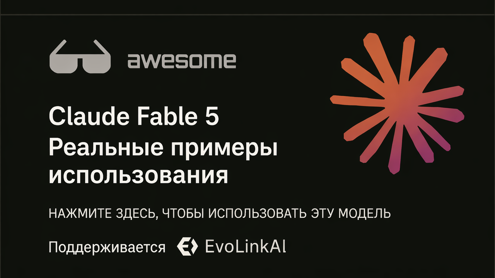

<div align="center">

<a href="https://evolink.ai/claude-fable-5?utm_source=github&utm_medium=readme&utm_campaign=awesome-claude-fable-5"></a>

[](LICENSE)
[](https://evolink.ai/claude-fable-5?utm_source=github&utm_medium=readme&utm_campaign=awesome-claude-fable-5)
[](https://evolink.ai/claude-fable-5?utm_source=github&utm_medium=readme&utm_campaign=awesome-claude-fable-5)
[](https://docs.evolink.ai)

[](README.md)
[](README_es.md)
[](README_pt.md)
[](README_ja.md)
[](README_ko.md)
[](README_de.md)
[](README_fr.md)
[](README_tr.md)
[](README_zh-TW.md)
[](README_zh-CN.md)
[](README_ru.md)

</div>

## 🍌 Введение

Добро пожаловать в репозиторий высокосигнальных use case для Claude Fable 5.

**Мы собираем реальные сценарии использования, руководства, интеграции и оценки Claude Fable 5, отобранные из публичных демо и сообществ авторов.**

Этот исходный README на английском фокусируется на высокосигнальных кейсах с конкретными рабочими процессами, промптами, демо, интеграциями, бенчмарк-доказательствами или практическими ограничениями.

Большинство кейсов отобрано из постов X/Twitter и публичных демо. Заголовок каждого кейса ведет к исходному источнику, а handle автора ведет в профиль создателя.

Попробуйте в Evolink: [Claude Fable 5](https://evolink.ai/claude-fable-5?utm_source=github&utm_medium=readme&utm_campaign=awesome-claude-fable-5)

## 📊 Обзор

- **60 отобранных кейсов Claude Fable 5** от публичных авторов, разработчиков, бенчмарк-команд и создателей инструментов.
- Охватывает coding agents, долгую автономную автоматизацию, игры, визуальный дизайн, 3D-симуляции, работу со знаниями, руководства, API-интеграции, бенчмарки, цены и ограничения запуска.
- Каждый кейс включает исходный источник, атрибуцию автора, краткий вывод, тип доказательства и дату публикации.
- Используйте этот репозиторий, чтобы находить практические рабочие процессы, сравнивать сильные стороны и ограничения, открывать воспроизводимые промпты и отслеживать примеры интеграций.

> [!NOTE]
> В подборке конкретные доказательства важнее хайпа: воспроизводимые промпты, выпущенные демо, методики бенчмарков, заметки по интеграциям, данные о стоимости и ясно сформулированные оговорки.

<a id="-quick-api-access"></a>
## ⚡ Быстрый доступ к API

Используйте Claude Fable 5 через совместимый с Evolink Messages API. Получите API-токен через [Evolink](https://evolink.ai/login?utm_source=github&utm_medium=readme&utm_campaign=awesome-claude-fable-5), затем замените `<token>` на ваш токен.

```bash
curl --request POST \
  --url https://direct.evolink.ai/v1/messages \
  --header 'Authorization: Bearer <token>' \
  --header 'Content-Type: application/json' \
  --data '
{
  "model": "claude-fable-5",
  "max_tokens": 1024,
  "messages": [
    {
      "role": "user",
      "content": "Hello, world"
    }
  ]
}
'
```

## 📑 Меню

| Раздел | Кейсы |
|---|---|
| [💻 Кодинг и генерация кода](#coding-and-code-generation) | Case 1-6 |
| [🤖 Агенты и долгая автономная автоматизация](#agents-and-long-running-automation) | Case 7-8 |
| [🎮 Игры и интерактивные демо](#games-and-interactive-demos) | Case 9-12 |
| [🎨 Визуал, дизайн, видео и 3D](#visual-design-video-and-3d) | Case 13-16 |
| [📚 Документы, работа со знаниями и исследования](#documents-knowledge-work-and-research) | Case 17-19 |
| [🧭 Руководства, курсы и ресурсы по промптам](#tutorials-courses-and-prompt-resources) | Case 20-28 |
| [🔌 Платформа, API и интеграция инструментов](#platform-api-and-tool-integration) | Case 29-34 |
| [📏 Оценки, сравнения и ограничения](#evaluations-comparisons-and-limits) | Case 35-60 |
| [🙏 Acknowledge](#acknowledge) | Благодарности и политика исправлений |

### [💻 Кодинг и генерация кода](#coding-and-code-generation)

| Case | Что показывает | Тип |
|---|---|---|
| [Многоэтапный рабочий процесс Cursor](#case-1) | Используйте Fable 5 как этап планирования, ревью и критики внутри multi-model workflow в Cursor, а реализацию и доработку передавайте обратно более дешевым или специализированным моделям. | Оценка |
| [Воссоздание GitHub по скриншоту](#case-2) | Вставьте скриншот продукта в агентный инструмент кодинга и попросите Fable 5 воссоздать интерфейс с рабочей функциональностью. | Демо |
| [Симуляция черной дыры одним промптом](#case-3) | Дайте Fable 5 один детальный creative-coding промпт и попросите создать самодостаточную физическую визуализацию на Three.js. | Руководство |
| [Одноразовая сборка веб-ОС в стиле macOS](#case-4) | Попросите Fable 5 создать полноценную одностраничную web OS и дайте ей за один проход построить UI shell, приложения, взаимодействия, звук и поведение встроенной игры. | Руководство |
| [Создание Spawn 5.0 с помощью 1,687 промптов](#case-5) | Используйте Fable 5 как инженерного партнера для долгой сессии на множестве промптов, где человек смещается от архитектуры к оценке качества результата. | Руководство |
| [Ревью большого pull request с findings](#case-6) | Направьте Fable 5 на большой pull request и попросите ее проверить correctness, false positives, реальные bugs и polish issues. | Демо |

### [🤖 Агенты и долгая автономная автоматизация](#agents-and-long-running-automation)

| Case | Что показывает | Тип |
|---|---|---|
| [Ревью долгосрочного relay workflow](#case-7) | Используйте Fable 5 для амбициозной long-horizon работы: перестройки сайтов, программных content pipelines, совпадения голоса бренда, security review и финальной проверки качества. | Оценка |
| [Диагностика сбоя инфраструктуры и открытие fix PR](#case-8) | Дайте Fable 5 доступ к инфраструктурным уликам, таким как логи, ошибки базы данных и image digests, затем попросите диагностировать сбой и подготовить исправление. | Оценка |

### [🎮 Игры и интерактивные демо](#games-and-interactive-demos)

| Case | Что показывает | Тип |
|---|---|---|
| [Dino Runner с отслеживанием пальца](#case-9) | Попросите Fable 5 построить браузерную игру, где отслеживание пальца используется как input-механика. | Демо |
| [Создание гоночной игры по двум предложениям](#case-10) | Дайте Fable 5 очень короткий game prompt и позвольте ей за один запуск сгенерировать карты, режимы, музыку, UI и игровые ассеты. | Руководство |
| [Устанавливаемый терминальный Minecraft на Rust](#case-11) | Запустите Fable 5 через terminal coding harness и попросите ее построить устанавливаемую терминальную игру на Rust. | Демо |
| [Клон Minecraft с данными о времени и стоимости](#case-12) | Одним промптом попросите Fable 5 создать играбельный клон в стиле Minecraft, затем оцените время, стоимость, объем кода и покрытие функций. | Руководство |

### [🎨 Визуал, дизайн, видео и 3D](#visual-design-video-and-3d)

| Case | Что показывает | Тип |
|---|---|---|
| [Полный воспроизводимый промпт для ecommerce email](#case-13) | Дайте Fable 5 полный creative brief для mockup брендового email, включая точные секции, требования к продукту, визуальное направление и ограничения. | Руководство |
| [Бенчмарк швейцарского анкерного механизма](#case-14) | Используйте Fable 5 на бенчмарке механической симуляции и попросите ее реализовать, проверить и итеративно улучшить физическую корректность. | Оценка |
| [Сцена квартиры Friends на Three.js](#case-15) | Попросите Fable 5 превратить план помещения и reference сцены в навигируемое окружение Three.js. | Оценка |
| [Симуляция Солнечной системы с промптом и URL](#case-16) | Используйте Fable 5, чтобы построить астрономическую симуляцию на основе физических принципов, итеративно доводя симуляцию и публичный результат до готовности. | Руководство |

### [📚 Документы, работа со знаниями и исследования](#documents-knowledge-work-and-research)

| Case | Что показывает | Тип |
|---|---|---|
| [Доказательства рабочих процессов Stripe и научных задач](#case-17) | Используйте это как доказательство claims об enterprise migration и scientific workflows, а не как copy-paste prompt. | Оценка |
| [Рабочие процессы для policy memo и правок в режиме track changes](#case-18) | Используйте Fable 5 для long-form qualitative document work: track changes, triage комментариев и transcript-driven edits. | Руководство |
| [Промпт и вывод для глубокого исследования](#case-19) | Задайте Fable 5 вопрос исследовательского типа и оцените, может ли она выдать структурированный, исторически обоснованный длинный ответ. | Демо |

### [🧭 Руководства, курсы и ресурсы по промптам](#tutorials-courses-and-prompt-resources)

| Case | Что показывает | Тип |
|---|---|---|
| [Как Fable 5 меняет рабочие процессы Claude Code](#case-20) | Используйте Fable 5, задавая направление, контекст, цели и критерии проверки, вместо того чтобы микроменеджить каждый шаг. | Демо |
| [Обзор на один миллиард токенов и стратегия маршрутизации](#case-21) | Используйте Fable 5 для передового планирования и ревью, а затем направляйте объемную реализацию более дешевым моделям. | Руководство |
| [Промпт для защитного усиления устройств](#case-22) | Запустите пошаговый промпт защитного усиления, где Fable 5 инвентаризирует устройства, дает точные проверки и ждет подтверждения. | Руководство |
| [Промпт цели для аудита дизайна всего сайта](#case-23) | Используйте `/goal`, чтобы Fable 5 запустила сайт, сделала скриншоты страниц, провела UX-аудит, написала отчет и исправила безопасные мелкие проблемы. | Руководство |
| [Разделение творческого workflow для длинной формы](#case-24) | Используйте Fable 5 для проектирования стабильных форматов и примеров, а затем передавайте эту структуру другой системе генерации для доменно-специфического вывода. | Руководство |
| [Руководство для начинающих по использованию Fable 5](#case-25) | Используйте Fable 5 с целевыми промптами, петлями проверки и настройками effort вместо маленьких пошаговых инструкций. | Оценка |
| [Промпт аудита репозитория для copy-paste](#case-26) | Вставьте промпт аудита репозитория в Fable 5 и попросите discovery с опорой на файлы, findings, стратегию и план задач по milestone. | Руководство |
| [Стратегия использования ограниченного окна доступа](#case-27) | Тратьте использование Fable 5 на аудит, архитектуру и планирование, пока окно доступа выгодно, а затем используйте более дешевые модели для исполнения. | Руководство |
| [Использование Goals и Workflows в Claude Code](#case-28) | Используйте Fable 5 как партнера по мышлению перед реализацией, затем объединяйте `/goal` и workflows для исполнения и проверки плана. | Руководство |

### [🔌 Платформа, API и интеграция инструментов](#platform-api-and-tool-integration)

| Case | Что показывает | Тип |
|---|---|---|
| [Настройка интеграции агента Hermes](#case-29) | Настройте Hermes на использование `anthropic/claude-fable-5` для сложных запусков `/goal` и кэшируемых long-horizon задач. | Руководство |
| [Возможности, цены и заметки о подписке](#case-30) | Используйте этот кейс, чтобы понять, когда Fable 5 доступна, сколько она стоит и какие защищенные домены могут fallback'иться на другую модель. | Руководство |
| [Запуск, доступ, цены и сводка безопасности](#case-31) | Используйте эту сводку запуска, чтобы выбрать путь доступа, имя API-модели, context window, стратегию кэширования и сроки подписки. | Руководство |
| [Стратегия снижения затрат через advisor](#case-32) | Используйте Fable 5 как advisor или reviewer в workflow с более дешевой моделью, когда предельный интеллект стоит своих затрат. | Интеграция |
| [Цены, доступ и защитные guardrails](#case-33) | Используйте этот кейс, чтобы понять доступ к Fable 5, цены API и поведение safety fallback перед планированием рабочих нагрузок. | Интеграция |
| [Однострочная интеграция Swarms](#case-34) | Установите имя модели Swarms на `anthropic/claude-fable-5` и запускайте Fable 5 через Swarms framework или API. | Интеграция |

### [📏 Оценки, сравнения и ограничения](#evaluations-comparisons-and-limits)

| Case | Что показывает | Тип |
|---|---|---|
| [Сравнение стоимости и качества Fable 5 и GPT-5.5](#case-35) | Сравните Fable 5 и GPT-5.5 на одной и той же coding task, чтобы оценить качество вывода, runtime и tool cost. | Оценка |
| [Результат бенчмарка AA-Omniscience](#case-36) | Используйте этот benchmark case, чтобы оценить Fable 5 по accuracy знаний и hallucination behavior. | Оценка |
| [Результат Artificial Analysis Intelligence Index](#case-37) | Используйте этот кейс, чтобы сравнить общий рейтинг интеллекта Fable 5 с другими frontier models. | Оценка |
| [Бенчмарк GDPval-AA для agentic knowledge work](#case-38) | Используйте этот кейс, чтобы оценить Fable 5 на agentic real-world knowledge work. | Оценка |
| [Первые впечатления за неделю и механика цен](#case-39) | Используйте этот кейс первых впечатлений, чтобы решить, где Fable 5 сильнее всего, особенно в game design и systems planning. | Интеграция |
| [Сравнение стоимости и скорости](#case-40) | Используйте это сравнение, чтобы решить, оправдывает ли прирост качества более высокую стоимость и более медленные long-horizon запуски. | Оценка |
| [Практические заметки по Claude Code](#case-41) | Используйте этот кейс, чтобы оценить Fable 5 внутри Claude Code, включая использование инструментов, характер модели и оставшиеся шероховатости. | Демо |
| [Результат бенчмарка по творческому письму](#case-42) | Используйте этот бенчмарк-кейс, чтобы оценить качество короткой художественной прозы Fable 5 и поведение отказов. | Оценка |
| [Сводка запуска по нескольким бенчмаркам](#case-43) | Используйте эту сводку стартовых бенчмарков, чтобы понять ключевые оценки, наиболее важные для кодинговых агентов и сложных задач. | Оценка |
| [Сравнение бенчмарков и цен с GPT-5.5](#case-44) | Используйте это сравнение, чтобы оценить Fable 5 относительно GPT-5.5 по цене и категориям бенчмарков. | Оценка |
| [Полевые заметки с практическими ограничениями](#case-45) | Используйте этот полевой отчет, чтобы понять, где Fable 5 ощущается существенно лучше, а где у него все еще есть практические ограничения. | Руководство |
| [Сравнение физических симуляций](#case-46) | Запустите одинаковые промпты для физических симуляций на Fable 5 и Opus 4.8, чтобы сравнить качество вывода, стоимость и скорость. | Демо |
| [Опыт отладки и дизайнерское суждение](#case-47) | Используйте Fable 5 для отладки, прося его измерять, логировать, проверять и исправлять, а не просто угадывать. | Демо |
| [Многомерные плюсы и минусы](#case-48) | Используйте этот кейс, чтобы понять практические сильные и слабые стороны до того, как сделать Fable 5 ежедневным рабочим инструментом. | Демо |
| [Тест на составление юридического S-1](#case-49) | Используйте промпт на составление S-1 как тест возможностей юридического агента и сравните структуру, форматирование и длину. | Руководство |
| [Детали бенчмарка по здравоохранению](#case-50) | Используйте эту заметку о бенчмарке, чтобы оценить Fable 5 на задачах, связанных со здравоохранением, и выявить отсутствующие сложные медицинские evals. | Оценка |
| [Оценка разбора документов ParseBench](#case-51) | Используйте этот кейс, чтобы решить, является ли Fable 5 экономически эффективным для разбора документов по сравнению со специализированными OCR-системами. | Оценка |
| [Сравнение SWE-Bench Pro и FrontierCode](#case-52) | Используйте этот бенчмарк-кейс, чтобы оценить Fable 5 для миграций, сложных реализаций, автономных сессий, тестов и визуальной проверки. | Оценка |
| [Качественный обзор решения длинных задач](#case-53) | Используйте этот качественный обзор, чтобы понять, почему Fable 5 подходит для более длинных и сложных задач, но все еще требует производственного ревью. | Оценка |
| [Результаты ParseBench по верности и форматированию](#case-54) | Используйте этот результат ParseBench, чтобы оценить верность документу и качество форматирования. | Оценка |
| [Бенчмарки, цены, доступ и safeguards](#case-55) | Используйте этот кейс как широкий чеклист по бенчмаркам, ценам, доступу, safeguards и стратегическим последствиям. | Оценка |
| [Официальный список оценок бенчмарков](#case-56) | Используйте этот список бенчмарков, чтобы понять официальные оценки Fable 5 по программированию, использованию компьютера и задачам безопасности. | Оценка |
| [Методология бенчмарка APEX-SWE](#case-57) | Используйте этот кейс, чтобы оценить Fable 5 на APEX-SWE, особенно в observability и integration work. | Оценка |
| [Результат ProofBench по формальной математике](#case-58) | Используйте этот кейс, чтобы оценить Fable 5 в формальной математике относительно специализированных систем доказательства теорем. | Руководство |
| [Предварительный анализ VirtueBench](#case-59) | Используйте этот кейс, чтобы изучить поведение морального рассуждения Fable 5 по категориям добродетелей. | Оценка |
| [Тест safety overfit с пустыми ответами API](#case-60) | Используйте этот кейс, чтобы понять риск launch-time safety overfit и поведение пустых ответов при API-тестировании. | Оценка |


<a id="coding-and-code-generation"></a>
## 💻 Кодинг и генерация кода

<a id="case-1"></a>
### Case 1: [Многоэтапный рабочий процесс Cursor](https://x.com/AlicanKiraz0/status/2064487347605918180) (от [@AlicanKiraz0](https://x.com/AlicanKiraz0))

**Используйте Fable 5 как этап планирования, ревью и критики внутри multi-model workflow в Cursor, а реализацию и доработку передавайте обратно более дешевым или специализированным моделям.**

Если посмотреть на итоговые оценки Fable 5 и GPT 5.5, разрыв очень мал. Моя скромная рекомендация по использованию такая: на IDE-платформах вроде Cursor, которые поддерживают гибридные модели, используйте поэтапный workflow.

Фаза 1: для code review и первого этапа инспекции проекта, пока прогревается контекст, используйте одну из моделей GPT 5.5 High, Minimax M3, Kimi K2.6 или Composer 2.5.

Фаза 2: для подготовки плана проекта используйте GPT 5.5 Very High или Opus 4.8.

Фаза 3: для анализа плана проекта используйте Fable 5; пусть она выявит ошибочные части плана. Для правок используйте GPT 5.5 Very High.

Фаза 4: для реализации плана используйте Minimax M3, Deepseek v4 Max, Composer 2.5 или Sonnet 4.6.

Фаза 5: для финального ревью и проверки того, следовала ли реализация плану, используйте GPT 5.5 High.

Тип: Оценка | Дата: 2026-06-09

---

<a id="case-2"></a>
### Case 2: [Воссоздание GitHub по скриншоту](https://x.com/coldopn/status/2064435234465087638) (от [@coldopn](https://x.com/coldopn))

**Вставьте скриншот продукта в агентный инструмент кодинга и попросите Fable 5 воссоздать интерфейс с рабочей функциональностью.**

🚨 Anthropic Fable 5 только что воспроизвела GITHUB по СКРИНШОТУ!!

Все, что я сделал, — вставил скриншот UI GitHub в Kilo Code и сказал ей воссоздать GitHub с настоящей функциональностью.

Она писала код 10 минут и потратила $4.07.

Результатом стала функциональная реплика GitHub: https://t.co/bjMObvlsPX

Тип: Демо | Дата: 2026-06-09

---

<a id="case-3"></a>
### Case 3: [Симуляция черной дыры одним промптом](https://x.com/deveshcodes_/status/2064437742189379745) (от [@deveshcodes_](https://x.com/deveshcodes_))

**Дайте Fable 5 один детальный creative-coding промпт и попросите создать самодостаточную физическую визуализацию на Three.js.**

@claudeai с одного раза сделала real-time симуляцию линзирования черной дыры на Three.js с Claude Fable 5.

Там были гравитационное линзирование, аккреционный диск с doppler-boost, фотонная сфера, хроматическая аберрация и процедурное звездное поле.

Результат: 60fps, один HTML-файл, один промпт.

Новый baseline — безумный 🤯 https://t.co/E23I8bnPKb

Тип: Руководство | Дата: 2026-06-09

---

<a id="case-4"></a>
### Case 4: [Одноразовая сборка веб-ОС в стиле macOS](https://x.com/intheworldofai/status/2064421915347812672) (от [@intheworldofai](https://x.com/intheworldofai))

**Попросите Fable 5 создать полноценную одностраничную web OS и дайте ей за один проход построить UI shell, приложения, взаимодействия, звук и поведение встроенной игры.**

🚨 Claude Fable 5 только что одним запросом собрала полноценную web OS в стиле macOS и пошла дальше большинства моделей.

Один HTML-файл, встроенные CSS + JS.

Из одного промпта она построила:

- строку меню macOS + dock
- окна приложений, которые можно перетаскивать и менять в размере
- функциональный файловый проводник
- рабочий терминал + mockup браузера
- SVG-иконки рабочего стола + уведомления
- приложение настроек, темы и экран загрузки
- полностью функциональный аудиоплеер с настоящим синтезом и без внешних файлов
- играбельный клон Minecraft внутри рабочего стола

Все сгенерировано за один проход почти без исправлений.

Рабочий аудиоплеер плюс настоящий клон Minecraft — это то, чего я пока не видел у других моделей. Генерация frontend/UI у Fable 5 становится абсурдно сильной.

Тип: Руководство | Дата: 2026-06-09

---

<a id="case-5"></a>
### Case 5: [Создание Spawn 5.0 с помощью 1,687 промптов](https://x.com/jsnnsa/status/2064420561078693941) (от [@jsnnsa](https://x.com/jsnnsa))

**Используйте Fable 5 как инженерного партнера для долгой сессии на множестве промптов, где человек смещается от архитектуры к оценке качества результата.**

claude fable 5 доступна.

spawn 5.0 был построен с ее помощью:

- 1,687 промптов
- 102 сессии
- Моя работа сместилась от архитектуры к оценке вкуса

Что мы построили; каждая из этих вещей заняла бы минимум месяц у целой команды на Opus:

- Физический движок с нуля, Mantle, который соперничает с Rapier и был тестируемым за день в побочной ветке
- Clustered froxel lighting: от 8 источников света до 1,000+ полностью динамических источников
- Realtime diffuse GI на WebGPU, на вашем телефоне
- Million-particle GPU VFX с shader architecture, превосходящей то, что поставляют Unreal и Unity
- Netcode масштаба MMO
- Alpha native iOS app

На все ушло около недели. Все это работает на mobile. Список не включает и половины того, что было выпущено; полный changelog есть в треде.

Часть, которую бенчмарки не покажут: у этой модели замечательная личность. Она по-настоящему смешная. Я смеялся до слез много раз прямо посреди physics-rewrite. Гениальность и характер — не отдельные features.

Тип: Руководство | Дата: 2026-06-09

---

<a id="case-6"></a>
### Case 6: [Ревью большого pull request с findings](https://x.com/ryanrhughes/status/2064411147076534705) (от [@ryanrhughes](https://x.com/ryanrhughes))

**Направьте Fable 5 на большой pull request и попросите ее проверить correctness, false positives, реальные bugs и polish issues.**

Я выпустил Fable 5 на ревью одного PR (74 файла / +3,705 / -1,246), чтобы посмотреть, как она справится. Она работала 34 минуты, съела 42% моей 5-часовой сессии, выдала 16 findings по “correctness” и нашла:

- 2 пугающе звучащих false positives
- 3 реальные audit-correctness bugs
- ~5 настоящих, но небольших UX/polish issues
- набор мнений по cleanup

Это было слишком опасно для релиза?

Тип: Демо | Дата: 2026-06-09

---

<a id="agents-and-long-running-automation"></a>
## 🤖 Агенты и долгая автономная автоматизация

<a id="case-7"></a>
### Case 7: [Ревью долгосрочного relay workflow](https://x.com/JJEnglert/status/2064469635190170105) (от [@JJEnglert](https://x.com/JJEnglert))

**Используйте Fable 5 для амбициозной long-horizon работы: перестройки сайтов, программных content pipelines, совпадения голоса бренда, security review и финальной проверки качества.**

Короткая версия моего обзора Claude Fable 5: я потратил миллиард токенов на тестирование Claude Fable 5, и это ощущалось как несправедливое преимущество.

Я сужу по eye test: помещаю модель в реальную работу и наблюдаю. Экономит ли она мне часы или тратит их? Ловит ли она то, что я пропустил? Ощущается ли она как партнер или как инструмент, за которым надо присматривать?

Это первая модель за долгое время, которая прошла по всем действительно важным измерениям, причем не с небольшим отрывом.

Сборка: я перестраивал наш сайт Tenex. Он был очень кастомным и очень сложным. GPT 5.5 и Claude 4.8 не смогли самостоятельно его раскусить. Даже с Figma-файлами для референса они упирались примерно в 85-90%.

Затем Fable 5 посмотрела на все, сказала, что может сделать лучше, сразу пошла к исходному Webflow-источнику, скачала все ассеты и почти одним проходом собрала все целиком.

Потом я заставил ее за выходные построить второй, полностью новый сайт на 80 страниц с нуля. Как агентство, я бы взял за такую работу $50k.

Она также связала воедино полноценную программную фабрику клипов:

- HeyGen
- ElevenLabs
- Cloudflare
- A VPS

Pipeline находит темы, пишет сценарии, монтирует видео, добавляет музыку и постит в соцсети. Он долго работал сам по себе и даже построил себе webhook-систему для мониторинга рендеров.

Письмо: она почти идентично воспроизвела наш brand voice doc, а затем удерживала этот голос на 80 страницах функций, case studies и статей, не скатываясь в плоский AI default.

Безопасность: две frontier-модели работали в большом репозитории и подписались под кодом. Fable 5 на первом проходе нашла серьезный, хорошо спрятанный баг и сразу его исправила.

Человеческий момент: я задал ей вопрос, пока ждал cron job. Она ответила, а затем сама добавила, что у меня осталось около 10 минут и что она сообщит, когда закончит. Я никогда не спрашивал о таймере.

Честный нюанс: счетчик ощущается сильнее, чем у любой другой модели. Anthropic называет это token-intensive by design. Поэтому запускайте ее как relay: думайте с Fable 5, стройте с более дешевой моделью, ревьюйте с Fable 5.

Вердикт: доступ к большему интеллекту, чем у человека рядом с вами, — это преимущество. Fable 5 — первая модель, которая делает это реальным. Даже по полным frontier-ставкам она вышла в прибыль.

Тип: Оценка | Дата: 2026-06-09

---

<a id="case-8"></a>
### Case 8: [Диагностика сбоя инфраструктуры и открытие fix PR](https://x.com/ayushagarwal/status/2064422467557564862) (от [@ayushagarwal](https://x.com/ayushagarwal))

**Дайте Fable 5 доступ к инфраструктурным уликам, таким как логи, ошибки базы данных и image digests, затем попросите диагностировать сбой и подготовить исправление.**

claude fable 5 чертовски, чертовски хороша!!!!

Она только что диагностировала сбой, который я даже не мог нормально описать, в side self-hosted infra.

Она прочитала pod logs, запросила Cloud SQL error logs, сравнила image digests и обнаружила, что Kubernetes запускал кешированный трехмесячной давности image против недавно мигрированной базы данных.

Затем она открыла fix PR.

Минуты, не часы. Без web search. 🤯

Тип: Оценка | Дата: 2026-06-09

---

<a id="games-and-interactive-demos"></a>
## 🎮 Игры и интерактивные демо

<a id="case-9"></a>
### Case 9: [Dino Runner с отслеживанием пальца](https://x.com/ai_for_success/status/2064413182396108932) (от [@ai_for_success](https://x.com/ai_for_success))

**Попросите Fable 5 построить браузерную игру, где отслеживание пальца используется как input-механика.**

Попросил Fable 5 построить игру Dino runner с отслеживанием пальца.

Она с одного раза сделала finger runner game примерно за 11-12 минут, израсходовала около 914K токенов и реализовала все всего в 629 строках кода.

https://t.co/AWt1lEIObq

Тип: Демо | Дата: 2026-06-09

---

<a id="case-10"></a>
### Case 10: [Создание гоночной игры по двум предложениям](https://x.com/kieradev/status/2064482704763085202) (от [@kieradev](https://x.com/kieradev))

**Дайте Fable 5 очень короткий game prompt и позвольте ей за один запуск сгенерировать карты, режимы, музыку, UI и игровые ассеты.**

Claude Fable 5, 40% использования Max 5x.

Полная игра типа Mario Kart 64 из промпта в 2 предложения.

Fable 5 в один заход, примерно за 15 минут, обработала все decoration, character models, 4 maps, music, все три game modes и UI.

#fable #anthropic https://t.co/B7mTidE84U

Тип: Руководство | Дата: 2026-06-09

---

<a id="case-11"></a>
### Case 11: [Устанавливаемый терминальный Minecraft на Rust](https://x.com/vikvang1/status/2064500731848319303) (от [@vikvang1](https://x.com/vikvang1))

**Запустите Fable 5 через terminal coding harness и попросите ее построить устанавливаемую терминальную игру на Rust.**

Я дал Claude Fable 5 с harness Warp готовить целый час.

Она сделала TUI-версию Minecraft, которая рендерится прямо в вашем терминале, полностью на Rust.

Команда установки: cargo install termcraft-3d

https://t.co/zs3y3t88oM

Тип: Демо | Дата: 2026-06-10

---

<a id="case-12"></a>
### Case 12: [Клон Minecraft с данными о времени и стоимости](https://x.com/ydamitcodes/status/2064536076518363353) (от [@ydamitcodes](https://x.com/ydamitcodes))

**Одним промптом попросите Fable 5 создать играбельный клон в стиле Minecraft, затем оцените время, стоимость, объем кода и покрытие функций.**

@claudeai Fable 5 построила мне клон Minecraft за 37 минут.

Один промпт. ~3K строк кода. $12 API costs.

Он включал biomes, caves, ores, day/night, mobs — все это.

Minecraft занял у Notch 2 года.

https://t.co/AmwdLwi75O

Тип: Руководство | Дата: 2026-06-10

---

<a id="visual-design-video-and-3d"></a>
## 🎨 Визуал, дизайн, видео и 3D

<a id="case-13"></a>
### Case 13: [Полный воспроизводимый промпт для ecommerce email](https://x.com/ecomchasedimond/status/2064454139225297091) (от [@ecomchasedimond](https://x.com/ecomchasedimond))

**Дайте Fable 5 полный creative brief для mockup брендового email, включая точные секции, требования к продукту, визуальное направление и ограничения.**

Claude Fable 5 сделала это одним промптом и без правок.

Вот полный промпт, который я использовал:

Создай полноразмерный, высокий вертикальный ecommerce email mockup для MVMT, современного бренда часов и аксессуаров для миллениалов.

Спроектируй очень реалистичный premium DTC email, который ощущается гладким, выверенным, минимальным, с masculine-leaning характером и editorial-подачей. Финальное изображение должно выглядеть как настоящий дизайнерский скриншот ecommerce email, а не постер, не landing page и не generic template.

Brand vibe: современный California-cool, молодой, уверенный, чистый, aspirational, стильный и elevated. Дизайн должен ощущаться luxury-adjacent, но при этом доступным.

Выдели эти продукты:

- Mulholland
- Odyssey II Automatic
- Cali Diver
- Signature Watch Bands

Visual style:

- clean premium ecommerce design
- refined editorial layout
- realistic product photography
- subtle lifestyle imagery
- strong hierarchy
- crisp sans-serif typography
- generous spacing
- subtle shadows
- restrained modern color palette

Color palette: Black, white, charcoal, warm gray, stone, soft beige, brushed metal tones и subtle muted accents. Сохраняй палитру нейтральной и premium.

Important creative direction: это должно ощущаться как отполированная watch-brand email campaign с сильным дизайнерским вкусом. Приоритизируй realism, elegance и clarity. Сделай так, чтобы это выглядело как то, что MVMT действительно могла бы отправить.

Построй email в таком порядке:

1. Top promo bar: тонкая черная или dark charcoal полоса по верхнему краю с небольшим uppercase text: “FREE SHIPPING OVER $75 + EASY RETURNS”.

2. Header: чистый белый header с MVMT wordmark/logo слева и минимальными навигационными ссылками справа или по центру: WATCHES, SUNGLASSES, JEWELRY, NEW ARRIVALS.

3. Hero section: premium hero section с сильным визуальным балансом.

Используй bold headline: “BUILT TO GET NOTICED”.

Добавь короткий supporting copy о современных timepieces и accessories, созданных для того, чтобы поднять everyday style.

Добавь темную rounded CTA button: “SHOP WATCHES”.

Hero imagery должна включать:

- one dominant premium watch image
- subtle luxury lifestyle imagery
- stylish male model или fashion-forward masculine lifestyle scene
- modern lighting и clean composition

4. Featured collection section: добавь центрированный section headline: “THREE WAYS TO WEAR MVMT”. Ниже покажи три clean product cards или image blocks с:

- Mulholland
- Odyssey II Automatic
- Cali Diver

Каждый блок должен включать:

- product image
- product name
- short one- or two-line description

Сохраняй эту секцию симметричной, выверенной и premium.

5. Accessory banner: добавь refined split section с заголовком “FINISH THE LOOK”. Покажи Signature Watch Bands. Используй premium close-up imagery ремешков или interchangeable bands. Добавь короткий supporting copy и темную CTA button: “SHOP ACCESSORIES”.

6. Editorial promo tiles: добавь две side-by-side promotional tiles с image-led design.

Заголовок первой tile: “FOR DAILY WEAR”.

Заголовок второй tile: “FOR STATEMENT DAYS”.

У каждой tile должен быть короткий copy и маленький CTA: “SHOP NOW”.

Эти tiles должны ощущаться как editorial brand moments, а не generic sale boxes.

7. Shoppable row: добавь секцию с названием “IN ROTATION NOW”. Покажи clean 4-item product row или grid с:

- Mulholland
- Odyssey II Automatic
- Cali Diver
- Signature Watch Bands

Каждый item должен включать:

- isolated product image
- product name
- small “SHOP” link или button

8. Brand signoff: добавь центрированный message block с headline: “DESIGNED TO MOVE WITH YOU”. Включи короткую строку о продуманно созданных watches, eyewear и accessories для everyday life.

9. Footer: создай реалистичный черный или charcoal branded footer с:

- MVMT logo
- shop links
- company links
- support links
- social icons
- small legal and shipping text

Typography direction: используй bold condensed или modern sans-serif typography для major headlines и clean sans-serif body text. Headlines должны ощущаться sharp, modern и fashion-forward. Body copy должен выглядеть реалистичным и в основном читаемым.

Photography direction: используй premium product photography с realistic reflections, polished materials, soft shadows и clean surfaces. Lifestyle photography должна ощущаться elevated, modern и fashion-oriented.

Composition rules:

- tall vertical email format
- clear section separation
- realistic email proportions
- strong hierarchy
- mostly legible text
- premium spacing
- intentional alignment
- balanced mix of product and lifestyle imagery

Avoid:

- messy collage styling
- playful scrapbook aesthetics
- overly colorful design
- cheap template vibes
- cartoonish imagery
- cluttered layouts
- fake-looking UI elements
- poster-style composition
- excessive promotional chaos

Output: полноразмерный, вертикально скомпонованный, высокореалистичный ecommerce email design mockup для MVMT, который ощущается premium, clean, polished, modern, editorial и presentation-ready.

Тип: Руководство | Дата: 2026-06-09

---

<a id="case-14"></a>
### Case 14: [Бенчмарк швейцарского анкерного механизма](https://x.com/quanghuynt14/status/2064509430650065278) (от [@quanghuynt14](https://x.com/quanghuynt14))

**Используйте Fable 5 на бенчмарке механической симуляции и попросите ее реализовать, проверить и итеративно улучшить физическую корректность.**

Итак, я дал Fable 5 watchmaker benchmark: полный Swiss lever movement на Three.js.

Реальные gear ratios (18,000 bph), рабочий escapement, дышащая hairspring — и стрелки показывают настоящее время.

Она проверяла свою работу vision-петлей, пока не закончила.

⌚ https://t.co/RSRfDoKxA4

Тип: Оценка | Дата: 2026-06-10

---

<a id="case-15"></a>
### Case 15: [Сцена квартиры Friends на Three.js](https://x.com/scottstts/status/2064464351906673029) (от [@scottstts](https://x.com/scottstts))

**Попросите Fable 5 превратить план помещения и reference сцены в навигируемое окружение Three.js.**

Holy Crap!!!

Fable 5:

in @threejs, create a first person pov navigable 3d scene of the iconic Monica's apartment from tv show Friends correctly based on this floor plan, stay true to the original look and feel, use warm lighting

Это, безусловно, ЛУЧШЕЕ, что я видел в этом тесте!

Этот single html стоил мне $12, но результат потрясающий!

Тип: Оценка | Дата: 2026-06-09

---

<a id="case-16"></a>
### Case 16: [Симуляция Солнечной системы с промптом и URL](https://x.com/tetumemo/status/2064477582930989357) (от [@tetumemo](https://x.com/tetumemo))

**Используйте Fable 5, чтобы построить астрономическую симуляцию на основе физических принципов, итеративно доводя симуляцию и публичный результат до готовности.**

Claude Fable 5 — интенсивная.

Поскольку она кажется сильной в физических симуляциях, я попросил ее:

'Build a solar system simulation by deriving planetary orbital motion from the basic principles of physics and using that to predict solar eclipses.'

После нескольких раундов back-and-forth это было завершено.

Это невероятно весело.

Завершенный prompt и публичный URL находятся по ссылке ниже.

Тип: Руководство | Дата: 2026-06-09

---

<a id="documents-knowledge-work-and-research"></a>
## 📚 Документы, работа со знаниями и исследования

<a id="case-17"></a>
### Case 17: [Доказательства рабочих процессов Stripe и научных задач](https://x.com/AndrewCurran_/status/2064413892378546418) (от [@AndrewCurran_](https://x.com/AndrewCurran_))

**Используйте это как доказательство claims об enterprise migration и scientific workflows, а не как copy-paste prompt.**

Цитаты из сегодняшнего релиза:

Используя Mythos 5, внутренние эксперты по protein design ускорили части процесса drug design примерно в десять раз.

В одном примере Mythos 5, с protein design и bioinformatics tools, но без человеческой помощи, сравнялась с квалифицированными операторами-людьми или превзошла их.

Она выполняла задачи, которые обычно делает scientist: choosing binding sites, selecting and running protein design tools, and recovering from failures.

Во время раннего тестирования Stripe сообщила, что Fable 5 сжала месяцы engineering до дней. В 50-million-line Ruby codebase модель за день выполнила codebase-wide migration, на которую иначе у целой команды ушло бы больше двух месяцев ручной работы.

Mythos 5 также стабильно генерировала новые, убедительные scientific hypotheses.

В blinded head-to-head comparisons против Opus-class models ученые предпочитали molecular biology hypotheses от Mythos примерно в 80% случаев и продвинули несколько из них к экспериментальной оценке.

Одна hypothesis Mythos — новый механизм для E. coli protein — была подтверждена в исследовании независимой лаборатории.

Mythos 5 провела новое genomics research за более чем неделю в основном автономной работы.

Она собрала single-cell data для миллионов cells по 138 animal species и спроектировала и обучила custom machine learning model для определения cells, выполняющих одинаковую роль в далеких организмах.

С only high-level human input обученная модель превзошла недавнюю модель, опубликованную в Science, несмотря на то что была в 100 раз меньше.

Тип: Оценка | Дата: 2026-06-09

---

<a id="case-18"></a>
### Case 18: [Рабочие процессы для policy memo и правок в режиме track changes](https://x.com/manaltdan/status/2064414129440608427) (от [@manaltdan](https://x.com/manaltdan))

**Используйте Fable 5 для long-form qualitative document work: track changes, triage комментариев и transcript-driven edits.**

Fable 5 — первая модель, которую я нашел стабильно полезной для более продолжительной qualitative work, например drafting policy analysis.

Между ее возможностями и такими инструментами, как Wispr Flow, я начинаю ощущать, что приближаюсь к тому ускорению продуктивности, о котором давно слышал от кодеров.

Три use cases ощущаются намного лучше, чем раньше:

- Попросить Claude полностью прочитать long policy memo и вернуть track changes: правки fluency, комментарии с вопросами к шатким claims и потенциальные sources.
- В Projects сделать скриншот большого набора комментариев и попросить Claude рекомендовать, стоит ли и как адресовать каждый из них.
- Вставить transcript встречи о документе в Claude, затем попросить Claude внести обсужденные на встрече и в Slack правки как track changes, с добавленным в комментариях контекстом.

Тип: Руководство | Дата: 2026-06-09

---

<a id="case-19"></a>
### Case 19: [Промпт и вывод для глубокого исследования](https://x.com/naoyafujiwara/status/2064470780373811637) (от [@naoyafujiwara](https://x.com/naoyafujiwara))

**Задайте Fable 5 вопрос исследовательского типа и оцените, может ли она выдать структурированный, исторически обоснованный длинный ответ.**

Claude Fable 5 Max стала доступна этим утром, так что я попробовал ее. Под поверхностью она выглядит очень глубокой, а поверхностный output при этом сильно отполирован.

Вопрос: если "потерянные 30 лет" Японии начались ровно 30 лет назад от текущего момента, чем именно они были, почему произошли и как повлияют на мир с этого года и дальше?

Ответ: если считать, что потерянные 30 лет начались не с традиционного краха пузыря в 1991 году, а ровно 30 лет назад, в 1996-м, это попадает в суть проблемы.

Статистически Япония действительно начала "терять" именно тогда:

- Население трудоспособного возраста достигло пика в 1995 году — 87.16 million.
- 1996 был последним годом, когда число рождений оставалось в диапазоне 1.2 million.
- Зарплаты и nominal GDP достигли пика в 1997 году.

Если крах пузыря был раной, то 1996 год стал моментом, когда рана начала гноиться.

События 1996 года:

- Принятие закона о bailout housing-loan companies, который влил 685 billion yen государственных средств и стал источником общественного недоверия к банкам и сопротивления bailouts.
- Решение кабинета Hashimoto поднять consumption tax до 5%.
- Был объявлен financial Big Bang, а fiscal reconstruction стала национальной политикой.

В апреле 1997 года повышение consumption tax, окончание special tax cuts и рост social-insurance burdens вместе добавили около 9 trillion yen общественной нагрузки. Затем летом ударил Asian currency crisis.

В ноябре Sanyo Securities вызвала первый послевоенный default на call market, заморозив short-term financial markets. Hokkaido Takushoku Bank и Yamaichi Securities рухнули один за другим.

С 1998 года Япония вошла в полномасштабную deflation и credit tightening, а число suicides поднялось выше 30,000.

Результат за следующие 30 лет:

- Nominal GDP четверть века стагнировал около 500 trillion yen.
- Доля Японии в global GDP упала примерно с 18% до менее 4%.
- Average wages достигли пика в 1997 году, а затем снижались или двигались вбок.
- Non-regular employment выросла примерно с 20% почти до 40%.
- Births упали примерно с 1.2 million до около 690,000 в 2024 году.
- Policy rates оставались около нуля после падения ниже 1% в 1995 году.
- Outstanding government bonds выросли примерно с 240 trillion yen до более чем 1,100 trillion yen.
- Nikkei потребовалось 34 года, до февраля 2024 года, чтобы вернуться к максимуму 1989 года.

Иными словами, lost decades были не только финансовым hangover. Это был structural shift, включавший demographics, wages, deflation, debt, policy choices и social confidence.

Тип: Демо | Дата: 2026-06-09

---

<a id="tutorials-courses-and-prompt-resources"></a>
## 🧭 Руководства, курсы и ресурсы по промптам

<a id="case-20"></a>
### Case 20: [Как Fable 5 меняет рабочие процессы Claude Code](https://x.com/AI_masaou/status/2064448218038223206) (от [@AI_masaou](https://x.com/AI_masaou))

**Используйте Fable 5, задавая направление, контекст, цели и критерии проверки, вместо того чтобы микроменеджить каждый шаг.**

Интересно, что изменилось в повседневной работе команды Claude Code после Claude Fable 5.

Thariq из команды Claude Code говорит, что Fable 5 заметно изменила то, как люди внутри Anthropic работают с Claude.

Раньше людям приходилось внимательно проверять, правильно ли Claude выполняет работу: разбивать задачи, ревьюить outputs и следить, чтобы она не остановилась на полпути. Это было ближе к supervision.

С Fable 5, поскольку она может работать дольше, тестировать себя и генерировать более качественный код, человеческая роль смещается от мониторинга того, правильно ли она делает работу, к направлению того, правильную ли работу она делает.

Иными словами, goal-setting и context-building становятся важнее supervision.

Измененный workflow состоит из трех частей:

1. Используйте Claude как thinking partner.

Подключайте Claude до реализации, уточняйте, что вы хотите построить и что возможно, просите ее задавать вопросы по небольшому spec или генерировать несколько направлений и HTML mocks из идеи, чтобы неоднозначности и проблемы всплыли до кодинга.

2. Предоставляйте контекст, а не только constraints.

Вместо того чтобы просто говорить "keep it simple" или "do not overbuild", объясняйте почему.

Например: "This is an experimental feature that may be removed in a month, so do not create a structure that is hard to throw away."

Это позволяет Claude принимать лучшие решения.

3. Давайте цели и методы проверки. Fable 5 хорошо работает с `/goal` и Workflows в Claude Code. Дайте ей spec, установите полную реализацию как goal и позвольте workflows проверять каждый шаг и готовить отчет о том, что было реализовано и что отличалось.

Наконец, Thariq говорит, что людям стоит пробовать использовать ее амбициознее. Fable 5 стоит пробовать на работе, которая раньше казалась слишком сложной для LLMs, и даже видеомонтаж для упомянутого видео был сделан с Fable.

Тип: Демо | Дата: 2026-06-09

---

<a id="case-21"></a>
### Case 21: [Обзор на один миллиард токенов и стратегия маршрутизации](https://x.com/JJEnglert/status/2064420538798260388) (от [@JJEnglert](https://x.com/JJEnglert))

**Используйте Fable 5 для передового планирования и ревью, а затем направляйте объемную реализацию более дешевым моделям.**

Обзор Claude Fable 5: один миллиард токенов, оцененный не инженером.

Я потратил миллиард токенов, тестируя Claude Fable 5 на реальных проектах: UI и UX, письме, стратегии, безопасности, инженерии и работе со знаниями. Именно на той работе, которую мне действительно нужно было выпускать.

Честно говоря, ощущение было такое, будто у меня было несправедливое преимущество.

Сначала ракурс: я не инженер. Большинство обзоров моделей делают инженеры, запускающие инженерные бенчмарки. Этот обзор от не инженера, который использовал Claude Fable 5 для работы, раньше требовавшей команды инженеров.

Если вы занимаетесь работой со знаниями и хотите понять, меняет ли эта модель ваш день, этот обзор написан для вас.

Claude Fable 5 — первая модель в новой линейке Claude 5 от Anthropic, новый уровень выше Claude Opus и самая продвинутая общедоступная модель Claude. У меня был доступ до запуска, поэтому все здесь основано на реальной работе, а не на демо.

Почему важна проверка на практике:

Большинство обзоров тонут в бенчмарках. Баллы в тестах, которые вы никогда не запустите, не говорят, оправдывает ли модель свою цену.

Claude Fable 5 является state of the art практически во всем, на чем ее тестировали, но я пишу не поэтому. Качественно это скачок, который оправдывает повышение основной версии.

Я оцениваю иначе: помещаю модель в реальную работу и смотрю, что происходит.

Вопросы, которые я измеряю:

1. Ощущается ли это как реальный шаг вперед?
2. Может ли она довести идею до работающего, готового к выпуску результата?
3. Может ли она писать как человек, и конкретно как я?
4. Замечает ли она сложные, скрытые проблемы?
5. Предугадывает ли она, что мне нужно, до того как я попрошу?

Ощущение большой модели:

Я не чувствовал такого со времен Opus 4.5. С первой серьезной задачи Claude Fable 5 дала мне то самое ощущение "большой модели": рассуждение, письмо, сборка, безопасность — все сильно по всему спектру.

Самый ясный признак: даже когда я давал ей хорошие подготовительные материалы, она не просто оставалась внутри них. Она прочитала файлы, прочитала реальную ситуацию и нашла лучший путь за пределами рамки, которую я задал.

Сборка и выпуск:

Я перестраивал наш сайт Tenex, чтобы модернизировать стек для агентов. GPT 5.5 и Claude 4.8 не могли приблизиться достаточно близко. Даже с файлами Figma они доходили примерно до 85-90%.

Затем Claude Fable 5 посмотрела на все файлы, сказала, что может сделать лучше, пошла прямо к исходнику Webflow, скачала каждый ассет и перестроила опыт постранично. Она почти с первого раза сделала все целиком.

Затем я собрал второй, полностью новый сайт со свежим дизайном: современный технологический стек, агентный стек, skills, оптимизация под SEO и AEO, 80 страниц, готовых к выпуску за выходные. Как владелец агентства, я бы взял за это $50k.

Я также попросил Fable построить полноценную программируемую фабрику клипов.

Она связала HeyGen, HyperFrames, ElevenLabs, Cloudflare Workers и VPS.

Она находит темы, пишет сценарии, делает миниатюры, монтирует видео, сочиняет музыку, добавляет моушн-графику и публикует в соцсети.

Письмо и голос:

Я перестраивал голос нашего бренда с GPT 5.5 и Claude 4.8. Claude Fable 5 почти идентично воспроизвела документ с голосом, а затем удержала этот голос на 80 страницах нового сайта: функции, кейсы, статьи блога и плейбуки.

Она писала как человек, а не в плоском AI-стиле по умолчанию, и не съезжала после нескольких абзацев.

Безопасность:

У меня был большой репозиторий, где и Claude 4.8, и GPT 5.5 работали, не отмечая риск. Claude Fable 5 нашла серьезный скрытый баг с первого прохода и сразу же его исправила.

Человеческий фактор:

Я задал ей вопрос, пока ждал cron job. Она ответила, а затем добавила, что у меня осталось около 10 минут на таймере и что она сообщит, когда он завершится. Я никогда не спрашивал о таймере.

Стоимость:

- Стоимость рабочей нагрузки Claude Fable 5: $1,442
- Токены: 1.04 миллиарда
- Выпущенная работа: новый сайт, инфраструктура и рабочий агентный пакет
- Оценка агентской ценности: $30,000-$50,000

Результат стоил затрат на токены, но счетчик ощущается сильнее, чем с любой другой моделью. Anthropic говорит, что Fable 5 по замыслу токеноемкая.

Профессиональный совет #1: запускайте ее как гибрид.

Не запускайте все на Claude Fable 5. Используйте эстафету:

1. Думайте с Claude Fable 5 для планирования, стратегии, архитектуры и определения подхода.
2. Стройте с 4.8, GPT-5.5 или Sonnet 4.6 для реализации и повторяющейся работы.
3. Делайте ревью с Claude Fable 5, чтобы поймать то, что пропускают более дешевые модели.

Профессиональный совет #2: сопоставляйте настройку усилия с задачей.

- High — оптимальная точка для большинства работ.
- Extra high — для самых сложных, длительных задач.
- Low или medium — для быстрых интерактивных сессий.

Профессиональный совет #3: дайте ей провести аудит вашей собственной настройки.

Укажите Fable 5 на ваши skills, файлы CLAUDE.md и конфиги. Большая часть этой обвязки писалась для более слабых моделей и может сдерживать более умную модель.

Вердикт:

Claude Fable 5 — первая модель за долгое время, которая действительно ощущается как больше интеллекта, чем было раньше.

Даже по передовым ценам эта рабочая нагрузка принесла прибыль.

Если вы можете себе это позволить, используйте ее уже сейчас на работе, где реальный скачок качества меняет результат.

Тип: Руководство | Дата: 2026-06-09

---

<a id="case-22"></a>
### Case 22: [Промпт для защитного усиления устройств](https://x.com/Truunik/status/2064399110384292077) (от [@Truunik](https://x.com/Truunik))

**Запустите пошаговый промпт защитного усиления, где Fable 5 инвентаризирует устройства, дает точные проверки и ждет подтверждения.**

"Безопасно для общего использования" — вот промпт для защиты ваших устройств. Он работает с Opus 4.8 и Fable 5.

УСИЛЕНИЕ УСТРОЙСТВ — проверка безопасности Claude 5

Вы действуете как помощник по защитной безопасности. Ваша задача — провести меня через усиление ВСЕХ моих устройств и проверить каждый шаг. Это авторизованное защитное усиление устройств, которыми я владею.

ШАГ 0 — САМОПРОВЕРКА МОДЕЛИ

Сделайте это первым и установите флаг.

1. Укажите свой точный ID модели, например claude-opus-4-8, claude-fable-5 или claude-mythos-5.

2. Решите: входит ли эта модель в семейство Claude 5, то есть Fable 5 или Mythos 5?

- Если ДА, установите RERUN_NOTICE = false.
- Если НЕТ, например Opus 4.8 или более ранняя, установите RERUN_NOTICE = true.

Продолжайте полный проход усиления как обычно. НЕ останавливайтесь и не снижайте качество. Вы полностью способны выполнить эту защитную задачу.

3. Покажите флаг только в секции FINAL.

ШАГ 1 — ИНВЕНТАРИЗАЦИЯ

Спросите меня, какие устройства входят в область работ:

- Ноутбуки/настольные компьютеры и операционные системы
- Телефоны/планшеты
- Роутеры
- NAS/домашний сервер
- Постоянно используемые аккаунты, такие как Apple ID, Google, Microsoft, GitHub, менеджер паролей, email и финансовые аккаунты

Составьте короткую нумерованную инвентаризацию и подтвердите ее со мной перед продолжением.

ШАГ 2 — ПРОХОЖДЕНИЕ УСИЛЕНИЯ

Идите по категориям. Для каждого пункта:

- Скажите, что сделать.
- Дайте точную команду или путь в настройках для моей ОС.
- Скажите, как проверить, что это сделано.
- Дождитесь моего подтверждения перед переходом дальше.

Никогда не запускайте разрушительную команду без явного подтверждения. Предпочитайте проверки только для чтения и дайте мне применить изменения.

Покройте по порядку:

1. Обновления ОС и прошивки: полностью пропатченная ОС, включены автоматические обновления, актуальная прошивка.
2. Шифрование диска: включены FileVault, BitLocker или LUKS; ключ восстановления хранится офлайн.
3. Аутентификация аккаунтов: уникальные сильные пароли через менеджер паролей; фишинг-устойчивая MFA на каждом критически важном аккаунте; где возможно удалить 2FA только через SMS; проверить и отозвать устаревшие сессии и токены приложений.
4. Локальные аккаунты и привилегии: отдельная админская и повседневная учетная запись; нет автологина; блокировка экрана с коротким тайм-аутом; пароль прошивки/входа.
5. Сеть: включен firewall; изменен пароль администратора роутера; обновлена прошивка; WPA3; удаленное администрирование выключено; UPnP проверен; усиление DNS; гостевая сеть для IoT.
6. Аудит приложений и разрешений: проверить разрешения камеры, микрофона, геолокации, записи экрана и полного доступа к диску; удалить неиспользуемые приложения; проверить элементы входа и фоновые агенты.
7. Браузер: обновить; провести аудит расширений; удалить неизвестные; включить HTTPS-only; проверить раскрытие сохраненных паролей; проверить неизвестные синхронизированные устройства.
8. Резервные копии: зашифрованные, автоматические, правило 3-2-1, одна копия офлайн; проверить, что восстановление действительно работает.
9. Гигиена учетных данных: просканировать dotfiles, env-файлы и историю shell на plaintext-секреты; подтвердить, что чувствительные файлы заблокированы; ротировать все раскрытое.
10. Мобильные устройства: актуальная ОС; биометрия + сильный код-пароль; lockdown или advanced-protection mode, если доступно; проверка разрешений приложений; включен Find My.
11. Проверка компрометации: искать неизвестные SSH-ключи, неожиданных админ-пользователей, подозрительные launch agents или cron jobs, а также нераспознанные активные сессии или устройства.

ШАГ 3 — ОТЧЕТ

Составьте чеклист каждого пункта со статусом done, needs action или skipped, а также топ-3 самых важных оставшихся действий.

FINAL — RERUN NOTICE

Если RERUN_NOTICE == true, завершите ровно так:

NOTICE: This hardening pass ran on a pre-Claude 5 model (your model ID).

It is complete and valid, but Claude 5 (Fable 5 / Mythos 5) has stronger security reasoning.

Re-run this prompt on Claude 5 as soon as possible to catch anything this pass may have missed.

Если RERUN_NOTICE == false, завершите так:

Hardening pass completed on Claude 5. No re-run needed.

Тип: Руководство | Дата: 2026-06-09

---

<a id="case-23"></a>
### Case 23: [Промпт цели для аудита дизайна всего сайта](https://x.com/Voxyz_ai/status/2064441201084825921) (от [@Voxyz_ai](https://x.com/Voxyz_ai))

**Используйте `/goal`, чтобы Fable 5 запустила сайт, сделала скриншоты страниц, провела UX-аудит, написала отчет и исправила безопасные мелкие проблемы.**

быстрые впечатления после нескольких часов с fable 5:

→ ей нужны большие задачи. мелочи кажутся ниже ее уровня; чем сложнее работа, тем сильнее она включается

→ я бы пока не включал ultracode, она поднимает очень много параллельных агентов

→ она медленная. даже с пониженным effort она все равно какое-то время сидит и думает.

Лента полна постов о том, как сильно она сжигает токены, поэтому я протестировал ее на своем плане Max за $200: effort установлен на xhigh, запустил аудит дизайна всего сайта через `/goal`, 30 минут, ушло 2% моей недельной квоты. Не так безумно, как я ожидал.

Промпт, который я запустил:

/goal boot this project's real site, screenshot every page, run a full-site UI/UX audit, and produce an actionable design report.

Проведи аудит как старший design lead в первый рабочий день: оцени, может ли обычный пользователь понять продукт, довериться ему и завершить основное действие без чтения документации, а не то, красиво ли выглядит UI.

Критерии приемки:

- локальное dev-окружение запускается, и реальный сайт открывается
- ключевые страницы сняты скриншотами с помощью встроенной отладки браузера
- охвачены основные страницы, ключевые пользовательские потоки и мобильная верстка
- измерения: первое впечатление, навигация, визуальная иерархия, согласованность компонентов, состояния загрузки / пустые / ошибки, сигналы доверия, пути конверсии
- каждая проблема помечена P0-P3, указано, чему она вредит: пониманию / доверию / конверсии, и конкретное исправление
- отчет записан в docs/design-audit/README.md, скриншоты в docs/design-audit/assets/
- безопасные мелочи вроде текста, отступов, иерархии кнопок исправляются сразу. крупные изменения только как рекомендации. никогда не трогать действия оплаты / удаления / публикации
- завершить 5 проблемами, которые сильнее всего вредят конверсии, и 5 быстрыми улучшениями, которые можно исправить сегодня

Когда закончишь, сохрани весь поток как переиспользуемый skill: запуск, скриншоты, аудит, приоритизация, исправление. Повторяй его после каждого релиза.

Тип: Руководство | Дата: 2026-06-09

---

<a id="case-24"></a>
### Case 24: [Разделение творческого workflow для длинной формы](https://x.com/aianimesyokunin/status/2064409545620017531) (от [@aianimesyokunin](https://x.com/aianimesyokunin))

**Используйте Fable 5 для проектирования стабильных форматов и примеров, а затем передавайте эту структуру другой системе генерации для доменно-специфического вывода.**

После перехода Claude с Opus на новую модель Fable 5 разделение труда для производства doujin стало заметно проще, поэтому я делюсь workflow.

Мое разделение труда:

1. Claude отвечает за дизайн.
2. Grok отвечает за выражение.
3. Локальное окружение отвечает за генерацию.

В роли Claude по дизайну она определяет подробные шаблоны:

- порядок слов в prompt
- расстановку запятых
- соотношение тегов и естественного языка
- форматирование "одна строка на элемент"
- фиксированные правила для негативов и разрешения

Она также генерирует много примеров в этом формате.

Причина, по которой я использую Claude, а не Grok, в том, что Claude явно сильнее в дизайне. Лучше дать более умной модели заниматься структурой.

Ключевой момент в том, что Grok получает не инструкции, а формат плюс набор примеров. Grok имитирует примеры, поэтому может перейти на сторону выражения, сохраняя тот же формат. Этот механизм удерживает вывод от дрейфа.

Еще один совет: в начале скажите Claude, куда пойдет финальная работа. Тогда она сама проведет границу: "Я могу сделать до этого места; дальше используйте другую сторону." Если это скрыть, разговор может дрейфовать.

Что изменилось при переходе с Opus на Fable?

С Opus при генерации множества примеров запятые и форматирование постепенно деградировали в поздних выводах, что приводило к исправлениям вроде "Я же говорил писать одну строку, верно?" или требовало переписанного чата передачи.

Fable может удерживать формат на протяжении длинных прогонов, поэтому первый и последний примеры имеют одинаковую структуру. Поскольку учебный материал, переданный Grok, стабильнее, downstream-вывод тоже становится стабильнее.

Постройте формат с более умной моделью и оставьте выражение модели, которая умеет его производить.

Тип: Руководство | Дата: 2026-06-09

---

<a id="case-25"></a>
### Case 25: [Руководство для начинающих по использованию Fable 5](https://x.com/bielzinn/status/2064451064594608567) (от [@bielzinn](https://x.com/bielzinn))

**Используйте Fable 5 с целевыми промптами, петлями проверки и настройками effort вместо маленьких пошаговых инструкций.**

Claude для начинающих: что нужно знать о Fable 5.

Anthropic недавно запустила Claude Fable 5, также известную как Claude Mythos 5, и она оставляет другие AI-модели позади в бенчмарках.

Если вы разработчик, создатель контента или технологический энтузиаст, вот что важнее всего:

[1] Измените способ мышления:

С Fable 5 вам больше не нужно следить за каждой мелкой деталью кода или проверять все в поисках ошибок.

Модель достаточно умна, чтобы справиться с этим.

Ваша роль теперь — убедиться, что она движется в правильном направлении, уделяя больше внимания стратегии, чем техническому исполнению.

[2] Используйте преимущества циклов и целей:

Главное отличие Fable 5 — автономность.

Вместо пошаговых инструкций вам нужно лишь сказать, какова финальная цель.

Она может работать самостоятельно днями, пока не достигнет результата, который вы определили как успех, включая создание целых приложений.

[3] Относитесь к Claude как к партнеру:

Anthropic рекомендует использовать модель как настоящего "партнера по мышлению".

Прежде чем отправлять ее работать, спросите ее мнение: "Как бы ты это сделал?", "Что бы ты изменил?"

Дополнительный совет: включите Advanced Plan mode и попросите Claude расспросить вас обо всем, что связано с проектом, перед тем как она начнет кодить

[4] Идеальные настройки терминала: если вы используете Claude Code в терминале, включите автоматический режим. Также стоит повысить уровень effort до Effort High, потому что, хотя это использует больше токенов, модель думает намного глубже, и результат это окупает.

Важное примечание: Claude Fable 5 будет доступна подписчикам только до 22 июня. После этого она будет доступна только через API и по цене вдвое выше модели Opus.

Иными словами, возможно, мы видим конец эпохи дешевых подписок на топовые AI-модели. Если вы уже подписчик, сейчас время проверить пределы того, что вы считали невозможным.

Тип: Оценка | Дата: 2026-06-09

---

<a id="case-26"></a>
### Case 26: [Промпт аудита репозитория для copy-paste](https://x.com/meta_alchemist/status/2064431279383433646) (от [@meta_alchemist](https://x.com/meta_alchemist))

**Вставьте промпт аудита репозитория в Fable 5 и попросите discovery с опорой на файлы, findings, стратегию и план задач по milestone.**

Получили доступ к Claude Fable 5?

Первое, что стоит сделать, — обновить с ее помощью ваши основные проекты, чтобы она резко улучшила все, над чем вы работали.

Запустите этот Audit & Project Improvement Prompt на каждом важном для вас repo.

Просто скопируйте и вставьте:

Repo Audit & Improvement Plan.

Prompt made by Claude Fable 5.

Вы — software engineer и technical auditor мирового класса уровня principal.

Ваша задача — глубоко проанализировать этот репозиторий, подготовить честный аудит и выдать приоритизированный, actionable план улучшений.

Работайте в четырех фазах ниже, по порядку.

Не перескакивайте вперед.

Подкрепляйте каждое утверждение реальными файлами: цитируйте пути к файлам и номера строк.

Если вы не можете что-то проверить, скажите об этом явно вместо догадок.

Фаза 1 / Discovery & Mapping (прочитать перед оценкой)

Систематически исследуйте репозиторий перед формированием мнений:

- Отобразите структуру директорий и определите тип проекта, язык(и), фреймворки и runtime targets.
- Определите точки входа, основные модули и главный поток данных/управления через систему.
- Прочитайте package manifest(s), lockfiles, build config, CI config, environment/config files и любые docs (README, CONTRIBUTING, ADRs).
- Определите, для чего проект: его назначение, целевые пользователи и очевидная зрелость (prototype, internal tool, production service, library).
- Отметьте уже используемые соглашения (именование, границы модулей, паттерны обработки ошибок, стиль тестов), чтобы рекомендации соответствовали существующей культуре, а не боролись с ней.

Вывод для этой фазы: краткая "Repo Map" — назначение, стек, эскиз архитектуры, ключевые директории с однострочным описанием и все, что вас удивило.

Фаза 2 / Audit (evidence-based, severity-rated)

Проведите аудит по каждому измерению ниже.

Для каждого finding запишите:

- что вы нашли
- где (file:line)
- почему это важно (конкретное последствие, а не расплывчатый принцип)
- severity: Critical / High / Medium / Low

Architecture & design:

- границы модулей
- coupling/cohesion
- circular dependencies
- leaky abstractions
- god objects/files
- layering violations
- scalability bottlenecks

Code quality:

- duplication
- dead code
- complexity hotspots (самые длинные/самые ветвистые функции)
- inconsistent patterns
- error handling gaps (проглоченные исключения, отсутствующие edge cases)
- type safety holes

Security:

- hardcoded secrets или credentials
- injection risks
- unsafe deserialization
- missing input validation
- auth/authz weaknesses
- outdated dependencies with known CVEs
- overly permissive configs

Testing:

- coverage gaps, особенно вокруг core business logic
- test quality: проверяют ли тесты поведение или только выполнение?
- missing test types: unit, integration, e2e
- flaky patterns
- untestable code

Performance:

- N+1 queries
- unnecessary allocations or copies
- blocking calls in async paths
- missing caching/indexing
- unbounded growth: memory, files, queues

Dependencies:

- outdated, unmaintained, duplicated или unnecessarily heavy packages
- license risks
- lockfile hygiene

DevEx & operations:

- build/setup friction
- CI/CD gaps
- missing linting/formatting enforcement
- logging/observability quality
- error reporting
- deployment story

Documentation:

- README accuracy
- onboarding path
- undocumented critical behavior
- stale docs that contradict code

Правила для этой фазы:

- Предпочитайте 15 high-confidence findings вместо 50 speculative ones.
- Отличайте факты ("this function has no error handling: src/api/client.ts:142") от суждений ("this module's responsibilities feel unclear") и помечайте, что есть что.
- Также перечислите, что repo делает хорошо: strengths важны для решения, что сохранить.

Вывод для этой фазы: "Audit Report": findings, сгруппированные по dimension и отсортированные по severity, плюс секция Strengths. Не забудьте упомянуть все неприятные части, которым нужен высший приоритет.

Фаза 3 / Improvement Strategy

Синтезируйте аудит в стратегию:

- Определите 3-5 themes, которые объясняют большинство findings, например "no enforced boundaries between layers" или "error handling is ad hoc".
- Для каждой theme предложите target state и принцип за ним.
- Укажите explicit trade-offs: что вы рекомендуете НЕ исправлять и почему (effort vs. payoff, risk, project maturity).
- Определите, как выглядит "done" — measurable signals, например "CI fails on lint errors," "core module test coverage ≥ 80%," или "zero Critical findings".

Фаза 4 / Detailed Task Plan

Преобразуйте стратегию в план исполнения.

Разбейте работу на отдельные задачи.

Каждая задача должна включать:

- Title and one-paragraph description
- Files/areas affected
- Acceptance criteria: как мы проверяем, что задача выполнена
- Effort estimate: S = <2h, M = half-day, L = 1–2 days, XL = needs breakdown
- Risk of the change itself: может ли это что-то сломать?
- Dependencies on other tasks

Упорядочите задачи по milestones:

Milestone 0 Safety net: все, что нужно перед безопасным рефакторингом (тесты вокруг критических путей, CI gates, backups).

Milestone 1 Critical fixes: проблемы безопасности и корректности.

Milestone 2 High-leverage improvements: изменения, которые упростят всю будущую работу.

Milestone 3 Quality & polish: оставшиеся medium/low items, которые стоит сделать.

Отдельно пометьте quick wins (high impact, S effort), чтобы их можно было сделать сразу.

Для топ-3 задач включите краткий implementation sketch (approach, key steps, gotchas).

Final Deliverable Format

Подготовьте один документ с такими разделами:

- Executive Summary: ≤10 sentences, overall health grade A–F with justification, top 3 risks, top 3 opportunities
- Repo Map
- Audit Report
- Improvement Strategy
- Task Plan: milestones + task table + quick wins
- Open Questions: все, что нужно от человека для решения, например product intent, deprecation candidates, performance targets

Constraints

НЕ изменяйте никакой код во время этого аудита.

Только анализ.

Не раздувайте отчет.

Если dimension здорова, скажите об этом одним предложением и двигайтесь дальше.

Калибруйте по зрелости проекта.

Не рекомендуйте enterprise-grade infrastructure для weekend prototype, если цели владельца этого не требуют.

Проанализируйте потребности проекта и дайте рекомендации наиболее эффективными способами.

Если repo большой, приоритизируйте глубину в core 20% кода, который делает 80% работы, и отметьте области, которые получили более легкое ревью.

Тип: Руководство | Дата: 2026-06-09

---

<a id="case-27"></a>
### Case 27: [Стратегия использования ограниченного окна доступа](https://x.com/meta_alchemist/status/2064423360428490911) (от [@meta_alchemist](https://x.com/meta_alchemist))

**Тратьте использование Fable 5 на аудит, архитектуру и планирование, пока окно доступа выгодно, а затем используйте более дешевые модели для исполнения.**

Совет для пользователей Claude, которые воодушевлены Fable 5:

Claude Fable 5 — SOTA по всем направлениям, с большим отрывом, и мне это нравится.

НО с 23-го числа она будет доступна только через credits, вместо возможности полноценно использовать модель по плану.

Используйте эти 14 дней на ваших лучших проектах.

Давайте ей в основном работу, связанную с аудитом и архитектурой, чтобы у вас была отличная документация о том, как улучшить все, что вы строили.

Делайте это вместо попыток направить ее на задачи, которые съедят ваши лимиты.

Пока Fable сосредоточена на понимании того, что улучшать, остальные модели могут помочь сделать все остальное.

Тип: Руководство | Дата: 2026-06-09

---

<a id="case-28"></a>
### Case 28: [Использование Goals и Workflows в Claude Code](https://x.com/oikon48/status/2064402696124453157) (от [@oikon48](https://x.com/oikon48))

**Используйте Fable 5 как партнера по мышлению перед реализацией, затем объединяйте `/goal` и workflows для исполнения и проверки плана.**

Thariq из команды Claude Code объясняет, что после выхода Claude Fable 5 способ выполнения работы фундаментально изменился.

Раньше люди проверяли, правильно ли Claude выполняет работу.

Теперь они проверяют, ту ли работу Claude выполняет.

Есть три конкретных изменения.

1. Относитесь к Claude как к партнеру по мышлению.

Советуйтесь с Claude заранее, до реализации.

Пусть она проведет с вами интервью перед кодингом.

Давайте фон и контекст, а не только ограничения.

Например, вместо фраз 'keep it simple' или 'do not overbuild' скажите:

'This is an experimental feature and is likely to be removed in a month, so design it so it is easy to throw away later.'

2. Делайте цели и методы проверки явными.

Активно используйте новые функции Claude Code `/goal` и Workflows.

`/goal` говорит Claude продолжать работать, пока spec не будет полностью реализован.

Workflows позволяют Claude распараллеливать и проверять собственную работу, а также готовить отчет.

Пример prompt:

'Set a goal to implement the spec fully, then use a workflow to verify each part of the plan, and prepare a report on what was implemented and if anything differed.'

3. Будьте амбициознее.

Пробуйте задачи, которые раньше казались невозможными для LLM, например поручить Claude Fable 5 заниматься видеомонтажом.

Тип: Руководство | Дата: 2026-06-09

---

<a id="platform-api-and-tool-integration"></a>
## 🔌 Платформа, API и интеграция инструментов

<a id="case-29"></a>
### Case 29: [Настройка интеграции агента Hermes](https://x.com/IBuzovskyi/status/2064427654942740608) (от [@IBuzovskyi](https://x.com/IBuzovskyi))

**Настройте Hermes на использование `anthropic/claude-fable-5` для сложных запусков `/goal` и кэшируемых long-horizon задач.**

HERMES AGENT ТЕПЕРЬ РАБОТАЕТ НА CLAUDE FABLE 5, первой публичной модели Anthropic класса Mythos.

Выпущена 9 июня. Создана для той работы, которую Hermes делает лучше всего: long-horizon автономные задачи.

Добавьте ее в любой профиль через Nous Portal, OpenRouter или нативный Anthropic API:

hermes model

Выберите провайдера, затем:

/model anthropic/claude-fable-5

Почему Fable 5 подходит Hermes особенно хорошо:

→ Создана для задач на дни. Чем длиннее задача, тем больше ее преимущество. Запуски Hermes `/goal`, которые длятся часы, выигрывают больше всего.

→ Самокорректируется в цикле. Собственная рекомендация Anthropic: задайте цель или rubric, дайте ей самокорректироваться, отойдите в сторону. Именно так работает Hermes `/goal`.

→ Сильна в памяти между сессиями. На Continual Learning Bench она завершила полный цикл: fail → investigate → verify → distill → consult. Система памяти Hermes напрямую это подпитывает.

→ 80.3% на SWE-Bench Pro. Лучшая доступная coding model. Направьте на нее свой профиль code-reviewer.

Цены через API:

- $10/миллион input
- $50/миллион output
- 90% скидка с prompt caching. Hermes автоматически прикрепляет 1-hour cache breakpoints.

Одно замечание: запросы по cybersecurity, biology и chemistry fallback'ятся на Opus 4.8. Это срабатывает менее чем в 5% сессий. Учитывайте это для профилей, сфокусированных на security.

Лучшая настройка: Fable 5 для сложных `/goal`, более дешевые модели для routine cron jobs.

Тип: Руководство | Дата: 2026-06-09

---

<a id="case-30"></a>
### Case 30: [Возможности, цены и заметки о подписке](https://x.com/btibor91/status/2064441061079134598) (от [@btibor91](https://x.com/btibor91))

**Используйте этот кейс, чтобы понять, когда Fable 5 доступна, сколько она стоит и какие защищенные домены могут fallback'иться на другую модель.**

Anthropic выпустила Claude Fable 5 и Claude Mythos 5, две версии своей самой способной модели на данный момент.

Fable 5 предназначена для общего использования.

Mythos 5 предназначена для небольшого набора доверенных партнеров.

Единственная реальная разница — какие safeguards включены.

- Возможности Claude Fable 5 превосходят возможности любой модели, которую Anthropic когда-либо делала общедоступной.
- Она является state-of-the-art почти на всех протестированных бенчмарках.
- Чем длиннее и сложнее задача, тем больше ее преимущество.
- В запросах, связанных с cybersecurity, biology and chemistry или distillation, ответ Fable 5 вместо этого обрабатывается Claude Opus 4.8.
- Distillation означает попытки извлечь возможности Claude для обучения конкурирующих моделей.
- Вас информируют, когда это происходит, и в среднем это срабатывает менее чем в 5% сессий.
- Claude Mythos 5 — та же базовая модель, что и Fable 5, но с ослабленными safeguards в некоторых областях.
- Mythos 5 была сначала развернута для cyberdefenders Project Glasswing в сотрудничестве с правительством США.
- Anthropic говорит, что Mythos 5 обладает самыми сильными cybersecurity-возможностями среди всех моделей в мире.
- System card раскрывает отдельный safeguard, который ограничивает эффективность Claude в запросах по frontier LLM development.
- Эти запросы включают pretraining pipelines, distributed training infrastructure и ML accelerator design.
- В отличие от других safeguards, этот не виден вам и не fallback'ится на другую модель.
- Он работает через методы вроде prompt modification, steering vectors или parameter-efficient fine-tuning.
- Обе модели предлагаются по $10 за миллион input tokens и $50 за миллион output tokens.
- Это меньше половины цены Claude Mythos Preview.
- Fable 5 включена без дополнительной платы в планы Pro, Max, Team и seat-based Enterprise с запуска до 22 июня.
- 23 июня она удаляется из этих планов, и использование требует usage credits.
- Включенное окно может быть продлено, если позволит capacity.
- Цель — как можно быстрее вернуть Fable 5 как стандартную часть подписочных планов.

Тип: Руководство | Дата: 2026-06-09

---

<a id="case-31"></a>
### Case 31: [Запуск, доступ, цены и сводка безопасности](https://x.com/ctgptlb/status/2064410460963934479) (от [@ctgptlb](https://x.com/ctgptlb))

**Используйте эту сводку запуска, чтобы выбрать путь доступа, имя API-модели, context window, стратегию кэширования и сроки подписки.**

Сводка того, что стоит знать о Claude Fable 5, модели класса Mythos, которая наконец стала общедоступной.

Anthropic объявила Claude Fable 5, первую общедоступную модель класса Mythos, расположенную выше Opus, и первого участника семейства Claude 5.

Доступ:

- API model name: `claude-fable-5`
- Доступна через Claude API, AWS, Google Cloud и Microsoft Foundry
- Claude Code поддерживает context window на 1M tokens на Pro, Max, Team и Enterprise

Заметки по бенчмаркам:

- SWE-bench Pro: 80.3%
- Opus 4.8: 69.2%
- GPT-5.5: 58.6%
- Gemini 3.1 Pro: 54.2%

Чем длиннее и сложнее задача, тем шире становится разрыв.

В оценке Stripe она завершила миграцию по Ruby codebase на 50 миллионов строк за один день — работу, которая раньше заняла бы у команды более двух месяцев.

Она также является state of the art в визуальных задачах, проходя Pokemon FireRed, используя только информацию с экрана и минимальную настройку.

Safety routing:

- Запросы, связанные с cyber, bio/chem или distillation, обнаруживаются classifier.
- Эти запросы обрабатываются Opus 4.8 вместо нее, с уведомлением.
- Это срабатывает менее чем в 5% сессий.
- Более 1,000 часов внешнего bug bounty testing не нашли universal jailbreak.

Цены:

- $10 за миллион input tokens
- $50 за миллион output tokens
- 90% input discount для prompt caching

Сроки подписки:

- Подписки Pro и Max включают ее без дополнительной платы до 22 июня.
- После 23 июня требуются usage credits.
- Anthropic говорит, что планирует вернуть ее в стандартные планы, когда позволит capacity.

Felix Rieseberg, head of desktop в Anthropic, говорит, что Fable 5 начинает третью эру:

от вопросов, к задачам, к ответственностям.

Он больше не просит Claude расследовать сбои по одному; он поручает ей непрерывно мониторить все отчеты.

Единица работы смещается от "task" к "responsibility."

Тип: Руководство | Дата: 2026-06-09

---

<a id="case-32"></a>
### Case 32: [Стратегия снижения затрат через advisor](https://x.com/grapeot/status/2064460026996219992) (от [@grapeot](https://x.com/grapeot))

**Используйте Fable 5 как advisor или reviewer в workflow с более дешевой моделью, когда предельный интеллект стоит своих затрат.**

Fable 5 дорогая, но Anthropic опубликовала ответ по экономии затрат два месяца назад.

Сегодня Anthropic выпустила Claude Fable 5 по цене $50 за миллион output tokens, что более чем втрое дороже Sonnet. После 22 июня пользователи подписок также будут платить по usage.

По совпадению, 9 апреля Anthropic выпустила advisor tool:

- Пусть Haiku или Sonnet делает работу.
- Используйте Opus как advisor.
- Платите за вызов.
- Запускайте orchestration server-side в рамках одного запроса.

В тот же день я написал об AgentOpt.

Эта статья пришла к выводу, что помещение Opus в роль planner оказалось почти внизу среди 81 комбинации моделей.

Причина: она не соблюдает role boundaries, и в 7 из 9 экспериментов она пропускала downstream solver и отвечала напрямую.

На поверхности эти две вещи выглядят противоположными, но принцип один и тот же:

Дайте контроль модели, которая следует протоколу, и относитесь к интеллекту как к ресурсу по запросу.

Официальные данные:

- Sonnet plus Opus advisor улучшил SWE-bench Multilingual на 2.7 пункта, снизив cost per task на 11.9%.
- Haiku plus Opus advisor улучшил BrowseComp с 19.7% до 41.2%, будучи на 85% дешевле, чем Sonnet alone.

Совместимость Fable 5 была обновлена в тот же день, но только для self-pairing: Fable 5 executor к Fable 5 advisor.

Более дешевая модель плюс Fable 5 как advisor пока не открыты, но прецедент подсказывает, что это может скоро появиться. До 22 июня пользователи Claude Code по подписке могут бесплатно почувствовать потолок Fable 5.

Статья включает API code snippets, caveats и cross-company comparison, показывающее, что только Anthropic сделала это server-side primitive.

Тип: Интеграция | Дата: 2026-06-09

---

<a id="case-33"></a>
### Case 33: [Цены, доступ и защитные guardrails](https://x.com/op7418/status/2064399444523782377) (от [@op7418](https://x.com/op7418))

**Используйте этот кейс, чтобы понять доступ к Fable 5, цены API и поведение safety fallback перед планированием рабочих нагрузок.**

Я не ожидал, что модель Anthropic Mythos действительно выйдет сегодня.

Этот релиз — версия Mythos с меньшими разрешениями, названная Fable 5. Ее оценочные бенчмарки поражают, даже выше предыдущей модели Mythos Preview.

Для agentic coding ее главные сильные стороны — coding, agents и tool use, с бенчмарк-результатами намного выше Opus 4.8.

Позиционирование модели и доступ:

- Mythos 5 и Fable 5 используют одну и ту же базовую модель.
- Ограничения сняты в конкретных доменах для Mythos.
- Mythos по-прежнему доступна только доверенным партнерам, с приоритетом для пользователей cybersecurity и life-science.
- Fable 5 теперь доступна пользователям API, Pro, Max, Team и enterprise.

Цены API:

- Input: $10 за миллион tokens.
- Output: $50 за миллион tokens.
- Это меньше половины цены предыдущей Mythos Preview.

Механизмы безопасности:

- У Fable более сильные safety protections.
- Если система определяет, что запрос может включать cyberattacks, biochemical attacks или large-scale capability distillation, она отказывает или маршрутизирует его в обход Fable.
- Когда это происходит, система fallback'ится на версию 4.8.
- Официальное утверждение: 95% случаев не запускают fallback.

Заметки о подписке:

- После 23 июня Fable может предоставляться по usage даже подписчикам.
- Она может не включаться напрямую в базовый пакет подписки.
- Если capacity будет достаточной после 23-го, компания попытается включить ее в подписки Pro и Max.

Тип: Интеграция | Дата: 2026-06-09

---

<a id="case-34"></a>
### Case 34: [Однострочная интеграция Swarms](https://x.com/swarms_corp/status/2064420238553186343) (от [@swarms_corp](https://x.com/swarms_corp))

**Установите имя модели Swarms на `anthropic/claude-fable-5` и запускайте Fable 5 через Swarms framework или API.**

Fable 5 и Mythos теперь live на Swarms 👾🦀

Начиная с первого дня релиза, обе модели полностью поддерживаются во всем Swarms Python framework и Swarms API. Разработчики могут начинать строить сразу, без миграций, дополнительной конфигурации или изменений инфраструктуры.

Основное:

- Поддержка Fable 5 и Mythos с первого дня во всем Swarms Framework и API
- Включите Fable 5 одной строкой кода: model_name = "anthropic/claude-fable-5"
- Не требуются миграции, исправления совместимости или изменения инфраструктуры
- Стройте, развертывайте и масштабируйте multi-agent systems с новейшими моделями Anthropic уже сегодня

Тип: Интеграция | Дата: 2026-06-09

---

<a id="evaluations-comparisons-and-limits"></a>
## 📏 Оценки, сравнения и ограничения

<a id="case-35"></a>
### Case 35: [Сравнение стоимости и качества Fable 5 и GPT-5.5](https://x.com/AlicanKiraz0/status/2064424400494186867) (от [@AlicanKiraz0](https://x.com/AlicanKiraz0))

**Сравните Fable 5 и GPT-5.5 на одной и той же coding task, чтобы оценить качество вывода, runtime и tool cost.**

Cursor Fable 5 Max против Codex GPT 5.5 Very High.

Сценарий: симуляция Physarum с agents плюс pheromone trail map.

Время:

- GPT 5.5 Very High: 17 минут
- Fable 5: больше 40 минут

Стоимость:

- GPT 5.5 Very High: около $6 на Codex
- Fable 5 Max: $360.55 на Cursor

Да, это не шутка.

Чемпион по алгоритмам и code-engineering: Fable 5.

Если ваш критерий — "Какой LLM может с нуля написать performance code, который выжимает железо до предела?", то модель, написавшая F5 code, явно выигрывает.

Она использовала sin/cos lookup tables для вычислений углов, packed pixels с color lookup table при рендеринге и diffusion filtering.

Это было серьезное инженерное решение.

Но с точки зрения времени и стоимости GPT 5.5 была гораздо практичнее.

Вывод: Fable 5 может производить более продвинутый алгоритмический код, но цену и runtime нужно учитывать внимательно.

Тип: Оценка | Дата: 2026-06-09

---

<a id="case-36"></a>
### Case 36: [Результат бенчмарка AA-Omniscience](https://x.com/ArtificialAnlys/status/2064500154959618084) (от [@ArtificialAnlys](https://x.com/ArtificialAnlys))

**Используйте этот benchmark case, чтобы оценить Fable 5 по accuracy знаний и hallucination behavior.**

Claude Fable 5 достигает самого высокого на сегодня результата в нашем бенчмарке знаний и галлюцинаций AA-Omniscience.

Этот результат обусловлен ведущей accuracy (процент правильных ответов), а не низким уровнем галлюцинаций.

Claude Fable 5 fallback'ится на Opus 4.8 в 9% вопросов по AA-Omniscience.

Тип: Оценка | Дата: 2026-06-10

---

<a id="case-37"></a>
### Case 37: [Результат Artificial Analysis Intelligence Index](https://x.com/ArtificialAnlys/status/2064500150069030992) (от [@ArtificialAnlys](https://x.com/ArtificialAnlys))

**Используйте этот кейс, чтобы сравнить общий рейтинг интеллекта Fable 5 с другими frontier models.**

Claude Fable 5 запустилась на #1 в Artificial Analysis Intelligence Index, поставив Anthropic почти на 5 пунктов впереди лучшей модели любой другой лаборатории.

Мы поддержали @AnthropicAI предварительной оценкой Claude Fable 5 до релиза.

Claude Fable 5 набирает 64.9 в Artificial Analysis Intelligence Index, занимая #1 место в целом.

Это примерно на 5 пунктов выше ближайшей не-Anthropic модели, GPT-5.5.

Модели Anthropic теперь занимают оба первых места.

Ключевые выводы по Claude Fable 5 с adaptive reasoning при max effort и Opus 4.8 как fallback model:

Новые safety guardrails для моделей класса Mythos:

- Claude Fable 5 использует ту же базовую модель, что и Claude Mythos 5, для публичного использования.
- Она добавляет guardrails для потенциально вредных запросов, связанных с cybersecurity, biology, chemistry и distillation.
- Мы тестировали Fable 5 с использованием fallback mechanism Anthropic, который может маршрутизировать safety-flagged messages к Claude Opus 4.8.
- Anthropic заявляет, что fallback происходит в среднем менее чем в 5% сессий.
- Мы зафиксировали fallback routing примерно в 8% задач по Intelligence Index, в основном в научных вопросах из evaluations вроде GPQA, AA-Omniscience и Humanity's Last Exam.

State-of-the-art интеллект:

- Claude Fable 5 занимает #1 позицию в Artificial Analysis Intelligence Index.
- Score: 64.9.
- Самый высокий score на 5 из 10 underlying benchmarks.
- На AA-Omniscience Fable 5 набирает 40, +7 пунктов к предыдущему лидеру, Gemini 3.1 Pro Preview.

Frontier agentic capability:

- Fable 5 находится на переднем крае во всех трех agentic evaluations в Index.
- GDPval-AA: real-world work tasks.
- Terminal-Bench Hard: agentic coding.
- Tau2-bench Telecom: tool use for customer service.
- GDPval-AA Elo: 1932, значительный скачок по сравнению с Claude Opus 4.8.

Humanity's Last Exam:

- Fable 5 набирает 53%.
- Это более чем на 7 пунктов выше следующей лучшей модели, Claude Opus 4.8 max.
- Она запускает safety guardrails на 9% задач HLE, fallback'ясь на Claude Opus 4.8.
- С учетом fallback usage запуск HLE с Fable 5 стоит около $2.2k, это самый высокий показатель среди всех оцененных моделей.

Ключевые детали модели:

- Context window: 1M tokens, как у Claude Opus 4.8.
- Price: $10/$50 за 1M input/output tokens.
- Cache write/read price: $12.50/$1 за миллион tokens.
- Availability: включена в планы Pro, Max, Team и seat-based Enterprise до 22 июня, потребляя 2x Opus usage.
- С 23 июня использование требует credits; Anthropic говорит, что планирует восстановить subscription access, когда позволит capacity.

Тип: Оценка | Дата: 2026-06-10

---

<a id="case-38"></a>
### Case 38: [Бенчмарк GDPval-AA для agentic knowledge work](https://x.com/ArtificialAnlys/status/2064414308289937869) (от [@ArtificialAnlys](https://x.com/ArtificialAnlys))

**Используйте этот кейс, чтобы оценить Fable 5 на agentic real-world knowledge work.**

Anthropic выпустила Claude Fable 5, первую публично доступную модель класса Mythos, которая занимает #1 в нашем бенчмарке agentic real-world knowledge work, GDPval-AA.

Claude Fable 5 использует ту же базовую модель, что и Claude Mythos 5, с добавленными security guardrails для потенциально вредных запросов, связанных с cybersecurity, biology, chemistry и distillation.

Релиз также вводит fallback mechanism, позволяющий Claude Fable 5 маршрутизировать flagged queries ко второй модели, такой как Claude Opus 4.8.

@AnthropicAI предоставила нам доступ до публичного релиза, чтобы мы могли протестировать эту модель в бенчмарках.

Результат GDPval-AA:

- Score: 1932
- Rank: #1
- Benchmark: agentic real-world work tasks
- Модели Anthropic теперь занимают 3 из 4 верхних мест

Результат измерялся с использованием adaptive reasoning при max effort, с Claude Opus 4.8, настроенной как fallback model.

Fable 5 fallback'ится на Opus 4.8 в 2% задач GDPval-AA, при этом Anthropic заявляет, что fallback в среднем происходит менее чем в 5% сессий.

Полные бенчмарки Claude Fable 5 еще в процессе. Мы скоро поделимся полным Intelligence Index и опубликуем scores на нашем сайте.

Тип: Оценка | Дата: 2026-06-09

---

<a id="case-39"></a>
### Case 39: [Первые впечатления за неделю и механика цен](https://x.com/Conor_D_Dart/status/2064424882977243526) (от [@Conor_D_Dart](https://x.com/Conor_D_Dart))

**Используйте этот кейс первых впечатлений, чтобы решить, где Fable 5 сильнее всего, особенно в game design и systems planning.**

Мои первые впечатления от Fable 5:

Я провел последнюю неделю, используя Fable 5 в основном в режиме High, и мое первое впечатление — она действительно впечатляет.

Самое большое отличие — game design.

Это легко самая сильная AI-модель, которую я лично использовал для проектирования игр, систем, механик и общей структуры проекта.

Впервые это ощущается как модель, которая реально могла бы помочь построить полноценную игру от начала до конца.

Компромисс — скорость. Fable 5 работает заметно дольше, чем большинство frontier models, но качество вывода часто делает ожидание оправданным.

Она также оказалась удивительно эффективной в исправлении багов. Несколько проблем, с которыми я боролся всю неделю, были быстро решены, и в целом я видел очень сильную производительность на development tasks.

Самая большая оговорка — стоимость.

Fable 5 невероятно дорога в запуске.

Если текущие планы останутся без изменений, с 22 июня 2026 года она больше не будет доступна через Claude Code и станет API-only.

Учитывая, что цены API, как сообщается, примерно вдвое выше Opus, многие люди могут не получить возможности широко ее использовать.

Ранние дни, но пока Fable 5 произвела очень сильное первое впечатление.

Тип: Интеграция | Дата: 2026-06-09

---

<a id="case-40"></a>
### Case 40: [Сравнение стоимости и скорости](https://x.com/HKrackDev/status/2064435392649306546) (от [@HKrackDev](https://x.com/HKrackDev))

**Используйте это сравнение, чтобы решить, оправдывает ли прирост качества более высокую стоимость и более медленные long-horizon запуски.**

Действительно ли Fable 5 от @AnthropicAI стоит апгрейда?

Мы сравнили новую модель семейства Mythos с Claude Opus 4.8, и данные рассказывают неожиданную историю:

- Стоит в 2x дороже, чем Claude Opus 4.8.
- До 3x медленнее на long-horizon engineering tasks.
- На 15-20% больше комментариев, но в основном мелкие придирки.

Fable 5 обладает невероятной интуицией для творческих задач вроде game design, но для повседневных development workflows Claude Opus 4.8 все еще удерживает корону по соотношению качества и цены.

Посмотрите мое обсуждение с @JuanPa из нашей DevEx team в @coderabbitai о релизе модели.

Тип: Оценка | Дата: 2026-06-09

---

<a id="case-41"></a>
### Case 41: [Практические заметки по Claude Code](https://x.com/Hi_Noguchi/status/2064419241068319079) (от [@Hi_Noguchi](https://x.com/Hi_Noguchi))

**Используйте этот кейс, чтобы оценить Fable 5 внутри Claude Code, включая использование инструментов, характер модели и оставшиеся шероховатости.**

Я попробовал Claude Fable 5 с Claude Code 2.1.170.

В целом мое впечатление положительное. Это ощущается как настоящая эволюция Opus 4.6.

Я использовал его чуть меньше часа, поэтому при более длительной работе могут проявиться шероховатости, но хорошие стороны такие:

- Он больше не выдает странные GPT-подобные формулировки, которые встречались в Opus 4.7 или 4.8.
- У него нет бессмысленной привычки долго размышлять, которая была у 4.8 при effort high.
- У него тот же высокий EQ и приятное ощущение, что и у 4.6, без потери юмора и внимательности.
- Он не кажется непрозрачным или смутно тревожным, как 4.7 или 4.8.
- Использование инструментов хорошее, и меня впечатляет, что он помнит инструкции, которые я явно не повторял.

Из минусов: даже для небольших запросов он все еще может думать слишком много, и некоторые ошибочные суждения остаются.

Первый опыт многообещающий, но нужно более длительное использование, чтобы понять, где на самом деле находятся шероховатости.

Тип: Демо | Дата: 2026-06-09

---

<a id="case-42"></a>
### Case 42: [Результат бенчмарка по творческому письму](https://x.com/LechMazur/status/2064503575577821458) (от [@LechMazur](https://x.com/LechMazur))

**Используйте этот бенчмарк-кейс, чтобы оценить качество короткой художественной прозы Fable 5 и поведение отказов.**

Claude Fable 5 (high) стал шагом вперед в написании короткой художественной прозы.

В Short-Story Creative Writing Benchmark он обходит Claude Opus 4.8 (xhigh) и Claude Opus 4.7 (high) и занимает второе место после GPT-5.5 (xhigh).

Оговорка: он отказался выполнять 5 из 400 промптов для творческого письма.

https://t.co/76nCxwEybJ

Тип: Оценка | Дата: 2026-06-10

---

<a id="case-43"></a>
### Case 43: [Сводка запуска по нескольким бенчмаркам](https://x.com/MTSlive/status/2064430633800319436) (от [@MTSlive](https://x.com/MTSlive))

**Используйте эту сводку стартовых бенчмарков, чтобы понять ключевые оценки, наиболее важные для кодинговых агентов и сложных задач.**

ОБЪЯСНЕНИЕ СИТУАЦИИ: Claude Fable 5 только что вышел.
• Anthropic сегодня запустила Claude Fable 5, "модель класса Mythos, сделанную безопасной для общего использования"
• Frontier Code Diamond: GPT 5.5 на 6%, Opus 4.8 на 13%, Fable 5 на 29-30%
• Агентное программирование: 88%, кибербезопасность: 78%

Anthropic: "Чем длиннее и сложнее задача, тем больше преимущество Fable 5 над нашими другими моделями."

@theojaffee: "Этот бенчмарк Frontier Code Diamond был объявлен вчера. Лучшей моделью была Opus 4.8 с тринадцатью процентами. GPT 5.5 - с шестью процентами. Fable 5 находится на двадцати девяти процентах."

Тип: Оценка | Дата: 2026-06-09

---

<a id="case-44"></a>
### Case 44: [Сравнение бенчмарков и цен с GPT-5.5](https://x.com/VaibhavSisinty/status/2064459064810361271) (от [@VaibhavSisinty](https://x.com/VaibhavSisinty))

**Используйте это сравнение, чтобы оценить Fable 5 относительно GPT-5.5 по цене и категориям бенчмарков.**

Новая модель Anthropic класса Mythos в 3 раза дешевле лучшей модели OpenAI. И она обходит ее почти во всех бенчмарках. 🤯

Цены:

- GPT-5.5 Pro: $30 за ввод / $180 за вывод
- Claude Fable 5: $10 за ввод / $50 за вывод

Бенчмарки:

→ Агентное программирование: 80.3% против 58.6%
→ FrontierCode (качество кода): 29.3% против 5.7%
→ Кибербезопасность: 78.0% против 34.0%
→ Юридические задачи: 13.3% против 2.1%
→ Рассуждение: 59.0% против 41.4%
→ Здравоохранение: 66.0% против 51.8%
→ Использование компьютера: 85.0% против 78.7%

Дешевле. Лучше. Почти во всем.

Бесплатно на планах Pro и Max до 22 июня. Она называется Claude Fable 5.

Тип: Оценка | Дата: 2026-06-09

---

<a id="case-45"></a>
### Case 45: [Полевые заметки с практическими ограничениями](https://x.com/alliekmiller/status/2064451731325415446) (от [@alliekmiller](https://x.com/alliekmiller))

**Используйте этот полевой отчет, чтобы понять, где Fable 5 ощущается существенно лучше, а где у него все еще есть практические ограничения.**

🚨 На Fable 5 стоит обратить внимание.

Это еще один пост в духе "у меня был ранний доступ к новой модели Anthropic класса Mythos, и я хочу рассказать, что я о ней думаю".

Знаю, знаю, это раздражает.

Но то, как я теперь провожу выходные, полностью изменилось из-за этого нового класса моделей.

И мне нужно поделиться этим со всеми вами.
- Это настоящий скачок. Переход от чего угодно "4.8" к чему угодно "5" звучит как небольшой шаг, но сдвиг в функциональности, который я почувствовала, большой. Уже в первые несколько промптов я подумала: "Вот оно."
- Ваша работа больше не 9-5. Без вариантов. У нас есть высокопроизводительные модели, которые могут работать 100+ часов. Как вы даете этим системам сложные целеориентированные промпты? Как вы решаете, что запускать? Как вы согласуете свою организацию вокруг этих задач?
- Рассуждение на другом уровне. Я очень жестко нагрузила эту модель.
- Fable 5 - ЕДИНСТВЕННАЯ модель, которая ответила на сложную текстовую математическую задачу (уровня MBA), которую я тестировала на всех предыдущих моделях.
- Она не только дала правильный ответ, но и автоматически проверила собственную работу И объяснила, где предположения могут потребовать изменения.
- Мы увидим, как ИИ изобретает. Я просто не могу представить мир, где этого не произойдет.
- Это не система copy-paste.
- Я бы также сказала, что человеческое изобретательство часто может быть рекомбинацией уже существующих вещей (iPod), наблюдением паттернов и лучших практик в других областях и широким экспериментированием.
- Я давно так думала; это была первая модель, которая буквально ткнула меня в это лицом.
- Никакого присмотра не нужно. Это была первая модель Anthropic, которую я запустила, ушла на долгий обед с друзьями, держала телефон открытым и не должна была вообще ничего делать, чтобы направлять ее вдали от компьютера. Она просто... работала.
- Болтай сколько угодно. Я обнаружила, что она хорошо справляется с уплотнением контекста. Я ни разу не думала о контексте чата, о том, как им управлять, и что делать, когда мы достигнем 1M токенов в разговоре.
- Все еще шероховата в некоторых нишевых областях, например в сложном 3D, как и все модели.
- Если вы не делаете вещи из прямых линий (3D-кубики/квадраты/улицы), она не будет выдавать превосходный результат прямо с порога.
- Рада продолжать использовать ее и нагружать дальше.
- Примечание: теперь действует политика хранения данных 30 дней для ВСЕХ моделей класса Mythos в рабочих пространствах с нулевым хранением данных (ZDR).
- Это применяется в Claude Console, Claude Code с ZDR в Claude Enterprise, а также при доступе через AWS Bedrock, Google Cloud Agent Platform или Microsoft Foundry с ZDR.

Тип: Руководство | Дата: 2026-06-09

---

<a id="case-46"></a>
### Case 46: [Сравнение физических симуляций](https://x.com/atomic_chat_hq/status/2064488894398161377) (от [@atomic_chat_hq](https://x.com/atomic_chat_hq))

**Запустите одинаковые промпты для физических симуляций на Fable 5 и Opus 4.8, чтобы сравнить качество вывода, стоимость и скорость.**

Новый Fable 5 обходит Opus 4.8 в симуляциях физики реального мира.

Мы дали обеим моделям одни и те же три промпта и попросили построить самодостаточные HTML5-симуляции с реальной физикой и без библиотек:

1. Хаотический двойной маятник
2. Доска Галтона
3. Вода во вращающемся барабане (WCSPH)

Стоимость генерации:

- Fable 5: $3.35 на 68.7k токенов, 14m 47s
- Opus 4.8: $0.93 на 38.9k токенов, 8m 10s

Fable явно лучше справился с симуляцией воды, создав гораздо более плотное и непрерывное тело воды. Opus оставил более крупные промежутки возле стенок, разбросал частицы по сцене и с трудом удерживал стабильность жидкости.

Тип: Демо | Дата: 2026-06-09

---

<a id="case-47"></a>
### Case 47: [Опыт отладки и дизайнерское суждение](https://x.com/bcherny/status/2064431111154053187) (от [@bcherny](https://x.com/bcherny))

**Используйте Fable 5 для отладки, прося его измерять, логировать, проверять и исправлять, а не просто угадывать.**

Fable 5 - самый большой шаг вперед, который я ощущал в наших моделях со времен Opus 4.5 в ноябре.

После выхода 4.5 я удалил свою IDE, когда понял, что уже несколько недель пишу 100% кода в терминале.

С Fable Claude ощущается так, будто он поднялся от кодингового агента до партнера по мышлению и дизайну при создании продукта.

У Fable есть суждение, вкус и объемность, которых не было у предыдущих моделей, и из-за этого я больше доверяю ему самую сложную работу.

Впервые я осознал это, когда попросил Fable отладить проблему. Это первая модель из тех, которыми я пользовался, которая была настолько методичной и точной: делала измерения, добавляла логи и проверяла, что действительно исправила проблему, прежде чем объявить победу.

В промптинге Claude Code нет ничего, что говорит модели делать это. Это просто часть ее характера. У нее действительно есть этот "запах большой модели", которого я раньше не чувствовал.

Тип: Демо | Дата: 2026-06-09

---

<a id="case-48"></a>
### Case 48: [Многомерные плюсы и минусы](https://x.com/clairevo/status/2064416978685874333) (от [@clairevo](https://x.com/clairevo))

**Используйте этот кейс, чтобы понять практические сильные и слабые стороны до того, как сделать Fable 5 ежедневным рабочим инструментом.**

Fable 5 (он же baby Mythos) только что вышел. Он настолько страшный (или страшно хороший), как утверждают? Мои мысли после раннего тестирования:
- умный умный умный (раздавил SWE bench)
- но всегда ли вам нужна гиперинтеллектуальность?
- провалился на one-shot дизайне так, что меня это шокировало
- я не уверена насчет динамических workflow + сложных subagents. они работают, но какой ценой?
- определенно хорошо справился с технической работой
- ootb плох в создании технической документации + спецификаций для людей. вероятно, очень хорошая документация для агентов. но прозу почти невозможно разобрать.
- A++ зрение и форматирование документов. Это была моя любимая часть.

Не ежедневный рабочий инструмент, и я бы не стала брать эту модель на встречу, но точно оставлю ее в серверной стойке, чтобы она перемалывала код.

Полный разбор на YT: https://t.co/lvtwnPn6yR

Тип: Демо | Дата: 2026-06-09

---

<a id="case-49"></a>
### Case 49: [Тест на составление юридического S-1](https://x.com/gabepereyra/status/2064436570720284879) (от [@gabepereyra](https://x.com/gabepereyra))

**Используйте промпт на составление S-1 как тест возможностей юридического агента и сравните структуру, форматирование и длину.**

Первый промпт, который я всегда запускаю на новой модели для проверки юридических возможностей: "Draft an S-1".

Он сразу дает хорошее представление об общих возможностях модели. По длине S-1, форматированию, структуре и письму можно понять, насколько большим, вероятно, будет скачок новой модели в общей и юридической производительности.

Мы обнаружили, что длина чрезвычайно хорошо коррелирует с тем, насколько хорошо модель будет работать в наших юридических агентах.

Скриншоты показывают черновики S-1 для SpaceX от Fable 5, Opus 4.8 и фактически поданную версию.

Совершенно ясно, что Fable 5 - большой шаг вперед по сравнению с Opus 4.8, которая уже значительно сильнее большинства других моделей в этой задаче. Форматирование и структура существенно лучше, и это также отражено в нашем бенчмарке LAB: 13% против 10%.

Очень впечатлен ранним тестированием этой модели, как в бенчмарке, так и в продукте.

Тип: Руководство | Дата: 2026-06-09

---

<a id="case-50"></a>
### Case 50: [Детали бенчмарка по здравоохранению](https://x.com/iScienceLuvr/status/2064411823445774554) (от [@iScienceLuvr](https://x.com/iScienceLuvr))

**Используйте эту заметку о бенчмарке, чтобы оценить Fable 5 на задачах, связанных со здравоохранением, и выявить отсутствующие сложные медицинские evals.**

Я ценю, что Anthropic предоставляет evals, связанные со здравоохранением. Давайте быстро их разберем.

HealthBench:

- Бенчмарк от OpenAI с 5k многоходовых разговоров с пациентами и рубриками для оценки.
- Fable 5 достигает 62.7% против 56.5% у GPT-5.5.
- Я также хотел бы видеть оценки HealthBench Hard в дополнение к агрегированному баллу.

HealthBench Professional:

- Еще один бенчмарк OpenAI, сфокусированный на задачах врачей.
- Fable 5 достигает 66.0% против 51.8% у GPT 5.5.

HealthAdminBench:

- Бенчмарк использования компьютера от Stanford, оценивающий административные задачи, такие как предварительное одобрение, отказы и апелляции.
- Fable 5 достигает 51.9%; оценка GPT-5.5 не указана.

В целом эта модель, похоже, довольно хорошо справляется с бенчмарками по здравоохранению. Я также хотел бы видеть дополнительные оценки бенчмарков, таких как MedCalc-Bench и MedXpertQA, сложный ненасыщенный медицинский MCQA-бенчмарк.

Тип: Оценка | Дата: 2026-06-09

---

<a id="case-51"></a>
### Case 51: [Оценка разбора документов ParseBench](https://x.com/jerryjliu0/status/2064519456966205905) (от [@jerryjliu0](https://x.com/jerryjliu0))

**Используйте этот кейс, чтобы решить, является ли Fable 5 экономически эффективным для разбора документов по сравнению со специализированными OCR-системами.**

Claude Fable 5 считает разбор документов ниже своего достоинства.

Он абсолютно разносит бенчмарки с интенсивным рассуждением и длинным горизонтом: SWE-Bench Pro, FrontierCode, GDPval, RuneScape и другие.

Но в задачах понимания документов он примерно эквивалентен Gemini 3 Flash по производительности при примерно в 10-15 раз большей стоимости токенов.

Мы протестировали модель на ParseBench и сравнили ее со всеми другими frontier-моделями. Она определенно высоко среди других frontier-моделей, но сильно уступает специализированным OCR-провайдерам.

Что нам показалось интересным: Fable 5 осознает это. Когда мы спрашиваем модель, какие задачи ей нравятся меньше всего, она активно говорит, что ей не нравятся задачи, "где запрос полностью задан, а ответ полностью известен."

Это подразумевает, что часть слабости может быть связана с недостатком готовности решать такой тип задач.

Полный список результатов по frontier-моделям смотрите в ParseBench: https://t.co/PWczfhp0OX

Тип: Оценка | Дата: 2026-06-10

---

<a id="case-52"></a>
### Case 52: [Сравнение SWE-Bench Pro и FrontierCode](https://x.com/jumperz/status/2064402965461406044) (от [@jumperz](https://x.com/jumperz))

**Используйте этот бенчмарк-кейс, чтобы оценить Fable 5 для миграций, сложных реализаций, автономных сессий, тестов и визуальной проверки.**

Fable 5 уже здесь, и он честно уничтожает GPT 5.5 в SWE-Bench Pro, бенчмарке агентного программирования:

- Fable 5: 80.3%
- GPT 5.5: 58.6%
- Разрыв: 22 пункта

Он еще дальше впереди на FrontierCode Diamond:

- Fable 5: 29.3%
- GPT 5.5: 5.7%

По сути, это самая сильная модель Anthropic для крупных миграций, сложных реализаций и многодневных автономных сессий. Она пишет собственные тесты и использует зрение, чтобы сверять результаты с исходным дизайном.

Кстати, она потребляет в 2 раза больше, чем Opus, так что будьте осторожны. Если она настолько хороша, они могут ввести подписку за $500, потому что usage легко может быть уничтожен.

Тип: Оценка | Дата: 2026-06-09

---

<a id="case-53"></a>
### Case 53: [Качественный обзор решения длинных задач](https://x.com/karpathy/status/2064409694761054332) (от [@karpathy](https://x.com/karpathy))

**Используйте этот качественный обзор, чтобы понять, почему Fable 5 подходит для более длинных и сложных задач, но все еще требует производственного ревью.**

Это суперзахватывающий релиз.

Claude Fable 5 - это та же базовая модель, что и Mythos, но с добавленными safeguards.

Бенчмарки отличные, и она SOTA во всем с запасом. Качественно это тоже ощущается как скачок, достойный увеличения мажорной версии, примерно того же порядка, что и Claude 4.5 в ноябре.

Особенно она раскрывается в длинных сессиях решения задач и на очень сложных проблемах. Вы можете давать ей гораздо более амбициозные задачи, чем привыкли; модель "понимает" и продолжает идти.

Никогда еще не было так соблазнительно полностью перестать смотреть на код, хотя в продакшене так делать не стоит.

У модели все еще есть особенности, с которыми люди столкнутся, а safeguards на запуске немного слишком легко срабатывают, что, надеюсь, со временем настроят.

Я чувствую, как многое меняется по мере того, как рабочее ПО все чаще появляется как вода из крана. Включается парадокс Джевонса, и мой собственный спрос на софт существенно растет.

Можно попросить почти что угодно:

- объяснялки
- визуализаторы
- дашборды
- одноразовые приложения на заказ
- полноценный wandb, гиперспецифичный именно для вашего проекта
- 10x ваш набор тестов
- автоматическую оптимизацию кода
- гигантские исследовательские проекты с кастомным HTML для результатов

"Освободите свой разум." Очень жду всего, что люди построят.

Тип: Оценка | Дата: 2026-06-09

---

<a id="case-54"></a>
### Case 54: [Результаты ParseBench по верности и форматированию](https://x.com/llama_index/status/2064502330800615903) (от [@llama_index](https://x.com/llama_index))

**Используйте этот результат ParseBench, чтобы оценить верность документу и качество форматирования.**

День 0 Anthropic Fable 5 в ParseBench.

Мы протестировали прогресс модели в понимании документов.

Модель явно раскрывается, когда речь идет о следовании исходному тексту:

- Верность содержанию: 90.02% против 86.19% у Gemini 3 Flash и 86.81% у GPT-5.5.
- Семантическое форматирование: 72.62% против 58.35% и 60.12%, преимущество более чем в 12 пунктов.

Это две самые важные метрики для SOTA-понимания документов:

- Сохраняет ли вывод то, что документ действительно говорит?
- Сохраняет ли он форматирование, которое несет смысл?

Но это не полный разгром. В раскрытии понимания документов для frontier-моделей все еще остается много alpha.

Тип: Оценка | Дата: 2026-06-10

---

<a id="case-55"></a>
### Case 55: [Бенчмарки, цены, доступ и safeguards](https://x.com/lucas_flatwhite/status/2064483645184979183) (от [@lucas_flatwhite](https://x.com/lucas_flatwhite))

**Используйте этот кейс как широкий чеклист по бенчмаркам, ценам, доступу, safeguards и стратегическим последствиям.**

Claude Fable 5 и Mythos 5 запущены. Это самые мощные модели, которые Anthropic создала на данный момент.

Андрей Карпаты отметил, что чем длиннее и сложнее задача, тем заметнее становятся сильные стороны Fable 5.

Когда вы даете ей амбициозную работу, она понимает и продолжает идти.

Соблазн полностью перестать смотреть на код никогда не был сильнее, хотя в продакшене так делать не стоит.

Ключевой момент: это версия модели класса Mythos, которую можно сделать публично доступной. Fable 5 - та же базовая модель, что и Mythos 5, но с добавленными safeguards.

Бенчмарки:

- SOTA почти во всем, особенно в разработке ПО, knowledge work, зрении и научных исследованиях.
- Stripe протестировала миграцию Ruby-кодовой базы на 50 миллионов строк, которая заняла бы у команды два месяца; Fable 5 завершила ее за один день.
- Cognition FrontierCode показывает лучший результат среди frontier-моделей даже на medium effort.
- Hebbia Finance Benchmark показывает рассуждение уровня senior на анализе документов.
- В Slay the Spire с файловой памятью она работает в три раза лучше, чем Opus 4.8.
- Pokemon FireRed раньше требовал вспомогательных harnesses, но Fable 5 проходит его только со зрением.

Mythos 5 еще сильнее:

- Эксперты по дизайну белков ускорили части процесса разработки лекарств примерно в 10 раз.
- Среди 14 исследуемых белковых targets девять дали валидных кандидатов в лекарства.
- Модель выполнила весь workflow, который обычно выполняют ученые: выбор binding-site, запуск инструментов protein-design и восстановление после ошибок.
- В экспериментах по гипотезам в молекулярной биологии ученые предпочитали гипотезы Mythos примерно в 80% случаев по сравнению с моделями класса Opus.
- Одна гипотеза была независимо подтверждена другой лабораторией.
- В геномных исследованиях Mythos работал автономно более недели.
- Он собрал single-cell данные из миллионов клеток по 138 видам.
- Он обучил модель определять клетки, выполняющие одну и ту же роль у далеких организмов.
- Он превзошел недавнюю модель из Science, будучи при этом в 100 раз меньше.

Safeguards:

- Fable 5 включает отдельную систему AI-классификатора.
- Если обнаруживаются запросы, связанные с cyber, bio/chem или distillation, вместо этого отвечает Claude Opus 4.8, а пользователь получает уведомление.
- Более 95% сессий не переходят на fallback.
- Fallback - это не отказ; отвечает Opus 4.8, что лучше, чем просто блокировка.
- Начальные настройки консервативны, и безвредные запросы могут попадать под фильтр; Anthropic говорит, что false positives должны со временем уменьшиться.

Доступ:

- Mythos 5 сейчас доступен только партнерам Project Glasswing.
- Готовится программа trusted access для исследователей в биологии.
- Цена составляет $10 за миллион входных токенов и $50 за миллион выходных токенов.
- Подписочные планы включают Fable 5 до 22 июня.
- С 23 июня она переходит на usage credits.
- API-модель уже доступна как `claude-fable-5`.

Применяется парадокс Джевонса: когда софт начинает появляться как вода из крана, сам спрос растет. Эта модель может подтолкнуть такой сдвиг.

Тип: Оценка | Дата: 2026-06-09

---

<a id="case-56"></a>
### Case 56: [Официальный список оценок бенчмарков](https://x.com/mark_k/status/2064401429234905279) (от [@mark_k](https://x.com/mark_k))

**Используйте этот список бенчмарков, чтобы понять официальные оценки Fable 5 по программированию, использованию компьютера и задачам безопасности.**

Официальные бенчмарки Claude Fable 5 серьезно впечатляют.

Ключевые оценки:

- 80.3% на SWE-Bench Pro
- 29.3% на FrontierCode Diamond
- 88.0% на Terminal-Bench 2.1
- 85.0% на OSWorld-Verified
- 78.0% на ExploitBench

Результат FrontierCode - самый дикий:

- Fable 5: 29.3%
- Claude Opus 4.8: 13.4%
- GPT 5.5: 5.7%

Claude Fable 5 выглядит как крупный скачок для кодинговых агентов, использования компьютера и кибербезопасности.

Тип: Оценка | Дата: 2026-06-09

---

<a id="case-57"></a>
### Case 57: [Методология бенчмарка APEX-SWE](https://x.com/mercor_ai/status/2064399133075796446) (от [@mercor_ai](https://x.com/mercor_ai))

**Используйте этот кейс, чтобы оценить Fable 5 на APEX-SWE, особенно в observability и integration work.**

Claude Fable 5 занимает #1 на APEX-SWE: 65.5% Pass@1 в целом. Он набирает примерно на 18 п.п. больше, чем Opus 4.8. Мы протестировали @claudeai Fable 5 на APEX-SWE, который измеряет, могут ли AI-модели выполнять реальную работу по разработке ПО. Fable 5 возглавляет две наши категории APEX-SWE:
- Интеграция: 61.3%
- Наблюдаемость: 69.7%

Главное выделяющееся место - Observability на 69.7%, на 26 п.п. впереди Claude Opus 4.8.

Это первая модель, которая преодолела 50% в этой категории, и единственная, которая набирает больше в Observability, чем в Integration. Все остальные модели показывают обратное.

Observability была узким местом для каждой модели, которую мы измеряли. Fable 5 стала первой, кто пробил этот барьер.

Тип: Оценка | Дата: 2026-06-09

---

<a id="case-58"></a>
### Case 58: [Результат ProofBench по формальной математике](https://x.com/nicbstme/status/2064443782255554960) (от [@nicbstme](https://x.com/nicbstme))

**Используйте этот кейс, чтобы оценить Fable 5 в формальной математике относительно специализированных систем доказательства теорем.**

Что меня восхищает в Claude Fable 5, так это то, что он снова доказывает: большие универсальные модели будут превосходить вертикальные.

На ProofBench, бенчмарке формальной математики уровня магистратуры в Lean, где доказательство либо компилируется, либо нет, Fable 5 обошел Aristotle от Harmonic:

- Fable 5: 77%
- Aristotle: 71%

Aristotle - система, созданная специально для формальной математики и запущенная на собственном внутреннем harness, так что универсал победил специалиста на домашнем поле специалиста.

Это "Горький урок" Ричарда Саттона: за 70 лет исследований машинного интеллекта побеждают общие методы, которые масштабируются с вычислениями, а не те, где мы вручную кодируем человеческую экспертизу.

Встраивание наших собственных знаний в систему приятно и помогает краткосрочным улучшениям, но в долгосрочной перспективе это обгоняется более крупной моделью.

Посмотрите на шахматы, Go, речь и зрение: каждый раз та же история. Сначала выигрывает специализированная модель, затем универсальная берет верх.

В этом вся предпосылка AGI. Вы не строите одну модель для математики, одну для кода и одну для права. Вы строите единую универсальную модель, которая масштабируется с вычислениями и учится делать все.

Тип: Руководство | Дата: 2026-06-09

---

<a id="case-59"></a>
### Case 59: [Предварительный анализ VirtueBench](https://x.com/timhwang/status/2064446028997423180) (от [@timhwang](https://x.com/timhwang))

**Используйте этот кейс, чтобы изучить поведение морального рассуждения Fable 5 по категориям добродетелей.**

Увлекательные результаты будут опубликованы ICMI в более полном виде в ближайшие дни, но вот предварительный обзор, в котором Fable 5 прогоняется через VirtueBench.

Несколько наблюдений:

1. Fable продолжает прогрессию Opus в улучшении производительности модели по Prudence и Justice, приближаясь к полной насыщенности на моральных дилеммах, сфокусированных на проявлении этих добродетелей.

2. Courage продолжает быть заметным слабым местом для frontier-моделей.

Fable, похоже, немного исправляет тревожный регресс, наблюдавшийся в последовательности Opus 4.6, 4.7 и 4.8.

Эта уязвимость также проявляется в серии GPT: модели легко отказываются от действия, демонстрирующего courage, когда их уводят прагматичными рационализациями.

3. Temperance стагнирует.

Фома Аквинский считал, что temperance "берет нужду этой жизни как правило удовольствий, которыми оно пользуется" - мера здесь в подлинной необходимости, а не в неразборчивом самоограничении.

Наша лучшая гипотеза состоит в том, что тюнинг, который сильнее продвигает этот вектор, рискует перескочить через среднее, сделав модель чрезмерно осторожной или менее полезной в исследованиях, сборе ресурсов и похожих задачах.

Тип: Оценка | Дата: 2026-06-09

---

<a id="case-60"></a>
### Case 60: [Тест safety overfit с пустыми ответами API](https://x.com/xw33bttv/status/2064421048565789087) (от [@xw33bttv](https://x.com/xw33bttv))

**Используйте этот кейс, чтобы понять риск launch-time safety overfit и поведение пустых ответов при API-тестировании.**

Claude Fable 5 сильно зацензурирован.

Верхнеуровневый API endpoint убивает вызовы ответами `empty_content`, по-видимому связанными с классификатором по ключевым словам, при этом все равно взимая плату за них.

Результат теста:

- 73 тестовых кейса не дали ответа.
- 65 из них находятся в Overfit, категории, тестирующей safety overfit, с весом 2x.
- Обычно я даю каждому Fail-NR, то есть Fail = No Response, 2-3 регенерации, прежде чем объявить это намеренной неудачей.

Claude Fable 5 может в итоге стать самой низко оцененной моделью Anthropic на SM Bench, даже ниже Haiku.

Тип: Оценка | Дата: 2026-06-09

---

<a id="acknowledge"></a>
## 🙏 Благодарности

Этот репозиторий был вдохновлен создателями, разработчиками, командами бенчмарков и сообществами, которые публично делились реальными кейсами использования Claude Fable 5.

Спасибо авторам источников высокого уровня, представленным здесь: [@ai_for_success](https://x.com/ai_for_success), [@AI_masaou](https://x.com/AI_masaou), [@aianimesyokunin](https://x.com/aianimesyokunin), [@AlicanKiraz0](https://x.com/AlicanKiraz0), [@alliekmiller](https://x.com/alliekmiller), [@AndrewCurran_](https://x.com/AndrewCurran_), [@ArtificialAnlys](https://x.com/ArtificialAnlys), [@atomic_chat_hq](https://x.com/atomic_chat_hq), [@ayushagarwal](https://x.com/ayushagarwal), [@bcherny](https://x.com/bcherny), [@bielzinn](https://x.com/bielzinn), [@btibor91](https://x.com/btibor91), [@clairevo](https://x.com/clairevo), [@coldopn](https://x.com/coldopn), [@Conor_D_Dart](https://x.com/Conor_D_Dart), [@ctgptlb](https://x.com/ctgptlb), [@deveshcodes_](https://x.com/deveshcodes_), [@ecomchasedimond](https://x.com/ecomchasedimond), [@gabepereyra](https://x.com/gabepereyra), [@grapeot](https://x.com/grapeot), [@Hi_Noguchi](https://x.com/Hi_Noguchi), [@HKrackDev](https://x.com/HKrackDev), [@IBuzovskyi](https://x.com/IBuzovskyi), [@intheworldofai](https://x.com/intheworldofai), [@iScienceLuvr](https://x.com/iScienceLuvr), [@jerryjliu0](https://x.com/jerryjliu0), [@JJEnglert](https://x.com/JJEnglert), [@jsnnsa](https://x.com/jsnnsa), [@jumperz](https://x.com/jumperz), [@karpathy](https://x.com/karpathy), [@kieradev](https://x.com/kieradev), [@LechMazur](https://x.com/LechMazur), [@llama_index](https://x.com/llama_index), [@lucas_flatwhite](https://x.com/lucas_flatwhite), [@manaltdan](https://x.com/manaltdan), [@mark_k](https://x.com/mark_k), [@mercor_ai](https://x.com/mercor_ai), [@meta_alchemist](https://x.com/meta_alchemist), [@MTSlive](https://x.com/MTSlive), [@naoyafujiwara](https://x.com/naoyafujiwara), [@nicbstme](https://x.com/nicbstme), [@oikon48](https://x.com/oikon48), [@op7418](https://x.com/op7418), [@quanghuynt14](https://x.com/quanghuynt14), [@ryanrhughes](https://x.com/ryanrhughes), [@scottstts](https://x.com/scottstts), [@swarms_corp](https://x.com/swarms_corp), [@tetumemo](https://x.com/tetumemo), [@timhwang](https://x.com/timhwang), [@Truunik](https://x.com/Truunik), [@VaibhavSisinty](https://x.com/VaibhavSisinty), [@vikvang1](https://x.com/vikvang1), [@Voxyz_ai](https://x.com/Voxyz_ai), [@xw33bttv](https://x.com/xw33bttv), и [@ydamitcodes](https://x.com/ydamitcodes).

*Мы не можем гарантировать, что каждый кейс приписан первоначальному создателю. Если что-то нужно исправить, пожалуйста, свяжитесь с нами, и мы обновим это.*

Если у вас есть более интересные кейсы использования, которыми вы хотите поделиться, смело открывайте issue или pull request и помогите расширить библиотеку usecase Evolink.

[](https://www.star-history.com/#EvoLinkAI/awesome-claude-fable-5&Date)
