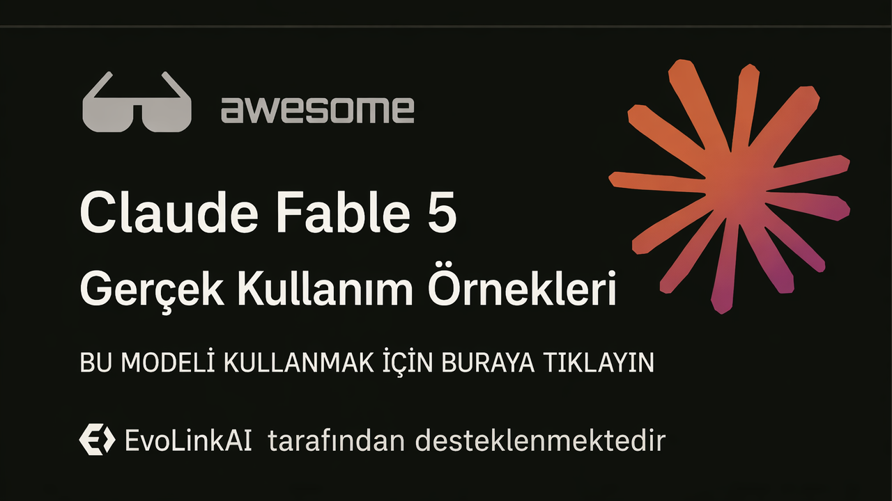

<div align="center">

<a href="https://evolink.ai/claude-fable-5?utm_source=github&utm_medium=readme&utm_campaign=awesome-claude-fable-5"></a>

[](LICENSE)
[](https://evolink.ai/claude-fable-5?utm_source=github&utm_medium=readme&utm_campaign=awesome-claude-fable-5)
[](https://evolink.ai/claude-fable-5?utm_source=github&utm_medium=readme&utm_campaign=awesome-claude-fable-5)
[](https://docs.evolink.ai)

[](README.md)
[](README_es.md)
[](README_pt.md)
[](README_ja.md)
[](README_ko.md)
[](README_de.md)
[](README_fr.md)
[](README_tr.md)
[](README_zh-TW.md)
[](README_zh-CN.md)
[](README_ru.md)

</div>

## 🍌 Giriş

Claude Fable 5 yüksek sinyalli kullanım örnekleri deposuna hoş geldiniz.

**Claude Fable 5 için gerçek dünya kullanım örneklerini, öğreticileri, entegrasyonları ve değerlendirmeleri; herkese açık demolardan ve üretici topluluklarından derleyerek topluyoruz.**

Bu Türkçe README, somut iş akışları, promptlar, demolar, entegrasyonlar, benchmark kanıtları veya pratik sınırlar içeren yüksek sinyalli örneklere odaklanır.

Çoğu örnek X/Twitter gönderilerinden ve herkese açık demolardan derlenmiştir. Her örnek başlığı özgün kaynağa, her yazar kullanıcı adı da üretici profiline bağlantı verir.

Evolink'te deneyin: [Claude Fable 5](https://evolink.ai/claude-fable-5?utm_source=github&utm_medium=readme&utm_campaign=awesome-claude-fable-5)

## 📊 Genel Bakış

- **88 özgün Fable 5 örneğine ek olarak 9 Fable 5.5 topluluk demosu; toplam 97 örnek.**
- Kodlama ajanlarını, uzun süreli otomasyonu, oyunları, görsel tasarımı, 3D simülasyonları, bilgi çalışmalarını, öğreticileri, API entegrasyonlarını, benchmarkları, fiyatlandırmayı ve lansman sınırlamalarını kapsar.
- Her örnek özgün kaynak, üretici atfı, kısa çıkarım, kanıt türü ve yayın tarihi içerir.
- Bu depoyu pratik iş akışlarını bulmak, güçlü ve zayıf yönleri karşılaştırmak, yeniden üretilebilir promptları keşfetmek ve entegrasyon örneklerini izlemek için kullanın.

> [!NOTE]
> Bu koleksiyon abartıdan çok somut kanıtları öne çıkarır: yeniden üretilebilir promptlar, yayınlanmış demolar, benchmark yöntemleri, entegrasyon notları, maliyet verileri ve açıkça belirtilmiş uyarılar.

<a id="-quick-api-access"></a>
## ⚡ Hızlı API erişimi

Claude Fable 5'i Evolink uyumlu Messages API üzerinden kullanın. [Evolink](https://evolink.ai/login?utm_source=github&utm_medium=readme&utm_campaign=awesome-claude-fable-5) üzerinden API token alın, ardından `<token>` değerini kendi tokenınızla değiştirin.

```bash
curl --request POST \
  --url https://direct.evolink.ai/v1/messages \
  --header 'Authorization: Bearer <token>' \
  --header 'Content-Type: application/json' \
  --data '
{
  "model": "claude-fable-5",
  "max_tokens": 1024,
  "messages": [
    {
      "role": "user",
      "content": "Hello, world"
    }
  ]
}
'
```

## 📑 Menü

| Bölüm | Örnekler |
|---|---|
| [💻 Kodlama ve Kod Üretimi](#coding-and-code-generation) | Case 1-6 |
| [🤖 Ajanlar ve Uzun Süreli Otomasyon](#agents-and-long-running-automation) | Case 7-8 |
| [🎮 Oyunlar ve Etkileşimli Demolar](#games-and-interactive-demos) | Case 9-12 |
| [🎨 Görsel, Tasarım, Video ve 3D](#visual-design-video-and-3d) | Case 13-16 |
| [📚 Belgeler, Bilgi Çalışması ve Araştırma](#documents-knowledge-work-and-research) | Case 17-19 |
| [🧭 Öğreticiler, Kurslar ve Prompt Kaynakları](#tutorials-courses-and-prompt-resources) | Case 20-28 |
| [🔌 Platform, API ve Araç Entegrasyonu](#platform-api-and-tool-integration) | Case 29-34 |
| [📏 Değerlendirmeler, Karşılaştırmalar ve Sınırlar](#evaluations-comparisons-and-limits) | Case 35-88 |
| [🙏 Acknowledge](#acknowledge) | Katkı verenler ve düzeltme politikası |

### [💻 Kodlama ve Kod Üretimi](#coding-and-code-generation)

| Case | Ne gösteriyor | Tür |
|---|---|---|
| [Cursor Çok Aşamalı İş Akışı](#case-1) | Fable 5'i çok modelli bir Cursor iş akışında plan inceleme ve eleştiri adımı olarak kullanın; ardından uygulama ve revizyonu daha ucuz veya uzmanlaşmış modellere devredin. | Değerlendirme |
| [Bir Ekran Görüntüsünden GitHub'ı Yeniden Oluşturma](#case-2) | Bir ürün ekran görüntüsünü ajanik kodlama aracına yapıştırın ve Fable 5'ten arayüzü çalışan işlevsellikle yeniden oluşturmasını isteyin. | Demo |
| [Tek Promptla Kara Delik Simülasyonu](#case-3) | Fable 5'e ayrıntılı bir yaratıcı kodlama promptu verin ve kendi kendine yeten bir Three.js fizik görselleştirmesi üretmesini isteyin. | Öğretici |
| [Tek Denemede macOS Tarzı Web OS](#case-4) | Fable 5'ten eksiksiz tek dosyalık bir web OS isteyin; UI kabuğunu, uygulamaları, etkileşimleri, sesi ve gömülü oyun davranışını tek geçişte inşa etmesine izin verin. | Öğretici |
| [Spawn 5.0'ı 1.687 Promptla İnşa Etme](#case-5) | Fable 5'i birçok prompt boyunca uzun oturumlu bir mühendislik ortağı olarak kullanın; insan rolü mimariden çıktı kalitesini yargılamaya kayar. | Öğretici |
| [Bulgularla Büyük Pull Request İncelemesi](#case-6) | Fable 5'i büyük bir pull request'e yönlendirin ve doğruluk, yanlış pozitifler, gerçek buglar ve cilalama sorunları açısından incelemesini isteyin. | Demo |

### [🤖 Ajanlar ve Uzun Süreli Otomasyon](#agents-and-long-running-automation)

| Case | Ne gösteriyor | Tür |
|---|---|---|
| [Uzun Ufuklu Relay İş Akışı İncelemesi](#case-7) | Fable 5'i iddialı uzun ufuklu işler için kullanın: site yeniden inşaları, programatik içerik hatları, ses eşleştirme, güvenlik incelemesi ve son kalite kontrolleri. | Değerlendirme |
| [Altyapı Kesintisini Teşhis Etme ve Düzeltme PR'ı Açma](#case-8) | Fable 5'e loglar, veritabanı hataları ve image digest'leri gibi altyapı ipuçlarına erişim verin; ardından kesintiyi teşhis edip düzeltmeyi hazırlamasını isteyin. | Değerlendirme |

### [🎮 Oyunlar ve Etkileşimli Demolar](#games-and-interactive-demos)

| Case | Ne gösteriyor | Tür |
|---|---|---|
| [Parmak Takipli Dino Runner](#case-9) | Fable 5'ten giriş mekaniği olarak parmak takibi kullanan bir tarayıcı oyunu yapmasını isteyin. | Demo |
| [İki Cümleyle Yarış Oyunu İnşası](#case-10) | Fable 5'e çok kısa bir oyun promptu verin; haritaları, modları, müziği, UI'ı ve oyun varlıklarını tek çalıştırmada üretmesine izin verin. | Öğretici |
| [Rust ile Kurulabilir Terminal Minecraft](#case-11) | Fable 5'i bir terminal kodlama harness'i içinde çalıştırın ve kurulabilir bir Rust terminal oyunu yapmasını isteyin. | Demo |
| [Zaman ve Maliyetle Minecraft Klonu](#case-12) | Tek promptla Fable 5'ten oynanabilir Minecraft tarzı bir klon isteyin; ardından zamanı, maliyeti, kod hacmini ve özellik kapsamını değerlendirin. | Öğretici |

### [🎨 Görsel, Tasarım, Video ve 3D](#visual-design-video-and-3d)

| Case | Ne gösteriyor | Tür |
|---|---|---|
| [Tam Yeniden Üretilebilir E-ticaret E-postası Promptu](#case-13) | Fable 5'e marka e-posta maketi için tam bir yaratıcı brief verin: kesin bölümler, ürün gereksinimleri, görsel yön ve kısıtlar dahil. | Öğretici |
| [Swiss Lever Saatçi Benchmarkı](#case-14) | Fable 5'i mekanik simülasyon benchmarkında kullanın; fiziksel doğruluğu uygulamasını, doğrulamasını ve yinelemesini isteyin. | Değerlendirme |
| [Three.js Friends Apartmanı Sahnesi](#case-15) | Fable 5'e bir kat planını ve sahne referansını gezilebilir bir Three.js ortamına dönüştürmesini promptlayın. | Değerlendirme |
| [Prompt ve URL ile Güneş Sistemi Simülasyonu](#case-16) | Fable 5'i fizik ilkelerinden bir astronomi simülasyonu inşa etmek için kullanın; simülasyon ve herkese açık çıktı hazır olana kadar yineleyin. | Öğretici |

### [📚 Belgeler, Bilgi Çalışması ve Araştırma](#documents-knowledge-work-and-research)

| Case | Ne gösteriyor | Tür |
|---|---|---|
| [Stripe ve Bilimsel İş Akışı Kanıtı](#case-17) | Bunu kopyala-yapıştır promptu olarak değil, kurumsal geçiş ve bilimsel iş akışı iddiaları için kanıt olarak kullanın. | Değerlendirme |
| [Politika Notu ve Değişiklik İzleme İş Akışları](#case-18) | Fable 5'i uzun form nitel belge çalışması için kullanın: değişiklik izleme, yorum triage'ı ve transkript odaklı düzenlemeler. | Öğretici |
| [Derin Araştırma Promptu ve Çıktısı](#case-19) | Fable 5'e araştırma tarzı bir soru sorun ve yapılandırılmış, tarihsel temelli uzun bir yanıt üretip üretemediğini değerlendirin. | Demo |

### [🧭 Öğreticiler, Kurslar ve Prompt Kaynakları](#tutorials-courses-and-prompt-resources)

| Case | Ne gösteriyor | Tür |
|---|---|---|
| [Fable 5'in Claude Code İş Akışlarını Nasıl Değiştirdiği](#case-20) | Fable 5'i her adımı mikro yönetmek yerine yön, bağlam, hedefler ve doğrulama kriterleri belirleyerek kullanın. | Demo |
| [Bir Milyar Token İncelemesi ve Yönlendirme Stratejisi](#case-21) | Fable 5'i frontier planlama ve inceleme için kullanın, sonra yüksek hacimli uygulamayı daha ucuz modellere yönlendirin. | Öğretici |
| [Savunmacı Cihaz Sertleştirme Promptu](#case-22) | Fable 5'in cihazları envantere aldığı, kesin kontroller verdiği ve doğrulama beklediği adım adım savunmacı sertleştirme promptunu çalıştırın. | Öğretici |
| [Tam Site Tasarım Denetimi Goal Promptu](#case-23) | Fable 5'in siteyi başlatması, sayfaların ekran görüntüsünü alması, UX denetimi yapması, rapor yazması ve güvenli küçük sorunları düzeltmesi için `/goal` kullanın. | Öğretici |
| [Uzun Form Yaratıcı İş Akışı Bölüşümü](#case-24) | Fable 5'i kararlı formatlar ve örnekler tasarlamak için kullanın; sonra bu yapıyı alana özgü çıktı için başka bir üretim sistemine devredin. | Öğretici |
| [Fable 5 Kullanımı İçin Başlangıç Rehberi](#case-25) | Fable 5'i küçük adım adım talimatlar yerine hedef odaklı promptlar, doğrulama döngüleri ve effort ayarlarıyla kullanın. | Değerlendirme |
| [Kopyala-Yapıştır Depo Denetimi Promptu](#case-26) | Depo denetimi promptunu Fable 5'e yapıştırın ve dosya destekli keşif, bulgular, strateji ve milestone görev planı isteyin. | Öğretici |
| [Sınırlı Pencere Kullanım Stratejisi](#case-27) | Erişim penceresi avantajlıyken Fable 5 kullanımını denetim, mimari ve planlamaya harcayın; yürütme için daha ucuz modeller kullanın. | Öğretici |
| [Claude Code'da Goals ve Workflows Kullanımı](#case-28) | Fable 5'i uygulamadan önce düşünce ortağı olarak kullanın, ardından planı yürütmek ve doğrulamak için `/goal` ve workflows'u birleştirin. | Öğretici |

### [🔌 Platform, API ve Araç Entegrasyonu](#platform-api-and-tool-integration)

| Case | Ne gösteriyor | Tür |
|---|---|---|
| [Hermes Ajan Entegrasyonu Kurulumu](#case-29) | Hermes'i `anthropic/claude-fable-5` kullanacak şekilde, karmaşık `/goal` çalışmaları ve cache'li uzun ufuklu görevler için yapılandırın. | Öğretici |
| [Yetenekler, Fiyatlandırma ve Abonelik Notları](#case-30) | Fable 5'in ne zaman erişilebilir olduğunu, maliyetini ve hangi korumalı alanların başka modele fallback edebileceğini anlamak için bu örneği kullanın. | Öğretici |
| [Lansman, Erişim, Fiyatlandırma ve Güvenlik Özeti](#case-31) | Erişim yolunu, API model adını, context window'u, caching stratejisini ve abonelik zamanlamasını seçmek için bu lansman özetini kullanın. | Öğretici |
| [Danışman Tabanlı Maliyet Azaltma Stratejisi](#case-32) | Marjinal zeka maliyete değdiğinde, Fable 5'i daha ucuz model iş akışında danışman veya inceleyici olarak kullanın. | Entegrasyon |
| [Fiyatlandırma, Erişim ve Güvenlik Korkulukları](#case-33) | İş yüklerini planlamadan önce Fable 5 erişimini, API fiyatlandırmasını ve güvenlik fallback davranışını anlamak için bu örneği kullanın. | Entegrasyon |
| [Tek Satırlık Swarms Entegrasyonu](#case-34) | Swarms model adını `anthropic/claude-fable-5` olarak ayarlayın ve Fable 5'i Swarms framework'ü veya API üzerinden çalıştırın. | Entegrasyon |

### [📏 Değerlendirmeler, Karşılaştırmalar ve Sınırlar](#evaluations-comparisons-and-limits)

| Case | Ne gösteriyor | Tür |
|---|---|---|
| [Fable 5 ve GPT-5.5 Maliyet ve Kalite Karşılaştırması](#case-35) | Çıktı kalitesini, çalışma süresini ve araç maliyetini değerlendirmek için Fable 5 ve GPT-5.5'i aynı kodlama görevinde karşılaştırın. | Değerlendirme |
| [AA-Omniscience Benchmark Sonucu](#case-36) | Fable 5'i bilgi doğruluğu ve halüsinasyon davranışı açısından değerlendirmek için bu benchmark örneğini kullanın. | Değerlendirme |
| [Artificial Analysis Intelligence Index Sonucu](#case-37) | Fable 5'in genel zeka sıralamasını diğer frontier modellerle benchmark etmek için bu örneği kullanın. | Değerlendirme |
| [GDPval-AA Ajanik Bilgi Çalışması Benchmarkı](#case-38) | Fable 5'i ajanik gerçek dünya bilgi çalışmasında değerlendirmek için bu örneği kullanın. | Değerlendirme |
| [Bir Haftalık İlk İzlenimler ve Fiyatlandırma Mekaniği](#case-39) | Fable 5'in en güçlü olduğu yerleri, özellikle oyun tasarımı ve sistem planlamasını belirlemek için bu ilk izlenim örneğini kullanın. | Entegrasyon |
| [Maliyet ve Hız Karşılaştırması](#case-40) | Kalite kazancının daha yüksek maliyeti ve daha yavaş uzun ufuklu çalışmaları haklı çıkarıp çıkarmadığını belirlemek için bu karşılaştırmayı kullanın. | Değerlendirme |
| [Claude Code Uygulamalı Notları](#case-41) | Araç kullanımı, kişilik ve kalan pürüzler dahil Fable 5'i Claude Code içinde değerlendirmek için bu örneği kullanın. | Demo |
| [Yaratıcı Yazarlık Benchmark Sonucu](#case-42) | Fable 5'in kısa kurgu yazım kalitesini ve refusal davranışını yargılamak için bu benchmark örneğini kullanın. | Değerlendirme |
| [Çoklu Benchmark Lansman Özeti](#case-43) | Kodlama ajanları ve karmaşık görevler için en ilgili headline skorları anlamak üzere bu lansman benchmark özetini kullanın. | Değerlendirme |
| [GPT-5.5 ile Benchmark ve Fiyat Karşılaştırması](#case-44) | Fable 5'i GPT-5.5'e karşı fiyat ve benchmark kategorileri açısından değerlendirmek için bu karşılaştırmayı kullanın. | Değerlendirme |
| [Pratik Sınırlamalarla Saha Notları](#case-45) | Fable 5'in nerede anlamlı biçimde daha iyi hissettirdiğini ve nerede hâlâ pratik sınırları olduğunu anlamak için bu saha raporunu kullanın. | Öğretici |
| [Fizik Simülasyonu Karşılaştırması](#case-46) | Çıktı kalitesini, maliyeti ve hızı karşılaştırmak için aynı fizik simülasyonu promptlarını Fable 5 ve Opus 4.8'e karşı çalıştırın. | Demo |
| [Hata Ayıklama Deneyimi ve Tasarım Yargısı](#case-47) | Fable 5'i hata ayıklama için kullanırken sadece tahmin etmesini değil, ölçmesini, log eklemesini, doğrulamasını ve yama yapmasını isteyin. | Demo |
| [Çok Boyutlu Artılar ve Eksiler](#case-48) | Fable 5'i günlük sürücü yapmadan önce pratik güçlü ve zayıf yönleri anlamak için bu örneği kullanın. | Demo |
| [Hukuki S-1 Taslak Testi](#case-49) | S-1 taslak promptunu hukuki ajan kabiliyet testi olarak kullanın ve yapı, biçimlendirme ve uzunluğu karşılaştırın. | Öğretici |
| [Sağlık Benchmark Ayrıntıları](#case-50) | Fable 5'i sağlıkla ilgili görevlerde değerlendirmek ve eksik zor tıbbi eval'leri belirlemek için bu benchmark notunu kullanın. | Değerlendirme |
| [ParseBench Belge Ayrıştırma Değerlendirmesi](#case-51) | Fable 5'in belge ayrıştırma için uzman OCR sistemlerine kıyasla maliyet etkin olup olmadığını belirlemek için bu örneği kullanın. | Değerlendirme |
| [SWE-Bench Pro ve FrontierCode Karşılaştırması](#case-52) | Fable 5'i migration'lar, karmaşık uygulamalar, otonom oturumlar, testler ve görsel doğrulama için değerlendirmek üzere bu benchmark örneğini kullanın. | Değerlendirme |
| [Uzun Problem Çözmeye Nitel İnceleme](#case-53) | Fable 5'in neden daha uzun ve daha zor görevlere uygun olduğunu, üretim incelemesinin hâlâ gerektiğini anlamak için bu nitel incelemeyi kullanın. | Değerlendirme |
| [ParseBench Sadakat ve Biçimlendirme Sonuçları](#case-54) | Belge sadakati ve biçimlendirme performansını yargılamak için bu ParseBench sonucunu kullanın. | Değerlendirme |
| [Benchmarklar, Fiyatlandırma, Erişim ve Koruma Önlemleri](#case-55) | Bu örneği benchmarklar, fiyatlandırma, erişim, koruma önlemleri ve stratejik sonuçlar için geniş bir checklist olarak kullanın. | Değerlendirme |
| [Resmi Benchmark Skor Listesi](#case-56) | Fable 5'in kodlama, bilgisayar kullanımı ve güvenlik görevlerindeki resmi skorlarını anlamak için bu benchmark listesini kullanın. | Değerlendirme |
| [APEX-SWE Benchmark Metodolojisi](#case-57) | Fable 5'i APEX-SWE üzerinde, özellikle observability ve integration işi açısından değerlendirmek için bu örneği kullanın. | Değerlendirme |
| [ProofBench Formel Matematik Sonucu](#case-58) | Fable 5'i uzman theorem-proving sistemlerine karşı formel matematikte değerlendirmek için bu örneği kullanın. | Öğretici |
| [VirtueBench Ön Analizi](#case-59) | Fable 5'in erdem kategorileri genelindeki ahlaki akıl yürütme davranışını incelemek için bu örneği kullanın. | Değerlendirme |
| [API Boş Yanıt Güvenlik Overfit Testi](#case-60) | Lansman zamanı güvenlik overfit riskini ve API testindeki boş yanıt davranışını anlamak için bu örneği kullanın. | Değerlendirme |
| [Fable İstem ve Doğrulama Kılavuzu](#case-61) | Uzun istem hilelerinden hedef, bağlam, kısıt, araç ve doğrulama döngülerine geçmek için bu kılavuzu kullanın. | Öğretici |
| [İstanbul Platform Oyunu Referans Yapımı](#case-62) | Fable 5'in oynanabilir platform oyunu oluşturmasını sınamak için bir sprite sayfası ve tek dönüştürme talimatı kullanın. | Demo |
| [İşletme İçin 3D Şehir Panosu](#case-63) | Bir iş akışını canlı bir 3D şehir panosu konseptine dönüştürmek için Fable 5'i kullanın. | Demo |
| [Three.js Delik Oyununu Tek Seferde Oluşturma](#case-64) | Three.js ile bir 3D tarayıcı oyunu prototipini tek seferde oluşturmak için Fable 5'i kullanın. | Demo |
| [DeepSWE Puan Karşılaştırması](#case-65) | Fable 5 xHigh ile GPT-5.5 xHigh'ın yazılım mühendisliği kıyaslamasındaki performansını karşılaştırmak için bu DeepSWE notunu kullanın. | Değerlendirme |
| [Depo Analizi Maliyet Karşılaştırması](#case-66) | Token fiyatını insanın yeniden çalışma maliyetiyle birlikte değerlendirmek için bu depo analizi karşılaştırmasını kullanın. | Değerlendirme |
| [Super Mario Oyununun Token Maliyeti](#case-67) | Fable 5'in çıktı kalitesini ve token tüketimini değerlendirmek için bu tek geçişlik oyun yapımını kullanın. | Demo |
| [Claude Code Model Geçiş Ayarı](#case-68) | Fable 5 mesajı işaretlendiğinde model değiştiren Claude Code ayarını anlamak için bu örneği inceleyin. | Entegrasyon |
| [Namma Metro Simülatörünün Yapımı](#case-69) | Bu demoyu, Fable 5 ile doğal dil üzerinden toplu taşıma simülatörü geliştirmeye kısa bir örnek olarak kullanın. | Demo |
| [Tek İstemle Dusk Drive Oyunu](#case-70) | Fable 5'i insan düzenlemesi olmadan düşük poligonlu oyun prototiplemede değerlendirmek için bu tek istemlik sürüş oyunu örneğini kullanın. | Demo |
| [APEX-Agents Pass@1 Sıralaması](#case-71) | Fable 5 Max'i çok adımlı otonom görevlerde karşılaştırmak için bu APEX-Agents sonucunu kullanın. | Değerlendirme |
| [Claude Model Seçim Rehberi](#case-72) | Fable 5'i en zor Claude Code işleri için ayırmak üzere bu model seçim rehberini kullanın. | Öğretici |
| [HermesWorld Otomatik Ajan Döngüsü](#case-73) | Günler boyunca geliştiren, test eden, oynayan ve temel işleyiş kontrolleri yapan müdahalesiz Fable 5 döngüsünü bu örnekle inceleyin. | Entegrasyon |
| [McKinsey Tarzı Rapor İstemi Testi](#case-74) | Danışmanlık raporunun yapısını, grafiklerini, anlatımını ve risk analizini değerlendirmek için bu belge oluşturma istemini kullanın. | Öğretici |
| [Görünür Güvenlik Önlemlerinin Devreye Alınması](#case-75) | Fable 5 güvenlik önlemlerinin görünürlüğünü, API ret nedenlerini ve Opus'a geçiş davranışını anlamak için bu resmî notu kullanın. | Entegrasyon |
| [Claude Code Model Eşleştirme Düzeltmesi](#case-76) | Fable 5 model adı ve bağlam eşleştirme sorunlarından kaçınmak için bu Claude Code değişiklik notunu kullanın. | Entegrasyon |
| [Claude Code İçinde Üç Web Uygulaması](#case-77) | Birden fazla üretilmiş web uygulaması üzerinden Claude Code içindeki Fable 5'i incelemek için bu başlangıç seviyesi kodlama demosunu kullanın. | Demo |
| [Açık Kaynak Uygulama Oluşturucu Rilable](#case-78) | Fable 5'in iOS, web uygulamaları, korumalı alanlar ve API token maliyetiyle ilişkisini bu açık kaynak oluşturucu üzerinden inceleyin. | Entegrasyon |
| [DeepSWE Kodlama Ajanı Endeksine Giriş](#case-79) | Güncellenmiş Artificial Analysis endeksini kullanarak, geri dönüştürülmüş herkese açık GitHub düzeltmelerinden kaçınan daha zor ajanik kodlama görevlerinde Fable 5'i karşılaştırın. | Değerlendirme |
| [DataEmpire Web Analitiği Oyunu](#case-80) | Claude Fable 5'ten ziyaretçileri ve kilometre taşlarını oyun varlıklarına eşlemesini isteyerek ham site analitiğini yeniden oynanabilir bir oyuna dönüştürün. | Entegrasyon |
| [FrontierSWE 20 Saatlik Görev Sinyali](#case-81) | FrontierSWE'yi, Fable 5'in yalnızca kısa bug-fix döngülerinde değil, çok uzun mühendislik görevlerinde de üretken kalabildiğine dair kanıt olarak kullanın. | Değerlendirme |
| [KernelBench-Hard CUDA Rekorları](#case-82) | Yalnızca mevcut kütüphanelerin sarmalayıcıları değil, düşük seviyeli optimizasyon gerektiğinde Fable 5'i ileri seviye CUDA kernel üretimi için kullanın. | Değerlendirme |
| [Figma Capture Açılış Sayfası Klonu](#case-83) | Canlı bir rakip sayfasını Figma katmanlarına alın ve Claude Code'un Fable 5 ile yapıyı, metinleri ve marka sistemini ekran görüntülerinden tahmin etmek yerine yeniden kurmasına izin verin. | Entegrasyon |
| [İki Saatte GTA 2 Klonu](#case-84) | Tüm yığını elle kodlamadan, ayrı varlık araçlarıyla birlikte Fable 5 kod üretimini kullanarak oynanabilir bir 3D oyunu hızla oluşturun. | Öğretici |
| [CloudWatch Log Triyaj Ajanı](#case-85) | Fable 5 destekli bir ajanın çok büyük servis log bağlamlarını işlemesine, mimariyi çıkarmasına ve ardından belirli arızalara daralmasına izin verin. | Entegrasyon |
| [Sandbox'larda Dünya Kupası Tahmincisi](#case-86) | Birden fazla frontier modeli izole sandbox'ların arkasına koyun ve herkese açık bir tahmin uygulaması için canlı haberleri, sakatlıkları ve sarı kart bağlamını araştırmalarına izin verin. | Entegrasyon |
| [WolfBench Ret Maliyeti Vakası](#case-87) | Fable 5 üzerinde uzun otonom çalışmaları fiyatlarken ret davranışını gerçek bir benchmark değişkeni olarak ele alın. | Değerlendirme |
| [API Erişim Kesinti İzleyicisi](#case-88) | İş akışınız fazla uyarı vermeden rate-limit uygulanabilecek veya geri çekilebilecek bir frontier modele sürekli erişime bağlıysa kullanılabilirliği bir script ile izleyin. | Entegrasyon |


### [🆕 Fable 5.5 Topluluk Demoları](#fable-5-5-community-demos)

| Örnek | Ne gösteriyor | Tür |
|---|---|---|
| [Kodla Üretilmiş Sesli Tilki Animasyonu](#case-89) | Kendi içinde yeterli bir HTML animasyonu ve ses tasarımı tanımlamak için sahne sahne bir yaratıcı brief kullanın. | Demo |
| [Açık Uçlu Yaratıcı Brief'ten Animasyon](#case-90) | Bir kodlama modelinin açık uçlu animasyon brief'inden ürettiğini ayrıntılı bir görsel senaryonun sonucuyla karşılaştırın. | Demo |
| [Animasyonlu İnşaat Şirketi Web Sitesi](#case-91) | Animasyonlu 3D sunumu ve sayfa kompozisyonunu değerlendirmek için bir inşaat şirketi web sitesi brief'i kullanın. | Demo |
| [Three.js Otomobil Sunumu](#case-92) | 3D kompozisyon, malzemeler ve kamera sunumunu küçük bir örnek üzerinde sınamak için otomobil sahnesini inceleyin. | Demo |
| [Minecraft Tarzı Tarayıcı Oyunu Demosu](#case-93) | Üretilmiş bir tarayıcı oyununu değerlendirirken oyun kaydını üreticinin oynama bağlantısıyla birlikte inceleyin. | Demo |
| [Three.js Bisiklet Süren Pelikan Animasyonu](#case-94) | Karakter hareketlerinin koordinasyonunu, bisiklet geometrisini ve çevre ayrıntılarını incelemek için bir bisiklet sahnesini kullanın. | Demo |
| [Tam İstemiyle Bisiklet Süren Pelikan SVG'si](#case-95) | Aynı girdi altında geometri ve ayrıntıları karşılaştırmak için üreticinin kısa SVG istemini yeniden kullanın. | Demo |
| [Dörtnala Koşan Zebra Animasyonu Örneği](#case-96) | Yürüyüş biçiminin tutarlılığını ve hareketin sürekliliğini incelemek için dörtnala koşan bir hayvan klibi kullanın. | Demo |
| [Emirleri Kullanıcının Verdiği TradingView Göstergesi](#case-97) | Olası girişleri işaretleyip yorum ekleyen bir göstergeyi değerlendirirken emir gerçekleştirmeyi manuel tutun. | Demo |

<a id="coding-and-code-generation"></a>
## 💻 Kodlama ve Kod Üretimi

<a id="case-1"></a>
### Case 1: [Cursor Çok Aşamalı İş Akışı](https://x.com/AlicanKiraz0/status/2064487347605918180) (tarafından [@AlicanKiraz0](https://x.com/AlicanKiraz0))

**Fable 5'i çok modelli bir Cursor iş akışında plan inceleme ve eleştiri adımı olarak kullanın; ardından uygulama ve revizyonu daha ucuz veya uzmanlaşmış modellere devredin.**

Fable 5 ile GPT 5.5 arasındaki nihai puanlamaya bakarsak fark çok küçük. Naçizane kullanım önerim şu: Cursor gibi hibrit modelleri destekleyen IDE platformlarında aşamalı bir iş akışı kullanın.

Aşama 1: Kod incelemesi ve proje denetiminin ilk aşaması için, bağlamı ısıtırken GPT 5.5 High, Minimax M3, Kimi K2.6 veya Composer 2.5 modellerinden birini kullanın.

Aşama 2: Proje planını hazırlamak için GPT 5.5 Very High veya Opus 4.8 kullanın.

Aşama 3: Proje planını analiz etmek için Fable 5 kullanın; planın hatalı kısımlarını belirlemesine izin verin. Revizyonlar için GPT 5.5 Very High kullanın.

Aşama 4: Planı uygulamak için Minimax M3, Deepseek v4 Max, Composer 2.5 veya Sonnet 4.6 kullanın.

Aşama 5: Son inceleme ve uygulamanın plana uyup uymadığını kontrol etmek için GPT 5.5 High kullanın.

Type: Evaluation | Date: 2026-06-09

---

<a id="case-2"></a>
### Case 2: [Bir Ekran Görüntüsünden GitHub'ı Yeniden Oluşturma](https://x.com/coldopn/status/2064435234465087638) (tarafından [@coldopn](https://x.com/coldopn))

**Bir ürün ekran görüntüsünü ajanik kodlama aracına yapıştırın ve Fable 5'ten arayüzü çalışan işlevsellikle yeniden oluşturmasını isteyin.**

🚨 Anthropic Fable 5 az önce GITHUB'ı bir EKRAN GÖRÜNTÜSÜNDEN kopyaladı!!

Yaptığım tek şey GitHub UI ekran görüntüsünü Kilo Code'a yapıştırmak ve gerçek işlevsellikle GitHub'ı yeniden oluşturmasını söylemekti.

10 dakika kodladı ve $4.07 harcadı.

Sonuç çalışan bir GitHub replikasıydı: https://t.co/bjMObvlsPX

Type: Demo | Date: 2026-06-09

---

<a id="case-3"></a>
### Case 3: [Tek Promptla Kara Delik Simülasyonu](https://x.com/deveshcodes_/status/2064437742189379745) (tarafından [@deveshcodes_](https://x.com/deveshcodes_))

**Fable 5'e ayrıntılı bir yaratıcı kodlama promptu verin ve kendi kendine yeten bir Three.js fizik görselleştirmesi üretmesini isteyin.**

@claudeai, Claude Fable 5 ile Three.js içinde gerçek zamanlı bir kara delik merceklenme simülasyonunu tek seferde yaptı.

Yerçekimsel merceklenme, doppler etkisiyle parlaklaşan yığılma diski, foton küresi, kromatik sapma ve prosedürel yıldız alanı içeriyordu.

Sonuç: 60fps, tek HTML dosyası, tek prompt.

Yeni taban çizgisi çılgın 🤯 https://t.co/E23I8bnPKb

Type: Tutorial | Date: 2026-06-09

---

<a id="case-4"></a>
### Case 4: [Tek Denemede macOS Tarzı Web OS](https://x.com/intheworldofai/status/2064421915347812672) (tarafından [@intheworldofai](https://x.com/intheworldofai))

**Fable 5'ten eksiksiz tek dosyalık bir web OS isteyin; UI kabuğunu, uygulamaları, etkileşimleri, sesi ve gömülü oyun davranışını tek geçişte inşa etmesine izin verin.**

🚨 Claude Fable 5 tek seferde tam macOS tarzı bir web OS inşa etti ve çoğu modelden daha ileri gitti.

Tek HTML dosyası, gömülü CSS + JS.

Tek prompttan şunları yaptı:

- macOS menü çubuğu + dock
- Sürüklenebilir ve yeniden boyutlandırılabilir uygulama pencereleri
- İşlevsel dosya gezgini
- Çalışan terminal + tarayıcı maketi
- SVG masaüstü ikonları + bildirimler
- Ayarlar uygulaması, temalar ve açılış ekranı
- Gerçek sentez kullanan ve dış dosya gerektirmeyen tamamen işlevsel ses oynatıcı
- Masaüstünün içinde oynanabilir Minecraft klonu

Hepsi neredeyse hiç düzeltme olmadan tek geçişte üretildi.

Çalışan ses oynatıcı ile gerçek Minecraft klonu, diğer modellerin henüz başardığını görmediğim bir şey. Fable 5'in frontend/UI üretimi inanılmazlaşıyor.

Type: Tutorial | Date: 2026-06-09

---

<a id="case-5"></a>
### Case 5: [Spawn 5.0'ı 1.687 Promptla İnşa Etme](https://x.com/jsnnsa/status/2064420561078693941) (tarafından [@jsnnsa](https://x.com/jsnnsa))

**Fable 5'i birçok prompt boyunca uzun oturumlu bir mühendislik ortağı olarak kullanın; insan rolü mimariden çıktı kalitesini yargılamaya kayar.**

claude fable 5 yayında.

spawn 5.0 onunla inşa edildi:

- 1.687 prompt
- 102 oturum
- İşim mimariden zevk/yargı değerlendirmesine kaydı

İnşa ettiklerimiz; bunların her biri Opus ile tam bir ekiple en az bir ay sürerdi:

- Sıfırdan bir fizik motoru, Mantle; Rapier'e rakip ve yan iş parçacığı olarak bir günde test edilebilir
- Clustered froxel lighting: 8 ışıktan 1.000+ tamamen dinamik ışığa
- WebGPU üzerinde gerçek zamanlı diffuse GI, telefonunuzda
- Unreal ve Unity'nin sunduğunun ötesinde shader mimarisine sahip milyon parçacıklı GPU VFX
- MMO ölçekli netcode
- Alfa yerel iOS uygulaması

Bunların tamamı yaklaşık bir hafta sürdü. Tamamı mobilde çalışıyor. Liste yayınlananların yarısını bile içermiyor; tam changelog thread'de.

Benchmarkların göstermeyeceği kısım: bu modelin harika bir kişiliği var. Gerçekten komik. Fizik yeniden yazımı ortasında defalarca gülmekten ağladım. Deha ve karakter ayrı özellikler değil.

Type: Tutorial | Date: 2026-06-09

---

<a id="case-6"></a>
### Case 6: [Bulgularla Büyük Pull Request İncelemesi](https://x.com/ryanrhughes/status/2064411147076534705) (tarafından [@ryanrhughes](https://x.com/ryanrhughes))

**Fable 5'i büyük bir pull request'e yönlendirin ve doğruluk, yanlış pozitifler, gerçek buglar ve cilalama sorunları açısından incelemesini isteyin.**

Fable 5'i tek bir PR'ı (74 dosya / +3.705 / -1.246) incelemek üzere serbest bıraktım; nasıl yapacağını görmek istedim. 34 dakika çalıştı, 5 saatlik oturumumun %42'sini tüketti, 16 "correctness" bulgusu üretti ve şunları buldu:

- Kulağa korkutucu gelen 2 yanlış pozitif
- 3 gerçek denetim-doğruluk bug'ı
- Yaklaşık 5 meşru ama küçük UX/cilalama sorunu
- Bir sürü temizlik görüşü

Bunu yayınlamak için fazla tehlikeli miydi?

Type: Demo | Date: 2026-06-09

---

<a id="agents-and-long-running-automation"></a>
## 🤖 Ajanlar ve Uzun Süreli Otomasyon

<a id="case-7"></a>
### Case 7: [Uzun Ufuklu Relay İş Akışı İncelemesi](https://x.com/JJEnglert/status/2064469635190170105) (tarafından [@JJEnglert](https://x.com/JJEnglert))

**Fable 5'i iddialı uzun ufuklu işler için kullanın: site yeniden inşaları, programatik içerik hatları, ses eşleştirme, güvenlik incelemesi ve son kalite kontrolleri.**

Claude Fable 5 incelememin kısa hali: Claude Fable 5'i test etmek için bir milyar token harcadım ve haksız avantajım varmış gibi hissettirdi.

Göz testine göre değerlendiririm: bir modeli gerçek işe koyar ve izlerim. Bana saat kazandırıyor mu yoksa kaybettiriyor mu? Kaçırdıklarımı yakalıyor mu? Bir ortak gibi mi hissettiriyor, yoksa sürekli bakıcılık etmem gereken bir araç gibi mi?

Uzun zamandır önemli her boyutta geçen ilk model bu, hem de az farkla değil.

İnşa: Tenex sitemizi yeniden yapıyordum. Çok özeldi ve çok zordu. GPT 5.5 ve Claude 4.8 bunu kendi başlarına çözemedi. Referans Figma dosyalarıyla bile yaklaşık %85-90 seviyesinde kaldılar.

Sonra Fable 5 her şeye baktı, daha iyisini yapabileceğini söyledi, doğrudan özgün Webflow kaynağına gitti, tüm varlıkları indirdi ve neredeyse tamamını tek seferde yaptı.

Sonra bir hafta sonunda sıfırdan ikinci, tamamen yeni 80 sayfalık bir site yaptırdım. Bir ajans olarak bunun için $50k alırdım.

Ayrıca eksiksiz bir programatik klip fabrikasını birbirine bağladı:

- HeyGen
- ElevenLabs
- Cloudflare
- Bir VPS

Hat konuları buluyor, senaryolar yazıyor, video düzenliyor, müzik ekliyor ve sosyal medyaya gönderiyor. Uzun süreler kendi başına çalıştı ve render'ları izlemek için kendine bir webhook sistemi bile kurdu.

Yazım: marka ses dokümanımızı neredeyse birebir kopyaladı, sonra bu sesi 80 sayfa özellik, vaka çalışması ve makale boyunca düz AI varsayımına kaymadan korudu.

Güvenlik: iki frontier model büyük bir repoda çalışmış ve kodu onaylamıştı. Fable 5 ilk geçişinde ciddi, iyi gizlenmiş bir bug buldu ve anında yamaladı.

İnsani an: bir cron job beklerken ona soru sordum. Cevap verdi, sonra kendiliğinden yaklaşık 10 dakikam kaldığını ve bitirdiğinde haber vereceğini ekledi. Zamanlayıcıyı hiç sormamıştım.

Dürüst uyarı: sayaç hissini diğer tüm modellerden daha fazla hissediyorsunuz. Anthropic bunun tasarım gereği token-yoğun olduğunu söylüyor. Bu yüzden relay olarak çalıştırın: Fable 5 ile düşünün, daha ucuz modelle inşa edin, Fable 5 ile inceleyin.

Karar: yanınızdaki kişiden daha fazla zekaya erişim avantajdır. Fable 5 bunu gerçek yapan ilk model. Tam frontier ücretleriyle bile kâr ettirdi.

Type: Evaluation | Date: 2026-06-09

---

<a id="case-8"></a>
### Case 8: [Altyapı Kesintisini Teşhis Etme ve Düzeltme PR'ı Açma](https://x.com/ayushagarwal/status/2064422467557564862) (tarafından [@ayushagarwal](https://x.com/ayushagarwal))

**Fable 5'e loglar, veritabanı hataları ve image digest'leri gibi altyapı ipuçlarına erişim verin; ardından kesintiyi teşhis edip düzeltmeyi hazırlamasını isteyin.**

claude fable 5 fena fena iyi!!!!

Yan taraftaki self-hosted altyapıda düzgün tarif bile edemediğim bir kesintiyi az önce teşhis etti.

Pod loglarını okudu, Cloud SQL hata loglarını sorguladı, image digest'lerini karşılaştırdı ve Kubernetes'in yeni migrate edilmiş veritabanına karşı 3 aylık cache'lenmiş image çalıştırdığını buldu.

Sonra düzeltme PR'ını açtı.

Saatler değil, dakikalar. Web araması yok. 🤯

Type: Evaluation | Date: 2026-06-09

---

<a id="games-and-interactive-demos"></a>
## 🎮 Oyunlar ve Etkileşimli Demolar

<a id="case-9"></a>
### Case 9: [Parmak Takipli Dino Runner](https://x.com/ai_for_success/status/2064413182396108932) (tarafından [@ai_for_success](https://x.com/ai_for_success))

**Fable 5'ten giriş mekaniği olarak parmak takibi kullanan bir tarayıcı oyunu yapmasını isteyin.**

Fable 5'ten parmak takipli bir Dino runner oyunu yapmasını istedim.

Parmak runner oyununu yaklaşık 11-12 dakikada tek seferde yaptı, yaklaşık 914K token tüketti ve her şeyi yalnızca 629 satır kodla uyguladı.

https://t.co/AWt1lEIObq

Type: Demo | Date: 2026-06-09

---

<a id="case-10"></a>
### Case 10: [İki Cümleyle Yarış Oyunu İnşası](https://x.com/kieradev/status/2064482704763085202) (tarafından [@kieradev](https://x.com/kieradev))

**Fable 5'e çok kısa bir oyun promptu verin; haritaları, modları, müziği, UI'ı ve oyun varlıklarını tek çalıştırmada üretmesine izin verin.**

Claude Fable 5, Max 5x kullanımının %40'ı.

2 cümlelik prompttan tam Mario Kart 64 tipi oyun.

Fable 5 tüm dekorasyonu, karakter modellerini, 4 haritayı, müziği, üç oyun modunun tamamını ve UI'ı tek seferde, yaklaşık 15 dakikada yaptı.

#fable #anthropic https://t.co/B7mTidE84U

Type: Tutorial | Date: 2026-06-09

---

<a id="case-11"></a>
### Case 11: [Rust ile Kurulabilir Terminal Minecraft](https://x.com/vikvang1/status/2064500731848319303) (tarafından [@vikvang1](https://x.com/vikvang1))

**Fable 5'i bir terminal kodlama harness'i içinde çalıştırın ve kurulabilir bir Rust terminal oyunu yapmasını isteyin.**

Claude Fable 5'i Warp'ın harness'iyle bir saat çalıştırdım.

Tamamen Rust ile yapılmış, doğrudan terminalinizde render alan bir Minecraft TUI sürümü yaptı.

Kurulum komutu: cargo install termcraft-3d

https://t.co/zs3y3t88oM

Type: Demo | Date: 2026-06-10

---

<a id="case-12"></a>
### Case 12: [Zaman ve Maliyetle Minecraft Klonu](https://x.com/ydamitcodes/status/2064536076518363353) (tarafından [@ydamitcodes](https://x.com/ydamitcodes))

**Tek promptla Fable 5'ten oynanabilir Minecraft tarzı bir klon isteyin; ardından zamanı, maliyeti, kod hacmini ve özellik kapsamını değerlendirin.**

@claudeai Fable 5 bana 37 dakikada bir Minecraft klonu yaptı.

Tek prompt. Yaklaşık 3K satır kod. API maliyeti $12.

Biyomlar, mağaralar, cevherler, gündüz/gece, mob'lar; hepsi vardı.

Minecraft Notch'un 2 yılını aldı.

https://t.co/AmwdLwi75O

Type: Tutorial | Date: 2026-06-10

---

<a id="visual-design-video-and-3d"></a>
## 🎨 Görsel, Tasarım, Video ve 3D

<a id="case-13"></a>
### Case 13: [Tam Yeniden Üretilebilir E-ticaret E-postası Promptu](https://x.com/ecomchasedimond/status/2064454139225297091) (tarafından [@ecomchasedimond](https://x.com/ecomchasedimond))

**Fable 5'e marka e-posta maketi için tam bir yaratıcı brief verin: kesin bölümler, ürün gereksinimleri, görsel yön ve kısıtlar dahil.**

Claude Fable 5 bunu tek promptla ve hiç düzenleme olmadan yaptı.

Kullandığım tam prompt:

MVMT için, modern saat ve aksesuar markası olarak milenyum kuşağına yönelik tam uzunlukta, uzun dikey bir e-ticaret e-postası maketi oluştur.

Şık, cilalı, minimal, maskülen tarafa yakın ve editoryal hissettiren, son derece gerçekçi premium DTC e-postası tasarla. Nihai görsel gerçek bir tasarımcının yaptığı e-ticaret e-postası ekran görüntüsü gibi görünmeli; poster, landing page veya jenerik şablon gibi değil.

Marka havası: Modern California-cool, genç, kendinden emin, temiz, aspirasyonel, stil sahibi ve yükseltilmiş. Tasarım lükse yakın ama yine de erişilebilir hissettirmeli.

Bu ürünleri belirgin biçimde öne çıkar:

- Mulholland
- Odyssey II Automatic
- Cali Diver
- Signature Watch Bands

Görsel stil:

- temiz premium e-ticaret tasarımı
- rafine editoryal düzen
- gerçekçi ürün fotoğrafçılığı
- incelikli lifestyle görselleri
- güçlü hiyerarşi
- net sans-serif tipografi
- ferah boşluk kullanımı
- incelikli gölgeler
- ölçülü modern renk paleti

Renk paleti: Siyah, beyaz, kömür grisi, sıcak gri, taş, yumuşak bej, fırçalanmış metal tonları ve incelikli soluk vurgular. Paleti nötr ve premium tut.

Önemli yaratıcı yön: Bu çalışma güçlü tasarım zevkine sahip, cilalı bir saat markası e-posta kampanyası gibi hissettirmeli. Gerçekçiliğe, zarafete ve netliğe öncelik ver. MVMT'nin gerçekten gönderebileceği bir şey gibi hissettir.

E-postayı şu sırayla inşa et:

1. Üst promosyon çubuğu: En üstte ince siyah veya koyu kömür grisi çubuk; küçük büyük harf metin: “FREE SHIPPING OVER $75 + EASY RETURNS”.

2. Header: Solda MVMT wordmark/logo, sağda veya ortada minimal navigasyon bağlantıları olan temiz beyaz header: WATCHES, SUNGLASSES, JEWELRY, NEW ARRIVALS.

3. Hero bölümü: Güçlü görsel dengeye sahip premium hero bölümü.

Kalın başlık kullan: “BUILT TO GET NOTICED”.

Gündelik stili yükseltmek için tasarlanmış modern saatler ve aksesuarlar hakkında kısa destek metni ekle.

Koyu yuvarlatılmış CTA butonu ekle: “SHOP WATCHES”.

Hero görselleri şunları içermeli:

- baskın bir premium saat görseli
- incelikli lüks lifestyle görselleri
- stil sahibi erkek model veya moda odaklı maskülen lifestyle sahnesi
- modern ışıklandırma ve temiz kompozisyon

4. Öne çıkan koleksiyon bölümü: Ortalanmış bölüm başlığı ekle: “THREE WAYS TO WEAR MVMT”. Altında şunları içeren üç temiz ürün kartı veya görsel bloğu göster:

- Mulholland
- Odyssey II Automatic
- Cali Diver

Her blok şunları içermeli:

- ürün görseli
- ürün adı
- kısa bir veya iki satırlık açıklama

Bu bölümü simetrik, cilalı ve premium tut.

5. Aksesuar banner'ı: “FINISH THE LOOK” başlıklı rafine bölünmüş bölüm ekle. Signature Watch Bands'i öne çıkar. Saat kayışlarının veya değiştirilebilir bantların premium yakın plan görsellerini göster. Kısa destek metni ve koyu CTA butonu ekle: “SHOP ACCESSORIES”.

6. Editoryal promosyon kutucukları: Görsel odaklı tasarıma sahip yan yana iki promosyon kutucuğu ekle.

Birinci kutucuk başlığı: “FOR DAILY WEAR”.

İkinci kutucuk başlığı: “FOR STATEMENT DAYS”.

Her kutucukta kısa metin ve küçük CTA olsun: “SHOP NOW”.

Bu kutucuklar jenerik indirim kutuları değil, editoryal marka anları gibi hissettirmeli.

7. Alışveriş yapılabilir satır: “IN ROTATION NOW” başlıklı bir bölüm ekle. Şunları içeren temiz 4 ürünlü satır veya grid göster:

- Mulholland
- Odyssey II Automatic
- Cali Diver
- Signature Watch Bands

Her öğe şunları içermeli:

- izole ürün görseli
- ürün adı
- küçük “SHOP” bağlantısı veya butonu

8. Marka kapanışı: “DESIGNED TO MOVE WITH YOU” başlıklı ortalanmış mesaj bloğu ekle. Günlük yaşam için özenle üretilmiş saatler, gözlükler ve aksesuarlar hakkında kısa bir satır ekle.

9. Footer: Şunları içeren gerçekçi siyah veya kömür grisi markalı footer oluştur:

- MVMT logo
- mağaza bağlantıları
- şirket bağlantıları
- destek bağlantıları
- sosyal ikonlar
- küçük yasal ve kargo metni

Tipografi yönü: Büyük başlıklarda kalın sıkıştırılmış veya modern sans-serif tipografi, gövde metninde temiz sans-serif kullan. Başlıklar keskin, modern ve moda odaklı hissettirmeli. Gövde metni gerçekçi ve büyük ölçüde okunabilir görünmeli.

Fotoğraf yönü: Gerçekçi yansımalar, cilalı materyaller, yumuşak gölgeler ve temiz yüzeylerle premium ürün fotoğrafçılığı kullan. Lifestyle fotoğrafçılığı yükseltilmiş, modern ve moda odaklı hissettirmeli.

Kompozisyon kuralları:

- uzun dikey e-posta formatı
- net bölüm ayrımı
- gerçekçi e-posta oranları
- güçlü hiyerarşi
- çoğunlukla okunabilir metin
- premium boşluk kullanımı
- bilinçli hizalama
- ürün ve lifestyle görsellerinin dengeli karışımı

Kaçın:

- dağınık kolaj stili
- oyuncu scrapbook estetiği
- aşırı renkli tasarım
- ucuz şablon hissi
- çizgi filmimsi görseller
- kalabalık düzenler
- sahte görünen UI öğeleri
- poster tarzı kompozisyon
- aşırı promosyon kaosu

Çıktı: MVMT için premium, temiz, cilalı, modern, editoryal ve sunuma hazır hissettiren; tam uzunlukta, dikey kompozisyonlu, son derece gerçekçi e-ticaret e-postası tasarım maketi.

Type: Tutorial | Date: 2026-06-09

---

<a id="case-14"></a>
### Case 14: [Swiss Lever Saatçi Benchmarkı](https://x.com/quanghuynt14/status/2064509430650065278) (tarafından [@quanghuynt14](https://x.com/quanghuynt14))

**Fable 5'i mekanik simülasyon benchmarkında kullanın; fiziksel doğruluğu uygulamasını, doğrulamasını ve yinelemesini isteyin.**

Fable 5'e saatçi benchmarkını verdim: Three.js içinde tam bir Swiss lever mekanizması.

Gerçek dişli oranları (18.000 bph), çalışan eşapman, nefes alan hairspring; ve kollar gerçek zamanı gösteriyor.

Bitene kadar kendi çalışmasını vision ile döngü içinde doğruladı.

⌚ https://t.co/RSRfDoKxA4

Type: Evaluation | Date: 2026-06-10

---

<a id="case-15"></a>
### Case 15: [Three.js Friends Apartmanı Sahnesi](https://x.com/scottstts/status/2064464351906673029) (tarafından [@scottstts](https://x.com/scottstts))

**Fable 5'e bir kat planını ve sahne referansını gezilebilir bir Three.js ortamına dönüştürmesini promptlayın.**

Vay canına!!!

Fable 5:

@threejs içinde, Friends dizisindeki ikonik Monica'nın apartmanını bu kat planına doğru biçimde dayandırarak birinci şahıs bakış açısıyla gezilebilir 3d sahne oluştur, özgün görünüm ve hissiyata sadık kal, sıcak ışık kullan

Bu testte gördüğüm AÇIK ARA EN İYİ sonuç!

Bu tek html bana $12'a mal oldu, ama sonuç çarpıcı!

Type: Evaluation | Date: 2026-06-09

---

<a id="case-16"></a>
### Case 16: [Prompt ve URL ile Güneş Sistemi Simülasyonu](https://x.com/tetumemo/status/2064477582930989357) (tarafından [@tetumemo](https://x.com/tetumemo))

**Fable 5'i fizik ilkelerinden bir astronomi simülasyonu inşa etmek için kullanın; simülasyon ve herkese açık çıktı hazır olana kadar yineleyin.**

Claude Fable 5 yoğun.

Fizik simülasyonlarında güçlü göründüğü için ona şunu sordum:

'Gezegenlerin yörünge hareketini fiziğin temel ilkelerinden türeterek ve bunu güneş tutulmalarını tahmin etmek için kullanarak bir güneş sistemi simülasyonu inşa et.'

Birkaç karşılıklı turdan sonra tamamlandı.

İnanılmaz eğlenceli.

Tamamlanan prompt ve herkese açık URL aşağıda bağlantılı.

Type: Tutorial | Date: 2026-06-09

---

<a id="documents-knowledge-work-and-research"></a>
## 📚 Belgeler, Bilgi Çalışması ve Araştırma

<a id="case-17"></a>
### Case 17: [Stripe ve Bilimsel İş Akışı Kanıtı](https://x.com/AndrewCurran_/status/2064413892378546418) (tarafından [@AndrewCurran_](https://x.com/AndrewCurran_))

**Bunu kopyala-yapıştır promptu olarak değil, kurumsal geçiş ve bilimsel iş akışı iddiaları için kanıt olarak kullanın.**

Bugünkü yayından alıntılar:

Mythos 5 kullanarak, dahili protein tasarımı uzmanları ilaç tasarım sürecinin bazı bölümlerini yaklaşık on kat hızlandırdı.

Bir örnekte Mythos 5, protein tasarımı ve biyoinformatik araçlarıyla ama insan yardımı olmadan, yetenekli insan operatörlerle eşleşti veya onları geçti.

Normalde bir bilim insanının tamamladığı görevleri yürüttü: bağlanma bölgelerini seçmek, protein tasarım araçlarını seçip çalıştırmak ve hatalardan toparlanmak.

Erken testlerde Stripe, Fable 5'in aylar süren mühendisliği günlere sıkıştırdığını bildirdi. 50 milyon satırlık Ruby kod tabanında model, normalde tüm ekibin elle iki aydan fazla sürecek kod tabanı geneli geçişi bir günde yaptı.

Mythos 5 ayrıca sürekli olarak yeni ve ikna edici bilimsel hipotezler üretti.

Opus sınıfı modellere karşı kör kafa kafaya karşılaştırmalarda, bilim insanları Mythos'un moleküler biyoloji hipotezlerini zamanın yaklaşık %80'inde tercih etti ve birkaçını deneysel değerlendirmeye taşıdı.

Bir Mythos hipotezi, bir E. coli proteini için yeni bir mekanizma, bağımsız bir laboratuvar çalışmasında desteklendi.

Mythos 5, büyük ölçüde otonom şekilde bir haftadan uzun sürede yeni genomik araştırma yürüttü.

138 hayvan türünde milyonlarca hücre için tek hücre verisi topladı ve uzak organizmalarda aynı rolü üstlenen hücreleri tanımlamak için özel bir makine öğrenimi modeli tasarlayıp eğitti.

Yalnızca üst düzey insan girdisiyle, eğitilen model Science'ta yayımlanan yakın tarihli bir modeli 100 kat daha küçük olmasına rağmen geçti.

Type: Evaluation | Date: 2026-06-09

---

<a id="case-18"></a>
### Case 18: [Politika Notu ve Değişiklik İzleme İş Akışları](https://x.com/manaltdan/status/2064414129440608427) (tarafından [@manaltdan](https://x.com/manaltdan))

**Fable 5'i uzun form nitel belge çalışması için kullanın: değişiklik izleme, yorum triage'ı ve transkript odaklı düzenlemeler.**

Fable 5, politika analizi taslağı gibi daha uzun süreli nitel işlerde tutarlı biçimde faydalı bulduğum ilk model.

Yetenekleri ve Wispr Flow gibi araçlar arasında, kodcuların uzun zamandır anlattığı üretkenlik hızlanmasına daha yakın hissetmeye başlıyorum.

Üç kullanım örneği eskisinden çok daha iyi hissettiriyor:

- Claude'a uzun bir politika notunu baştan sona okutmak ve değişiklik izleme döndürmesini istemek: akıcılık düzenlemeleri, zayıf iddiaları sorgulayan yorumlar ve olası kaynaklar.
- Projects içinde büyük bir yorum setinin ekran görüntüsünü almak ve Claude'dan her birine yanıt verilip verilmeyeceğini ve nasıl verileceğini önermesini istemek.
- Bir belge hakkındaki toplantı transkriptini Claude'a yapıştırmak, ardından toplantıda ve Slack'te konuşulan düzenlemeleri yorumlara bağlam ekleyerek değişiklik izleme olarak girmesini istemek.

Type: Tutorial | Date: 2026-06-09

---

<a id="case-19"></a>
### Case 19: [Derin Araştırma Promptu ve Çıktısı](https://x.com/naoyafujiwara/status/2064470780373811637) (tarafından [@naoyafujiwara](https://x.com/naoyafujiwara))

**Fable 5'e araştırma tarzı bir soru sorun ve yapılandırılmış, tarihsel temelli uzun bir yanıt üretip üretemediğini değerlendirin.**

Claude Fable 5 Max bu sabah erişilebilir oldu, ben de denedim. Yüzey çıktısı çok cilalıyken altta çok derin görünüyor.

Soru: Japonya'nın "kayıp 30 yılı" tam olarak bugünden 30 yıl önce başladıysa, tam olarak neydi, neden oldu ve bu yıldan itibaren dünyayı nasıl etkileyecek?

Yanıt: Kayıp 30 yılı geleneksel 1991 balon çöküşüyle değil de tam 30 yıl önce, 1996'da başlatmak meselenin özüne iner.

İstatistiksel olarak Japonya o dönemde gerçekten "kaybetmeye" başladı:

- Çalışma çağındaki nüfus 1995'te 87,16 milyonla zirve yaptı.
- 1996, doğumların 1,2 milyon bandında kaldığı son yıldı.
- Ücretler ve nominal GDP 1997'de zirve yaptı.

Balon çöküşü yara ise, 1996 yaranın iltihaplanmaya başladığı zamandı.

1996'daki olaylar:

- 685 milyar yen kamu fonu enjekte eden ve bankalara yönelik kamu güvensizliğinin ve kurtarma paketlerine direncin kökeni haline gelen konut-kredisi-şirketi kurtarma yasasının kabulü.
- Hashimoto kabinesinin tüketim vergisini %5'e çıkarma kararı.
- Finansal Big Bang duyuruldu ve mali yeniden yapılanma ulusal politika oldu.

Nisan 1997'de tüketim vergisi artışı, özel vergi indirimlerinin sona ermesi ve daha yüksek sosyal sigorta yükleri birlikte kamu yüküne yaklaşık 9 trilyon yen ekledi. Sonra yazın Asya para krizi vurdu.

Kasım ayında Sanyo Securities, çağrı piyasasında savaş sonrası ilk temerrüde neden oldu ve kısa vadeli finans piyasalarını dondurdu. Hokkaido Takushoku Bank ve Yamaichi Securities peş peşe çöktü.

1998'den itibaren Japonya tam ölçekli deflasyona ve kredi sıkılaşmasına girdi; intiharlar 30.000'in üzerine çıktı.

Sonraki 30 yılın sonucu:

- Nominal GDP çeyrek yüzyıl boyunca yaklaşık 500 trilyon yen civarında durgun kaldı.
- Japonya'nın küresel GDP payı yaklaşık %18'den %4'ün altına düştü.
- Ortalama ücretler 1997'de zirve yaptı ve sonra düştü veya yatay seyretti.
- Düzenli olmayan istihdam yaklaşık %20'den neredeyse %40'a çıktı.
- Doğumlar yaklaşık 1,2 milyondan 2024'te yaklaşık 690.000'e düştü.
- Politika faizleri 1995'te %1'in altına indikten sonra sıfıra yakın kaldı.
- Ödenmemiş devlet tahvilleri yaklaşık 240 trilyon yenden 1.100 trilyon yenin üzerine çıktı.
- Nikkei'nin 1989 zirvesini yeniden yakalaması Şubat 2024'e kadar, 34 yıl sürdü.

Başka deyişle, kayıp on yıllar yalnızca finansal sarhoşluk değildi. Demografi, ücretler, deflasyon, borç, politika tercihleri ve toplumsal güveni içeren yapısal bir değişimdi.

Type: Demo | Date: 2026-06-09

---

<a id="tutorials-courses-and-prompt-resources"></a>
## 🧭 Öğreticiler, Kurslar ve Prompt Kaynakları

<a id="case-20"></a>
### Case 20: [Fable 5'in Claude Code İş Akışlarını Nasıl Değiştirdiği](https://x.com/AI_masaou/status/2064448218038223206) (tarafından [@AI_masaou](https://x.com/AI_masaou))

**Fable 5'i her adımı mikro yönetmek yerine yön, bağlam, hedefler ve doğrulama kriterleri belirleyerek kullanın.**

Claude Fable 5'ten sonra Claude Code ekibinin günlük işlerinde değişen şey ilginç.

Claude Code ekibinden Thariq, Fable 5'in Anthropic içindeki insanların Claude ile çalışma şeklini önemli ölçüde değiştirdiğini söylüyor.

Önceden insanlar Claude'un işi doğru yapıp yapmadığını dikkatle kontrol etmek zorundaydı: görevleri bölmek, çıktıları incelemek ve ortada durmadığından emin olmak. Bu daha çok gözetim gibiydi.

Fable 5 ile, daha uzun süre çalışabildiği, kendini test edebildiği ve daha yüksek kaliteli kod üretebildiği için insan rolü işin doğru yapılıp yapılmadığını izlemekten doğru işin yapılıp yapılmadığını yönlendirmeye kayıyor.

Başka deyişle hedef belirleme ve bağlam inşa etme, gözetimden daha önemli hale geliyor.

Değişen iş akışının üç bölümü var:

1. Claude'u düşünce ortağı olarak kullanın.

Uygulamadan önce Claude'u dahil edin; ne inşa etmek istediğinizi ve neyin mümkün olduğunu netleştirin, küçük bir spec hakkında sorular sormasını sağlayın veya bir fikirden birden fazla yön ve HTML mock üretmesini isteyin ki belirsizlik ve sorunlar kodlamadan önce ortaya çıksın.

2. Yalnızca kısıt değil, bağlam sağlayın.

Sadece "basit tut" veya "aşırı inşa etme" demek yerine nedenini açıklayın.

Örneğin: "Bu bir ay içinde kaldırılabilecek deneysel bir özellik, bu yüzden atması zor bir yapı oluşturma."

Bu Claude'un daha iyi karar vermesini sağlar.

3. Hedefler ve doğrulama yöntemleri verin. Fable 5, Claude Code'un `/goal` ve Workflows özellikleriyle iyi çalışır. Ona bir spec verin, hedef olarak tam uygulamayı belirleyin ve workflow'ların her adımı doğrulayıp neyin uygulandığı ve neyin farklı olduğu hakkında rapor hazırlamasına izin verin.

Son olarak Thariq, insanların onu daha iddialı kullanmayı denemesi gerektiğini söylüyor. Fable 5, daha önce LLM'ler için fazla zor görünen işlerde denenmeye değer; referans verilen videonun video düzenlemesi bile Fable ile yapılmış.

Type: Demo | Date: 2026-06-09

---

<a id="case-21"></a>
### Case 21: [Bir Milyar Token İncelemesi ve Yönlendirme Stratejisi](https://x.com/JJEnglert/status/2064420538798260388) (tarafından [@JJEnglert](https://x.com/JJEnglert))

**Fable 5'i frontier planlama ve inceleme için kullanın, sonra yüksek hacimli uygulamayı daha ucuz modellere yönlendirin.**

Claude Fable 5 İncelemesi: Bir Milyar Token, Bir Mühendis Olmayan Kişi Tarafından Değerlendirildi.

Claude Fable 5'i gerçek projelerde test etmek için bir milyar token harcadım: UI ve UX, yazım, strateji, güvenlik, mühendislik ve bilgi çalışması. Gerçekten yayınlamam gereken işler.

Gerçekten haksız avantaja sahipmişim gibi hissettirdi.

Önce mercek: mühendis değilim. Çoğu model incelemesi, mühendislerin mühendislik benchmarkları çalıştırmasından gelir. Bu inceleme, eskiden bir mühendis ekibi gerektiren işleri Claude Fable 5 ile yapan bir mühendis olmayan kişiden geliyor.

Bilgi çalışması yapıyorsanız ve bu modelin gününüzü değiştirip değiştirmediğini bilmek istiyorsanız, bu inceleme sizin için yazıldı.

Claude Fable 5, Anthropic'in yeni Claude 5 ailesindeki ilk model; Claude Opus'un üstünde yeni bir katman ve genel kullanıma açık en gelişmiş Claude modeli. Lansmandan önce erişimim vardı, bu yüzden buradaki her şey demodan değil gerçek işten geliyor.

Neden göz testi:

Çoğu inceleme sizi benchmarklara boğar. Asla çalıştırmayacağınız testlerdeki skorlar, modelin parasını çıkarıp çıkarmadığını söylemez.

Claude Fable 5, test edildiği hemen her şeyde son teknoloji, ama bunu yazmamın nedeni bu değil. Nitel olarak, büyük sürüm atlamasını hak eden bir basamak değişimi.

Ben farklı değerlendiririm: bir modeli gerçek işe koyar ve ne olduğuna bakarım.

Ölçtüğüm sorular:

1. Gerçek bir seviye atlama gibi hissettiriyor mu?
2. Bir fikri çalışan, gönderilebilir sonuca götürebiliyor mu?
3. Bir insan gibi ve özellikle benim gibi yazabiliyor mu?
4. Zor, gizli sorunları yakalıyor mu?
5. Ben sormadan neye ihtiyacım olduğunu öngörüyor mu?

Büyük model hissi:

Bunu Opus 4.5'ten beri hissetmemiştim. İlk ciddi görevden itibaren Claude Fable 5 bana o "büyük model" hissini verdi: akıl yürütme, yazım, inşa, güvenlik; hepsi baştan sona güçlü.

En net işaret: ona sağlam hazırlık materyalleri verdiğimde bile sadece onların içinde kalmadı. Dosyaları okudu, gerçek durumu okudu ve çizdiğim kutunun dışında daha iyi bir yol buldu.

İnşa ve yayın:

Ajanlar için stack'i modernleştirmek üzere Tenex sitemizi yeniden yapıyordum. GPT 5.5 ve Claude 4.8 yeterince yaklaşamadı. Figma dosyalarıyla bile yaklaşık %85-90'a geldiler.

Sonra Claude Fable 5 tüm dosyalara baktı, daha iyisini yapabileceğini söyledi, doğrudan özgün Webflow kaynağına gitti, tüm varlıkları indirdi ve deneyimi sayfa sayfa yeniden inşa etti. Neredeyse tamamını tek seferde yaptı.

Sonra taze bir tasarımla ikinci, tamamen yeni bir site inşa ettim: modern tech stack, agent stack, skills, SEO ve AEO optimize, hafta sonunda yayına hazır 80 sayfa. Bir ajans sahibi olarak bunun için $50k alırdım.

Fable'a tam bir programatik klip fabrikası da kurdurdum.

HeyGen, HyperFrames, ElevenLabs, Cloudflare Workers ve bir VPS'i birbirine bağladı.

Konuları buluyor, senaryolar yazıyor, thumbnail yapıyor, video düzenliyor, müzik besteliyor, motion graphics ekliyor ve sosyal medyaya gönderiyor.

Yazım ve ses:

Marka sesimizi GPT 5.5 ve Claude 4.8 ile yeniden kuruyordum. Claude Fable 5 ses dokümanını neredeyse birebir kopyaladı, sonra bu sesi yeni sitenin 80 sayfası boyunca korudu: özellikler, case study'ler, blog yazıları ve playbook'lar.

Bir insan gibi yazdı, düz AI varsayımı gibi değil; birkaç paragraftan sonra sapmadı.

Güvenlik:

Hem Claude 4.8 hem GPT 5.5'in çalıştığı ama risk işaretlemediği büyük bir repom vardı. Claude Fable 5 ilk geçişinde ciddi bir gizli bug buldu ve anında yamaladı.

İnsan faktörü:

Bir cron job beklerken ona soru sordum. Cevap verdi, sonra zamanlayıcıda yaklaşık 10 dakikam kaldığını ve bitirdiğinde haber vereceğini ekledi. Zamanlayıcıyı hiç sormamıştım.

Maliyet:

- Claude Fable 5 iş yükü maliyeti: $1.442
- Tokenlar: 1,04 milyar
- Gönderilen iş: yeni web sitesi, altyapı ve çalışan ajan paketi
- Ajans değeri tahmini: $30.000-$50.000

Sonuç token maliyetine değdi, ama sayacı başka hiçbir modelde olmadığı kadar hissediyorsunuz. Anthropic, Fable 5'in tasarım gereği token-yoğun olduğunu söylüyor.

Profesyonel ipucu #1: hibrit çalıştırın.

Her şeyi Claude Fable 5 üzerinde çalıştırmayın. Relay çalıştırın:

1. Planlama, strateji, mimari ve yaklaşımı haritalamak için Claude Fable 5 ile düşünün.
2. Uygulama ve tekrarlı işler için 4.8, GPT-5.5 veya Sonnet 4.6 ile inşa edin.
3. Daha ucuz modellerin kaçırdığını yakalamak için Claude Fable 5 ile inceleyin.

Profesyonel ipucu #2: effort ayarını göreve uydurun.

- High çoğu iş için tatlı noktadır.
- Extra high en zor, uzun süreli görevler içindir.
- Low veya medium hızlı karşılıklı oturumlar içindir.

Profesyonel ipucu #3: kendi kurulumunuzu denetletin.

Fable 5'i skills, CLAUDE.md dosyaları ve config'lerinize yönlendirin. Bu iskeletin çoğu daha zayıf modeller için yazılmıştı ve daha akıllı bir modeli geride tutabilir.

Karar:

Claude Fable 5, bir süredir ilk kez öncekinden gerçekten daha fazla zeka gibi hissettiren model.

Frontier fiyatlarla bile iş yükü kâr ettirdi.

Karşılayabiliyorsanız, gerçek kalite sıçramasının sonucu değiştirdiği işlerde şimdi kullanın.

Type: Tutorial | Date: 2026-06-09

---
<a id="case-22"></a>
### Case 22: [Savunmacı Cihaz Sertleştirme Promptu](https://x.com/Truunik/status/2064399110384292077) (tarafından [@Truunik](https://x.com/Truunik))

**Fable 5'in cihazları envantere aldığı, kesin kontroller verdiği ve doğrulama beklediği adım adım savunmacı sertleştirme promptunu çalıştırın.**

"Genel kullanım için güvenli" işte cihazlarınızı güvene almak için bir prompt. Opus 4.8 ve Fable 5 ile çalışıyor.

CİHAZ SERTLEŞTİRME — Claude 5 Güvenlik Geçişi

Savunmacı güvenlik asistanı gibi davranıyorsun. Görevin, TÜM cihazlarımı sertleştirme sürecinde bana rehberlik etmek ve her adımı doğrulamak. Bu, sahip olduğum cihazlar için yetkili öz savunma sertleştirmesidir.

ADIM 0 — MODEL ÖZ DENETİMİ

Önce bunu yap ve bir flag ayarla.

1. Tam model ID'ni belirt; örneğin claude-opus-4-8, claude-fable-5 veya claude-mythos-5.

2. Karar ver: bu model Claude 5 ailesinde mi, yani Fable 5 veya Mythos 5 mi?

- EVET ise RERUN_NOTICE = false ayarla.
- HAYIR ise, örneğin Opus 4.8 veya daha eskiyse RERUN_NOTICE = true ayarla.

Tam sertleştirme geçişine normal şekilde devam et. DURMA veya kaliteyi düşürme. Bu savunmacı görevi tamamen yapabilecek kapasitedesin.

3. Flag'i yalnızca FINAL bölümünde göster.

ADIM 1 — ENVANTER

Bana hangi cihazların kapsamda olduğunu sor:

- Laptop/masaüstü ve işletim sistemleri
- Telefonlar/tabletler
- Router'lar
- NAS/ev sunucusu
- Apple ID, Google, Microsoft, GitHub, parola yöneticisi, e-posta ve finans hesapları gibi her zaman açık hesaplar

Kısa numaralı bir envanter üret ve devam etmeden önce benimle onayla.

ADIM 2 — SERTLEŞTİRME REHBERİ

Kategori kategori ilerle. Her öğe için:

- Ne yapılacağını söyle.
- İşletim sistemim için kesin komutu veya ayarlar yolunu ver.
- Tamamlandığını nasıl doğrulayacağımı söyle.
- Devam etmeden önce onay vermemi bekle.

Açık onay olmadan asla yıkıcı komut çalıştırma. Salt okunur kontrolleri tercih et ve değişiklikleri benim uygulamama izin ver.

Sırayla şunları kapsa:

1. OS ve firmware güncellemeleri: tamamen yamalı OS, otomatik güncellemeler açık, firmware güncel.
2. Disk şifreleme: FileVault, BitLocker veya LUKS etkin; recovery key çevrimdışı saklanmış.
3. Hesap kimlik doğrulaması: parola yöneticisiyle benzersiz güçlü parolalar; her kritik hesapta phishing-resistant MFA; mümkün olduğunda sadece SMS 2FA'yı kaldır; eski oturumları ve uygulama tokenlarını inceleyip iptal et.
4. Yerel hesaplar ve ayrıcalıklar: admin ile günlük kullanım hesabı ayrı; otomatik giriş yok; kısa zaman aşımıyla ekran kilidi; firmware/login parolası.
5. Ağ: firewall açık; router admin parolası değiştirilmiş; firmware güncel; WPA3; remote admin kapalı; UPnP incelenmiş; DNS sertleştirme; IoT için misafir ağı.
6. Uygulama ve izin denetimi: kamera, mikrofon, konum, ekran kaydı ve tam disk erişimi izinlerini incele; kullanılmayan uygulamaları kaldır; login items ve background agents kontrol et.
7. Tarayıcı: güncelle; uzantıları denetle; bilinmeyenleri kaldır; HTTPS-only etkinleştir; kayıtlı parola maruziyetini incele; bilinmeyen sync cihazlarını kontrol et.
8. Yedekler: şifreli, otomatik, 3-2-1 kuralı, bir kopya çevrimdışı; geri yüklemenin gerçekten çalıştığını doğrula.
9. Kimlik bilgisi hijyeni: dotfile'larda, env dosyalarında ve shell history'de düz metin secret ara; hassas dosyaların kilitli olduğunu doğrula; açığa çıkan her şeyi rotate et.
10. Mobil cihazlar: OS güncel; biyometrik + güçlü passcode; varsa lockdown veya advanced-protection modu; uygulama izin taraması; Find My etkin.
11. Ele geçirilme kontrolü: bilinmeyen SSH key'leri, beklenmeyen admin kullanıcıları, şüpheli launch agent'lar veya cron job'lar ve tanınmayan giriş yapılmış oturumlar veya cihazlar ara.

ADIM 3 — RAPOR

Her öğeyi done, needs action veya skipped olarak işaretlenmiş bir checklist üret; hâlâ açık kalan en yüksek etkili 3 aksiyonu belirt.

FINAL — RERUN NOTICE

RERUN_NOTICE == true ise tam olarak şununla bitir:

NOTICE: This hardening pass ran on a pre-Claude 5 model (your model ID).

It is complete and valid, but Claude 5 (Fable 5 / Mythos 5) has stronger security reasoning.

Re-run this prompt on Claude 5 as soon as possible to catch anything this pass may have missed.

RERUN_NOTICE == false ise şununla bitir:

Hardening pass completed on Claude 5. No re-run needed.

Type: Tutorial | Date: 2026-06-09

---

<a id="case-23"></a>
### Case 23: [Tam Site Tasarım Denetimi Goal Promptu](https://x.com/Voxyz_ai/status/2064441201084825921) (tarafından [@Voxyz_ai](https://x.com/Voxyz_ai))

**Fable 5'in siteyi başlatması, sayfaların ekran görüntüsünü alması, UX denetimi yapması, rapor yazması ve güvenli küçük sorunları düzeltmesi için `/goal` kullanın.**

fable 5 ile birkaç saatten sonraki hızlı izlenimler:

→ büyük görevler istiyor. küçük işler ona düşük geliyor; iş ne kadar karmaşıksa o kadar yükleniyor

→ ultracode'u henüz açmazdım, çok sayıda paralel ajan başlatıyor

→ yavaş tarafta. effort düşürülse bile bir süre düşünüp duruyor.

Timeline, tokenları ne kadar sert yaktığına dair gönderilerle dolu; bu yüzden $200 Max planımda test ettim: effort xhigh, tam site tasarım denetimi `/goal`, 30 dakika; haftalık kotamın %2'sini aldı. Beklediğim kadar çılgın değildi.

Çalıştırdığım prompt:

/goal bu projenin gerçek sitesini başlat, her sayfanın ekran görüntüsünü al, tam site UI/UX denetimi yap ve uygulanabilir bir tasarım raporu üret.

İlk günündeki kıdemli tasarım lideri gibi denetle: normal bir kullanıcının ürünü anlayıp anlayamayacağını, ona güvenip güvenemeyeceğini ve doküman okumadan temel aksiyonu tamamlayıp tamamlayamayacağını yargıla; UI'ın güzel görünüp görünmediğini değil.

Kabul kriterleri:

- yerel dev ortamı başlar ve gerçek site açılır
- önemli sayfaların ekran görüntüleri yerleşik tarayıcı debugging ile alınır
- ana sayfalar, temel kullanıcı akışları ve mobil layout kapsanır
- boyutlar: ilk izlenimler, navigasyon, görsel hiyerarşi, bileşen tutarlılığı, loading / empty / error state'leri, güven sinyalleri, conversion paths
- her issue P0-P3 olarak etiketlenir; understanding / trust / conversion alanlarından hangisine zarar verdiği ve spesifik düzeltmesi belirtilir
- rapor docs/design-audit/README.md içine, ekran görüntüleri docs/design-audit/assets/ içine yazılır
- copy, spacing, button hierarchy gibi güvenli küçük şeyleri anında düzelt. büyük değişiklikler yalnızca öneridir. payment / delete / publish aksiyonlarına asla dokunma
- conversion'a en çok zarar veren 5 issue ve bugün düzeltilebilir 5 quick win ile bitir

Bittiğinde tüm akışı yeniden kullanılabilir bir skill olarak kaydet: başlat, ekran görüntüsü al, denetle, önceliklendir, düzelt. Her release'ten sonra tekrar çalıştır.

Type: Tutorial | Date: 2026-06-09

---

<a id="case-24"></a>
### Case 24: [Uzun Form Yaratıcı İş Akışı Bölüşümü](https://x.com/aianimesyokunin/status/2064409545620017531) (tarafından [@aianimesyokunin](https://x.com/aianimesyokunin))

**Fable 5'i kararlı formatlar ve örnekler tasarlamak için kullanın; sonra bu yapıyı alana özgü çıktı için başka bir üretim sistemine devredin.**

Claude Opus'tan yeni model Fable 5'e geçtikten sonra doujin üretiminde iş bölümü belirgin şekilde kolaylaştı, bu yüzden iş akışını paylaşıyorum.

Benim iş bölüşümüm:

1. Claude tasarımı yönetir.
2. Grok ifadeyi yönetir.
3. Yerel ortam üretimi yönetir.

Claude'un tasarım rolünde ayrıntılı pattern'ler tanımlar:

- prompt kelime sırası
- virgül yerleşimi
- tag'lerin doğal dile oranı
- her öğe için tek satır formatı
- negative ve çözünürlük için sabit kurallar

Ayrıca bu formatta birçok örnek üretir.

Bunun için Grok yerine Claude kullanmamın nedeni, Claude'un tasarımda açıkça daha güçlü olması. Daha akıllı modelin yapıyı yönetmesine izin vermek daha iyi.

Kilit nokta şu: Grok talimat değil, format artı örnek seti alır. Grok örnekleri taklit eder, böylece aynı formatı korurken ifade tarafına geçebilir. Bu mekanizma çıktının sapmasını engeller.

Bir ipucu daha: Claude'a en başta nihai işin nereye gideceğini söyleyin. O zaman sınırı kendisi çizer: "Buraya kadar yapabilirim; bunun ötesinde diğer tarafı kullan." Bu gizlenirse konuşma dağılabilir.

Opus'tan Fable'a ne değişti?

Opus ile çok sayıda örnek üretirken, virgüller ve formatlama sonraki çıktılarda yavaş yavaş bozulur; "sana tek satır yaz demedim mi?" gibi düzeltmelere veya yeniden yazılmış bir devir sohbetine ihtiyaç olurdu.

Fable uzun çalışmalar boyunca formatı koruyabiliyor, bu yüzden ilk ve son örnek aynı yapıya sahip. Grok'a aktarılan öğretim materyali daha kararlı olduğu için downstream çıktı da daha kararlı hale geliyor.

Formatı daha akıllı modelle kurun ve ifadeyi onu üretebilen modele bırakın.

Type: Tutorial | Date: 2026-06-09

---

<a id="case-25"></a>
### Case 25: [Fable 5 Kullanımı İçin Başlangıç Rehberi](https://x.com/bielzinn/status/2064451064594608567) (tarafından [@bielzinn](https://x.com/bielzinn))

**Fable 5'i küçük adım adım talimatlar yerine hedef odaklı promptlar, doğrulama döngüleri ve effort ayarlarıyla kullanın.**

Yeni başlayanlar için Claude: Fable 5 hakkında bilmeniz gerekenler.

Anthropic kısa süre önce Claude Mythos 5 olarak da bilinen Claude Fable 5'i yayınladı ve benchmarklarda diğer AI modellerini geride bırakıyor.

Geliştirici, içerik üreticisi veya teknoloji meraklısıysanız en önemli noktalar şunlar:

[1] Düşünme şeklinizi değiştirin:

Fable 5 ile artık kodun her küçük detayına göz kulak olmanıza veya hata arayarak her şeyi incelemenize gerek yok.

Model bunu halledebilecek kadar akıllı.

Artık rolünüz onun doğru yöne gittiğinden emin olmak; teknik yürütmeden çok stratejiye odaklanmak.

[2] Döngülerden ve hedeflerden yararlanın:

Fable 5'in en büyük ayrıştırıcısı otonomi.

Adım adım talimatlar vermek yerine, yalnızca nihai hedefin ne olduğunu söylemeniz yeterli.

Başarı olarak tanımladığınız sonuca ulaşana kadar kendi başına günlerce çalışabilir; buna tüm uygulamaları inşa etmek de dahil.

[3] Claude'a ortak gibi davranın:

Anthropic modeli gerçek bir "düşünce ortağı" olarak kullanmanızı önerir.

İşe koymadan önce görüşünü sorun: "Bunu nasıl yapardın?", "Neyi değiştirirdin?"

Ek ipucu: Advanced Plan modunu açın ve Claude'dan kodlamaya başlamadan önce projeyle ilgili her konuda sizi sorgulamasını isteyin

[4] İdeal terminal ayarları: Claude Code'u terminalde kullanıyorsanız automatic mode'u etkinleştirin. Effort seviyesini Effort High'a çıkarmaya da değer; daha fazla token kullansa da model çok daha derin düşünür ve sonuç bunu telafi eder.

Önemli not: Claude Fable 5 abonelere yalnızca 22 Haziran'a kadar açık olacak. Bundan sonra yalnızca API üzerinden ve Opus modelinin iki katı maliyetle erişilebilir olacak.

Başka deyişle, en üst AI modelleri için ucuz abonelik döneminin sonunu görüyor olabiliriz. Zaten aboneyseniz, imkansız sandığınız şeylerin sınırlarını test etme zamanı bu.

Type: Evaluation | Date: 2026-06-09

---

<a id="case-26"></a>
### Case 26: [Kopyala-Yapıştır Depo Denetimi Promptu](https://x.com/meta_alchemist/status/2064431279383433646) (tarafından [@meta_alchemist](https://x.com/meta_alchemist))

**Depo denetimi promptunu Fable 5'e yapıştırın ve dosya destekli keşif, bulgular, strateji ve milestone görev planı isteyin.**

Claude Fable 5'e eriştiniz mi?

Yapmanız gereken ilk şey, ana projelerinizi onunla yükseltmek; böylece üzerinde çalıştığınız her şeyi ciddi biçimde iyileştirir.

Sizin için önemli her repoda bu Audit & Project Improvement Prompt'u çalıştırın.

Basitçe kopyalayıp yapıştırın:

Repo Audit & Improvement Plan.

Prompt Claude Fable 5 tarafından yapıldı.

Sen dünya çapında principal seviyesinde bir yazılım mühendisi ve teknik denetçisin.

Görevin bu depoyu derinlemesine analiz etmek, dürüst bir denetim üretmek ve önceliklendirilmiş, uygulanabilir bir iyileştirme planı teslim etmek.

Aşağıdaki dört aşamada sırayla çalış.

Önden atlama.

Her iddiayı gerçek dosyalara dayandır: dosya yolları ve satır numaraları ver.

Bir şeyi doğrulayamıyorsan tahmin etmek yerine açıkça söyle.

Aşama 1 / Keşif ve Haritalama (yargılamadan önce oku)

Herhangi bir görüş oluşturmadan önce depoyu sistematik olarak keşfet:

- Dizin yapısını haritala ve proje türünü, dil(ler)i, framework'leri ve runtime hedeflerini belirle.
- Entry point'leri, çekirdek modülleri ve sistemdeki ana veri/kontrol akışını belirle.
- Package manifest'lerini, lockfile'ları, build config'i, CI config'i, environment/config dosyalarını ve tüm dokümanları (README, CONTRIBUTING, ADR'ler) oku.
- Projenin ne için olduğunu belirle: amacı, hedef kullanıcıları ve görünen olgunluğu (prototip, dahili araç, üretim servisi, kütüphane).
- Önerilerin mevcut kültüre uyup onunla savaşmaması için hâlihazırda kullanılan konvansiyonları not et (isimlendirme, modül sınırları, error handling pattern'leri, test stili).

Bu aşamanın çıktısı: kısa bir "Repo Map"; amaç, stack, mimari taslak, tek satırlık açıklamalarla ana dizinler ve seni şaşırtan şeyler.

Aşama 2 / Denetim (kanıta dayalı, önem dereceli)

Aşağıdaki her boyutu denetle.

Her bulgu için kaydet:

- ne buldun
- nerede (file:line)
- neden önemli (somut sonuç, muğlak ilke değil)
- önem derecesi: Critical / High / Medium / Low

Mimari ve tasarım:

- modül sınırları
- coupling/cohesion
- döngüsel bağımlılıklar
- sızıntılı soyutlamalar
- god object/file'lar
- katman ihlalleri
- ölçeklenebilirlik darboğazları

Kod kalitesi:

- tekrar
- ölü kod
- karmaşıklık sıcak noktaları (en uzun/en çok dallanan fonksiyonlar)
- tutarsız pattern'ler
- error handling boşlukları (yutulan exception'lar, eksik edge case'ler)
- type safety delikleri

Güvenlik:

- hardcoded secret veya credential'lar
- injection riskleri
- güvensiz deserialization
- eksik input validation
- auth/authz zayıflıkları
- bilinen CVE'leri olan eski bağımlılıklar
- aşırı izinli config'ler

Test:

- coverage boşlukları, özellikle çekirdek business logic etrafında
- test kalitesi: testler davranışı mı assert ediyor, yoksa sadece çalışmayı mı?
- eksik test türleri: unit, integration, e2e
- flaky pattern'ler
- test edilemeyen kod

Performans:

- N+1 sorgular
- gereksiz allocation veya copy'ler
- async path'lerde blocking call'lar
- eksik cache/index
- sınırsız büyüme: bellek, dosyalar, kuyruklar

Bağımlılıklar:

- eski, bakımsız, yinelenen veya gereksiz ağır paketler
- lisans riskleri
- lockfile hijyeni

DevEx ve operasyon:

- build/setup sürtünmesi
- CI/CD boşlukları
- eksik linting/formatting enforcement
- logging/observability kalitesi
- error reporting
- deployment hikayesi

Dokümantasyon:

- README doğruluğu
- onboarding yolu
- dokümante edilmemiş kritik davranış
- kodla çelişen bayat dokümanlar

Bu aşama için kurallar:

- 50 spekülatif bulgu yerine 15 yüksek güvenli bulguyu tercih et.
- Gerçekleri ("bu fonksiyonda error handling yok: src/api/client.ts:142") yargılardan ("bu modülün sorumlulukları belirsiz hissettiriyor") ayır ve hangisi olduğunu etiketle.
- Reponun iyi yaptığı şeyleri de listele: güçlü yönler neyin korunacağını belirlemede önemlidir.

Bu aşamanın çıktısı: boyutlara göre gruplanmış, önem derecesine göre sıralanmış bulgular ve Strengths bölümü içeren bir "Audit Report". En yüksek öncelik gerektiren çirkin kısımları da belirtmeyi unutma.

Aşama 3 / İyileştirme Stratejisi

Denetimi bir stratejiye sentezle:

- Bulguların çoğunu açıklayan 3-5 temayı belirle, örneğin "katmanlar arasında zorlanan sınırlar yok" veya "error handling ad hoc".
- Her tema için hedef durum ve arkasındaki ilkeyi öner.
- Açık trade-off'lar belirt: neyi düzeltmemeyi öneriyorsun ve neden (efor/kazanç, risk, proje olgunluğu).
- "Done" neye benzer tanımla; ölçülebilir sinyaller, örneğin "CI lint hatalarında fail eder," "core module test coverage ≥ 80%," veya "sıfır Critical bulgu".

Aşama 4 / Ayrıntılı Görev Planı

Stratejiyi yürütme planına dönüştür.

İşi ayrık görevlere böl.

Her görev şunları içermeli:

- Başlık ve tek paragraflık açıklama
- Etkilenen dosyalar/alanlar
- Kabul kriterleri: bittiğini nasıl doğrularız
- Efor tahmini: S = <2h, M = yarım gün, L = 1-2 gün, XL = parçalanmalı
- Değişikliğin kendi riski: bir şeyleri bozabilir mi?
- Diğer görevlere bağımlılıklar

Görevleri milestone'lara sırala:

Milestone 0 Safety net: güvenli refactor öncesi gereken her şey (kritik path'ler etrafında testler, CI gate'leri, backup'lar).

Milestone 1 Critical fixes: güvenlik ve doğruluk sorunları.

Milestone 2 High-leverage improvements: gelecekteki tüm işi kolaylaştıran değişiklikler.

Milestone 3 Quality & polish: yapılmaya değer kalan medium/low öğeler.

Quick win'leri (yüksek etki, S efor) ayrıca işaretle ki hemen yapılabilsinler.

İlk 3 görev için kısa bir uygulama taslağı ekle (yaklaşım, ana adımlar, dikkat edilmesi gerekenler).

Nihai Teslim Formatı

Şu bölümlerden oluşan tek bir doküman üret:

- Executive Summary: ≤10 cümle, gerekçeli genel sağlık notu A-F, en büyük 3 risk, en büyük 3 fırsat
- Repo Map
- Audit Report
- Improvement Strategy
- Task Plan: milestone'lar + görev tablosu + quick win'ler
- Open Questions: ürün niyeti, deprecation adayları, performans hedefleri gibi karar vermek için insandan gereken her şey

Kısıtlar

Bu denetim sırasında hiçbir kodu değiştirme.

Yalnızca analiz.

Raporu şişirme.

Bir boyut sağlıklıysa tek cümleyle söyle ve devam et.

Projenin olgunluğuna göre kalibre et.

Sahibin hedefleri gerektirmedikçe hafta sonu prototipi için enterprise-grade altyapı önerme.

Projenin ihtiyaçlarını analiz et ve en etkili yollarla öneriler sun.

Repo büyükse, işin %80'ini yapan çekirdek kodun %20'sinde derinliğe öncelik ver ve hangi alanların daha hafif incelendiğini not et.

Type: Tutorial | Date: 2026-06-09

---

<a id="case-27"></a>
### Case 27: [Sınırlı Pencere Kullanım Stratejisi](https://x.com/meta_alchemist/status/2064423360428490911) (tarafından [@meta_alchemist](https://x.com/meta_alchemist))

**Erişim penceresi avantajlıyken Fable 5 kullanımını denetim, mimari ve planlamaya harcayın; yürütme için daha ucuz modeller kullanın.**

Fable 5 konusunda heyecanlı Claude kullanıcıları için bir ipucu:

Claude Fable 5 her alanda büyük farkla SOTA ve bunu seviyorum.

AMA 23'ünden itibaren modeli bir planla tam olarak kullanmak yerine yalnızca credits üzerinden erişilebilir olacak.

Bu 14 günü en iyi projelerinizde kullanın.

Öncelikle denetim ve mimariyle ilgili işler verin; böylece inşa ettiğiniz her şeyi nasıl iyileştireceğinize dair harika dokümantasyonunuz olur.

Bunu limitlerinizi yiyecek görevlere harcamaya çalışmak yerine yapın.

Fable neyin iyileştirileceğini bilmeye odaklandığı sürece, diğer modeller geri kalanını yapmanıza yardım edebilir.

Type: Tutorial | Date: 2026-06-09

---

<a id="case-28"></a>
### Case 28: [Claude Code'da Goals ve Workflows Kullanımı](https://x.com/oikon48/status/2064402696124453157) (tarafından [@oikon48](https://x.com/oikon48))

**Fable 5'i uygulamadan önce düşünce ortağı olarak kullanın, ardından planı yürütmek ve doğrulamak için `/goal` ve workflows'u birleştirin.**

Claude Code ekibinden Thariq, Claude Fable 5 çıktıktan sonra işin yapılma biçiminin temelden değiştiğini açıklıyor.

Geçmişte insanlar Claude'un işi doğru yapıp yapmadığını doğruluyordu.

Şimdi Claude'un doğru işi yapıp yapmadığını doğruluyorlar.

Üç somut değişiklik var.

1. Claude'a düşünce ortağı gibi davranın.

Uygulamadan önce erken aşamada Claude'a danışın.

Kodlamadan önce sizi görüşmeye almasını sağlayın.

Yalnızca kısıtlar yerine arka plan ve bağlam sağlayın.

Örneğin 'basit tut' veya 'aşırı inşa etme' demek yerine şunu söyleyin:

'Bu deneysel bir özellik ve muhtemelen bir ay içinde kaldırılacak, bu yüzden daha sonra atması kolay olacak şekilde tasarla.'

2. Hedefleri ve doğrulama yöntemlerini açık hale getirin.

Claude Code'un yeni `/goal` ve Workflows özelliklerini aktif kullanın.

`/goal`, Claude'a spec tamamen uygulanana kadar çalışmaya devam etmesini söyler.

Workflows, Claude'un paralelleştirmesine, kendi çalışmasını doğrulamasına ve rapor hazırlamasına izin verir.

Örnek prompt:

'Spec'i tamamen uygulamak için bir goal belirle, sonra planın her parçasını doğrulamak için workflow kullan ve nelerin uygulandığına ve bir şey farklıysa buna dair rapor hazırla.'

3. Daha iddialı olun.

Claude Fable 5'e video düzenleme yaptırmak gibi, daha önce LLM'ler için imkansız hissettiren görevleri deneyin.

Type: Tutorial | Date: 2026-06-09

---

<a id="platform-api-and-tool-integration"></a>
## 🔌 Platform, API ve Araç Entegrasyonu

<a id="case-29"></a>
### Case 29: [Hermes Ajan Entegrasyonu Kurulumu](https://x.com/IBuzovskyi/status/2064427654942740608) (tarafından [@IBuzovskyi](https://x.com/IBuzovskyi))

**Hermes'i `anthropic/claude-fable-5` kullanacak şekilde, karmaşık `/goal` çalışmaları ve cache'li uzun ufuklu görevler için yapılandırın.**

HERMES AGENT ARTIK CLAUDE FABLE 5 ÜZERİNDE ÇALIŞIYOR, Anthropic'in ilk herkese açık Mythos sınıfı modeli.

9 Haziran'da yayınlandı. Hermes'in en iyi yaptığı türde işler için üretildi: uzun ufuklu otonom görevler.

Nous Portal, OpenRouter veya yerel Anthropic API üzerinden herhangi bir profile ekleyin:

hermes model

Provider seçin, sonra:

/model anthropic/claude-fable-5

Fable 5 neden özellikle Hermes'e uyuyor:

→ Günler süren görevler için inşa edildi. Görev uzadıkça liderliği büyür. Saatler süren Hermes `/goal` çalışmaları en çok faydayı görür.

→ Döngü içinde kendi kendini düzeltir. Anthropic'in kendi yönlendirmesi: bir goal veya rubric tasarla, kendi kendini düzeltmesine izin ver, geri çekil. Hermes `/goal` tam olarak böyle çalışır.

→ Oturumlar arası bellekte güçlü. Continual Learning Bench'te tam döngüyü tamamladı: fail → investigate → verify → distill → consult. Hermes bellek sistemi bunu doğrudan besler.

→ SWE-Bench Pro'da %80,3. Mevcut en iyi kodlama modeli. Code-reviewer profilinizi ona yönlendirin.

API üzerinden fiyatlandırma:

- $10/milyon input
- $50/milyon output
- Prompt caching ile %90 indirim. Hermes 1 saatlik cache breakpoint'lerini otomatik ekler.

Bir not: siber güvenlik, biyoloji ve kimya sorguları Opus 4.8'e fallback eder. Bu, oturumların %5'inden azında tetiklenir. Güvenlik odaklı profiller için aklınızda tutun.

En iyi kurulum: karmaşık `/goal`'lar için Fable 5, rutin cron job'lar için daha ucuz modeller.

Type: Tutorial | Date: 2026-06-09

---

<a id="case-30"></a>
### Case 30: [Yetenekler, Fiyatlandırma ve Abonelik Notları](https://x.com/btibor91/status/2064441061079134598) (tarafından [@btibor91](https://x.com/btibor91))

**Fable 5'in ne zaman erişilebilir olduğunu, maliyetini ve hangi korumalı alanların başka modele fallback edebileceğini anlamak için bu örneği kullanın.**

Anthropic, bugüne kadarki en yetenekli modellerinin iki sürümü olan Claude Fable 5 ve Claude Mythos 5'i yayınladı.

Fable 5 genel kullanım içindir.

Mythos 5 güvenilir küçük bir partner grubu içindir.

Tek gerçek fark hangi korumaların yerinde olduğudur.

- Claude Fable 5'in yetenekleri, Anthropic'in şimdiye kadar genel kullanıma açtığı tüm modelleri aşar.
- Test edilen neredeyse tüm benchmarklarda state-of-the-art'tır.
- Görev ne kadar uzun ve karmaşıksa liderliği o kadar büyür.
- Siber güvenlik, biyoloji ve kimya veya distillation ile ilgili isteklerde Fable 5'in yanıtı bunun yerine Claude Opus 4.8 tarafından ele alınır.
- Distillation, Claude'un yeteneklerini rakip modelleri eğitmek için çıkarmaya yönelik girişimler anlamına gelir.
- Bu olduğunda bilgilendirilirsiniz ve ortalama oturumların %5'inden azında tetiklenir.
- Claude Mythos 5, bazı alanlarda korumaları kaldırılmış olarak Fable 5 ile aynı temel modeldir.
- Mythos 5, ABD hükümetiyle iş birliği içinde önce Project Glasswing cyberdefender'larına dağıtıldı.
- Anthropic, Mythos 5'in dünyadaki tüm modeller arasında en güçlü siber güvenlik yeteneklerine sahip olduğunu söylüyor.
- System card, Claude'un frontier LLM development isteklerindeki etkinliğini sınırlayan ayrı bir koruma ortaya koyuyor.
- Bu istekler pretraining pipelines, distributed training infrastructure ve ML accelerator design içerir.
- Diğer korumaların aksine, bu size görünmez ve başka modele fallback etmez.
- Prompt modification, steering vectors veya parameter-efficient fine-tuning gibi yöntemlerle çalışır.
- Her iki model de $10/milyon input token ve $50/milyon output token olarak sunulur.
- Bu, Claude Mythos Preview fiyatının yarısından azdır.
- Fable 5 lansmandan 22 Haziran'a kadar Pro, Max, Team ve seat-based Enterprise planlarında ek maliyet olmadan dahildir.
- 23 Haziran'da bu planlardan çıkarılır ve kullanımı usage credits gerektirir.
- Kapasite izin verirse dahil pencere uzatılabilir.
- Amaç, Fable 5'i olabildiğince hızlı abonelik planlarının standart parçası olarak geri getirmektir.

Type: Tutorial | Date: 2026-06-09

---

<a id="case-31"></a>
### Case 31: [Lansman, Erişim, Fiyatlandırma ve Güvenlik Özeti](https://x.com/ctgptlb/status/2064410460963934479) (tarafından [@ctgptlb](https://x.com/ctgptlb))

**Erişim yolunu, API model adını, context window'u, caching stratejisini ve abonelik zamanlamasını seçmek için bu lansman özetini kullanın.**

Sonunda genel kullanıma açılan Mythos sınıfı model Claude Fable 5 hakkında bilmeniz gerekenlerin özeti.

Anthropic, Opus'un üstünde konumlanan ilk genel erişilebilir Mythos sınıfı model ve Claude 5 ailesinin ilk üyesi Claude Fable 5'i duyurdu.

Erişim:

- API model adı: `claude-fable-5`
- Claude API, AWS, Google Cloud ve Microsoft Foundry üzerinden erişilebilir
- Claude Code, Pro, Max, Team ve Enterprise'da 1M-token context window destekler

Benchmark notları:

- SWE-bench Pro: %80,3
- Opus 4.8: %69,2
- GPT-5.5: %58,6
- Gemini 3.1 Pro: %54,2

Görev ne kadar uzun ve karmaşıksa fark o kadar açılır.

Stripe değerlendirmesinde, 50 milyon satırlık Ruby kod tabanı genelinde bir migration'ı bir günde tamamladı; bu iş önceden bir ekibin iki aydan fazla zamanını alırdı.

Görsel görevlerde de state of the art; yalnızca ekran bilgisi ve minimal kurulumla Pokemon FireRed'i bitiriyor.

Güvenlik yönlendirmesi:

- Cyber, bio/chem veya distillation içeren sorgular bir classifier tarafından tespit edilir.
- Bu istekler bildirimle birlikte Opus 4.8 tarafından ele alınır.
- Bu, oturumların %5'inden azında tetiklenir.
- 1.000 saatten fazla harici bug bounty testi evrensel jailbreak bulmadı.

Fiyatlandırma:

- $10/milyon input token
- $50/milyon output token
- Prompt caching için %90 input indirimi

Abonelik zamanlaması:

- Pro ve Max abonelikleri 22 Haziran'a kadar ek maliyet olmadan içerir.
- 23 Haziran'dan sonra usage credits gerekir.
- Anthropic, kapasite izin verdiğinde standart planlara döndürmeyi planladığını söylüyor.

Anthropic'in desktop başkanı Felix Rieseberg, Fable 5'in üçüncü bir dönemi başlattığını söylüyor:

sorulardan görevlere, görevlerden sorumluluklara.

Artık Claude'dan crash'leri tek tek araştırmasını istemiyor; tüm raporları sürekli izlemesini sağlıyor.

İş birimi "task"tan "responsibility"ye kayıyor.

Type: Tutorial | Date: 2026-06-09

---

<a id="case-32"></a>
### Case 32: [Danışman Tabanlı Maliyet Azaltma Stratejisi](https://x.com/grapeot/status/2064460026996219992) (tarafından [@grapeot](https://x.com/grapeot))

**Marjinal zeka maliyete değdiğinde, Fable 5'i daha ucuz model iş akışında danışman veya inceleyici olarak kullanın.**

Fable 5 pahalı, ama Anthropic maliyet düşürme yanıtını iki ay önce yayınladı.

Bugün Anthropic, output token başına $50/milyon fiyatlı, Sonnet'ten üç kattan pahalı Claude Fable 5'i yayınladı. 22 Haziran'dan sonra abonelik kullanıcıları da kullanıma göre ödeme yapacak.

Tesadüfen, 9 Nisan'da Anthropic advisor aracını yayınladı:

- İşi Haiku veya Sonnet yapsın.
- Opus'u advisor olarak kullanın.
- Çağrı başına ücretlendirin.
- Orchestration'ı tek request içinde server-side çalıştırın.

Aynı gün AgentOpt hakkında yazdım.

O makale, Opus'u planner rolüne koymanın 81 model kombinasyonu arasında alt sıralarda yer aldığı sonucuna vardı.

Neden: rol sınırlarına saygı duymuyor ve 9 deneyin 7'sinde downstream solver'ı atlayıp doğrudan yanıtlıyor.

Bu iki şey yüzeyde zıt görünüyor, ama ilke aynı:

Kontrolü protokole uyan modele verin ve zekayı talep üzerine kaynak olarak ele alın.

Resmi veriler:

- Sonnet artı Opus advisor, SWE-bench Multilingual'ı 2,7 puan artırırken görev başı maliyeti %11,9 düşürdü.
- Haiku artı Opus advisor, BrowseComp'u %19,7'den %41,2'ye çıkardı ve Sonnet alone'a göre %85 daha ucuzdu.

Fable 5 uyumluluğu aynı gün güncellendi, ama yalnızca self-pairing için: Fable 5 executor'dan Fable 5 advisor'a.

Daha ucuz model artı advisor olarak Fable 5 henüz açık değil, ama emsal bunun yakında gelebileceğini düşündürüyor. 22 Haziran'dan önce Claude Code abonelik kullanıcıları Fable 5'in tavanını ücretsiz hissedebilir.

Makale API code snippet'leri, uyarılar ve yalnızca Anthropic'in bunu server-side primitive yaptığını gösteren şirketler arası karşılaştırma içeriyor.

Type: Integration | Date: 2026-06-09

---

<a id="case-33"></a>
### Case 33: [Fiyatlandırma, Erişim ve Güvenlik Korkulukları](https://x.com/op7418/status/2064399444523782377) (tarafından [@op7418](https://x.com/op7418))

**İş yüklerini planlamadan önce Fable 5 erişimini, API fiyatlandırmasını ve güvenlik fallback davranışını anlamak için bu örneği kullanın.**

Anthropic'in Mythos modelinin bugün gerçekten yayınlanmasını beklemiyordum.

Bu sürüm Mythos'un daha düşük izinli versiyonu ve adı Fable 5. Değerlendirme benchmarkları şaşırtıcı, önceki Mythos Preview modelinden bile yüksek.

Ajanik kodlama için ana güçlü yönleri kodlama, ajanlar ve araç kullanımı; benchmark skorları Opus 4.8'in çok üstünde.

Model konumlandırma ve erişim:

- Mythos 5 ve Fable 5 aynı temel modeli kullanır.
- Mythos için belirli alanlarda kısıtlamalar kaldırılmıştır.
- Mythos hâlâ yalnızca güvenilir partnerlere açıktır; siber güvenlik ve yaşam bilimleri kullanıcılarına öncelik verilir.
- Fable 5 artık API, Pro, Max, Team ve enterprise kullanıcılarına açıktır.

API fiyatlandırması:

- Input: $10/milyon token.
- Output: $50/milyon token.
- Bu, önceki Mythos Preview fiyatının yarısından az.

Güvenlik mekanizmaları:

- Fable daha güçlü güvenlik korumalarına sahiptir.
- Sistem bir isteğin cyberattacks, biochemical attacks veya large-scale capability distillation içerebileceğini belirlerse reddeder veya Fable'dan uzağa yönlendirir.
- Bu olduğunda sistem version 4.8'e fallback eder.
- Resmi iddia, vakaların %95'inin fallback tetiklemediğidir.

Abonelik notları:

- 23 Haziran'dan sonra Fable, aboneler için bile usage ile sağlanabilir.
- Temel abonelik paketine doğrudan dahil olmayabilir.
- 23'ünden sonra kapasite yeterliyse şirket Pro ve Max aboneliklerine dahil etmeye çalışacak.

Type: Integration | Date: 2026-06-09

---

<a id="case-34"></a>
### Case 34: [Tek Satırlık Swarms Entegrasyonu](https://x.com/swarms_corp/status/2064420238553186343) (tarafından [@swarms_corp](https://x.com/swarms_corp))

**Swarms model adını `anthropic/claude-fable-5` olarak ayarlayın ve Fable 5'i Swarms framework'ü veya API üzerinden çalıştırın.**

Fable 5 ve Mythos artık Swarms üzerinde yayında 👾🦀

Yayının ilk gününden itibaren her iki model de Swarms Python framework'ü ve Swarms API genelinde tamamen destekleniyor. Geliştiriciler migration, ek yapılandırma veya altyapı değişikliği olmadan hemen inşa etmeye başlayabilir.

Öne çıkanlar:

- Swarms Framework ve API genelinde Fable 5 ve Mythos için ilk gün desteği
- Fable 5'i tek satır kodla etkinleştirin: model_name = "anthropic/claude-fable-5"
- Migration, uyumluluk düzeltmesi veya altyapı değişikliği gerekmez
- En yeni Anthropic modelleriyle bugün çok ajanlı sistemler inşa edin, dağıtın ve ölçekleyin

Type: Integration | Date: 2026-06-09

---

<a id="evaluations-comparisons-and-limits"></a>
## 📏 Değerlendirmeler, Karşılaştırmalar ve Sınırlar

<a id="case-35"></a>
### Case 35: [Fable 5 ve GPT-5.5 Maliyet ve Kalite Karşılaştırması](https://x.com/AlicanKiraz0/status/2064424400494186867) (tarafından [@AlicanKiraz0](https://x.com/AlicanKiraz0))

**Çıktı kalitesini, çalışma süresini ve araç maliyetini değerlendirmek için Fable 5 ve GPT-5.5'i aynı kodlama görevinde karşılaştırın.**

Cursor Fable 5 Max vs Codex GPT 5.5 Very High.

Senaryo: Ajanlar ve feromon iz haritasıyla Physarum simülasyonu.

Zamanlama:

- GPT 5.5 Very High: 17 dakika
- Fable 5: 40 dakikadan fazla

Maliyet:

- GPT 5.5 Very High: Codex'te yaklaşık $6
- Fable 5 Max: Cursor'da $360.55

Evet, bu şaka değil.

Algoritma ve kod-mühendisliği şampiyonu: Fable 5.

Kriteriniz "Hangi LLM sıfırdan donanımın sınırlarını zorlayan performans kodu yazabilir?" ise, F5 kodunu yazan model açıkça kazanır.

Açı hesaplamaları için sin/cos lookup table'ları kullandı, render sırasında color lookup table ile pikselleri paketledi ve diffusion filtering kullandı.

Ciddi bir mühendislik çözümüydü.

Ama zaman ve maliyet açısından GPT 5.5 çok daha pratikti.

Çıkarım: Fable 5 daha gelişmiş algoritmik kod üretebilir, ama fiyat ve çalışma süresi dikkatle değerlendirilmelidir.

Type: Evaluation | Date: 2026-06-09

---

<a id="case-36"></a>
### Case 36: [AA-Omniscience Benchmark Sonucu](https://x.com/ArtificialAnlys/status/2064500154959618084) (tarafından [@ArtificialAnlys](https://x.com/ArtificialAnlys))

**Fable 5'i bilgi doğruluğu ve halüsinasyon davranışı açısından değerlendirmek için bu benchmark örneğini kullanın.**

Claude Fable 5, bilgi ve halüsinasyon benchmarkımız AA-Omniscience'ta bugüne kadarki en yüksek skoru alıyor.

Bu skor, düşük halüsinasyonlardan çok lider doğrulukla (doğru cevaplanan yüzde soruları) geliyor.

Claude Fable 5, AA-Omniscience genelindeki soruların %9'unda Opus 4.8'e fallback ediyor.

Type: Evaluation | Date: 2026-06-10

---

<a id="case-37"></a>
### Case 37: [Artificial Analysis Intelligence Index Sonucu](https://x.com/ArtificialAnlys/status/2064500150069030992) (tarafından [@ArtificialAnlys](https://x.com/ArtificialAnlys))

**Fable 5'in genel zeka sıralamasını diğer frontier modellerle benchmark etmek için bu örneği kullanın.**

Claude Fable 5, Artificial Analysis Intelligence Index'te #1 olarak çıktı ve Anthropic'i diğer tüm laboratuvarların en iyi modelinin neredeyse 5 puan önüne koydu.

Claude Fable 5'in lansman öncesi değerlendirmesinde @AnthropicAI'a destek verdik.

Claude Fable 5, Artificial Analysis Intelligence Index'te 64,9 puan alarak genel #1 sırayı elde ediyor.

En yakın Anthropic dışı model GPT-5.5'in yaklaşık 5 puan önünde.

Anthropic modelleri artık ilk 2 sıranın ikisini de işgal ediyor.

Max effort ile adaptive reasoning ve fallback model olarak Opus 4.8 kullanılarak Claude Fable 5 için temel çıkarımlar:

Mythos sınıfı modeller için yeni güvenlik korkulukları:

- Claude Fable 5, herkese açık kullanım için Claude Mythos 5 ile aynı temel modeli kullanır.
- Potansiyel olarak zararlı siber güvenlik, biyoloji, kimya ve distillation ilişkili sorgular için guardrail ekler.
- Fable 5'i, safety-flagged mesajları Claude Opus 4.8'e yönlendirebilen Anthropic fallback mekanizmasıyla test ettik.
- Anthropic, fallback'in ortalama oturumların %5'inden azında gerçekleştiğini belirtiyor.
- Intelligence Index genelindeki görevlerin yaklaşık %8'inde fallback routing kaydettik; çoğu GPQA, AA-Omniscience ve Humanity's Last Exam gibi değerlendirmelerdeki bilimsel sorulardaydı.

State-of-the-art zeka:

- Claude Fable 5, Artificial Analysis Intelligence Index'te #1 konumu alıyor.
- Skor: 64,9.
- Alttaki 10 benchmarkın 5'inde en yüksek skor.
- AA-Omniscience'ta Fable 5, önceki lider Gemini 3.1 Pro Preview'ın 7 puan üstünde 40 puan alıyor.

Frontier ajanik kabiliyet:

- Fable 5, Index'teki üç ajanik değerlendirmenin tamamında frontier seviyesinde.
- GDPval-AA: gerçek dünya iş görevleri.
- Terminal-Bench Hard: ajanik kodlama.
- Tau2-bench Telecom: müşteri hizmetleri için araç kullanımı.
- GDPval-AA Elo: 1932, Claude Opus 4.8'den anlamlı bir sıçrama.

Humanity's Last Exam:

- Fable 5 %53 skor alıyor.
- Bir sonraki en iyi model Claude Opus 4.8 max'ten 7 puandan fazla önde.
- HLE görevlerinin %9'unda safety guardrail tetikliyor ve Claude Opus 4.8'e fallback ediyor.
- Fallback kullanımı dahil, HLE'yi Fable 5 ile çalıştırmak yaklaşık $2.2k tutuyor; değerlendirilen tüm modeller içinde en yüksek.

Temel model ayrıntıları:

- Context window: 1M token, Claude Opus 4.8 ile aynı.
- Fiyat: 1M input/output token başına $10/$50.
- Cache write/read fiyatı: milyon token başına $12.50/$1.
- Erişilebilirlik: 22 Haziran'a kadar Pro, Max, Team ve seat-based Enterprise planlarında dahil; 2x Opus usage tüketir.
- 23 Haziran'dan itibaren usage credits gerekir; Anthropic kapasite izin verdiğinde abonelik erişimini geri getirmeyi planladığını söylüyor.

Type: Evaluation | Date: 2026-06-10

---

<a id="case-38"></a>
### Case 38: [GDPval-AA Ajanik Bilgi Çalışması Benchmarkı](https://x.com/ArtificialAnlys/status/2064414308289937869) (tarafından [@ArtificialAnlys](https://x.com/ArtificialAnlys))

**Fable 5'i ajanik gerçek dünya bilgi çalışmasında değerlendirmek için bu örneği kullanın.**

Anthropic, ajanik gerçek dünya bilgi çalışması benchmarkımız GDPval-AA'da #1 olan ilk herkese açık Mythos sınıfı model Claude Fable 5'i yayınladı.

Claude Fable 5, potansiyel olarak zararlı siber güvenlik, biyoloji, kimya ve distillation ilişkili sorgular için ek güvenlik guardrail'leriyle Claude Mythos 5 ile aynı temel modeli paylaşır.

Yayın ayrıca Claude Fable 5'in işaretlenen sorguları Claude Opus 4.8 gibi ikinci bir modele yönlendirmesine izin veren fallback mekanizması getiriyor.

@AnthropicAI bu modeli benchmark etmek için herkese açık yayından önce bize erişim paylaştı.

GDPval-AA sonucu:

- Skor: 1932
- Sıra: #1
- Benchmark: ajanik gerçek dünya iş görevleri
- Anthropic modelleri artık ilk 4 sıranın 3'ünü işgal ediyor

Sonuç, fallback model olarak Claude Opus 4.8 yapılandırılmışken max effort adaptive reasoning kullanılarak ölçüldü.

Fable 5, GDPval-AA görevlerinin %2'sinde Opus 4.8'e fallback ediyor; Anthropic ortalama oturumların %5'inden azında fallback gerçekleştiğini belirtiyor.

Claude Fable 5 için tam benchmarklar devam ediyor. Tam Intelligence Index'i paylaşacak ve skorları yakında web sitemizde yayınlayacağız.

Type: Evaluation | Date: 2026-06-09

---

<a id="case-39"></a>
### Case 39: [Bir Haftalık İlk İzlenimler ve Fiyatlandırma Mekaniği](https://x.com/Conor_D_Dart/status/2064424882977243526) (tarafından [@Conor_D_Dart](https://x.com/Conor_D_Dart))

**Fable 5'in en güçlü olduğu yerleri, özellikle oyun tasarımı ve sistem planlamasını belirlemek için bu ilk izlenim örneğini kullanın.**

Fable 5 hakkındaki ilk izlenimlerim:

Geçen haftayı çoğunlukla High modunda Fable 5 kullanarak geçirdim ve ilk izlenimim gerçekten etkileyici olduğu.

En büyük öne çıkan alan oyun tasarımı.

Oyunlar, sistemler, mekanikler ve genel proje yapısı tasarlamak için kişisel olarak kullandığım açık ara en güçlü AI modeli.

İlk kez, baştan sona eksiksiz bir oyun inşa etmeye gerçekçi biçimde yardım edebilecek bir model gibi hissettiriyor.

Trade-off hız. Fable 5 çoğu frontier modelden belirgin şekilde daha uzun çalışıyor, ama çıktı kalitesi çoğu zaman beklemeye değiyor.

Bug düzeltmede de şaşırtıcı derecede etkili oldu. Hafta boyunca uğraştığım birkaç sorun hızlıca çözüldü ve genel olarak geliştirme görevlerinde çok güçlü performans gördüm.

En büyük uyarı maliyet.

Fable 5 çalıştırmak inanılmaz pahalı.

Mevcut planlar değişmezse 22 Haziran 2026'dan itibaren Claude Code üzerinden erişilebilir olmayacak ve yalnızca API olacak.

API fiyatlandırmasının Opus'un yaklaşık iki katı olduğu bildirildiğine göre, birçok kişi onu kapsamlı kullanma şansı bulamayabilir.

Henüz erken, ama şimdiye kadar Fable 5 çok güçlü bir ilk izlenim bıraktı.

Type: Integration | Date: 2026-06-09

---

<a id="case-40"></a>
### Case 40: [Maliyet ve Hız Karşılaştırması](https://x.com/HKrackDev/status/2064435392649306546) (tarafından [@HKrackDev](https://x.com/HKrackDev))

**Kalite kazancının daha yüksek maliyeti ve daha yavaş uzun ufuklu çalışmaları haklı çıkarıp çıkarmadığını belirlemek için bu karşılaştırmayı kullanın.**

@AnthropicAI'ın Fable 5'i gerçekten yükseltmeye değer mi?

Yeni Mythos-family modeli Claude Opus 4.8'e karşı benchmarkladık ve veriler şaşırtıcı bir hikaye anlatıyor:

- Claude Opus 4.8'den 2x daha pahalı.
- Uzun ufuklu mühendislik görevlerinde 3x'e kadar daha yavaş.
- %15-20 daha fazla yorum, ama çoğu küçük nitpick.

Fable 5 oyun tasarımı gibi yaratıcı görevlerde inanılmaz sezgiye sahip, ama günlük geliştirme iş akışları için Claude Opus 4.8 hâlâ kalite/fiyat tacını taşıyor.

Model yayını hakkında @JuanPa ile, @coderabbitai'daki DevEx ekibimizden, yaptığım tartışmaya göz atın.

Type: Evaluation | Date: 2026-06-09

---

<a id="case-41"></a>
### Case 41: [Claude Code Uygulamalı Notları](https://x.com/Hi_Noguchi/status/2064419241068319079) (tarafından [@Hi_Noguchi](https://x.com/Hi_Noguchi))

**Araç kullanımı, kişilik ve kalan pürüzler dahil Fable 5'i Claude Code içinde değerlendirmek için bu örneği kullanın.**

Claude Fable 5'i Claude Code 2.1.170 ile denedim.

Genel olarak izlenimim olumlu. Opus 4.6'nın meşru bir evrimi gibi hissettiriyor.

Bir saatin biraz altında kullandım, bu yüzden daha fazla kullanımla pürüzler ortaya çıkabilir; ama iyi noktalar:

- Opus 4.7 veya 4.8'de görülen tuhaf GPT benzeri ifadeleri artık üretmiyor.
- 4.8'in effort high'da sahip olduğu anlamsız uzun düşünme alışkanlığı yok.
- 4.6 ile aynı yüksek EQ ve hoş hissiyata sahip; mizah veya düşünceliliği kaybetmeden.
- 4.7 veya 4.8 gibi opak veya muğlak biçimde huzursuz hissettirmiyor.
- Araç kullanımı iyi ve açıkça tekrarlamadığım talimatları hatırlayarak beni etkiliyor.

Negatif tarafta, küçük isteklerde bile hâlâ fazla düşünebiliyor ve bazı yanlış yargılar devam ediyor.

İlk deneyim umut verici, ama pürüzlerin gerçekten nerede olduğunu görmek için daha uzun kullanım gerekiyor.

Type: Demo | Date: 2026-06-09

---

<a id="case-42"></a>
### Case 42: [Yaratıcı Yazarlık Benchmark Sonucu](https://x.com/LechMazur/status/2064503575577821458) (tarafından [@LechMazur](https://x.com/LechMazur))

**Fable 5'in kısa kurgu yazım kalitesini ve refusal davranışını yargılamak için bu benchmark örneğini kullanın.**

Claude Fable 5 (high), kısa kurgu yazımında bir seviye yukarı.

Short-Story Creative Writing Benchmark'ta Claude Opus 4.8 (xhigh) ve Claude Opus 4.7'yi (high) geçiyor; GPT-5.5'in (xhigh) arkasında ikinci sırada.

Uyarı: 400 yaratıcı yazarlık promptunun 5'ini reddetti.

https://t.co/76nCxwEybJ

Type: Evaluation | Date: 2026-06-10

---

<a id="case-43"></a>
### Case 43: [Çoklu Benchmark Lansman Özeti](https://x.com/MTSlive/status/2064430633800319436) (tarafından [@MTSlive](https://x.com/MTSlive))

**Kodlama ajanları ve karmaşık görevler için en ilgili headline skorları anlamak üzere bu lansman benchmark özetini kullanın.**

DURUM AÇIKLANDI: Claude Fable 5 az önce çıktı.
• Anthropic bugün Claude Fable 5'i yayınladı, "genel kullanım için güvenli hale getirilmiş Mythos sınıfı bir model"
• Frontier Code Diamond: GPT 5.5 %6, Opus 4.8 %13, Fable 5 %29-30
• Ajanik kodlama: %88, Siber güvenlik: %78

Anthropic: "Görev ne kadar uzun ve karmaşıksa, Fable 5'in diğer modellerimize göre liderliği o kadar büyür."

@theojaffee: "Bu Frontier Code Diamond benchmarkı dün duyuruldu. En iyi model yüzde on üçle Opus 4.8'di. GPT 5.5 yüzde altıydı. Fable 5 yüzde yirmi dokuzda."

Type: Evaluation | Date: 2026-06-09

---

<a id="case-44"></a>
### Case 44: [GPT-5.5 ile Benchmark ve Fiyat Karşılaştırması](https://x.com/VaibhavSisinty/status/2064459064810361271) (tarafından [@VaibhavSisinty](https://x.com/VaibhavSisinty))

**Fable 5'i GPT-5.5'e karşı fiyat ve benchmark kategorileri açısından değerlendirmek için bu karşılaştırmayı kullanın.**

Anthropic'in yeni Mythos-class modeli OpenAI'ın en iyi modelinden 3x daha ucuz. Ve neredeyse her benchmarkta onu geçiyor. 🤯

Fiyatlandırma:

- GPT-5.5 Pro: $30 input / $180 output
- Claude Fable 5: $10 input / $50 output

Benchmarklar:

→ Ajanik kodlama: %80,3 vs %58,6
→ FrontierCode (kod kalitesi): %29,3 vs %5,7
→ Siber güvenlik: %78,0 vs %34,0
→ Hukuk: %13,3 vs %2,1
→ Akıl yürütme: %59,0 vs %41,4
→ Sağlık: %66,0 vs %51,8
→ Bilgisayar kullanımı: %85,0 vs %78,7

Daha ucuz. Daha iyi. Neredeyse her şeyde.

22 Haziran'a kadar Pro ve Max planlarında ücretsiz. Adı Claude Fable 5.

Type: Evaluation | Date: 2026-06-09

---

<a id="case-45"></a>
### Case 45: [Pratik Sınırlamalarla Saha Notları](https://x.com/alliekmiller/status/2064451731325415446) (tarafından [@alliekmiller](https://x.com/alliekmiller))

**Fable 5'in nerede anlamlı biçimde daha iyi hissettirdiğini ve nerede hâlâ pratik sınırları olduğunu anlamak için bu saha raporunu kullanın.**

🚨 Fable 5 dikkat edilmesi gereken bir şey.

Bu başka bir "yeni Mythos-class Anthropic modeline erken erişimim vardı ve ne düşündüğümü anlatmak istiyorum" gönderisi.

Biliyorum, biliyorum, sinir bozucu.

Ama hafta sonlarımı geçirme biçimim bu yeni model sınıfı nedeniyle tamamen değişti.

Ve bunu hepinizle paylaşmam gerekiyor.
- Bu gerçek bir sıçrama. "4.8" herhangi bir şeyden "5" herhangi bir şeye geçiş kulağa küçük geliyor, ama hissettiğim işlevsellik değişimi büyük. İlk birkaç prompt içinde "Evet, olay bu" dedim.
- İşiniz artık 9-5 değil. İmkansız. 100+ saat çalışabilen yüksek performanslı modellerimiz var. Bu sistemlere karmaşık hedef odaklı promptları nasıl veriyorsunuz? Neyi başlatacağınıza nasıl karar veriyorsunuz? Organizasyonunuzu bu görevlerde nasıl hizalıyorsunuz?
- Başka seviyede reasoning. Bu modeli çok zorladım.
- Fable 5, önceki tüm modellerde test ettiğim zor bir kelime matematik problemini (MBA seviyesi) cevaplayan TEK model.
- Sadece doğru yapmakla kalmadı, kendi çalışmasını otomatik doğruladı VE varsayımların nerede değişmesi gerekebileceğini açıkladı.
- AI'ın icat ettiğini göreceğiz. Bunun olmayacağı bir dünya hayal edemiyorum.
- Bu bir kopyala-yapıştır sistemi değil.
- İnsan icadının da çoğu zaman önceden var olan şeylerin yeniden birleşimi (iPod), başka alanlardaki pattern ve best practice'leri görmek ve geniş deneylerden oluştuğunu savunurum.
- Bunu bir süredir düşünüyordum; bunu yüzüme çarpan ilk model buydu.
- Sıfır bakıcılık gerekiyor. Başlattığım, arkadaşlarla uzun öğle yemeğine çıktığım, telefonu açık tuttuğum ve bilgisayardan uzaktayken yönlendirmek için hiçbir şey yapmam gerekmediği ilk Anthropic modeliydi. Sadece... çalıştı.
- Sonsuza kadar konuş. Context compaction'ı iyi yönettiğini gördüm. Bir kez bile sohbetin context'ini, nasıl yöneteceğimi ve konuşmada 1M token'a vardığımızda ne yapacağımı düşünmedim.
- Bazı niş alanlarda, tüm modeller gibi, karmaşık 3D'de hâlâ pürüzlü.
- Düz çizgi şeyler (3D zar/kare/sokak) yapmıyorsanız, kapıdan çıkar çıkmaz ezip geçmeyecek.
- Kullanmaya ve zorlamaya devam etmek için heyecanlıyım.
- Not: zero data retention (ZDR) olan workspace'lerde TÜM Mythos-class modeller için artık 30 günlük retention policy var.
- Bu, Claude Console, Claude Enterprise'da ZDR ile Claude Code veya AWS Bedrock, Google Cloud Agent Platform ya da Microsoft Foundry üzerinden ZDR erişiminde geçerlidir.

Type: Tutorial | Date: 2026-06-09

---

<a id="case-46"></a>
### Case 46: [Fizik Simülasyonu Karşılaştırması](https://x.com/atomic_chat_hq/status/2064488894398161377) (tarafından [@atomic_chat_hq](https://x.com/atomic_chat_hq))

**Çıktı kalitesini, maliyeti ve hızı karşılaştırmak için aynı fizik simülasyonu promptlarını Fable 5 ve Opus 4.8'e karşı çalıştırın.**

Yeni Fable 5, gerçek dünya fizik simülasyonlarında Opus 4.8'i geçiyor.

İki modele aynı üç promptu verdik ve gerçek fizik içeren, kütüphanesiz, kendi kendine yeten HTML5 simülasyonları yapmalarını istedik:

1. Kaotik çift sarkaç
2. Galton board
3. Dönen tamburda su (WCSPH)

Üretim maliyeti:

- Fable 5: 68,7k token üzerinde $3.35, 14m 47s
- Opus 4.8: 38,9k token üzerinde $0.93, 8m 10s

Fable su simülasyonunda açıkça daha iyi yaptı; çok daha sağlam ve sürekli bir su kütlesi üretti. Opus duvarların yakınında daha büyük boşluklar bıraktı, parçacıkları sahneye saçtı ve sıvıyı kararlı tutmakta zorlandı.

Type: Demo | Date: 2026-06-09

---

<a id="case-47"></a>
### Case 47: [Hata Ayıklama Deneyimi ve Tasarım Yargısı](https://x.com/bcherny/status/2064431111154053187) (tarafından [@bcherny](https://x.com/bcherny))

**Fable 5'i hata ayıklama için kullanırken sadece tahmin etmesini değil, ölçmesini, log eklemesini, doğrulamasını ve yama yapmasını isteyin.**

Fable 5, Kasım'da Opus 4.5'ten beri modellerimizde hissettiğim en büyük seviye atlama.

4.5 çıktıktan sonra birkaç haftadır kodlamamın %100'ünü terminalde yaptığımı fark edince IDE'mi kaldırmıştım.

Fable ile Claude, ürünü inşa ederken kodlama ajanı olmaktan düşünce ve tasarım ortağı olmaya geçmiş gibi hissettiriyor.

Fable, önceki modellerde olmayan bir yargı, zevk ve boyutsallığa sahip; bu da en karmaşık işlerde ona daha çok güvenmeme yol açıyor.

Bu farkındalığı ilk kez Fable'dan bir şeyi debug etmesini istediğimde yaşadım. Kullandığım modeller içinde bu kadar metodik ve kesin olan ilk model: ölçümler almak, loglar eklemek ve zafer ilan etmeden önce sorunu gerçekten düzelttiğini doğrulamak.

Claude Code'un prompting'inde modele bunu söyleyen hiçbir şey yok. Bu sadece kişiliğinin bir parçası. Daha önce hissetmediğim bu "big model smell" gerçekten onda var.

Type: Demo | Date: 2026-06-09

---

<a id="case-48"></a>
### Case 48: [Çok Boyutlu Artılar ve Eksiler](https://x.com/clairevo/status/2064416978685874333) (tarafından [@clairevo](https://x.com/clairevo))

**Fable 5'i günlük sürücü yapmadan önce pratik güçlü ve zayıf yönleri anlamak için bu örneği kullanın.**

Fable 5 (aka baby Mythos) az önce çıktı. İddia ettikleri kadar korkutucu mu (veya korkutucu derecede iyi mi)? Biraz erken testten sonra düşüncelerim:
- smart smart smart (SWE bench'i ezdi)
- ama her zaman hiper zekaya ihtiyacınız var mı?
- one-shot design'da beni şok eden şekilde yüzüstü düştü
- dynamic workflows + complex subagents konusunda emin değilim. çalışıyorlar, ama hangi maliyetle?
- teknik işi kesinlikle iyi halletti
- ootb insanlar için teknik docs + specs üretmede kötü. muhtemelen ajanlar için çok iyi docs. ama prose'u ayrıştırmak neredeyse imkansız.
- A++ vision ve belge formatlama. En sevdiğim kısım buydu.

Günlük sürücü değil ve bu modeli bir toplantıya koymazdım, ama kesinlikle server rack'te tutup kod öğütmesini sağlarım.

YT'de tam değerlendirme: https://t.co/lvtwnPn6yR

Type: Demo | Date: 2026-06-09

---

<a id="case-49"></a>
### Case 49: [Hukuki S-1 Taslak Testi](https://x.com/gabepereyra/status/2064436570720284879) (tarafından [@gabepereyra](https://x.com/gabepereyra))

**S-1 taslak promptunu hukuki ajan kabiliyet testi olarak kullanın ve yapı, biçimlendirme ve uzunluğu karşılaştırın.**

Yeni bir modelde hukuki yetenekleri test etmek için her zaman çalıştırdığım ilk prompt: “Draft an S-1”.

Modelin genel yeteneklerine hemen iyi bir his verir. S-1'in uzunluğundan, biçimlendirmesinden, yapısından ve yazımından yeni modelin genel ve hukuki performansta ne kadar büyük bir sıçrama yapacağını anlayabilirsiniz.

Uzunluğun, modelin hukuki ajanlarımızda ne kadar iyi çalışacağıyla son derece iyi korele olduğunu gördük.

Ekran görüntüleri Fable 5, Opus 4.8 ve gerçek dosyalanmış sürümden SpaceX S-1 taslaklarını gösteriyor.

Fable 5'in, bu görevde çoğu diğer modelden zaten önemli ölçüde güçlü olan Opus 4.8'den büyük bir seviye yukarı olduğu çok net. Biçimlendirme ve yapı belirgin biçimde daha iyi ve LAB benchmarkımıza da yansıyor: %13 vs. %10.

Bu modelin erken testlerinde hem benchmarkta hem üründe çok etkilendim.

Type: Tutorial | Date: 2026-06-09

---

<a id="case-50"></a>
### Case 50: [Sağlık Benchmark Ayrıntıları](https://x.com/iScienceLuvr/status/2064411823445774554) (tarafından [@iScienceLuvr](https://x.com/iScienceLuvr))

**Fable 5'i sağlıkla ilgili görevlerde değerlendirmek ve eksik zor tıbbi eval'leri belirlemek için bu benchmark notunu kullanın.**

Anthropic'in sağlıkla ilgili eval'ler sağlamasını takdir ediyorum. Hızlıca üzerinden geçelim.

HealthBench:

- OpenAI'dan, hastalarla 5k multi-turn konuşma ve değerlendirme rubric'leri içeren benchmark.
- Fable 5, GPT-5.5'in %56,5'ine karşı %62,7 elde ediyor.
- Aggregate skora ek olarak HealthBench Hard skorlarını da görmek isterdim.

HealthBench Professional:

- Hekim görevlerine odaklanan başka bir OpenAI benchmarkı.
- Fable 5, GPT 5.5 için %51,8'e karşı %66,0 elde ediyor.

HealthAdminBench:

- Stanford'dan, prior authorization, denials ve appeals gibi idari görevleri değerlendiren computer-use benchmarkı.
- Fable 5 %51,9 elde ediyor; GPT-5.5 skoru verilmiyor.

Genel olarak bu model sağlık benchmarklarında oldukça iyi performans gösteriyor gibi. MedCalc-Bench ve doygun olmayan zor tıbbi MCQA benchmarkı MedXpertQA gibi ek benchmark skorlarını da görmek isterdim.

Type: Evaluation | Date: 2026-06-09

---

<a id="case-51"></a>
### Case 51: [ParseBench Belge Ayrıştırma Değerlendirmesi](https://x.com/jerryjliu0/status/2064519456966205905) (tarafından [@jerryjliu0](https://x.com/jerryjliu0))

**Fable 5'in belge ayrıştırma için uzman OCR sistemlerine kıyasla maliyet etkin olup olmadığını belirlemek için bu örneği kullanın.**

Claude Fable 5 belge ayrıştırmayı kendine düşük görüyor.

Reasoning-intensive ve uzun ufuklu benchmarklarda kesinlikle ezip geçiyor: SWE-Bench Pro, FrontierCode, GDPval, RuneScape ve daha fazlası.

Ama belge anlama görevlerinde performans olarak yaklaşık Gemini 3 Flash'a eşdeğer, token maliyeti ise yaklaşık 10-15x.

Modeli ParseBench üzerinde benchmarkladık ve diğer tüm frontier modellerle karşılaştırdık. Diğer frontier modellere kıyasla kesinlikle üstlerde, ama uzman OCR sağlayıcılarının çok gerisinde kalıyor.

İlginç bulduğumuz şey Fable 5'in bu konuda öz farkındalığı olması. Modele en az hangi görevlerden hoşlandığını sorduğumuzda, "isteğin tamamen belirli ve cevabın tamamen bilinen olduğu" görevlerden hoşlanmadığını aktif olarak söylüyor.

Bu, zayıflığın bir kısmının bu tür görevi çözme isteksizliği olabileceğini ima ediyor.

Frontier modeller genelindeki tam sonuç listesi için ParseBench'e bakın: https://t.co/PWczfhp0OX

Type: Evaluation | Date: 2026-06-10

---

<a id="case-52"></a>
### Case 52: [SWE-Bench Pro ve FrontierCode Karşılaştırması](https://x.com/jumperz/status/2064402965461406044) (tarafından [@jumperz](https://x.com/jumperz))

**Fable 5'i migration'lar, karmaşık uygulamalar, otonom oturumlar, testler ve görsel doğrulama için değerlendirmek üzere bu benchmark örneğini kullanın.**

Fable 5 geldi ve ajanik kodlama benchmarkı SWE-Bench Pro'da GPT 5.5'i dürüstçe yok ediyor:

- Fable 5: %80,3
- GPT 5.5: %58,6
- Fark: 22 puan

FrontierCode Diamond'da daha da önde:

- Fable 5: %29,3
- GPT 5.5: %5,7

Bu temelde Anthropic'in büyük migration'lar, karmaşık uygulamalar ve çok günlük otonom oturumlar için en güçlü modeli. Kendi testlerini yazıyor ve çıktıları özgün tasarıma karşı kontrol etmek için vision kullanıyor.

Bu arada Opus'un 2x'i kadar kullanıyor, bu yüzden dikkatli olun. Bu kadar iyiyse $500 abonelik çıkarabilirler, çünkü usage kolayca yok olabilir.

Type: Evaluation | Date: 2026-06-09

---

<a id="case-53"></a>
### Case 53: [Uzun Problem Çözmeye Nitel İnceleme](https://x.com/karpathy/status/2064409694761054332) (tarafından [@karpathy](https://x.com/karpathy))

**Fable 5'in neden daha uzun ve daha zor görevlere uygun olduğunu, üretim incelemesinin hâlâ gerektiğini anlamak için bu nitel incelemeyi kullanın.**

Bu süper heyecan verici bir yayın.

Claude Fable 5, Mythos ile aynı temel model, ama ek korumalarla.

Benchmarklar harika ve her şeyde farkla SOTA. Nitel olarak bu da Kasım'da Claude 4.5'in olduğu düzende, büyük sürüm artışına değer bir basamak değişimi gibi hissettiriyor.

Özellikle uzun problem çözme oturumlarında ve çok zor problemlerde zirve yapıyor. Alışık olduğunuzdan çok daha iddialı görevler verebilirsiniz; model "anlıyor" ve devam ediyor.

Koda tamamen bakmayı bırakmak hiç bu kadar cazip hissettirmemişti, ancak bunu production'da yapmamalısınız.

Modelde insanların karşılaşacağı gariplikler hâlâ var ve korumalar lansmanda biraz fazla tetikte; umarım zamanla ayarlanır.

Çalışan yazılım giderek musluktan akar gibi çıktıkça birçok şeyin değiştiğini hissediyorum. Jevons paradox devreye giriyor ve yazılıma olan kendi talebim ciddi biçimde artıyor.

Neredeyse her şeyi isteyebilirsiniz:

- açıklayıcılar
- görselleştiriciler
- dashboard'lar
- özel tek kullanımlık uygulamalar
- yalnızca projeniz için aşırı spesifik tam bir wandb
- test suite'inizi 10x
- kodu otomatik optimize etme
- sonuçlar için özel HTML ile dev araştırma projeleri

"Free your mind." İnsanların inşa edeceği her şeyi gerçekten sabırsızlıkla bekliyorum.

Type: Evaluation | Date: 2026-06-09

---

<a id="case-54"></a>
### Case 54: [ParseBench Sadakat ve Biçimlendirme Sonuçları](https://x.com/llama_index/status/2064502330800615903) (tarafından [@llama_index](https://x.com/llama_index))

**Belge sadakati ve biçimlendirme performansını yargılamak için bu ParseBench sonucunu kullanın.**

ParseBench'te Day 0 Anthropic Fable 5.

Modelin belge anlama alanındaki ilerlemelerini test ettik.

Model özgün metne bağlılık söz konusu olduğunda açıkça zirve yapıyor:

- İçerik sadakati: Gemini 3 Flash için %86,19 ve GPT-5.5 için %86,81'e karşı %90,02.
- Semantik biçimlendirme: %58,35 ve %60,12'ye karşı %72,62; 12+ puan liderlik.

Bunlar SOTA belge anlama için en önemli iki metrikten ikisi:

- Çıktı belgenin gerçekten söylediğini koruyor mu?
- Anlam taşıyan biçimlendirmeyi koruyor mu?

Ama bu tam süpürme değil. Frontier modeller için belge anlamayı açığa çıkarmada hâlâ çok alpha var.

Type: Evaluation | Date: 2026-06-10

---

<a id="case-55"></a>
### Case 55: [Benchmarklar, Fiyatlandırma, Erişim ve Koruma Önlemleri](https://x.com/lucas_flatwhite/status/2064483645184979183) (tarafından [@lucas_flatwhite](https://x.com/lucas_flatwhite))

**Bu örneği benchmarklar, fiyatlandırma, erişim, koruma önlemleri ve stratejik sonuçlar için geniş bir checklist olarak kullanın.**

Claude Fable 5 ve Mythos 5 yayınlandı. Anthropic'in şimdiye kadar yaptığı en güçlü modeller bunlar.

Andrej Karpathy, görev ne kadar uzun ve karmaşıksa Fable 5'in güçlü yönlerinin o kadar görünür hale geldiğini söyledi.

Ona iddialı iş verdiğinizde anlıyor ve devam ediyor.

Koda tamamen bakmayı bırakma cazibesi hiç bu kadar güçlü hissettirmemişti, ancak production'da bunu yapmamalısınız.

Kilit nokta: bu, Mythos sınıfı modelin herkese açık hale getirilebilen bir versiyonu. Fable 5, ek korumalarla Mythos 5 ile aynı temel model.

Benchmarklar:

- Neredeyse her şeyde SOTA; özellikle yazılım mühendisliği, bilgi çalışması, vision ve bilimsel araştırma.
- Stripe, bir ekibin iki ayını alacak 50 milyon satırlık Ruby kod tabanı migration'ını test etti; Fable 5 bir günde tamamladı.
- Cognition FrontierCode, medium effort'ta bile frontier modeller arasında en iyi skoru gösteriyor.
- Hebbia Finance Benchmark, belge tabanlı analizde senior-level reasoning gösteriyor.
- Slay the Spire'da file-based memory ile Opus 4.8'den üç kat iyi performans gösteriyor.
- Pokemon FireRed daha önce yardımcı harness'ler gerektiriyordu, ama Fable 5 yalnızca vision ile bitiriyor.

Mythos 5 daha da güçlü:

- Protein-design uzmanları ilaç geliştirme sürecinin bazı bölümlerini yaklaşık 10x hızlandırdı.
- İncelenen 14 protein hedefinden dokuzu geçerli ilaç adayı üretti.
- Model bilim insanlarının normalde yaptığı tüm iş akışını yürüttü: binding-site selection, protein-design tool'larını çalıştırma ve hatalardan toparlanma.
- Moleküler biyoloji hipotez deneylerinde, bilim insanları Mythos hipotezlerini Opus sınıfı modellere karşı zamanın yaklaşık %80'inde tercih etti.
- Bir hipotez başka bir laboratuvar tarafından bağımsız olarak doğrulandı.
- Genomik araştırmada Mythos bir haftadan fazla otonom çalıştı.
- 138 tür genelinde milyonlarca hücreden tek hücre verisi topladı.
- Uzak organizmalarda aynı rolü yapan hücreleri tanımlamak için bir model eğitti.
- 100x daha küçük olmasına rağmen yakın tarihli bir Science modelini geçti.

Koruma önlemleri:

- Fable 5 ayrı bir classifier AI sistemi içerir.
- Cyber, bio/chem veya distillation ilişkili sorgular tespit edilirse, bunun yerine Claude Opus 4.8 yanıtlar ve kullanıcı bilgilendirilir.
- Oturumların %95'inden fazlası fallback etmez.
- Fallback refusal değildir; Opus 4.8 yanıtlar, bu basitçe engellemekten iyidir.
- İlk ayarlar konservatif ve zararsız istekler yakalanabilir; Anthropic false positive'lerin zamanla azalacağını söylüyor.

Erişim:

- Mythos 5 şu anda yalnızca Project Glasswing partnerlerine açıktır.
- Biyoloji araştırmacıları için trusted access program geliyor.
- Fiyatlandırma $10/milyon input token ve $50/milyon output token.
- Abonelik planları Fable 5'i 22 Haziran'a kadar içerir.
- 23 Haziran'dan itibaren usage credits'e geçer.
- API modeli şimdi `claude-fable-5` olarak erişilebilir.

Jevons paradox geçerli: yazılım musluktan su gibi çıkmaya başladığında, talebin kendisi büyür. Bu model o değişimi tetikleyebilir.

Type: Evaluation | Date: 2026-06-09

---

<a id="case-56"></a>
### Case 56: [Resmi Benchmark Skor Listesi](https://x.com/mark_k/status/2064401429234905279) (tarafından [@mark_k](https://x.com/mark_k))

**Fable 5'in kodlama, bilgisayar kullanımı ve güvenlik görevlerindeki resmi skorlarını anlamak için bu benchmark listesini kullanın.**

Resmi Claude Fable 5 benchmarkları cidden etkileyici.

Temel skorlar:

- SWE-Bench Pro'da %80,3
- FrontierCode Diamond'da %29,3
- Terminal-Bench 2.1'de %88,0
- OSWorld-Verified'da %85,0
- ExploitBench'te %78,0

FrontierCode sonucu çılgın olan:

- Fable 5: %29,3
- Claude Opus 4.8: %13,4
- GPT 5.5: %5,7

Claude Fable 5, kodlama ajanları, bilgisayar kullanımı ve siber güvenlik için büyük bir sıçrama gibi görünüyor.

Type: Evaluation | Date: 2026-06-09

---

<a id="case-57"></a>
### Case 57: [APEX-SWE Benchmark Metodolojisi](https://x.com/mercor_ai/status/2064399133075796446) (tarafından [@mercor_ai](https://x.com/mercor_ai))

**Fable 5'i APEX-SWE üzerinde, özellikle observability ve integration işi açısından değerlendirmek için bu örneği kullanın.**

Claude Fable 5, APEX-SWE'de #1 oldu: genel Pass@1 %65,5. Opus 4.8'den yaklaşık 18pp yüksek skor alıyor. @claudeai Fable 5'i AI modellerinin gerçek yazılım mühendisliği işi yapıp yapamadığını ölçen APEX-SWE üzerinde test ettik. Fable 5 iki APEX-SWE kategorimizin başında:
- Integration: %61,3
- Observability: %69,7

Öne çıkan, Claude Opus 4.8'in 26pp önünde %69,7 ile Observability.

Bu kategoride %50'yi geçen ilk model ve Observability'de Integration'dan daha yüksek skor alan tek model. Diğer tüm modeller bunun tersini gösteriyor.

Observability ölçtüğümüz her model için darboğazdı. Fable 5 bunu kıran ilk model.

Type: Evaluation | Date: 2026-06-09

---

<a id="case-58"></a>
### Case 58: [ProofBench Formel Matematik Sonucu](https://x.com/nicbstme/status/2064443782255554960) (tarafından [@nicbstme](https://x.com/nicbstme))

**Fable 5'i uzman theorem-proving sistemlerine karşı formel matematikte değerlendirmek için bu örneği kullanın.**

Claude Fable 5 ile ilgili büyüleyici bulduğum şey, büyük genelci modellerin dikey modelleri geçeceğini bir kez daha kanıtlaması.

Bir proof'un ya derlendiği ya da derlenmediği, Lean'de lisansüstü seviyede formel matematik benchmarkı ProofBench'te Fable 5, Harmonic'in Aristotle'ını geçti:

- Fable 5: %77
- Aristotle: %71

Aristotle, formel matematik için özel olarak inşa edilmiş ve kendi dahili harness'i üzerinde çalışan bir sistem; yani genelci, uzmanın kendi sahasında uzmanı geçti.

Bu Richard Sutton'ın "Bitter Lesson"ı: 70 yıllık makine zekası araştırması boyunca kazanan yöntemler, insan uzmanlığını elle kodladığımız yöntemler değil, compute ile ölçeklenen genel yöntemlerdir.

Sisteme kendi bilgimizi inşa etmek iyi hissettirir ve kısa vadeli kazançlara yardım eder, ama uzun vadede daha büyük model tarafından geçilir.

Satranç, Go, konuşma ve vision'a bakabilirsiniz: her seferinde aynı hikaye. Önce uzman model kazanır, sonra genel model devralır.

AGI'nin tüm önermesi budur. Matematik için bir model, kod için bir model ve hukuk için bir model inşa etmezsiniz. Compute ile ölçeklenen ve her şeyi yapmayı öğrenen tek bir genel model inşa edersiniz.

Type: Tutorial | Date: 2026-06-09

---

<a id="case-59"></a>
### Case 59: [VirtueBench Ön Analizi](https://x.com/timhwang/status/2064446028997423180) (tarafından [@timhwang](https://x.com/timhwang))

**Fable 5'in erdem kategorileri genelindeki ahlaki akıl yürütme davranışını incelemek için bu örneği kullanın.**

Büyüleyici sonuçlar önümüzdeki günlerde ICMI tarafından daha ayrıntılı yayınlanacak, ama burada Fable 5'i VirtueBench'e karşı çalıştıran ön inceleme var.

Birkaç gözlem:

1. Fable, Prudence ve Justice üzerinde model performansını ilerletmede Opus çizgisini sürdürüyor; bu erdemlerin uygulanmasına odaklanan ahlaki ikilemlerde neredeyse tam doygunluğa yaklaşıyor.

2. Courage frontier modeller için belirgin zayıf nokta olmaya devam ediyor.

Fable, Opus 4.6, 4.7 ve 4.8 ilerleyişinde gözlenen kaygı verici regression'ı marjinal olarak düzeltiyor gibi görünüyor.

Bu kırılganlık GPT serisinde de görülüyor: modeller pragmatik gerekçelerle uzaklaştırıldıklarında courage-exhibiting action'ı kolayca terk ediyor.

3. Temperance durağan.

Aquinas, temperance'ın "kullandığı hazların kuralı olarak bu yaşamın ihtiyacını aldığını" savunuyordu; ölçü ayrım gözetmeyen kısıtlama değil, gerçek ihtiyaçtır.

En iyi tahminimiz, bu vektörde daha ileri iten tuning'in ortalamayı aşma riski taşıdığı; modeli araştırma, kaynak toplama ve benzeri görevlerde aşırı ihtiyatlı veya daha az yardımcı hale getirebileceği yönünde.

Type: Evaluation | Date: 2026-06-09

---

<a id="case-60"></a>
### Case 60: [API Boş Yanıt Güvenlik Overfit Testi](https://x.com/xw33bttv/status/2064421048565789087) (tarafından [@xw33bttv](https://x.com/xw33bttv))

**Lansman zamanı güvenlik overfit riskini ve API testindeki boş yanıt davranışını anlamak için bu örneği kullanın.**

Claude Fable 5 ağır sansürlü.

Upstream API endpoint'i, görünüşe göre keyword'ler üzerinde classifier ilişkili olarak `empty_content` yanıtlarıyla çağrıları öldürüyor; yine de ücretlendiriyor.

Test sonucu:

- 73 test case yanıt vermedi.
- Bunların 65'i safety overfit'i test eden ve 2x ağırlıklı Overfit kategorisinde.
- Genellikle her Fail-NR'ye, yani Fail = No Response'a, kasıtlı başarısızlık ilan etmeden önce 2-3 regeneration veririm.

Claude Fable 5, SM Bench'te Haiku'nun bile altında, en düşük puanlı Anthropic modeli olabilir.

Type: Evaluation | Date: 2026-06-09

---

<a id="case-61"></a>
### Case 61: [Fable İstem ve Doğrulama Kılavuzu](https://x.com/aashatwt/status/2064973740354818074) (yazan [@aashatwt](https://x.com/aashatwt))

**Uzun istem hilelerinden hedef, bağlam, kısıt, araç ve doğrulama döngülerine geçmek için bu kılavuzu kullanın.**

Fable 5 istemlerini uzun bir adım listesi yerine bağlam ve ortam tasarımı olarak ele alın. Gönderi; açık hedef, ilgili bağlam, kısıtlar, araç erişimi ve başarıyı doğrulama yönteminden oluşan pratik bir yaklaşımı özetliyor. Doğrulama, değerlendirme ve geri bildirimin modelin akıl yürütmesini ayrıntılı yönetmekten daha önemli olduğunu da savunuyor.

Type: Tutorial | Date: 2026-06-11

---


<a id="case-62"></a>
### Case 62: [İstanbul Platform Oyunu Referans Yapımı](https://x.com/ozansihay/status/2064973170780545535) (yazan [@ozansihay](https://x.com/ozansihay))

**Fable 5'in oynanabilir platform oyunu oluşturmasını sınamak için bir sprite sayfası ve tek dönüştürme talimatı kullanın.**

İçerik üreticisi önce GPT Image 2 ile retro İstanbul platform oyunu için bir sprite sayfası üretti, ardından bu referans görseli Claude Fable 5 High'a vererek görseli oyuna dönüştürmesini istedi. Bildirdiğine göre sonuç tek geçişte elde edildi.

Type: Demo | Date: 2026-06-11

---


<a id="case-63"></a>
### Case 63: [İşletme İçin 3D Şehir Panosu](https://x.com/noisyb0y1/status/2064970594118967756) (yazan [@noisyb0y1](https://x.com/noisyb0y1))

**Bir iş akışını canlı bir 3D şehir panosu konseptine dönüştürmek için Fable 5'i kullanın.**

Gönderi; depoların, paketlemenin, dronların, siparişlerin, departmanların, müşterilerin ve yapay zekâ yardımcılarının canlı 3D şehre dönüştüğü tek istemlik iş görselleştirmesini anlatıyor. Çıktıyı müşteriye sunulan statik slaytlara alternatif olarak konumlandırıyor. Ekranda 42 teslimat, 12 dakikalık ortalama süre ve $651 gelir gibi operasyonel göstergeler yer alıyor.

Type: Demo | Date: 2026-06-11

---


<a id="case-64"></a>
### Case 64: [Three.js Delik Oyununu Tek Seferde Oluşturma](https://x.com/thebuggeddev/status/2064968106104275008) (yazan [@thebuggeddev](https://x.com/thebuggeddev))

**Three.js ile bir 3D tarayıcı oyunu prototipini tek seferde oluşturmak için Fable 5'i kullanın.**

İçerik üreticisi, Fable 5'in Three.js kullanarak HOLE IT tarzında tam bir 3D oyunu tek geçişte oluşturduğunu söylüyor. Bu, kısa bir istekten oynanabilir 3D etkileşim üretimini sınamak için küçük ama somut bir oyun oluşturma demosu.

Type: Demo | Date: 2026-06-11

---


<a id="case-65"></a>
### Case 65: [DeepSWE Puan Karşılaştırması](https://x.com/AiBattle_/status/2064964335957348462) (yazan [@AiBattle_](https://x.com/AiBattle_))

**Fable 5 xHigh ile GPT-5.5 xHigh'ın yazılım mühendisliği kıyaslamasındaki performansını karşılaştırmak için bu DeepSWE notunu kullanın.**

Gönderi, Claude Fable 5 xHigh'ın DeepSWE'de %70 alarak GPT-5.5 xHigh ile aynı puana ulaştığını bildiriyor ve kaynak bağlamı olarak Theo'nun yakın tarihli videosunu gösteriyor. Daha güçlü sonuçlar çıkarmadan önce asıl videodan doğrulanması gereken bir kıyaslama ipucu olarak ele alın.

Type: Evaluation | Date: 2026-06-11

---


<a id="case-66"></a>
### Case 66: [Depo Analizi Maliyet Karşılaştırması](https://x.com/Pilgrim6938/status/2064946766278210038) (yazan [@Pilgrim6938](https://x.com/Pilgrim6938))

**Token fiyatını insanın yeniden çalışma maliyetiyle birlikte değerlendirmek için bu depo analizi karşılaştırmasını kullanın.**

Gönderi Claude Fable 5, Opus 4.8, GPT-5.5 ve Gemini 3.1 Pro'yu aynı görevde karşılaştırıyor: yaklaşık 90.000 satırlık depoyu analiz etmek, önbellek geçersizleştirme sorununu bulmak ve tam düzeltme planı önermek. Yazar, geliştirici düzeltme süresi hesaba katıldığında token fiyatı ile gerçek görev maliyetinin ayrıştığını savunuyor. Fable 5'i karmaşık yeniden düzenleme, modüller arası geçiş ve uzun ajan zincirlerinde seçici kullanmayı öneriyor.

Type: Evaluation | Date: 2026-06-11

---


<a id="case-67"></a>
### Case 67: [Super Mario Oyununun Token Maliyeti](https://x.com/pankajkumar_dev/status/2064941888990593416) (yazan [@pankajkumar_dev](https://x.com/pankajkumar_dev))

**Fable 5'in çıktı kalitesini ve token tüketimini değerlendirmek için bu tek geçişlik oyun yapımını kullanın.**

İçerik üreticisi Claude Fable 5'ten Nintendo Super Mario tarzında bir oyun oluşturmasını istedi. Gönderiye göre görev yaklaşık 2 milyon token kullandı ve tek geçişte güçlü sonuç verdi; hem oyun oluşturma kalitesini hem maliyeti değerlendirmeye yarıyor.

Type: Demo | Date: 2026-06-11

---


<a id="case-68"></a>
### Case 68: [Claude Code Model Geçiş Ayarı](https://x.com/oikon48/status/2064937790010503347) (yazan [@oikon48](https://x.com/oikon48))

**Fable 5 mesajı işaretlendiğinde model değiştiren Claude Code ayarını anlamak için bu örneği inceleyin.**

Gönderi, Claude Code `/config` içinde «Switch models when a message is flagged» adlı ayarı gösteriyor. Fable 5'in saldırı amaçlı siber güvenlik teknikleri, biyoloji/yaşam bilimleri deney yöntemleri, moleküler mekanizmalar veya modelin düşünme süreçlerini çıkarma istekleri gibi işaretlenen alanlarda Opus modeline geçebildiğini açıklıyor.

Type: Integration | Date: 2026-06-11

---


<a id="case-69"></a>
### Case 69: [Namma Metro Simülatörünün Yapımı](https://x.com/anilbpai/status/2064927784833790091) (yazan [@anilbpai](https://x.com/anilbpai))

**Bu demoyu, Fable 5 ile doğal dil üzerinden toplu taşıma simülatörü geliştirmeye kısa bir örnek olarak kullanın.**

İçerik üreticisi, Bengaluru Metrosu'nda yolculuk ederken Claude Fable 5'i kodlama ortağı olarak kullanıp Namma Metro simülatörü geliştirdiğini bildiriyor. Kısa gönderi görsel demoya bağlantı veriyor ve Fable 5'in belirli bir şehre dayalı simülasyon fikrinde kullanımını gösteriyor.

Type: Demo | Date: 2026-06-11

---


<a id="case-70"></a>
### Case 70: [Tek İstemle Dusk Drive Oyunu](https://x.com/VincentLogic/status/2064921358359011684) (yazan [@VincentLogic](https://x.com/VincentLogic))

**Fable 5'i insan düzenlemesi olmadan düşük poligonlu oyun prototiplemede değerlendirmek için bu tek istemlik sürüş oyunu örneğini kullanın.**

Gönderi, Claude Fable 5'in tek istemden Dusk Drive adlı eksiksiz sürüş oyunu oluşturmasını anlatıyor. Üretici düşük poligonlu görsel stili, kuzey ışıkları altında karda drift sahnesini ve fikirden oynanabilir sürüme kadar hiç insan düzenlemesi yapılmadığı iddiasını öne çıkarıyor.

Type: Demo | Date: 2026-06-11

---


<a id="case-71"></a>
### Case 71: [APEX-Agents Pass@1 Sıralaması](https://x.com/GratomicAi/status/2064970797978911102) (yazan [@GratomicAi](https://x.com/GratomicAi))

**Fable 5 Max'i çok adımlı otonom görevlerde karşılaştırmak için bu APEX-Agents sonucunu kullanın.**

Gönderiye göre Fable 5 Max, APEX-Agents sıralamasında %45 Pass@1 ile Gemini 3.5 Flash'ın arkasında, Opus'un önünde ikinci oldu. APEX-Agents, yapay zekânın karmaşık ve çok adımlı görevleri bağımsız yerine getirme becerisini ölçen bir kıyaslama olarak tanımlanıyor.

Type: Evaluation | Date: 2026-06-11

---


<a id="case-72"></a>
### Case 72: [Claude Model Seçim Rehberi](https://x.com/charliejhills/status/2064957428211536212) (yazan [@charliejhills](https://x.com/charliejhills))

**Fable 5'i en zor Claude Code işleri için ayırmak üzere bu model seçim rehberini kullanın.**

Gönderi Haiku 4.5, Sonnet 4.6, Opus 4.8 ve Fable 5'i modelin harcadığı çaba ve limit kullanımı açısından karşılaştırıyor. Pratik önerisi, günlük işlerde Sonnet kullanmak, zor sorunlarda Opus'a geçmek ve planlama, geliştirme ve test derinliğinin önemli olduğu en zor Claude Code görevleri için Fable 5'i saklamak.

Type: Tutorial | Date: 2026-06-11

---


<a id="case-73"></a>
### Case 73: [HermesWorld Otomatik Ajan Döngüsü](https://x.com/outsource_/status/2064954350187778366) (yazan [@outsource_](https://x.com/outsource_))

**Günler boyunca geliştiren, test eden, oynayan ve temel işleyiş kontrolleri yapan müdahalesiz Fable 5 döngüsünü bu örnekle inceleyin.**

İçerik üreticisi, HermesWorld v2'yi tamamen otomatik döngüde Fable 5 kullanarak geliştirdiğini anlatıyor. Bildirdiğine göre ajan günlerce çalışıyor, özellikler geliştirip test ediyor, ortaya çıkan ürünü oynayarak deniyor ve tamamlamaya ilerlerken temel işleyiş kontrolleri yapıyor.

Type: Integration | Date: 2026-06-11

---


<a id="case-74"></a>
### Case 74: [McKinsey Tarzı Rapor İstemi Testi](https://x.com/smtgpt/status/2064953210335588758) (yazan [@smtgpt](https://x.com/smtgpt))

**Danışmanlık raporunun yapısını, grafiklerini, anlatımını ve risk analizini değerlendirmek için bu belge oluşturma istemini kullanın.**

İçerik üreticisi Fable 5'ten, bir varlık sınıfı olarak Bitcoin ve blokzincir teknolojisi hakkında gerektiğinde grafik ve görseller içeren ayrıntılı McKinsey tarzı rapor istedi. Bildirilen çıktı; veri, grafik, yatırım tezi ve risk analizi içeren 19 sayfalık belgeydi. Değerlendirme yapıyı güçlü buluyor; görsellerin daha net, açıklamaların daha öz olabileceğini belirtiyor.

Type: Tutorial | Date: 2026-06-11

---


<a id="case-75"></a>
### Case 75: [Görünür Güvenlik Önlemlerinin Devreye Alınması](https://x.com/ClaudeDevs/status/2064949876463645026) (yazan [@ClaudeDevs](https://x.com/ClaudeDevs))

**Fable 5 güvenlik önlemlerinin görünürlüğünü, API ret nedenlerini ve Opus'a geçiş davranışını anlamak için bu resmî notu kullanın.**

ClaudeDevs, ileri düzey büyük dil modeli geliştirmeye yönelik Fable 5 güvenlik önlemlerini görünür kılan değişiklikleri duyurdu. İşaretlenen istekler görünür biçimde Opus 4.8'e geçecek; işaretlenen API isteklerinin ret nedeni döndürmesi bekleniyor. Gönderi, önlemlerin neden önce görünmez sunulduğunu ve Anthropic'in artık bu tercihi neden yanlış ödünleşim olarak tanımladığını da açıklıyor.

Type: Integration | Date: 2026-06-11

---


<a id="case-76"></a>
### Case 76: [Claude Code Model Eşleştirme Düzeltmesi](https://x.com/ClaudeCodeLog/status/2064948584907153576) (yazan [@ClaudeCodeLog](https://x.com/ClaudeCodeLog))

**Fable 5 model adı ve bağlam eşleştirme sorunlarından kaçınmak için bu Claude Code değişiklik notunu kullanın.**

Claude Code 2.1.173, varsayılan 1M bağlam model eşleştirmeyi bozmasın diye Fable 5 model adlarından `[1m]` sonekini kaldıran bir düzeltme içeriyor. Aynı sürüm, Windows korumalı alanı bağımlılığına ilişkin hatalı uyarıyı bastırıyor ve grep yardım çıktısındaki kipleri netleştiriyor.

Type: Integration | Date: 2026-06-11

---


<a id="case-77"></a>
### Case 77: [Claude Code İçinde Üç Web Uygulaması](https://x.com/0x3b33/status/2064948399300825439) (yazan [@0x3b33](https://x.com/0x3b33))

**Birden fazla üretilmiş web uygulaması üzerinden Claude Code içindeki Fable 5'i incelemek için bu başlangıç seviyesi kodlama demosunu kullanın.**

İçerik üreticisi, kodlama geçmişi olmadan Claude Code ve Fable 5 ile 30 dakikada üç çalışan web uygulaması oluşturduğunu, bunları yerel 3000, 3001 ve 3002 portlarında açtığını söylüyor. Bunu kıyaslama değil, başlangıç seviyesine yönelik küçük bir iş akışı demosu olarak ele alın.

Type: Demo | Date: 2026-06-11

---


<a id="case-78"></a>
### Case 78: [Açık Kaynak Uygulama Oluşturucu Rilable](https://x.com/rileybrown/status/2064931283403178354) (yazan [@rileybrown](https://x.com/rileybrown))

**Fable 5'in iOS, web uygulamaları, korumalı alanlar ve API token maliyetiyle ilişkisini bu açık kaynak oluşturucu üzerinden inceleyin.**

İçerik üreticisi, web ve iOS uygulamaları oluşturan Rilable adlı iOS uygulamasını açık kaynak yaptı. Gönderiye göre uygulama Fable 5 ile 10 istemde geliştirildi ve yaklaşık $210 API token maliyeti oluştu. Uygulama üretiminde Claude modelleri, korumalı alanlarda Daytona, veritabanında Convex, yapay zekâ özelliklerinde Vercel AI Gateway, iOS uygulamalarında ise Chorus ajanının iOS becerisi kullanılıyor.

Type: Integration | Date: 2026-06-11

---


<a id="case-79"></a>
### Case 79: [DeepSWE Kodlama Ajanı Endeksine Giriş](https://x.com/ArtificialAnlys/status/2065328920514515037) (tarafından [@ArtificialAnlys](https://x.com/ArtificialAnlys))

**Güncellenmiş Artificial Analysis endeksini kullanarak, geri dönüştürülmüş herkese açık GitHub düzeltmelerinden kaçınan daha zor ajanik kodlama görevlerinde Claude Fable 5'i karşılaştırın.**

Artificial Analysis, Coding Agent Index'inde SWE-Bench Pro'yu Datacurve'ün DeepSWE'siyle değiştirdi. Gönderi, benchmark kirliliğini azaltmak için DeepSWE'nin herkese açık GitHub issue'larını veya pull request'leri uyarlamak yerine görevleri sıfırdan yazdığını söylüyor. Güncellenen sıralamada Fable 5 Max ile Claude Code 77 ile giriş yapıyor; 76'daki GPT-5.5 xhigh'lı Codex'in ve 73'teki Opus 4.8 Max'lı Claude Code'un önünde.

Type: Evaluation | Date: 2026-06-12

---

<a id="case-80"></a>
### Case 80: [DataEmpire Web Analitiği Oyunu](https://x.com/marclou/status/2065029898243318093) (tarafından [@marclou](https://x.com/marclou))

**Claude Fable 5'ten ziyaretçileri ve kilometre taşlarını oyun varlıklarına eşlemesini isteyerek ham site analitiğini yeniden oynanabilir bir oyuna dönüştürün.**

Marc Lou, Claude Fable 5'in DataFast web analitiği API'sinin üzerine DataEmpire'ı kurduğunu söylüyor. Her ziyaretçi bir köylüye dönüşüyor, trafik büyümesi yerleşimi genişletiyor ve Age of Legends 1 milyon ziyaretçide açılıyor. Herkese açık demo, DataFast kullanıcılarının kendi site geçmişlerini oyun katmanı üzerinden yeniden oynamasına izin veriyor; bu da bunu statik bir oyun klibinden çok somut, API destekli bir ürünleştirme örneği haline getiriyor.

Type: Integration | Date: 2026-06-11

---

<a id="case-81"></a>
### Case 81: [FrontierSWE 20 Saatlik Görev Sinyali](https://x.com/ProximalHQ/status/2065184730279223410) (tarafından [@ProximalHQ](https://x.com/ProximalHQ))

**FrontierSWE'yi, Claude Fable 5'in yalnızca kısa bug-fix döngülerinde değil, çok uzun mühendislik görevlerinde de üretken kalabildiğine dair kanıt olarak kullanın.**

ProximalHQ, Claude Fable 5'in FrontierSWE'de 1 numaraya yerleştiğini bildiriyor ve bunu benchmark'ı yayımladıklarından beri gördükleri en büyük kabiliyet sıçraması olarak nitelendiriyor. Notlarına göre Fable 5 birçok görevde yaklaşık 20 saat boyunca üretken kalabiliyor ve önceki modeller için fiilen erişilemez olan görevleri tam kapasiteyle ele alıyor.

Type: Evaluation | Date: 2026-06-11

---

<a id="case-82"></a>
### Case 82: [KernelBench-Hard CUDA Rekorları](https://x.com/elliotarledge/status/2065109393142849932) (tarafından [@elliotarledge](https://x.com/elliotarledge))

**Yalnızca mevcut kütüphanelerin sarmalayıcıları değil, düşük seviyeli optimizasyon gerektiğinde Claude Fable 5'i ileri seviye CUDA kernel üretimi için kullanın.**

Elliot Arledge, RTX PRO 6000 üzerinde roofline dereceli KernelBench-Hard'da 13 frontier coding agent'ı 45'er dakika çalıştırdı. Claude Fable 5, top-k, sonic-MoE ve W4A16 int4 GEMM'de tüm zamanların rekorlarını kırdı, 6 problemin 5'inde zirveye çıktı ve yazar çalışmaları, liderlik tablosunu ve kodu yayımladı. Aynı thread, Fable 5'in gerçek bir tensor-core kernel denediği ancak tail-alignment edge case'i nedeniyle sıfır aldığı bir FP8 GEMM kaçırmasını da not ediyor.

Type: Evaluation | Date: 2026-06-11

---

<a id="case-83"></a>
### Case 83: [Figma Capture Açılış Sayfası Klonu](https://x.com/mikefutia/status/2065537778516205856) (tarafından [@mikefutia](https://x.com/mikefutia))

**Canlı bir rakip sayfasını Figma katmanlarına alın ve Claude Code'un Claude Fable 5 ile yapıyı, metinleri ve marka sistemini ekran görüntülerinden tahmin etmek yerine yeniden kurmasına izin verin.**

Mike Futia, Figma'nın Chrome eklentisinin bir web sitesini düzenlenebilir katmanlara kopyaladığı, Claude Code'un bu katmanları Figma MCP üzerinden okuduğu, sayfayı kullanıcının marka sesiyle yeniden yazdığı ve GPT Image 2'nin markaya uygun fotoğraf ürettiği bir iş akışını anlatıyor. İddiaya göre uçtan uca sonuç yaklaşık 15 dakikada gönderime hazır bir landing page ve 16 görsel için kabaca 2 $ görüntü üretim API maliyeti.

Type: Integration | Date: 2026-06-12

---

<a id="case-84"></a>
### Case 84: [İki Saatte GTA 2 Klonu](https://x.com/techhalla/status/2064682080445898957) (tarafından [@techhalla](https://x.com/techhalla))

**Tüm yığını elle kodlamadan, ayrı varlık araçlarıyla birlikte Claude Fable 5 kod üretimini kullanarak oynanabilir bir 3D oyunu hızla oluşturun.**

TechHalla, Claude Fable 5 High'ın yaklaşık iki saatte GTA 2 tarzı bir klon oluşturduğunu; üreticinin ise Tripo'da özel 3D modeller ürettiğini söylüyor. Gönderi prompt'ları içeren bir öğretici thread'e işaret ediyor; bu da onu salt bir benchmark teaser'ından ziyade çok araçlı oyun üretiminin kompakt bir örneği haline getiriyor.

Type: Tutorial | Date: 2026-06-10

---

<a id="case-85"></a>
### Case 85: [CloudWatch Log Triyaj Ajanı](https://x.com/diblacksmith/status/2066230084273344698) (tarafından [@diblacksmith](https://x.com/diblacksmith))

**Fable 5 destekli bir ajanın çok büyük servis log bağlamlarını işlemesine, mimariyi çıkarmasına ve ardından belirli arızalara daralmasına izin verin.**

diblacksmith, bir RLM ajanının tek çalıştırmada yaklaşık 80.000 satır CloudWatch logunu işlediğini, şimdiye kadar yalnızca yaklaşık 32 bin aktif token harcayarak 53 adıma ulaştığını bildiriyor. Ajanın loglardan sistem mimarisini çıkardığını ve AgentCore throttles ile Slack `user_not_found` hataları dahil ekibin gözden kaçırdığı sorunları işaretlediğini söylüyor.

Type: Integration | Date: 2026-06-14

---

<a id="case-86"></a>
### Case 86: [Sandbox'larda Dünya Kupası Tahmincisi](https://x.com/upstash/status/2064702195333820846) (tarafından [@upstash](https://x.com/upstash))

**Birden fazla frontier modeli izole sandbox'ların arkasına koyun ve herkese açık bir tahmin uygulaması için canlı haberleri, sakatlıkları ve sarı kart bağlamını araştırmalarına izin verin.**

Upstash, izole Upstash sandbox'ları içinde çalışan Claude Fable 5, GPT-5.5 ve Gemini ile bir Dünya Kupası tahmincisi kurduğunu söylüyor. Demo ve open-source yayın, Fable 5'i bağımsız bir sohbet demosundan ziyade çok modelli bir araştırma ve orkestrasyon yığınının içindeki modellerden biri olarak konumlandırıyor.

Type: Integration | Date: 2026-06-10

---

<a id="case-87"></a>
### Case 87: [WolfBench Ret Maliyeti Vakası](https://x.com/WolfBenchAI/status/2065582716054376921) (tarafından [@WolfBenchAI](https://x.com/WolfBenchAI))

**Claude Fable 5 üzerinde uzun otonom çalışmaları fiyatlarken ret davranışını gerçek bir benchmark değişkeni olarak ele alın.**

WolfBenchAI, Claude Fable 5 değerlendirmesinin $11,081.12 tuttuğunu, bunun bu seride şimdiye kadarki en pahalı benchmark çalışması olduğunu ve tekrar eden retlerin faydalı görev tamamlamasını düşürmesi nedeniyle yine de zirveye çıkamadığını söylüyor. Bu, ajan değerlendirmeleri veya diğer yüksek otonomi iş yükleri için bütçe yapan ekipler adına somut bir sınır vakası.

Type: Evaluation | Date: 2026-06-12

---

<a id="case-88"></a>
### Case 88: [API Erişim Kesinti İzleyicisi](https://x.com/simonw/status/2065618703480414666) (tarafından [@simonw](https://x.com/simonw))

**İş akışınız fazla uyarı vermeden rate-limit uygulanabilecek veya geri çekilebilecek bir frontier modele sürekli erişime bağlıysa kullanılabilirliği bir script ile izleyin.**

Simon Willison, erişimin ne kadar süreceğini görmek için `claude-fable-5` API'sine her dakika ping attığını ve kendi tarafında yanıt vermeyi bıraktığı tam noktayı raporladığını söylüyor. Gönderi uygulama ayrıntısı bakımından zayıf, ancak erişim sürekliliğinin varsayılacak bir şey değil, kullanıcıların ölçmek zorunda kaldığı operasyonel bir sınırlama haline geldiğine dair somut kanıt sunuyor.

Type: Integration | Date: 2026-06-13

---


<a id="fable-5-5-community-demos"></a>
## 🆕 Fable 5.5 Topluluk Demoları


<a id="case-89"></a>
### Case 89: [Kodla Üretilmiş Sesli Tilki Animasyonu](https://x.com/chetaslua/status/2117224839010459987) (üreten [@chetaslua](https://x.com/chetaslua))

**Kendi içinde yeterli bir HTML animasyonu ve ses tasarımı tanımlamak için sahne sahne bir yaratıcı brief kullanın.**

Üretici, kareleri ve sesi Python ile oluşturulan, yaklaşık 2 saat 40 dakikalık çalışmanın ardından tek HTML dosyası olarak teslim edilen 66 saniyelik tilki ve kâğıt kuşlar kısa filmi bildirmiştir. Eşlik eden istem; sahneleri, özgün görselleri, sesi ve kare incelemesini tanımlar. Gönderi filmi ayrıntılı yaratıcı brief ve üretim görüşmesinin ekran görüntüleriyle birlikte sunar.

[İçerik üreticisinin tam istemi](https://x.com/chetaslua/status/2117224843661980093)

[](https://pub-62cf7640cd0f4066b60933bd2e9b85ef.r2.dev/github-repo-media/awesome-claude-fable-5/fable-5-5/2026-11-03/case-89-0-video-8e1ac3acc5e7cb57.mp4)


Type: Demo | Date: 2026-11-02

---

<a id="case-90"></a>
### Case 90: [Açık Uçlu Yaratıcı Brief'ten Animasyon](https://x.com/notjazii/status/2117221957104239010) (üreten [@notjazii](https://x.com/notjazii))

**Bir kodlama modelinin açık uçlu animasyon brief'inden ürettiğini ayrıntılı bir görsel senaryonun sonucuyla karşılaştırın.**

Yazar bir animasyon paylaşarak genel bir yaratıcı istekten yaklaşık bir saatlik çalışmayla, haricî varlık kullanmadan kodla ürettiğini bildiriyor. Gönderi sonucu açık uçlu bir yaratıcı kodlama çalışması olarak sunuyor.

[](https://pub-62cf7640cd0f4066b60933bd2e9b85ef.r2.dev/github-repo-media/awesome-claude-fable-5/fable-5-5/2026-11-03/case-90-0-video-24243aa4947eafd2.mp4)

Type: Demo | Date: 2026-11-02

---

<a id="case-91"></a>
### Case 91: [Animasyonlu İnşaat Şirketi Web Sitesi](https://x.com/exploraX_/status/2117176904306335864) (üreten [@exploraX_](https://x.com/exploraX_))

**Animasyonlu 3D sunumu ve sayfa kompozisyonunu değerlendirmek için bir inşaat şirketi web sitesi brief'i kullanın.**

Üretici, inşaat şirketi brief’i etrafında oluşturulmuş animasyonlu bir 3D web sitesi paylaşıyor ve sonucun kaydını ekliyor.

[](https://pub-62cf7640cd0f4066b60933bd2e9b85ef.r2.dev/github-repo-media/awesome-claude-fable-5/fable-5-5/2026-11-03/case-91-0-video-2b260d32fccecca6.mp4)

Type: Demo | Date: 2026-11-02

---

<a id="case-92"></a>
### Case 92: [Three.js Otomobil Sunumu](https://x.com/chetaslua/status/2116975056014430419) (üreten [@chetaslua](https://x.com/chetaslua))

**3D kompozisyon, malzemeler ve kamera sunumunu küçük bir örnek üzerinde sınamak için otomobil sahnesini inceleyin.**

Üretici bir Three.js otomobil sunumu paylaşıyor. Kayıt, sahneyi ve görsel sunumunu değerlendirmek için küçük bir referans sağlıyor.

[](https://pub-62cf7640cd0f4066b60933bd2e9b85ef.r2.dev/github-repo-media/awesome-claude-fable-5/fable-5-5/2026-11-03/case-92-0-video-41812e3bdae683b0.mp4)

Type: Demo | Date: 2026-11-01

---

<a id="case-93"></a>
### Case 93: [Minecraft Tarzı Tarayıcı Oyunu Demosu](https://x.com/notjazii/status/2116919129974411584) (üreten [@notjazii](https://x.com/notjazii))

**Üretilmiş bir tarayıcı oyununu değerlendirirken oyun kaydını üreticinin oynama bağlantısıyla birlikte inceleyin.**

Yazar Minecraft tarzı bir oyunun kaydını ve oynama bağlantısını paylaşıyor; yapımı yaklaşık bir veya iki saat süren tek geçişlik görev olarak tanımlıyor. Gönderi, okuyucuların keşfetmesi için kaydedilen sonucu oynama bağlantısıyla birlikte sunuyor.

[](https://pub-62cf7640cd0f4066b60933bd2e9b85ef.r2.dev/github-repo-media/awesome-claude-fable-5/fable-5-5/2026-11-03/case-93-0-video-903a5b83acef99f5.mp4)

Type: Demo | Date: 2026-11-01

---

<a id="case-94"></a>
### Case 94: [Three.js Bisiklet Süren Pelikan Animasyonu](https://x.com/chetaslua/status/2116882694026269148) (üreten [@chetaslua](https://x.com/chetaslua))

**Karakter hareketlerinin koordinasyonunu, bisiklet geometrisini ve çevre ayrıntılarını incelemek için bir bisiklet sahnesini kullanın.**

Üretici, bisiklet süren pelikanın gerçekçi Three.js animasyonunu paylaşıyor ve tek geçişlik sonuç olarak tanımlıyor. Klip; karakter hareketi, bisiklet yapısı ve çevredeki sahne için bir referans sunuyor.

[](https://pub-62cf7640cd0f4066b60933bd2e9b85ef.r2.dev/github-repo-media/awesome-claude-fable-5/fable-5-5/2026-11-03/case-94-0-video-446b1cb698f14157.mp4)

Type: Demo | Date: 2026-11-01

---

<a id="case-95"></a>
### Case 95: [Tam İstemiyle Bisiklet Süren Pelikan SVG'si](https://x.com/marmaduke091/status/2116233349391962392) (üreten [@marmaduke091](https://x.com/marmaduke091))

**Aynı girdi altında geometri ve ayrıntıları karşılaştırmak için üreticinin kısa SVG istemini yeniden kullanın.**

Yazar, bisiklet süren pelikanın oluşturulmuş görselini aşağıda aynen verilen kısa SVG isteğiyle birlikte sunuyor.

```
Generate an SVG of a Pelican riding a bicycle as nicely done as you can
```


Type: Demo | Date: 2026-10-30

---

<a id="case-96"></a>
### Case 96: [Dörtnala Koşan Zebra Animasyonu Örneği](https://x.com/AI_Screening/status/2115845754468356465) (üreten [@AI_Screening](https://x.com/AI_Screening))

**Yürüyüş biçiminin tutarlılığını ve hareketin sürekliliğini incelemek için dörtnala koşan bir hayvan klibi kullanın.**

Yazar, dörtnala koşan zebra görevi için seçtiği en iyi çıktıyı paylaşıyor. Klip, okuyuculara inceleyebilecekleri somut bir hareket örneği sunuyor.

[](https://pub-62cf7640cd0f4066b60933bd2e9b85ef.r2.dev/github-repo-media/awesome-claude-fable-5/fable-5-5/2026-11-03/case-96-0-video-506044b0159933fe.mp4)

Type: Demo | Date: 2026-10-29

---

<a id="case-97"></a>
### Case 97: [Emirleri Kullanıcının Verdiği TradingView Göstergesi](https://x.com/waveking1314/status/2114572023204806669) (üreten [@waveking1314](https://x.com/waveking1314))

**Olası girişleri işaretleyip yorum ekleyen bir göstergeyi değerlendirirken emir gerçekleştirmeyi manuel tutun.**

Üretici, kullanıcı emir verip vermemeye karar verirken olası giriş noktalarını işaretleyen ve kısa yorum ekleyen TradingView göstergesini Claude Fable 5.5 ile yazdığını bildiriyor. Gönderi bir kayıt içeriyor ve göstergenin daha sonra paylaşılacağını söylüyor.

[](https://pub-62cf7640cd0f4066b60933bd2e9b85ef.r2.dev/github-repo-media/awesome-claude-fable-5/fable-5-5/2026-11-03/case-97-0-video-e16da93b5ca229bd.mp4)

Type: Demo | Date: 2026-10-26

---

<a id="acknowledge"></a>
## 🙏 Teşekkür

Bu depo, gerçek Claude Fable 5 kullanım örneklerini herkese açık şekilde paylaşan üreticilerden, geliştiricilerden, benchmark ekiplerinden ve topluluklardan ilham aldı.

[@AlicanKiraz0](https://x.com/AlicanKiraz0), [@coldopn](https://x.com/coldopn), [@deveshcodes_](https://x.com/deveshcodes_), [@intheworldofai](https://x.com/intheworldofai), [@jsnnsa](https://x.com/jsnnsa), [@ryanrhughes](https://x.com/ryanrhughes), [@JJEnglert](https://x.com/JJEnglert), [@ayushagarwal](https://x.com/ayushagarwal), [@ai_for_success](https://x.com/ai_for_success), [@kieradev](https://x.com/kieradev), [@vikvang1](https://x.com/vikvang1), [@ydamitcodes](https://x.com/ydamitcodes), [@ecomchasedimond](https://x.com/ecomchasedimond), [@quanghuynt14](https://x.com/quanghuynt14), [@scottstts](https://x.com/scottstts), [@tetumemo](https://x.com/tetumemo), [@AndrewCurran_](https://x.com/AndrewCurran_), [@manaltdan](https://x.com/manaltdan), [@naoyafujiwara](https://x.com/naoyafujiwara), [@AI_masaou](https://x.com/AI_masaou), [@Truunik](https://x.com/Truunik), [@Voxyz_ai](https://x.com/Voxyz_ai), [@aianimesyokunin](https://x.com/aianimesyokunin), [@bielzinn](https://x.com/bielzinn), [@meta_alchemist](https://x.com/meta_alchemist), [@oikon48](https://x.com/oikon48), [@IBuzovskyi](https://x.com/IBuzovskyi), [@btibor91](https://x.com/btibor91), [@ctgptlb](https://x.com/ctgptlb), [@grapeot](https://x.com/grapeot), [@op7418](https://x.com/op7418), [@swarms_corp](https://x.com/swarms_corp), [@ArtificialAnlys](https://x.com/ArtificialAnlys), [@Conor_D_Dart](https://x.com/Conor_D_Dart), [@HKrackDev](https://x.com/HKrackDev), [@Hi_Noguchi](https://x.com/Hi_Noguchi), [@LechMazur](https://x.com/LechMazur), [@MTSlive](https://x.com/MTSlive), [@VaibhavSisinty](https://x.com/VaibhavSisinty), [@alliekmiller](https://x.com/alliekmiller), [@atomic_chat_hq](https://x.com/atomic_chat_hq), [@bcherny](https://x.com/bcherny), [@clairevo](https://x.com/clairevo), [@gabepereyra](https://x.com/gabepereyra), [@iScienceLuvr](https://x.com/iScienceLuvr), [@jerryjliu0](https://x.com/jerryjliu0), [@jumperz](https://x.com/jumperz), [@karpathy](https://x.com/karpathy), [@llama_index](https://x.com/llama_index), [@lucas_flatwhite](https://x.com/lucas_flatwhite), [@mark_k](https://x.com/mark_k), [@mercor_ai](https://x.com/mercor_ai), [@nicbstme](https://x.com/nicbstme), [@timhwang](https://x.com/timhwang), [@xw33bttv](https://x.com/xw33bttv), [@aashatwt](https://x.com/aashatwt), [@ozansihay](https://x.com/ozansihay), [@noisyb0y1](https://x.com/noisyb0y1), [@thebuggeddev](https://x.com/thebuggeddev), [@AiBattle_](https://x.com/AiBattle_), [@Pilgrim6938](https://x.com/Pilgrim6938), [@pankajkumar_dev](https://x.com/pankajkumar_dev), [@anilbpai](https://x.com/anilbpai), [@VincentLogic](https://x.com/VincentLogic), [@GratomicAi](https://x.com/GratomicAi), [@charliejhills](https://x.com/charliejhills), [@outsource_](https://x.com/outsource_), [@smtgpt](https://x.com/smtgpt), [@ClaudeDevs](https://x.com/ClaudeDevs), [@ClaudeCodeLog](https://x.com/ClaudeCodeLog), [@0x3b33](https://x.com/0x3b33), [@rileybrown](https://x.com/rileybrown), [@marclou](https://x.com/marclou), [@ProximalHQ](https://x.com/ProximalHQ), [@elliotarledge](https://x.com/elliotarledge), [@mikefutia](https://x.com/mikefutia), [@techhalla](https://x.com/techhalla), [@diblacksmith](https://x.com/diblacksmith), [@upstash](https://x.com/upstash), [@WolfBenchAI](https://x.com/WolfBenchAI), [@simonw](https://x.com/simonw), [@chetaslua](https://x.com/chetaslua), [@notjazii](https://x.com/notjazii), [@exploraX_](https://x.com/exploraX_), [@marmaduke091](https://x.com/marmaduke091), [@AI_Screening](https://x.com/AI_Screening), [@waveking1314](https://x.com/waveking1314)


*Her örneğin özgün üreticiye atfedildiğini garanti edemeyiz. Düzeltilmesi gereken bir şey varsa lütfen bizimle iletişime geçin, güncelleyelim.*

Paylaşmak istediğiniz daha ilginç kullanım örnekleri varsa, issue veya pull request açmaktan çekinmeyin ve Evolink kullanım örnekleri kütüphanesini büyütmeye yardım edin.

[](https://www.star-history.com/#EvoLinkAI/awesome-claude-fable-5&Date)
